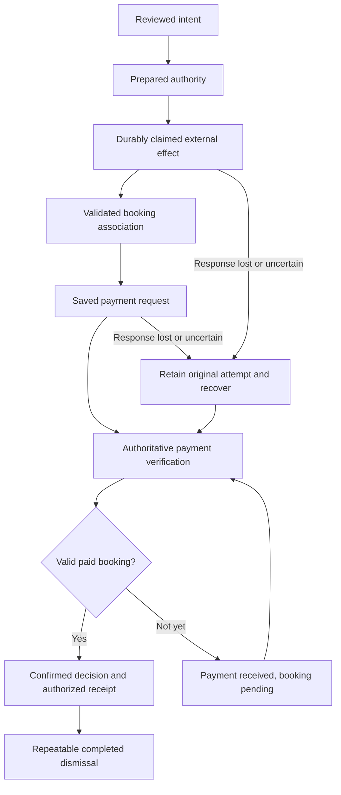

# Domain operation inventory and API contracts

This is the implementation contract for the current repository revision, not a public third-party API or proof that a route is enabled in client production. [Business rules](business-rules.md) owns invariants; [Complete journey](journey.md) owns sequencing and history. [Code owners](code-owners/index.md) expands the modules. When changing an operation, update its schemas, server owner, browser adapter, tests and this inventory together. Source links below are the exact validation/behavior owners, not alternative implementations.

## 1. Domain operation inventory

### Named service operation matrix

Each operation records its name, source status, permission policy and evidence owners. The rows below describe the current source, **not a new all-tests-passed or production-acceptance count**. Tests linked are relevant evidence owners; current run outcomes belong in Progress. Worker tests use isolated workerd/D1/DO and synthetic provider interception, not real SimplyBook/HitPay payment execution.

[Composition](../src/services/index.ts) selects booking/customerIdentity at build time; failed live requests never switch to demo. The separate `services.identity`, enquiry and assistant objects remain local demo implementations. The active public catalogue is `customerCatalogueService`, not the unavailable legacy `catalogueService`. The protected confirmation service handles live checks instead of the disabled generic booking check/resolve methods.

| Named operation                                     | Source status                       | Permission / policy                                                  | Implementation and API mapping                                                                           | Test evidence owners                                                                                                                                                                                                    |
| --------------------------------------------------- | ----------------------------------- | -------------------------------------------------------------------- | -------------------------------------------------------------------------------------------------------- | ----------------------------------------------------------------------------------------------------------------------------------------------------------------------------------------------------------------------- |
| `services.booking.restore`                          | Live adapter implemented            | Current owned access                                                 | [booking adapter](../src/services/booking.ts); GET booking/current                                       | [adapter tests](../src/services/async-booking.test.ts); [Worker native](../worker/tests/native.test.mjs); [customer browser](../tests/customer.spec.ts)                                                                 |
| `services.booking.publicCalendar`                   | Live adapter implemented            | Public configured display scope                                      | [booking adapter](../src/services/booking.ts); GET calendar/:month                                       | [adapter tests](../src/services/async-booking.test.ts); [catalogue](../worker/tests/catalogue.test.mjs); [customer browser](../tests/customer.spec.ts)                                                                  |
| `services.booking.calendar`                         | Live adapter implemented            | Current access and service scope                                     | [booking adapter](../src/services/booking.ts); GET booking/calendar/:service/:month                      | [adapter tests](../src/services/async-booking.test.ts); [Worker native](../worker/tests/native.test.mjs); [customer browser](../tests/customer.spec.ts)                                                                 |
| `services.booking.availability`                     | Live adapter implemented            | Current access and date/service scope                                | [booking adapter](../src/services/booking.ts); GET booking/availability/:service/:date                   | [adapter tests](../src/services/async-booking.test.ts); [Worker native](../worker/tests/native.test.mjs); [customer browser](../tests/customer.spec.ts)                                                                 |
| `services.booking.checkout`                         | Live adapter implemented            | Owner-bound intent/key; accepted selection                           | [booking adapter](../src/services/booking.ts); Prepare/reuse attempt; branch depends on holding          | [adapter tests](../src/services/async-booking.test.ts); [combined hold](../worker/tests/combined-hold.test.mjs); [customer browser](../tests/customer.spec.ts)                                                          |
| `services.booking.pay`                              | Live adapter implemented            | Owned grant, consent, durable effect fencing                         | [booking adapter](../src/services/booking.ts); Combined checkout/native/HitPay composition               | [adapter tests](../src/services/async-booking.test.ts); [HitPay](../worker/tests/hitpay.test.mjs); [customer browser](../tests/customer.spec.ts)                                                                        |
| `services.booking.check`                            | Unavailable in live adapter         | Fails explicitly; use protected confirmation service                 | [booking adapter](../src/services/booking.ts)                                                            | [adapter tests](../src/services/async-booking.test.ts)                                                                                                                                                                  |
| `services.booking.resolve`                          | Unavailable in live adapter         | Fails explicitly; use protected confirmation service                 | [booking adapter](../src/services/booking.ts)                                                            | [adapter tests](../src/services/async-booking.test.ts)                                                                                                                                                                  |
| `services.customerIdentity.current`                 | Local read                          | Current unexpired cached identity; no new server proof               | [identity adapter](../src/services/identity.ts); Memory read only                                        | [adapter](../src/services/identity.test.ts); [Worker identity](../worker/tests/identity.test.mjs); [delivery](../worker/tests/identity-delivery.test.mjs); [customer browser](../tests/customer.spec.ts)                |
| `services.customerIdentity.refresh`                 | Live adapter implemented            | Current capability; remembered family/expiry and response generation | [identity adapter](../src/services/identity.ts); POST access, GET identity, optional restore and re-read | [adapter](../src/services/identity.test.ts); [Worker identity](../worker/tests/identity.test.mjs); [delivery](../worker/tests/identity-delivery.test.mjs); [customer browser](../tests/customer.spec.ts)                |
| `services.customerIdentity.guest`                   | Live adapter implemented            | Server-issued guest capability                                       | [identity adapter](../src/services/identity.ts); POST access                                             | [adapter](../src/services/identity.test.ts); [Worker identity](../worker/tests/identity.test.mjs); [delivery](../worker/tests/identity-delivery.test.mjs); [customer browser](../tests/customer.spec.ts)                |
| `services.customerIdentity.challenge`               | Live adapter implemented            | Turnstile, scoped delivery and challenge limits                      | [identity adapter](../src/services/identity.ts); POST access and identity/challenges                     | [adapter](../src/services/identity.test.ts); [Worker identity](../worker/tests/identity.test.mjs); [delivery](../worker/tests/identity-delivery.test.mjs); [customer browser](../tests/customer.spec.ts)                |
| `services.customerIdentity.verify`                  | Live adapter implemented            | Matching challenge/email, valid code and current identity            | [identity adapter](../src/services/identity.ts); POST identity/verify then GET identity                  | [adapter](../src/services/identity.test.ts); [Worker identity](../worker/tests/identity.test.mjs); [delivery](../worker/tests/identity-delivery.test.mjs); [customer browser](../tests/customer.spec.ts)                |
| `services.customerIdentity.profile`                 | Live adapter implemented            | Current same-email identity                                          | [identity adapter](../src/services/identity.ts); GET identity/contact                                    | [adapter](../src/services/identity.test.ts); [Worker identity](../worker/tests/identity.test.mjs); [delivery](../worker/tests/identity-delivery.test.mjs); [customer browser](../tests/customer.spec.ts)                |
| `services.customerIdentity.saveProfile`             | Live adapter implemented            | Current same-email remembered consent                                | [identity adapter](../src/services/identity.ts); POST identity/contact                                   | [adapter](../src/services/identity.test.ts); [Worker identity](../worker/tests/identity.test.mjs); [delivery](../worker/tests/identity-delivery.test.mjs); [customer browser](../tests/customer.spec.ts)                |
| `services.customerIdentity.signOut`                 | Live adapter implemented            | Presented access or current verified email for all-device revocation | [identity adapter](../src/services/identity.ts); DELETE access or identity/all-devices                   | [adapter](../src/services/identity.test.ts); [Worker identity](../worker/tests/identity.test.mjs); [delivery](../worker/tests/identity-delivery.test.mjs); [customer browser](../tests/customer.spec.ts)                |
| `customerCatalogueService.read`                     | Live adapter implemented            | Configured public customer catalogue; bounded freshness              | [customer catalogue](../src/services/customer-catalogue.ts); GET catalogue                               | [adapter](../src/services/customer-catalogue.test.ts); [Worker](../worker/tests/catalogue.test.mjs)                                                                                                                     |
| `customerCatalogueService.peek`                     | Local cache read                    | Only unexpired display data; never write authority                   | [customer catalogue](../src/services/customer-catalogue.ts)                                              | [adapter](../src/services/customer-catalogue.test.ts)                                                                                                                                                                   |
| `catalogueService.read / liveCatalogueService.read` | Unavailable legacy adapter          | No silent fallback to demo catalogue                                 | [booking adapter](../src/services/booking.ts)                                                            | [catalogue adapter](../src/services/catalogue.test.ts)                                                                                                                                                                  |
| `protectedCheckoutService.context`                  | Server-connected implementation     | Owned access, requested mode/id, validated destination               | [confirmation service](../src/services/confirmation.ts); GET attempts/:id/checkout                       | [adapter](../src/services/confirmation.test.ts); [Worker runtime](../worker/tests/runtime.test.mjs); [HitPay](../worker/tests/hitpay.test.mjs); [protected UI](../src/features/booking/protected-confirmation.test.tsx) |
| `readConfirmation`                                  | Server-connected implementation     | Owned access, original check deadline/allowance                      | [confirmation service](../src/services/confirmation.ts); GET attempts/:id/confirmation                   | [adapter](../src/services/confirmation.test.ts); [Worker runtime](../worker/tests/runtime.test.mjs); [HitPay](../worker/tests/hitpay.test.mjs); [protected UI](../src/features/booking/protected-confirmation.test.tsx) |
| `readBookingReceipt`                                | Server-connected implementation     | Current access and verified receipt                                  | [confirmation service](../src/services/confirmation.ts); GET attempts/:id/receipt                        | [adapter](../src/services/confirmation.test.ts); [Worker runtime](../worker/tests/runtime.test.mjs); [HitPay](../worker/tests/hitpay.test.mjs); [protected UI](../src/features/booking/protected-confirmation.test.tsx) |
| `expireBooking`                                     | Server-connected implementation     | Owned attempt and authoritative release evidence                     | [confirmation service](../src/services/confirmation.ts); POST attempts/:id/expire                        | [adapter](../src/services/confirmation.test.ts); [Worker runtime](../worker/tests/runtime.test.mjs); [HitPay](../worker/tests/hitpay.test.mjs); [protected UI](../src/features/booking/protected-confirmation.test.tsx) |
| `dismissCompletedBooking`                           | Server-connected implementation     | Owned completed attempt; repeatable acknowledgement                  | [confirmation service](../src/services/confirmation.ts); POST attempts/:id/dismiss                       | [adapter](../src/services/confirmation.test.ts); [Worker runtime](../worker/tests/runtime.test.mjs); [HitPay](../worker/tests/hitpay.test.mjs); [protected UI](../src/features/booking/protected-confirmation.test.tsx) |
| `startSyntheticCheckout`                            | Preview only                        | Isolated synthetic server; no real payment/booking                   | [confirmation service](../src/services/confirmation.ts); POST /__experiment/attempts                     | [experiment browser](../tests/experiment.spec.ts)                                                                                                                                                                       |
| `bookingFromReceipt`                                | Local conversion                    | Caller supplies validated protected receipt                          | [confirmation service](../src/services/confirmation.ts)                                                  | [confirmation adapter](../src/services/confirmation.test.ts)                                                                                                                                                            |
| `services.enquiry.submit`                           | Local demo adapter; delivered:false | Validation only; no server delivery claim                            | [enquiry](../src/services/demo/enquiry.ts)                                                               | [service tests](../src/services/booking.test.ts); [customer browser](../tests/customer.spec.ts)                                                                                                                         |
| `services.assistant.reply`                          | Local deterministic adapter         | No external model, booking mutation or notification                  | [assistant](../src/services/demo/assistant.ts)                                                           | [service tests](../src/services/booking.test.ts); [customer browser](../tests/customer.spec.ts)                                                                                                                         |
| `services.identity.read`                            | Legacy local demo adapter           | Not the live customerIdentity authority                              | [demo identity](../src/services/demo/identity.ts)                                                        | [service tests](../src/services/booking.test.ts)                                                                                                                                                                        |
| `services.identity.challenge`                       | Legacy local demo adapter           | Not the live customerIdentity authority                              | [demo identity](../src/services/demo/identity.ts)                                                        | [service tests](../src/services/booking.test.ts)                                                                                                                                                                        |
| `services.identity.verify`                          | Legacy local demo adapter           | Not the live customerIdentity authority                              | [demo identity](../src/services/demo/identity.ts)                                                        | [service tests](../src/services/booking.test.ts)                                                                                                                                                                        |
| `services.identity.signOut`                         | Legacy local demo adapter           | Not the live customerIdentity authority                              | [demo identity](../src/services/demo/identity.ts)                                                        | [service tests](../src/services/booking.test.ts)                                                                                                                                                                        |
| `services.identity.profile`                         | Legacy local demo adapter           | Not the live customerIdentity authority                              | [demo identity](../src/services/demo/identity.ts)                                                        | [service tests](../src/services/booking.test.ts)                                                                                                                                                                        |
| `services.identity.saveProfile`                     | Legacy local demo adapter           | Not the live customerIdentity authority                              | [demo identity](../src/services/demo/identity.ts)                                                        | [service tests](../src/services/booking.test.ts)                                                                                                                                                                        |

### Server and operational responsibilities

| ID    | Operation and trigger                  | Owner / boundary                                                                                                                     | Durable or external effects                                                      | Guards and recovery                                                                                | Rules            |
| ----- | -------------------------------------- | ------------------------------------------------------------------------------------------------------------------------------------ | -------------------------------------------------------------------------------- | -------------------------------------------------------------------------------------------------- | ---------------- |
| OP-01 | Browse catalogue/month/day             | [Catalogue](../worker/customer-catalogue.ts), [public calendar](../worker/public-calendar.ts), [prebooking](../worker/prebooking.ts) | Provider reads, bounded display snapshots                                        | Snapshot expiry, configured account/service, date and eligibility; no booking authority from cache | BR-001, 002, 006 |
| OP-02 | Establish guest access                 | [Access](../worker/access.ts)                                                                                                        | D1 capability and HttpOnly cookie                                                | Server expiry/revocation and owner binding; a new guest never inherits revoked attempts            | BR-003, 004      |
| OP-03 | Request/verify email challenge         | [Identity delivery](../worker/identity-delivery.ts), [identity](../worker/identity.ts)                                               | Bounded Resend delivery, hashed challenge and verified identity                  | Turnstile, delivery scope, rate limits, expiry, single consumption, exact email                    | BR-003, 004      |
| OP-04 | Restore identity/save contact/revoke   | [Remembered identity](../worker/remembered-identity.ts), [profile](../worker/contact-profile.ts)                                     | Token rotation/revocation, consented minimal contact                             | Current identity and account/origin; no raw token export or cross-email prefill                    | BR-003–005       |
| OP-05 | Validate selection and prepare attempt | [Customer authority](../worker/customer-authority.ts), [native checkout](../worker/native-checkout.ts)                               | Durable attempt/grant intent                                                     | Key/intent/owner match, current policy and consent; explicit no-dispatch readback before retry     | BR-002, 007–009  |
| OP-06 | Create single/batch booking            | [Native checkout](../worker/native-checkout.ts), [dispatch](../worker/native-dispatch.ts), [journal](../worker/journal.ts)           | SimplyBook book or createBatch/book/closeBatch; durable effect/reference records | Claim before each write; validate complete association; uncertain writes retain evidence           | BR-007, 008, 014 |
| OP-07 | Create hosted payment                  | [HitPay hold](../worker/hitpay-hold.ts), [journal](../worker/hitpay-journal.ts)                                                      | HitPay request and saved handoff                                                 | Bind merchant/amount/currency/invoice/attempt; reserve once; no payment for incomplete batch       | BR-010, 011      |
| OP-08 | Read context/current attempt           | [Confirmation](../worker/confirmation.ts), [native checkout](../worker/native-checkout.ts)                                           | Protected state reads                                                            | Owner capability; retained state does not imply confirmed payment                                  | BR-004, 008, 013 |
| OP-09 | Check and reconcile outcome            | [Confirmation](../worker/confirmation.ts), [HitPay recovery](../worker/hitpay-recovery.ts)                                           | Provider reads and guarded accounting reconciliation                             | Original checking budget/deadline; paid plus valid booking before confirmation                     | BR-010–012       |
| OP-10 | Receive provider webhooks              | [HitPay webhook](../worker/hitpay-webhook.ts), [SimplyBook webhook](../worker/webhook.ts)                                            | Deduplicated receipt; scheduled recovery                                         | Independent signature contracts, scope/association validation; payload alone is not confirmation   | BR-010           |
| OP-11 | Expire/recover/dismiss                 | [Coordinator](../worker/coordinator.ts), [scheduled recovery](../worker/scheduled-recovery.ts)                                       | Durable recovery/release/dismissal state                                         | Authoritative financial evidence; no blind replay/refund; dismissal repeatable                     | BR-008, 011, 012 |
| OP-12 | Read protected receipt                 | [Receipt](../worker/receipt.ts)                                                                                                      | Authorized read; customer export actions retired                                 | Fresh access and validated receipt; cached browser state cannot authorize export                   | BR-004, 013      |
| OP-13 | Serialize/provider authentication      | [Queue](../worker/provider-queue.ts), [session](../worker/provider-session.ts), [token cache](../worker/provider-token-cache.ts)     | DO SQLite tokens and coordination                                                | Bounded queues/transport slots, scoped encryption, unchanged absolute expiry                       | BR-014–017       |
| OP-14 | Collect/export diagnostics             | [Diagnostics](../worker/diagnostics.ts), [telemetry](../worker/telemetry.ts)                                                         | Sanitized logs; optional OTLP export                                             | Redaction, sampling and bounds; no provider calls in exporter; activation separate                 | BR-018–020       |
| OP-15 | Deliver and recover deployment         | [Deployment](../scripts/deploy-cloudflare.mjs), [verified artifact](../scripts/verified-target-run.mjs)                              | Authorized CI deployment only                                                    | Exact revision/artifact, correct account/resources, immutable foundation, independent acceptance   | BR-021–032       |

Rule numbers resolve through [the stable rule index](code-owners/index.md#11-business-rule-to-owner-index). OP IDs describe responsibilities, not permission to invoke operations.

## 2. Common HTTP boundary

[worker/index.ts](../worker/index.ts) owns route matching, guards, response envelopes and dispatch. API requests require HTTPS and the configured `APP_ORIGIN`; a supplied Origin must match. Non-GET browser operations require the matching Origin. Signed webhook paths are dispatched before the browser mutation-Origin requirement, while retaining protocol/host and supplied-Origin checks. There is no general cross-origin API/CORS contract.

Only two query forms are accepted: daily availability GET `?refresh=1` and native booking POST `?hold=1`, on their exact routes. Other query parameters produce `400 unexpected_parameters`. Route attempt patterns accept 36 lowercase hex/hyphen characters; operation schemas additionally validate UUIDs where required. Service route IDs use 1–15 decimal digits starting nonzero. Month routes use `YYYY-MM` with month 01–12.

Normal JSON replies use `Content-Type: application/json`, `Cache-Control: no-store`, `X-Content-Type-Options: nosniff`, `Referrer-Policy: no-referrer` and `X-Request-ID`. `ApiError` replies are `{ "error": "machine_code" }` with their declared status. Unexpected exceptions return `503 {"error":"temporarily_unavailable"}` and sanitized diagnostics. There is no universal success envelope. Unsupported routes fall through to 404; method-specific routes may explicitly return 405, so callers must not assume every wrong method has the same response.

JSON body operations using `inputBody` require `application/json`, at most 4096 bytes and completion within one second. Bodyless routes reject a nonempty body (`413 payload_not_supported`); a stalled initial read is `408 request_body_timeout`. Signed webhooks have separate body readers. Do not send `{}` to a bodyless operation.

Access and remembered cookies are Secure, HttpOnly, SameSite=Strict, Path=/; access uses `__Host-soccerbot-access`. Cookies are server-issued capabilities, never values to log or embed in links. Browser adapters use same-origin credentials, no-store and reject redirects. Foundation/account/environment verification and configured operation windows apply in addition to the per-route guards.

## 3. Identity and profile contracts

| Method and path                    | Request                              | Success body / status                                                              | Guard, effect and failure owner                                                                                                   |
| ---------------------------------- | ------------------------------------ | ---------------------------------------------------------------------------------- | --------------------------------------------------------------------------------------------------------------------------------- |
| POST `/api/access`                 | No body                              | `{access:"guest"}`; 201 for new capability, 200 when existing access authenticates | [Access](../worker/access.ts); issues cookie, no email identity                                                                   |
| DELETE `/api/access`               | No body                              | `{access:"revoked"}` / 200; clears access and remembered cookies                   | Revokes presented authority; already-invalid access may be cleared safely                                                         |
| POST `/api/identity/challenges`    | `{email,botToken}`                   | `{challengeId,expiresAt,resendAfter}` / 200                                        | [Identity](../worker/identity.ts) and [delivery](../worker/identity-delivery.ts); access, Turnstile, scoped delivery, rate limits |
| POST `/api/identity/verify`        | `{challengeId,email,code,remember?}` | Verified `{email,expiresAt,remember}` / 200; cookie updates                        | UUID challenge, matching normalized email, six decimal digits, remember defaults false; consumes challenge                        |
| GET `/api/identity`                | No body                              | `{email,expiresAt,remember}` or `null` / 200                                       | Current access and proof window; null is no verified identity, not guest access failure                                           |
| POST `/api/identity/restore`       | No body                              | Restored identity or `null` / 200; possible cookie rotation                        | [Remembered identity](../worker/remembered-identity.ts); original lifetime and revocation remain authoritative                    |
| DELETE `/api/identity/all-devices` | No body                              | `{access:"revoked"}` / 200; clears cookies                                         | Current verified identity, including valid remembered restoration; invalid guest authority denied                                 |
| GET `/api/identity/contact`        | No body                              | `{email,contact:null\|{name,phone}}` / 200                                         | [Profile](../worker/contact-profile.ts); verified identity, account/origin and consent scope                                      |
| POST `/api/identity/contact`       | `{email,name,phone}`                 | `{email,saved:true}` / 200                                                         | Same-email current authority; consent predicates rechecked at storage boundary                                                    |

Challenge email is trimmed/lowercased, valid and at most 254 characters; botToken is 1–2048 characters. Contact-profile names are trimmed 2–80 characters; phone accepts an optional plus and digits/spaces/parentheses/hyphens, 8–24 characters with 8–15 digits. This profile payload is deliberately smaller than booking contact. Verification uses generic failure messaging; `verification_request_limited` is 429 and disabled delivery is 503. Do not infer a provider customer exists from a challenge response.

## 4. Catalogue and selection contracts

| Method and path                                  | Inputs                                         | Success / meaning                                                     | Authority                                                                        |
| ------------------------------------------------ | ---------------------------------------------- | --------------------------------------------------------------------- | -------------------------------------------------------------------------------- |
| GET `/api/catalogue`                             | No body/query                                  | Validated catalogue defined in [catalog.ts](../src/domain/catalog.ts) | [Customer catalogue](../worker/customer-catalogue.ts); configured provider scope |
| GET `/api/calendar/:month`                       | Month                                          | PublicCalendar below                                                  | Public display only; fixed display deadline                                      |
| GET `/api/booking/calendar/:serviceId/:month`    | Provider service and month                     | `{month,observedAtMs,dates:Availability[]}`                           | Protected access and configured calendar window                                  |
| GET `/api/booking/availability/:serviceId/:date` | Date `YYYY-MM-DD`, optional exact `?refresh=1` | Availability below                                                    | Protected access; refreshed display still does not authorize a write             |

[Schema owner](../src/domain/native-checkout.ts):

- **Offer:** `{serviceId,productServiceId?,serviceName,instructorId,instructorName,startMs,priceMinor,currency:"SGD"}`. Names are 1–256 characters; IDs follow [providerIdentifier](../src/domain/catalog.ts); milliseconds and minor-unit amounts are safe integers, start positive and price nonnegative.
- **Availability:** `{date,observedAtMs,offers:Offer[]}`; maximum 2,000 offers per day. Different instructors may offer the same start; these are alternatives for one shared studio, not additive capacity. The client groups them by date/start and retains the explicitly selected instructor ID. Exact duplicate offers remain invalid.
- **PublicCalendar:** `{month,serviceId,observedAtMs,displayExpiresAtMs?,dates:[{date,available,offers?}]}`; maximum 31 dates. Validation rejects duplicate/out-of-month dates, duplicate service/instructor/start offers and offers inconsistent with service/date/availability. Display-deadline validation applies.
- **Protected calendar:** maximum 31 Availability entries. A missing/empty/failing result is not permission to fabricate a free slot.

The public customer catalogue accepts the supported `developer` and `production` environment labels; it retains strict public-only fields, complete-data and expiry validation. Unknown environment labels remain invalid.

Production calendar selection requires explicit, distinct primary/premium service IDs from the sealed target mapping and an expected company login; it never defaults to staging service 2. Provider authentication selects production secret names and rejects a company mismatch. Developer selection retains service 2. Native grants and payment scopes can retain production identity for the explicitly configured client guest sandbox. Client grants require the S$108 base price, premium mapping, customer-choice scheduling and four-hour notice, without historical trial exceptions. This schema support does not authorize customer operations: production access remains disabled in target rendering/artifact validation.

Customer grants declare `providerSchedules: "customer-choice"`; prebooking validates the selected eligible trainer without picking one by order. Legacy finite trial contracts retain `"non-overlapping"` and reject simultaneous eligibility. Calendar reads include every active linked instructor in the validated catalogue. Work is limited to 96 instructor/range reads per service/calendar request (ranges contain at most 15 consecutive authorized dates); oversize work fails before availability dispatch. Ongoing customer reads use two lanes with serialized admission; finite experiments remain sequential. Responses allow at most 2,000 offers/day, 6,000 offers/calendar and 1,500,000 UTF-8 bytes/calendar, below durable snapshot row limits. Exceeding a bound, a missing trainer/date response or a failed sibling rejects the read without a partial cache entry. Explicit empty arrays remain valid closed-day evidence. Shared pending reads, 60-second freshness, account/revision isolation and invalidation fencing remain enforced. These short provider-read caches are separate from the shared display snapshots (30-minute original lifetime, approximately 15-minute scheduled refresh). Journalled booking dispatch removes only overlapping studio offers from the display snapshot. A pre-dispatch selection rejection removes only the selected trainer/service offer; price or transient-provider errors do not imply occupancy. Fresh authoritative day responses update that day without rebuilding the month or extending its lifetime. Cache maintenance cannot change a durable financial result. These are operational bounds, not unlimited roster capacity; a 31-day month permits at most 32 trainers by request count, and offer/payload/freshness limits can be tighter. Provider shared-resource capacity must be configured and owner-tested before enabling overlapping schedules.

## 5. Attempt preparation and booking/payment writes

| Method and path                         | Request                                                             | Result contract                                                                          | Effects / retry rule                                                                               |
| --------------------------------------- | ------------------------------------------------------------------- | ---------------------------------------------------------------------------------------- | -------------------------------------------------------------------------------------------------- |
| POST `/api/booking/prepare`             | PrepareInput below                                                  | 201; preparation result with `attemptId`, `state:"prepared"`                             | Durable intent/grant preparation; retain key and original identity                                 |
| POST `/api/booking/hold/:attemptId`     | PrepareInput, `holding:true`, key equals path UUID                  | 200; native execution result                                                             | Combined preparation and held booking path; not a harmless display read                            |
| POST `/api/booking/checkout/:attemptId` | PrepareInput, `holding:true`, `accepted:true`, key equals path UUID | 200; native execution result, saved handoff when established                             | Direct combined creation/payment composition; current checkout authority required                  |
| POST `/api/booking/native/:attemptId`   | No body; optional exact `?hold=1`                                   | 200; native execution result                                                             | Existing owned grant, not a new arbitrary booking; claimed writes cannot be blindly replayed       |
| GET `/api/booking/native/:attemptId`    | No body                                                             | `{attemptId,state,paymentAvailable:false}`                                               | Protected grant readback; state may expose `verifying` when retained creation evidence supports it |
| POST `/api/booking/hitpay/:attemptId`   | Exactly `{accepted:true}`                                           | 200; saved/created payment handoff result from [HitPay hold](../worker/hitpay-hold.ts)   | Current owner, verified held association and one reserved payment effect                           |
| GET `/api/booking/current`              | No body                                                             | `{state:"empty"}` or `{state:"prepared"\|"held"\|"checking",attemptId,contact,sessions}` | Owned active attempt restoration; session entries are Offer plus players                           |
| POST `/api/attempts`                    | No body                                                             | 503 `booking_prerequisites_blocked` after authentication                                 | Deliberately closed generic creation route; not a replacement for named operations                 |

**PrepareInput** ([nativePrepareSchema](../src/domain/native-checkout.ts)):

```ts
{
  key: string; // 16–128 ASCII letters/digits/underscore/hyphen
  contact: { name: string; email: string; phone: string;
             contactMethod: string; academy: string };
  accepted: boolean;
  holding?: true;
  sessions: { serviceId: string; instructorId: string; startMs: number;
              players: number; totalMinor: number }[];
}
```

The object and nested selection/contact objects are strict. Sessions contain 1–12 items; players 1–4; timestamps positive safe integers; totals nonnegative safe integers. `accepted` must be true unless `holding:true`. Combined checkout further requires consent true and key equal to the UUID path. Domain validation additionally checks contact, lead time, account, selection and price; schema-valid JSON alone is not authorized. [Contact owner](../src/domain/contact.ts) defines business validation rather than implying the plain string schema is sufficient.

**Native execution result read by the browser:** `{attemptId,state,paymentAvailable,checkout?,rejectedSessionIndex?}`. `attemptId` must match the original request; `rejectedSessionIndex`, when supplied, is an integer 0–11 and must reference the submitted selection. `selection_unavailable` and `restart_required` carry the rejected index; an `associated` result may carry a validated handoff. A payment still being checked can return `{attemptId,state:"checking",paymentAvailable:false}`. See [browser decoder](../src/services/booking.ts).

Native execution results are state-dependent saved results, not a guarantee that HTTP 200 means paid or confirmed. [executeNativeCheckout / nativeCheckoutStatus](../worker/native-checkout.ts), [coordinator composition](../worker/coordinator.ts) and the [service adapters](../src/services) own exact result branches. Read the protected context/status/receipt contracts for customer progression. Browser abort or response loss cannot roll back a provider effect. Explicit rejection with proven no dispatch may return to Review; uncertain writes retain original attempt/grant/reference evidence for recovery.

**HitPay handoff value:** `{url,expiresAtMs}` with URL at most 2048 characters and positive safe-integer expiry. Current [URL validator](../src/domain/native-checkout.ts) accepts the configured sandbox checkout host/path patterns; this is not a claim that production merchant URLs are enabled. Server stores and validates merchant/request/invoice/amount/currency association before handoff. Only the original booking payment step opts into Continue payment using this same URL and original expiry. The hosted-provider `/confirmation/` return route is confirmation-only and never displays a payment continuation button or timer, even while payment evidence is pending; this presentation restriction is not proof of payment. For an eligible original-page continuation, clicking adds no provider read or payment-creation request. The browser derives a client-only monotonic clock from the protected response Date header, conservatively accounting for second precision and request elapsed time. Countdown and click expiry use its conservative upper bound, while polling uses the arrival-based lower bound to avoid early requests; stored budget timestamps remain integer milliseconds. missing/invalid server time suppresses HitPay continuation. A countdown is advisory, not settlement proof; payment detection or expiry removes the action. The URL is sensitive checkout capability data and must not enter telemetry.

## 6. Protected confirmation, receipt and recovery

| Method and path                             | Input                                    | Output / effect                                             | Guard                                                                     |
| ------------------------------------------- | ---------------------------------------- | ----------------------------------------------------------- | ------------------------------------------------------------------------- |
| GET `/api/attempts/:attemptId/checkout`     | No body; optional `X-Booking-Details: 1` | CheckoutContext below, with supported display details       | Current owned access; context is not payment proof                        |
| GET `/api/attempts/:attemptId/confirmation` | No body                                  | Decision below plus checking headers                        | Shared server check budget, original deadline, provider verification      |
| GET `/api/attempts/:attemptId/receipt`      | No body; optional `X-Booking-Refresh: 1` | Verified Receipt from [receipt owner](../worker/receipt.ts) | Revalidate authority; display details carry no confirmation timestamp     |
| POST `/api/attempts/:attemptId/expire`      | No body                                  | `{expired:true}` after permitted release                    | Server evidence determines releasability; browser timeout is insufficient |
| POST `/api/attempts/:attemptId/dismiss`     | No body                                  | `{dismissed:true}` after permitted dismissal                | Repeatable completed dismissal; uncertain attempts stay protected         |

**CheckoutContext** ([browser runtime schema](../src/services/confirmation.ts), [server](../worker/confirmation.ts)):

```ts
{
  attemptId: string; mode: "synthetic" | "live";
  checkout: {state:"unavailable"} |
            {state:"available"; url:string; expiresAtMs?:number};
  summary: {players:number; totalMinor:number; currency:"SGD";
            sessions:{startMs:number; players:number}[]};
  checking: {deadlineMs:number; nextCheckMs:number; pollAfterMs:number;
             holdExpiresAtMs?:number};
  payment?: {status:"recorded"; paidAtMs:number};
  details?: BookingDetails;
  confirmation?: Receipt;
  customerConfirmation?: Receipt;
  expired?: boolean;
}
```

`pollAfterMs` is 1000–30000 in the response schema; this validation range does not override the tighter server checking policy. Summary has 1–12 sessions and 1–4 players. Client verifies the requested attempt/mode and accepted destination, not just JSON shape. `payment.status:"recorded"` alone does not imply a valid confirmed booking.

**Decision:** `{status:"confirmed",reason:"verified"}`, `{status:"pending"|"unresolved",reason,customerConfirmation?,expired?}`, `{status:"invalid",reason}`, or `{status:"denied",reason:"access_denied"}`. Authentication can also fail at HTTP level. Check responses can expose `X-Checking-Deadline`, `X-Next-Check`, `X-Checks-Remaining`; protected reads attach `X-Recovery-Trace` and `Server-Timing`. A 429 with remaining zero is exhausted, otherwise throttled; use supplied schedule without resetting the original window. No timeout/absence of webhook proves nonpayment.

**BookingDetails:** `{providerReferences?,attemptId,createdAtMs,totalMinor,taxMinor,contact,sessions}`; sessions are 1–12 Offers extended with players. Sum of session prices must equal total; tax cannot exceed total. **Receipt** adds `verifiedAtMs`. See [receipt schema](../src/domain/native-checkout.ts) and [provider-reference schema](../src/domain/provider-references.ts). Browser receipt validation compares protected evidence with the server clock when supplied; receipt exports never rely solely on a previous browser snapshot.

Export clicks send `X-Booking-Refresh: 1`; ordinary receipt display reads do not. When retained proof is stale, the coordinator admits read-only known-booking/invoice verification within the original checking deadline, sharing the durable 120-check ceiling and a minimum 10-second admission interval. The read has a 15-second bound shortened by the remaining window. Fresh stored proof needs no provider read. The response uses freshly validated proof without persisting it over the financial journal. Access, association, retained observation, payment state and deadline are rechecked after refresh. No historical saved receipt authorizes export. Errors include 409 `receipt_not_verified` / `receipt_verification_expired`, 429 `checking_throttled`, and provider-unavailable failures; none grants another payment or resets a deadline.

## 7. Webhooks, operator routes and scheduled work

| Surface                                                                                                                                            | Contract and scope                                                                                                                                                                                                                                                                                                                                                                                                                                                                                                                                                                                                   |
| -------------------------------------------------------------------------------------------------------------------------------------------------- | -------------------------------------------------------------------------------------------------------------------------------------------------------------------------------------------------------------------------------------------------------------------------------------------------------------------------------------------------------------------------------------------------------------------------------------------------------------------------------------------------------------------------------------------------------------------------------------------------------------------- |
| POST `/api/webhooks/hitpay`                                                                                                                        | JSON, raw bytes at most 32768 and five-second read bound. `Hitpay-Signature` is a 64-hex HMAC-SHA256 over raw bytes using configured salt. Body requires valid payment request `id`, optional reference_number 1–128 characters. Match stored payment scope before retention/recovery. 202 `{received:true}` acknowledges receipt, not settlement. Errors include 401 signature, 415 content type, 400 invalid event, 404 unknown request, 409 mismatch and 503 disabled. [Owner](../worker/hitpay-webhook.ts).                                                                                                      |
| POST `/api/provider/webhook` and `/api/provider/webhook/new_invoice`                                                                               | Separate SimplyBook `x-signature` and payload contract; route labels new_booking/new_invoice are not trusted proof of event or payment type. Bounded parsing, configured subscription/signing and association checks; 202 `{received:true}`. Never reuse the HitPay signing contract. [Owner](../worker/webhook.ts), [route owner](../worker/webhook-contract.ts).                                                                                                                                                                                                                                                   |
| GET `/api/health`                                                                                                                                  | Configuration/revision/versionId/origin/provider-access diagnostics and optional validated readiness-nonce echo. Credential **presence** booleans only. Environment comes from validated configuration. `foundationRegistration` is `registered` only after an exact identity match, or `pending` for an empty registration in production with every customer/provider/email/payment/warming switch explicitly disabled. Pending is installation diagnostics, not authorization or operational readiness; foreign identity, missing schema/bindings and enabled operations still fail. [Router](../worker/index.ts). |
| GET/POST `/api/developer/provider-identity`, `/historical-comparison`, `/native-field-discovery`, `/native-readback` (each under `/api/developer`) | Bodyless named diagnostic operations; [developerOperation](../worker/developer-operation.ts) owns operator authority and finite scope. Not customer endpoints and not blanket authorization for historical/provider operations.                                                                                                                                                                                                                                                                                                                                                                                      |
| POST `/api/developer/webhook-create` and `/api/developer/webhook-cleanup`                                                                          | Bodyless; 64-lowercase-hex Bearer credential hashed before coordinator dispatch, then operator/window guards. These change provider subscription state and require separately authorized execution.                                                                                                                                                                                                                                                                                                                                                                                                                  |
| Scheduler / DO alarms                                                                                                                              | No public HTTP endpoint: recovery, comments and optional display warming. Scheduler calls `noRetry`; failures produce bounded diagnostics, not blind platform replay. [Scheduler](../worker/index.ts), [recovery](../worker/scheduled-recovery.ts), [coordinator](../worker/coordinator.ts).                                                                                                                                                                                                                                                                                                                         |

Synthetic `/__experiment` tooling belongs to the isolated preview server and tests. It is not a production payment provider or an extra route on the Worker API. Server-exported journal/recovery functions are trusted composition interfaces, not publicly callable endpoints.

## 8. Errors, concurrency and compatibility

| Failure class                                    | Customer/operator interpretation                   | Safe handling                                                                       |
| ------------------------------------------------ | -------------------------------------------------- | ----------------------------------------------------------------------------------- |
| 400 validation / unexpected parameters           | Request contract rejected                          | Correct inputs; do not remove validation or expose raw provider errors              |
| 401/403 authority / origin                       | Capability expired/revoked/wrong owner or origin   | Hide protected details and re-establish permitted access; no cross-account fallback |
| 409 selection/grant/association conflict         | State no longer matches request                    | Read original protected evidence; distinguish no-start from uncertain dispatch      |
| 413/415/408 payload limits                       | Body too large, wrong content type or read timeout | Respect exact transport contract; no larger unbounded parser                        |
| 429 challenge/check limit                        | Abuse or original checking allowance               | Honor supplied timing; never refresh grants/deadlines to evade limits               |
| 503 queue/provider/configuration/unknown outcome | Unavailable does not mean effect absent            | Preserve original attempt; use bounded authorized recovery and incident evidence    |

The browser [BookingServiceError](../src/services/contracts.ts) vocabulary includes invalid_request, invalid_response, selection_unavailable, selection_changed, reservation_expired, checkout_window_blocked, checkout_not_started, queue_busy, payment_unavailable, conflict, unavailable, temporarily_unavailable and cancelled. These are adapter-level classifications, not a promise that Worker machine codes have identical names.

The account coordinator serializes workflows; queue priorities/capacity and separately bounded physical transports follow BR-015. Idempotency is implemented by durable owned attempts/grants/effects, not a generic `Idempotency-Key` HTTP header. A different browser key is not a remedy for uncertain payment. Maintain backward-compatible state/receipt readers during deployment; accepted migration history is immutable.

## 9. Verification ownership

[Worker tests](../worker/tests) cover access, identity, catalogue, combined hold, provider writes, recovery and signature boundaries with isolated synthetic providers. [Service tests](../src/services) cover parsing and browser adapter failure mapping. [Customer browser tests](../tests/customer.spec.ts) and [synthetic checkout tests](../tests/experiment.spec.ts) cover UI state/navigation under owner/CI browser execution. UAT is separated into [Admin](uat/admin.md), [Trainers](uat/trainers.md) and [Simulated user](uat/simulated-user.md). Green synthetic tests are not evidence of client configuration, live provider capacity or deployed acceptance.

## 10. Worked requests, responses and recovery decisions

These examples are fictional documentation fixtures, not captured traffic or instructions to send requests. IDs, names, amounts and timestamps illustrate the contract; they do not authorize a customer/provider operation. Cookies, bot tokens, signatures and payment URLs are deliberately omitted. Examples show relevant headers only; common response headers from section 2 still apply. All timestamps are epoch milliseconds unless a header says otherwise. Non-GET browser requests require the configured same-origin Origin, and JSON requests require `Content-Type: application/json`.

### A. Create guest access, then request email verification

`POST /api/access` has **no body**. A newly issued capability returns HTTP 201:

```json
{ "access": "guest" }
```

The server sets the protected access cookie; the browser does not read or manufacture its value. Reusing authentic existing access returns the same body with HTTP 200. `POST /api/identity/challenges` then accepts `{email,botToken}` only with a real validated bot token and permitted delivery scope. Illustrative HTTP 200 reply:

```json
{
  "challengeId": "11111111-1111-4111-8111-111111111111",
  "expiresAt": 1800000600000,
  "resendAfter": 1800000060000
}
```

No email or provider-customer lookup result is returned by this wire response. The browser adapter attaches its already-normalized requested email to its local challenge object. A verification request binds that challenge, the same email, six-digit code and remember choice; code values are not included in documentation fixtures. Wrong/expired verification does not fall back to unverified profile lookup. See [identity owner](../worker/identity.ts).

### B. Prepare a reviewed booking intent

Illustrative JSON for `POST /api/booking/prepare`:

```json
{
  "key": "22222222-2222-4222-8222-222222222222",
  "contact": {
    "name": "Example Customer",
    "email": "customer@example.com",
    "phone": "+6590000000",
    "contactMethod": "email",
    "academy": ""
  },
  "accepted": true,
  "sessions": [
    {
      "serviceId": "1",
      "instructorId": "2",
      "startMs": 1800014400000,
      "players": 1,
      "totalMinor": 8800
    }
  ]
}
```

The IDs/time/price must come from the configured current selection and pass provider/domain checks; these fixture values are not a real available slot or price quote. The same intent/key must be preserved for an uncertain result. Illustrative HTTP 201 preparation reply:

```json
{
  "attemptId": "22222222-2222-4222-8222-222222222222",
  "state": "prepared"
}
```

Prepared authority is not a booking, a held studio slot, payment or confirmation. For the combined checkout route, add `holding:true`, use the same key as the UUID path and require `accepted:true`; that path can create external effects and is not equivalent to a preview/read.

### C. Definitive request rejection versus uncertain checkout

`POST /api/booking/hitpay/:attemptId` with `{ "accepted": false }` fails before payment dispatch at that route, HTTP 400:

```json
{ "error": "payment_consent_required" }
```

Correcting consent still requires the original owned eligible attempt; this error does not authorize a new financial claim. For combined checkout, an authenticated rejection readback may classify a now-unavailable selection. Example HTTP 409:

```json
{ "error": "checkout_selection_unavailable" }
```

Return to editable selection/Review according to the adapter's classification. Do not generalize **every** 409 as “nothing happened.” If rejected preparation readback cannot establish a safe no-start outcome, the combined route can return HTTP 409:

```json
{ "error": "checkout_recovery_required" }
```

Retain the original attempt/key and protected recovery state. An HTTP 503 `temporarily_unavailable`, response loss or browser abort is also not proof of no provider effect. See [rejected readback](../worker/customer-authority.ts) and [combined composition](../worker/coordinator.ts).

### D. Checkout context without payment authority

`GET /api/attempts/22222222-2222-4222-8222-222222222222/checkout`, HTTP 200:

```json
{
  "attemptId": "22222222-2222-4222-8222-222222222222",
  "mode": "live",
  "checkout": { "state": "unavailable" },
  "summary": {
    "players": 1,
    "totalMinor": 8800,
    "currency": "SGD",
    "sessions": [{ "startMs": 1800014400000, "players": 1 }]
  },
  "checking": {
    "deadlineMs": 1800000780000,
    "nextCheckMs": 1800000002000,
    "pollAfterMs": 2000,
    "holdExpiresAtMs": 1800000900000
  }
}
```

Show protected summary/checking state, keep checkout unavailable and do not fabricate a payment URL. A later valid available context can expose its saved URL, but merely opening that URL does not confirm payment. The original server clocks remain in force across refreshes/tabs.

### E. Paid, but booking confirmation still pending

`GET /api/attempts/:attemptId/confirmation` can return HTTP 200:

```json
{
  "status": "pending",
  "reason": "payment_received_booking_pending"
}
```

Show payment received/booking pending and continue only permitted checking/recovery. Do not offer another payment or claim a confirmed receipt. Once current evidence establishes both payment and valid booking, the decision is:

```json
{ "status": "confirmed", "reason": "verified" }
```

This is a status decision, not the receipt payload. Read `/receipt` under current authority for protected receipt details. Customer PDF/calendar actions are retired. HTTP 409 `{ "error": "receipt_not_verified" }` means the required receipt evidence is not presently established; a prior UI success snapshot cannot bypass it.

### F. Shared checking limit and expired access

If the caller checks too early, HTTP 429 may include:

```http
X-Checking-Deadline: 1800000780000
X-Next-Check: 1800000010000
X-Checks-Remaining: 99
```

```json
{ "error": "checking_throttled" }
```

Wait for the permitted next check using the existing checking owner; do not introduce an independent retry loop. When the shared allowance is exhausted, `X-Checks-Remaining: 0` accompanies `checking_limit_reached`. Neither case authorizes a replacement attempt or new deadline. If access is expired/revoked, HTTP 401 can return:

```json
{ "error": "access_denied" }
```

Hide protected information and follow identity recovery. Do not substitute another cookie, saved customer identity or local receipt. [Confirmation adapter](../src/services/confirmation.ts) maps HTTP denial/throttling separately from successful JSON decisions.

### G. Signed webhook acknowledgement and repeatable dismissal

An authenticated, scoped provider event can receive HTTP 202:

```json
{ "received": true }
```

This acknowledges retained delivery; it does not promise final reconciliation, email delivery or paid booking. Duplicate delivery must not duplicate accounting. Invalid signatures are rejected; never retry a signature failure by removing verification.

After authoritative completion, bodyless `POST /api/attempts/:attemptId/dismiss` returns HTTP 200:

```json
{ "dismissed": true }
```

A lost acknowledgement can be reconciled/repeated under the same authority. Dismissal is not deletion of financial evidence and does not itself start a new booking.

### State transition interpretation



This is a cross-operation interpretation, not a replacement for individual persisted state enums. Every edge requires the owning server operation and its guards. HTTP success, an adapter state such as `associated`, and a confirmed booking are different facts.

### Closed-install management service contract

`FoundationManagement` (`worker/foundation-management.ts`) is an internal named Worker entrypoint reachable only through explicitly granted service bindings; the public HTTP router exposes none of these methods. All methods require production, all eight external-effect switches disabled, and exact expected account/database/coordinator name/location hint/source revision. `inspect` derives the real namespace ID without obtaining a stub and returns pending or matching registered state; foreign identity fails. `register` additionally requires that exact derived ID, inserts only an absent singleton and verifies the immutable winner after concurrent/repeated calls. `initialize` requires matching registration and invokes only the coordinator's `inspectFoundation` diagnostic through `coordinatorStub`. The diagnostic checks its own identity and returns ID, alarm, pending-wakeup count and unknown location; it performs no provider operations. Registration is management-owned and is never inferred from a public health request.

### Paid response confirmation evidence

After verified HitPay payment and current booking/invoice checks, recovery may use the authenticated SimplyBook accept-payment response as final evidence only when the existing invoice validator accepts the exact invoice, customer, currency, totals, processor, complete booking set, trainer/time/duration and confirmed nested bookings. The result is committed under the existing claim generation/version predicates before customer success. Incomplete or inconsistent response bodies retain the known-ID readback path; lost responses remain unknown and never trigger a duplicate write. The confirmed status DTO may include attempt-bound `customerConfirmation`; the UI can render it while the separate receipt request is pending. Export authorization and fresh-read requirements remain unchanged. Production response-shape and latency acceptance require an owner checkout; synthetic fixtures alone do not establish the fast path is used by the provider.

### Optional invoice document display metadata

Normalized invoice observations may contain optional `documentNumber` from the authenticated SimplyBook invoice `number` field. Receipt/context display DTOs may contain `providerReferences.invoiceNumber`; it is a trimmed, nonempty string of at most128 characters without ASCII controls. Normalization omits absent/invalid display metadata rather than introducing a payment-proof dependency. Receipt construction only projects a number whose observation invoice ID matches the retained association. Current payment/booking/account/currency/amount/lease checks remain unchanged.

The accounting fast path includes this metadata in the same durable publication; no additional provider read or expiry extension is added. Legacy observations/confirmations without the field remain readable. Protected receipt reads use current validated observation data within the existing authorization/window rules. Internal IDs remain in protected protocol/journal data for compatibility and reconciliation but are not customer-facing labels. The display number is never an idempotency key, calendar UID or substitute invoice identity.

At owner request, confirmed customer cards display optional `providerReferences.invoiceNumber` unchanged. Missing metadata or pending confirmation omits the label; internal invoice/booking IDs are never fallbacks. API `number` still requires comparison with the actual SimplyBook Pay document during full-flow UAT; display does not certify an SI prefix or contribute payment proof.
