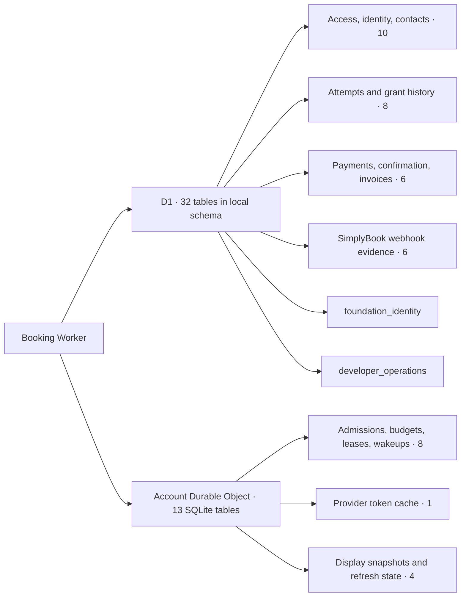
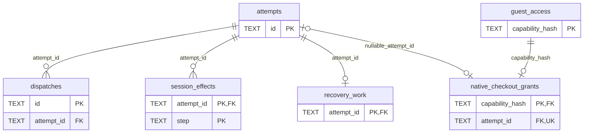
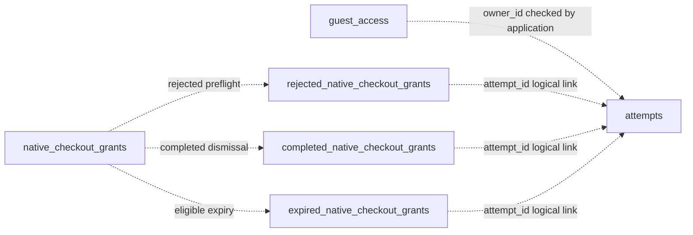
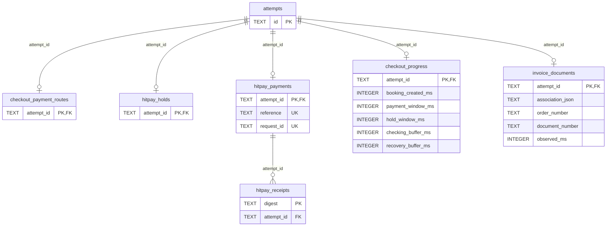
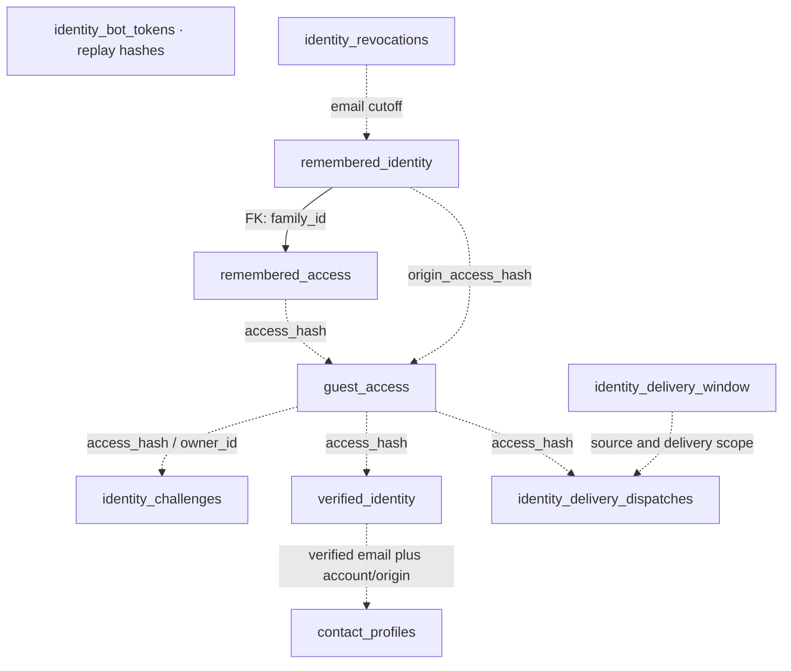
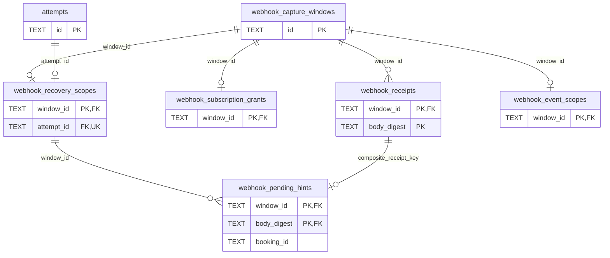
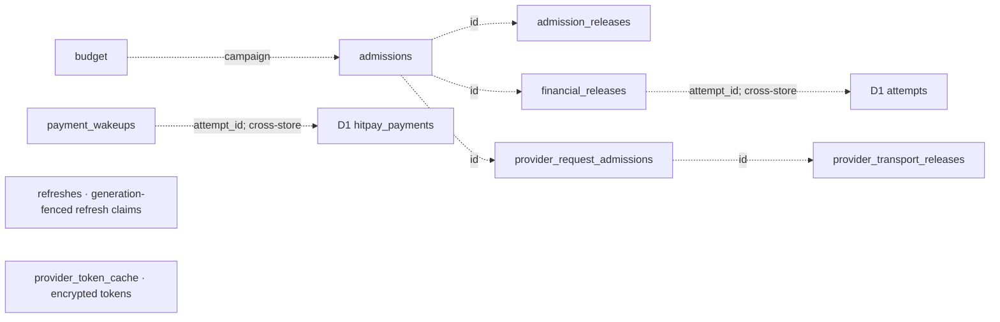
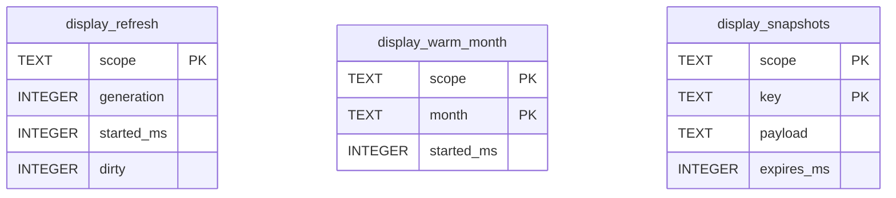

# Database schema

- **Source inventory:**32 application D1 tables;13 application SQLite tables in the account Durable Object.
  - D1 migrations0001–0038 define the current source; platform bookkeeping/test-only tables are excluded.
- **Deployment limit:** this is source structure, not a live database inspection or feature-activation claim.
  - Enquiry email delivery remains unimplemented.

- The schema source is [D1 migrations](../../migrations), [coordinator initialization](../../worker/coordinator.ts), [token-cache initialization](../../worker/provider-token-cache.ts) and [display-cache initialization](../../worker/display-snapshots.ts).
- Retention, expiry and deletion policy belongs to [Data lifecycle](../data-lifecycle.md); authorization and payment invariants belong to [Business rules](../business-rules.md).
- This document owns table structure and relationships only.

## Overview

- D1 retains booking/payment evidence; the Durable Object coordinates provider work and caches reads.

## Reading the diagrams

- These use **crow’s-foot ER notation**, a common format for relational database schemas.
- Chen notation uses relationship diamonds and is useful for conceptual modelling; it is not used here.
- At an ER line end, `||` means exactly one, `o|` means zero or one, and `o{` means zero or many.
- For example, `attempts ||--o{ dispatches` means an attempt can have many dispatches and each dispatch belongs to one attempt.

- ER diagrams show declared SQL foreign keys with solid relationships.
  - `PK` means primary key, `FK` foreign key and `UK` unique constraint/index.
  - Compound keys are named together in the inventories.
- Dashed arrows in flowcharts show application-managed links or archival actions, **not foreign keys**.
  - They do not assert SQL-enforced cardinality.
- ER fields are selected identifiers; the inventories list all tables and their keys.
  - Full columns, indexes, checks and triggers remain in the linked schema sources.
- Provider booking IDs, invoice IDs and scoped associations inside JSON are not local foreign keys to SimplyBook/HitPay.
  - D1 and Durable Object storage have no cross-database foreign keys.

## D1: Booking attempts and grant history

- Grant archival preserves records; it does not delete the underlying attempt or payment.

- The three archive tables use `CREATE TABLE AS SELECT`: they **do not inherit primary keys, foreign keys, NOT NULL or CHECK constraints**.
- Each has an explicitly created unique `attempt_id` index and update/delete-preservation triggers.
- `native_checkout_grants.attempt_id` is nullable until association; its active primary key is the capability hash.

| Table                              | Key                               | Purpose                                                                                  |
| ---------------------------------- | --------------------------------- | ---------------------------------------------------------------------------------------- |
| `attempts`                         | PK: `id`                          | Original booking intent, idempotency identity, provider associations and observed state. |
| `dispatches`                       | PK: `id`                          | Durable record of a dispatched operation, including an unknown result.                   |
| `session_effects`                  | PK: `attempt_id, step`            | Per-attempt operation steps and their retained provider references.                      |
| `recovery_work`                    | PK: `attempt_id`                  | Bounded recovery scheduling, claim generation and retry state.                           |
| `native_checkout_grants`           | PK: `capability_hash`             | Current capability-bound checkout authority and availability snapshots.                  |
| `rejected_native_checkout_grants`  | No PK; unique index: `attempt_id` | Preserved grant history after preflight rejection.                                       |
| `completed_native_checkout_grants` | No PK; unique index: `attempt_id` | Preserved grant history after leaving a completed booking.                               |
| `expired_native_checkout_grants`   | No PK; unique index: `attempt_id` | Preserved grant history after an eligible reservation expires.                           |

## D1: Payments, confirmation and invoices

- **Migration0038:** adds immutable `recovery_buffer_ms`, default0 for existing rows; new attempts record180000.
- It delays unpaid grant release without changing provider hold/payment validity.
- `checking.recoveryEndsAtMs` exposes the separate release-check boundary; `holdExpiresAtMs` retains the actual provider hold deadline.

- **Migration0037:** adds immutable `checking_buffer_ms`, default300000 for existing rows; new attempts explicitly record60000.
- It does not rewrite old timing or payment evidence.
- Deploy this additive migration before the new Worker; old code can continue using the extended table.

- **Migration0036:** `document_number` is nullable while the final paid document is unavailable.
- Its association is checked against the attempt by application code; the JSON column itself is not a foreign key.
- Updating display metadata does not update immutable `checkout_progress.confirmation_json` or authorize payment/booking success.
- See [invoice contract](../api-contracts.md#optional-invoice-document-display-metadata).

| Table                     | Key              | Purpose                                                                                    |
| ------------------------- | ---------------- | ------------------------------------------------------------------------------------------ |
| `checkout_payment_routes` | PK: `attempt_id` | Immutable choice of native or HitPay payment route for an attempt.                         |
| `hitpay_holds`            | PK: `attempt_id` | Original reservation scope, association and expiry used to guard payment.                  |
| `hitpay_payments`         | PK: `attempt_id` | HitPay request identity, verified payment evidence and accounting/recovery state.          |
| `hitpay_receipts`         | PK: `digest`     | Deduplicated authenticated HitPay webhook receipt digests.                                 |
| `checkout_progress`       | PK: `attempt_id` | Booking creation time, original windows, immutable recovery buffer and saved confirmation. |
| `invoice_documents`       | PK: `attempt_id` | Original unpaid number and later paid document number; optional display metadata (0036).   |

## D1: Access, identity and contact details

- Only `remembered_access.family_id → remembered_identity.id` is a declared foreign key in this group.
- Other identity relationships rely on application checks and, for linked revocation, triggers.
- Email is not globally unique across access rows; a contact profile is keyed by the complete account/origin/email tuple.
- `identity_bot_tokens` is an independent replay ledger, not a foreign-key child of a challenge.
- Email tables do not imply that delivery is currently enabled.

| Table                          | Key                             | Purpose                                                                     |
| ------------------------------ | ------------------------------- | --------------------------------------------------------------------------- |
| `guest_access`                 | PK: `capability_hash`           | Hashed browser access capability, owner and validity/revocation timestamps. |
| `identity_challenges`          | PK: `id`                        | Email verification challenges, hashed codes and attempt/rate-limit state.   |
| `identity_bot_tokens`          | PK: `token_hash`                | Consumed bot-verification token hashes for replay protection.               |
| `verified_identity`            | PK: `access_hash`               | Verified email identity attached to an access hash.                         |
| `remembered_identity`          | PK: `id`                        | Remember-me token family, rotation and fixed expiry/revocation state.       |
| `remembered_access`            | PK: `access_hash`               | Access hashes linked to a remembered family and restoration state.          |
| `identity_revocations`         | PK: `email`                     | Email-level revocation cutoff and operation identity.                       |
| `contact_profiles`             | PK: `account_id, origin, email` | Saved customer contact details scoped by account, origin and email.         |
| `identity_delivery_window`     | PK: `singleton`                 | Finite operator-authorized identity email delivery window.                  |
| `identity_delivery_dispatches` | PK: `id`                        | Identity-email dispatch history, including uncertain delivery.              |

## D1: SimplyBook webhook evidence

- The receipt-to-hint foreign key is the **pair** `(window_id, body_digest)`, not two independent links.
- `booking_id` is a provider reference validated by code, not a foreign key to a local bookings table.
- These capture/diagnostic tables are distinct from active HitPay receipts and do not themselves authorize reconciliation.

| Table                         | Key                          | Purpose                                                                    |
| ----------------------------- | ---------------------------- | -------------------------------------------------------------------------- |
| `webhook_capture_windows`     | PK: `id`                     | Bounded, explicitly authorized SimplyBook webhook capture windows.         |
| `webhook_receipts`            | PK: `window_id, body_digest` | Deduplicated receipt metadata and permitted payload shape within a window. |
| `webhook_subscription_grants` | PK: `window_id`              | Authority and outcomes for bounded subscription setup/cleanup.             |
| `webhook_recovery_scopes`     | PK: `window_id`              | An explicitly bound attempt for a capture window.                          |
| `webhook_pending_hints`       | PK: `window_id, body_digest` | Booking-ID hints awaiting matching against the bound attempt.              |
| `webhook_event_scopes`        | PK: `window_id`              | Immutable booking/invoice event selection for a capture window.            |

## D1: Deployment and operator authority

- Neither table has a declared foreign key.
- Foundation identity is checked against runtime bindings; operator capability authority is validated by the relevant operation owner.

| Table                  | Key                   | Purpose                                                                              |
| ---------------------- | --------------------- | ------------------------------------------------------------------------------------ |
| `foundation_identity`  | PK: `singleton`       | Singleton binding to the expected account, environment, D1 database and coordinator. |
| `developer_operations` | PK: `capability_hash` | Capability-bound operator actions, expiry and retained outcome.                      |

## Durable Object SQLite: coordination and tokens

- All nine tables below live in the same account coordinator's SQLite storage.
- **None declares a SQL foreign key.** Dashed links show IDs used by coordinator code; release records can outlive the active transport claim.

| Table                         | Primary key  | Purpose                                                                           |
| ----------------------------- | ------------ | --------------------------------------------------------------------------------- |
| `budget`                      | `campaign`   | Campaign provider-call usage and cooldown.                                        |
| `refreshes`                   | `key`        | Refresh claim, generation and completion/expiry timestamps.                       |
| `admissions`                  | `id`         | Reserved provider-call accounting and completion state.                           |
| `admission_releases`          | `id`         | Evidence for releasing a read admission.                                          |
| `financial_releases`          | `id`         | Attempt-bound financial admission release evidence.                               |
| `payment_wakeups`             | `attempt_id` | Durable payment-recovery wakeup, correlation, generation and `ready_ms` deadline. |
| `provider_request_admissions` | `id`         | Active transport claims, operation, instance, read-only flag and expiry.          |
| `provider_transport_releases` | `id`         | Recorded transport completion/release evidence.                                   |
| `provider_token_cache`        | `family`     | Token family, scope/expiry, encryption IV and ciphertext.                         |

- `refreshes` governs general refresh claims; `display_refresh` below governs public display snapshots.
- Their similar names do not mean shared rows or a foreign-key relationship.
- Token plaintext is not a schema field; tokens are encrypted before storage.

- The coordinator adds `payment_wakeups.ready_ms` to existing DO SQLite tables at initialization (default0 preserves immediate legacy wakeups).
- No D1 migration is required.
- `provider_token_cache` keeps its existing columns; its encrypted admin payload now includes rotating refresh material.
- Legacy access-only rows remain readable at their original expiry.
- Older binaries cannot restore the new encrypted payload and will fall back to authentication; do not restore a pre-consumption token-cache backup.

## Durable Object SQLite: public display cache

- These are cached calendar/catalogue reads, not booking or payment authority.

| Table                    | Primary key                 | Purpose                                                                                                          |
| ------------------------ | --------------------------- | ---------------------------------------------------------------------------------------------------------------- |
| `display_refresh`        | `scope`                     | Generation fences stale writes; legacy start/dirty columns remain compatible but no longer schedule warming.     |
| `display_warm_month`     | `(scope, month)`            | Last attempted warm per month; rotates failure/restart work without renewing snapshots.                          |
| `display_release_probes` | `(scope, attempt_id, date)` | Original grid starts, base deadline, bounded probe step and next read time; completed tombstones prevent replay. |
| `display_snapshots`      | `(scope, key)`              | Scoped calendar/catalogue payload and original read expiry.                                                      |

- The matching `scope` is an application-managed link, **not a foreign key**.
- Public display expiry does not release a provider reservation.
- Cache behavior belongs to [Technical behavior](../code-owners/technical-behavior.md); disposal/retention belongs to [Data lifecycle](../data-lifecycle.md).

## Constraint ownership

- A mix of database and application checks is intentional.
- Prefer database enforcement for structural invariants that must survive every writer: primary/foreign keys, uniqueness, valid scalar values and protected immutable fields.
- Application code validates authenticated ownership, provider evidence, JSON meaning and cross-store relationships.
- Conditional SQL updates, transactions and generation/version checks make concurrent state transitions atomic; a browser check alone is insufficient.

| Rule                                                                                     | Current enforcement boundary                                                                                                                                                 |
| ---------------------------------------------------------------------------------------- | ---------------------------------------------------------------------------------------------------------------------------------------------------------------------------- |
| Declared keys and allowed values                                                         | SQL primary/foreign keys, unique indexes and CHECK constraints; see migrations for exact coverage.                                                                           |
| Immutable original intent, association, confirmation and selected history/payment fields | SQL triggers plus application transition rules; not every column is immutable.                                                                                               |
| Owner access, exact provider scope, paid/confirmed evidence                              | Server validation and guarded SQL publication; provider facts cannot be established by a foreign key.                                                                        |
| D1 attempt references in Durable Object storage                                          | Application checks across stores; no cross-database foreign key is available.                                                                                                |
| Archive-to-attempt links                                                                 | Currently application-managed; archive tables lack inherited foreign keys. This is an explicit gap in structural enforcement, not a claim that foreign keys are unnecessary. |

- The archive tables are still used: completed/expired availability snapshots reconstruct confirmation details; completed dismissal and expiry paths recognise archived attempts; rejection preserves the old grant before allowing a new selection.
- Do not drop them because they lack foreign keys.
- Consolidating them or adding constraints requires a separate migration design, existing-data validation and regression coverage.
- Retention/deletion decisions remain with [Data lifecycle](../data-lifecycle.md).

## Schema boundaries and maintenance

- Immutable triggers protect original intent, association, saved confirmation and selected financial/history fields.
  - ER arrows cannot express those guards; consult the migration and [code owners](../code-owners/index.md) before changing a record.
- There is no local SimplyBook customer/service/trainer directory or relational bookings table.
  - Selections, contacts and provider evidence are retained in scoped JSON payloads; these may contain personal data despite generic column names.
- D1 history tables are preserved copies, not cascading children.
  - Expiry, dismissal and archival do not imply physical deletion.
- Temporary migration tables such as `native_checkout_grants_next`, `developer_operations_migrating` and `foundation_identity_upgrade` are replaced/renamed during migration; they are not additional final-schema tables.
- When changing migrations or runtime `CREATE TABLE` statements, rebuild the final schema in an isolated empty SQLite database, compare `table_info`, `foreign_key_list` and unique indexes, then update affected diagrams/inventories.
  - Verify upgrades and runtime behavior separately; a schema map is not migration acceptance.
- This map was checked by applying all36 migration files to an in-memory SQLite database and extracting the11 runtime table declarations into isolated SQLite databases.
  - No production/customer rows were read or changed for this document.
  - The existing application tests remain separate evidence.
