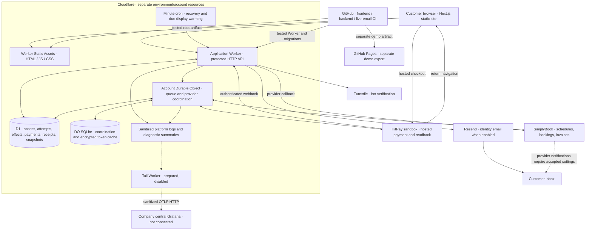
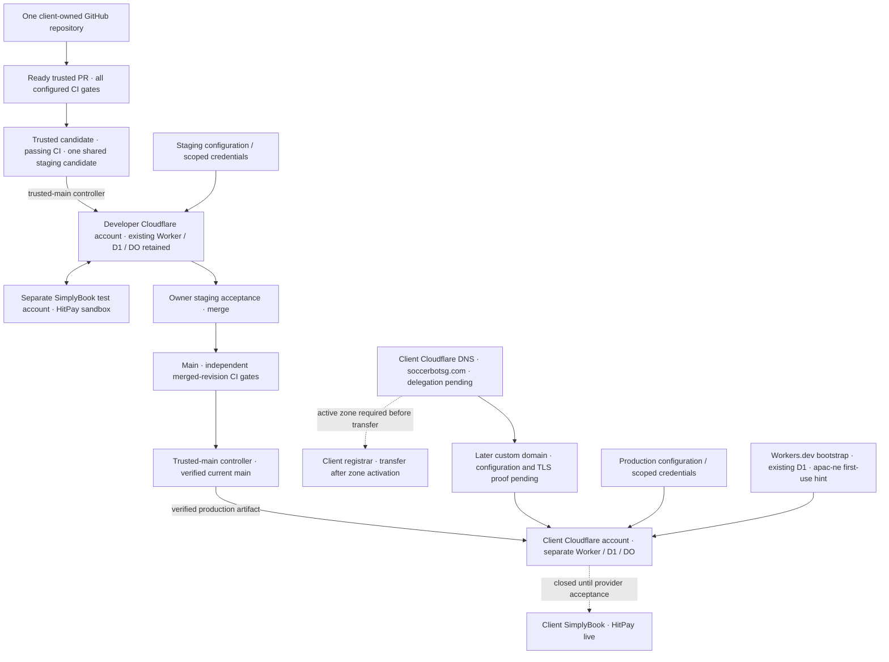

# Current system diagram

Application topology shared by developer staging and the separately installed client Worker. Client CI/deployment is operational; customer launch, domain routing and live provider acceptance remain pending. Dashed telemetry links are prepared but disabled/unattached. [Architecture decisions](adr.md) · [Database schema](database-schema.md) · [System rules](../business-rules.md#current-system-rules).

Reconciliation verifies provider state before confirmation; arrows do not imply parallel provider writes or that a callback proves payment. D1 and Durable Object SQLite are separate stores. The diagram shows current integrations, not authorization to provision or activate them.

## Client delivery topology

The client repository owns staging and production deployment; both paths have successful execution evidence in Progress. The initial client Worker uses its temporary Workers.dev hostname and the latest production release restores customer/provider access disabled. Domain hookup and activation are later steps. The runtime components above apply independently to each environment.

