# Booking scenarios and messages

- [Progress](../PROGRESS.md) owns current delivery status; this document owns scenario messages; [contracts](api-contracts.md) own proof and recovery rules.
- Diagrams and the current copy table below describe implemented behavior.
- The explicitly archived copy review is historical evidence, not the current message inventory.
- HitPay/bank screens are provider-owned; their return paths remain physical UAT.

## 1. Guest entry

- Continue as guest, then select sessions without creating an account.

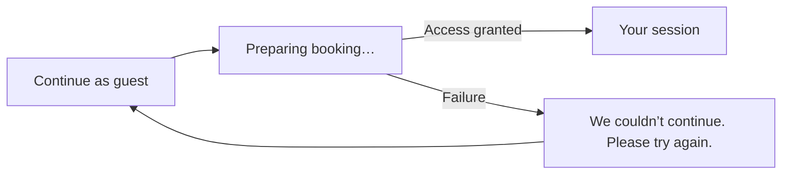

## 2. Email entry and verification

- Verify email before loading saved details; a code or service failure never grants access.

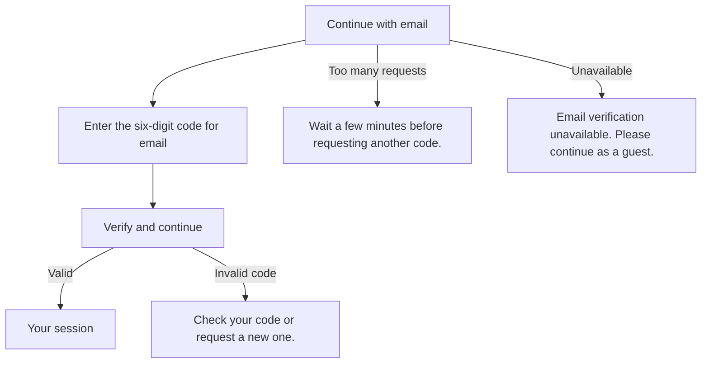

## 3. Expired or revoked access

- Identity and confirmation access use different messages; neither reveals a server revocation reason.
- Explicit access entry and checkout renew only a valid unexpired capability, preserving its owner.
- Expired/revoked access is not revived; payment, hold and checking deadlines remain independent.

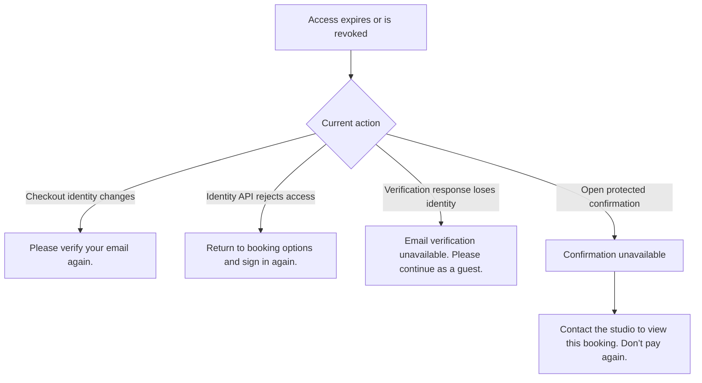

## 4. Session choice and calendar

- Choose the priced session card (one-third desktop width, full mobile width) to open player count and the three included features.
- The compact card stays in place with a blue selected highlight.
- Clicking reveals the full-width player control and three inclusions beneath the card grid; it does not replace the card or open a dialog.
- See available times continues from this view.
- Trainer choices share one studio and never add capacity.

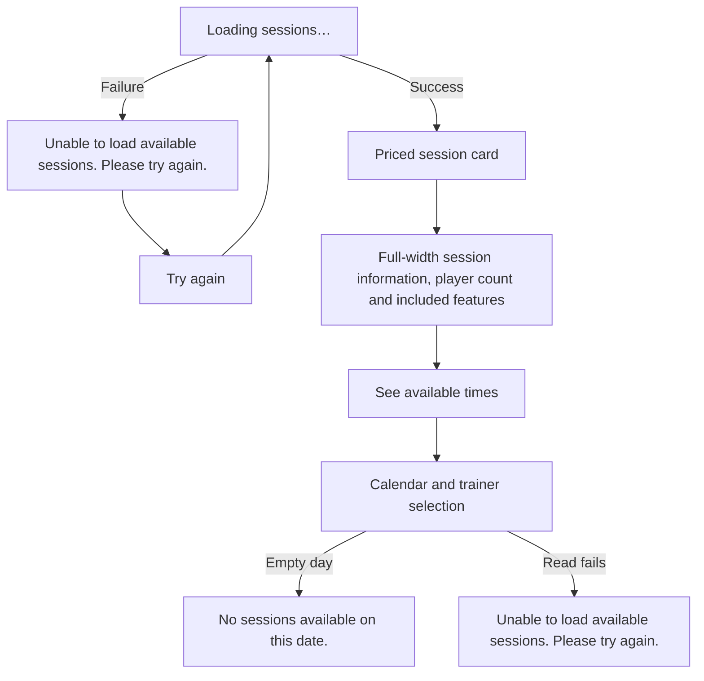

- Calendar Refresh remains available.
- A verified conflict removes overlapping studio offers across trainers from the affected cached day and removes rejected cart selection(s), retaining contact details and unaffected valid dates/months.
- It must not clear the whole calendar or wait for scheduled warming.
- Missing/expired snapshots and provider-delayed release can still require reads; a local timer never invents a free slot.
- See [capacity and recovery rules](business-rules.md#br-001).

## 5. Details and review

- Your details shows each session's small price right-aligned on its Trainer row.
- Review has Your sessions, Booking contact, and Order summary; the numbered date/time/trainer rows and per-session prices belong inside Order summary.
- There is no separate Dates & times section or aggregate “N × 40 min session” row.
- Edit links all read “Edit”.
- Final totals use a larger Total label and amount, with a muted SGD immediately to the left of the amount.
- There is no currency caption underneath.

- Saved contact details are not booking confirmation.
- Basket items have distinct boundaries/backgrounds, with the remove × at the top and a light-red cue; prices align right on the trainer row.

## 6. Checkout creation and rejected or uncertain writes

- Classify from protected evidence, not HTTP status alone.
- Same studio time is shared regardless of trainer or service.
- See the [recovery decision contract](api-contracts.md#conflict-recovery-decision-contract).

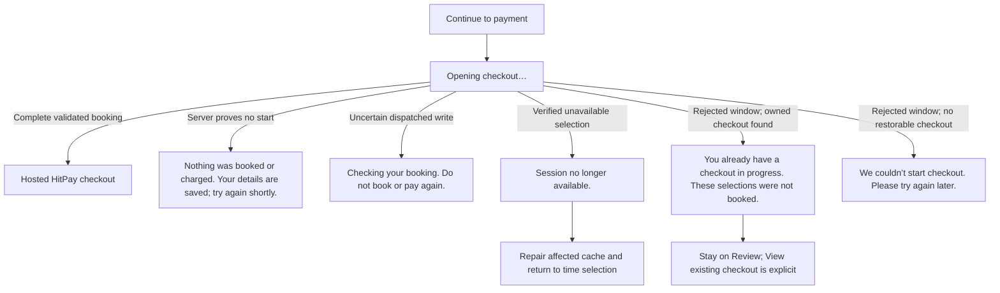

- Never silently replace the requested draft with another checkout.
- Unknown writes keep the original attempt and recovery identity; they must not become a new booking/payment retry.

## 7. Multi-session partial failure

- Payment is offered only for a complete validated batch; partial/unknown creation uses recovery.

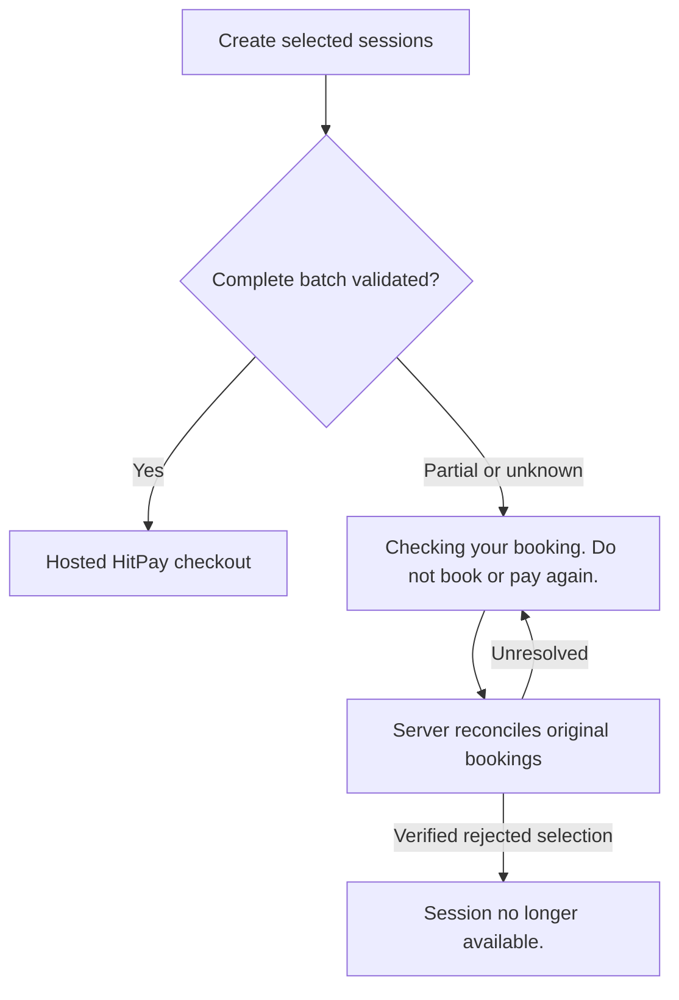

## 8. Back and Continue payment

- Payment and confirmation routes may reopen only the same server-authorized, unexpired unpaid HitPay link in the same tab.
- A completed return hint suppresses continuation immediately, but does not prove payment.
- Paid evidence, expiry and unresolved/denied states must not expose continuation.

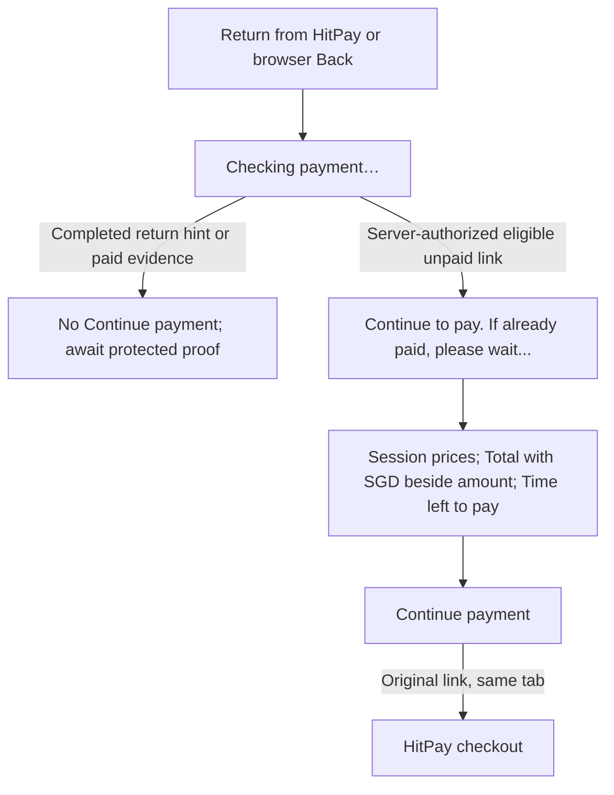

- The countdown is centred and bold above the button.
- Structured details persist into unresolved feedback; missing metadata never invents a trainer or per-session amount.

## 9. Card authentication and provider return

- HitPay handles issuer authentication; browser return alone never confirms payment.

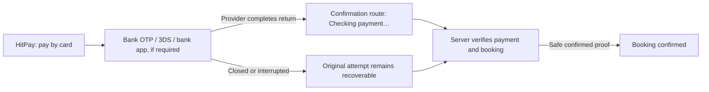

## 10. Payment and booking confirmation

- Paid evidence can show progress, but success and the invoice number require confirmed booking proof.

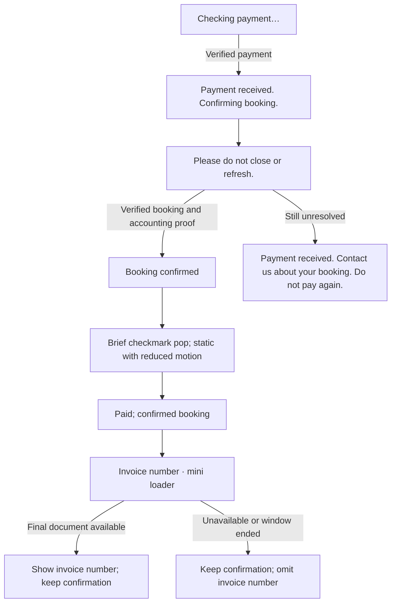

## 11. Temporary status failure

- A failed read offers status checking without treating it as a failed payment.

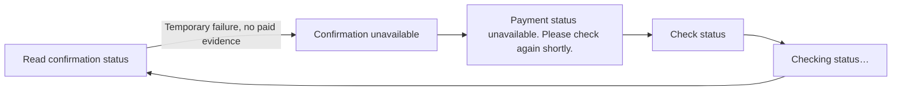

## 12. Unresolved payment or reconciliation

- An incomplete booking with no payment dispatch shows “Unable to complete this booking. Contact the studio for help with this reservation.” instead of a payment spinner.
- Automatic release of an attempt without a completed association is not implemented; changing this message does not resolve that recovery limitation.
- A known occupied start is classified using fresh provider availability even when its retained attempt lacks a completed association.
- No replacement write is permitted.

- After unresolved checking, Check status displays “Status checked. Payment is still unconfirmed.” after an unchanged result, a wait message when rate-limited, or a retry message after failure.
- The button is absent from the active automatic-checking layout.
- Structured booking details remain visible across the transition.

- Unknown payment uses a neutral notice; known paid evidence, including an authenticated `paid_booking_invalid` result, retains the payment-received wording.
- Check status shares the existing 30-second foreground recheck limit and cannot reset the original checking budget.

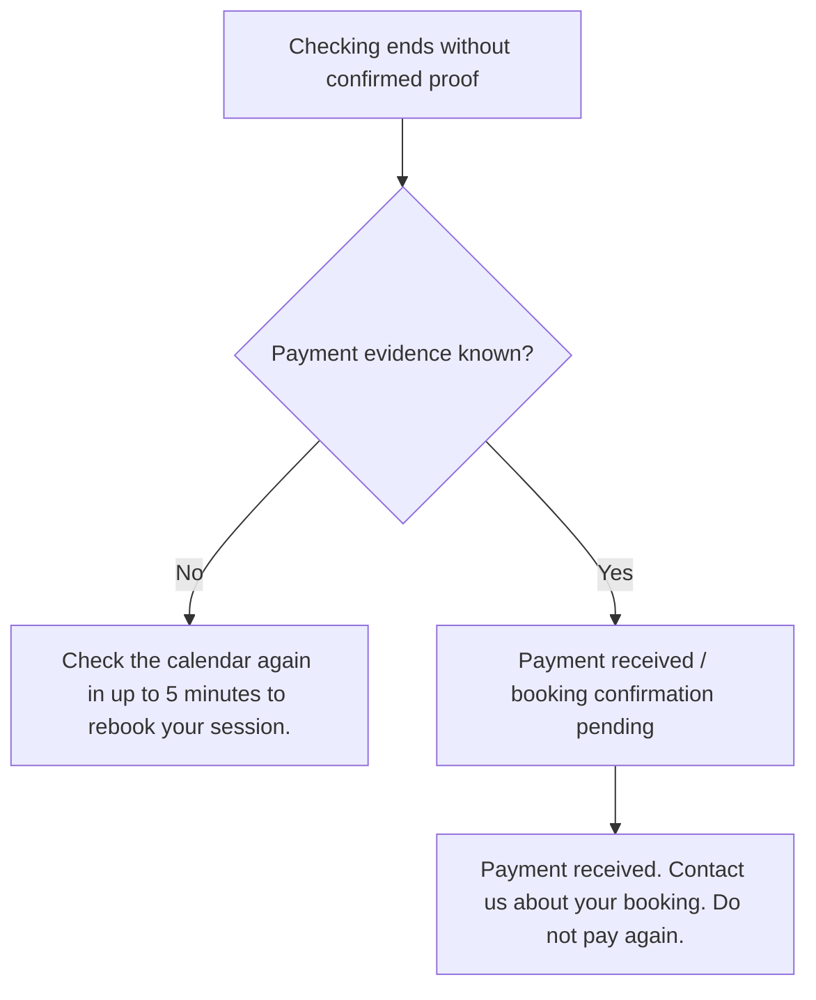

## 13. Expiry, grace and late payment

- A timer ending hides payment continuation; only verified releasable expiry permits a restart.
- New attempts use8 minutes to pay,1 further minute of checking and3 further minutes of recovery before grant release eligibility.
- The configured10-minute provider hold remains independently capped by invoice due time; cancellation may occur later.
- The recovery buffer does not extend payment or provider occupancy.
- Old attempts retain their windows.
- After the original recovery and hold deadlines, an authenticated matching expired/canceled request with an explicit empty list or only matching, zero-refund unstarted payment-method entries may release; ambiguous evidence and unprocessed receipts stay protected.
- The original financial journal is retained for late payment.
- The five-minute customer prompt is a recheck instruction, not a guarantee of provider release.
- Authoritative affected-day reads update retained calendar snapshots before return; a local timer never adds a session back.
- Bounded affected-day probes handle delayed provider release independently of browser life; the slot remains unavailable until current provider capacity permits it.

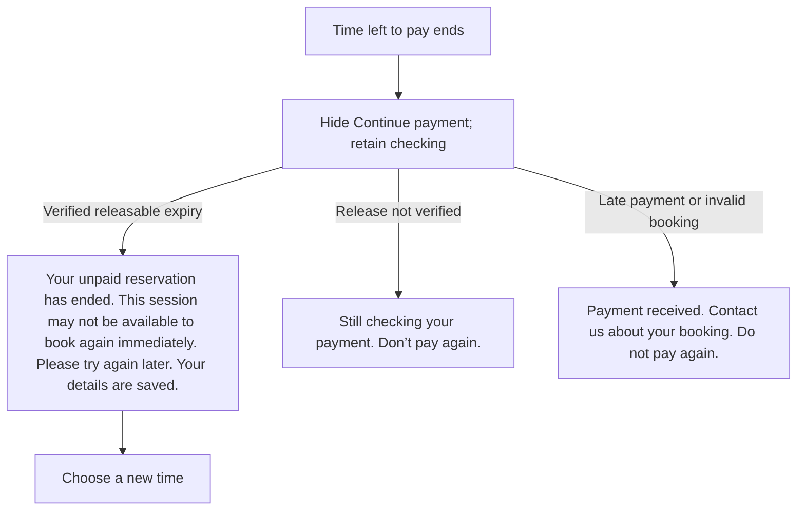

- Confirmation summary follows review: provider service name, player count without “per session”; each session uses “Trainer: <name>”.
- Supporting client/location/disclaimer details remain collapsed under View full details.
- The continuation countdown is centred and bold above its payment button.
- Missing validated display metadata never substitutes a guessed trainer.

## 14. Confirmed details temporarily unavailable

- A receipt-read failure does not undo verified confirmation or authorize another payment.

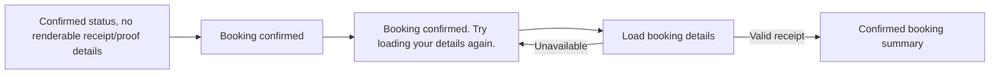

## 15. Saved confirmation and old links

- Each protected old link shows only its own booking; it cannot replace a newer active checkout.

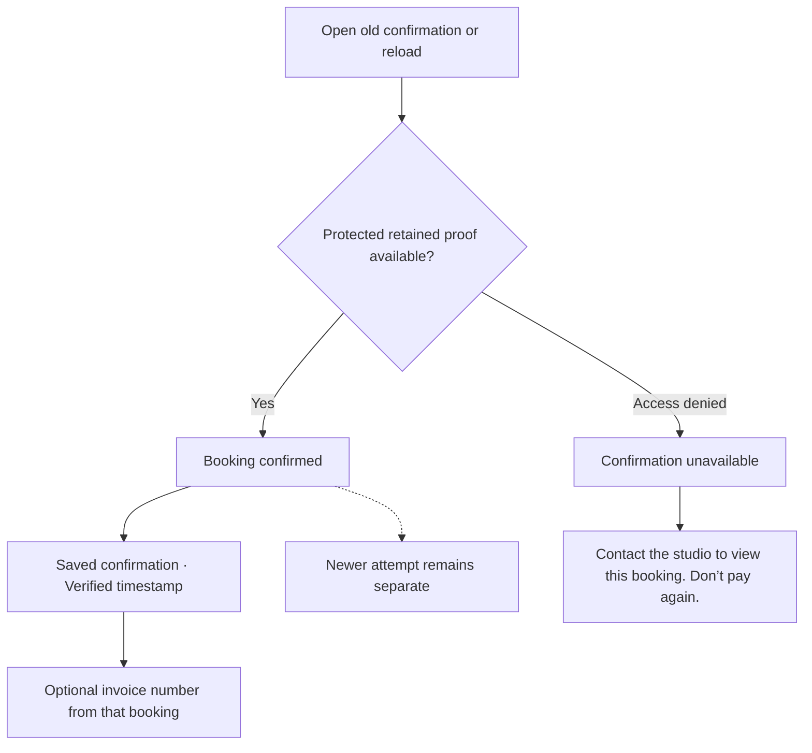

## 16. Make another booking and Back to home

- A completed receipt remains immutable.
- Leaving an older receipt must not silently adopt a newer completed booking, or discard a newer unpaid/uncertain checkout.

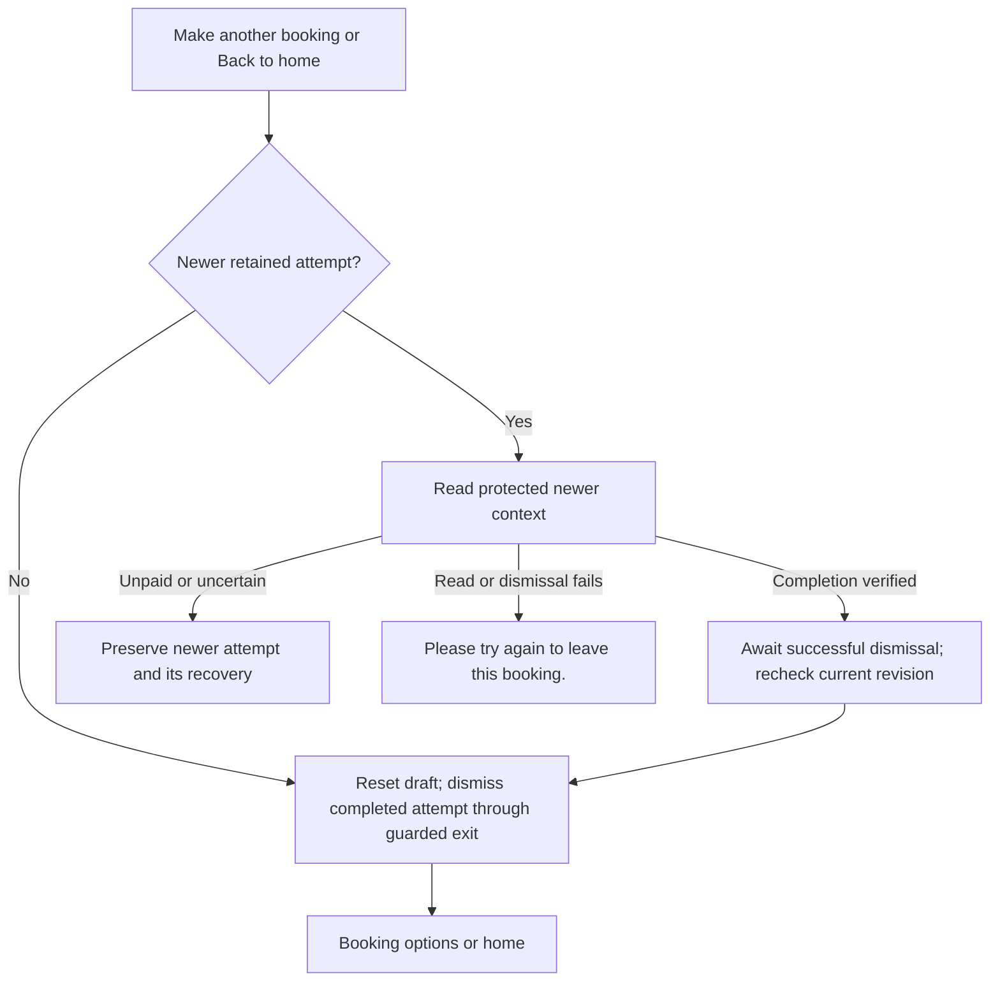

- The same-attempt exit uses the existing guarded background dismissal/retry; its failure can show “Unable to start a new booking. Please try again. Your confirmed booking is unchanged.” For a different newer completed attempt, dismissal must succeed before reset/navigation.
- Navigation never cancels a booking or resets payment deadlines.

## 17. Three complete journeys

- Retain one browser context through single → single → single or multi → single → single.

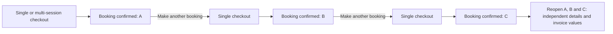

## 18. WhatsApp and staff action

- Contacting the studio requests a change; it does not automatically cancel, reschedule or refund.

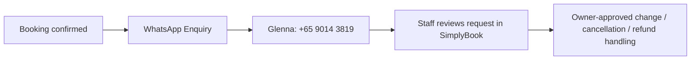

## 19. Preview-only payment states

- Preview messages are not proof of real payment or booking.

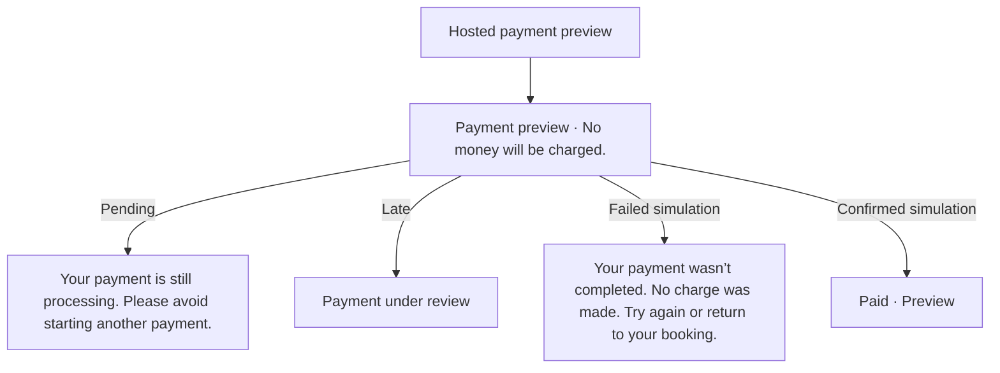

- Historical copy-review decisions: [Journey](journey.md#archived-copy-review-historical-baseline-and-disposition).

## Current changed copy and presentation

- These rows supersede historical baseline wording for the named paths.
- Deployment/test evidence belongs only in [Progress](../PROGRESS.md) and dated [Journey](journey.md).

| Surface / condition                                                              | Current copy or behavior                                                                                                                       | Source                                                                                                                                                           |
| -------------------------------------------------------------------------------- | ---------------------------------------------------------------------------------------------------------------------------------------------- | ---------------------------------------------------------------------------------------------------------------------------------------------------------------- |
| Proven unavailable session; basket unavailable selection; demo capacity conflict | Session no longer available.                                                                                                                   | [booking adapter](../src/services/booking.ts), [basket](../src/features/booking/summary.tsx), [demo](../src/services/demo/booking.ts)                            |
| Availability/catalogue read fails                                                | Unable to load available sessions. Please try again.                                                                                           | [shared copy](../src/domain/booking-messages.ts), catalogue and availability views                                                                               |
| Verified empty date                                                              | No sessions available on this date.                                                                                                            | [shared copy](../src/domain/booking-messages.ts), [time selection](../src/features/booking/time-step.tsx)                                                        |
| Rejected preparation with owned existing checkout                                | You already have a checkout in progress. These selections were not booked. / View existing checkout                                            | [provider](../src/features/booking/provider.tsx), [Review](../src/features/booking/review-step.tsx)                                                              |
| Rejected preparation without restorable checkout                                 | We couldn’t start checkout. Please try again later.                                                                                            | [booking adapter](../src/services/booking.ts)                                                                                                                    |
| Changed selection / price; uncertain payment                                     | Keep distinct existing evidence-specific feedback; do not replace with a proven session conflict                                               | [booking adapter](../src/services/booking.ts)                                                                                                                    |
| Manual status check, unchanged                                                   | Status checked. Payment is still unconfirmed.                                                                                                  | [protected confirmation](../src/features/booking/protected-confirmation.tsx)                                                                                     |
| Manual status check, rate limited                                                | Please wait a moment before checking again. Your booking is unchanged.                                                                         | [protected confirmation](../src/features/booking/protected-confirmation.tsx)                                                                                     |
| Manual status check, failed read                                                 | We couldn’t check your payment just now. Please try again in a moment.                                                                         | [protected confirmation](../src/features/booking/protected-confirmation.tsx)                                                                                     |
| Player App popup                                                                 | App Store / Google Play / Web App; owner-supplied destinations; clear borderless ×, no Not now footer or leftover gap; keyboard focus retained | [popup](../src/components/player-app-prompt.tsx), [dialog](../src/components/dialog.tsx)                                                                         |
| Session selection                                                                | Priced clickable card; click shows original full-width player selection and three inclusions                                                   | [session step](../src/features/booking/session-step.tsx)                                                                                                         |
| Details / Review / pending payment                                               | Small session prices right-aligned with Trainer; larger Total label and amount; muted SGD immediately left of the amount                       | [summary](../src/features/booking/summary.tsx), [Review](../src/features/booking/review-step.tsx), [confirmation](../src/features/booking/confirmation-step.tsx) |
| Confirmed session                                                                | Paid badge and paid amount align on Trainer row; supporting details collapsed under View full details                                          | [confirmation](../src/features/booking/confirmation-step.tsx)                                                                                                    |

- The first-visit app prompt supports ×, Escape and backdrop dismissal; dialog headings have unique accessible IDs and the close target remains 44px.
- The calendar allows only the current Singapore month plus two.
- Status/error notices remain separated from Continue by the shared spacing.
- No presentation change grants booking, payment or expiry authority.

- The three availability messages are owned by [booking-messages.ts](../src/domain/booking-messages.ts).
- Confirmed conflicts use the same singular “Session no longer available.” for single and multi-session requests, regardless of trainer.
- There is one studio and only one session at any time; trainer choice never creates separate capacity.
- A failed read is never rendered as an empty date or proven conflict.
- Global lack of an eligible session type is distinct from an empty selected date and retains “No sessions are currently available.”

## Public entry surfaces

- [Technical behaviour](code-owners/technical-behavior.md#public-homepage-and-studio-presentation) owns header/footer, media, curves, gradients, sizing, public motion and mobile booking-bar details.
- [Customer UAT](tests/uat/customer.md) owns task/expected-result checks;
  - CI and physical/provider acceptance remain separate.
- Outlet selection is presentation scaffolding for the existing single venue.
  - Session selection passes the existing `serviceId`; it does not create a new provider mapping or capacity pool.
- Booking components remain static except existing confirmation/invoice cues; public reveals/back-to-top do not run in booking, confirmation or experiment checkout.
