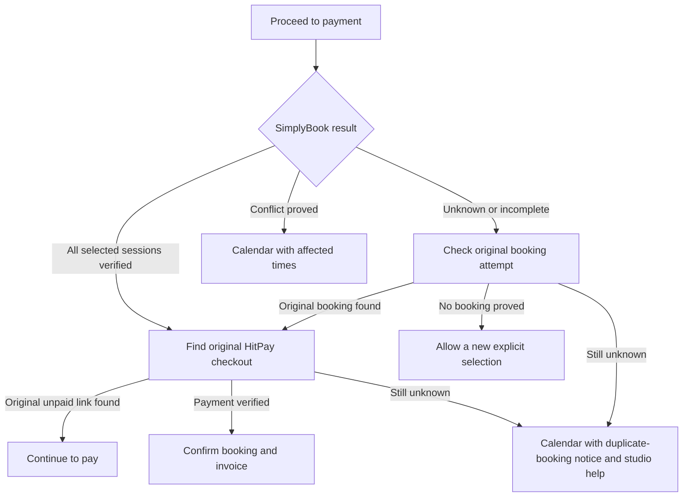

# Booking scenarios and messages

## Booking entry and four booking stages

| Page                | Customer action and result                                                                                                                                                                                                                            |
| ------------------- | ----------------------------------------------------------------------------------------------------------------------------------------------------------------------------------------------------------------------------------------------------- |
| Start your booking  | Continue as guest establishes access. Continue with email opens email entry. These pages and the code/saved-contact pages have no booking progress bar.                                                                                               |
| Continue with email | Email me a code runs the domain precheck and requests a code. The code page identifies the recipient, shows the expiry beside the field, and groups Spam/Junk guidance with Request another code. Successful verification opens the signed-in choice. |
| 1 · Session         | Choose the outlet, session type and player count. The sticky Continue action is visible and disabled until the required choices are made.                                                                                                             |
| 2 · Time            | Choose Weekly or Monthly, a date, time and eligible trainer. Each selected slot shows its trainer and remove control. Clear all clears the cart and collapses selected slots. Continue needs an eligible selection and a clear recovery path.         |
| 3 · Details         | Guest contact details require confirmation of the current email address. After blur or attempted submission, invalid fields show feedback. Review Booking focuses the first invalid control, including the email-check button when applicable.        |
| 4 · Review          | Review the selected sessions, contact, price and arrival information. The Terms and Conditions link works independently of consent. Acknowledgement and valid checkout proof are required to submit.                                                  |

- A checkout blocked by an existing attempt preserves the original booking access deadline. Expired booking access returns the customer to Start your booking with the red notice. An explicit fresh guest entry clears the notice and establishes new access. The original financial attempt retains its own evidence.
- On desktop and iPad the booking heading sits above progress, between Back and the right-aligned identity. Calendar shows the date beside the outlet and session type. On phone, controls and sticky actions retain their compact layout.
- During ordinary editing, the customer can navigate Back. After a financial submission, explicit booking navigation and re-entry check the original attempt. A stale cart or checkbox cannot authorize another submission.

## Checkout creation and recovery

| Event                                             | What the customer can do                                                                                                                                                                                                                              |
| ------------------------------------------------- | ----------------------------------------------------------------------------------------------------------------------------------------------------------------------------------------------------------------------------------------------------- |
| Submission rejected before any write              | Keep the eligible draft. If the server identifies a conflict, Calendar lists the affected sessions and preserves eligible survivors.                                                                                                                  |
| SimplyBook response lost or partial batch         | The original attempt stays protected while the server checks it. A free slot alone cannot clear it. Only a complete verified batch can proceed to payment.                                                                                            |
| Provider proves no booking was created            | Return to Calendar with contact details retained. Select again and acknowledge a new Review. A fresh eligible offer controls whether the original time appears.                                                                                       |
| SimplyBook rejects the email                      | Check the original session during the loader. If still eligible, return the guest to Contact details to correct the address. Otherwise show Calendar with the outcome and studio help. A verified member can request help with the read-only address. |
| Booking exists but HitPay link is missing         | Recover the original payment request. Finding a valid unpaid link restores Continue to pay. Finding paid evidence opens the original confirmation checks.                                                                                             |
| Still uncertain after the 30-second pre-link wait | Return to Calendar with the red duplicate-booking notice and studio help. The customer may browse or change selections. Enter contact details stays blocked until the original attempt resolves.                                                      |
| Back, refresh, Home and re-entry                  | Recover using the same attempt, link and deadlines. A verified active checkout in a different tab remains separate from a rejected tab’s draft.                                                                                                       |
| Ask the studio to contact me                      | Send the report for the original attempt and show the acknowledgement. A help request does not release the booking.                                                                                                                                   |

Edits made after Back affect the editable draft. When an unpaid checkout already exists, navigation recovers its original contact details, sessions, amount, payment link and deadline. After verified rejection with no booking, a corrected submission uses a new attempt.

After browser Back to Contact details, a conflict can finish checking while the customer edits. The next valid Review Booking action opens Calendar with one notice listing the affected sessions. Refresh keeps the notice. Once the customer leaves Calendar, the surviving sessions can proceed to Review.

The [business rules](business-rules.md#br-008) own read limits and release authority. The [API proof contract](api-contracts.md#verified-no-creation-resolution) describes what the server can conclude after a completed error or lost transport.

## Continue to pay, expiry and confirmation

| Event                                    | Customer outcome                                                                                                                                                                                                                   |
| ---------------------------------------- | ---------------------------------------------------------------------------------------------------------------------------------------------------------------------------------------------------------------------------------- |
| Eligible unpaid link                     | Continue payment reopens the original hosted checkout in the same tab. Show its original countdown. Site departures offer Stay or Leave. Browser Back may traverse history.                                                        |
| Payment deadline reached                 | Hide Continue payment and show the expiry loader. A verified unpaid release returns to Calendar, including after returning from HitPay in a fresh page. An inconclusive result retains the original attempt and shows studio help. |
| Replacement after expiry                 | The old cart clears. The customer can select eligible replacements, enter Details and acknowledge Review. Actual checkout waits for safe release. Restore a previous time only after fresh SimplyBook availability.                |
| Payment arrives during recovery          | Open the original confirmation flow. When payment is known but the booking or invoice remains unresolved, show Pending and studio help after bounded checking.                                                                     |
| Confirmed                                | Show Your booking, Location, session details, invoice number when supplied, amount, paid status and copy action. The customer can contact the studio through WhatsApp, book another session or go Home.                            |
| Receipt temporarily unavailable          | Keep confirmed status and offer to load the details again. Browser hints cannot establish paid or confirmed status.                                                                                                                |
| Invalid or inaccessible confirmation URL | Return Home. Old authorized confirmations show their own booking and preserve any newer active attempt.                                                                                                                            |

- Review and Confirmation share the arrival note, followed by four bullets in two columns. The copy action labels each session’s date, time, type, trainer and booking code when supplied. Codes stay paired with their original session when the summary is sorted; missing codes are omitted and later copies include codes received after confirmation. A single session has no numbered-list prefix.
- The original confirmation access window applies across reload. Leaving an old confirmation never dismisses a newer unresolved checkout.
- Owner-accepted expiry fallback (23 November 2026): when a fresh payment return has different saved session selections and the bounded display wait ends before the next status poll, it may return Home. Book now must enforce the original unpaid expiry release before a replacement checkout. In the recorded fallback, re-entry Calendar has no red expiry notice; this is accepted. Direct Calendar recovery retains its expiry notice. Home alone is not proof of a permanent booking block; verify re-entry and the distinct hosted checkout.
- After a confirmed booking, the customer can return to Calendar and submit a new selection from Review without first choosing an exit on the previous receipt. Browser Back, Home and opening a receipt never submit a checkout.
- For the exact expiry and post-payment clocks, see [BR-011 to BR-013](business-rules.md#br-011). For physical acceptance sequences see the [customer worksheet](uat/simulated-user.md).

## Public pages and enquiry

- Home, Studio, Enquire, Terms and Privacy share a sticky slogan banner. Booking and confirmation routes have no slogan banner. Inner public pages have a Back control (chevron only on mobile): return through same-tab site history, close a single-entry tab opened from this site when the browser allows it, otherwise fall back Home. Review consent links retain a separate tab and the original Review state.
- Enquire displays email, telephone/WhatsApp, address and hours above the form; its old shaped Home button is removed.
- Home and Studio use linked photo sections. Touch layouts alternate images and text. Full-page navigation retains the shared loader. The back-to-top control sits at bottom right and disappears at the top.
- The location popup gives the address, opening hours, lift diagram, food-court directions and Google Maps link. Visitors coming from the food court at #03-18 take the lift to Level 5, turn left and follow the route to #05-01.
- Enquiry validates after blur or attempted submission. Send enquiry focuses the first invalid field. Live success requires both staff and customer messages to be accepted by the delivery provider. Preview shows its own no-send acknowledgement.

## Customer message inventory

### Leaving a booking

The [leave dialog](../src/components/site-shell.tsx) opens with **Leave this booking?**

> Your selections and changes will not be saved.

When a booking attempt exists, a booking action is loading, or the customer is on confirmation, the dialog adds this paragraph:

> Any time slots we’re holding for you stay reserved until the payment timer ends. If you’ve already paid, leaving won’t cancel your booking.

**Leave booking** continues to the selected destination. **Stay** closes the dialog.

### Rejected contact email

The [email rejection notice](../src/features/booking/booking-help.tsx) shows the email used for the checkout attempt in place of `{email}`:

> **We couldn’t book your session using {email}.** Nothing was booked or charged.

If the session is still available, Contact details focuses the rejected address. A guest can correct it. A verified member sees their read-only address and can request studio help. On Calendar, one additional sentence pair appears before the spelling guidance, depending on the availability check:

| Session availability | Additional wording                                                                                              |
| -------------------- | --------------------------------------------------------------------------------------------------------------- |
| Unavailable          | Your selected session is no longer available. Choose another session, then check your email in Contact details. |
| Unknown              | We couldn’t verify the session’s availability. Check your email when you enter Contact details.                 |

All three versions end with:

> Check the spelling. If the address is correct, ask the studio for help.

The help action is **Ask the studio to contact me**.

### Conflict, expiry and payment

| Trigger                                                                              | Customer message                                                                                                               | Result                                                                                                                                                                                                   |
| ------------------------------------------------------------------------------------ | ------------------------------------------------------------------------------------------------------------------------------ | -------------------------------------------------------------------------------------------------------------------------------------------------------------------------------------------------------- |
| Proven conflict with affected sessions                                               | Some sessions may no longer be available. Please check again.                                                                  | Calendar immediately for authenticated indices, otherwise after fresh classification; show bullets, remove affected selections, retain others and hide affected windows pending fresh availability.      |
| Proven no-effects rejection without an affected index; classification pending/failed | Some sessions may no longer be available. Please check again.                                                                  | Keep initial loading through failed/partial reads; bounded paced retries finish all dates before Calendar. Refresh preserves the original snapshot and readiness gate.                                   |
| Refresh finds a different checkout or lacks exact tab ownership                      | Retain the existing conflict notice; do not create a new notice from another checkout.                                         | Calendar; never automatically adopt the other checkout.                                                                                                                                                  |
| Payment window ended, original attempt still resolving                               | Your payment window has ended. These sessions may not be available to book again immediately. Please try again later.          | Calendar, empty expired cart; original attempt retained. Other slots selectable; no recovery spinner or status controls.                                                                                 |
| Authoritatively released unpaid reservation                                          | Your payment window has ended. These sessions may not be available to book again immediately. Please try again later.          | Calendar; preserve new selections, restore hidden times only after fresh availability.                                                                                                                   |
| Released expiry with no original sessions                                            | Your payment window has ended. These sessions may not be available to book again immediately. Please try again later.          | Calendar selection.                                                                                                                                                                                      |
| Late payment detected during calendar recovery                                       | Payment received. Opening your booking status. Do not pay again.                                                               | Automatically open the original payment/confirmation route.                                                                                                                                              |
| Server proves checkout never started                                                 | Nothing was booked or charged. Your details are saved; try again shortly.                                                      | Clear undispatched attempt, keep editable draft.                                                                                                                                                         |
| Provider queue admission busy                                                        | Please wait a moment, then try again. Your details are saved.                                                                  | Retain same prepared attempt for retry.                                                                                                                                                                  |
| Repeated unpaid-reservation defence                                                  | New reservations are paused after repeated unpaid reservations. Please try again in up to 1 hour.                              | Server blocks another reservation; retain draft.                                                                                                                                                         |
| Lost/unknown checkout write                                                          | Checking your booking. Do not book or pay again.                                                                               | Original attempt retained; no blind replacement write.                                                                                                                                                   |
| Provider creation incomplete/uncertain                                               | We’re checking whether your booking was created. Please don’t book or pay again.                                               | Original attempt stays locked; automatic protected context reads observe recovery state. No new booking/payment retry is offered.                                                                        |
| Exact original attempt has verified terminal no-creation proof                       | Some sessions may no longer be available. Please check again.                                                                  | Calendar; clear old cart, consent and attempt, preserve contact/session preferences, require a new explicit booking. Unknown/failed reads never trigger this.                                            |
| Unresolved booking or payment link before handoff                                    | Checkout paused to prevent a duplicate booking. — Ask the studio to contact me                                                 | Calendar after the bounded creation wait; retain the original attempt and financial block. No standalone Payment Unavailable page or replacement write.                                                  |
| Temporary/malformed/unavailable payment-status response                              | Retain the appropriate loading or last authorized confirmation presentation.                                                   | No error flash during ordinary reads. Only exhausted post-payment recovery uses the red help notice above the confirmation details with Pending status.                                                  |
| Exhausted post-payment recovery                                                      | We couldn’t confirm your booking status. — Ask the studio to contact me                                                        | Existing confirmation structure with protected details and amber Pending status; retain the original attempt. Never a standalone notice/page.                                                            |
| Access denied                                                                        | Return Home                                                                                                                    | Hide protected details; stop unauthorized reads and cancel pending conflict classification. Preserve the original attempt/cart; late results cannot navigate.                                            |
| Payment received but booking pending, invalid or late                                | Payment received. We are still confirming your booking. Please contact us and do not pay again. — Ask the studio to contact me | After the bounded post-payment wait, use normal confirmation details with amber Pending status without a duplicate supporting sentence. No false confirmation, standalone heading or additional payment. |
| Expiry release remains unresolved                                                    | Retain the normal transition loader until the matching Calendar handoff; then the stable expiry notice.                        | Retry the same protected release operation automatically without a standalone release-error page. Financial uncertainty remains protected.                                                               |
| Confirmed booking, receipt/details unavailable                                       | Booking confirmed. Try loading your details again.                                                                             | “Load booking details” reads receipt only; never repeats payment.                                                                                                                                        |
| Confirmed-booking restart/dismissal fails                                            | Unable to start a new booking. Please try again. Your confirmed booking is unchanged.                                          | Keep the receipt available and offer to retry that exit.                                                                                                                                                 |
| Checkout retries a previously requested receipt exit and the retry fails             | Unable to start a new booking. Please try again.                                                                               | Wait for acknowledgement of that exit before submitting.                                                                                                                                                 |
| Confirmation exit action fails                                                       | Please try again to leave this booking.                                                                                        | Confirmation remains intact.                                                                                                                                                                             |

### Availability and general booking errors

| Trigger                                                            | Customer message                                                                           |
| ------------------------------------------------------------------ | ------------------------------------------------------------------------------------------ |
| Catalogue/calendar/day read fails / Adjacent displayed month fails | Unable to Load.                                                                            |
| No times on chosen date                                            | No sessions available on this date. Choose another date. Your selections are saved.        |
| No eligible session type                                           | No sessions are currently available.                                                       |
| Session type not chosen                                            | Choose your session.                                                                       |
| Session display metadata unavailable                               | Apex @ Henderson · Session details unavailable                                             |
| Session changes during availability read                           | Your session has changed. Please check availability again.                                 |
| Unavailable selected cart session                                  | Session no longer available.                                                               |
| Selected cart session started                                      | Session has started — remove to continue.                                                  |
| Five-session cart limit                                            | No limit banner; the five-session cap remains enforced.                                    |
| Live endpoint unavailable                                          | Online booking is unavailable. Your selections have been kept.                             |
| Operation unavailable/not enabled                                  | Online booking is not available yet. Please contact the studio.                            |
| Invalid request schema                                             | Please review your booking details.                                                        |
| Invalid/mismatched provider reply                                  | We couldn’t check this information. Please try again.                                      |
| Unclassified request failure                                       | We couldn’t complete that request. Please try again.                                       |
| Unclassified selection conflict                                    | Your booking details have changed. Please review your selected sessions before continuing. |
| Explicit request cancellation                                      | The request was cancelled.                                                                 |
| Interrupted status action                                          | The status check was interrupted. Your booking is unchanged.                               |
| Identity changes during operation                                  | Please verify your email again.                                                            |
| Invalid checkout consent/selection/service relationship            | Review your selection before starting checkout.                                            |

### Contact, selection and consent validation

| Condition                            | Validation message                                                  |
| ------------------------------------ | ------------------------------------------------------------------- |
| Missing/invalid full name            | Enter the booking contact’s full name.                              |
| Invalid email                        | Enter a valid email address.                                        |
| Email differs from verified identity | Use your verified email address.                                    |
| Invalid phone                        | Enter a valid mobile number.                                        |
| Invalid contact preference           | Select a contact method.                                            |
| Academy field too long               | Use no more than 120 characters.                                    |
| Empty cart                           | Choose at least one session.                                        |
| More than five sessions              | Choose up to 5 sessions per booking.                                |
| Invalid/out-of-window session        | Choose a valid session within the booking window.                   |
| Mixed/invalid session selection      | Review your selected sessions.                                      |
| Selected session started             | A selected session has started. Remove it and choose a future time. |
| Insufficient lead time               | Book sessions at least 4 hours before their start time.             |
| Overlapping sessions                 | Selected sessions must not overlap.                                 |
| Invalid booking options              | Review your booking options.                                        |
| Missing verified email               | Verify your email again.                                            |
| Invalid contact details              | Review your contact details.                                        |
| Missing review consent               | Review and accept the booking information.                          |

### Guest entry and optional email verification

| Trigger                                                     | Customer message                                                          |
| ----------------------------------------------------------- | ------------------------------------------------------------------------- |
| Unexpected email or other identity-action error             | We couldn’t continue. Please try again.                                   |
| Guest access rejected, unavailable, missing or malformed    | We couldn’t start your booking. Please try again.                         |
| Guest access rate-limited                                   | Too many booking requests. Please wait a few minutes and try again.       |
| Missing/expired security proof                              | Complete the security check and try again.                                |
| Wrong/expired verification code                             | Check your code or request a new one.                                     |
| Identity rate limit                                         | Too many code requests. Try again later.                                  |
| Identity access denied                                      | Return to booking options and verify your email again.                    |
| Missing site key / unavailable or invalid identity response | Email verification unavailable. Please continue as a guest.               |
| Signed-in identity cannot be revalidated                    | Verify your email again.                                                  |
| Remembered-profile requirement not met                      | Select Remember me and verify your email to save details.                 |
| Save remembered contact fails                               | We couldn’t save your details. Please try again.                          |
| All-device sign-out requires fresh access                   | Verify your email again, then choose Sign out all devices.                |
| All-device sign-out fails                                   | Could not sign out all devices. Please try again.                         |
| Background sign-out cannot finish                           | Could not finish signing out. Please try again.                           |
| Protected action follows failed background sign-out         | Sign-out could not be completed. Return to booking options and try again. |
| Browser sign-out fails                                      | Could not sign out this browser. Please try again.                        |

### Successful and foreground progress states

- During foreground checkout, the loader announces the operation and shows “Please do not close or refresh.” Background checks let visitors continue using Calendar.
- For an unpaid link, a verified receipt or an expired payment window, see [Continue to pay, expiry and confirmation](#continue-to-pay-expiry-and-confirmation).

### Archived checkout release recovery

If restoration finds no current booking but this tab retains an expired submitted checkout, protected release must succeed before the tab starts another checkout. A failed or timed-out release returns to the existing protected recovery screen, which owns retries and payment checks. Successful release clears only the matching checkout correlation and returns to Calendar for a new selection.
