# Booking scenarios and messages

Local source map, 2 November2026; [Progress](../PROGRESS.md) owns deployment/test status, this document owns scenario messages and copy decisions, and [contracts](api-contracts.md) own proof and recovery rules. Diagram messages reflect source, including unapproved wording that remains unchanged. HitPay/bank screens are provider-owned; their return paths remain physical UAT.

## 1. Guest entry

Continue as guest, then select sessions without creating an account.

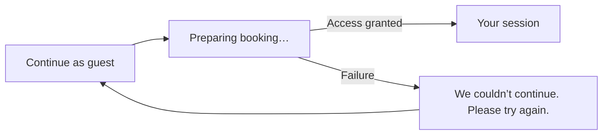

## 2. Email entry and verification

Verify email before loading saved details; a code or service failure never grants access.

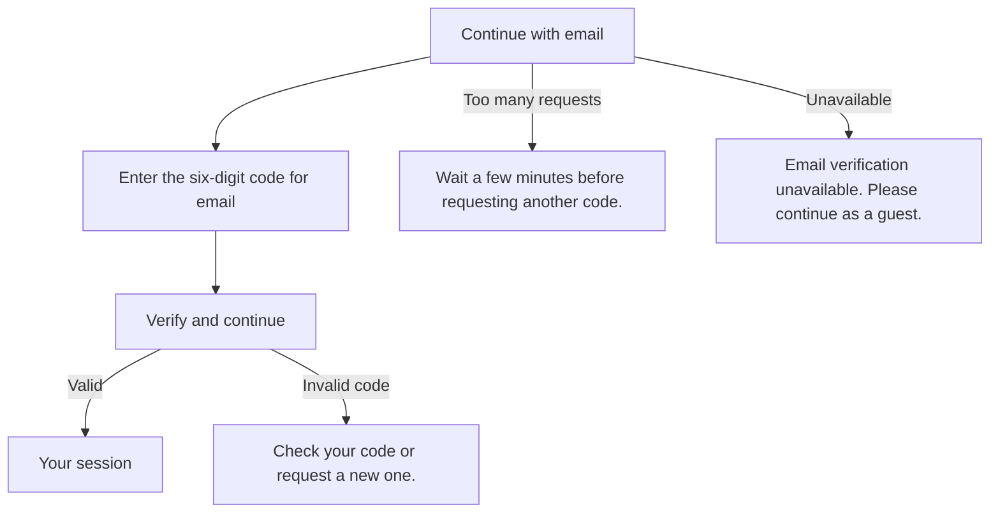

## 3. Expired or revoked access

Identity and confirmation access use different messages; neither reveals a server revocation reason.

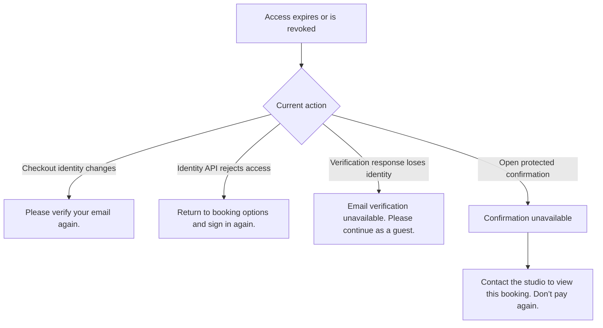

## 4. Catalogue and calendar

Unavailable data keeps selections without pretending a time is bookable.

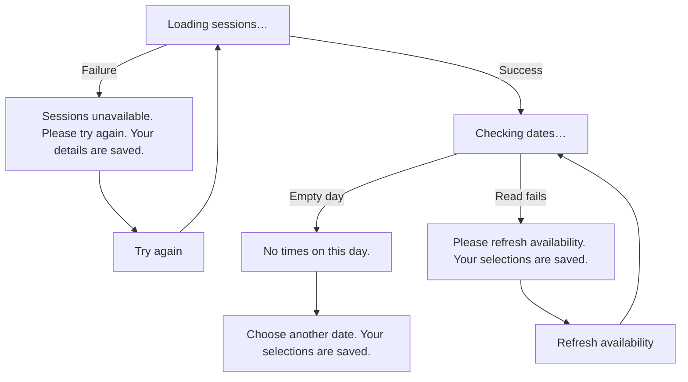

## 5. Details and review

Correct validation errors before checkout; saved details are separate from a confirmed booking.

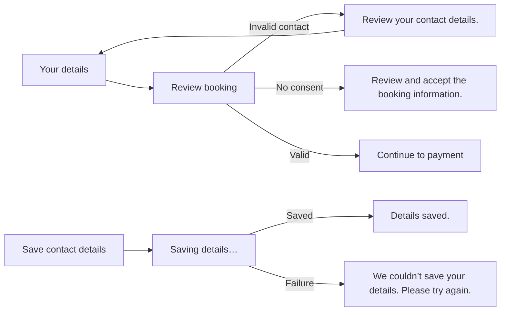

## 6. Checkout creation and uncertain writes

An uncertain booking write retains its original attempt instead of inviting another booking or payment.

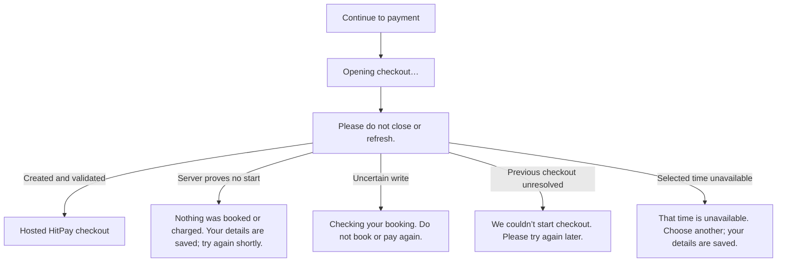

## 7. Multi-session partial failure

Payment is offered only for a complete validated batch; partial/unknown creation uses recovery.

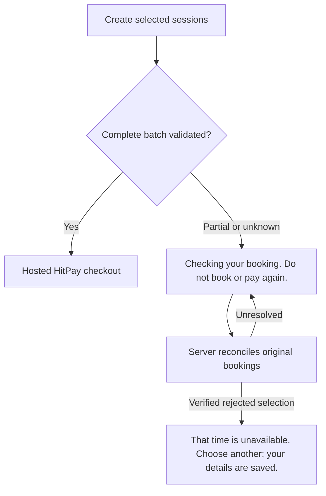

## 8. Back and Continue payment

The original payment page can reopen the same unexpired link in the same tab.

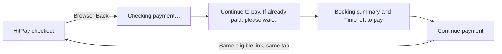

## 9. Card authentication and provider return

HitPay handles issuer authentication; browser return alone never confirms payment.

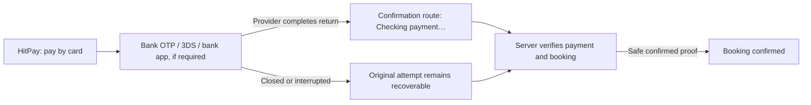

## 10. Payment and booking confirmation

Paid evidence can show progress, but success and the invoice number require confirmed booking proof.

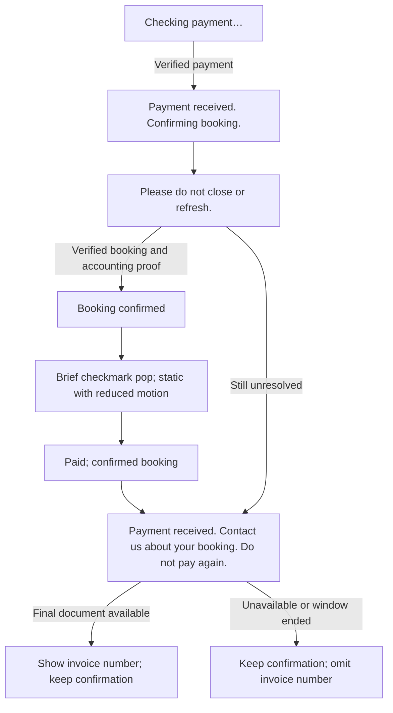

## 11. Temporary status failure

A failed read offers status checking without treating it as a failed payment.

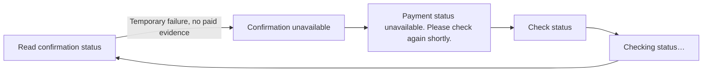

## 12. Unresolved payment or reconciliation

After unresolved checking, the message distinguishes verified payment from an unknown payment outcome.

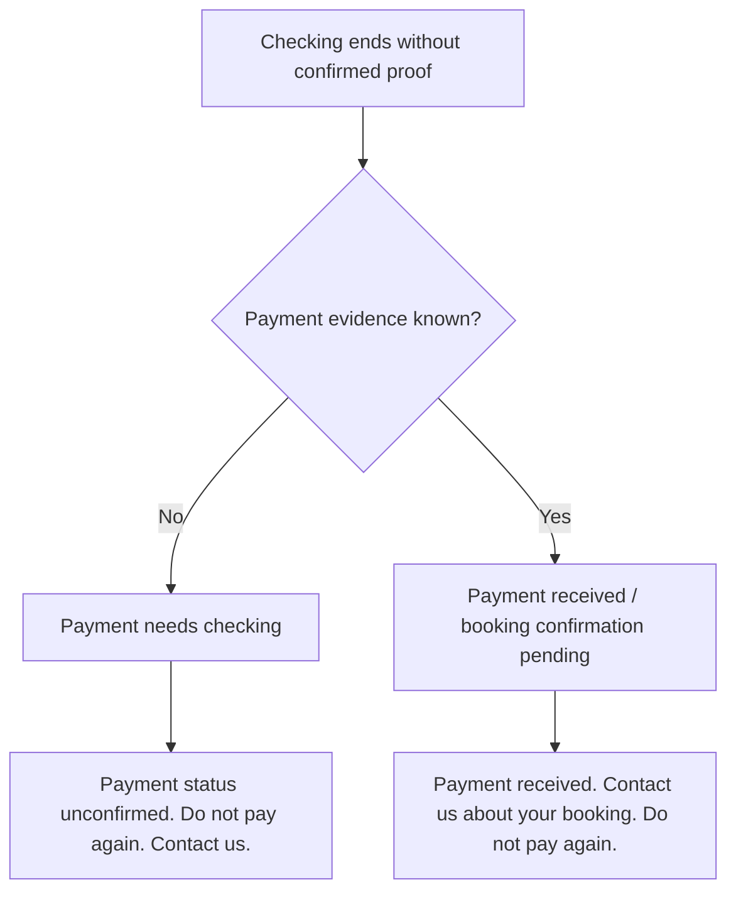

## 13. Expiry, grace and late payment

A timer ending hides payment continuation; only verified releasable expiry permits a restart.

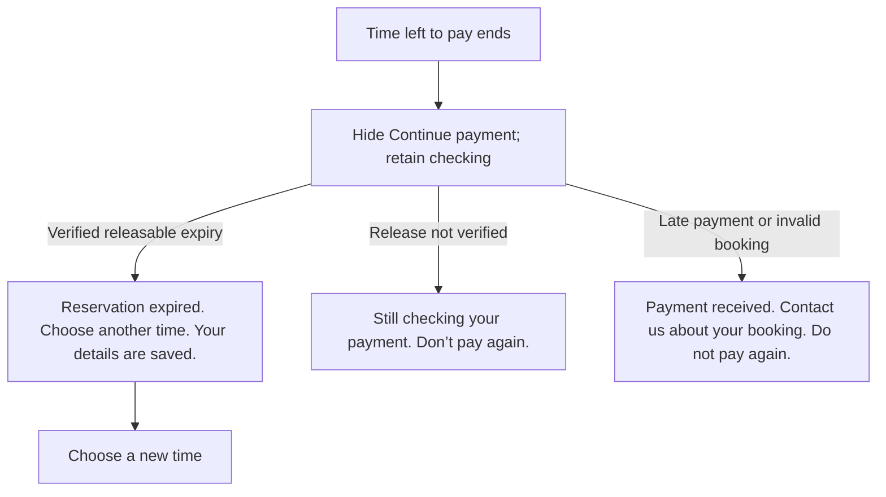

## 14. Confirmed details temporarily unavailable

A receipt-read failure does not undo verified confirmation or authorize another payment.

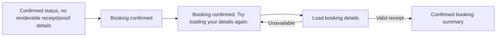

## 15. Saved confirmation and old links

Each protected old link shows only its own booking; it cannot replace a newer active checkout.

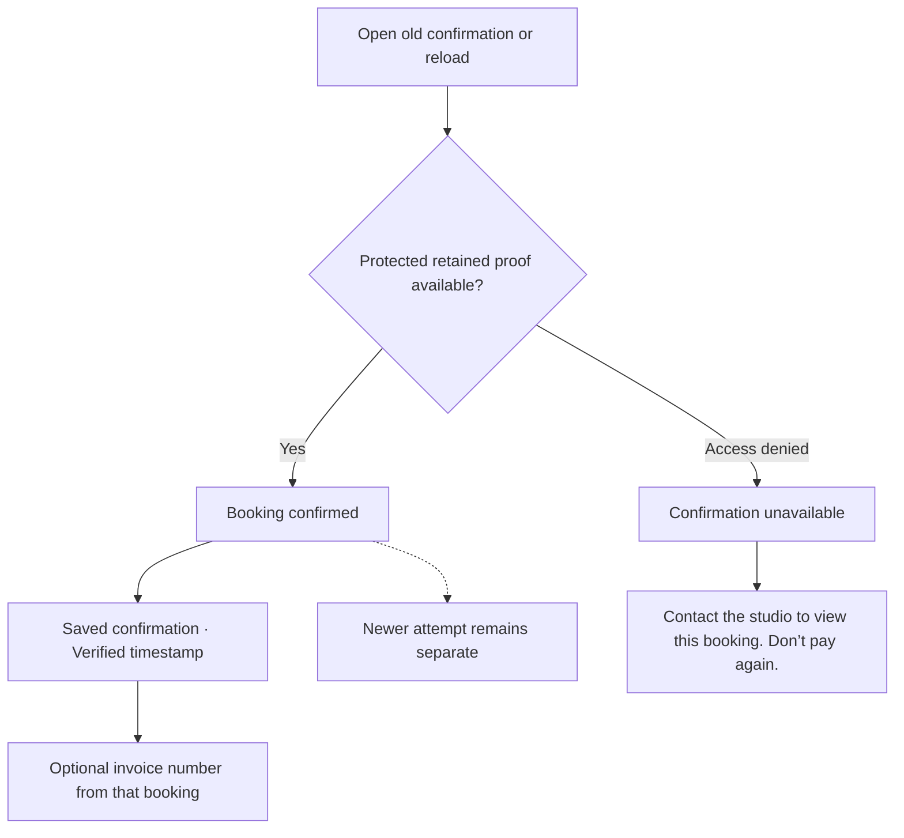

## 16. Make another booking

Leaving a completed confirmation clears the new selection flow, not the paid booking.

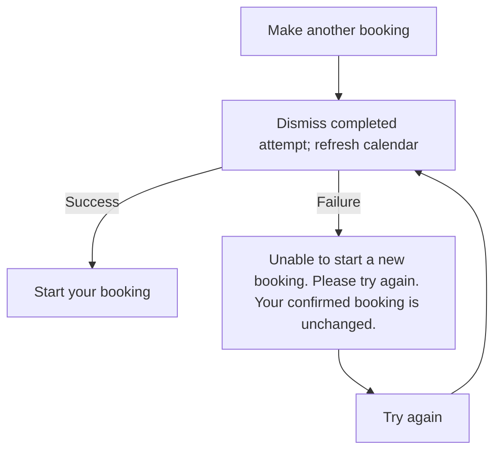

## 17. Three complete journeys

Retain one browser context through single → single → single or multi → single → single.

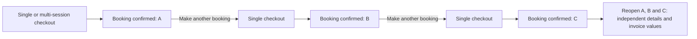

## 18. WhatsApp and staff action

Contacting the studio requests a change; it does not automatically cancel, reschedule or refund.

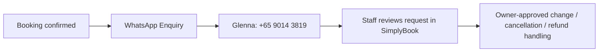

## 19. Preview-only payment states

Preview messages are not proof of real payment or booking.

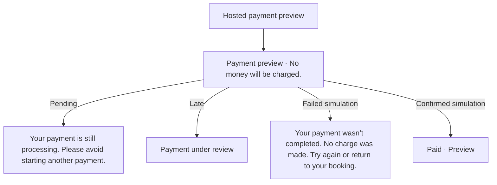

Field-level validation, less common notices and remaining copy proposals are retained in the expandable review below. [Customer UAT](uat/simulated-user.md) owns test actions/results; diagrams describe intended source paths, not completed provider acceptance.

Complete copy review and remaining proposals

## Copy review (baseline and disposition)

“Keep” means retain the exact current wording. Repeated text from different owners is retained to expose alternate paths. Numbered rows cover messages, status headings, notifications and guidance; routine field captions/navigation controls are in the source inventory appendix. Provider-owned screens are outside our copy control.

### Identity and customer details

| ID   | Scenario / owner                                                                                     | Current message                                                                                                                                                     | Suggested wording                                           | Safety / meaning to retain                                                                          |
| ---- | ---------------------------------------------------------------------------------------------------- | ------------------------------------------------------------------------------------------------------------------------------------------------------------------- | ----------------------------------------------------------- | --------------------------------------------------------------------------------------------------- |
| M001 | account-step · customer feedback/guidance ([source](../src/features/booking/account-step.tsx))       | We couldn’t continue. Please try again.                                                                                                                             | Unable to continue. Please try again.                       | Presentation only; preserve existing conditions and actions.                                        |
| M002 | account-step · loading ([source](../src/features/booking/account-step.tsx))                          | Preparing booking…                                                                                                                                                  | Keep.                                                       | Presentation only; preserve existing conditions and actions.                                        |
| M003 | account-step · customer feedback/guidance ([source](../src/features/booking/account-step.tsx))       | Book without creating an account.                                                                                                                                   | Keep.                                                       | Presentation only; preserve existing conditions and actions.                                        |
| M004 | account-step · customer feedback/guidance ([source](../src/features/booking/account-step.tsx))       | Welcome back                                                                                                                                                        | Keep.                                                       | Presentation only; preserve existing conditions and actions.                                        |
| M005 | account-step · customer feedback/guidance ([source](../src/features/booking/account-step.tsx))       | Continue with email                                                                                                                                                 | Keep.                                                       | Presentation only; preserve existing conditions and actions.                                        |
| M006 | account-step · customer feedback/guidance ([source](../src/features/booking/account-step.tsx))       | Verify your email to prefill your name and phone number.                                                                                                            | Verify your email to use saved details.                     | Presentation only; preserve existing conditions and actions.                                        |
| M007 | account-step · customer feedback/guidance ([source](../src/features/booking/account-step.tsx))       | Verify your email again.                                                                                                                                            | Keep.                                                       | Presentation only; preserve existing conditions and actions.                                        |
| M008 | account-step · customer feedback/guidance ([source](../src/features/booking/account-step.tsx))       | Verify your email with Remember me selected to save contact details.                                                                                                | Select Remember me and verify your email to save details.   | **Applied locally in frontend audit.** Presentation only; preserve existing conditions and actions. |
| M009 | account-step · customer feedback/guidance ([source](../src/features/booking/account-step.tsx))       | Verify your email                                                                                                                                                   | Keep.                                                       | Presentation only; preserve existing conditions and actions.                                        |
| M010 | account-step · customer feedback/guidance ([source](../src/features/booking/account-step.tsx))       | Verify your email to continue with your saved booking contact details.                                                                                              | Verify your email to use saved details.                     | Preserve truthful saved-details/selection behaviour.                                                |
| M011 | account-step · customer feedback/guidance ([source](../src/features/booking/account-step.tsx))       | Enter the six-digit code for [email]                                                                                                                                | Keep.                                                       | Presentation only; preserve existing conditions and actions.                                        |
| M012 | account-step · loading ([source](../src/features/booking/account-step.tsx))                          | Checking details…                                                                                                                                                   | Keep.                                                       | Presentation only; preserve existing conditions and actions.                                        |
| M013 | account-step · customer feedback/guidance ([source](../src/features/booking/account-step.tsx))       | Demo code                                                                                                                                                           | Keep.                                                       | Presentation only; preserve existing conditions and actions.                                        |
| M014 | account-step · customer feedback/guidance ([source](../src/features/booking/account-step.tsx))       | No email sent · Code valid for 10 minutes                                                                                                                           | Keep.                                                       | Presentation only; preserve existing conditions and actions.                                        |
| M015 | details-step · customer feedback/guidance ([source](../src/features/booking/details-step.tsx))       | Details saved.                                                                                                                                                      | Keep.                                                       | Preserve truthful saved-details/selection behaviour.                                                |
| M016 | details-step · customer feedback/guidance ([source](../src/features/booking/details-step.tsx))       | We couldn’t save your details. Please try again.                                                                                                                    | Unable to save details. Please try again.                   | Presentation only; preserve existing conditions and actions.                                        |
| M017 | details-step · customer feedback/guidance ([source](../src/features/booking/details-step.tsx))       | Review your selected times and details. Your booking is created when you continue to payment.                                                                       | Keep.                                                       | Presentation only; preserve existing conditions and actions.                                        |
| M018 | details-step · customer feedback/guidance ([source](../src/features/booking/details-step.tsx))       | Contact profile                                                                                                                                                     | Keep.                                                       | Presentation only; preserve existing conditions and actions.                                        |
| M019 | details-step · customer feedback/guidance ([source](../src/features/booking/details-step.tsx))       | Booking contact                                                                                                                                                     | Keep.                                                       | Presentation only; preserve existing conditions and actions.                                        |
| M020 | details-step · customer feedback/guidance ([source](../src/features/booking/details-step.tsx))       | Your name and phone will be saved when you submit this form. Anyone using this verified email shares these saved contact details. Previous bookings stay unchanged. | Keep.                                                       | Preserve truthful saved-details/selection behaviour.                                                |
| M021 | details-step · customer feedback/guidance ([source](../src/features/booking/details-step.tsx))       | Review your contact details for this booking. Changes will not be saved for your next visit.                                                                        | Keep.                                                       | Preserve truthful saved-details/selection behaviour.                                                |
| M022 | details-step · loading ([source](../src/features/booking/details-step.tsx))                          | Saving details…                                                                                                                                                     | Keep.                                                       | Presentation only; preserve existing conditions and actions.                                        |
| M023 | details-step · loading ([source](../src/features/booking/details-step.tsx))                          | Checking availability…                                                                                                                                              | Keep.                                                       | Presentation only; preserve existing conditions and actions.                                        |
| M024 | email-bot-proof · customer feedback/guidance ([source](../src/features/booking/email-bot-proof.tsx)) | Email verification is not available yet. You can continue as a guest.                                                                                               | Email verification unavailable. Please continue as a guest. | **Applied locally in frontend audit.** Presentation only; preserve existing conditions and actions. |
| M025 | identity · customer feedback/guidance ([source](../src/services/identity.ts))                        | Email verification is unavailable. You can continue as a guest.                                                                                                     | Email verification unavailable. Please continue as a guest. | **Applied locally in frontend audit.** Presentation only; preserve existing conditions and actions. |
| M026 | identity · customer feedback/guidance ([source](../src/services/identity.ts))                        | Sign in again, then choose Sign out all devices.                                                                                                                    | Keep.                                                       | Presentation only; preserve existing conditions and actions.                                        |
| M027 | identity · customer feedback/guidance ([source](../src/services/identity.ts))                        | Could not sign out all devices. Please try again.                                                                                                                   | Unable to sign out all devices. Please try again.           | Presentation only; preserve existing conditions and actions.                                        |
| M028 | identity · customer feedback/guidance ([source](../src/services/identity.ts))                        | Could not sign out this browser. Please try again.                                                                                                                  | Unable to sign out. Please try again.                       | Presentation only; preserve existing conditions and actions.                                        |
| M029 | identity · customer feedback/guidance ([source](../src/services/identity.ts))                        | Wait a few minutes before requesting another code.                                                                                                                  | Please wait a few minutes before requesting a new code.     | Presentation only; preserve existing conditions and actions.                                        |
| M030 | identity · customer feedback/guidance ([source](../src/services/identity.ts))                        | Return to booking options and sign in again.                                                                                                                        | Return to booking options to sign in again.                 | Presentation only; preserve existing conditions and actions.                                        |
| M031 | identity · customer feedback/guidance ([source](../src/services/identity.ts))                        | Check your code or request a new one.                                                                                                                               | Keep.                                                       | Presentation only; preserve existing conditions and actions.                                        |
| M032 | identity · customer feedback/guidance ([source](../src/services/identity.ts))                        | Complete the security check and try again.                                                                                                                          | Keep.                                                       | Presentation only; preserve existing conditions and actions.                                        |
| M033 | contact · customer feedback/guidance ([source](../src/domain/contact.ts))                            | Enter the booking contact’s full name.                                                                                                                              | Enter your full name.                                       | Presentation only; preserve existing conditions and actions.                                        |
| M034 | contact · customer feedback/guidance ([source](../src/domain/contact.ts))                            | Enter a valid email address.                                                                                                                                        | Keep.                                                       | Presentation only; preserve existing conditions and actions.                                        |
| M035 | contact · customer feedback/guidance ([source](../src/domain/contact.ts))                            | Use your verified email address.                                                                                                                                    | Keep.                                                       | Presentation only; preserve existing conditions and actions.                                        |
| M036 | contact · customer feedback/guidance ([source](../src/domain/contact.ts))                            | Enter a valid mobile number.                                                                                                                                        | Keep.                                                       | Presentation only; preserve existing conditions and actions.                                        |
| M037 | contact · customer feedback/guidance ([source](../src/domain/contact.ts))                            | Select a contact method.                                                                                                                                            | Keep.                                                       | Presentation only; preserve existing conditions and actions.                                        |
| M038 | contact · customer feedback/guidance ([source](../src/domain/contact.ts))                            | Use no more than 120 characters.                                                                                                                                    | Keep.                                                       | Presentation only; preserve existing conditions and actions.                                        |

### Preview / demo branches

| ID   | Scenario / owner                                                                                                   | Current message                                                                                                                                                                                    | Suggested wording                                     | Safety / meaning to retain                                                 |
| ---- | ------------------------------------------------------------------------------------------------------------------ | -------------------------------------------------------------------------------------------------------------------------------------------------------------------------------------------------- | ----------------------------------------------------- | -------------------------------------------------------------------------- |
| M039 | account-step · customer feedback/guidance ([source](../src/features/booking/account-step.tsx))                     | Email sign-in preview · No email will be sent.                                                                                                                                                     | Keep.                                                 | Preview-only evidence; do not imply live payment/email/booking.            |
| M040 | confirmation-step · customer feedback/guidance ([source](../src/features/booking/confirmation-step.tsx))           | Booking reference [preview reference]                                                                                                                                                              | Keep.                                                 | Preview-only evidence; do not imply live payment/email/booking.            |
| M041 | confirmation-step · customer feedback/guidance ([source](../src/features/booking/confirmation-step.tsx))           | Paid · Preview                                                                                                                                                                                     | Keep.                                                 | Preview-only evidence; do not imply live payment/email/booking.            |
| M042 | confirmation-step · customer feedback/guidance ([source](../src/features/booking/confirmation-step.tsx))           | Payment preview · No money was charged.                                                                                                                                                            | Keep.                                                 | Preview-only evidence; do not imply live payment/email/booking.            |
| M043 | payment-step · customer feedback/guidance ([source](../src/features/booking/payment-step.tsx))                     | Processing payment                                                                                                                                                                                 | Keep.                                                 | Presentation only; preserve existing conditions and actions.               |
| M044 | payment-step · customer feedback/guidance ([source](../src/features/booking/payment-step.tsx))                     | Payment under review                                                                                                                                                                               | Keep.                                                 | Presentation only; preserve existing conditions and actions.               |
| M045 | payment-step · customer feedback/guidance ([source](../src/features/booking/payment-step.tsx))                     | Payment pending                                                                                                                                                                                    | Keep.                                                 | Presentation only; preserve existing conditions and actions.               |
| M046 | payment-step · customer feedback/guidance ([source](../src/features/booking/payment-step.tsx))                     | Confirming payment and booking.                                                                                                                                                                    | Keep.                                                 | Presentation only; preserve existing conditions and actions.               |
| M047 | payment-step · customer feedback/guidance ([source](../src/features/booking/payment-step.tsx))                     | The payment arrived after the reservation expired, or availability needs review. Contact the studio before making another payment.                                                                 | Payment needs review. Contact us. Do not pay again.   | Keep duplicate-payment/booking warning where outcome is uncertain.         |
| M048 | payment-step · customer feedback/guidance ([source](../src/features/booking/payment-step.tsx))                     | Your payment is still processing. Please avoid starting another payment.                                                                                                                           | Payment processing. Do not pay again.                 | Keep duplicate-payment/booking warning where outcome is uncertain.         |
| M049 | payment-step · loading ([source](../src/features/booking/payment-step.tsx))                                        | Checking payment…                                                                                                                                                                                  | Keep.                                                 | Presentation only; preserve existing conditions and actions.               |
| M050 | payment-step · customer feedback/guidance ([source](../src/features/booking/payment-step.tsx))                     | Your payment wasn’t completed. No charge was made. Try again or return to your booking.                                                                                                            | Payment incomplete. No charge made. Please try again. | Use only when established by the existing state; never infer from timeout. |
| M051 | payment-step · customer feedback/guidance ([source](../src/features/booking/payment-step.tsx))                     | Hosted payment preview                                                                                                                                                                             | Keep.                                                 | Preview-only evidence; do not imply live payment/email/booking.            |
| M052 | payment-step · customer feedback/guidance ([source](../src/features/booking/payment-step.tsx))                     | Review selections                                                                                                                                                                                  | Keep.                                                 | Presentation only; preserve existing conditions and actions.               |
| M053 | payment-step · loading ([source](../src/features/booking/payment-step.tsx))                                        | Starting payment…                                                                                                                                                                                  | Keep.                                                 | Presentation only; preserve existing conditions and actions.               |
| M054 | payment-step · customer feedback/guidance ([source](../src/features/booking/payment-step.tsx))                     | Payment preview · No money will be charged.                                                                                                                                                        | Keep.                                                 | Preview-only evidence; do not imply live payment/email/booking.            |
| M055 | payment-step · customer feedback/guidance ([source](../src/features/booking/payment-step.tsx))                     | Try separate checkout · Synthetic Preview                                                                                                                                                          | Keep.                                                 | Preview-only evidence; do not imply live payment/email/booking.            |
| M056 | protected-confirmation · customer feedback/guidance ([source](../src/features/booking/protected-confirmation.tsx)) | Experiment 1 · Synthetic Preview · No payment or booking is made                                                                                                                                   | Keep.                                                 | Preview-only evidence; do not imply live payment/email/booking.            |
| M057 | enquiry-page · customer feedback/guidance ([source](../src/features/enquiry/enquiry-page.tsx))                     | Your enquiry for [enquiry type] is ready in this preview.                                                                                                                                          | Keep.                                                 | Preview-only evidence; do not imply live payment/email/booking.            |
| M058 | enquiry-page · customer feedback/guidance ([source](../src/features/enquiry/enquiry-page.tsx))                     | Preview · No enquiry sent.                                                                                                                                                                         | Keep.                                                 | Preview-only evidence; do not imply live payment/email/booking.            |
| M059 | assistant · customer feedback/guidance ([source](../src/services/demo/assistant.ts))                               | For changes or cancellations to ${booking.reference}, contact the studio at ${CONTACT.phoneDisplay}. Your booking has not been changed. Refunds are handled by authorised studio staff.            | Keep.                                                 | Preview-only evidence; do not imply live payment/email/booking.            |
| M060 | assistant · customer feedback/guidance ([source](../src/services/demo/assistant.ts))                               | Open your confirmed booking first, or contact the studio for help with an existing reservation.                                                                                                    | Keep.                                                 | Render only with the existing proof/state gate; no timing change.          |
| M061 | assistant · customer feedback/guidance ([source](../src/services/demo/assistant.ts))                               | The Kickoff Special is S$88 per 40-minute session for 1–4 players. Full instructor guidance and Single, Team and Battle play are included.                                                         | Keep.                                                 | Preview-only evidence; do not imply live payment/email/booking.            |
| M062 | assistant · customer feedback/guidance ([source](../src/services/demo/assistant.ts))                               | ${ADDRESS}. The preview schedule runs from 12 noon to 8 pm. Please confirm live opening hours with the studio.                                                                                     | Keep.                                                 | Preview-only evidence; do not imply live payment/email/booking.            |
| M063 | assistant · customer feedback/guidance ([source](../src/services/demo/assistant.ts))                               | Arrive 10 minutes early in comfortable sportswear and suitable footwear. Have your SoccerBot Player App profile ready. Contact the studio about specific access needs.                             | Keep.                                                 | Preview-only evidence; do not imply live payment/email/booking.            |
| M064 | assistant · customer feedback/guidance ([source](../src/services/demo/assistant.ts))                               | Use Contact us to enquire about multi-session bundles, memberships, academy visits, corporate bookings and sponsorship arrangements.                                                               | Keep.                                                 | Preview-only evidence; do not imply live payment/email/booking.            |
| M065 | assistant · customer feedback/guidance ([source](../src/services/demo/assistant.ts))                               | ${booking.reference}: ${booking.slots.map((slot) => `${dateLabel(slot.date)} at ${slot.start}, ${slot.studio}`).join("; ")}. ${money(booking.totalCents)}. This is your confirmed preview booking. | Keep.                                                 | Render only with the existing proof/state gate; no timing change.          |
| M066 | assistant · customer feedback/guidance ([source](../src/services/demo/assistant.ts))                               | No confirmed booking is available in this browser. You can start a booking or contact the studio.                                                                                                  | Keep.                                                 | Render only with the existing proof/state gate; no timing change.          |
| M067 | enquiry · customer feedback/guidance ([source](../src/services/demo/enquiry.ts))                                   | Check your name, email and contact number.                                                                                                                                                         | Keep.                                                 | Preview-only evidence; do not imply live payment/email/booking.            |
| M068 | enquiry · customer feedback/guidance ([source](../src/services/demo/enquiry.ts))                                   | Choose an enquiry type and describe your requirements.                                                                                                                                             | Keep.                                                 | Preview-only evidence; do not imply live payment/email/booking.            |
| M069 | enquiry · customer feedback/guidance ([source](../src/services/demo/enquiry.ts))                                   | Enter a guest count from 1 to 999.                                                                                                                                                                 | Keep.                                                 | Preview-only evidence; do not imply live payment/email/booking.            |
| M070 | enquiry · customer feedback/guidance ([source](../src/services/demo/enquiry.ts))                                   | Choose today or a future date.                                                                                                                                                                     | Keep.                                                 | Preview-only evidence; do not imply live payment/email/booking.            |
| M071 | identity · customer feedback/guidance ([source](../src/services/demo/identity.ts))                                 | Enter a valid email address.                                                                                                                                                                       | Keep.                                                 | Preview-only evidence; do not imply live payment/email/booking.            |
| M072 | identity · customer feedback/guidance ([source](../src/services/demo/identity.ts))                                 | This code has expired. Request a new code.                                                                                                                                                         | Keep.                                                 | Expiry does not prove no charge; retain recovery policy.                   |
| M073 | identity · customer feedback/guidance ([source](../src/services/demo/identity.ts))                                 | The verification code is incorrect.                                                                                                                                                                | Keep.                                                 | Preview-only evidence; do not imply live payment/email/booking.            |
| M074 | identity · customer feedback/guidance ([source](../src/services/demo/identity.ts))                                 | Request a new verification code.                                                                                                                                                                   | Keep.                                                 | Preview-only evidence; do not imply live payment/email/booking.            |
| M075 | identity · customer feedback/guidance ([source](../src/services/demo/identity.ts))                                 | Verify your email again.                                                                                                                                                                           | Keep.                                                 | Preview-only evidence; do not imply live payment/email/booking.            |
| M076 | demo-catalog · customer feedback/guidance ([source](../src/domain/demo-catalog.ts))                                | Demonstration profile. Guides players through ball control, passing and shooting drills, adapting each session to the group’s experience and goals.                                                | Keep.                                                 | Presentation only; preserve existing conditions and actions.               |
| M077 | demo-catalog · customer feedback/guidance ([source](../src/domain/demo-catalog.ts))                                | Preview profile. Final instructor details will be provided by the studio.                                                                                                                          | Keep.                                                 | Preview-only evidence; do not imply live payment/email/booking.            |
| M078 | site-shell · customer feedback/guidance ([source](../src/components/site-shell.tsx))                               | This website is a booking preview. No payment is collected, booking submitted or enquiry sent.                                                                                                     | Keep.                                                 | Preview-only evidence; do not imply live payment/email/booking.            |
| M079 | page · customer feedback/guidance ([source](../src/app/experiment/page.tsx))                                       | Experiment 1 · Synthetic Preview                                                                                                                                                                   | Keep.                                                 | Preview-only evidence; do not imply live payment/email/booking.            |
| M080 | page · customer feedback/guidance ([source](../src/app/experiment/page.tsx))                                       | Separate checkout preview                                                                                                                                                                          | Keep.                                                 | Preview-only evidence; do not imply live payment/email/booking.            |
| M081 | page · customer feedback/guidance ([source](../src/app/experiment/page.tsx))                                       | Keep SoccerBot open while you try a simulated checkout separately. No payment details are collected, and no real booking or payment is made.                                                       | Keep.                                                 | Presentation only; preserve existing conditions and actions.               |
| M082 | page · customer feedback/guidance ([source](../src/app/experiment/page.tsx))                                       | This demonstration requires the isolated local Preview server. Your current booking selections and contact information stay unchanged.                                                             | Keep.                                                 | Preview-only evidence; do not imply live payment/email/booking.            |
| M083 | page · loading ([source](../src/app/experiment/page.tsx))                                                          | Preparing preview…                                                                                                                                                                                 | Keep.                                                 | Preview-only evidence; do not imply live payment/email/booking.            |
| M084 | page · customer feedback/guidance ([source](../src/app/experiment/page.tsx))                                       | Synthetic checkout is unavailable on this host. Use the documented local Preview server.                                                                                                           | Keep.                                                 | Preview-only evidence; do not imply live payment/email/booking.            |
| M085 | assistant · customer feedback/guidance ([source](../src/services/demo/assistant.ts))                               | `I can help with sessions, prices, location and your preview booking. To contact the studio, call ${CONTACT.phoneDisplay} or email ${CONTACT.email}.`                                              | Keep.                                                 | Preview-only evidence; do not imply live payment/email/booking.            |
| M086 | booking · customer feedback/guidance ([source](../src/services/demo/booking.ts))                                   | A payment is already in progress. Check its status before starting another.                                                                                                                        | Keep.                                                 | Preview-only evidence; do not imply live payment/email/booking.            |
| M087 | booking · customer feedback/guidance ([source](../src/services/demo/booking.ts))                                   | A selected instructor is no longer available. Review your selected sessions.                                                                                                                       | Keep.                                                 | Preview-only evidence; do not imply live payment/email/booking.            |
| M088 | booking · customer feedback/guidance ([source](../src/services/demo/booking.ts))                                   | A selected session is no longer available. No sessions were booked. Please review your selections.                                                                                                 | Keep.                                                 | Preview-only evidence; do not imply live payment/email/booking.            |

### Availability and selection

| ID   | Scenario / owner                                                                                   | Current message                                                                                                                                                             | Suggested wording                                                                                    | Safety / meaning to retain                                                                               |
| ---- | -------------------------------------------------------------------------------------------------- | --------------------------------------------------------------------------------------------------------------------------------------------------------------------------- | ---------------------------------------------------------------------------------------------------- | -------------------------------------------------------------------------------------------------------- |
| M089 | availability · customer feedback/guidance ([source](../src/features/booking/availability.ts))      | Your session has changed. Please check availability again.                                                                                                                  | Session changed. Please refresh availability.                                                        | Presentation only; preserve existing conditions and actions.                                             |
| M090 | availability · customer feedback/guidance ([source](../src/features/booking/availability.ts))      | We couldn’t check availability. Please try again.                                                                                                                           | Unable to load times. Please try again.                                                              | Presentation only; preserve existing conditions and actions.                                             |
| M091 | live-catalogue · loading ([source](../src/features/booking/live-catalogue.tsx))                    | Loading sessions…                                                                                                                                                           | Keep.                                                                                                | Presentation only; preserve existing conditions and actions.                                             |
| M092 | live-catalogue · customer feedback/guidance ([source](../src/features/booking/live-catalogue.tsx)) | Session information is unavailable. Your details have been kept.                                                                                                            | Sessions unavailable. Please try again. Your details are saved.                                      | **Applied locally.** Presentation only; preserve existing conditions and actions.                        |
| M093 | live-catalogue · customer feedback/guidance ([source](../src/features/booking/live-catalogue.tsx)) | No instructor currently available                                                                                                                                           | No instructor available                                                                              | Presentation only; preserve existing conditions and actions.                                             |
| M094 | live-catalogue · customer feedback/guidance ([source](../src/features/booking/live-catalogue.tsx)) | Select session                                                                                                                                                              | Keep.                                                                                                | Presentation only; preserve existing conditions and actions.                                             |
| M095 | live-catalogue · customer feedback/guidance ([source](../src/features/booking/live-catalogue.tsx)) | No sessions are currently available.                                                                                                                                        | No sessions available.                                                                               | Presentation only; preserve existing conditions and actions.                                             |
| M096 | live-catalogue · customer feedback/guidance ([source](../src/features/booking/live-catalogue.tsx)) | Online booking is not available yet. Contact the studio for help.                                                                                                           | Online booking unavailable. Please contact us.                                                       | Presentation only; preserve existing conditions and actions.                                             |
| M097 | live-catalogue · customer feedback/guidance ([source](../src/features/booking/live-catalogue.tsx)) | Contact the studio                                                                                                                                                          | Keep.                                                                                                | Presentation only; preserve existing conditions and actions.                                             |
| M098 | session-price · customer feedback/guidance ([source](../src/features/booking/session-price.tsx))   | See prices when booking                                                                                                                                                     | Keep.                                                                                                | Presentation only; preserve existing conditions and actions.                                             |
| M099 | session-step · customer feedback/guidance ([source](../src/features/booking/session-step.tsx))     | Choose your session.                                                                                                                                                        | Keep.                                                                                                | Presentation only; preserve existing conditions and actions.                                             |
| M100 | session-step · customer feedback/guidance ([source](../src/features/booking/session-step.tsx))     | No sessions are currently available.                                                                                                                                        | No sessions available.                                                                               | Presentation only; preserve existing conditions and actions.                                             |
| M101 | session-step · customer feedback/guidance ([source](../src/features/booking/session-step.tsx))     | Players · maximum 4                                                                                                                                                         | Keep.                                                                                                | Presentation only; preserve existing conditions and actions.                                             |
| M102 | session-step · customer feedback/guidance ([source](../src/features/booking/session-step.tsx))     | Set the number of players for your booking.                                                                                                                                 | Keep.                                                                                                | Presentation only; preserve existing conditions and actions.                                             |
| M103 | session-step · loading ([source](../src/features/booking/session-step.tsx))                        | Loading times…                                                                                                                                                              | Keep.                                                                                                | Presentation only; preserve existing conditions and actions.                                             |
| M104 | summary · customer feedback/guidance ([source](../src/features/booking/summary.tsx))               | Crosses the [time] instructor rotation. Your assigned/chosen instructor stays for the full session.                                                                         | Keep.                                                                                                | Presentation only; preserve existing conditions and actions.                                             |
| M105 | summary · customer feedback/guidance ([source](../src/features/booking/summary.tsx))               | Session has started — remove to continue.                                                                                                                                   | Keep.                                                                                                | Presentation only; preserve existing conditions and actions.                                             |
| M106 | summary · customer feedback/guidance ([source](../src/features/booking/summary.tsx))               | No sessions selected                                                                                                                                                        | Keep.                                                                                                | Presentation only; preserve existing conditions and actions.                                             |
| M107 | summary · customer feedback/guidance ([source](../src/features/booking/summary.tsx))               | Choose a date, then add the times that suit you.                                                                                                                            | Keep.                                                                                                | Presentation only; preserve existing conditions and actions.                                             |
| M108 | summary · loading ([source](../src/features/booking/summary.tsx))                                  | Checking sessions…                                                                                                                                                          | Keep.                                                                                                | Presentation only; preserve existing conditions and actions.                                             |
| M109 | summary · customer feedback/guidance ([source](../src/features/booking/summary.tsx))               | Your selections are saved. Availability could not be checked.                                                                                                               | Please refresh availability. Your selections are saved.                                              | **Applied locally in frontend audit.** Preserve truthful saved-details/selection behaviour.              |
| M110 | summary · customer feedback/guidance ([source](../src/features/booking/summary.tsx))               | Your selections are not reserved until booking is confirmed.                                                                                                                | Selecting a time does not reserve it.                                                                | **Applied locally in frontend audit.** Render only with the existing proof/state gate; no timing change. |
| M111 | time-step · customer feedback/guidance ([source](../src/features/booking/time-step.tsx))           | Add 40-minute sessions on the same or different dates. Start times are 50 minutes apart, with 10 minutes for exit and entry.                                                | Add 40-minute sessions across dates. Allow 10 minutes between sessions.                              | Presentation only; preserve existing conditions and actions.                                             |
| M112 | time-step · loading ([source](../src/features/booking/time-step.tsx))                              | Checking dates…                                                                                                                                                             | Keep.                                                                                                | Presentation only; preserve existing conditions and actions.                                             |
| M113 | time-step · loading ([source](../src/features/booking/time-step.tsx))                              | Finding available sessions…                                                                                                                                                 | Keep.                                                                                                | Presentation only; preserve existing conditions and actions.                                             |
| M114 | time-step · customer feedback/guidance ([source](../src/features/booking/time-step.tsx))           | Available sessions                                                                                                                                                          | Keep.                                                                                                | Presentation only; preserve existing conditions and actions.                                             |
| M115 | time-step · customer feedback/guidance ([source](../src/features/booking/time-step.tsx))           | No available sessions                                                                                                                                                       | Keep.                                                                                                | Presentation only; preserve existing conditions and actions.                                             |
| M116 | time-step · customer feedback/guidance ([source](../src/features/booking/time-step.tsx))           | Availability not verified                                                                                                                                                   | Keep.                                                                                                | Presentation only; preserve existing conditions and actions.                                             |
| M117 | time-step · customer feedback/guidance ([source](../src/features/booking/time-step.tsx))           | Only dates with available sessions can be selected.                                                                                                                         | Remove; legend suffices.                                                                             | Presentation only; preserve existing conditions and actions.                                             |
| M118 | time-step · customer feedback/guidance ([source](../src/features/booking/time-step.tsx))           | Availability could not be checked. Your selections are saved.                                                                                                               | Please refresh availability. Your selections are saved.                                              | **Applied locally in frontend audit.** Preserve truthful saved-details/selection behaviour.              |
| M119 | time-step · customer feedback/guidance ([source](../src/features/booking/time-step.tsx))           | Refresh availability                                                                                                                                                        | Keep.                                                                                                | Presentation only; preserve existing conditions and actions.                                             |
| M120 | time-step · customer feedback/guidance ([source](../src/features/booking/time-step.tsx))           | Refresh availability to choose a session. Your selections are saved.                                                                                                        | Refresh availability to continue. Your selections are saved.                                         | Preserve truthful saved-details/selection behaviour.                                                     |
| M121 | time-step · loading ([source](../src/features/booking/time-step.tsx))                              | Checking times…                                                                                                                                                             | Keep.                                                                                                | Presentation only; preserve existing conditions and actions.                                             |
| M122 | time-step · customer feedback/guidance ([source](../src/features/booking/time-step.tsx))           | Session has started                                                                                                                                                         | Keep.                                                                                                | Presentation only; preserve existing conditions and actions.                                             |
| M123 | time-step · customer feedback/guidance ([source](../src/features/booking/time-step.tsx))           | Unavailable                                                                                                                                                                 | Keep.                                                                                                | Presentation only; preserve existing conditions and actions.                                             |
| M124 | time-step · customer feedback/guidance ([source](../src/features/booking/time-step.tsx))           | Choose trainer: ${offers .filter((offer) => offer.available) .map(sessionInstructorName) .join(" / ")}                                                                      | Keep.                                                                                                | Presentation only; preserve existing conditions and actions.                                             |
| M125 | time-step · customer feedback/guidance ([source](../src/features/booking/time-step.tsx))           | No instructor available                                                                                                                                                     | Keep.                                                                                                | Presentation only; preserve existing conditions and actions.                                             |
| M126 | time-step · customer feedback/guidance ([source](../src/features/booking/time-step.tsx))           | Crosses the [time] instructor rotation. Your assigned/chosen instructor stays for the full session.                                                                         | Keep.                                                                                                | Presentation only; preserve existing conditions and actions.                                             |
| M127 | time-step · customer feedback/guidance ([source](../src/features/booking/time-step.tsx))           | Choose a trainer to add this session                                                                                                                                        | Keep.                                                                                                | Presentation only; preserve existing conditions and actions.                                             |
| M128 | time-step · customer feedback/guidance ([source](../src/features/booking/time-step.tsx))           | No times on this day.                                                                                                                                                       | No times available on this date.                                                                     | Presentation only; preserve existing conditions and actions.                                             |
| M129 | time-step · customer feedback/guidance ([source](../src/features/booking/time-step.tsx))           | Choose another date. Your selections are saved.                                                                                                                             | Choose another date. Your selections are saved.                                                      | Preserve truthful saved-details/selection behaviour.                                                     |
| M130 | time-step · customer feedback/guidance ([source](../src/features/booking/time-step.tsx))           | Open noon–8pm. Book at least 4 hours ahead. Choose a trainer for every session. All trainers share one studio; choosing another trainer does not create extra availability. | Open noon–8pm. Book 4 hours ahead. Choose a trainer for each session; all trainers share one studio. | Presentation only; preserve existing conditions and actions.                                             |
| M131 | time-step · customer feedback/guidance ([source](../src/features/booking/time-step.tsx))           | Open noon–8pm. Choose a trainer separately for every session. Demo trainer choices rotate every three hours; your chosen trainer stays for the full session.                | Keep.                                                                                                | Presentation only; preserve existing conditions and actions.                                             |
| M132 | customer-catalogue · customer feedback/guidance ([source](../src/services/customer-catalogue.ts))  | Session information is unavailable. Please contact the studio.                                                                                                              | Sessions unavailable. Please contact us.                                                             | Presentation only; preserve existing conditions and actions.                                             |
| M133 | booking · customer feedback/guidance ([source](../src/domain/booking.ts))                          | Choose at least one session.                                                                                                                                                | Keep.                                                                                                | Presentation only; preserve existing conditions and actions.                                             |
| M134 | booking · customer feedback/guidance ([source](../src/domain/booking.ts))                          | Choose a valid session within the booking window.                                                                                                                           | Keep.                                                                                                | Presentation only; preserve existing conditions and actions.                                             |
| M135 | booking · customer feedback/guidance ([source](../src/domain/booking.ts))                          | Review your selected sessions.                                                                                                                                              | Keep.                                                                                                | Presentation only; preserve existing conditions and actions.                                             |
| M136 | booking · customer feedback/guidance ([source](../src/domain/booking.ts))                          | Book sessions at least 4 hours before their start time.                                                                                                                     | Keep.                                                                                                | Presentation only; preserve existing conditions and actions.                                             |
| M137 | booking · customer feedback/guidance ([source](../src/domain/booking.ts))                          | Selected sessions must not overlap.                                                                                                                                         | Keep.                                                                                                | Presentation only; preserve existing conditions and actions.                                             |
| M138 | booking · customer feedback/guidance ([source](../src/domain/booking.ts))                          | Review your booking options.                                                                                                                                                | Keep.                                                                                                | Presentation only; preserve existing conditions and actions.                                             |
| M139 | booking · customer feedback/guidance ([source](../src/domain/booking.ts))                          | Verify your email again.                                                                                                                                                    | Keep.                                                                                                | Presentation only; preserve existing conditions and actions.                                             |
| M140 | booking · customer feedback/guidance ([source](../src/domain/booking.ts))                          | Review your contact details.                                                                                                                                                | Keep.                                                                                                | Presentation only; preserve existing conditions and actions.                                             |
| M141 | booking · customer feedback/guidance ([source](../src/domain/booking.ts))                          | Review and accept the booking information.                                                                                                                                  | Keep.                                                                                                | Presentation only; preserve existing conditions and actions.                                             |
| M142 | booking · customer feedback/guidance ([source](../src/domain/booking.ts))                          | A selected session has started. Remove it and choose a future time.                                                                                                         | Session started. Remove it and choose another time.                                                  | Presentation only; preserve existing conditions and actions.                                             |
| M143 | summary · customer feedback/guidance ([source](../src/features/booking/summary.tsx))               | A selected session is no longer available. Remove it and choose another time.                                                                                               | Session unavailable. Remove it and choose another time.                                              | Presentation only; preserve existing conditions and actions.                                             |

### Shared loading, navigation and guidance

| ID   | Scenario / owner                                                                                     | Current message                                                                                                                         | Suggested wording                                                                    | Safety / meaning to retain                                                                  |
| ---- | ---------------------------------------------------------------------------------------------------- | --------------------------------------------------------------------------------------------------------------------------------------- | ------------------------------------------------------------------------------------ | ------------------------------------------------------------------------------------------- |
| M144 | booking-loading · customer feedback/guidance ([source](../src/features/booking/booking-loading.tsx)) | Don’t close or refresh.                                                                                                                 | Please do not close or refresh.                                                      | **Applied locally.** Keep duplicate-payment/booking warning where outcome is uncertain.     |
| M145 | booking-loading · loading ([source](../src/features/booking/booking-loading.tsx))                    | Opening checkout…                                                                                                                       | Keep.                                                                                | Presentation only; preserve existing conditions and actions.                                |
| M146 | booking-loading · loading ([source](../src/features/booking/booking-loading.tsx))                    | Checking payment…                                                                                                                       | Keep.                                                                                | Presentation only; preserve existing conditions and actions.                                |
| M147 | booking-loading · loading ([source](../src/features/booking/booking-loading.tsx))                    | Preparing booking…                                                                                                                      | Keep.                                                                                | Presentation only; preserve existing conditions and actions.                                |
| M148 | catalog · customer feedback/guidance ([source](../src/domain/catalog.ts))                            | For changes or cancellations, contact Glenna on WhatsApp: +65 9014 3819.                                                                | Keep.                                                                                | Presentation only; preserve existing conditions and actions.                                |
| M149 | booking-navigation · customer feedback/guidance ([source](../src/components/booking-navigation.tsx)) | Opening studio                                                                                                                          | Keep.                                                                                | Presentation only; preserve existing conditions and actions.                                |
| M150 | booking-navigation · customer feedback/guidance ([source](../src/components/booking-navigation.tsx)) | Opening booking                                                                                                                         | Keep.                                                                                | Presentation only; preserve existing conditions and actions.                                |
| M151 | brand-loading · customer feedback/guidance ([source](../src/components/brand-loading.tsx))           | Opening booking                                                                                                                         | Keep.                                                                                | Presentation only; preserve existing conditions and actions.                                |
| M152 | player-app-prompt · customer feedback/guidance ([source](../src/components/player-app-prompt.tsx))   | Get the SoccerBot Player App                                                                                                            | Keep.                                                                                | Presentation only; preserve existing conditions and actions.                                |
| M153 | player-app-prompt · customer feedback/guidance ([source](../src/components/player-app-prompt.tsx))   | Create your player profile and have your QR card ready before your session.                                                             | Keep.                                                                                | Presentation only; preserve existing conditions and actions.                                |
| M154 | site-shell · customer feedback/guidance ([source](../src/components/site-shell.tsx))                 | Leave this booking?                                                                                                                     | Keep.                                                                                | Presentation only; preserve existing conditions and actions.                                |
| M155 | site-shell · customer feedback/guidance ([source](../src/components/site-shell.tsx))                 | General disclaimer                                                                                                                      | Keep.                                                                                | Presentation only; preserve existing conditions and actions.                                |
| M156 | site-shell · customer feedback/guidance ([source](../src/components/site-shell.tsx))                 | Your current selections are saved in this browser. Any payment in progress remains available when you return.                           | Your selections are saved in this browser. Complete payment before checkout expires. | **Applied locally in frontend audit.** Preserve truthful saved-details/selection behaviour. |
| M157 | site-shell · customer feedback/guidance ([source](../src/components/site-shell.tsx))                 | Football and physical activity involve risks. Follow your instructor’s directions and discuss any support requirements with the studio. | Keep.                                                                                | Presentation only; preserve existing conditions and actions.                                |
| M158 | not-found · customer feedback/guidance ([source](../src/app/not-found.tsx))                          | Page not found                                                                                                                          | Keep.                                                                                | Presentation only; preserve existing conditions and actions.                                |
| M159 | not-found · customer feedback/guidance ([source](../src/app/not-found.tsx))                          | The page you’re looking for isn’t available.                                                                                            | Keep.                                                                                | Presentation only; preserve existing conditions and actions.                                |

### Payment, confirmation and recovery

| ID   | Scenario / owner                                                                                                        | Current message                                                              | Suggested wording                                                                                                   | Safety / meaning to retain                                                                                                                                   |
| ---- | ----------------------------------------------------------------------------------------------------------------------- | ---------------------------------------------------------------------------- | ------------------------------------------------------------------------------------------------------------------- | ------------------------------------------------------------------------------------------------------------------------------------------------------------ |
| M160 | confirmation-step · loading ([source](../src/features/booking/confirmation-step.tsx))                                   | Checking booking…                                                            | Keep.                                                                                                               | Presentation only; preserve existing conditions and actions.                                                                                                 |
| M161 | confirmation-step · loading ([source](../src/features/booking/confirmation-step.tsx))                                   | Loading summary…                                                             | Keep.                                                                                                               | Presentation only; preserve existing conditions and actions.                                                                                                 |
| M162 | confirmation-step · loading ([source](../src/features/booking/confirmation-step.tsx))                                   | Checking payment…                                                            | Keep.                                                                                                               | Presentation only; preserve existing conditions and actions.                                                                                                 |
| M163 | Navigation/dismissal failed ([source](../src/features/booking/confirmation-step.tsx))                                   | Please try again to leave this booking.                                      | Unable to leave this page. Please try again.                                                                        | Presentation only; preserve existing conditions and actions.                                                                                                 |
| M164 | confirmation-step · customer feedback/guidance ([source](../src/features/booking/confirmation-step.tsx))                | Booking confirmed                                                            | Keep.                                                                                                               | Render only with the existing proof/state gate; no timing change.                                                                                            |
| M165 | confirmation-step · customer feedback/guidance ([source](../src/features/booking/confirmation-step.tsx))                | Saved confirmation · Verified [date/time] (Singapore time)                   | Confirmed [date/time] (Singapore time) — retain only if timestamp meaning is clear; otherwise keep current wording. | Preserve truthful saved-details/selection behaviour.                                                                                                         |
| M166 | Verified confirmed card with optional provider metadata ([source](../src/features/booking/confirmation-step.tsx))       | Invoice number [provider number]                                             | Keep.                                                                                                               | Provider value unchanged; no guessed SI prefix; absent while pending.                                                                                        |
| M167 | confirmation-step · customer feedback/guidance ([source](../src/features/booking/confirmation-step.tsx))                | Paid                                                                         | Keep.                                                                                                               | Render only with the existing proof/state gate; no timing change.                                                                                            |
| M168 | protected-confirmation · customer feedback/guidance ([source](../src/features/booking/protected-confirmation.tsx))      | Time left to pay: [countdown]                                                | Keep.                                                                                                               | Presentation only; preserve existing conditions and actions.                                                                                                 |
| M169 | protected-confirmation · customer feedback/guidance ([source](../src/features/booking/protected-confirmation.tsx))      | Continue payment                                                             | Keep.                                                                                                               | Presentation only; preserve existing conditions and actions.                                                                                                 |
| M170 | Ongoing payment check / failed expiry release ([source](../src/features/booking/protected-confirmation.tsx))            | Still checking your payment. Don’t pay again.                                | Checking payment. Do not pay again.                                                                                 | Keep duplicate-payment/booking warning where outcome is uncertain.                                                                                           |
| M171 | protected-confirmation · loading ([source](../src/features/booking/protected-confirmation.tsx))                         | Preparing confirmation…                                                      | Keep.                                                                                                               | Presentation only; preserve existing conditions and actions.                                                                                                 |
| M172 | protected-confirmation · loading ([source](../src/features/booking/protected-confirmation.tsx))                         | Checking booking…                                                            | Keep.                                                                                                               | Presentation only; preserve existing conditions and actions.                                                                                                 |
| M173 | Payment verified; booking reconciliation pending ([source](../src/features/booking/protected-confirmation.tsx))         | Paid—confirming booking…                                                     | Payment received. Confirming booking.                                                                               | **Applied locally.** Presentation only; preserve existing conditions and actions.                                                                            |
| M174 | protected-confirmation · loading ([source](../src/features/booking/protected-confirmation.tsx))                         | Checking payment…                                                            | Keep.                                                                                                               | Presentation only; preserve existing conditions and actions.                                                                                                 |
| M175 | Original unpaid page with eligible Continue payment ([source](../src/features/booking/protected-confirmation.tsx))      | Complete your payment below. If you have paid, please wait for confirmation. | Continue to pay. If already paid, please wait...                                                                    | **Applied locally.** Presentation only; preserve existing conditions and actions.                                                                            |
| M176 | protected-confirmation · customer feedback/guidance ([source](../src/features/booking/protected-confirmation.tsx))      | Payment received                                                             | Keep.                                                                                                               | Presentation only; preserve existing conditions and actions.                                                                                                 |
| M177 | Paid evidence without confirmed booking ([source](../src/features/booking/protected-confirmation.tsx))                  | Payment received; booking confirmation pending                               | Payment received. Confirming booking.                                                                               | Presentation only; preserve existing conditions and actions.                                                                                                 |
| M178 | protected-confirmation · customer feedback/guidance ([source](../src/features/booking/protected-confirmation.tsx))      | Complete your payment                                                        | Keep.                                                                                                               | Presentation only; preserve existing conditions and actions.                                                                                                 |
| M179 | protected-confirmation · loading ([source](../src/features/booking/protected-confirmation.tsx))                         | Preparing checkout…                                                          | Keep.                                                                                                               | Presentation only; preserve existing conditions and actions.                                                                                                 |
| M180 | protected-confirmation · customer feedback/guidance ([source](../src/features/booking/protected-confirmation.tsx))      | Booking confirmed                                                            | Keep.                                                                                                               | Render only with the existing proof/state gate; no timing change.                                                                                            |
| M181 | protected-confirmation · customer feedback/guidance ([source](../src/features/booking/protected-confirmation.tsx))      | Payment needs checking                                                       | Payment status unconfirmed                                                                                          | Presentation only; preserve existing conditions and actions.                                                                                                 |
| M182 | Unavailable/denied fallback heading ([source](../src/features/booking/protected-confirmation.tsx))                      | Can’t load confirmation                                                      | Confirmation unavailable                                                                                            | **Applied locally.** Presentation only; preserve existing conditions and actions.                                                                            |
| M183 | Retained paid evidence; booking needs help ([source](../src/features/booking/protected-confirmation.tsx))               | Payment received. Contact the studio for booking help. Don’t pay again.      | Payment received. Contact us about your booking. Do not pay again.                                                  | **Applied locally.** Keep duplicate-payment/booking warning where outcome is uncertain.                                                                      |
| M184 | Confirmed fallback body ([source](../src/features/booking/protected-confirmation.tsx))                                  | Your booking is confirmed.                                                   | Keep.                                                                                                               | Render only with the existing proof/state gate; no timing change.                                                                                            |
| M185 | protected-confirmation · customer feedback/guidance ([source](../src/features/booking/protected-confirmation.tsx))      | Contact the studio to view this booking. Don’t pay again.                    | Contact us to view your booking. Do not pay again.                                                                  | Keep duplicate-payment/booking warning where outcome is uncertain.                                                                                           |
| M186 | protected-confirmation · customer feedback/guidance ([source](../src/features/booking/protected-confirmation.tsx))      | Checking booking.                                                            | Keep.                                                                                                               | Presentation only; preserve existing conditions and actions.                                                                                                 |
| M187 | Temporary status-read failure ([source](../src/features/booking/protected-confirmation.tsx))                            | We couldn’t check your payment. Try checking again shortly.                  | Payment status unavailable. Please check again shortly.                                                             | **Applied locally.** Presentation only; preserve existing conditions and actions.                                                                            |
| M188 | Unresolved, exhausted checking or manual-review fallback ([source](../src/features/booking/protected-confirmation.tsx)) | We couldn’t confirm your payment. Don’t pay again; contact the studio.       | Payment status unconfirmed. Do not pay again. Contact us.                                                           | **Applied locally.** If paid evidence already exists, use “Payment received. Contact us about your booking. Do not pay again.” Requires state-specific copy. |
| M189 | protected-confirmation · customer feedback/guidance ([source](../src/features/booking/protected-confirmation.tsx))      | Payment verified: [date/time] (Singapore time)                               | Keep.                                                                                                               | Presentation only; preserve existing conditions and actions.                                                                                                 |
| M190 | protected-confirmation · customer feedback/guidance ([source](../src/features/booking/protected-confirmation.tsx))      | Booking confirmed. Try loading your details again.                           | Booking confirmed. Please reload your booking details.                                                              | Render only with the existing proof/state gate; no timing change.                                                                                            |
| M191 | protected-confirmation · customer feedback/guidance ([source](../src/features/booking/protected-confirmation.tsx))      | Load booking details                                                         | Keep.                                                                                                               | Presentation only; preserve existing conditions and actions.                                                                                                 |
| M192 | protected-confirmation · customer feedback/guidance ([source](../src/features/booking/protected-confirmation.tsx))      | Checkout opens separately. Return here to check your booking.                | Keep.                                                                                                               | Presentation only; preserve existing conditions and actions.                                                                                                 |
| M193 | protected-confirmation · customer feedback/guidance ([source](../src/features/booking/protected-confirmation.tsx))      | Open checkout again                                                          | Keep.                                                                                                               | Presentation only; preserve existing conditions and actions.                                                                                                 |
| M194 | protected-confirmation · customer feedback/guidance ([source](../src/features/booking/protected-confirmation.tsx))      | Open checkout                                                                | Keep.                                                                                                               | Presentation only; preserve existing conditions and actions.                                                                                                 |
| M195 | protected-confirmation · customer feedback/guidance ([source](../src/features/booking/protected-confirmation.tsx))      | Checkout unavailable. Don’t pay again; contact the studio.                   | Checkout unavailable. Do not pay again. Contact us.                                                                 | Keep duplicate-payment/booking warning where outcome is uncertain.                                                                                           |
| M196 | protected-confirmation · loading ([source](../src/features/booking/protected-confirmation.tsx))                         | Checking status…                                                             | Keep.                                                                                                               | Presentation only; preserve existing conditions and actions.                                                                                                 |
| M197 | protected-confirmation · customer feedback/guidance ([source](../src/features/booking/protected-confirmation.tsx))      | Check status                                                                 | Keep.                                                                                                               | Presentation only; preserve existing conditions and actions.                                                                                                 |
| M198 | Dismissal blocked while payment unresolved ([source](../src/services/confirmation.ts))                                  | Payment status is still being checked. Your original booking has been kept.  | Checking payment. Do not start another booking.                                                                     | Keep duplicate-payment/booking warning where outcome is uncertain.                                                                                           |
| M199 | Navigation/dismissal failed ([source](../src/services/confirmation.ts))                                                 | Please try again to leave this booking.                                      | Unable to leave this page. Please try again.                                                                        | Presentation only; preserve existing conditions and actions.                                                                                                 |

### Review and checkout

| ID   | Scenario / owner                                                                               | Current message                                                                                                                                                                   | Suggested wording                                                                                              | Safety / meaning to retain                                                                          |
| ---- | ---------------------------------------------------------------------------------------------- | --------------------------------------------------------------------------------------------------------------------------------------------------------------------------------- | -------------------------------------------------------------------------------------------------------------- | --------------------------------------------------------------------------------------------------- |
| M200 | payment-step · customer feedback/guidance ([source](../src/features/booking/payment-step.tsx)) | Secure payment                                                                                                                                                                    | Keep.                                                                                                          | Presentation only; preserve existing conditions and actions.                                        |
| M201 | payment-step · customer feedback/guidance ([source](../src/features/booking/payment-step.tsx)) | Choose your payment method at secure checkout.                                                                                                                                    | Keep.                                                                                                          | Presentation only; preserve existing conditions and actions.                                        |
| M202 | payment-step · loading ([source](../src/features/booking/payment-step.tsx))                    | Preparing checkout…                                                                                                                                                               | Keep.                                                                                                          | Presentation only; preserve existing conditions and actions.                                        |
| M203 | payment-step · customer feedback/guidance ([source](../src/features/booking/payment-step.tsx)) | We check your sessions again before preparing checkout. Payment is confirmed only after verification.                                                                             | Complete payment to confirm your booking.                                                                      | Render only with the existing proof/state gate; no timing change.                                   |
| M204 | review-step · customer feedback/guidance ([source](../src/features/booking/review-step.tsx))   | Before your session                                                                                                                                                               | Keep.                                                                                                          | Presentation only; preserve existing conditions and actions.                                        |
| M205 | review-step · customer feedback/guidance ([source](../src/features/booking/review-step.tsx))   | Arrive 10 minutes early.                                                                                                                                                          | Keep.                                                                                                          | Presentation only; preserve existing conditions and actions.                                        |
| M206 | review-step · customer feedback/guidance ([source](../src/features/booking/review-step.tsx))   | Late arrivals may not receive extra time.                                                                                                                                         | Keep.                                                                                                          | Presentation only; preserve existing conditions and actions.                                        |
| M207 | review-step · customer feedback/guidance ([source](../src/features/booking/review-step.tsx))   | Latecomers may not be given extra time.                                                                                                                                           | Keep.                                                                                                          | Presentation only; preserve existing conditions and actions.                                        |
| M208 | review-step · customer feedback/guidance ([source](../src/features/booking/review-step.tsx))   | Wear activewear and soccer boots (preferred) or sports shoes; bring a towel.                                                                                                      | Keep.                                                                                                          | Presentation only; preserve existing conditions and actions.                                        |
| M209 | review-step · customer feedback/guidance ([source](../src/features/booking/review-step.tsx))   | Wear training gear or activewear. Soccer boots are preferred; sports shoes are also suitable. Bring your own towel.                                                               | Keep.                                                                                                          | Presentation only; preserve existing conditions and actions.                                        |
| M210 | review-step · customer feedback/guidance ([source](../src/features/booking/review-step.tsx))   | Follow your instructor’s safety guidance.                                                                                                                                         | Keep.                                                                                                          | Presentation only; preserve existing conditions and actions.                                        |
| M211 | review-step · customer feedback/guidance ([source](../src/features/booking/review-step.tsx))   | Review booking                                                                                                                                                                    | Keep.                                                                                                          | Presentation only; preserve existing conditions and actions.                                        |
| M212 | review-step · customer feedback/guidance ([source](../src/features/booking/review-step.tsx))   | Check your details before payment.                                                                                                                                                | Keep.                                                                                                          | Presentation only; preserve existing conditions and actions.                                        |
| M213 | review-step · loading ([source](../src/features/booking/review-step.tsx))                      | Checking reservation…                                                                                                                                                             | Keep.                                                                                                          | Presentation only; preserve existing conditions and actions.                                        |
| M214 | review-step · loading ([source](../src/features/booking/review-step.tsx))                      | Opening checkout…                                                                                                                                                                 | Keep.                                                                                                          | Presentation only; preserve existing conditions and actions.                                        |
| M215 | review-step · customer feedback/guidance ([source](../src/features/booking/review-step.tsx))   | Reservation checking. Don’t close or refresh.                                                                                                                                     | Checking booking. Please keep this page open.                                                                  | Keep duplicate-payment/booking warning where outcome is uncertain.                                  |
| M216 | review-step · customer feedback/guidance ([source](../src/features/booking/review-step.tsx))   | Booking information                                                                                                                                                               | Keep.                                                                                                          | Presentation only; preserve existing conditions and actions.                                        |
| M217 | review-step · customer feedback/guidance ([source](../src/features/booking/review-step.tsx))   | Each session is 40 minutes for 1–4 players with one instructor in the shared studio. Start times are 50 minutes apart.                                                            | 40-minute sessions for 1–4 players with an instructor. Sessions start 50 minutes apart.                        | Presentation only; preserve existing conditions and actions.                                        |
| M218 | review-step · customer feedback/guidance ([source](../src/features/booking/review-step.tsx))   | Your selected sessions are temporarily held. Payment uses this existing reservation; it does not check the slots as available again. If the hold expires, payment cannot proceed. | Your sessions are temporarily reserved. Complete payment before the reservation expires.                       | **Applied locally in frontend audit.** Presentation only; preserve existing conditions and actions. |
| M219 | review-step · customer feedback/guidance ([source](../src/features/booking/review-step.tsx))   | Selecting a time does not reserve it. Availability is checked before the reservation is created.                                                                                  | Selecting a time does not reserve it.                                                                          | **Applied locally in frontend audit.** Presentation only; preserve existing conditions and actions. |
| M220 | review-step · customer feedback/guidance ([source](../src/features/booking/review-step.tsx))   | Follow the instructor’s safety guidance.                                                                                                                                          | Keep.                                                                                                          | Presentation only; preserve existing conditions and actions.                                        |
| M221 | review-step · customer feedback/guidance ([source](../src/features/booking/review-step.tsx))   | Contact the studio for changes, cancellations and applicable refund policies. Cancellation and refund are separate actions.                                                       | Contact us for changes, cancellations or refund enquiries. Cancelling does not automatically refund a payment. | Presentation only; preserve existing conditions and actions.                                        |

### Booking errors and restart recovery

| ID   | Scenario / owner                                                                               | Current message                                                                                                                | Suggested wording                                                                     | Safety / meaning to retain                                                                          |
| ---- | ---------------------------------------------------------------------------------------------- | ------------------------------------------------------------------------------------------------------------------------------ | ------------------------------------------------------------------------------------- | --------------------------------------------------------------------------------------------------- |
| M222 | provider · customer feedback/guidance ([source](../src/features/booking/provider.tsx))         | We couldn’t finish closing your previous booking. Your confirmation is saved. Please try again before reviewing a new booking. | Unable to start a new booking. Please try again. Your confirmed booking is unchanged. | **Applied locally.** Leaving a confirmation does not cancel its booking.                            |
| M223 | provider · customer feedback/guidance ([source](../src/features/booking/provider.tsx))         | The status check was interrupted. Check payment status to continue.                                                            | Please check your payment status again.                                               | Presentation only; preserve existing conditions and actions.                                        |
| M224 | provider · customer feedback/guidance ([source](../src/features/booking/provider.tsx))         | Your previous booking could not be closed. Please try again.                                                                   | Unable to start a new booking. Please try again.                                      | **Applied locally in frontend audit.** Leaving a confirmation does not cancel its booking.          |
| M225 | provider · customer feedback/guidance ([source](../src/features/booking/provider.tsx))         | Your email session has expired. Verify your email again.                                                                       | Please verify your email again.                                                       | **Applied locally.** Expiry does not prove no charge; retain recovery policy.                       |
| M226 | provider · customer feedback/guidance ([source](../src/features/booking/provider.tsx))         | Your email session has changed. Verify your email again.                                                                       | Please verify your email again.                                                       | **Applied locally.** Presentation only; preserve existing conditions and actions.                   |
| M227 | provider · customer feedback/guidance ([source](../src/features/booking/provider.tsx))         | We couldn’t complete that request. Please try again.                                                                           | Unable to continue. Please try again.                                                 | Presentation only; preserve existing conditions and actions.                                        |
| M228 | Ongoing payment check / failed expiry release ([source](../src/features/booking/provider.tsx)) | Still checking your payment. Don’t pay again.                                                                                  | Checking payment. Do not pay again.                                                   | Keep duplicate-payment/booking warning where outcome is uncertain.                                  |
| M229 | Verified expiry; restart allowed ([source](../src/features/booking/provider.tsx))              | Your reserved time expired. Choose again; your details are saved.                                                              | Reservation expired. Choose another time. Your details are saved.                     | **Applied locally.** Expiry does not prove no charge; retain recovery policy.                       |
| M230 | booking · customer feedback/guidance ([source](../src/services/booking.ts))                    | The request was cancelled.                                                                                                     | Keep.                                                                                 | Presentation only; preserve existing conditions and actions.                                        |
| M231 | booking · customer feedback/guidance ([source](../src/services/booking.ts))                    | We couldn’t check this information. Please try again.                                                                          | Unable to check details. Please try again.                                            | Presentation only; preserve existing conditions and actions.                                        |
| M232 | booking · customer feedback/guidance ([source](../src/services/booking.ts))                    | Please review your booking details.                                                                                            | Keep.                                                                                 | Presentation only; preserve existing conditions and actions.                                        |
| M233 | booking · customer feedback/guidance ([source](../src/services/booking.ts))                    | We couldn’t complete that request. Please try again.                                                                           | Unable to continue. Please try again.                                                 | Presentation only; preserve existing conditions and actions.                                        |
| M234 | booking · customer feedback/guidance ([source](../src/services/booking.ts))                    | Online booking is not available yet. Please contact the studio.                                                                | Online booking unavailable. Please contact us.                                        | Presentation only; preserve existing conditions and actions.                                        |
| M235 | booking · customer feedback/guidance ([source](../src/services/booking.ts))                    | Please wait a moment, then try again. Your details are saved.                                                                  | Please try again shortly. Your details are saved.                                     | Preserve truthful saved-details/selection behaviour.                                                |
| M236 | Uncertain checkout write; recovery in progress ([source](../src/services/booking.ts))          | We’re checking your booking. Don’t book or pay again.                                                                          | Checking your booking. Do not book or pay again.                                      | **Applied locally.** Keep duplicate-payment/booking warning where outcome is uncertain.             |
| M237 | booking · customer feedback/guidance ([source](../src/services/booking.ts))                    | That time is unavailable. Choose another; your details are saved.                                                              | Time unavailable. Choose another. Your details are saved.                             | Preserve truthful saved-details/selection behaviour.                                                |
| M238 | Previous checkout active or unresolved ([source](../src/services/booking.ts))                  | We couldn’t start checkout. Please try again later.                                                                            | Unable to start checkout. Please try again later.                                     | Presentation only; preserve existing conditions and actions.                                        |
| M239 | Server proves checkout never started ([source](../src/services/booking.ts))                    | Nothing was booked or charged. Your details are saved; try again shortly.                                                      | Nothing booked or charged. Please try again. Your details are saved.                  | Use only when established by the existing state; never infer from timeout.                          |
| M240 | Verified expiry; restart allowed ([source](../src/services/booking.ts))                        | Your reserved time expired. Choose again; your details are saved.                                                              | Reservation expired. Choose another time. Your details are saved.                     | **Applied locally.** Expiry does not prove no charge; retain recovery policy.                       |
| M241 | booking · customer feedback/guidance ([source](../src/services/booking.ts))                    | We couldn’t open checkout. Don’t book or pay again; contact the studio.                                                        | Checkout unavailable. Do not book or pay again. Contact us.                           | Keep duplicate-payment/booking warning where outcome is uncertain.                                  |
| M242 | booking · customer feedback/guidance ([source](../src/services/booking.ts))                    | Your selected time changed. Choose again; your details are saved.                                                              | Time changed. Choose again. Your details are saved.                                   | Preserve truthful saved-details/selection behaviour.                                                |
| M243 | booking · customer feedback/guidance ([source](../src/services/booking.ts))                    | This selection has changed. Return to your booking and restart checkout.                                                       | Selection changed. Please review your booking.                                        | Presentation only; preserve existing conditions and actions.                                        |
| M244 | booking · customer feedback/guidance ([source](../src/services/booking.ts))                    | Online booking is unavailable. Your selections have been kept.                                                                 | Booking unavailable. Please try again. Your selections are saved.                     | Presentation only; preserve existing conditions and actions.                                        |
| M245 | booking · customer feedback/guidance ([source](../src/services/booking.ts))                    | Review your selection before starting checkout.                                                                                | Keep.                                                                                 | Presentation only; preserve existing conditions and actions.                                        |
| M246 | booking · customer feedback/guidance ([source](../src/services/booking.ts))                    | This selection is no longer available or has changed. Please choose again. Your details have been kept.                        | Selection unavailable. Choose again. Your details are saved.                          | **Applied locally in frontend audit.** Presentation only; preserve existing conditions and actions. |

### Enquiry and assistant

| ID   | Scenario / owner                                                                               | Current message                                                        | Suggested wording                                       | Safety / meaning to retain                                   |
| ---- | ---------------------------------------------------------------------------------------------- | ---------------------------------------------------------------------- | ------------------------------------------------------- | ------------------------------------------------------------ |
| M247 | enquiry-page · customer feedback/guidance ([source](../src/features/enquiry/enquiry-page.tsx)) | Thank you.                                                             | Keep.                                                   | Presentation only; preserve existing conditions and actions. |
| M248 | enquiry-page · customer feedback/guidance ([source](../src/features/enquiry/enquiry-page.tsx)) | Contact the studio.                                                    | Keep.                                                   | Presentation only; preserve existing conditions and actions. |
| M249 | enquiry-page · customer feedback/guidance ([source](../src/features/enquiry/enquiry-page.tsx)) | Tell us about your special arrangements or reservation.                | Keep.                                                   | Presentation only; preserve existing conditions and actions. |
| M250 | enquiry-page · customer feedback/guidance ([source](../src/features/enquiry/enquiry-page.tsx)) | We couldn’t send your enquiry. Please try again or contact the studio. | Unable to send enquiry. Please try again or contact us. | Presentation only; preserve existing conditions and actions. |
| M251 | enquiry-page · loading ([source](../src/features/enquiry/enquiry-page.tsx))                    | Preparing…                                                             | Keep.                                                   | Presentation only; preserve existing conditions and actions. |

## Additional controls and labels

Routine controls do not need copy changes unless the matching action changes. Included so the review does not silently omit alternate buttons/headings.

| Source owner                                        | Text                                                                                    | Recommendation                  |
| --------------------------------------------------- | --------------------------------------------------------------------------------------- | ------------------------------- |
| src/features/assistant/assistant.tsx:16             | Welcome to SOCCERBOTSTUDIO. How can I help with your session?                           | Keep; supporting label/control. |
| src/features/assistant/assistant.tsx:64             | Studio assistant                                                                        | Keep; supporting label/control. |
| src/features/assistant/assistant.tsx:66             | Booking preview                                                                         | Keep; supporting label/control. |
| src/features/assistant/assistant.tsx:70             | Close assistant                                                                         | Keep; supporting label/control. |
| src/features/assistant/assistant.tsx:92             | Sessions & prices                                                                       | Keep; supporting label/control. |
| src/features/assistant/assistant.tsx:92             | Location                                                                                | Keep; supporting label/control. |
| src/features/assistant/assistant.tsx:92             | My booking                                                                              | Keep; supporting label/control. |
| src/features/assistant/assistant.tsx:110            | Ask the studio assistant                                                                | Keep; supporting label/control. |
| src/features/assistant/assistant.tsx:117            | Ask a question…                                                                         | Keep; supporting label/control. |
| src/features/assistant/assistant.tsx:123            | Send message                                                                            | Keep; supporting label/control. |
| src/features/assistant/assistant.tsx:133            | Contact the studio                                                                      | Keep; supporting label/control. |
| src/features/assistant/assistant.tsx:140            | Hide studio assistant                                                                   | Keep; supporting label/control. |
| src/features/assistant/assistant.tsx:140            | Open studio assistant                                                                   | Keep; supporting label/control. |
| src/features/booking/account-step.tsx:136           | Start your booking                                                                      | Keep; supporting label/control. |
| src/features/booking/account-step.tsx:141           | Try again                                                                               | Keep; supporting label/control. |
| src/features/booking/account-step.tsx:162           | Book as a guest                                                                         | Keep; supporting label/control. |
| src/features/booking/account-step.tsx:166           | Continue as guest                                                                       | Keep; supporting label/control. |
| src/features/booking/account-step.tsx:206           | Continue signed in                                                                      | Keep; supporting label/control. |
| src/features/booking/account-step.tsx:229           | Manage saved contact                                                                    | Keep; supporting label/control. |
| src/features/booking/account-step.tsx:245           | Use another email                                                                       | Keep; supporting label/control. |
| src/features/booking/account-step.tsx:258           | Sign out all devices                                                                    | Keep; supporting label/control. |
| src/features/booking/account-step.tsx:315           | Email address                                                                           | Keep; supporting label/control. |
| src/features/booking/account-step.tsx:335           | Remember me                                                                             | Keep; supporting label/control. |
| src/features/booking/account-step.tsx:341           | Verification code                                                                       | Keep; supporting label/control. |
| src/features/booking/account-step.tsx:375           | Verify and continue                                                                     | Keep; supporting label/control. |
| src/features/booking/account-step.tsx:388           | Resend code                                                                             | Keep; supporting label/control. |
| src/features/booking/account-step.tsx:401           | Change email                                                                            | Keep; supporting label/control. |
| src/features/booking/account-step.tsx:417           | Back to booking options                                                                 | Keep; supporting label/control. |
| src/features/booking/booking-page.tsx:19            | Booking                                                                                 | Keep; supporting label/control. |
| src/features/booking/booking-page.tsx:20            | Session                                                                                 | Keep; supporting label/control. |
| src/features/booking/booking-page.tsx:21            | Time                                                                                    | Keep; supporting label/control. |
| src/features/booking/booking-page.tsx:22            | Details                                                                                 | Keep; supporting label/control. |
| src/features/booking/booking-page.tsx:23            | Review                                                                                  | Keep; supporting label/control. |
| src/features/booking/booking-page.tsx:108           | Back                                                                                    | Keep; supporting label/control. |
| src/features/booking/booking-page.tsx:116           | Back to home                                                                            | Keep; supporting label/control. |
| src/features/booking/booking-page.tsx:121           | Booking progress                                                                        | Keep; supporting label/control. |
| src/features/booking/confirmation-step.tsx:51       | Booking summary                                                                         | Keep; supporting label/control. |
| src/features/booking/confirmation-step.tsx:52       | Your booking                                                                            | Keep; supporting label/control. |
| src/features/booking/confirmation-step.tsx:161      | Booking actions                                                                         | Keep; supporting label/control. |
| src/features/booking/confirmation-step.tsx:168      | Make another booking                                                                    | Keep; supporting label/control. |
| src/features/booking/confirmation-step.tsx:172      | WhatsApp Enquiry                                                                        | Keep; supporting label/control. |
| src/features/booking/confirmation-step.tsx:186      | Back to home                                                                            | Keep; supporting label/control. |
| src/features/booking/confirmation-step.tsx:213      | View full details                                                                       | Keep; supporting label/control. |
| src/features/booking/confirmation-step.tsx:220      | Client Details                                                                          | Keep; supporting label/control. |
| src/features/booking/confirmation-step.tsx:229      | Location                                                                                | Keep; supporting label/control. |
| src/features/booking/confirmation-step.tsx:246      | Disclaimers                                                                             | Keep; supporting label/control. |
| src/features/booking/details-step.tsx:126           | Optional                                                                                | Keep; supporting label/control. |
| src/features/booking/details-step.tsx:189           | Saved contact details                                                                   | Keep; supporting label/control. |
| src/features/booking/details-step.tsx:189           | Your details                                                                            | Keep; supporting label/control. |
| src/features/booking/details-step.tsx:251           | Full name                                                                               | Keep; supporting label/control. |
| src/features/booking/details-step.tsx:255           | Email address (verified)                                                                | Keep; supporting label/control. |
| src/features/booking/details-step.tsx:256           | Email address                                                                           | Keep; supporting label/control. |
| src/features/booking/details-step.tsx:261           | Mobile number                                                                           | Keep; supporting label/control. |
| src/features/booking/details-step.tsx:265           | Preferred contact method                                                                | Keep; supporting label/control. |
| src/features/booking/details-step.tsx:271           | Academy / school / organisation                                                         | Keep; supporting label/control. |
| src/features/booking/details-step.tsx:289           | Save contact details                                                                    | Keep; supporting label/control. |
| src/features/booking/details-step.tsx:298           | Back to booking options                                                                 | Keep; supporting label/control. |
| src/features/booking/details-step.tsx:333           | Review booking                                                                          | Keep; supporting label/control. |
| src/features/booking/email-bot-proof.tsx:66         | Email security check                                                                    | Keep; supporting label/control. |
| src/features/booking/instructor.tsx:48              | Sessions with ${instructor.name}                                                        | Keep; supporting label/control. |
| src/features/booking/live-catalogue.tsx:56          | Try again                                                                               | Keep; supporting label/control. |
| src/features/booking/live-catalogue.tsx:63          | Current sessions                                                                        | Keep; supporting label/control. |
| src/features/booking/payment-step.tsx:50            | Back to review                                                                          | Keep; supporting label/control. |
| src/features/booking/payment-step.tsx:56            | Order summary                                                                           | Keep; supporting label/control. |
| src/features/booking/payment-step.tsx:64            | Payment                                                                                 | Keep; supporting label/control. |
| src/features/booking/payment-step.tsx:65            | Total due · SGD                                                                         | Keep; supporting label/control. |
| src/features/booking/payment-step.tsx:71            | Your session                                                                            | Keep; supporting label/control. |
| src/features/booking/payment-step.tsx:77            | Checkout                                                                                | Keep; supporting label/control. |
| src/features/booking/payment-step.tsx:78            | Payment method                                                                          | Keep; supporting label/control. |
| src/features/booking/payment-step.tsx:99            | Pay ${money(totalCents(attempt.draft))}                                                 | Keep; supporting label/control. |
| src/features/booking/payment-step.tsx:145           | Payment amount                                                                          | Keep; supporting label/control. |
| src/features/booking/payment-step.tsx:158           | Contact the studio                                                                      | Keep; supporting label/control. |
| src/features/booking/payment-step.tsx:171           | Check payment status                                                                    | Keep; supporting label/control. |
| src/features/booking/payment-step.tsx:182           | Back to your booking                                                                    | Keep; supporting label/control. |
| src/features/booking/payment-step.tsx:194           | Total due · SGD · Inclusive of GST                                                      | Keep; supporting label/control. |
| src/features/booking/payment-step.tsx:226           | Card                                                                                    | Keep; supporting label/control. |
| src/features/booking/payment-step.tsx:226           | PayNow                                                                                  | Keep; supporting label/control. |
| src/features/booking/payment-step.tsx:232           | Card payment                                                                            | Keep; supporting label/control. |
| src/features/booking/protected-confirmation.tsx:525 | Current booking summary                                                                 | Keep; supporting label/control. |
| src/features/booking/protected-confirmation.tsx:526 | Your booking                                                                            | Keep; supporting label/control. |
| src/features/booking/protected-confirmation.tsx:544 | Total                                                                                   | Keep; supporting label/control. |
| src/features/booking/review-step.tsx:19             | Full name                                                                               | Keep; supporting label/control. |
| src/features/booking/review-step.tsx:21             | Email address                                                                           | Keep; supporting label/control. |
| src/features/booking/review-step.tsx:23             | Mobile number                                                                           | Keep; supporting label/control. |
| src/features/booking/review-step.tsx:25             | Preferred contact method                                                                | Keep; supporting label/control. |
| src/features/booking/review-step.tsx:31             | Academy / school / organisation                                                         | Keep; supporting label/control. |
| src/features/booking/review-step.tsx:87             | Your sessions                                                                           | Keep; supporting label/control. |
| src/features/booking/review-step.tsx:90             | Edit players                                                                            | Keep; supporting label/control. |
| src/features/booking/review-step.tsx:97             | Your session                                                                            | Keep; supporting label/control. |
| src/features/booking/review-step.tsx:106            | Dates &amp; times                                                                       | Keep; supporting label/control. |
| src/features/booking/review-step.tsx:109            | Edit selections                                                                         | Keep; supporting label/control. |
| src/features/booking/review-step.tsx:117            | Booking contact                                                                         | Keep; supporting label/control. |
| src/features/booking/review-step.tsx:120            | Edit details                                                                            | Keep; supporting label/control. |
| src/features/booking/review-step.tsx:127            | Order summary                                                                           | Keep; supporting label/control. |
| src/features/booking/review-step.tsx:151            | Review selections                                                                       | Keep; supporting label/control. |
| src/features/booking/review-step.tsx:175            | Continue to payment                                                                     | Keep; supporting label/control. |
| src/features/booking/session-step.tsx:47            | Your session                                                                            | Keep; supporting label/control. |
| src/features/booking/session-step.tsx:95            | Remove one player                                                                       | Keep; supporting label/control. |
| src/features/booking/session-step.tsx:105           | Add one player                                                                          | Keep; supporting label/control. |
| src/features/booking/session-step.tsx:125           | Interactive football in a 360° arena, for individual players and groups.                | Keep; supporting label/control. |
| src/features/booking/session-step.tsx:139           | Included with your session                                                              | Keep; supporting label/control. |
| src/features/booking/session-step.tsx:143           | Arena access                                                                            | Keep; supporting label/control. |
| src/features/booking/session-step.tsx:144           | Access to the arena’s 360° projection wall and interactive training system.             | Keep; supporting label/control. |
| src/features/booking/session-step.tsx:147           | Full instructor guidance                                                                | Keep; supporting label/control. |
| src/features/booking/session-step.tsx:148           | Your instructor introduces the activities and guides your group throughout the session. | Keep; supporting label/control. |
| src/features/booking/session-step.tsx:151           | Single, Team and Battle play                                                            | Keep; supporting label/control. |
| src/features/booking/session-step.tsx:152           | Explore all three play modes during your studio session.                                | Keep; supporting label/control. |
| src/features/booking/session-step.tsx:174           | See available times                                                                     | Keep; supporting label/control. |
| src/features/booking/summary.tsx:38                 | Selected sessions                                                                       | Keep; supporting label/control. |
| src/features/booking/summary.tsx:69                 | Remove ${slot.date} at ${slot.start}                                                    | Keep; supporting label/control. |
| src/features/booking/summary.tsx:102                | Total due                                                                               | Keep; supporting label/control. |
| src/features/booking/summary.tsx:134                | Your booking summary                                                                    | Keep; supporting label/control. |
| src/features/booking/summary.tsx:140                | Your booking basket                                                                     | Keep; supporting label/control. |
| src/features/booking/summary.tsx:140                | Booking summary                                                                         | Keep; supporting label/control. |
| src/features/booking/summary.tsx:146                | Your session                                                                            | Keep; supporting label/control. |
| src/features/booking/summary.tsx:164                | Clear all                                                                               | Keep; supporting label/control. |
| src/features/booking/summary.tsx:191                | Total                                                                                   | Keep; supporting label/control. |
| src/features/booking/summary.tsx:205                | Continue                                                                                | Keep; supporting label/control. |
| src/features/booking/summary.tsx:241                | Your instructors                                                                        | Keep; supporting label/control. |
| src/features/booking/summary.tsx:258                | Instructor                                                                              | Keep; supporting label/control. |
| src/features/booking/time-step.tsx:182              | Select dates and times                                                                  | Keep; supporting label/control. |
| src/features/booking/time-step.tsx:194              | Booking calendar                                                                        | Keep; supporting label/control. |
| src/features/booking/time-step.tsx:200              | Calendar month                                                                          | Keep; supporting label/control. |
| src/features/booking/time-step.tsx:220              | Previous month                                                                          | Keep; supporting label/control. |
| src/features/booking/time-step.tsx:228              | Next month                                                                              | Keep; supporting label/control. |
| src/features/booking/time-step.tsx:244              | Mon                                                                                     | Keep; supporting label/control. |
| src/features/booking/time-step.tsx:244              | Tue                                                                                     | Keep; supporting label/control. |
| src/features/booking/time-step.tsx:244              | Wed                                                                                     | Keep; supporting label/control. |
| src/features/booking/time-step.tsx:244              | Thu                                                                                     | Keep; supporting label/control. |
| src/features/booking/time-step.tsx:244              | Fri                                                                                     | Keep; supporting label/control. |
| src/features/booking/time-step.tsx:244              | Sat                                                                                     | Keep; supporting label/control. |
| src/features/booking/time-step.tsx:244              | Sun                                                                                     | Keep; supporting label/control. |
| src/features/booking/time-step.tsx:304              | Selected day                                                                            | Keep; supporting label/control. |
| src/features/booking/time-step.tsx:308              | In your booking                                                                         | Keep; supporting label/control. |
| src/features/booking/time-step.tsx:333              | Try again                                                                               | Keep; supporting label/control. |
| src/features/booking/time-step.tsx:338              | Session times                                                                           | Keep; supporting label/control. |
| src/features/booking/time-step.tsx:389              | Per session                                                                             | Keep; supporting label/control. |
| src/features/booking/time-step.tsx:389              | Trial price                                                                             | Keep; supporting label/control. |
| src/features/booking/time-step.tsx:417              | Trainer                                                                                 | Keep; supporting label/control. |
| src/features/booking/time-step.tsx:419              | Trainer for ${slot.date} at ${slot.start}                                               | Keep; supporting label/control. |
| src/features/booking/time-step.tsx:486              | See next available day                                                                  | Keep; supporting label/control. |
| src/features/booking/time-step.tsx:487              | See next month                                                                          | Keep; supporting label/control. |
| src/features/booking/time-step.tsx:488              | See next day                                                                            | Keep; supporting label/control. |
| src/features/enquiry/enquiry-page.tsx:49            | Optional                                                                                | Keep; supporting label/control. |
| src/features/enquiry/enquiry-page.tsx:69            | Back to home                                                                            | Keep; supporting label/control. |
| src/features/enquiry/enquiry-page.tsx:90            | Send another enquiry                                                                    | Keep; supporting label/control. |
| src/features/enquiry/enquiry-page.tsx:124           | Your details                                                                            | Keep; supporting label/control. |
| src/features/enquiry/enquiry-page.tsx:126           | Full name                                                                               | Keep; supporting label/control. |
| src/features/enquiry/enquiry-page.tsx:127           | Email address                                                                           | Keep; supporting label/control. |
| src/features/enquiry/enquiry-page.tsx:128           | Contact number                                                                          | Keep; supporting label/control. |
| src/features/enquiry/enquiry-page.tsx:129           | Academy, school or organisation                                                         | Keep; supporting label/control. |
| src/features/enquiry/enquiry-page.tsx:133           | Your plans                                                                              | Keep; supporting label/control. |
| src/features/enquiry/enquiry-page.tsx:137           | Enquiry type *                                                                          | Keep; supporting label/control. |
| src/features/enquiry/enquiry-page.tsx:146           | Select an arrangement                                                                   | Keep; supporting label/control. |
| src/features/enquiry/enquiry-page.tsx:152           | Number of guests                                                                        | Keep; supporting label/control. |
| src/features/enquiry/enquiry-page.tsx:153           | Preferred date                                                                          | Keep; supporting label/control. |
| src/features/enquiry/enquiry-page.tsx:154           | Preferred time                                                                          | Keep; supporting label/control. |
| src/features/enquiry/enquiry-page.tsx:157           | Your requirements *                                                                     | Keep; supporting label/control. |
| src/components/player-app-prompt.tsx:31             | Not now                                                                                 | Keep; supporting label/control. |
| src/components/player-app-prompt.tsx:41             | Download app                                                                            | Keep; supporting label/control. |
| src/components/site-shell.tsx:35                    | Skip to content                                                                         | Keep; supporting label/control. |
| src/components/site-shell.tsx:38                    | Main navigation                                                                         | Keep; supporting label/control. |
| src/components/site-shell.tsx:59                    | The studio                                                                              | Keep; supporting label/control. |
| src/components/site-shell.tsx:67                    | Download app                                                                            | Keep; supporting label/control. |
| src/components/site-shell.tsx:70                    | Book now                                                                                | Keep; supporting label/control. |
| src/components/site-shell.tsx:97                    | Find Us                                                                                 | Keep; supporting label/control. |
| src/components/site-shell.tsx:122                   | Connect With Us                                                                         | Keep; supporting label/control. |
| src/components/site-shell.tsx:140                   | Contact Us                                                                              | Keep; supporting label/control. |
| src/components/site-shell.tsx:153                   | Get in touch                                                                            | Keep; supporting label/control. |
| src/components/site-shell.tsx:154                   | Disclaimer                                                                              | Keep; supporting label/control. |
| src/components/site-shell.tsx:181                   | Back to home                                                                            | Keep; supporting label/control. |
| src/components/site-shell.tsx:184                   | Stay                                                                                    | Keep; supporting label/control. |
| src/app/not-found.tsx:11                            | Back to home                                                                            | Keep; supporting label/control. |

## Not separate customer messages

- Worker reconciliation reasons, accounting retries, unknown writes, duplicate/out-of-order webhooks, late settlement and manual review map into the payment/recovery scenario table; raw codes are not rendered.
- Background calendar refresh, tab visibility changes and successful silent session restoration have no dedicated notification.
- HitPay, issuer OTP/3DS and Turnstile widget copy is provider-owned and cannot be enumerated from this repository. Native browser validation wording varies by browser and language.
- “Confirmed” does not mean immune to future refunds or disputes. The animation and invoice label use the existing confirmed-proof gate.
- Proposed formal style: short outcome, one next step, and “Do not pay again” when needed. Do not add blanket retry language to ambiguous payment failures.

Frontend audit: modal headings have unique accessible IDs, close controls keep their44px width, long invoice references wrap, and calendar retry uses the shared notice/action spacing. The leave dialog now explicitly mentions checkout expiry; basket guidance no longer implies there is no reservation during checkout. These are local source changes, pending browser visual acceptance.
