# Booking scenarios and messages

Source reconciled 8 November 2026 against the current local `fix/consistent-conflict-notice` working tree; [Progress](../PROGRESS.md) owns deployment/test status, this document owns scenario messages and copy decisions, and [contracts](api-contracts.md) own proof and recovery rules. Diagrams and the current copy table below describe implemented behavior. The historical copy-review snapshot is preserved in Journey. The current customer error catalogue below is the source-reviewed inventory. HitPay/bank screens are provider-owned; their return paths remain physical UAT.

[Current error-message catalogue](#current-customer-error-catalogue--local-repair-8-november-2026) lists exact wording, triggers and permitted actions.

- New-reservation cooldown: show “New reservations are paused after repeated unpaid reservations. Please try again in up to 1 hour.” Preserve customer selections/contact; no new provider effect starts. Existing uncertain/paid attempts retain recovery rather than returning an editable duplicate checkout.
- Calendar display expiry retains the date grid and loaded cards during background refresh, without a foreground spinner or all-grey flash. A failed refresh keeps explicit retry feedback; expired data never grants reservation authority.

The calendar displays the selected outlet and catalogue session name in a bold18px row above the16px duration note, below its main heading and above the duration note. The home hero address uses smaller white text with a subtle shadow on mobile; desktop styling is unchanged.

Booking headings use shared deliberate two-line text at widths up to700px, with the existing32px mobile type size. Desktop keeps the same wording inline; the status column yields space to the full heading instead of reserving40% for a short badge. Mobile title and identity occupy separate grid columns; initial guest choices have no status column. Examples: “Start your / booking”, “Your / session”, “Select dates / and times”, “Your / details”, and “Review / Booking”.

## 1. Guest entry

The initial booking-choice page shows no Guest badge, including after Continue as Guest → Back or a return with retained guest access. Email entry and code verification also suppress the badge, including when guest access is retained. Guest appears only on subsequent booking steps. A verified email and its entry-only Sign out remain visible on the choice page. Owner-approved status presentation (11 November2026): Guest uses a pale-yellow badge with text and dimensions reduced25% (13.5px text). Verified identity uses a pale-green, right-aligned badge: bold “Email verified” above the address without parentheses, at14px. Long email addresses wrap within the badge; header text retains its desktop one-line/mobile two-line layout. This status means verified contact identity, not a self-service reservation account.

Continue as Guest, then select sessions without creating an account.

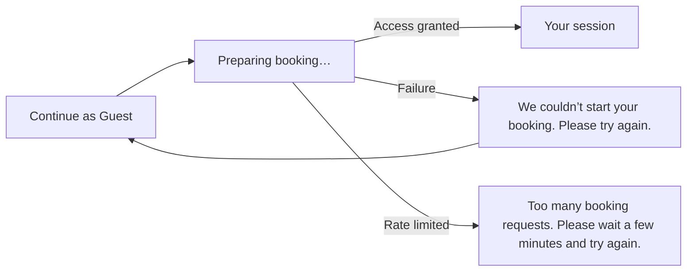

## 2. Email entry and verification

Booking steps after entry show Guest or the currently verified email beside the heading. The initial choice page suppresses Guest, and email entry/code verification suppress identity badges. Guest uses a larger bold pale-yellow badge; the shared identity label reserves its height to avoid shifting the page when verified identity arrives. Only the initial booking-options heading offers Sign out. It waits for acknowledged sign-out before ending the editable flow and routing Home; failure stays on booking options with “Try signing out again”. Later headings are read-only, and payment/confirmation screens keep their existing protected presentation.

On email/code entry, the top-left Back returns to booking options and cancels pending identity work. The bottom duplicate Back link and email-entry envelope tile are removed. The first booking-options screen retains Home.

When email verification is configured and enabled, verify email before loading saved details; a code or service failure never grants access. Requesting a code first requires booking access. If that prerequisite fails, show the neutral guest-access failure or rate-limit message from scenario1. The email-specific failures below apply after that prerequisite succeeds; this diagram does not claim the feature is enabled in production.

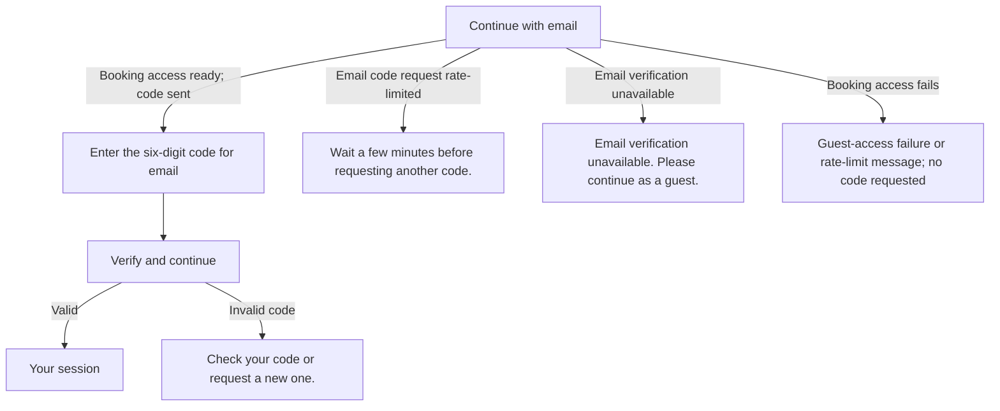

## 3. Expired or revoked access

Identity and confirmation access use different messages; neither reveals a server revocation reason. Explicit access entry and checkout renew only a valid unexpired capability, preserving its owner. Expired/revoked access is not revived; payment, hold and checking deadlines remain independent.

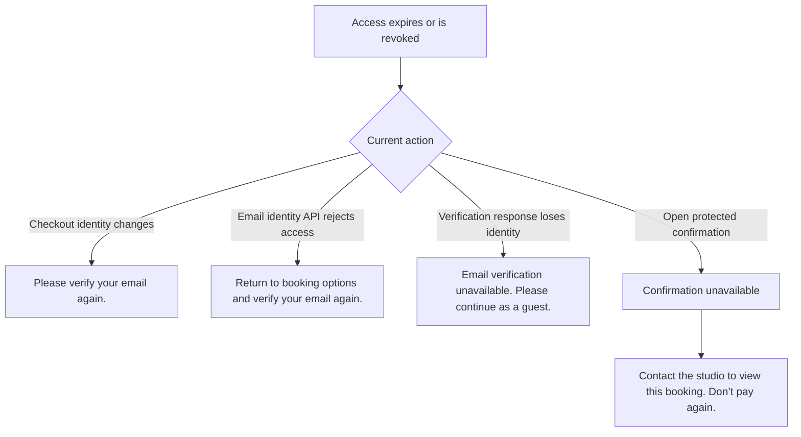

## 4. Session choice and calendar

Choose the priced session card (one-third desktop width, full mobile width) to open player count and the three included features. The compact card stays in place with a blue selected highlight. Returning from the calendar preserves outlet/session choices and player count; explicit deselection still collapses them. Clicking reveals the full-width player control and three inclusions beneath the card grid; it does not replace the card or open a dialog. Choose Date & Time continues from this view. Trainer choices share one studio and never add capacity.

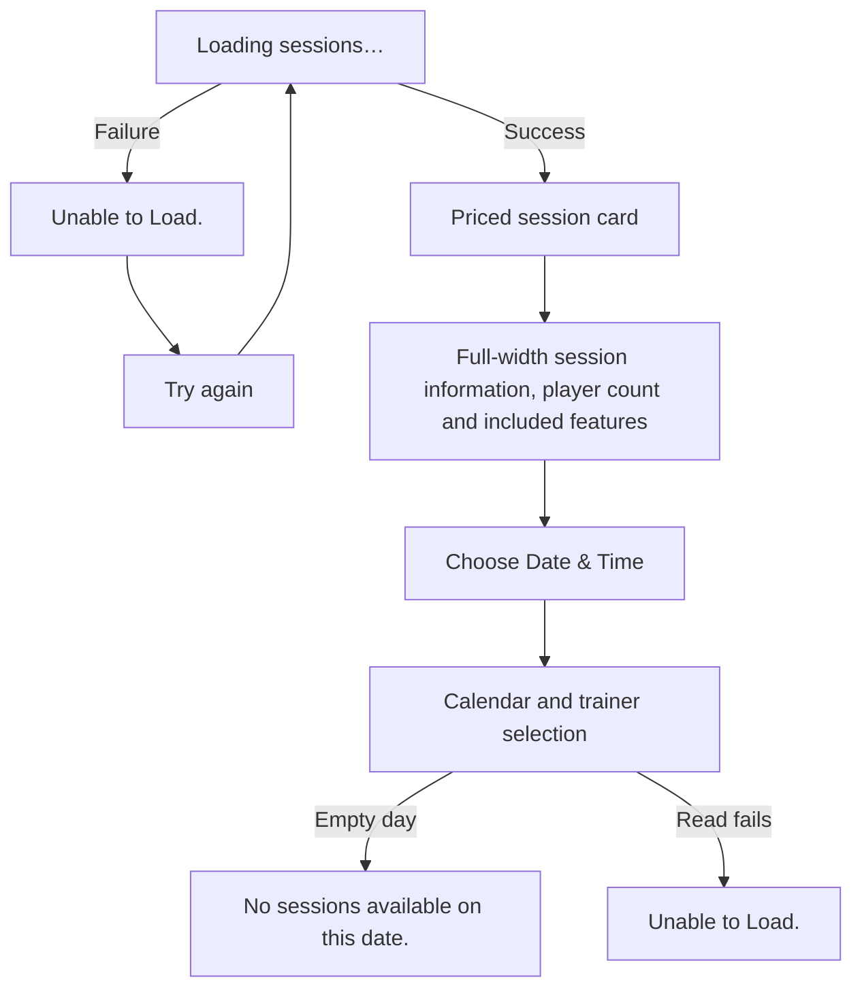

Calendar month/navigation remain on one row; there is no permanent Refresh button. Failed availability reads offer Try again. A verified conflict with authenticated affected-session indices returns directly to Calendar with the affected-session list and corrected cart together; a generic rejection waits for initial fresh classification. Affected studio windows are hidden across trainers; for generic rejections, failed or partial reads retain the initial loading state until every requested date is classified. Availability reads have a 30-second deadline; protected conflict-context reads retain 10 seconds. Failed reads retry no sooner than 30 seconds, respecting server pacing, with successful dates retained only while fresh. No booking or payment write is retried. Background reads update the affected cache while retaining contact details and unaffected valid dates/months. This does not clear the whole calendar or wait for scheduled warming. Missing/expired snapshots and provider-delayed release can still require reads; a local timer never invents a free slot. See [capacity and recovery rules](business-rules.md#br-001).

## 5. Details and review

- On phones, Time, Details and Review expose cart/trainer icons on the right of the persistent top row, with the step count centred; select either to open a right-aligned popup with a fixed header/close control and independently scrolling body.
- The cart badge counts selected sessions; the trainer badge counts distinct selected trainers. Both pop when their count changes, except under reduced motion. Zero counts have no badge.
- Time/Details session and instructor summaries move into those popups; Review retains all session, contact and order details in the main body. Its cart shows the same summary as Details. Next-step actions, contact fields and consent stay on the main page. The next-step action is a full-width naked button without a white wrapper, separated from preceding content and stopping at its original position before the footer. Desktop keeps inline sections.
- Calendar has no visible legend or availability dots. The currently displayed date uses a blue outline and soft background. Only dates with cart-selected sessions use navy circles with white numerals; unavailable dates use a darker grey surface. Cart membership remains available to screen readers. Mobile live controls keep the full month name and previous/next arrows in one row; there is no Refresh button. The selector and enabled arrows have hover feedback.
- Time cards: single-line time and add/check above; price below right. Desktop retains all trainer names below left. Mobile has one circled information mark beside the muted hint above all slots; individual cards have no information icon: “Select to view trainers available”.
- For the current owned live attempt, authenticated expiry or the original checking deadline without payment evidence permits a calendar handoff with the expired cart cleared and the unresolved attempt lock retained. After server-confirmed unpaid release, check affected dates and preserve any new selections made during recovery. Name removed dates/time ranges above the calendar. Failed background reads retain the red notice and hidden affected slots without extra status text; preserve contact and require renewed consent. Unknown provider creation and payment remain protected; scenario12 covers attempts without an eligible calendar handoff.
- Enter Booking Details, Review Booking and Proceed to Payment show the selected-session total before the chevron, using the existing price owner.
- Time popup retains Remove/Clear all; Review main-body Edit links retain the original held/verifying restrictions. Closing a popup restores focus and does not change selections.

Your details shows each session's small price right-aligned on its Trainer row. Review has Your Sessions, Booking contact, and Order summary; the numbered date/time/trainer rows and per-session prices belong inside Order summary. There is no separate Dates & times section or aggregate “N × 40 min session” row. Edit links all read “Edit”. Final totals use a larger Total label and amount, with a muted SGD immediately to the left of the amount. There is no currency caption underneath.

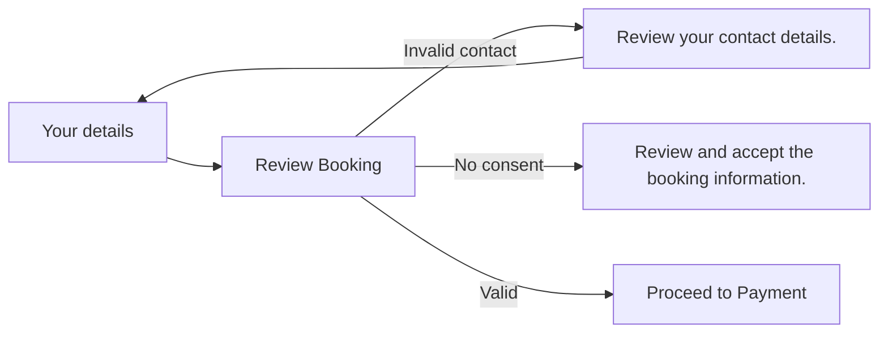

Saved contact details are not booking confirmation. Basket items have distinct boundaries/backgrounds, with the remove × at the top and a light-red cue; prices align right on the trainer row.

## 6. Checkout creation and rejected or uncertain writes

When SimplyBook creation is uncertain and no reliable booking reference exists, the original attempt stays protected; an error or matching contact details cannot prove that no booking was created. An authenticated `creationResolution: {state: "not_created"}` now supplies the distinct terminal result. The automatic source is a narrowly validated single-book date/time rejection; a genuinely lost provider response requires restricted operator verification that original processing finished and created no intended booking. Empty searches and elapsed time are insufficient. The [proof contract](api-contracts.md#verified-no-creation-resolution) owns those server guards.

After that terminal result, show “Nothing was booked or charged. Your details are saved; please choose your sessions again.” Return the matching attempt to Calendar, clear its old cart/consent/recovery identity, and preserve contact and session preferences. A new checkout requires the customer's explicit selection and consent; the old write is never replayed. Refresh while recovery is open checks the exact retained attempt before making this transition. If the customer already left for Home, subsequent Book re-entry checks that attempt and, once resolved, opens normal fresh booking entry without the old recovery notice. Another tab's checkout is not adopted. The resolved notice is in memory only: after resolution, refresh does not resurrect it or the cleared attempt. Unresolved or failed reads continue protecting the original attempt.

For HitPay link recovery, show Preparing payment while recovering the same request. After one creation attempt plus four failed read-only recovery attempts, show Payment Unavailable: “Our payment provider may be temporarily unavailable.” Retain the unresolved reservation; do not expose another payment or assume it is cancelled. Emit the prepared manual-check telemetry event. An authenticated later payment remains eligible for reconciliation.

After a verified selection rejection or blocked checkout window, this tab retains its editable calendar draft across reload, including an empty cart. A tab-local navigation preference prevents automatic adoption of the protected browser session's other checkout; no other-checkout payment link is offered. Matching contact details or selections do not override that preference. Starting a new retained attempt restores normal reload recovery. This preference is not authorization and never cancels or releases another tab's reservation.

Classify from protected evidence, not HTTP status alone. Same studio time is shared regardless of trainer or service. See the [recovery decision contract](api-contracts.md#conflict-recovery-decision-contract).

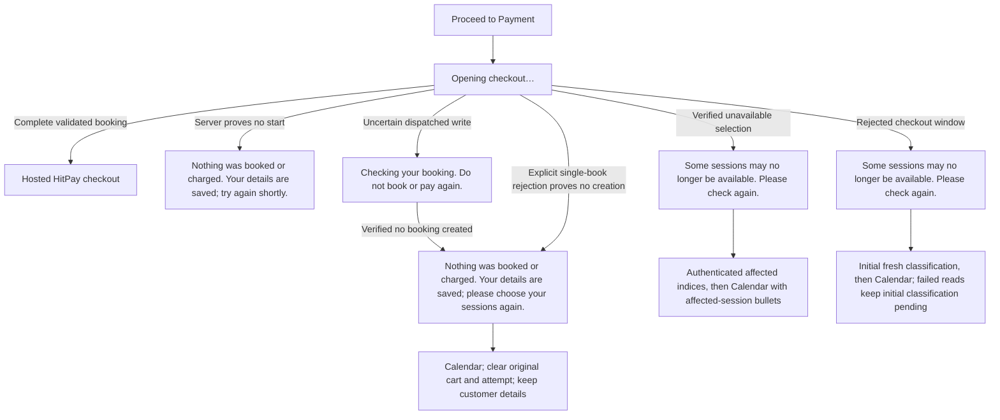

Never silently replace the requested draft with another checkout. Unknown writes keep the original attempt and recovery identity; they must not become a new booking/payment retry.

## 7. Multi-session partial failure

Payment is offered only for a complete validated batch. A lost checkout response can show “Checking your booking. Do not book or pay again.” An authenticated incomplete-booking context uses the wording below and reads the original protected state. Those reads do not themselves reconcile missing SimplyBook references. A separately proven no-effects rejection follows scenario6; partial or unknown writes never become rejection proof merely because a read fails or availability changes.

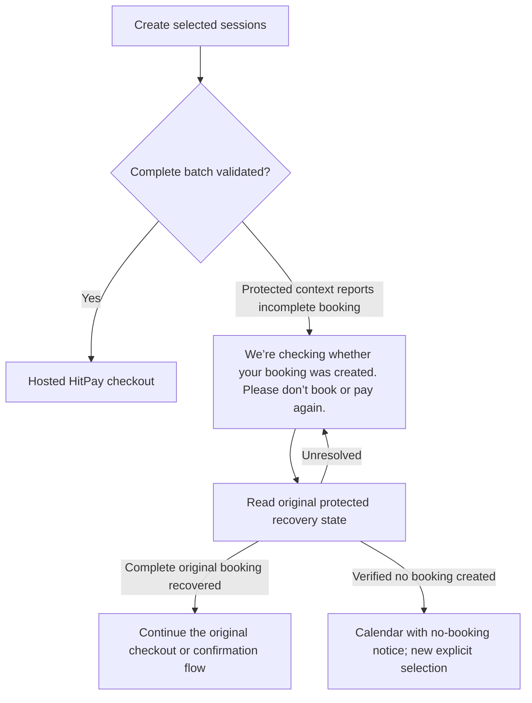

## 8. Back and Continue payment

Payment and confirmation routes may reopen only the same server-authorized, unexpired unpaid HitPay link in the same tab. A completed return hint suppresses continuation immediately, but does not prove payment. Paid evidence, expiry and unresolved/denied states must not expose continuation.

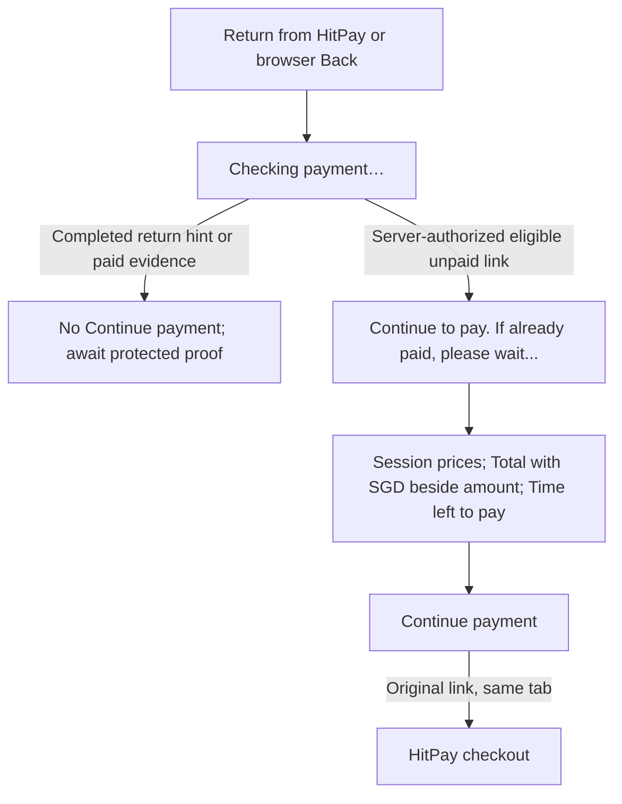

The countdown is centred and bold above the button. Structured details persist into unresolved feedback; missing metadata never invents a trainer or per-session amount.

## 9. Card authentication and provider return

HitPay handles issuer authentication; browser return alone never confirms payment.

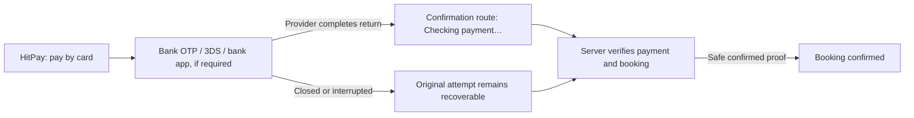

## 10. Payment and booking confirmation

Paid evidence can show progress, but success and the invoice number require confirmed booking proof.

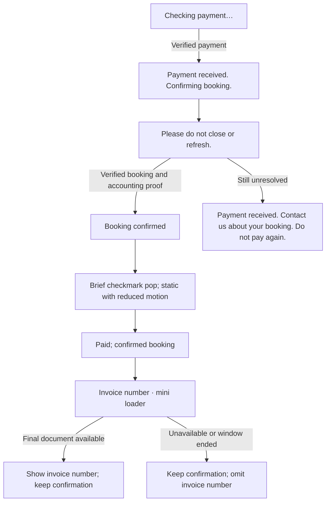

## 11. Temporary status failure

A transient read failure shows Confirmation unavailable when no paid evidence is known. That warning remains while the next automatic read is in flight; a throttled response preserves the previous view. A successful response determines the next state. A failed read never implies failed payment.

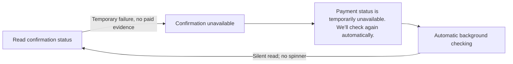

## 12. Unresolved payment or reconciliation

An incomplete booking with no payment dispatch shows only the red message “We’re checking whether your booking was created. Please don’t book or pay again.” and the standard “Checking your reservation…” spinner. Sequential protected context reads continue beyond one minute while the attempt remains incomplete, respect server pacing, and slow after transient read failures. Leaving the page or losing access stops polling. Recovered complete booking evidence returns to the original checkout/confirmation flow; explicit `creationResolution: {state: "not_created"}` instead follows scenario6 to Calendar. Until one of those results is authenticated, no replacement booking or payment write is permitted. These reads observe retained state and do not themselves reconcile SimplyBook or infer noncreation. A missing-reference lost response needs restricted provider-backed operator proof; fresh availability, deadlines and empty searches cannot replace it. See [Technical behavior section7](code-owners/technical-behavior.md#7-recovery-confirmation-exports-and-completed-exit).

No customer-facing Check Status or Check payment status button exists in any branch. Structured details remain visible where available; status checks, initial context retries and expiry release run automatically without manual-check feedback or spinner flashes.

Unknown payment uses a neutral notice; known paid evidence, including an authenticated `paid_booking_invalid` result, retains the payment-received wording. Automatic focus/visibility rechecks retain the existing30-second limit and cannot reset the original checking budget. Calendar return requires protected live context for the current retained attempt, no payment or rejection evidence, and either authenticated expiry or an elapsed original checking deadline. Without that eligible handoff, the original attempt stays protected with the unconfirmed-payment notice.

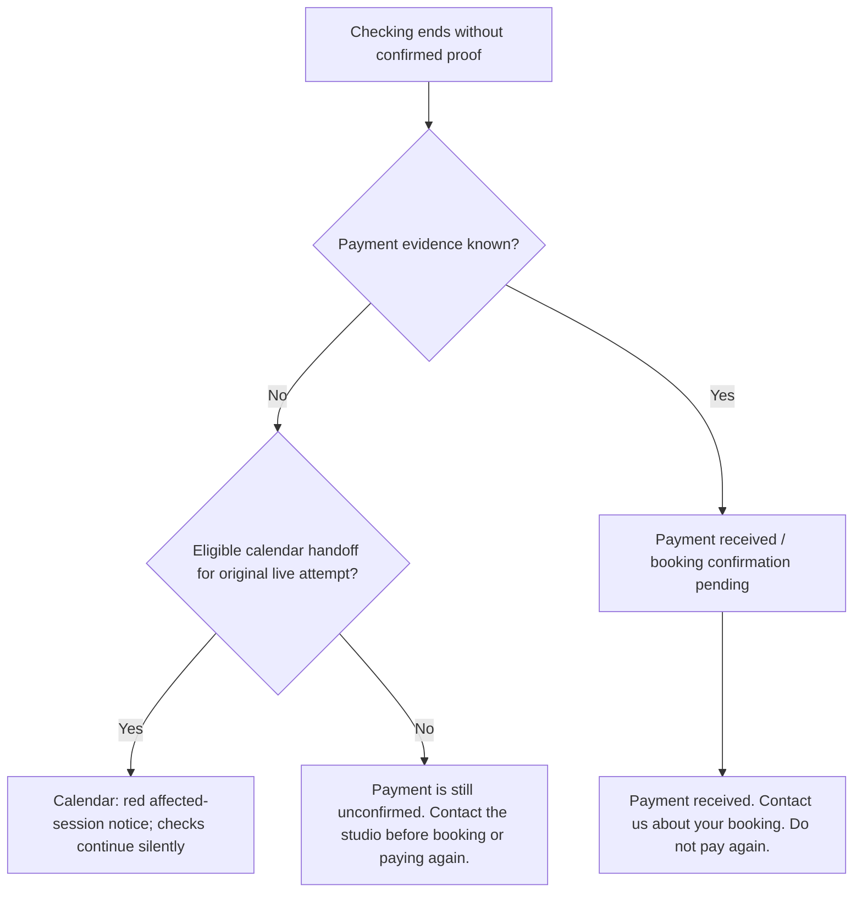

## 13. Expiry, grace and late payment

When the authenticated payment deadline ends, payment continuation is hidden and the original attempt gets at most10 seconds of foreground reconciliation using the full booking animation. Confirmed payment/booking opens confirmation; known payment stays in its confirmation flow; proven releasable unpaid expiry returns immediately to Calendar. If still unknown at the end of the bounded window, return to Calendar and continue silent background checks. Only verified releasable expiry permits a new checkout. New attempts use8 minutes to pay,1 further minute of checking and3 further minutes of recovery before grant release eligibility. The configured10-minute provider hold remains independently capped by invoice due time; cancellation may occur later. The recovery buffer does not extend payment or provider occupancy. Old attempts retain their windows. After the original recovery and hold deadlines, an authenticated matching expired/canceled request with an explicit empty list or only matching, zero-refund unstarted payment-method entries may release; ambiguous evidence and unprocessed receipts stay protected. The original financial journal is retained for late payment. The ten-second display window begins when the expiry is first observed for that attempt and payment deadline; reload resumes its remaining time rather than granting another window. Calendar background recovery never starts a foreground wait, and conflict handoff is unchanged. A failed release request keeps that original attempt locked while release retries silently on the calendar. Without an eligible calendar handoff, show “We couldn’t confirm that your reservation was released. Please don’t book or pay again.” and retain the same release operation. A red calendar notice names affected sessions; rebooking stays locked until authenticated release. No additional Back to home link appears in the notice. Affected-day reads update retained calendar snapshots in the background; a local timer never adds a session back. Bounded affected-day probes handle delayed provider release independently of browser life; the slot remains unavailable until current provider capacity permits it.

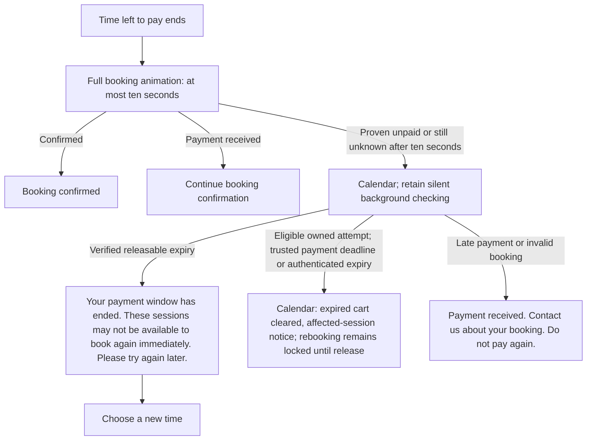

Confirmation summary follows review: provider service name, player count without “per session”; each session uses “Trainer: <name>”. Your Sessions, Booking Contact, Location and Before Your Session are collapsed under View Full Details, in that order. Order Summary and Total Paid remain visible below the disclosure. Session rows show prices beside Trainer; one Paid badge sits at the top right of Order Summary on mobile and desktop. The continuation countdown is centred and bold above its payment button. Missing validated display metadata never substitutes a guessed trainer.

## 14. Confirmed details temporarily unavailable

A receipt-read failure does not undo verified confirmation or authorize another payment.

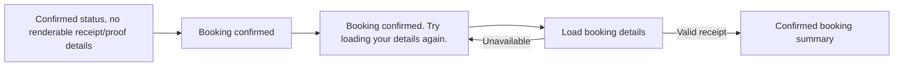

## 15. Saved confirmation and old links

Each protected old link shows only its own booking; it cannot replace a newer active checkout.

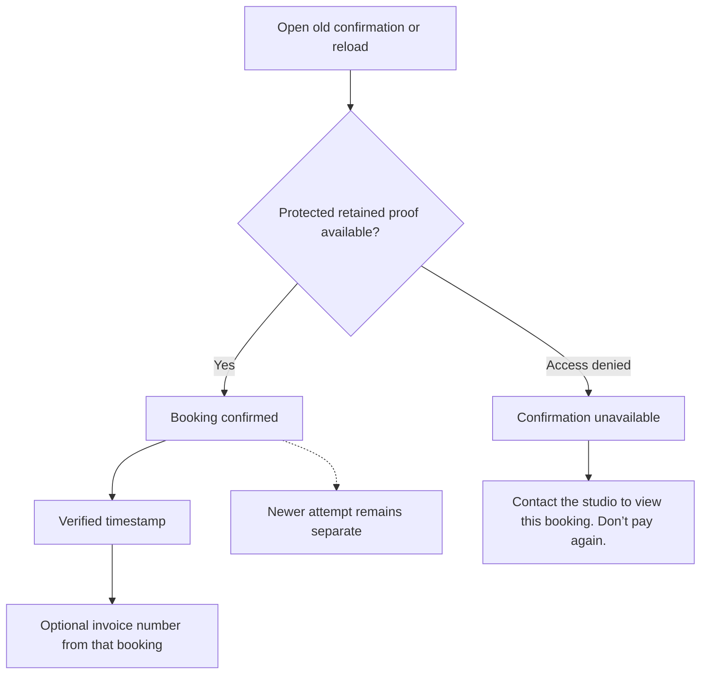

## 16. Make another booking and Back to home

During an unpaid booking step, header, footer and other site links leaving the flow open “Leave this booking?” with “Your selections and changes will not be saved.” Stay keeps the current step and selections; Leave booking clears editable data and follows the chosen destination. All footer links, including Book, share this rule. A new-tab or external-app destination leaves the original tab on Home. Step navigation and explicit payment/recovery continuation links retain their existing behavior; leaving never cancels an existing reservation or payment. Browser chrome and context-menu navigation are outside this custom-link dialog.

A completed receipt remains immutable. Leaving an older receipt must not silently adopt a newer completed booking, or discard a newer unpaid/uncertain checkout.

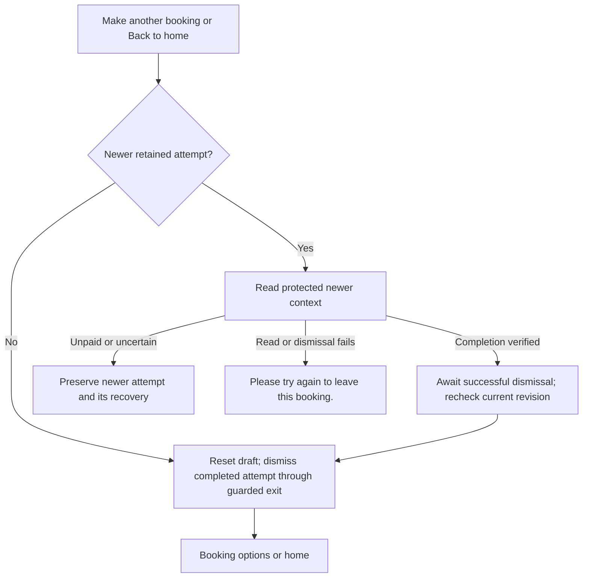

The same-attempt exit uses the existing guarded background dismissal/retry; its failure can show “Unable to start a new booking. Please try again. Your confirmed booking is unchanged.” For a different newer completed attempt, dismissal must succeed before reset/navigation. Navigation never cancels a booking or resets payment deadlines.

## 17. Three complete journeys

Retain one browser context through single → single → single or multi → single → single.

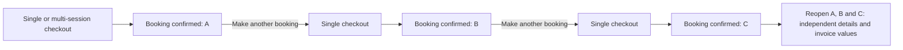

## 18. WhatsApp and staff action

Contacting the studio requests a change; it does not automatically cancel, reschedule or refund.

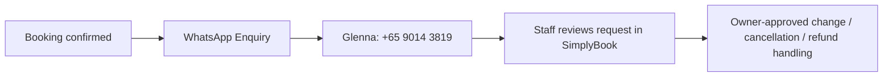

## 19. Preview-only payment states

Preview messages are not proof of real payment or booking.

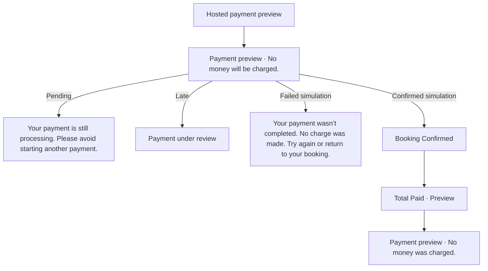

Historical field-level wording and copy proposals are retained in Journey; they are not a second current-source inventory. [Customer UAT](uat/simulated-user.md) owns test actions/results; diagrams describe intended source paths, not completed provider acceptance.

## Archived copy review (historical baseline and disposition)

The earlier M-ID review and control-label inventory are preserved in [Journey](journey.md#historical-copy-review-preserved-on-8-november-2026). They are historical evidence, not current customer messages.

## Additional controls and labels

Use the current source and the message catalogue below. The superseded control-label snapshot is retained with the [historical review](journey.md#historical-copy-review-preserved-on-8-november-2026).

## Not separate customer messages

- Worker reconciliation reasons, accounting retries, unknown writes, duplicate/out-of-order webhooks, late settlement and manual review map into the payment/recovery scenario table; raw codes are not rendered.
- Background calendar refresh, tab visibility changes and successful silent session restoration have no dedicated notification.
- HitPay, issuer OTP/3DS and Turnstile widget copy is provider-owned and cannot be enumerated from this repository. Native browser validation wording varies by browser and language.
- “Confirmed” does not mean immune to future refunds or disputes. The animation and invoice label use the existing confirmed-proof gate.
- Proposed formal style: short outcome, one next step, and “Do not pay again” when needed. Do not add blanket retry language to ambiguous payment failures.

## Current changed copy and presentation

The [current customer error catalogue](#current-customer-error-catalogue--local-repair-8-november-2026) is the single current wording inventory. Confirmed conflicts use the affected-session notice; unavailable basket items use “Session no longer available.” Failed availability reads never imply an empty date or a confirmed conflict. Deployment/test evidence belongs in [Progress](../PROGRESS.md) and dated [Journey](journey.md).

## Public entry surfaces — 6 November redesign

The interactive homepage hero remains with 15% shorter height targets and a straight edge. The enlarged address still opens its location dialog. Two image banners lead to **Explore the studio** and **Book now**. Contact us is a compact photo-free muted-orange abstract banner with navy text and a tonal peach action; Studio reuses its centred, shorter layout and radial-gradient style for the booking footer with different copy and the retained navy palette. Both closing banners meet the unchanged footer directly; the white footer groups Services, Connect With Us and Find Us on the left and a horizontal Apple/Android/web Download App row on the right, with the logo bottom-right above the divider. Service includes Terms of Service, Privacy Policy and Refund Policy links to intentionally empty white placeholder bodies; Get in touch and the footer Disclaimer are removed. The second section retains curved top and bottom edges; the Contact banner has straight edges. Both image promotions use very light grey backgrounds with dark text and navy actions. The smaller flag precedes the two header links; Download app is removed from the header. The initial popup has only the owner-approved heading **Download The Official Soccerbot360 Player App Now.**, App Store, Google Play and Web App icon links, and close control. Its earlier explanatory text and header Download app rows above are retired. Studio shows only the official demonstration video above its retained content; visible global-imagery credits are removed, with provenance retained in source.

Session entry now reveals **Choose your outlet** → **Apex @ Henderson** (flagship description) → **Select your session** → player controls/inclusions → **Choose Date & Time**. The only outlet uses existing venue authority; no new provider mapping, capacity or pricing rule is introduced. Clicking either selected card again deselects it. Outlet deselection hides/resets nested session disclosure; session deselection hides players/inclusions/continue. Outlet and session widths and selected highlights match. The outlet has no trailing arrow/check indicator; its address is on a separate line beneath the flagship description. Returning from the calendar preserves outlet/session choices and player count. Enquiry stays preview-only and the mock assistant remains retired.

Public shell follow-up: the header remains visible while scrolling, with measured clearance for anchor/focus navigation. Sections below the initial viewport reveal once as they enter view; reduced-motion users see immediate content. Booking data, validation, live status and leave-booking confirmation retain their existing behavior.

Connect With Us uses icons instead of visible platform labels for WhatsApp, email and Instagram, retaining readable contact values and accessible platform names. The footer has no Enquire link; WhatsApp, email and Instagram remain.

Latest visual corrections: stage offscreen sections transparently before a clear650ms/32px entrance, with immediate reveal for focus/reduced motion and cleanup. Closing-banner heading, supporting copy and CTA share centred alignment and balanced columns, stacking centrally on phones. Phone header flag and two navigation buttons align together at the right.

Booking routes, confirmation and experiment checkout are excluded from scroll reveals; their components remain static, retaining existing confirmation/invoice popup behavior. On phones the Studio tagline/video intro fills the first viewport below the measured sticky header, with cover video and a single playback control; gallery begins below the fold.

Mobile Studio video uses the official homepage hero-loop.mp4 montage with a centred portrait cover crop; desktop retains stream.mp4. Both use muted, inline, one-pass autoplay with no native controls or loop; a single control shows Pause while playing and Replay after completion. Reduced motion or blocked autoplay offers Play. Media files remain MP4 for quality and size. The responsive source owner is studio-hero-video.tsx with canonical media provenance in media.ts. Footer headings are16px, details14px, contact icons20px and app icons26px within44px controls; four desktop columns become two on tablets and one on phones.

Public pages show a centred floating up-chevron after200px scrolling. Its icon gently floats; clicking restores header focus and scrolls to the top. Reduced motion disables floating/smooth scrolling. The control is absent throughout booking, confirmation and experiment checkout. Check it on phone/desktop alongside existing public-section motion; no payment/navigation authority changes.

Mobile booking navigation uses a compact sticky Back/current-step row below the measured site header. Existing single next-action controls in session, calendar basket, details/review and email/verification forms occupy a slim fixed bottom bar, with body/focus/safe-area clearance. Account choice cards and payment/recovery actions retain their existing placement. Actual controls, handlers, disabled/loading conditions and form ownership are unchanged; no duplicate actions or booking animation are introduced. Check navigation height≤48px and bottom bar≤72px without a device safe-area inset, keyboard/focus clearance and disabled-state behavior.

Public entrance motion targets noninteractive visual blocks only: clickable controls and forms remain stationary, including banner CTAs. Studio intro retains a real layout box so route entry starts at the hero. CI42179543002 exposed these navigation/hit-target regressions; original evidence is retained in Journey and final-head verification is required.

### Follow-up navigation and conflict behavior

Review consent resets on departure, reload and return; a dispatched checkout retains its immutable accepted snapshot. A proven no-effects conflict with an authenticated affected-index list returns to Calendar immediately with that list and corrected cart. A generic rejection without affected indexes waits for complete fresh classification. Indexed rejection evidence is retained with the original tab-local rejected snapshot. Refresh resumes its protected read from the immutable pre-dispatch rejection even when no attempt row was ever created; known indexes can complete handoff without provider reads. Failed or partial reads never remove unclassified selections and cannot finish the initial handoff. Candidate windows remain hidden pending successful fresh availability. Every conflict phase uses exactly “Some sessions may no longer be available. Please check again.” Classification retries keep one stable initial loader. After handoff, later availability reconciliation stays in the background. If all dates are successfully read and every selection is available again, keep the cart and show the generic notice without inventing affected sessions. Conflict and expiry lists explicitly use visible disc markers. A tab-local date/time list preserves the notice and bullets across calendar refreshes and selection edits, and is cleared the first time the calendar step is left. Returning or refreshing afterward does not recreate it merely because another checkout exists. Reload preserves this tab’s draft and never offers or automatically adopts another tab’s checkout. Expiry clears expired selections; new selections made while recovery runs survive safe release.

### Rolling calendar

The calendar defaults to Month. The optional rolling seven-day view begins at the first available date for a fresh selection. Restored selections retain their selected date. Week/Month sits beside the navigation arrows; month names remain written in full. A week spanning two months loads both snapshots without discarding the first when the second fails. Switching views or weeks preserves the cart. Only days containing cart selections use navy circles with white numerals, without a legend or availability dots. Unavailable days use a darker grey surface. Monthly date cells are approximately half their former desktop height and 30% shorter on phones. The desktop cart sticks below the header without an internal height cap or scrollbar; all selected sessions and trainer profiles flow with document scrolling. Mobile panels retain a single body scroll area, without a nested session-list scrollbar. Your Cart starts with the session count and, on Time, Clear all; it does not repeat Your Sessions or a service name. Review and the calendar context use the originally selected catalogue service name, independent of the first session’s weekday/premium rate. Review reads its retained display label or existing catalogue cache without starting a request. The outlet/session context remains18px bold above the16px duration note.

Mobile entry choices use compact cards with icons beside headings and44px minimum actions. Outlet/session cards use reduced spacing so the choices fit within a typical phone viewport. Expanded player/inclusion details also use compact mobile spacing:12px panels/gaps,16px headings,14px descriptions and44px player buttons. Full content retains natural page scrolling; target roughly40% less overall height, subject to owner viewport acceptance. The hero address uses the12px caption token on mobile; desktop remains14px. Viewing a date alone never adds the navy cart-selection circle.

Selecting a trainer collapses that slot’s picker and shows Trainer: name at the lower left using the price font size. To change it, remove that selection and choose the time/trainer again. Opening an unselected picker leaves its tile white; only a completed selection is highlighted. Date changes preserve the previous times-region height while loading, without keeping stale slots actionable.

Desktop Time cart uses one Enter Booking Details action with the total directly under the compact banner shared by every booking step, before the session count/Clear all and rows; it omits the duplicate total row. Mobile keeps its existing floating combined action and read-only total inside the panel. Original row typography,44px remove controls and spacing remain on taller screens; five-session carts in desktop windows up to850px high reduce row padding/gaps only. One compact Your Trainers panel follows the cart in page flow. It lists unique trainer avatar/name rows with a count, starts collapsed and opens only one biography at a time. Mobile uses the same panel within the existing trainer dialog.

On mobile, tapping a date reveals that date’s session heading after its offers arrive, positioned below the sticky navigation. Initial loading and background refresh do not move the page; reduced-motion users get an immediate move. Session cards use one full-width column so selected trainer and price stay aligned on the second row. Long names and rotation notices may still wrap for readability.

### Confirmation and calendar return presentation — 8 November 2026

A fixed, horizontally centred double-chevron up button sits8px below the sticky navigation on mobile and below the sticky site header on desktop whenever the calendar is above that area, including after manual scrolling. It shares the studio cue’s shape, colours, size and pulse, and returns to the calendar below the sticky bars. Reduced motion keeps it static. Explicit date selection scrolls to loaded sessions on both desktop and mobile, reserving60px below the sticky bars for the cue. Initial load and background refresh do not trigger scrolling.

Protected confirmation context and post-payment verification use the full checkout loading presentation, then directly show Booking Confirmed when verified. No small pending spinner or intermediate booking summary appears in that path. Explicit unpaid payment continuation retains its usable summary and action. This presentation does not change payment proof, checking deadlines or failure recovery. The verified Paid badge sits at the top right of Order Summary with23.8px text and8.5px vertical/15.3px horizontal padding on mobile and desktop; preview summaries do not claim payment.

### Explicit next-step actions and field validation — 8 November 2026

The main booking actions read Continue as Guest, Choose Date & Time, Enter Booking Details, Review Booking and Proceed to Payment. Calendar and review actions retain their displayed amount and chevron. Existing email-verification entry and payment-resume actions retain their distinct meanings.

Contact inputs show their existing validation feedback on blur and are revalidated on submission: trimmed full name2–80 characters, email format and120-character limit, phone8–15 digits with supported separators, an allowed preferred contact method, and optional academy/school/organisation up to120 characters. Verified-email matching remains required. Email-verification entry applies the shared format check before requesting a code; invalid values show an accessible message and make no request. Format validation does not establish mailbox ownership or deliverability.

Verified confirmation now includes “Your booking confirmation will be emailed to you.” directly below Booking Confirmed; previews and pending states do not promise email delivery. When the authenticated status confirms the current attempt and its protected booking details are already loaded, those details render immediately even if the separate receipt request is still pending. Invoice enrichment replaces them without replaying the confirmation heading. Pending payment or browser-return hints alone never enable this path.

Local8 November follow-up reduces the Paid badge text and padding by15% (23.8px text;8.5px vertical and15.3px horizontal padding). Browser/device acceptance remains pending; this local slice is not deployed.

### Conflict and expiry recovery clarification (local, 8 November 2026)

Confirmed conflict returns to the calendar with “Some sessions may no longer be available. Please check again.” Only affected cart selections are removed. Expiry returns with the red affected-session notice and clears the expired cart. In both cases, affected studio windows are hidden across trainers while fresh availability is checked silently; other slots remain selectable. No calendar recovery spinner, status-check text or Check status control is shown. Fresh available offers return only after the original payment no longer blocks their release. New selections remain separate from the original attempt and are preserved when release completes.

Refresh retains this tab’s recovery state and never automatically opens another tab’s payment link. Identical contact information is not checkout ownership. Unknown provider writes remain unresolved until authoritative evidence arrives. A pre-dispatch rejection can become a conflict return; a separate verified no-creation result follows scenario6 with its own notice. Late confirmed payment still leads to confirmation.

## Current customer error catalogue — local repair, 8 November 2026

This is the rendered live booking-flow inventory for the local repair, not a deployment receipt. `{sessions}` means Singapore dates and time ranges. Conflict and expiry notices list affected sessions as separate bullets below the fixed message, for example “Mon, 9 Nov 2026, 12:00–12:40.” Conflict bullets include only verified affected sessions and persist with the notice through refresh until the first calendar departure. Internal provider reasons that share a customer message are grouped. Preview-only simulation errors and unreachable legacy copy are excluded. No customer-facing Check Status or Check payment status button is retained; automatic recovery keeps its original attempt, timing and financial safeguards. “Try again” for availability and “Load booking details” for a verified receipt are different operations.

Verified no-creation also temporarily hides the original affected time windows across trainers. Background fresh availability alone restores them; failed or stale reads leave them hidden. The cart is cleared, and other available sessions remain selectable.

### Conflict, expiry and payment

| Trigger                                                                              | Customer message                                                                                                      | Result                                                                                                                                                                                              |
| ------------------------------------------------------------------------------------ | --------------------------------------------------------------------------------------------------------------------- | --------------------------------------------------------------------------------------------------------------------------------------------------------------------------------------------------- |
| Proven conflict with affected sessions                                               | Some sessions may no longer be available. Please check again.                                                         | Calendar immediately for authenticated indices, otherwise after fresh classification; show bullets, remove affected selections, retain others and hide affected windows pending fresh availability. |
| Proven no-effects rejection without an affected index; classification pending/failed | Some sessions may no longer be available. Please check again.                                                         | Keep initial loading through failed/partial reads; bounded paced retries finish all dates before Calendar. Refresh preserves the original snapshot and readiness gate.                              |
| Refresh finds a different checkout or lacks exact tab ownership                      | Retain the existing conflict notice; do not create a new notice from another checkout.                                | Calendar; never automatically adopt the other checkout.                                                                                                                                             |
| Payment window ended, original attempt still resolving                               | Your payment window has ended. These sessions may not be available to book again immediately. Please try again later. | Calendar, empty expired cart; original attempt retained. Other slots selectable; no recovery spinner or status controls.                                                                            |
| Authoritatively released unpaid reservation                                          | Your payment window has ended. These sessions may not be available to book again immediately. Please try again later. | Calendar; preserve new selections, restore hidden times only after fresh availability.                                                                                                              |
| Released expiry with no original sessions                                            | Your payment window has ended. These sessions may not be available to book again immediately. Please try again later. | Calendar selection.                                                                                                                                                                                 |
| Late payment detected during calendar recovery                                       | Payment received. Opening your booking status. Do not pay again.                                                      | Automatically open the original payment/confirmation route.                                                                                                                                         |
| Server proves checkout never started                                                 | Nothing was booked or charged. Your details are saved; try again shortly.                                             | Clear undispatched attempt, keep editable draft.                                                                                                                                                    |
| Provider queue admission busy                                                        | Please wait a moment, then try again. Your details are saved.                                                         | Retain same prepared attempt for retry.                                                                                                                                                             |
| Repeated unpaid-reservation defence                                                  | New reservations are paused after repeated unpaid reservations. Please try again in up to 1 hour.                     | Server blocks another reservation; retain draft.                                                                                                                                                    |
| Lost/unknown checkout write                                                          | Checking your booking. Do not book or pay again.                                                                      | Original attempt retained; no blind replacement write.                                                                                                                                              |
| Provider creation incomplete/uncertain                                               | We’re checking whether your booking was created. Please don’t book or pay again.                                      | Original attempt stays locked; automatic protected context reads observe recovery state. No new booking/payment retry is offered.                                                                   |
| Exact original attempt has verified terminal no-creation proof                       | Nothing was booked or charged. Your details are saved; please choose your sessions again.                             | Calendar; clear old cart, consent and attempt, preserve contact/session preferences, require a new explicit booking. Unknown/failed reads never trigger this.                                       |
| HitPay link acquisition exhausted after five attempts                                | Payment Unavailable — Our payment provider may be temporarily unavailable.                                            | Also: “Your reservation still needs to be resolved. Please don’t book or pay again. Contact the studio for help.” No new payment action.                                                            |
| Other HitPay checkout opening failure                                                | We couldn’t open checkout. Don’t book or pay again; contact the studio.                                               | Retain hold/attempt; protected recovery owns subsequent presentation.                                                                                                                               |
| Temporary/malformed/unavailable payment-status response                              | Confirmation unavailable — Payment status is temporarily unavailable. We’ll check again automatically.                | Retain original attempt; background checks do not replace displayed content with a loader.                                                                                                          |
| Unresolved/invalid/exhausted evidence without a usable calendar handoff              | Payment is still unconfirmed. Contact the studio before booking or paying again.                                      | Original attempt stays protected. No five-minute rebooking promise.                                                                                                                                 |
| Access denied                                                                        | Confirmation unavailable — Contact the studio to view this booking. Don’t pay again.                                  | Hide protected details; stop unauthorized reads and cancel pending conflict classification. Preserve the original attempt/cart; late results cannot navigate.                                       |
| Payment received but booking pending, invalid or late                                | Payment received; booking confirmation pending — Payment received. Contact us about your booking. Do not pay again.   | No false confirmation or additional payment. Historical proof may use heading “Payment received”.                                                                                                   |
| Expiry release fails outside an eligible calendar handoff                            | We couldn’t confirm that your reservation was released. Please don’t book or pay again.                               | Retry same release automatically. Normal owned booking flow stays on calendar with its stable expiry notice.                                                                                        |
| Confirmed booking, receipt/details unavailable                                       | Booking confirmed. Try loading your details again.                                                                    | “Load booking details” reads receipt only; never repeats payment.                                                                                                                                   |
| Confirmed-booking restart/dismissal fails                                            | Unable to start a new booking. Please try again. Your confirmed booking is unchanged.                                 | Preserve confirmation; explicit restart retry only.                                                                                                                                                 |
| Checkout attempted before that dismissal succeeds                                    | Unable to start a new booking. Please try again.                                                                      | No new checkout.                                                                                                                                                                                    |
| Confirmation exit action fails                                                       | Please try again to leave this booking.                                                                               | Confirmation remains intact.                                                                                                                                                                        |

### Availability and general booking errors

| Trigger                                                 | Customer message                                                                           |
| ------------------------------------------------------- | ------------------------------------------------------------------------------------------ |
| Catalogue/calendar/day read fails                       | Unable to Load.                                                                            |
| Adjacent displayed month fails                          | Unable to Load.                                                                            |
| No times on chosen date                                 | No sessions available on this date. Choose another date. Your selections are saved.        |
| No eligible session type                                | No sessions are currently available.                                                       |
| Session type not chosen                                 | Choose your session.                                                                       |
| Session display metadata unavailable                    | Apex @ Henderson · Session details unavailable                                             |
| Session changes during availability read                | Your session has changed. Please check availability again.                                 |
| Unavailable selected cart session                       | Session no longer available.                                                               |
| Selected cart session started                           | Session has started — remove to continue.                                                  |
| Five-session cart limit                                 | No limit banner; the five-session cap remains enforced.                                    |
| Live endpoint unavailable                               | Online booking is unavailable. Your selections have been kept.                             |
| Operation unavailable/not enabled                       | Online booking is not available yet. Please contact the studio.                            |
| Invalid request schema                                  | Please review your booking details.                                                        |
| Invalid/mismatched provider reply                       | We couldn’t check this information. Please try again.                                      |
| Unclassified request failure                            | We couldn’t complete that request. Please try again.                                       |
| Unclassified selection conflict                         | Your booking details have changed. Please review your selected sessions before continuing. |
| Explicit request cancellation                           | The request was cancelled.                                                                 |
| Interrupted status action                               | The status check was interrupted. Your booking is unchanged.                               |
| Identity changes during operation                       | Please verify your email again.                                                            |
| Invalid checkout consent/selection/service relationship | Review your selection before starting checkout.                                            |

Explicit availability retry immediately clears the previous error while the request is pending; only a failed retry restores it. Retained calendar content stays visible without a background branded loader. Availability failures offer “Try again” where retry is supported; explicit service-unavailable status omits it. Server-confirmed selection conflicts and expired holds are consumed by the calendar transition; lower-level phrases such as “Your selected time changed” or “Reservation expired” do not remain their normal final screen.

### Contact, selection and consent validation

These retain entered details and block the next action. Some domain guards normally manifest as a disabled button rather than a separate alert.

| Condition                            | Validation message                                                  |
| ------------------------------------ | ------------------------------------------------------------------- |
| Missing/invalid full name            | Enter the booking contact’s full name.                              |
| Invalid email                        | Enter a valid email address.                                        |
| Email differs from verified identity | Use your verified email address.                                    |
| Invalid phone                        | Enter a valid mobile number.                                        |
| Invalid contact preference           | Select a contact method.                                            |
| Academy field too long               | Use no more than 120 characters.                                    |
| Empty cart                           | Choose at least one session.                                        |
| More than five sessions              | Choose up to 5 sessions per booking.                                |
| Invalid/out-of-window session        | Choose a valid session within the booking window.                   |
| Mixed/invalid session selection      | Review your selected sessions.                                      |
| Selected session started             | A selected session has started. Remove it and choose a future time. |
| Insufficient lead time               | Book sessions at least 4 hours before their start time.             |
| Overlapping sessions                 | Selected sessions must not overlap.                                 |
| Invalid booking options              | Review your booking options.                                        |
| Missing verified email               | Verify your email again.                                            |
| Invalid contact details              | Review your contact details.                                        |
| Missing review consent               | Review and accept the booking information.                          |

### Guest entry and optional email verification

Email-specific rows apply only when that feature is configured/enabled; this catalogue does not claim it is enabled in production.

| Trigger                                                     | Customer message                                                    |
| ----------------------------------------------------------- | ------------------------------------------------------------------- |
| Unexpected email or other identity-action error             | We couldn’t continue. Please try again.                             |
| Guest access rejected, unavailable, missing or malformed    | We couldn’t start your booking. Please try again.                   |
| Guest access rate-limited                                   | Too many booking requests. Please wait a few minutes and try again. |
| Missing/expired security proof                              | Complete the security check and try again.                          |
| Wrong/expired verification code                             | Check your code or request a new one.                               |
| Identity rate limit                                         | Wait a few minutes before requesting another code.                  |
| Identity access denied                                      | Return to booking options and verify your email again.              |
| Missing site key / unavailable or invalid identity response | Email verification unavailable. Please continue as a guest.         |
| Signed-in identity cannot be revalidated                    | Verify your email again.                                            |
| Remembered-profile requirement not met                      | Select Remember me and verify your email to save details.           |
| Save remembered contact fails                               | We couldn’t save your details. Please try again.                    |
| All-device sign-out requires fresh access                   | Verify your email again, then choose Sign out all devices.          |
| All-device sign-out fails                                   | Could not sign out all devices. Please try again.                   |
| Browser sign-out fails                                      | Could not sign out this browser. Please try again.                  |

Guest-access failures are classified separately from email verification, including transport and malformed-response failures. Initial background identity refresh failure is silent; it does not show an alert.

### Successful and foreground progress states

These are not errors. Initial user-driven checkout/payment preparation may use the approved loader; background recovery must not inject a loader into an already usable calendar or stable status view.

- Verified booking: “Booking Confirmed” and “Your booking confirmation will be emailed to you.”
- Existing valid payment: “Continue to pay. If already paid, please wait...” with “Time left to pay: {mm:ss}” and “Continue payment”.
- Native retained link: “Complete your payment” and “Checkout opens separately. Return here to check your booking.”
- Foreground progress labels: “Preparing booking…”, “Checking dates…”, “Checking times…”, “Checking sessions…”, “Checking reservation…”, “Opening checkout…”, “Preparing payment…”, “Checking booking…”, “Checking payment…”, “Payment received. Confirming booking.”, “Preparing confirmation…”. In the shared booking overlay, the label names the progress indicator for assistive technology. Visible text is “Please do not close or refresh.”, except “Opening checkout…” and “Checking payment…” prefix that sentence. Eligible unpaid continuation displays its progress label and guidance with the retained summary.
- Remembered contact saved: “Details saved.”

Sources: [provider](../src/features/booking/provider.tsx), [protected confirmation](../src/features/booking/protected-confirmation.tsx), [booking adapter](../src/services/booking.ts), [identity adapter](../src/services/identity.ts), [booking messages](../src/domain/booking-messages.ts), [selection validation](../src/domain/booking.ts), [contact validation](../src/domain/contact.ts), [account step](../src/features/booking/account-step.tsx), [calendar](../src/features/booking/time-step.tsx), [cart](../src/features/booking/summary.tsx).

Calendar departure after recovery: the initial Calendar redirect is consumed on arrival. Conflict survivors can Continue immediately without editing the cart. During unresolved expiry, Back permits earlier selection steps while the original attempt remains protected; new checkout remains blocked until verified release. Background release must preserve the current step and edited draft, and must not restore a notice already dismissed by leaving Calendar.

Background calendar refresh keeps last-known date indicators and session cards without the branded loading graphic, including delayed retries after a failed read. Retained cards are presentation only: expired offers cannot authorize a selection or Continue, and failed refreshes still show retry feedback. A fresh successful response replaces the retained display, including verified empty results. Missing-day results remain unknown; only verified empty days use the unavailable state. Trailing future months are hidden only with complete fresh empty-cache coverage; unknown months stay reachable and warming continues over all policy months.

Local contact/action presentation update: required booking-contact name, email and phone show invalid styling immediately, with existing validation messages. Review Booking stays disabled until contact validation passes. Step3,4,5 actions use a subtle 240ms readiness animation only on disabled-to-enabled transitions, respecting reduced motion. Guest email adds “Please double-check your email address, then confirm by selecting the exclamation mark.” The red confirmation control becomes a green animated tick after an explicit click with valid email syntax. Every edit resets acknowledgement; Review Booking and form submission require it. Verified member email is exempt. No email-domain typo suggestion or mailbox verification was added.

Local cart-copy update: BasketContinue no longer renders “Updating session availability…”, “Session no longer available.” or its availability-read failure notice beneath the primary action. Availability and financial guards still determine whether the action is enabled. Conflict/expiry calendar notices and affected-session lists are unchanged.

Local presentation refinement: calendar read failures use a compact red notice with16px separation from the grid, “Unable to Load. Try again.” with a clickable retry. Session-section scrolling leaves24px extra space below sticky surfaces; desktop action scrolling reserves32px around the target. Five-session capacity remains enforced without its banner. Action readiness scales0.98→1.01→1 with a reduced blue halo; confirmation/email ticks retain their original animation.

Recovery refinement from captures16–18: expiry restarts calendar reads immediately, clears the old editable cart and retains the original financial attempt separately. Replacement sessions can navigate through Details and Review; final checkout waits for authenticated safe resolution. The matching expiry notice clears on the first Calendar departure and remains dismissed across remount/reload and later release. Governed provider recovery checks at the actual payment deadline; verified terminal unpaid proof unlocks another explicit checkout without a fixed checking-buffer wait. Unknown/paid/partial outcomes remain protected, and original affected capacity stays hidden until fresh availability permits it.
