# Booking scenarios and messages

The outlet shows its building name above one address line, “201 Henderson Road, #05-01”. The session title and duration/player-range/trainer metadata share the desktop top row; two full-width price rows align their amounts right. Phone metadata stacks below the title. “Trainer included” stays together on one line; the demo name is “Kickoff Special” without the old trial-price suffix. Card body text, price amounts and the visible player count use 16px. Minus, count and plus occupy equal 40px squares; the count is bold and the icons are 20px. Unselected cards remain white; selected outlet, session, time, payment-method and calendar-day surfaces use the same pale teal fill and teal border as card hover, with dark ink; cart-day numeral circles use solid navy with white numbers. Outlet, session and time cards have no selection plus/tick icons; player-count minus/plus controls remain. The outside-card player helper, circle, line and pulse are removed. Primary Continue/Save actions have a subtle flowing navy gradient, static under reduced motion and absent on disabled controls. Card widths, vertical ordering, toggle behavior and initial Continue visibility are retained.

Shared primary actions remain sticky, but their moving subtree is excluded from browser scroll anchoring to prevent automatic scroll displacement at the resting/floating transition. Manual footer scrolling remains available.

Booking primary Continue/Save actions use the original header navy with white heavy-italic labels and normal letter spacing. Secondary and disabled states retain their existing treatment. Selected cards and calendar days use the pale teal hover colour, with unselected white surfaces unchanged. Calendar content and controls use16px, supporting details14px, section/card headings20px, and weekday/progress labels12px. Main headings use40px desktop/32px phone heavy italic, except the short-phone Session step uses a compact28px single-line heading. Trainer labels remain16px before and after selection; state changes do not resize the text.

Details retains “* Required fields” and the Booking Contact heading above the inputs, and removes the booking-timing introduction and saved-contact explanatory paragraph. Review removes “Check your details before payment.” Field labels, validation, consent, profile saving and review/confirmation summary headings are unchanged.

Successful email verification returns to the verified Welcome back card on Account. Welcome back and the email use centred 24px, 900-weight italic action typography. Only explicit Continue signed in advances to Session; verification, remembered identity and revocation remain server-authoritative.

Source reconciled 8 November 2026 against the current local `fix/consistent-conflict-notice` working tree; [Progress](../PROGRESS.md) owns deployment/test status, this document owns scenario messages and copy decisions, and [contracts](api-contracts.md) own proof and recovery rules. Diagrams and the current copy table below describe implemented behavior. The historical copy-review snapshot is preserved in Journey. The current customer error catalogue below is the source-reviewed inventory. HitPay/bank screens are provider-owned; their return paths remain physical UAT.

[Current error-message catalogue](#current-customer-error-catalogue--local-repair-8-november-2026) lists exact wording, triggers and permitted actions.

- New-reservation cooldown: show “New reservations are paused after repeated unpaid reservations. Please try again in up to 1 hour.” Preserve customer selections/contact; no new provider effect starts. Existing uncertain/paid attempts retain recovery rather than returning an editable duplicate checkout.
- Calendar display expiry retains the date grid and loaded cards during background refresh, without a foreground spinner or all-grey flash. A failed refresh keeps explicit retry feedback; expired data never grants reservation authority.

The calendar displays the selected outlet and catalogue session name in a bold16px row above the16px duration note, below its main heading and above the duration note. The home hero address uses smaller white text with a subtle shadow on mobile; desktop styling is unchanged.

Booking headings use shared deliberate two-line text at widths up to700px, with32px mobile type; Session uses a single28px line when viewport height is at most850px. Desktop keeps the same wording inline; the status column yields space to the full heading instead of reserving40% for a short badge. Mobile title and identity occupy separate grid columns; initial guest choices have no status column. Examples: “Start your / booking”, “Your / session”, “Select dates / and times”, “Your / details”, and “Review / Booking”.

## 1. Guest entry

The initial booking-choice page shows no Guest badge, including after Guest → Back or a return with retained guest access. Email entry and code verification also suppress the badge, including when guest access is retained. Guest appears only on subsequent booking steps. A verified email remains visible on the choice page; its badge has no Sign out link. Booking entry starts the bounded identity check during the hero transition. The banner/direct Book Now path uses the original full-page loader while the check is pending; skipping or finishing the hero uses the same loader if needed. A direct account URL/reload follows the same full-page loading contract. Ordinary entry/step loading shows “Loading...”. One entry loader remains until identity settles; continuing signed in keeps the full loader through navigation, without intermediate choice cards. No subsection loader or temporary Guest choices appear while identity is unresolved. Verified/restored identity shows one full-width Welcome back card instead of the Guest option. Identity restoration must settle before choices appear. It runs once per fresh booking entry; internal Back/forward navigation reuses the latest guest, verified or signed-out state. Continue signed in and Manage saved contact do not repeat identity restoration. Reload/direct later-step entry can inspect existing identity once without restoring or creating access. Owner-approved status presentation (11 November2026): Guest uses a pale-yellow badge with text and dimensions reduced25% (13.5px text). Verified identity uses a pale-green, right-aligned badge: bold “Email verified” above the address without parentheses, at14px. On mobile, long email addresses stay on one line and shrink to fit the badge; header text retains its desktop one-line/mobile two-line layout. This status means verified contact identity, not a self-service reservation account.

Guest selects the local booking mode and immediately navigates to Your session. It does not repeat fresh-entry access creation or show a preparation loader/disabled-choice phase. Failed initial access does not authorize protected operations; those retain their existing server checks.

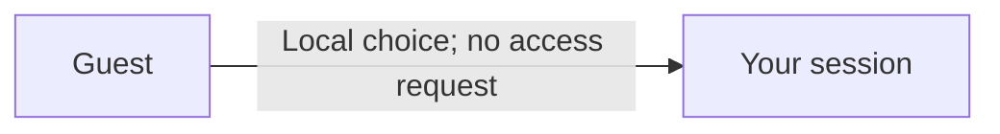

## 2. Email entry and verification

Booking steps after entry show Guest or the currently verified email beside the heading. The initial choice page suppresses Guest, and email entry/code verification suppress identity badges. Guest uses a compact bold pale-yellow badge; verified status uses Email verified in bold above the address. Initial booking choices reserve no Guest status row. All heading badges are read-only. Use another email reveals the email form immediately; Sign out all devices reveals unsigned choices immediately. Server revocation and fresh anonymous access run in the background. A verification or new protected booking action waits if that sequence is unfinished. Failure or timeout retains actionable retry feedback; an immediate local screen change does not prove all-device revocation. The signed-in card retains Use another email and Sign out all devices, plus Manage saved contact only for remembered identity. Eligible secondary controls share one row with readable wrapped labels. Payment/confirmation screens keep their existing protected presentation.

Local email candidate: secondary account actions retain44px touch targets and one-row layout; Email verified is bold. Email/code entry has no Change email action; top Back remains. Each newly issued code has its own120-second validity; the normal view shows “Code expires in: MM:SS” alongside immediately available Request another code, which does not invalidate earlier valid codes. Successful issuance, including the third, does not show a red pause. Only a subsequent denied request shows “Too many code requests. Try again later.” with bare centred `MM:SS` below and separation from Remember me. Deadlines come from the server; timers never send automatically. Invalid-code/network errors must not hide an eligible request action. Verification remains available during blocking. Valid proof clears only stale security guidance; unrelated errors remain visible. BR-003 owns limits and authority.

On email/code entry, the top-left Back returns to booking options and cancels pending UI work without invalidating issued codes. The email form submits with “Get Verification Code”; the choice card remains “Sign in”. Site departures retain the usual “Leave this booking?” warning, with no code-specific warning or cancellation. Each issued code retains its independent120-second expiry; request counters and cooldowns are unchanged. The bottom duplicate Back link and email-entry envelope tile are removed. The first booking-options screen retains Home.

When email verification is configured and enabled, verify email before loading saved details; a code or service failure never grants access. Requesting a code first requires booking access. If that prerequisite fails, show the neutral guest-access failure or rate-limit message from scenario1. The email-specific failures below apply after that prerequisite succeeds; this diagram does not claim the feature is enabled in production.

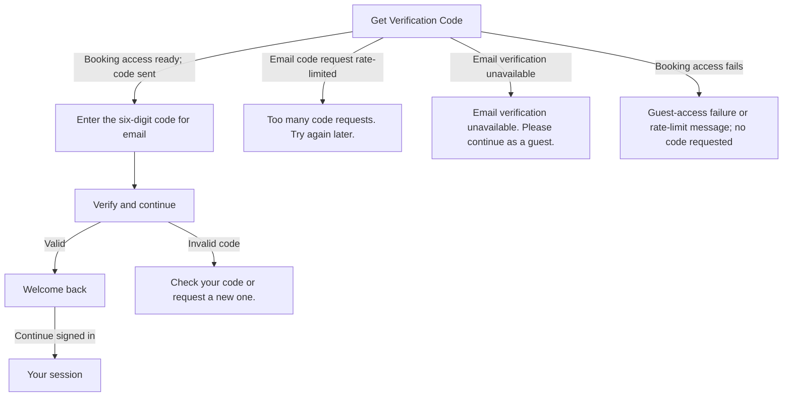

Review Booking prepares checkout-specific Turnstile proof. Missing/expired server proof shows “Complete the security check and try again. Your selections are saved.” A failed widget shows “Security check unavailable. Please refresh this page and try again.” New checkout waits for valid proof; expired/unavailable proof shows local security-check guidance and never creates a reservation. Explicit retry retains the same checkout intent. An already-created checkout, payment return, callback or recovery does not prompt for another challenge.

## 3. Expired or revoked access

The recovery notice remains in place after Guest is clicked until navigation completes, avoiding a button jump. Arriving at another booking step or leaving for Home clears that journey’s notice. A fresh Book now entry prepares access again through the shared entry owner; the previous notice does not reappear merely because the new draft has no mode. Protected access failures still trigger the genuine expiry recovery.

Identity and confirmation access use different messages; neither reveals a server revocation reason. Explicit access entry and checkout renew only a valid unexpired capability, preserving its owner. Expired/revoked access is not revived; payment, hold and checking deadlines remain independent.

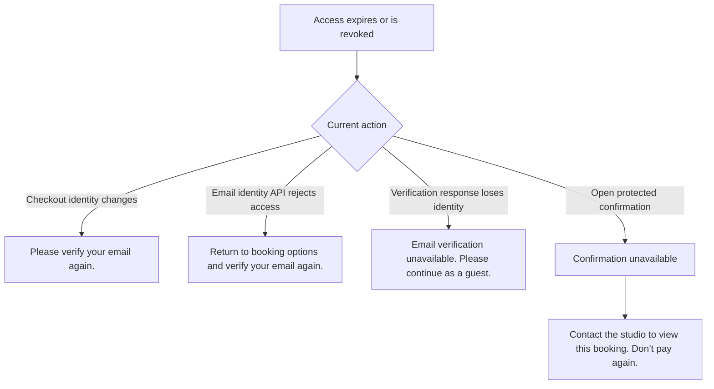

## 4. Session choice and calendar

The sole outlet and session start selected, with the existing outlet-above-session arrangement and the address beneath its building name; each desktop card is at most half the section width and phone cards use its full width. Both cards remain toggleable. On desktop, the session icon/title use the same inset and16px gap as the outlet, and metadata is three right-aligned non-wrapping lines: “40 minutes”, “1–4 players”, “Trainer included”. Mobile retains its compact duration/player line and left-aligned metadata. The session card includes duration, player range, prices and “Trainer included”; its bottom row contains the compact minus/count/plus control, bounded to1–4 players. The three inclusion descriptions and separate large player panel are removed. Deselecting a session hides its player row and Choose Date & Time; reselection preserves the count. Outlet deselection hides/resets the nested session disclosure. Calendar Back preserves choices/count. Initial entry does not auto-scroll; explicit reselection retains existing desktop scrolling. Desktop acceptance requires the full Continue action visible on arrival with breathing room; phones retain the existing sticky action. Loading/failure and multiple-service selection remain governed by the live catalogue.

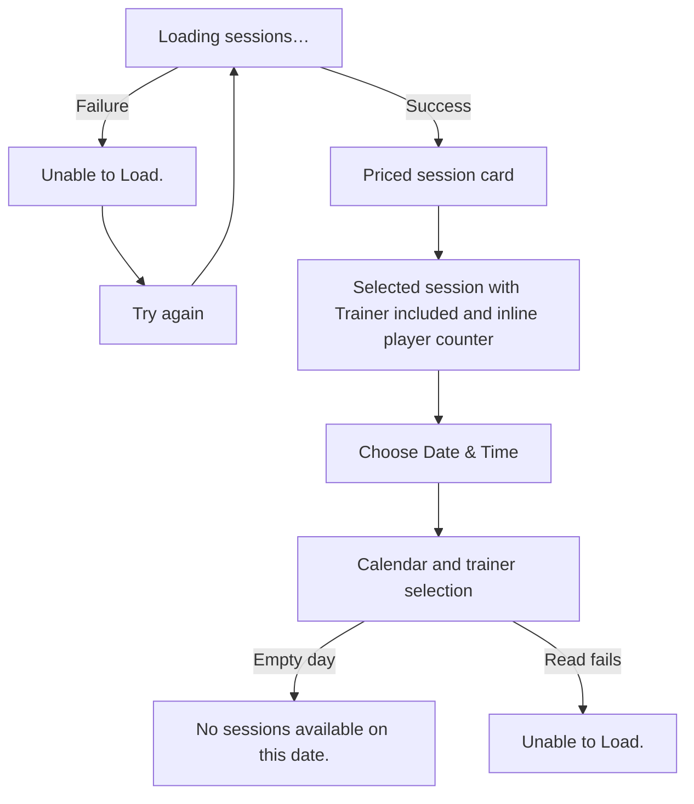

Calendar month/navigation remain on one row except below350px, where navigation moves below the full month/year to avoid clipping; there is no permanent Refresh button. Failed availability reads offer Try again. A verified conflict with authenticated affected-session indices returns directly to Calendar with the affected-session list and corrected cart together; a generic rejection waits for initial fresh classification. Affected studio windows are hidden across trainers; for generic rejections, failed or partial reads retain the initial loading state until every requested date is classified. Availability reads have a 30-second deadline; protected conflict-context reads retain 10 seconds. Failed reads retry no sooner than 30 seconds, respecting server pacing, with successful dates retained only while fresh. No booking or payment write is retried. Background reads update the affected cache while retaining contact details and unaffected valid dates/months. This does not clear the whole calendar or wait for scheduled warming. Missing/expired snapshots and provider-delayed release can still require reads; a local timer never invents a free slot. See [capacity and recovery rules](business-rules.md#br-001).

## 5. Details and review

- On phones, Time, Details and Review expose cart/trainer icons on the right of the persistent top row, with the step count centred; select either to open a right-aligned popup with a fixed header/close control and independently scrolling body.
- The cart badge counts selected sessions; the trainer badge counts distinct selected trainers. Both pop when their count changes, except under reduced motion. Zero counts have no badge.
- Time/Details session and instructor summaries move into those popups; Review retains all session, contact and order details in the main body. Its cart shows the same summary as Details. Next-step actions, contact fields and consent stay on the main page. The next-step action is a full-width naked button without a white wrapper, separated from preceding content and stopping at its original position before the footer. Desktop keeps inline sections.
- Calendar has no visible legend or availability dots. The currently displayed date uses a blue outline and soft background. Only dates with cart-selected sessions use outlined pale-gradient circles with dark numerals; unavailable dates use a darker grey surface. Cart membership remains available to screen readers. Mobile live controls keep the full month name and previous/next arrows in one row; there is no Refresh button. The selector and enabled arrows have hover feedback.
- Time cards: single-line time and add/check above; price below right. Desktop retains all trainer names below left. Mobile has one circled information mark beside the muted hint above all slots; individual cards have no information icon: “Select to view trainers available”.
- For the current owned live attempt, authenticated expiry or the original checking deadline without payment evidence permits a calendar handoff with the expired cart cleared and the unresolved attempt lock retained. After server-confirmed unpaid release, check affected dates and preserve any new selections made during recovery. Name removed dates/time ranges above the calendar. Failed background reads retain the red notice and hidden affected slots without extra status text; preserve contact and require renewed consent. Unknown provider creation and payment remain protected; scenario12 covers attempts without an eligible calendar handoff.
- Enter Booking Details, Review Booking and Proceed to Payment show the selected-session total before the chevron, using the existing price owner.
- Time popup retains Remove/Clear all; Review main-body Edit links retain the original held/verifying restrictions. Closing a popup restores focus and does not change selections.

Your details shows each session's small price right-aligned on its Trainer row. Review has Your Sessions, Booking contact, and Order summary; the numbered date/time/trainer rows and per-session prices belong inside Order summary. There is no separate Dates & times section or aggregate “N × 40 min session” row. Edit links all read “Edit”. Final totals use a larger Total label and amount, with a muted SGD immediately to the left of the amount. There is no currency caption underneath.

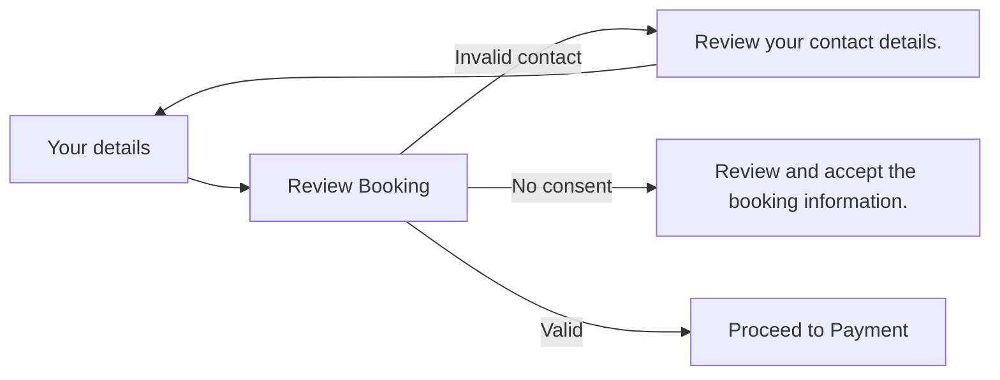

Saved contact details are not booking confirmation. Basket items have distinct boundaries/backgrounds, with the remove × at the top and a light-red cue; prices align right on the trainer row.

## 6. Checkout creation and rejected or uncertain writes

When SimplyBook creation is uncertain and no reliable booking reference exists, the original attempt stays protected; an error or matching contact details cannot prove that no booking was created. An authenticated `creationResolution: {state: "not_created"}` now supplies the distinct terminal result. The automatic source is a narrowly validated single-book date/time rejection; a genuinely lost provider response requires restricted operator verification that original processing finished and created no intended booking. Empty searches and elapsed time are insufficient. The [proof contract](api-contracts.md#verified-no-creation-resolution) owns those server guards.

After that terminal result, show “Some sessions may no longer be available. Please check again.” with the original affected session dates/times as bullet points. Return the matching attempt to Calendar, clear its old cart/consent/recovery identity, and preserve contact and session preferences. A new checkout requires the customer's explicit selection and consent; the old write is never replayed. Refresh while recovery is open checks the exact retained attempt before making this transition. If the customer already left for Home, subsequent Book re-entry checks that attempt and, once resolved, opens normal fresh booking entry without the old recovery notice. Another tab's checkout is not adopted. The resolved notice is in memory only: after resolution, refresh does not resurrect it or the cleared attempt. Unresolved or failed reads continue protecting the original attempt.

For HitPay link recovery, retain the original full loader while recovering the same request. One creation attempt and read-only recovery do not authorize duplicate payment writes. If still unresolved at the30-second creation boundary, return to Calendar with “We couldn’t confirm your booking status.” and Request Help. Retain the unresolved reservation; do not assume cancellation or show a standalone Payment Unavailable page. Authenticated later payment remains eligible for reconciliation.

After a verified selection rejection or blocked checkout window, this tab retains its editable calendar draft across reload, including an empty cart. A tab-local navigation preference prevents automatic adoption of the protected browser session's other checkout; no other-checkout payment link is offered. Matching contact details or selections do not override that preference. Starting a new retained attempt restores normal reload recovery. This preference is not authorization and never cancels or releases another tab's reservation.

Classify from protected evidence, not HTTP status alone. Same studio time is shared regardless of trainer or service. See the [recovery decision contract](api-contracts.md#conflict-recovery-decision-contract).

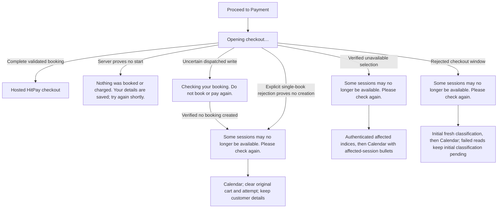

Never silently replace the requested draft with another checkout. Unknown writes keep the original attempt and recovery identity; they must not become a new booking/payment retry.

## 7. Multi-session partial failure

Payment is offered only for a complete validated batch. A lost checkout response can show “Checking your booking. Do not book or pay again.” An authenticated incomplete-booking context uses the wording below and reads the original protected state. Those reads do not themselves reconcile missing SimplyBook references. A separately proven no-effects rejection follows scenario6; partial or unknown writes never become rejection proof merely because a read fails or availability changes.

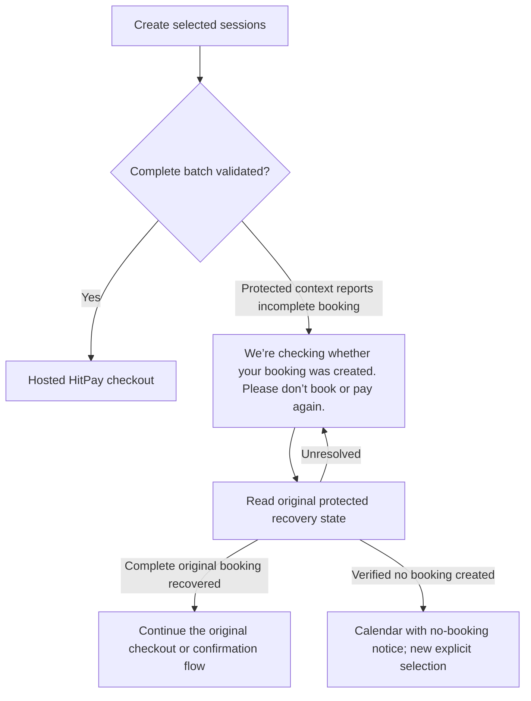

## 8. Back and Continue payment

Payment and confirmation routes may reopen only the same server-authorized, unexpired unpaid HitPay link in the same tab. A completed return hint suppresses continuation immediately, but does not prove payment. Paid evidence, expiry and unresolved/denied states must not expose continuation.

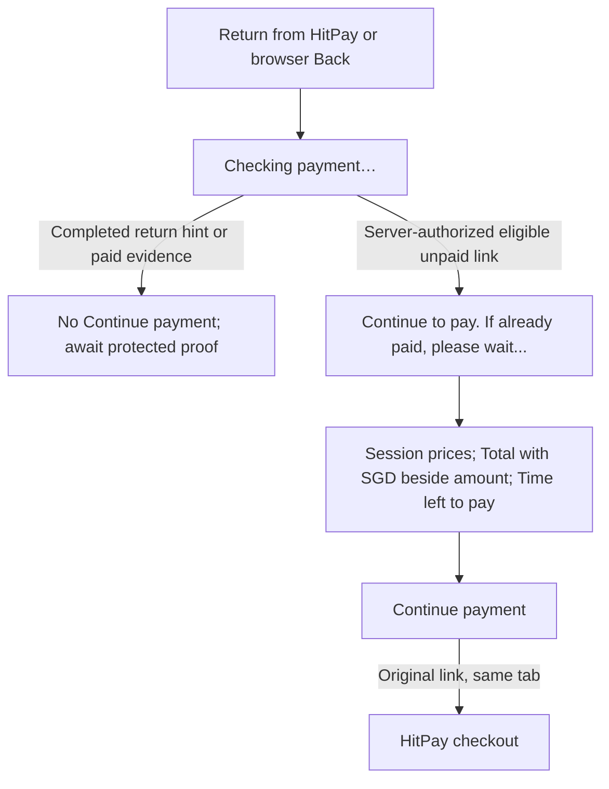

The countdown is centred and bold above the button. Structured details persist into unresolved feedback; missing metadata never invents a trainer or per-session amount.

## 9. Card authentication and provider return

HitPay handles issuer authentication; browser return alone never confirms payment.

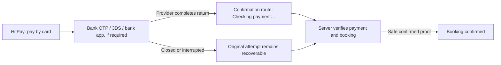

## 10. Payment and booking confirmation

Paid evidence can show progress, but success and the invoice number require confirmed booking proof.

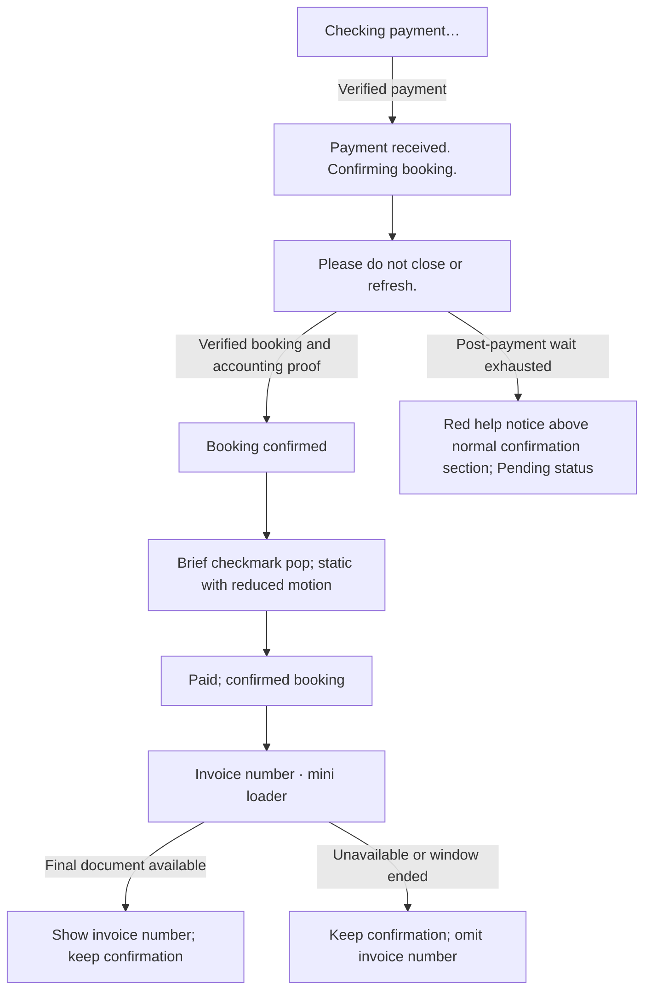

## 11. Temporary status failure

A transient protected status or receipt failure is not a new failed booking. Keep the current authorized confirmation or normal checking presentation while the bounded read/retry settles. An unpaid active checkout keeps its allowed Continue payment flow. Only exhausted post-payment recovery uses the red help notice within the existing confirmation structure; ordinary refresh must not flash Pending or a standalone error page.

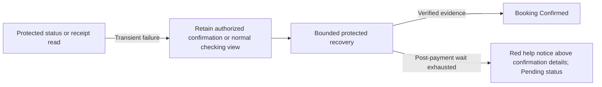

## 12. Unresolved payment or reconciliation

Incomplete booking/checkout creation keeps its original full-loader presentation for the30-second foreground budget, then returns to Calendar with the standardized red help notice. Explicit authenticated no-creation proof instead follows scenario6 with the safe retry notice. The original attempt remains protected until authoritative resolution; no replacement write is permitted merely because a timer elapsed. Protected background reads continue with the existing pacing and stop on lost access. Fresh availability or an empty provider search cannot prove no creation.

After payment, only genuinely exhausted recovery uses the red help notice above the standard confirmation details/Order Summary and amber Pending status. Known payment retains truthful supporting payment-received text; unknown payment never claims Paid. No standalone Pending heading, booking-status error page or manual Check Status button is part of this flow. Ordinary unpaid returns and receipt refreshes do not enter this dead-end state. Automatic focus/visibility rechecks retain their existing30-second admission limit and original attempt identity.

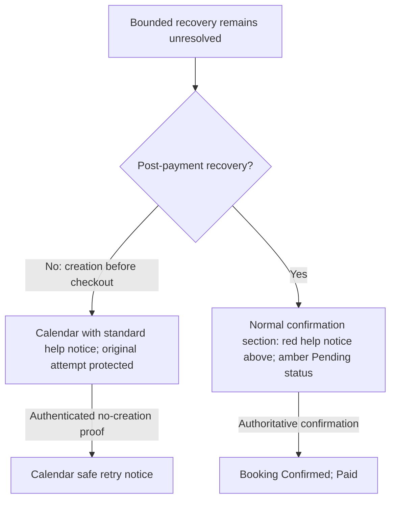

## 13. Expiry, grace and late payment

Expiry and conflict handoffs retain their operation-specific full-page message while Calendar reads settle; an overlapping generic read must not insert “Loading...”. A new unrelated loading episode resets normally, and denied recovery drops conflict feedback while leaving for Home. Refresh retains the existing “Refreshing…” cover while checks run. Resolved expiry, conflict, unavailable-session and no-creation notices retain their complete affected-session bullets across Calendar refresh and same-page selection changes; navigating away dismisses them. Unknown payment retains its original financial lock independently of whether its notice is visible. Verified payment clears unpaid recovery presentation and suppresses Continue payment. Only verified booking evidence shows Booking Confirmed; received money with unresolved booking remains in confirmation/support recovery. After foreground waiting ends, its red notice explicitly says “Payment received. We are still confirming your booking. Please contact us and do not pay again.”, replacing the unpaid/unknown-status copy.

When the authenticated payment deadline ends, payment continuation is hidden and the original attempt gets20 seconds of foreground reconciliation using the full booking animation. If no successful status read started after expiry has returned, retain that loader for up to10 additional seconds to let the server-paced check settle (30 seconds maximum overall). A fresh still-pending result after the initial grace ends returns to Calendar immediately; payment evidence stays in confirmation. This adds no polling requests or bypass of server pacing. Confirmed payment/booking opens confirmation; known payment stays in its confirmation flow; proven releasable unpaid expiry returns immediately to Calendar. If still unknown at the end of the bounded window, return to Calendar and continue silent background checks. Only verified releasable expiry permits a new checkout. New attempts use8 minutes to pay,1 further minute of checking and3 further minutes of recovery before grant release eligibility. The configured10-minute provider hold remains independently capped by invoice due time; cancellation may occur later. The recovery buffer does not extend payment or provider occupancy. Old attempts retain their windows. After the original recovery and hold deadlines, an authenticated matching expired/canceled request with an explicit empty list or only matching, zero-refund unstarted payment-method entries may release; ambiguous evidence and unprocessed receipts stay protected. The original financial journal is retained for late payment. The twenty-second display window begins when the expiry is first observed for that attempt and payment deadline; reload resumes its remaining time rather than granting another window. Calendar background recovery never starts a foreground wait, and conflict handoff is unchanged. A failed release request keeps that original attempt locked while release retries silently on the calendar. While the matching Calendar handoff is being established, retain the normal transition loader; do not insert a standalone release-error page. Keep the same protected release operation and financial block. A red calendar notice names affected sessions; rebooking stays locked until authenticated release. No additional Back to home link appears in the notice. Affected-day reads update retained calendar snapshots in the background; a local timer never adds a session back. Bounded affected-day probes handle delayed provider release independently of browser life; the slot remains unavailable until current provider capacity permits it.

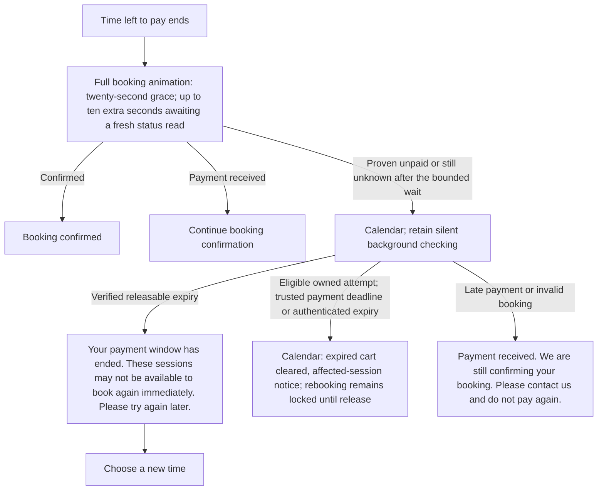

Confirmation summary follows review: provider service name, player count without “per session”; each session uses “Trainer: <name>”. Your Sessions, Booking Contact, Location and Before Your Session remain fully visible in that order. Order Summary and Total Paid follow, with the three booking actions below the complete summary. Session rows show prices beside Trainer; one Paid badge sits at the top right of Order Summary on mobile and desktop. The continuation countdown is centred and bold above its payment button. Missing validated display metadata never substitutes a guessed trainer.

## 14. Confirmed details temporarily unavailable

A receipt-read failure does not undo verified confirmation or authorize another payment.

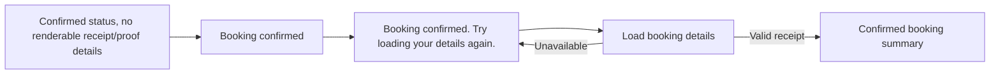

## 15. Saved confirmation and old links

Each protected old link shows only its own booking; it cannot replace a newer active checkout.

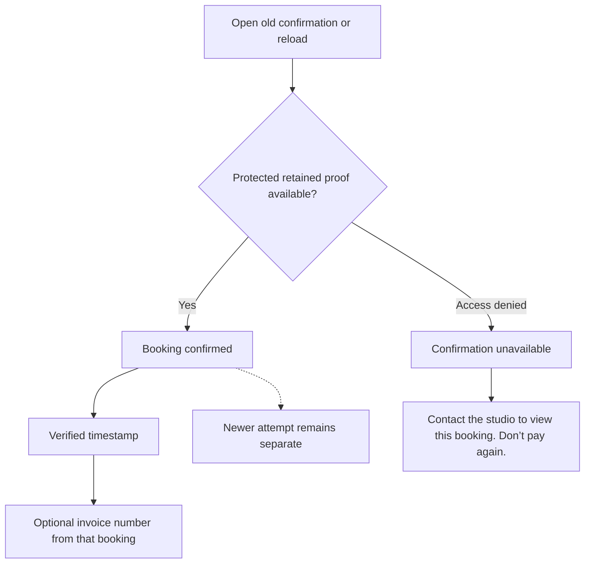

## 16. Make another booking and Back to home

During an unpaid booking step, header, footer and other site links leaving the flow open “Leave this booking?” with “Your selections and changes will not be saved.” Stay keeps the current step and selections; Leave booking clears editable data and follows the chosen destination. All footer links, including Book, share this rule. A new-tab or external-app destination leaves the original tab on Home. Step navigation and explicit payment/recovery continuation links retain their existing behavior; leaving never cancels an existing reservation or payment. Browser chrome and context-menu navigation are outside this custom-link dialog.

A completed receipt remains immutable. Leaving an older receipt must not silently adopt a newer completed booking, or discard a newer unpaid/uncertain checkout.

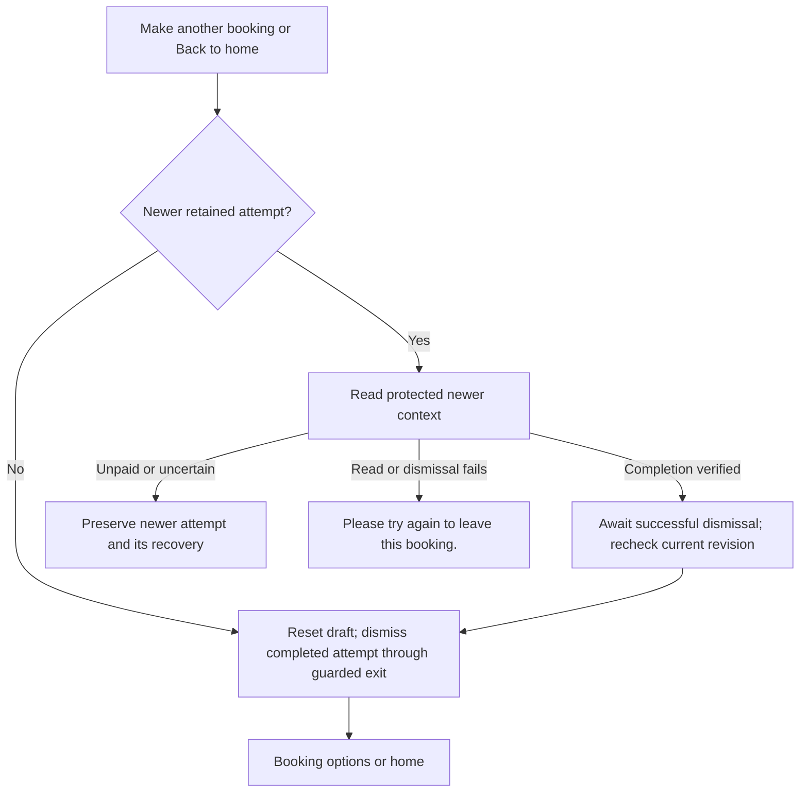

The same-attempt exit uses the existing guarded background dismissal/retry; its failure can show “Unable to start a new booking. Please try again. Your confirmed booking is unchanged.” For a different newer completed attempt, dismissal must succeed before reset/navigation. Navigation never cancels a booking or resets payment deadlines.

## 17. Three complete journeys

Retain one browser context through single → single → single or multi → single → single.

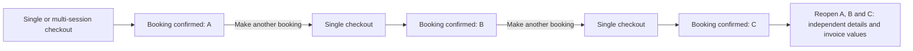

## 18. WhatsApp and staff action

Contacting the studio requests a change; it does not automatically cancel, reschedule or refund.

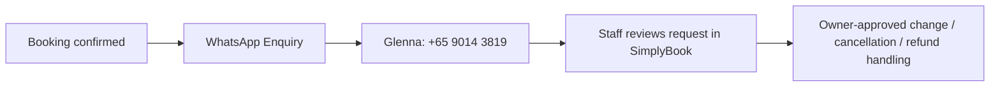

## 19. Preview-only payment states

Preview messages are not proof of real payment or booking.

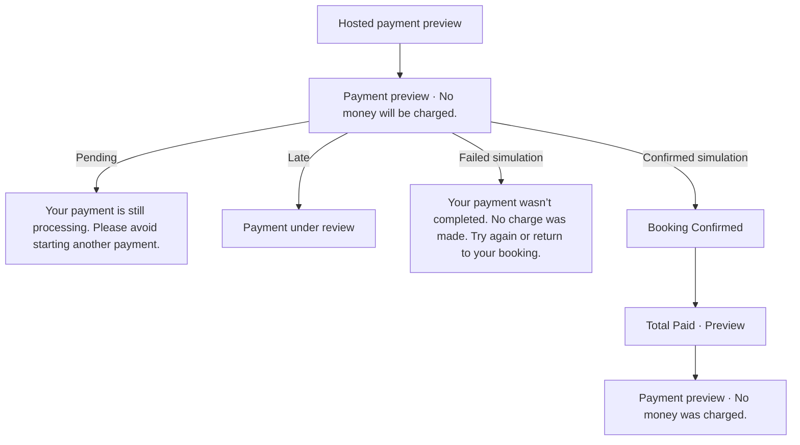

Historical field-level wording and copy proposals are retained in Journey; they are not a second current-source inventory. [Customer UAT](uat/simulated-user.md) owns test actions/results; diagrams describe intended source paths, not completed provider acceptance.

## Archived copy review (historical baseline and disposition)

The earlier M-ID review and control-label inventory are preserved in [Journey](journey.md#historical-copy-review-preserved-on-8-november-2026). They are historical evidence, not current customer messages.

## Additional controls and labels

Use the current source and the message catalogue below. The superseded control-label snapshot is retained with the [historical review](journey.md#historical-copy-review-preserved-on-8-november-2026).

## Not separate customer messages

- Worker reconciliation reasons, accounting retries, unknown writes, duplicate/out-of-order webhooks, late settlement and manual review map into the payment/recovery scenario table; raw codes are not rendered.
- Background calendar refresh, tab visibility changes and successful silent session restoration have no dedicated notification.
- HitPay, issuer OTP/3DS and Turnstile widget copy is provider-owned and cannot be enumerated from this repository. Native browser validation wording varies by browser and language.
- “Confirmed” does not mean immune to future refunds or disputes. The animation and invoice label use the existing confirmed-proof gate.
- Proposed formal style: short outcome, one next step, and “Do not pay again” when needed. Do not add blanket retry language to ambiguous payment failures.

## Current changed copy and presentation

The [current customer error catalogue](#current-customer-error-catalogue--local-repair-8-november-2026) is the single current wording inventory. Confirmed conflicts use the affected-session notice; unavailable basket items use “Session no longer available.” Failed availability reads never imply an empty date or a confirmed conflict. Deployment/test evidence belongs in [Progress](../PROGRESS.md) and dated [Journey](journey.md).

## Public entry surfaces — 6 November redesign

The interactive homepage hero remains with 15% shorter height targets and a straight edge. The enlarged address still opens its location dialog. Two image banners lead to **Explore the studio** and **Book now**. Contact us is a compact photo-free muted-orange abstract banner with navy text and a tonal peach action; Studio reuses its centred, shorter layout and radial-gradient style for the booking footer with different copy and the retained navy palette. Both closing banners meet the unchanged footer directly; the white footer groups Services, Connect With Us and Find Us on the left and a horizontal Apple/Android/web Download App row on the right, with the logo bottom-right above the divider. Service includes Terms of Service, Privacy Policy and Refund Policy links to intentionally empty white placeholder bodies; Get in touch and the footer Disclaimer are removed. The second section retains curved top and bottom edges; the Contact banner has straight edges. Both image promotions use very light grey backgrounds with dark text and navy actions. The smaller flag precedes the two header links; Download app is removed from the header. The initial popup has only the owner-approved heading **Download The Official Soccerbot360 Player App Now.**, App Store, Google Play and Web App icon links, and close control. Its earlier explanatory text and header Download app rows above are retired. Studio shows only the official demonstration video above its retained content; visible global-imagery credits are removed, with provenance retained in source.

Session entry follows the selected-by-default, toggleable flow in section4; the only venue retains its existing provider mapping and capacity authority. See the enquiry section for its current live/preview delivery boundary.

Public shell follow-up: the header remains visible while scrolling, with measured clearance for anchor/focus navigation. Sections below the initial viewport reveal once as they enter view; reduced-motion users see immediate content. Booking data, validation, live status and leave-booking confirmation retain their existing behavior.

Connect With Us uses icons instead of visible platform labels for WhatsApp, email and Instagram, retaining readable contact values and accessible platform names. The footer has no Enquire link; WhatsApp, email and Instagram remain.

Latest visual corrections: stage offscreen sections transparently before a clear650ms/32px entrance, with immediate reveal for focus/reduced motion and cleanup. Closing banners retain the original compact height/spacing and three centred groups: heading, description, and large unboxed action with its diagonal arrow. The whole banner is clickable, with horizontal-only hover/focus movement and unchanged height/type sizes. Both have24px of white space above on desktop and12px on mobile. Desktop homepage/Studio cards activate only through hover/focus and reset on departure; mobile stays expanded. Scrolling never changes disclosure. Desktop retains rounded overlapping cards with normal spacing and no additional approach distance; mobile stays square and non-overlapping with12px white gaps throughout. No separate curve artwork remains. The final banner separator is opaque white so the hero never shows through. Homepage sections2/3 share tighter16:9 desktop frames,440px minimum height and32px vertical copy padding; the desktop stack backing is transparent behind rounded corners; homepage double chevrons and banner edge lights alternate brightness with reduced-motion support. Studio halves use decorative lower-corner circuit circles instead of chevrons; the Contact banner action is Enquire. White text halves retain short copy with pale cyan accents and a faint corner grid. Phone header flag and two navigation buttons align together at the right.

Booking routes, confirmation and experiment checkout are excluded from scroll reveals; their components remain static, retaining existing confirmation/invoice popup behavior. On phones the Studio tagline/video intro fills the first viewport below the measured sticky header, with cover video and a single playback control; gallery begins below the fold.

Mobile Studio video uses the official homepage hero-loop.mp4 montage with a centred portrait cover crop; desktop retains stream.mp4. Both use muted, inline, one-pass autoplay with no native controls or loop; a single control shows Pause while playing and Replay after completion. Reduced motion or blocked autoplay offers Play. Media files remain MP4 for quality and size. The responsive source owner is studio-hero-video.tsx with canonical media provenance in media.ts. Footer headings are16px, details14px, contact icons20px and app icons26px within44px controls; four desktop columns become two on tablets and one on phones.

Public and booking pages share one48px circle with a single upward chevron, no horizontal line and no double-chevron square. Any nonzero scroll shows it immediately, with no distance threshold; each movement restarts a3-second idle timer, after which it disappears. Returning to the page top hides it immediately and route changes clean up the timer. All routes use one bottom-right control, including the 404 shell. The control owns its clearance above an overlapping booking primary action and retains layer36 above primary-action layer35. There is no separate booking/top control or action-owned circle placement. The gentle homepage chevron float remains, with static motion and immediate scrolling under reduced motion. Calendar day selection leaves72px below navigation so its session heading clears the circle. Continue/payment actions use native CSS sticky positioning within their content parent, preserving their natural space and stopping before the footer; no scroll handler switches them between fixed and normal positioning. A zero-height position marker preserves independent natural-position measurement. Provider/payment authority is unchanged.

Mobile booking navigation uses a compact sticky Back/current-step row below the measured site header. Existing single next-action controls in session, calendar basket, details/review and email/verification forms occupy a slim fixed bottom bar, with body/focus/safe-area clearance. Account choice cards and payment/recovery actions retain their existing placement. Actual controls, handlers, disabled/loading conditions and form ownership are unchanged; no duplicate actions or booking animation are introduced. Check navigation height≤48px and bottom bar≤72px without a device safe-area inset, keyboard/focus clearance and disabled-state behavior.

Public entrance motion targets noninteractive visual blocks only: clickable controls and forms remain stationary, including banner CTAs. Studio intro retains a real layout box so route entry starts at the hero. CI42179543002 exposed these navigation/hit-target regressions; original evidence is retained in Journey and final-head verification is required.

### Follow-up navigation and conflict behavior

Review consent resets on departure, reload and return; a dispatched checkout retains its immutable accepted snapshot. A proven no-effects conflict with an authenticated affected-index list returns to Calendar immediately with that list and corrected cart. A generic rejection without affected indexes waits for complete fresh classification. Indexed rejection evidence is retained with the original tab-local rejected snapshot. Refresh resumes its protected read from the immutable pre-dispatch rejection even when no attempt row was ever created; known indexes can complete handoff without provider reads. Failed or partial reads never remove unclassified selections and cannot finish the initial handoff. Candidate windows remain hidden pending successful fresh availability. Every conflict phase uses exactly “Some sessions may no longer be available. Please check again.” Classification retries keep one stable initial loader. After handoff, later availability reconciliation stays in the background. If all dates are successfully read and every selection is available again, keep the cart and show the generic notice without inventing affected sessions. Conflict and expiry lists explicitly use visible disc markers. A tab-local date/time list preserves the notice and bullets across calendar refreshes and selection edits, and is cleared the first time the calendar step is left. Returning or refreshing afterward does not recreate it merely because another checkout exists. Reload preserves this tab’s draft and never offers or automatically adopts another tab’s checkout. Expiry clears expired selections; new selections made while recovery runs survive safe release.

### Rolling calendar

The calendar defaults to Month. The optional rolling seven-day view begins at the first available date for a fresh selection. Restored selections retain their selected date. Week/Month sits beside the navigation arrows; month names remain written in full. A week spanning two months loads both snapshots without discarding the first when the second fails. Switching views or weeks preserves the cart. Only days containing cart selections use outlined neutral-grey circles with dark numerals, without a legend or availability dots. Unavailable days use a darker grey surface. Monthly date cells are approximately half their former desktop height and 30% shorter on phones. The desktop cart sticks below the header without an internal height cap or scrollbar; all selected sessions and trainer profiles flow with document scrolling. Mobile panels retain a single body scroll area, without a nested session-list scrollbar. Your Cart starts with the session count and, on Time, Clear all; it does not repeat Your Sessions or a service name. Review and the calendar context use the originally selected catalogue service name, independent of the first session’s weekday/premium rate. Review reads its retained display label or existing catalogue cache without starting a request. The outlet/session context remains16px bold above the16px duration note.

Mobile entry choices use compact cards with icons beside headings and44px minimum actions. Outlet/session cards use reduced spacing so the choices fit within a typical phone viewport. The player counter is inside the session card with44px controls; the three inclusion descriptions are removed. Full content retains natural page scrolling; target roughly40% less overall height, subject to owner viewport acceptance. The hero address uses the12px caption token on mobile; desktop remains14px. Viewing a date alone never adds the navy cart-selection circle.

Clicking a session tile outside its controls expands or collapses its trainer picker without removing a saved session. A selected tile opens with its saved trainer selected in the dropdown. Selecting another eligible trainer replaces only that slot and collapses the picker. The separate small black × has no visible box at rest, shows an8px rounded pale background on fine-pointer hover or keyboard focus, and retains a44px tap area at the upper right, with the price below it. It removes that session and closes its picker; basket removal remains available. Both controls retain keyboard access. Open and selected cards use the shared teal highlight. Date changes preserve the previous times-region height while loading, without keeping stale slots actionable.

Desktop Time cart uses one Enter Booking Details action with the total directly under the compact banner shared by every booking step, before the session count/Clear all and rows; it omits the duplicate total row. Mobile keeps its existing floating combined action and read-only total inside the panel. Original row typography,44px remove controls and spacing remain on taller screens; five-session carts in desktop windows up to850px high reduce row padding/gaps only. One compact Your Trainers panel follows the cart in page flow. It lists unique trainer avatar/name rows with a count, starts collapsed and opens only one biography at a time. Mobile uses the same panel within the existing trainer dialog.

On mobile, tapping a date reveals that date’s session heading after its offers arrive, positioned below the sticky navigation. Initial loading and background refresh do not move the page; reduced-motion users get an immediate move. Session cards use one full-width column so selected trainer and price stay aligned on the second row. Long trainer names may still wrap for readability.

### Confirmation and calendar return presentation — 8 November 2026

The calendar uses the same shared Back to top circle as every booking step; the navy double-chevron calendar-return control is retired. Explicit date selection scrolls to loaded sessions24px below the sticky bars. Initial load and background refresh do not trigger scrolling.

Protected confirmation context and post-payment verification use the full checkout loading presentation, then directly show Booking Confirmed when verified. No small pending spinner or intermediate booking summary appears in that path. Explicit unpaid payment continuation retains its usable summary and action. This presentation does not change payment proof, checking deadlines or failure recovery. The verified Paid badge sits at the top right of Order Summary with23.8px text and8.5px vertical/15.3px horizontal padding on mobile and desktop; preview summaries do not claim payment.

### Explicit next-step actions and field validation — 8 November 2026

The main booking actions read Guest, Choose Date & Time, Enter Booking Details, Review Booking and Proceed to Payment. Calendar and review actions retain their displayed amount and chevron. Existing email-verification entry and payment-resume actions retain their distinct meanings.

Contact inputs show validation feedback while typing, on blur and on submission. New writes trim outer whitespace, reject embedded invalid characters, require a full name of 2–80 characters containing letters (including attached accents), decimal digits, spaces, hyphens or straight/curly apostrophes, with at least one letter or digit; decorative symbols are rejected during editing and at write boundaries. They require a valid email of at most 254 characters, an explicitly allowed preferred contact method, and optional academy/school/organisation of at most 120 characters. Singapore mobile numbers require eight digits starting with 8 or 9; the searchable country-code selector permits overseas numbers with a recognized calling code and the international 7–15-digit range, without country-specific length or mobile-prefix restrictions. Phone edits silently ignore invalid characters and excessive digits without adding error text or invalid styling; deletion/correction remains available. Required/incomplete-number feedback still applies to the accepted value. Valid numbers are stored in international format. These local checks add no network request; the API validates independently before contact storage or provider booking creation. Existing invalid saved profiles remain editable. Verified email is fixed and retains its server-side matching guard. Syntax checks do not establish ownership, deliverability or phone reachability.

Approved field examples appear inside empty inputs in regular-weight light grey (`--color-hint`, #767676); supporting field hints and email-check guidance share this colour: “John Doe”, “abc@gmail.com”, “9123 4567”, a library-supplied mobile example for the selected overseas country, “Enter the 6-digit code from your email.” and “International Sports School” Verified email displays only its fixed value. Guest email has no initial message; after editing, invalid input shows only its error and valid input shows the grey double-check instruction in the same position. The redundant preferred-contact-method hint is removed. The same examples apply to corresponding enquiry fields; date/time and selection guidance remain outside controls where native controls do not support placeholders.

Approved phone feedback: “Enter an 8-digit mobile number starting with 8 or 9.”, “Enter a valid mobile number for the selected country.” Organisation invalid-character feedback is “Remove invalid characters from the organisation name.” Name/email retain their existing generic validation messages while rejecting the same embedded invalid characters.

Verified confirmation now includes “We’ll email your confirmation.” directly below Booking Confirmed; previews and pending states do not promise email delivery. When the authenticated status confirms the current attempt and its protected booking details are already loaded, those details render immediately even if the separate receipt request is still pending. Invoice enrichment replaces them without replaying the confirmation heading. Pending payment or browser-return hints alone never enable this path.

Local8 November follow-up reduces the Paid badge text and padding by15% (23.8px text;8.5px vertical and15.3px horizontal padding). Browser/device acceptance remains pending; this local slice is not deployed.

### Conflict and expiry recovery clarification (local, 8 November 2026)

Confirmed conflict returns to the calendar with “Some sessions may no longer be available. Please check again.” Only affected cart selections are removed. Expiry returns with the red affected-session notice and clears the expired cart. In both cases, affected studio windows are hidden across trainers while fresh availability is checked silently; other slots remain selectable. No calendar recovery spinner, status-check text or Check status control is shown. Fresh available offers return only after the original payment no longer blocks their release. New selections remain separate from the original attempt and are preserved when release completes.

Refresh retains this tab’s recovery state and never automatically opens another tab’s payment link. Identical contact information is not checkout ownership. Unknown provider writes remain unresolved until authoritative evidence arrives. A pre-dispatch rejection can become a conflict return; a separate verified no-creation result follows scenario6 with its own notice. Late confirmed payment still leads to confirmation.

## Current customer error catalogue — local repair, 8 November 2026

This is the rendered live booking-flow inventory for the local repair, not a deployment receipt. `{sessions}` means Singapore dates and time ranges. Conflict and expiry notices list affected sessions as separate bullets below the fixed message, for example “Mon, 9 Nov 2026, 12:00–12:40.” Conflict bullets include only verified affected sessions and persist with the notice through refresh until the first calendar departure. Internal provider reasons that share a customer message are grouped. Preview-only simulation errors and unreachable legacy copy are excluded. No customer-facing Check Status or Check payment status button is retained; automatic recovery keeps its original attempt, timing and financial safeguards. “Try again” for availability and “Load booking details” for a verified receipt are different operations.

The verified no-creation red notice also retains its full message and session bullets through Calendar reload and local interactions. Navigating away clears it; returning to Calendar does not revive it.

Verified no-creation also temporarily hides the original affected time windows across trainers. Background fresh availability alone restores them; failed or stale reads leave them hidden. The cart is cleared, and other available sessions remain selectable.

### Conflict, expiry and payment

| Trigger                                                                              | Customer message                                                                                                      | Result                                                                                                                                                                                                   |
| ------------------------------------------------------------------------------------ | --------------------------------------------------------------------------------------------------------------------- | -------------------------------------------------------------------------------------------------------------------------------------------------------------------------------------------------------- |
| Proven conflict with affected sessions                                               | Some sessions may no longer be available. Please check again.                                                         | Calendar immediately for authenticated indices, otherwise after fresh classification; show bullets, remove affected selections, retain others and hide affected windows pending fresh availability.      |
| Proven no-effects rejection without an affected index; classification pending/failed | Some sessions may no longer be available. Please check again.                                                         | Keep initial loading through failed/partial reads; bounded paced retries finish all dates before Calendar. Refresh preserves the original snapshot and readiness gate.                                   |
| Refresh finds a different checkout or lacks exact tab ownership                      | Retain the existing conflict notice; do not create a new notice from another checkout.                                | Calendar; never automatically adopt the other checkout.                                                                                                                                                  |
| Payment window ended, original attempt still resolving                               | Your payment window has ended. These sessions may not be available to book again immediately. Please try again later. | Calendar, empty expired cart; original attempt retained. Other slots selectable; no recovery spinner or status controls.                                                                                 |
| Authoritatively released unpaid reservation                                          | Your payment window has ended. These sessions may not be available to book again immediately. Please try again later. | Calendar; preserve new selections, restore hidden times only after fresh availability.                                                                                                                   |
| Released expiry with no original sessions                                            | Your payment window has ended. These sessions may not be available to book again immediately. Please try again later. | Calendar selection.                                                                                                                                                                                      |
| Late payment detected during calendar recovery                                       | Payment received. Opening your booking status. Do not pay again.                                                      | Automatically open the original payment/confirmation route.                                                                                                                                              |
| Server proves checkout never started                                                 | Nothing was booked or charged. Your details are saved; try again shortly.                                             | Clear undispatched attempt, keep editable draft.                                                                                                                                                         |
| Provider queue admission busy                                                        | Please wait a moment, then try again. Your details are saved.                                                         | Retain same prepared attempt for retry.                                                                                                                                                                  |
| Repeated unpaid-reservation defence                                                  | New reservations are paused after repeated unpaid reservations. Please try again in up to 1 hour.                     | Server blocks another reservation; retain draft.                                                                                                                                                         |
| Lost/unknown checkout write                                                          | Checking your booking. Do not book or pay again.                                                                      | Original attempt retained; no blind replacement write.                                                                                                                                                   |
| Provider creation incomplete/uncertain                                               | We’re checking whether your booking was created. Please don’t book or pay again.                                      | Original attempt stays locked; automatic protected context reads observe recovery state. No new booking/payment retry is offered.                                                                        |
| Exact original attempt has verified terminal no-creation proof                       | Some sessions may no longer be available. Please check again.                                                         | Calendar; clear old cart, consent and attempt, preserve contact/session preferences, require a new explicit booking. Unknown/failed reads never trigger this.                                            |
| HitPay link acquisition exhausted before handoff                                     | We couldn’t confirm your booking status. — Request Help                                                               | Calendar after the bounded creation wait; retain the original attempt and financial block. No standalone Payment Unavailable page or replacement write.                                                  |
| Other unresolved HitPay checkout opening failure before handoff                      | We couldn’t confirm your booking status. — Request Help                                                               | Same bounded Calendar recovery; only explicit no-creation proof permits the safe retry notice.                                                                                                           |
| Temporary/malformed/unavailable payment-status response                              | Retain the appropriate loading or last authorized confirmation presentation.                                          | No error flash during ordinary reads. Only exhausted post-payment recovery uses the red help notice above the confirmation details with Pending status.                                                  |
| Exhausted post-payment recovery                                                      | We couldn’t confirm your booking status. — Request Help                                                               | Existing confirmation structure with protected details and amber Pending status; retain the original attempt. Never a standalone notice/page.                                                            |
| Access denied                                                                        | Confirmation unavailable — Contact the studio to view this booking. Don’t pay again.                                  | Hide protected details; stop unauthorized reads and cancel pending conflict classification. Preserve the original attempt/cart; late results cannot navigate.                                            |
| Payment received but booking pending, invalid or late                                | Payment received. We are still confirming your booking. Please contact us and do not pay again. — Request Help        | After the bounded post-payment wait, use normal confirmation details with amber Pending status without a duplicate supporting sentence. No false confirmation, standalone heading or additional payment. |
| Expiry release remains unresolved                                                    | Retain the normal transition loader until the matching Calendar handoff; then the stable expiry notice.               | Retry the same protected release operation automatically without a standalone release-error page. Financial uncertainty remains protected.                                                               |
| Confirmed booking, receipt/details unavailable                                       | Booking confirmed. Try loading your details again.                                                                    | “Load booking details” reads receipt only; never repeats payment.                                                                                                                                        |
| Confirmed-booking restart/dismissal fails                                            | Unable to start a new booking. Please try again. Your confirmed booking is unchanged.                                 | Preserve confirmation; explicit restart retry only.                                                                                                                                                      |
| Checkout attempted before that dismissal succeeds                                    | Unable to start a new booking. Please try again.                                                                      | No new checkout.                                                                                                                                                                                         |
| Confirmation exit action fails                                                       | Please try again to leave this booking.                                                                               | Confirmation remains intact.                                                                                                                                                                             |

### Availability and general booking errors

| Trigger                                                 | Customer message                                                                           |
| ------------------------------------------------------- | ------------------------------------------------------------------------------------------ |
| Catalogue/calendar/day read fails                       | Unable to Load.                                                                            |
| Adjacent displayed month fails                          | Unable to Load.                                                                            |
| No times on chosen date                                 | No sessions available on this date. Choose another date. Your selections are saved.        |
| No eligible session type                                | No sessions are currently available.                                                       |
| Session type not chosen                                 | Choose your session.                                                                       |
| Session display metadata unavailable                    | Apex @ Henderson · Session details unavailable                                             |
| Session changes during availability read                | Your session has changed. Please check availability again.                                 |
| Unavailable selected cart session                       | Session no longer available.                                                               |
| Selected cart session started                           | Session has started — remove to continue.                                                  |
| Five-session cart limit                                 | No limit banner; the five-session cap remains enforced.                                    |
| Live endpoint unavailable                               | Online booking is unavailable. Your selections have been kept.                             |
| Operation unavailable/not enabled                       | Online booking is not available yet. Please contact the studio.                            |
| Invalid request schema                                  | Please review your booking details.                                                        |
| Invalid/mismatched provider reply                       | We couldn’t check this information. Please try again.                                      |
| Unclassified request failure                            | We couldn’t complete that request. Please try again.                                       |
| Unclassified selection conflict                         | Your booking details have changed. Please review your selected sessions before continuing. |
| Explicit request cancellation                           | The request was cancelled.                                                                 |
| Interrupted status action                               | The status check was interrupted. Your booking is unchanged.                               |
| Identity changes during operation                       | Please verify your email again.                                                            |
| Invalid checkout consent/selection/service relationship | Review your selection before starting checkout.                                            |

Explicit availability retry immediately clears the previous error while the request is pending; only a failed retry restores it. Retained calendar content stays visible without a background branded loader. Availability failures offer “Try again” where retry is supported; explicit service-unavailable status omits it. Server-confirmed selection conflicts and expired holds are consumed by the calendar transition; lower-level phrases such as “Your selected time changed” or “Reservation expired” do not remain their normal final screen.

### Contact, selection and consent validation

These retain entered details and block the next action. Some domain guards normally manifest as a disabled button rather than a separate alert.

| Condition                            | Validation message                                                  |
| ------------------------------------ | ------------------------------------------------------------------- |
| Missing/invalid full name            | Enter the booking contact’s full name.                              |
| Invalid email                        | Enter a valid email address.                                        |
| Email differs from verified identity | Use your verified email address.                                    |
| Invalid phone                        | Enter a valid mobile number.                                        |
| Invalid contact preference           | Select a contact method.                                            |
| Academy field too long               | Use no more than 120 characters.                                    |
| Empty cart                           | Choose at least one session.                                        |
| More than five sessions              | Choose up to 5 sessions per booking.                                |
| Invalid/out-of-window session        | Choose a valid session within the booking window.                   |
| Mixed/invalid session selection      | Review your selected sessions.                                      |
| Selected session started             | A selected session has started. Remove it and choose a future time. |
| Insufficient lead time               | Book sessions at least 4 hours before their start time.             |
| Overlapping sessions                 | Selected sessions must not overlap.                                 |
| Invalid booking options              | Review your booking options.                                        |
| Missing verified email               | Verify your email again.                                            |
| Invalid contact details              | Review your contact details.                                        |
| Missing review consent               | Review and accept the booking information.                          |

### Guest entry and optional email verification

Email-specific rows apply only when that feature is configured/enabled; this catalogue does not claim it is enabled in production.

| Trigger                                                     | Customer message                                                          |
| ----------------------------------------------------------- | ------------------------------------------------------------------------- |
| Unexpected email or other identity-action error             | We couldn’t continue. Please try again.                                   |
| Guest access rejected, unavailable, missing or malformed    | We couldn’t start your booking. Please try again.                         |
| Guest access rate-limited                                   | Too many booking requests. Please wait a few minutes and try again.       |
| Missing/expired security proof                              | Complete the security check and try again.                                |
| Wrong/expired verification code                             | Check your code or request a new one.                                     |
| Identity rate limit                                         | Too many code requests. Try again later.                                  |
| Identity access denied                                      | Return to booking options and verify your email again.                    |
| Missing site key / unavailable or invalid identity response | Email verification unavailable. Please continue as a guest.               |
| Signed-in identity cannot be revalidated                    | Verify your email again.                                                  |
| Remembered-profile requirement not met                      | Select Remember me and verify your email to save details.                 |
| Save remembered contact fails                               | We couldn’t save your details. Please try again.                          |
| All-device sign-out requires fresh access                   | Verify your email again, then choose Sign out all devices.                |
| All-device sign-out fails                                   | Could not sign out all devices. Please try again.                         |
| Background sign-out cannot finish                           | Could not finish signing out. Please try again.                           |
| Protected action follows failed background sign-out         | Sign-out could not be completed. Return to booking options and try again. |
| Browser sign-out fails                                      | Could not sign out this browser. Please try again.                        |

Guest-access failures are classified separately from email verification, including transport and malformed-response failures. Initial background identity refresh failure is silent; it does not show an alert.

### Successful and foreground progress states

These are not errors. Initial user-driven checkout/payment preparation may use the approved loader; background recovery must not inject a loader into an already usable calendar or stable status view.

- Verified booking: “Booking Confirmed” and “We’ll email your confirmation.”
- Existing valid payment: “Continue to pay. If already paid, please wait...” with “Time left to pay: {mm:ss}” and “Continue payment”.
- Native retained link: “Complete your payment” and “Checkout opens separately. Return here to check your booking.”
- Foreground progress labels: “Preparing booking…”, “Checking dates…”, “Checking times…”, “Checking sessions…”, “Checking reservation…”, “Opening checkout…”, “Preparing payment…”, “Checking booking…”, “Checking payment…”, “Payment received. Confirming booking.”, “Preparing confirmation…”. In the shared booking overlay, the label names the progress indicator for assistive technology. Visible text is “Please do not close or refresh.”, except “Opening checkout…” and “Checking payment…” prefix that sentence. Eligible unpaid continuation displays its progress label and guidance with the retained summary.
- Remembered contact saved: “Details saved.”

Sources: [provider](../src/features/booking/provider.tsx), [protected confirmation](../src/features/booking/protected-confirmation.tsx), [booking adapter](../src/services/booking.ts), [identity adapter](../src/services/identity.ts), [booking messages](../src/domain/booking-messages.ts), [selection validation](../src/domain/booking.ts), [contact validation](../src/domain/contact.ts), [account step](../src/features/booking/account-step.tsx), [calendar](../src/features/booking/time-step.tsx), [cart](../src/features/booking/summary.tsx).

Calendar departure after recovery: the initial Calendar redirect is consumed on arrival. Conflict survivors can Continue immediately without editing the cart. During unresolved expiry, Back permits earlier selection steps while the original attempt remains protected; new checkout remains blocked until verified release. Background release must preserve the current step and edited draft, and must not restore a notice already dismissed by leaving Calendar.

Background calendar refresh keeps last-known date indicators and session cards without the branded loading graphic, including delayed retries after a failed read. Retained cards are presentation only: expired offers cannot authorize a selection or Continue, and failed refreshes still show retry feedback. A fresh successful response replaces the retained display, including verified empty results. Missing-day results remain unknown; only verified empty days use the unavailable state. Trailing future months are hidden only with complete fresh empty-cache coverage; unknown months stay reachable and warming continues over all policy months.

Local contact/action presentation update: required booking-contact name, email and phone reveal invalid styling/messages after blur or attempted submission. Review Booking stays disabled until contact validation passes. Step3,4,5 actions use a subtle 240ms readiness animation only on disabled-to-enabled transitions, respecting reduced motion. Guest email adds “Select blue circle to confirm email.” Its filled confirmation control and divider span the full input interior height. The transfer control shows a green tick only after an explicit successful domain check (demo acknowledgement in demo mode). Every edit resets acknowledgement; Review Booking and form submission require it. Verified member email is exempt. No email-domain typo suggestion or mailbox verification was added.

Local cart-copy update: BasketContinue no longer renders “Updating session availability…”, “Session no longer available.” or its availability-read failure notice beneath the primary action. Availability and financial guards still determine whether the action is enabled. Conflict/expiry calendar notices and affected-session lists are unchanged.

Local presentation refinement: calendar read failures use a compact red notice with16px separation from the grid, “Unable to Load. Try again.” with a clickable retry. Session-section scrolling leaves24px extra space below sticky surfaces; desktop action scrolling reserves32px around the target. Five-session capacity remains enforced without its banner. Action readiness scales0.98→1.01→1 with a reduced blue halo; confirmation/email ticks retain their original animation.

Recovery refinement from captures16–18: expiry restarts calendar reads immediately, clears the old editable cart and retains the original financial attempt separately. Replacement sessions can navigate through Details and Review; final checkout waits for authenticated safe resolution. The matching expiry notice clears on the first Calendar departure and remains dismissed across remount/reload and later release. Governed provider recovery checks at the actual payment deadline; verified terminal unpaid proof unlocks another explicit checkout without a fixed checking-buffer wait. Unknown/paid/partial outcomes remain protected, and original affected capacity stays hidden until fresh availability permits it.

## Consolidated local follow-up — 12 November 2026

These are current candidate behaviors; staging and later deployment/physical acceptance are separate. The owner's earlier unresolved OTP note is superseded by explicit approval of independent120-second code validity and overlapping requests. A new request does not invalidate an older unexpired code. Up to three admitted requests are allowed before the fixed600-second session/IP/email block; the third success has no red pause. A later denial shows “Too many code requests. Try again later.” and only a centred `MM:SS` beneath it. Keep space between Remember me and this notice. Codes retain their own expiry and remain verifiable during request blocking. See BR-003 and API contracts for ownership, consumption and guess limits.

Manage saved contact uses the full-page loader during revalidation and profile loading, preventing flashes of unsigned choices or disabled Welcome back. Reveal the form only after its reads settle; genuine errors return actionable feedback. Top-left ‹ Back returns to booking options without saving, showing Welcome back only if identity remains valid. The existing bottom Back control remains.

Calendar entry uses one full-page preparation state for all actual cache coverage under the current service/player scope and required selected-day display. Do not assume a fixed three-month range. Prepared cached months switch without month loaders. Background refresh retains displayed dates/cards without branded spinner interruptions. Failed preparation settles to retry feedback; display readiness never authorizes an expired offer.

Details → Review is a normal transition without a new full loader. Review Turnstile reserves widget spacing only while interaction is required; hidden background verification leaves no reserved gap. Review Turnstile is interaction-only: pending/expired proof controls explicit checkout admission, not automatic page routing. If an editable selection crosses the four-hour lead-time cutoff, remove only affected selections and show red “Session no longer available.” with their dated bullets. Preserve valid survivors and contact so replacement/Continue is possible. This is neither payment expiry nor proof of provider release; held/uncertain attempts retain existing locks and recovery.

### Single calendar snapshot — local follow-up, 12 November 2026

Site arrival downloads one JSON calendar snapshot covering the complete booking window. The account/Session/Calendar routes reuse those month entries with their original deadlines. Opening Calendar or switching a fresh cached month does not fetch another month. If the initial download is unfinished, the full loader waits for that same request. Expiry or explicit retry obtains one replacement snapshot; incomplete/failed/expired replacements cannot establish availability. Checkout, conflict classification and payment/expiry recovery retain their separate authenticated reads and authority.

### A–F follow-up: identity boundaries and completed payment returns

Changing email, signing out and continuing a newly verified/restored identity reset outlet/session disclosure to selected and clear player count, selected times, contact and consent. Normal Back navigation within an unchanged identity remains local. Held/uncertain payment attempts retain their separate recovery authority.

Get Verification Code immediately replaces its label with a compact spinner in the disabled grey button. Details → Review navigates immediately and saves remembered name/phone in the background. Save errors appear on Review with Try again; new payment waits for an in-flight save and cannot proceed after a failed save. Manage saved contact retains its explicit save behavior.

Visible Review Turnstile has equal vertical spacing, including its visible success frame; the hidden widget reserves no gap. Full confirmation checking/preparation loaders say “Please do not close or refresh.” Back to home from confirmation navigates immediately while cleanup continues.

Provider return query hints are removed from the address after arrival. After this browser has displayed confirmation, old checkout entries suppress repayment and editable steps while protected recovery restores confirmation; failed confirmed-history recovery goes Home. The marker never proves payment. First returns and direct confirmation revisits/refreshes retain protected confirmation and recovery. Storage unavailable or an unrecognized previous confirmation falls back to protected confirmation, never an assumed payment. The external HitPay page remains provider-controlled.

## Revoked-session entry and saved-contact boundary — 12 November 2026

Email verification and Continue signed in retain only verified email before Your Session; they no longer fetch saved name/phone. Entering Booking Details performs its protected profile read behind the standard full-page loader without a message. Saved fields render only after success. A revoked profile returns to `/book/account/` with “You’ve been signed out. Continue as a guest or verify your email again.” Manage saved contact uses the same recovery before revealing its editor. Timeout/transient failure offers Try again without revealing fields. User-edited draft values survive a successful returning read. Ordinary session/calendar navigation gains no identity polling.

Once contact details have been displayed/entered, remote email sign-out does not block checkout. An optional remembered-profile save rejected specifically because identity was revoked is skipped; entered booking details remain. Other save failures keep their existing retry behavior. Explicit profile-editor saving after revocation returns to entry. All-device sign-out revokes email proof, remembered tokens and older challenges, while preserving other devices’ booking capabilities. Local logout, token replay rejection, payment ownership, duplicate-attempt and capacity guards remain enforced. No new unresolved-checkout lock or storage key is introduced.

## Review security feedback and active checkout — 13 November 2026

Turnstile begins on Review entry. The disabled payment button replaces its arrow with the existing small spinner only after the review checkbox is selected and background verification is pending. Its label and total remain visible. Unchecking, successful verification, a visible interaction request or failure stops the spinner; existing error/interaction guidance remains. No automatic payment action is introduced.

An authoritative `checkout_already_active` rejection uses: “You already have an active checkout. Return to your existing checkout to complete payment, or wait for it to expire before starting another.” This approved copy replaces the availability warning only for that cause; unrelated availability/recovery-window rejections keep their existing classification. The complete notice persists across Calendar refresh and selection edits, and dismisses on navigation like the other resolved Calendar notices.

### Approved rejection loading copy — 13 November 2026

Checkout creation begins with “Opening checkout… Please do not close or refresh.” During subsequent conflict classification, display “Some sessions may no longer be available. Please do not close or refresh.” For the distinct authenticated `checkout_already_active` rejection, display “You may already have an active checkout. Please do not close or refresh.” These temporary messages precede the existing final notice and cart classification; they do not change checkout ownership, retries or availability decisions. Expiry reconciliation retains “Checking payment… Please do not close or refresh.” Ordinary booking-entry loaders remain message-free.

### Immediate field validation refinement — 13 November 2026

Name and organisation allow-lists apply while editing and at new-write boundaries. Organisation permits letters with attached marks, decimal digits, spaces and business punctuation (`’ ' & . , ( ) / + -`), up to 120 characters. Booking and enquiry use the same name, email, mobile and organisation rules. The preview-only enquiry form also validates its allowed type, optional guest count (1–999), real non-past date, 24-hour time and required message (up to 2,000 characters). Requirements allow ordinary prose and line breaks but reject other controls and invisible format characters. Invalid enquiry input never reaches its service. Live builds submit to the protected public enquiry endpoint; preview builds remain no-send.

Phone rejected edits preserve the accepted value without a new red error; incomplete accepted values still validate. Verification code remains six digits only. Contact selects remain allow-listed, and read-only verified email remains unchanged. These are local checks, not extra network calls.

Calendar month/year selection, previous/next arrows and view selection share a compact 36px control height on desktop and mobile; text size and navigation behaviour remain unchanged.

Native session tiles and open trainer pickers are filtered by the current four-hour cutoff, including retained availability shown during background reads. Exactly four hours remains eligible; the first invalid millisecond removes the slot locally alongside cart pruning. The existing precise cutoff timer also covers unselected displayed offers; normal minute refresh and payment recovery timing stay unchanged, with no extra request/polling loop.

## Bounded checkout recovery and contact checks (13 November 2026 candidate)

Guest email entry performs immediate local format checks. Clicking the exclamation mark performs a server-side domain-routing check: a small grey spinner becomes a tick only after success. A changed address invalidates the tick and ignores any late response for the old address. DNS does not prove a mailbox exists. Verified email skips this lookup and is selectable text without an editable input caret, including Manage saved contact.

Unresolved booking/checkout creation has one30-second foreground budget per attempt, retained across reload. Both unresolved booking creation and booking-created/checkout-failed outcomes return to Calendar at the budget boundary with **“We couldn’t confirm your booking status.”** and **Request Help**, never to a standalone status page. The original attempt and financial block remain; background recovery does not create a replacement booking. Proven no-creation outcomes retain the existing safe retry path. Availability **Try again** refreshes Calendar data only; it never retries a financial write. Lost-response readback uses the remaining original wait, rather than a new unbounded request. A later explicit retry after an authenticated matched queue-busy or verification-required no-dispatch rejection gets a fresh display wait for that safe dispatch; unknown writes never reset their budget or replay creation.

While that creation outcome remains unresolved, Calendar permits replacement selections and earlier selection steps, but Enter Booking Details stays disabled. Direct, Back or refreshed Details/Review/payment URLs return to Calendar with the original notice and Request Help; Review's acknowledgement is never exposed as an enabled-looking control that cannot be completed. Navigating to an earlier step dismisses that Calendar notice; returning or reloading does not recreate the dismissed display, while the original unresolved financial guard remains. The current-page guard also works when browser storage is unavailable. Authenticated safe release preserves replacement selections and restores normal Details/Review continuation and acknowledgement. This creation-only guard does not change ordinary unpaid-expiry recovery, which still permits the replacement browsing described above.

For this pre-link creation recovery, paced fresh availability reads can also restore the original affected time when it is positively offered again. Warm, failed, omitted or stale reads cannot restore it. The original attempt stays protected, Enter Booking Details remains disabled and no replacement booking/payment is sent. If the customer deliberately selects that restored time, later verified no-creation resolution preserves it and restores normal Review acknowledgement. Issued-link expiry recovery keeps its existing behavior; a free-looking slot alone never proves the earlier booking was not created.

A completed payment-return hint suppresses payment continuation but never proves payment. The30-second confirmation budget begins only in the post-payment phase (authenticated payment evidence or a completed provider-return display hint), separately from creation/expiry waiting, and retains its original deadline across reload. An elapsed deadline cannot display a dead end before the fresh protected context/status cycle settles; saved authenticated confirmation takes precedence, including while a receipt read returns a transient409. Only genuinely unresolved post-payment recovery after that budget uses the standard confirmation structure: the red **“We couldn’t confirm your booking status.”** notice and **Request Help** above the existing booking-details/Order Summary section, with an amber **Pending** status replacing Paid. Authenticated money evidence uses **“Payment received. We are still confirming your booking. Please contact us and do not pay again.”** in the red notice. The amber Pending badge has no duplicate sentence below it. Render only available protected details; do not invent missing contact, trainer or invoice data. There is no standalone Pending page or bare booking-status error page. Ordinary confirmation refresh, receipt revalidation, an unpaid HitPay return and recovery still progressing must not expose this dead-end presentation. Continue payment remains the existing unpaid handoff; known confirmation renders directly once authorized evidence is available. Neither closing the browser nor losing a webhook proves payment failure; browser access expiry and different-browser ownership remain separate from financial reconciliation.

When retained Calendar recovery discovers authenticated payment, route the original attempt to the dedicated confirmation route and retire only its own Calendar notice/marker. Reopening or refreshing retains that original route and suppresses repayment; it does not create a booking, treat a browser hint as proof or display a bare error between Calendar and confirmation.

On Calendar only, the unresolved notice uses a compact row: message on the left, Request Help aligned right, and any affected-session bullets below. Narrow layouts wrap the action without overflow; sending, success and failure feedback remains available. The post-payment confirmation notice retains its existing layout.

Request Help sends the fixed-recipient staff report to contact@soccerbotsg.com and an auto-reply to the original booking contact, including selected sessions and booking amount without claiming confirmation. While sending, the button shows a small spinner and “Sending request…” and is disabled; no full-page loader replaces the page. Only acceptance of both messages changes the whole red notice to green **“Help has been requested. We will get back as soon as we can.”** and removes the action. A failed send retains the red notice and retry feedback. Both messages use distinct stable idempotency keys; partial retries reuse identical payloads. The same shared component serves unresolved booking creation and checkout preparation on Calendar and exhausted confirmation on the confirmation page. Red/green presentation survives refresh and same-page interactions; navigation away dismisses it. Late send completion after departure cannot recreate the green notice. Original payment locks and server recovery remain independent. This candidate has synthetic mail evidence only, not live delivery acceptance.

The confirmed-booking copy control is an icon-only button at the top right of the confirmation card, aligned with the always-visible session heading. Paid uses the compact status badge and aligns directly with Order Summary. Removing the copy/status stack and the first session’s extra top padding brings the session content closer to that heading. It keeps the accessible name “Copy booking confirmation” and copies the formatted booking message. Successful copying shows a small “Copied” popup for3 seconds without moving the badge or summary; another successful copy restarts that interval. Pending/preview states never expose this paid-message action. Clipboard failure shows “Couldn’t copy. Try again.” instead of success. Leaving the confirmed booking clears the popup/timer and ignores late clipboard replies.

### 14 November presentation refinement

Enabled Continue/Save buttons use the header navy with white labels and normal letter spacing. Outlet, session and time cards omit selection plus/tick icons. Available calendar dates are outlined; unavailable dates have no visible outline and a lighter grey fill. Confirmation status badges use20px bold text and the copy-icon button is20% narrower, retaining the existing alignment and content. Recovery notices group the message and session bullets together, with Request Help centred against that group, equal top/bottom padding and safe mobile wrapping. Report sending and recovery logic are unchanged.

Social metadata uses one branded logo-and-arena image and studio-wide wording across Open Graph, Twitter cards and homepage title/description fallback. Messenger-controlled cropping, layout and cached previews can differ. No booking, validation, payment, expiry, recovery or authorization transition is changed.

### Compact Player App prompt

The Player App popup uses the main-header navy with white text/icons. On phones it has a compact single-line “Get the Soccerbot360 Player App” heading and three equal-width store links in one row, with icons above labels. Close remains44px; link destinations, dismissal persistence and modal focus behavior are unchanged. Browser/mobile visual acceptance remains pending because the owner reports exhausted GitHub Actions minutes on the private repository.

### Ultimate confirmation exits

Missing or malformed attempt IDs return Home before protected reads. A structured `404 attempt_unavailable` means the current identity cannot access that attempt; initial, recovery and expiry reads stop and return Home, as do access denials. Explicit receipt-access denial also returns Home; optional invoice404/503 failures retain an already verified receipt. This does not establish payment failure or authorize a replacement booking. After the existing30-second post-payment wait, missing/malformed/unavailable context without a usable summary returns Home; Pending/Request Help requires a validated nonempty session summary. A mounted verified confirmation remains visible through idling and failed optional invoice enrichment. Live access denial returns Home without displaying protected details. A creation-recovery timeout still offers its existing Calendar handoff first; if that handoff cannot accept the attempt, return Home instead of leaving a permanent loader. The same rule applies to an expired checkout whose Calendar handoff is rejected. Other terminal live confirmation fallbacks return Home. These exits do not reset the draft, clear financial locks, dismiss/cancel an attempt, declare payment failed or stop server reconciliation. Valid accessible attempts retain the existing continuation, Calendar recovery and bounded post-payment Pending document.

The exported Experiment route and its preview entry link are removed. Isolated synthetic provider fixtures remain test-only; they are not a customer page. Popup responsive dimensions belong to its component CSS without competing Tailwind padding/width/alignment utilities.

### Contact and continuation consistency

Required booking name/email/phone fields show red guidance immediately, clearing as valid; optional organisation and untouched Manage saved contact fields do not start in error. Placeholder text is lighter than entered values. Get Verification Code runs Turnstile in the background, shows “Checking security…” for a valid email while pending, and “Sending code…” during dispatch. Email domain checking uses “Checking email…” below the field. Review/enquiry security waits, enquiry/help dispatch and saved-contact saving use short loading labels. Interactive challenges remain visible when required; no new payment checks are introduced.

Desktop entry buttons use60% width inside their shared panel; phone choices stay full width. Calendar has one main Enter Booking Details action outside the cart, floating on desktop and phone with unchanged eligibility. Unavailable dates remain disabled with no outline and faded numbers/fill. Enquiry uses the shared country-code phone control and sends staff notifications to both approved inboxes only in live mode; see API contracts for delivery guarantees.

### Enquiry acknowledgement and field presentation

Required enquiry fields show matching red borders while invalid, including initial empty name, email, mobile, enquiry type and requirements. The compound mobile control owns focus/error highlighting across country code and number; inner controls do not draw a competing focus ring. Optional blank fields remain neutral.

After a successful enquiry response, stay on the enquiry form page and show “Enquiry sent. We’ll reach out as soon as we can.” immediately below the blue heading. Focus and scroll to that acknowledgement; clear it when another enquiry is edited or the page is left. There is no Home redirect, global banner or expiry timer. Preview instead shows “Preview · No enquiry sent.” on the same page. The acknowledgement contains no customer details and is not proof of inbox delivery. Failed sends retain input and the same retry key; a subsequent enquiry starts a new key. Live submission sends staff the enquiry, then sends the customer an acknowledgement email containing a plain-text copy of the submitted enquiry with replies directed to the studio; both provider acceptances precede success.

The enquiry heading is “Contact the studio” and its top-left link is “Home”, without the former introduction. Enquiry type/date/time grey hints and the visible red requirements helper are removed; placeholders, required/invalid semantics and server/browser validation remain. Required empty controls still start with red borders and optional blank controls stay neutral. Home and Send enquiry share the existing asymmetric control corners. Header links use the existing bold-italic action face and the Singapore flag uses proportional1/3px asymmetric corners.

The booking-choice “or” uses the same Roboto 900 italic font and body size as its action labels. Guest and envelope icons appear inside their respective buttons in inherited white, with the existing trailing chevrons retained; decorative icons do not alter accessible names or navigation.

Available time cards retain chronological DOM/keyboard order. Above the phone breakpoint they fill two columns top-to-bottom, then left-to-right; phones show one top-to-bottom column. The row count follows the number of distinct offered start times, including odd counts. Trainer expansion, price labels, capacity and selection authority are unchanged. Verify consecutive times and keyboard order on desktop and phone.

Desktop card-width refinement: both cards stay vertically stacked, each no wider than half the section. The outlet name sits above its address, and session metadata sits beside its title with two price rows and the player controls below. Phones retain full-width cards and stacked information. At desktop heights up to850px, only session-step vertical gaps/padding are compacted so Continue can fit naturally; typography,40px player controls and other booking steps remain unchanged. Verify full initial action visibility at1280×720 and original phone sticky behaviour.

The Review step’s Proceed to Payment action uses a lock icon; its busy and security-check indicators retain their existing behavior.

The approved card arrangement uses a plain football icon and a vertical divider between the desktop session title and metadata. “Trainer included” occupies its own unbroken line. Narrow phones stack the metadata without the divider. Outlet name and single-line address remain aligned beside the location icon. White/pale-teal selection colours and the absence of selection ticks/plus icons are retained.

Customer-facing trainer-rotation notices are removed from calendar, cart, review and confirmation. Demo boundary metadata and trainer/session assignment behavior remain unchanged.

Session-step section headings are simply “Outlet” and “Session”.

Review and Confirmation share Roboto with regular16px body/contact values, bold16px dates and edit links,20px section headings/totals/status emphasis, and14px supporting references/currency text. The email entry action and heading read “Sign in”; verified continuation remains “Continue signed in”.

A time slot also uses the pale teal selection fill and border while its trainer selector is open, before a trainer is chosen. This visual state does not add a session to the cart.

Session date/time/trainer lines share equal2px vertical gaps across cart and document summaries, including the full cart. Input values use14px; labels and control heights retain their existing sizes. Native autofill uses the shared pale teal fill, including the whole phone control; focus/error cues remain. Tinted cart rows, trainer avatars and expanded/hover trainer controls use the same pale teal; red remove controls retain their danger colours. Native contact-card autofill requires owner browser acceptance.

Month/week day hover uses the shared pale teal fill and border. Time-slot containers use teal while choosing/selected; their outer focus ring follows keyboard focus-visible rather than lingering after mouse deselection.

Each booking step has one non-wrapping introduction in the existing muted16px lead style. Concise copy asks customers to continue as a guest or sign in, confirm their session and players, enter contact details, and review before payment. Calendar uses “40-min session · 10-min changeover.” Email entry and verification helpers are short; the verification recipient appears in its form. Saved-contact editing has the same single-line treatment. Compact desktop Session spacing retains initial Continue visibility.

Calendar continuation appears once outside the cart. Cart and Details summaries share top spacing and retain totals. The main next action stays visible on desktop and phone as its original document position scrolls outside view; existing selection/validation rules still decide whether it is enabled.

Continue actions normally have32px top and24px bottom breathing room; the short-phone Session step uses24px top/16px bottom. Floating actions use the corresponding bottom spacing above the safe viewport edge. Focusing the trainer dropdown does not add a second focus outline around its session card.

### Consolidated continuation presentation — 15 November 2026

The consolidated continuation layout uses the same sticky action for enquiry and booking, with32px above and24px below (24px/16px on the compact short-phone Session step). The booking required-field note sits beside Booking Contact inside the card; the enquiry note sits beside Your details inside its form card. Cart date/time/trainer lines share21px line heights and2px gaps; remove/price controls occupy a separate right column. The first-step OR is20px and underlined, without decorative lines.

Primary-action security/submission waits show a small spinner beside the button label together with a6px left-to-right navy fill along the disabled grey button. The spinner follows the actual loading state and disappears when the wait ends. The visual reaches80% at0.6seconds,94% at2seconds and98% at5seconds, then holds until actual readiness; it does not expose a fabricated percentage or enable an action on a timer. When waiting ends, the fill sweeps from its current position to100% over180ms before the ready entrance/halo resumes if eligibility is true. Provider work is never delayed for animation. Reduced motion shows a static fill. Provider calls, duplicate protection, eligibility and retry authority are unchanged.

Explicit saved-contact submission stays on the editor with entered values intact. The card heading is Booking Contact; a green “Details saved.” notice appears directly beneath it, receives focus and scrolls into view. Editing clears the notice through the existing contact-key guard. Only the explicit Back control closes the editor. Ordinary booking-details submission still advances to Review with its existing background-save behavior.

Unsigned booking entry uses the original navy buttons with white icons and 16px heavy-italic labels: “Guest” and “Sign in”. Desktop keeps one equal-width row; phones at700px and below stack Guest, centred underlined OR and Sign in, without decorative lines, with the existing asymmetric header-button corners. Photos and their unused assets are removed. Guest/sign-in handlers, disabled states and the verified Welcome back presentation are unchanged.

### Booking access expiry at navigation boundaries

After the server-issued booking access deadline, remaining on a step or selecting/unselecting cards and editing player count does not redirect. Back, Continue and browser navigation between booking steps return to step1 (`/book/account/`) with “Your session expired. Continue as a guest or sign in to start again.” Explicit protected-request `401 access_denied` responses (availability, email-domain lookup, verification, contact and pre-payment requests) use the same recovery. The red access-loss notice survives refresh on Step1 through validated tab-session display state. Successful renewed navigation away from Step1 or explicitly leaving the journey clears it; selecting Guest must not collapse the notice before navigation. Guest/Sign in establishes fresh access. There is no idle timer, per-click polling or expiry extension from local edits. Stale/aborted responses cannot reset newly established access; transient network/DNS errors remain retryable. Retained financial attempts continue under their separate protected recovery authority rather than being discarded or repaid.

Booking action sizing is shared by entry, verified continuation, profile actions and sticky primary controls: desktop18px vertical padding/52px minimum, phone48px minimum. Entry choices remain side by side on desktop and stack on phones, with16px gaps around the underlined OR. Phone entry labels can wrap without increasing the standard height. Entry/profile clearance follows the32px top/24px bottom action spacing. Calendar continuation sits directly after the time content without the former extra29px actions-wrapper margin.

Normal confirmation entry retains the existing branded checking messages while protected confirmation resolves; actual reloads keep one “Refreshing…” loader through those checks. It must not briefly expose a collapsed main/footer-only page, and must not show a confirmed booking before authoritative evidence.

Initial HTML has a neutral full-page loader. Only an actual browser reload shows “Refreshing…”. On reload, that same loader contains restoration and all page-blocking checks, then reveals the ready page directly; it never hands off to a second loader or loading message. This includes identity/profile reads, Calendar readiness and protected payment/confirmation reads. Normal navigation, including HitPay returns and browser Back/Forward, keeps existing loader messages. Later in-site actions do not replay Refreshing, and no loader implies payment success.

Branded loaders without a supplied visible message show “Loading...” by default, including normal entry, route fallbacks and compact loaders. Explicit refresh and payment/recovery messages take precedence; loading timing and navigation behavior are unchanged.

Review Booking performs local validation and navigation without a button spinner or progress fill. Submission/navigation guards still prevent duplicate actions; actual profile saves retain their loading feedback.

Full-page branded loaders have no forced one-second minimum. Document entry/refresh waits for hydration, restored state, active checks, fonts, hero decoding and a render frame. Logo navigation waits for route arrival and identity readiness, then retains its short exit fade. Shared booking overlays release as soon as actual pending work finishes; meaningful recovery feedback persists throughout an uninterrupted operation. Cancellation/unmount releases pending work; provider deadlines and compact-loader behavior are unchanged.

Normal document entry also uses one initial cover through its checks, displaying existing operation feedback (including payment messages) instead of a simultaneous operation portal. Refresh remains the only path labelled “Refreshing…”.

Homepage returns through site links or browser history reuse one neutral Loading cover until readiness and hero image decoding complete. Guarded booking departure covers the interval before route commit instead of exposing an empty main. Only the first normal homepage document entrance gets the image settle/light sweep; reduced motion and later returns do not replay it. The Player App popup mounts only after the cover finishes, never over initial loading.

Booking-step helpers stay on one line with concise16px muted copy. The verification recipient remains visible in the code form rather than extending its helper. Hidden security proof contributes no vertical margin; a visible challenge is separated from the action by the shared32px top spacing. The6px progress fill stays clipped to the button corners, including phone layouts, without inheriting generic action-span margins.

Payment continuation retains its intended checking message and “Continue to pay. If already paid, please wait...” instruction. Its compact spinner does not add a separate generic “Loading...” line.

Approved payment guidance: inside Review’s Proceed to Payment button, show “You’ll be redirected to [horizontal HitPay logo] to complete your payment.” as a compact second line beneath the primary action. Keep the full instruction at the standard14px hint size where it fits; below560px viewport width, retain only the horizontal HitPay logo at the right of the main action. Active buttons use white text/logo, disabled buttons retain muted text and the colour logo. The instruction remains the button’s accessible description; there is no separate grey strip or nested link. Below Continue payment, show the countdown beside “Sessions held until the timer ends.” on desktop; on mobile, centre the countdown above the single-line reminder at the existing readable hint size. Keep the existing protected deadline and expiry behavior; the text does not extend a hold.

Review bootstrap uses “Checking booking…”; payment and confirmation bootstrap use “Checking payment…” until protected work supplies its actual status. A small head script selects reload copy before static HTML paints, so actual reloads never first paint the normal-navigation message. The document cover retains the latest operation message through generic route fallbacks and fonts/frame completion rather than flashing “Loading...” between checks and ready content. A real document reload still says “Refreshing…”. Non-checkout routes retain their normal generic loading copy; status changes never imply paid/confirmed evidence.

Review history returns also use Checking payment from static first paint and throughout hydration; ordinary Review entry retains Checking booking. The exported Review page must contain both navigation-specific messages.

### Compact phone Session choices

The one available outlet/session stays preselected. Tap the selected outlet card → unselect outlet/session and show Choose outlet → select the studio name → restore name/full address and show Choose session → select a session name → restore its details, player controls and Continue. Tapping only the selected session returns to Choose session. On mobile, each unselected control is one full-width native dropdown with the booking-card shape and Choose outlet/Choose session placeholder: no visible heading, icon or surrounding card. Its full area opens the native menu. Options show names only; existing player count is retained. Selected session labels, metadata, prices and Players align to the right of its20px icon, matching the outlet icon and text hierarchy. Hover uses the existing pale teal selected fill and teal outline without resizing; time-slot trainer selection is unchanged. Short mobile screens use compact spacing to keep the standard cards and Continue visible. Desktop behaviour is unchanged.

### Nested 404 departures

An unknown URL such as /book/session/yes shows the404 artwork inside the normal site header and footer, without a duplicate artwork logo. Its Home link navigates directly without the Leave this booking warning or player-app prompt. This does not cancel a reservation or payment. Valid booking pages retain their existing departure confirmation.

Closing Contact us/Book now banners retain their full-banner links, arrow-free Bot blue action wording, stronger horizontal hover motion and a blue background light sweep on desktop. On mobile (700px and below), headings and descriptions are plain content with a separate original-shaped white rectangular action: Enquire or Book now, without the diagonal arrow. Booking uses the same BookingLink preparation and loader; destination and entry guards do not change.

Public homepage/Studio cards keep fixed photo/text boundaries during hover; photo framing does not zoom on interaction. Mobile closing-banner content fades in together, including its action, without moving the click target. The404 Instagram easter egg changes colour only on pointer hover; click/tap/visited states retain the neutral colour, with a separate keyboard focus outline.

### 18 November 2026 — approved offer and booking presentation

The hero retains Your Move and the desktop circular entry cue. Its bottom strip presents Kickoff Special, catalogue-environment prices (weekday and weekend/SG public holiday pairs), and 40 minutes / 1–4 players / instructor included beside the circle. Mobile uses centred compact rows and inward-moving double cues instead of the circle; reduced motion suppresses the loop. The photograph fills the hero without the earlier radial gaps. Homepage promotion photos follow their text destination through the existing navigation owner.

Email address confirmation uses a large blue origin circle, a short solid dark pipe and three small travelling circles. Pending motion starts quickly then slows; reduced motion shows stationary particles. Only the current response expands the destination: green with a white tick for success, orange with a white exclamation mark for invalid or unavailable checks. Retry clears the prior result; editing cancels and resets the check, and stale replies remain ignored. Motion never imposes a minimum wait or grants confirmation. Send enquiry uses the neutral state until every required field passes existing validation, then Bot blue when enabled; bot-proof and submission checks still apply.

Confirmation details are always visible, with the three customer actions after the complete booking card. Paid/pending copy and authority remain unchanged. Mobile arrival guidance uses the caption token, half the previous padding and tighter spacing rather than unreadably tiny type. Physical device layout acceptance remains pending.

Form validation presentation: untouched inputs remain neutral while first typing. Booking contact/profile, sign-in email and enquiry reveal errors after blur or attempted submission, then clear feedback as corrected. Submission readiness still uses current validation regardless of error visibility. Your requirements shows “Please tell us what you need.” when empty after blur/submission and links that message through aria-describedby.

Confirmation’s Before Your Session guidance keeps arrival/latecomer copy together in one unbulleted paragraph, without forced line breaks. The remaining four items (activewear, footwear, towel, instructor safety guidance) use semantic bullets in a2×2 grid on desktop and mobile; mobile uses the shared smaller caption type. Text may wrap within its column for narrow screens or accessibility zoom rather than clipping.

Review and Confirmation share the four arrival-guidance bullet items in a two-column grid. The arrival/latecomer sentence remains outside the list. Explicit list-item/disc styling preserves visible markers after CSS resets; phone typography remains compact.
