# Code owners and feature map

[Database schema](../architecture/database-schema.md) maps all application tables, keys and relationships; implementation owners remain below.

Source map reconciled 2 November2026. “Owner” means the module responsible for a behavior, not a person or GitHub review assignment. Start at the overview, then follow the numbered sections into smaller diagrams and linked source files. Arrows show responsibility breakdown unless explicitly labelled as a request/data flow; they are not an exhaustive import graph or a promise of execution order.

This document owns code navigation. [System topology](../architecture/diagram.md) owns infrastructure diagrams, [Architecture](../architecture/adr.md) explains runtime relationships, and [Business rules](../business-rules.md) owns behavioral rules. Update this map when responsibility moves between modules. The map describes implemented feature ownership. Test evidence and client deployment status remain separate in [Progress](../../PROGRESS.md).

Customer actions/messages are mapped in [Booking scenarios](../booking-flows.md); implementation and evidence owners remain here.

See [Technical behavior](technical-behavior.md) for named functions, observable behavior, guards, failures, recovery and evidence.

## 1. Overview

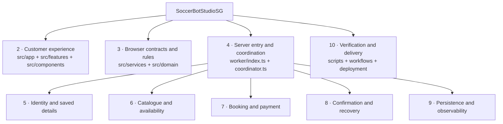

Navigation: [Customer UI](#2-customer-experience) · [Browser contracts](#3-browser-contracts-and-domain-rules) · [Server entry](#4-server-entry-and-provider-coordination) · [Identity](#5-identity-and-saved-details) · [Availability](#6-catalogue-and-availability) · [Checkout](#7-booking-and-payment) · [Recovery](#8-confirmation-and-recovery) · [Storage](#9-persistence-and-observability) · [Delivery](#10-verification-and-delivery).

## 2. Customer experience

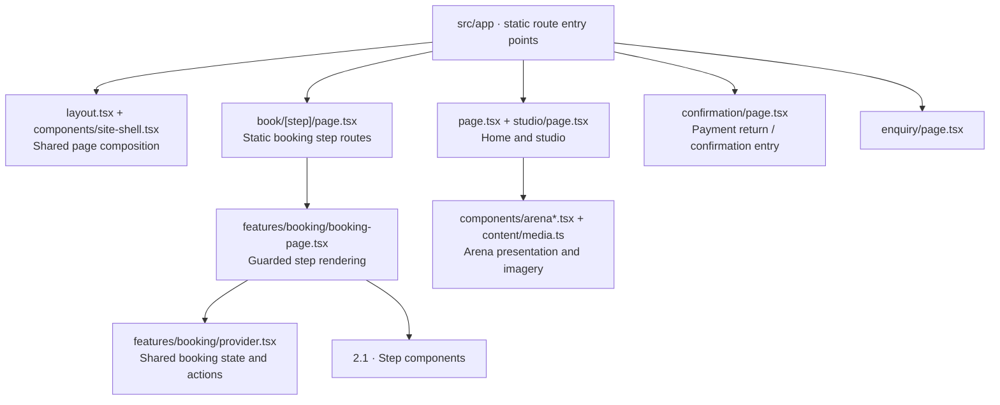

Entry owners: [layout](../../src/app/layout.tsx), [booking route](../../src/app/book/[step]/page.tsx), [BookingPage](../../src/features/booking/booking-page.tsx), [booking provider](../../src/features/booking/provider.tsx). Shared navigation belongs to [booking-navigation.tsx](../../src/components/booking-navigation.tsx); visual rules live in [globals.css](../../src/app/globals.css). [Enquiry](../../src/features/enquiry/enquiry-page.tsx) is a separate feature with build-time live/preview service composition; the persistent mock assistant is retired.

### 2.1 Booking UI expansion

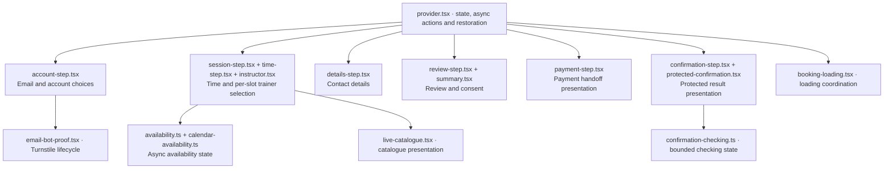

All filenames in this diagram are under [src/features/booking](../../src/features/booking). The provider owns browser state transitions and async coordination; step components own presentation and user interaction. They do not authorize provider writes or prove payment. Start with [account-step](../../src/features/booking/account-step.tsx) for account actions, [details-step](../../src/features/booking/details-step.tsx) for saved-details editing, and [protected-confirmation](../../src/features/booking/protected-confirmation.tsx) for return/confirmation behavior.

## 3. Browser contracts and domain rules

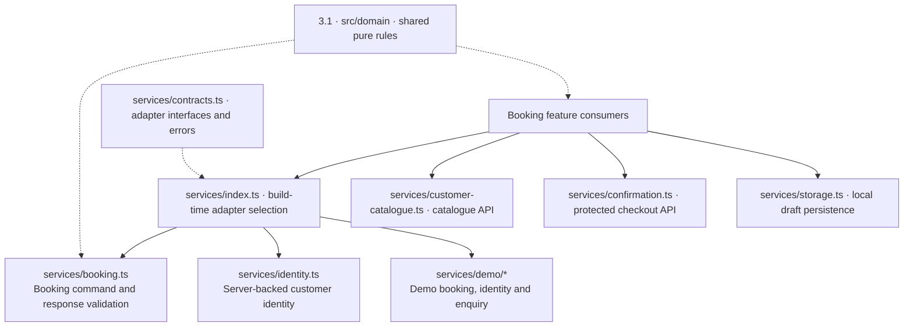

[Service composition](../../src/services/index.ts) selects live or demo booking/customer identity at build time. Enquiry is composed with a demo adapter; do not infer live message delivery. There is no chat-assistant adapter or floating chat surface. [contracts.ts](../../src/services/contracts.ts) defines the boundary. [booking.ts](../../src/services/booking.ts) owns `defineBookingService` and `liveBookingService`; [identity.ts](../../src/services/identity.ts) owns `createLiveIdentityService`. Customer PDF/calendar generation is retired.

### 3.1 Domain expansion

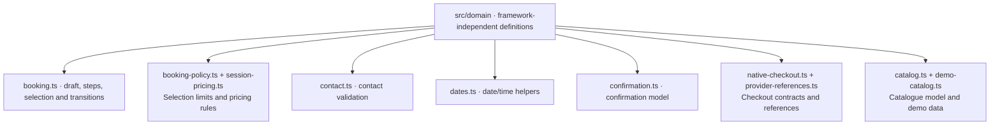

Browse [src/domain](../../src/domain). Browser validation improves interaction; the server independently enforces authority, account scope and current provider evidence.

## 4. Server entry and provider coordination

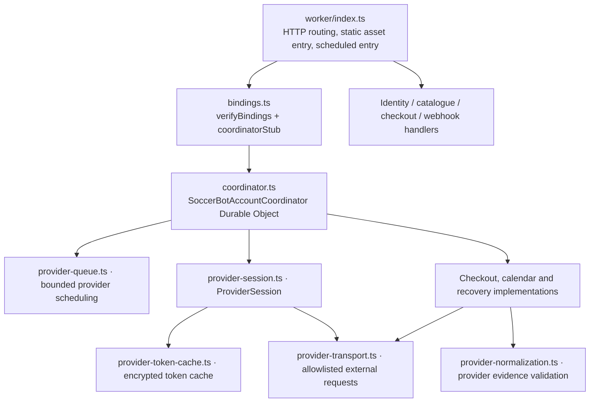

[Checkout bot proof](../../worker/checkout-bot-proof.ts) owns action/hostname validation and durable intent-bound receipts for new customer preparation; recovery/callback authentication remains in its existing owner. [Worker entry](../../worker/index.ts) owns routing; [bindings](../../worker/bindings.ts) owns account/foundation checks and configured coordinator acquisition. [Coordinator](../../worker/coordinator.ts) owns account-level orchestration and connects its [queue](../../worker/provider-queue.ts), [session](../../worker/provider-session.ts) and [token cache](../../worker/provider-token-cache.ts). [policy.ts](../../worker/policy.ts) owns shared policy/error/capability helpers. [provider-transport.ts](../../worker/provider-transport.ts) owns `providerRequest`, `identityRequest` and scoped `hitpayRequest`; [provider-normalization.ts](../../worker/provider-normalization.ts) validates returned booking, invoice and batch evidence.

## 5. Identity and saved details

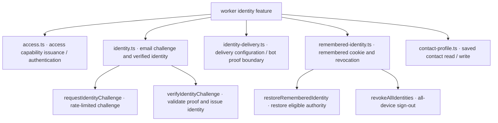

Owners: [access](../../worker/access.ts), [identity](../../worker/identity.ts), [identity delivery](../../worker/identity-delivery.ts), [remembered identity](../../worker/remembered-identity.ts), [contact profile](../../worker/contact-profile.ts). Resend delivers identity emails; SimplyBook booking notifications are a different integration. Saved details require current verified identity. Browser storage is not server authorization.

## 6. Catalogue and availability

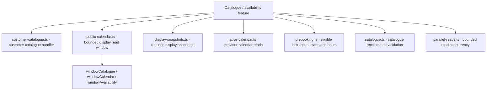

Owners: [customer catalogue](../../worker/customer-catalogue.ts), [public calendar](../../worker/public-calendar.ts), [display snapshots](../../worker/display-snapshots.ts), [native calendar](../../worker/native-calendar.ts), [fixed-grid interval normalization](../../worker/native-grid.ts), [prebooking](../../worker/prebooking.ts), [catalogue](../../worker/catalogue.ts), [parallel reads](../../worker/parallel-reads.ts). Display snapshots help browsing; they do not reserve capacity or authorize checkout. `prepareCustomerNative` and customer calendar/availability operations are in [native-checkout.ts](../../worker/native-checkout.ts).

## 7. Booking and payment

- [Reservation admission](../../worker/reservation-abuse.ts): customer/IP expiry strikes and atomic new-reservation eligibility.
- [Unpaid expiry policy](../../worker/checkout-expiry-policy.ts): shared financial predicate for release and strike materialization.

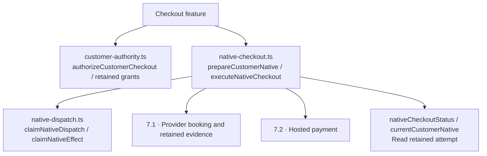

[customer-authority.ts](../../worker/customer-authority.ts) owns checkout grants and rejected-preparation handling. [checkout-preparation-rejection.ts](../../worker/checkout-preparation-rejection.ts) retains immutable no-dispatch proof and exposes its protected context for rejected keys that never became attempts. [native-checkout.ts](../../worker/native-checkout.ts) coordinates the customer checkout operation. [native-dispatch.ts](../../worker/native-dispatch.ts) claims dispatch/effects before external writes. These boundaries prevent a repeated browser action from being treated as permission to recreate an uncertain booking.

### 7.1 Booking expansion

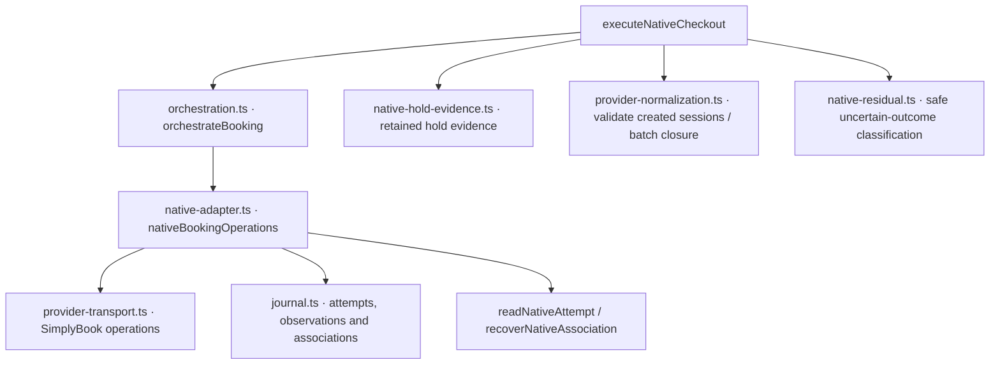

Owners: [orchestration](../../worker/orchestration.ts), [native adapter](../../worker/native-adapter.ts), [journal](../../worker/journal.ts), [hold evidence](../../worker/native-hold-evidence.ts), [residual outcomes](../../worker/native-residual.ts). [native-setup.ts](../../worker/native-setup.ts) and [field-discovery.ts](../../worker/field-discovery.ts) support scoped provider setup/discovery; [native-comments.ts](../../worker/native-comments.ts) owns booking annotations. The adapter also contains scoped compensation logic; its existence does not authorize operator cancellations or refunds.

### 7.2 Payment expansion

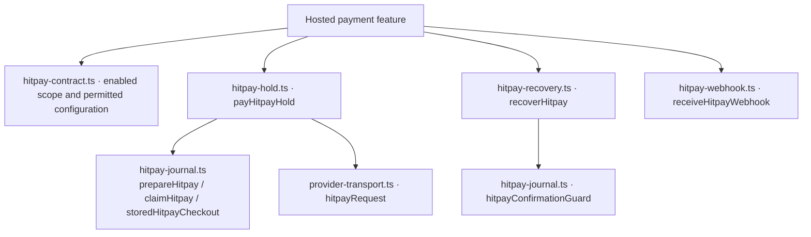

Owners: [contract](../../worker/hitpay-contract.ts), [hold](../../worker/hitpay-hold.ts), [payment journal](../../worker/hitpay-journal.ts), [payment recovery](../../worker/hitpay-recovery.ts), [webhook](../../worker/hitpay-webhook.ts). Payment creation requires validated booking/invoice evidence. Customer return navigation and webhook arrival trigger checking; neither independently proves payment. Existing sandbox scope must not be confused with activated client live payments.

## 8. Confirmation and recovery

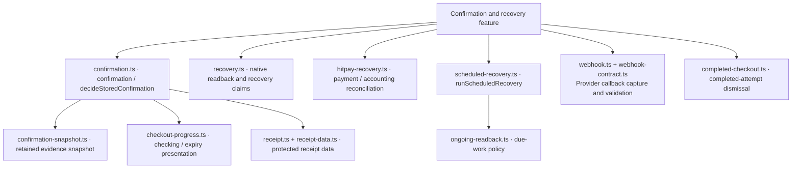

Owners: [confirmation](../../worker/confirmation.ts), [snapshot](../../worker/confirmation-snapshot.ts), [progress](../../worker/checkout-progress.ts), [receipt](../../worker/receipt.ts), [receipt data](../../worker/receipt-data.ts), [native recovery](../../worker/recovery.ts), [scheduled recovery](../../worker/scheduled-recovery.ts), [ongoing readback](../../worker/ongoing-readback.ts), [webhook capture](../../worker/webhook.ts), [webhook contract](../../worker/webhook-contract.ts), [completed checkout](../../worker/completed-checkout.ts). [webhook-subscriptions.ts](../../worker/webhook-subscriptions.ts) owns subscription management. Confirmation consumes authoritative retained/reconciled evidence; recovery preserves the original attempt rather than starting a replacement.

## 9. Persistence and observability

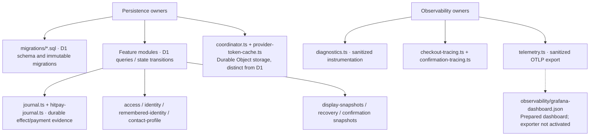

There is no single generic repository layer: SQL lives with the owning feature. [Migrations](../../migrations) own schema evolution; [bindings](../../worker/bindings.ts) checks the immutable foundation. [diagnostics](../../worker/diagnostics.ts), [checkout tracing](../../worker/checkout-tracing.ts) and [confirmation tracing](../../worker/confirmation-tracing.ts) own instrumentation. [telemetry](../../worker/telemetry.ts), [telemetry configuration](../../wrangler.telemetry.jsonc) and the [Grafana dashboard](../../observability/grafana-dashboard.json) are prepared separately from activation.

## 10. Verification and delivery

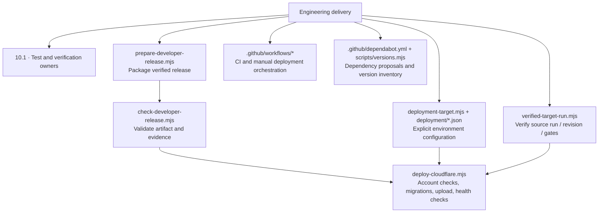

Script names above are under [scripts](../../scripts). Key owners: [release packaging](../../scripts/prepare-developer-release.mjs), [artifact checks](../../scripts/check-developer-release.mjs), [target configuration](../../scripts/deployment-target.mjs), [run provenance](../../scripts/verified-target-run.mjs), [deployment](../../scripts/deploy-cloudflare.mjs). [staging](../../deployment/staging.json) and [production](../../deployment/production.json) keep resource identities separate. [worker/pages.ts](../../worker/pages.ts) is the optional Pages adapter; the prepared client target selects SaaS-to-Worker hosting. Client production and repository cutover remain incomplete.

### 10.1 Verification expansion

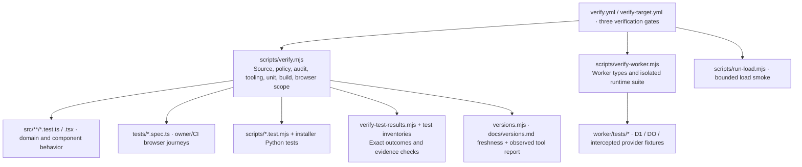

[verify.mjs](../../scripts/verify.mjs) selects code/browser/full scope; [verify-worker.mjs](../../scripts/verify-worker.mjs) owns isolated Worker verification. [check-source.mjs](../../scripts/check-source.mjs), [check-policy.mjs](../../scripts/check-policy.mjs) and [check-pages-policy.mjs](../../scripts/check-pages-policy.mjs) enforce source/configuration/workflow boundaries. [verify-test-results.mjs](../../scripts/verify-test-results.mjs) checks evidence against inventories. Browser tests remain owner/CI-operated; simulated providers do not establish live-provider acceptance. [versions.md](../versions.md) is the separate dependency snapshot.

## 11. Business rule to owner index

The linked **BR** IDs belong to Business rules; this index provides navigation, not a second copy of the rules. One ID may cover a cohesive group of constraints in an existing paragraph. Entries naming an owner-operated process are acceptance or operational responsibilities, not claims that a module automates them. The feature diagrams above expand the listed code owners.

| Rule                                  | Topic                                                                                                       | Feature area / responsibility                          | Source owners                                                                                                                                                                                                                                                                                         |
| ------------------------------------- | ----------------------------------------------------------------------------------------------------------- | ------------------------------------------------------ | ----------------------------------------------------------------------------------------------------------------------------------------------------------------------------------------------------------------------------------------------------------------------------------------------------- |
| [BR-001](../business-rules.md#br-001) | Customer booking website for one Singapore venue and one shared studio across instructors                   | 3.1 Domain                                             | [booking-policy.ts](../../src/domain/booking-policy.ts), [prebooking.ts](../../worker/prebooking.ts)                                                                                                                                                                                                  |
| [BR-002](../business-rules.md#br-002) | SimplyBook owns services, schedules, eligible instructors, customer/booking/invoice records and configured… | 3.1 Domain                                             | [booking-policy.ts](../../src/domain/booking-policy.ts), [prebooking.ts](../../worker/prebooking.ts)                                                                                                                                                                                                  |
| [BR-003](../business-rules.md#br-003) | Email proof precedes protected existing-customer lookup/prefill                                             | 5 Identity                                             | [identity.ts](../../worker/identity.ts), [access.ts](../../worker/access.ts), [remembered-identity.ts](../../worker/remembered-identity.ts), [contact-profile.ts](../../worker/contact-profile.ts), [bindings.ts](../../worker/bindings.ts)                                                           |
| [BR-004](../business-rules.md#br-004) | D1 foundation identity must match the configured account, environment, database and coordinator             | 5 Identity                                             | [identity.ts](../../worker/identity.ts), [access.ts](../../worker/access.ts), [remembered-identity.ts](../../worker/remembered-identity.ts), [contact-profile.ts](../../worker/contact-profile.ts), [bindings.ts](../../worker/bindings.ts)                                                           |
| [BR-005](../business-rules.md#br-005) | Developer and client accounts, merchants, origins, mappings, secrets and data must stay isolated            | 5 Identity                                             | [identity.ts](../../worker/identity.ts), [access.ts](../../worker/access.ts), [remembered-identity.ts](../../worker/remembered-identity.ts), [contact-profile.ts](../../worker/contact-profile.ts), [bindings.ts](../../worker/bindings.ts)                                                           |
| [BR-006](../business-rules.md#br-006) | Public display snapshots support fast browsing; they do not authorize bookings                              | 6 Availability                                         | [public-calendar.ts](../../worker/public-calendar.ts), [prebooking.ts](../../worker/prebooking.ts), [provider.tsx](../../src/features/booking/provider.tsx)                                                                                                                                           |
| [BR-007](../business-rules.md#br-007) | Flow: calendar → Details → Review/consent → reserve attempt authority → create/validate all sessions →…     | 7 Booking                                              | [native-checkout.ts](../../worker/native-checkout.ts), [native-dispatch.ts](../../worker/native-dispatch.ts), [customer-authority.ts](../../worker/customer-authority.ts), [journal.ts](../../worker/journal.ts)                                                                                      |
| [BR-008](../business-rules.md#br-008) | Unknown write outcomes retain original attempt identity and evidence                                        | 7 Booking                                              | [native-checkout.ts](../../worker/native-checkout.ts), [native-dispatch.ts](../../worker/native-dispatch.ts), [customer-authority.ts](../../worker/customer-authority.ts), [journal.ts](../../worker/journal.ts)                                                                                      |
| [BR-009](../business-rules.md#br-009) | For explicit preparation-window rejection (including 409), bounded authenticated readback checks the…       | 7 Booking                                              | [native-checkout.ts](../../worker/native-checkout.ts), [native-dispatch.ts](../../worker/native-dispatch.ts), [customer-authority.ts](../../worker/customer-authority.ts), [journal.ts](../../worker/journal.ts)                                                                                      |
| [BR-010](../business-rules.md#br-010) | HitPay hosts payment; secrets and payment verification stay server-side                                     | 7.2 Payment / 8 Recovery                               | [hitpay-hold.ts](../../worker/hitpay-hold.ts), [hitpay-journal.ts](../../worker/hitpay-journal.ts), [hitpay-recovery.ts](../../worker/hitpay-recovery.ts), [checkout-progress.ts](../../worker/checkout-progress.ts), [confirmation-checking.ts](../../src/features/booking/confirmation-checking.ts) |
| [BR-011](../business-rules.md#br-011) | Original booking creation anchors the eight-minute payment window and fifteen-minute hold                   | 7.2 Payment / 8 Recovery                               | [hitpay-hold.ts](../../worker/hitpay-hold.ts), [hitpay-journal.ts](../../worker/hitpay-journal.ts), [hitpay-recovery.ts](../../worker/hitpay-recovery.ts), [checkout-progress.ts](../../worker/checkout-progress.ts), [confirmation-checking.ts](../../src/features/booking/confirmation-checking.ts) |
| [BR-012](../business-rules.md#br-012) | Polling: at most one check per two seconds for the first 20 checks, then at least ten seconds, with…        | 7.2 Payment / 8 Recovery                               | [hitpay-hold.ts](../../worker/hitpay-hold.ts), [hitpay-journal.ts](../../worker/hitpay-journal.ts), [hitpay-recovery.ts](../../worker/hitpay-recovery.ts), [checkout-progress.ts](../../worker/checkout-progress.ts), [confirmation-checking.ts](../../src/features/booking/confirmation-checking.ts) |
| [BR-013](../business-rules.md#br-013) | Show checking/preparation/payment-received states according to actual evidence                              | 2.1 UI / 8 Confirmation                                | [confirmation.ts](../../worker/confirmation.ts), [receipt.ts](../../worker/receipt.ts), [protected-confirmation.tsx](../../src/features/booking/protected-confirmation.tsx)                                                                                                                           |
| [BR-014](../business-rules.md#br-014) | D1 holds minimal access/attempt/grant/effect/payment/webhook/recovery evidence and display snapshots; it…   | 4 Coordination / 9 Storage                             | [coordinator.ts](../../worker/coordinator.ts), [provider-queue.ts](../../worker/provider-queue.ts), [provider-token-cache.ts](../../worker/provider-token-cache.ts), [provider-session.ts](../../worker/provider-session.ts), [migrations](../../migrations)                                          |
| [BR-015](../business-rules.md#br-015) | One active workflow; at most 24 waiting jobs with the last four reserved for recovery                       | 4 Coordination / 9 Storage                             | [coordinator.ts](../../worker/coordinator.ts), [provider-queue.ts](../../worker/provider-queue.ts), [provider-token-cache.ts](../../worker/provider-token-cache.ts), [provider-session.ts](../../worker/provider-session.ts), [migrations](../../migrations)                                          |
| [BR-016](../business-rules.md#br-016) | Two AES-GCM-encrypted account/environment/credential-scoped tokens persist in Durable Object SQLite, not D1 | 4 Coordination / 9 Storage                             | [coordinator.ts](../../worker/coordinator.ts), [provider-queue.ts](../../worker/provider-queue.ts), [provider-token-cache.ts](../../worker/provider-token-cache.ts), [provider-session.ts](../../worker/provider-session.ts), [migrations](../../migrations)                                          |
| [BR-017](../business-rules.md#br-017) | Single checkout uses six coordinator D1 calls plus one HTTP call; reconciliation uses five.                 | 4 Coordination / 9 Storage                             | [coordinator.ts](../../worker/coordinator.ts), [provider-queue.ts](../../worker/provider-queue.ts), [provider-token-cache.ts](../../worker/provider-token-cache.ts), [provider-session.ts](../../worker/provider-session.ts), [migrations](../../migrations)                                          |
| [BR-018](../business-rules.md#br-018) | Existing sanitized Worker diagnostics and Server-Timing cover checkout, confirmation, provider…             | 9 Observability                                        | [diagnostics.ts](../../worker/diagnostics.ts), [telemetry.ts](../../worker/telemetry.ts), [grafana-dashboard.json](../../observability/grafana-dashboard.json)                                                                                                                                        |
| [BR-019](../business-rules.md#br-019) | Prepared Tail Worker `worker/telemetry.ts` converts allowlisted diagnostic summaries to OTLP/HTTP JSON for… | 9 Observability                                        | [diagnostics.ts](../../worker/diagnostics.ts), [telemetry.ts](../../worker/telemetry.ts), [grafana-dashboard.json](../../observability/grafana-dashboard.json)                                                                                                                                        |
| [BR-020](../business-rules.md#br-020) | Defaults: 10% deterministic successful-correlation sampling; recognized failures bypass sampling within…    | 9 Observability                                        | [diagnostics.ts](../../worker/diagnostics.ts), [telemetry.ts](../../worker/telemetry.ts), [grafana-dashboard.json](../../observability/grafana-dashboard.json)                                                                                                                                        |
| [BR-021](../business-rules.md#br-021) | Current main CI requires frontend, backend and live-email gates                                             | 10 Delivery; owner operates acceptance                 | [deploy-cloudflare.mjs](../../scripts/deploy-cloudflare.mjs), [verified-target-run.mjs](../../scripts/verified-target-run.mjs), [run-load.mjs](../../scripts/run-load.mjs)                                                                                                                            |
| [BR-022](../business-rules.md#br-022) | Client provisioning requires authorization and reuse of confirmed resources                                 | 10 Delivery; owner operates acceptance                 | [deploy-cloudflare.mjs](../../scripts/deploy-cloudflare.mjs), [verified-target-run.mjs](../../scripts/verified-target-run.mjs), [run-load.mjs](../../scripts/run-load.mjs)                                                                                                                            |
| [BR-023](../business-rules.md#br-023) | Bounded synthetic load is accepted for 1/3/5 baseline/fault cohorts and separate ten-customer…              | 10 Delivery; owner operates acceptance                 | [deploy-cloudflare.mjs](../../scripts/deploy-cloudflare.mjs), [verified-target-run.mjs](../../scripts/verified-target-run.mjs), [run-load.mjs](../../scripts/run-load.mjs)                                                                                                                            |
| [BR-024](../business-rules.md#br-024) | Owner accepts normal payment/recovery/dismissal, 15-minute timeout and the observed long-open confirmation… | 10 Delivery; owner operates acceptance                 | [deploy-cloudflare.mjs](../../scripts/deploy-cloudflare.mjs), [verified-target-run.mjs](../../scripts/verified-target-run.mjs), [run-load.mjs](../../scripts/run-load.mjs)                                                                                                                            |
| [BR-025](../business-rules.md#br-025) | Transfer registrar first, then client-managed Cloudflare DNS; reassess prepared SaaS target                 | 10 Delivery; owner operates DNS/provider setup         | [production.json](../../deployment/production.json), [deployment-target.mjs](../../scripts/deployment-target.mjs), [deploy-cloudflare.mjs](../../scripts/deploy-cloudflare.mjs), [index.ts](../../worker/index.ts)                                                                                    |
| [BR-026](../business-rules.md#br-026) | Fallback activity was recorded during setup; recheck before deployment                                      | 10 Delivery; owner operates DNS/provider setup         | [production.json](../../deployment/production.json), [deployment-target.mjs](../../scripts/deployment-target.mjs), [deploy-cloudflare.mjs](../../scripts/deploy-cloudflare.mjs), [index.ts](../../worker/index.ts)                                                                                    |
| [BR-027](../business-rules.md#br-027) | D1 resource identity and placement evidence are in the 27 October provisioning entry                        | 10 Delivery; owner operates DNS/provider setup         | [production.json](../../deployment/production.json), [deployment-target.mjs](../../scripts/deployment-target.mjs), [deploy-cloudflare.mjs](../../scripts/deploy-cloudflare.mjs), [index.ts](../../worker/index.ts)                                                                                    |
| [BR-028](../business-rules.md#br-028) | The client repository will own both environments: trusted PR staging continues to the existing developer…   | 10 Delivery; owner operates DNS/provider setup         | [production.json](../../deployment/production.json), [deployment-target.mjs](../../scripts/deployment-target.mjs), [deploy-cloudflare.mjs](../../scripts/deploy-cloudflare.mjs), [index.ts](../../worker/index.ts)                                                                                    |
| [BR-029](../business-rules.md#br-029) | Choose database and coordinator placement together before the client account Durable Object is first used:  | 4 Coordination / 10 Delivery; owner validates location | [bindings.ts](../../worker/bindings.ts), [production.json](../../deployment/production.json)                                                                                                                                                                                                          |
| [BR-030](../business-rules.md#br-030) | Source implements the hint; actual placement and provisioning authorization remain separate                 | 4 Coordination / 10 Delivery; owner validates location | [bindings.ts](../../worker/bindings.ts), [production.json](../../deployment/production.json)                                                                                                                                                                                                          |
| [BR-031](../business-rules.md#br-031) | Owner waived the separate real-checkout placement comparison on 22 October 2026                             | Operational decision; no new experiment owner          | [business-rules.md](../business-rules.md)                                                                                                                                                                                                                                                             |
| [BR-032](../business-rules.md#br-032) | Follow the client initial placement strategy above: verify the new D1 primary location, prefer `apac-ne`…   | Operational decision; no new experiment owner          | [business-rules.md](../business-rules.md)                                                                                                                                                                                                                                                             |

Closed-install management is owned by [foundation-management.ts](../../worker/foundation-management.ts) and [foundation-setup.mjs](../../scripts/foundation-setup.mjs). The named service entrypoint is separate from the public router; see the [runbook](../runbook.md#closed-production-foundation-registration) for its inspect/register/initialize sequence.
