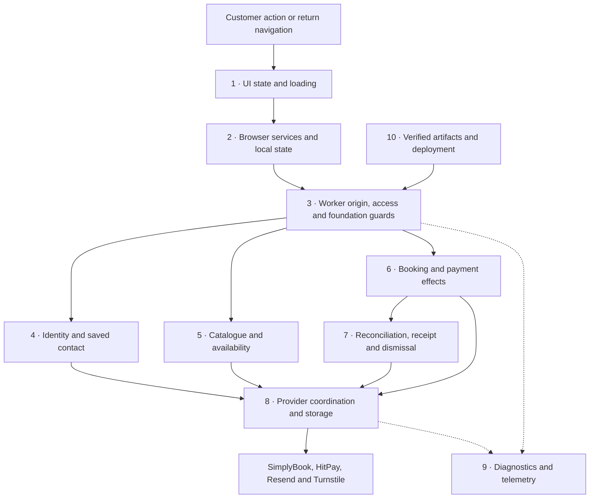
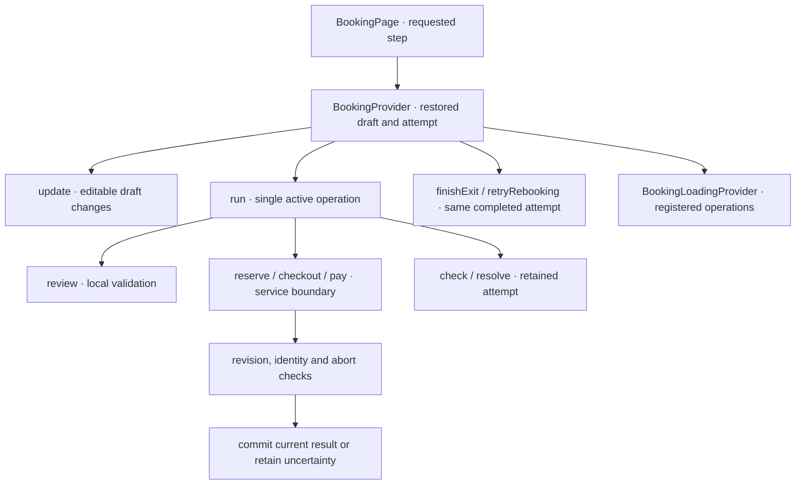
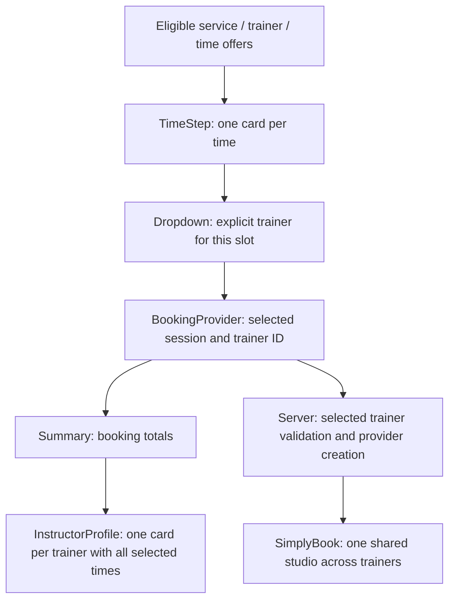
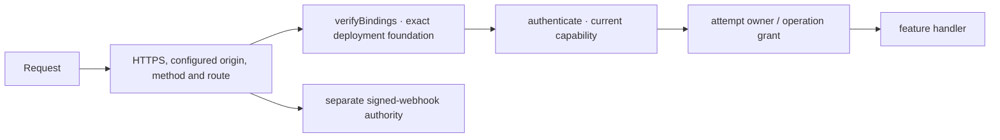
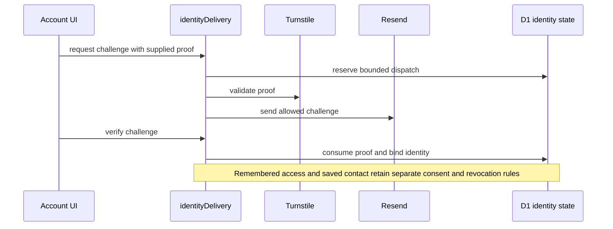
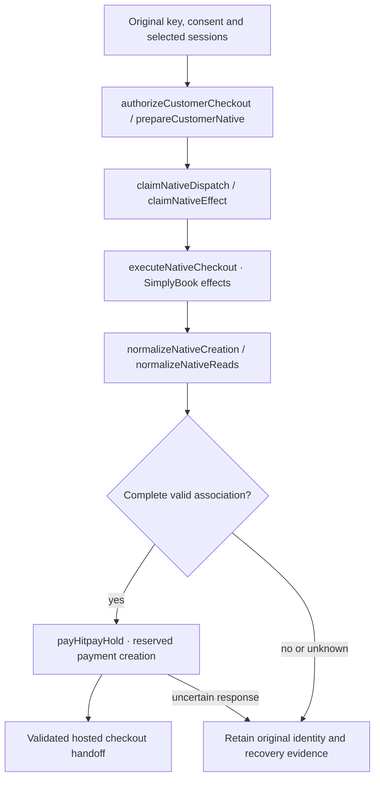
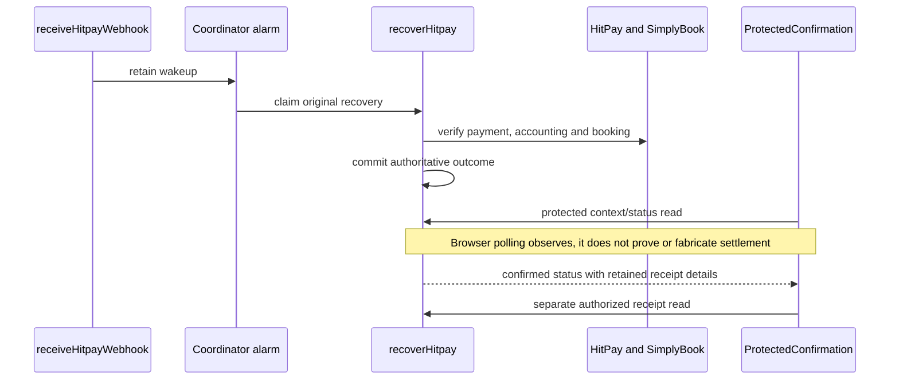
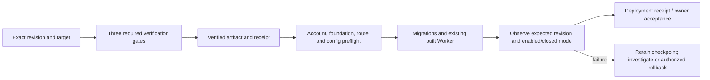

# Technical behavior and recovery map

Price presentation: `session-price.tsx` resolves homepage rates from the validated public catalogue environment and the shared `session-pricing.ts` profile; `SessionStep` passes the same catalogue environment into its price label. Unknown/failed homepage catalogue reads show no numeric fallback. Preview alone uses developer rates. Display labels grant no booking/payment authority; native quotes and Worker price/amount checks remain unchanged.

Reviewed against merged baseline `662bea3` and the local shared-calendar repair (3 November 2026); local changes are not deployment evidence. This is the function-level companion to the [feature ownership map](index.md): what each named operation does, what the customer or operator sees, what prevents unsafe actions, and where failure recovery belongs. It covers the principal feature entry points and state-changing functions; it is not an exhaustive catalogue of private parsing helpers, JSX callbacks or generated bindings. “Owner” means code responsibility, not an assigned responder.

[Business rules](../business-rules.md) remain the authority for invariants, [API contracts](../api-contracts.md) own request/response shapes, and the [runbook](../runbook.md) owns operator procedures. Tables describe implemented behavior, not proof that client production is configured. SimplyBook staff scheduling and HitPay/Cloudflare administration are provider-console operations, not custom SoccerBot admin features. Enquiry uses a demo adapter; the persistent mock assistant is retired.

## Overview and reading route

For a visible failure, start with its UI row, follow the named service to its Worker owner, then inspect the linked evidence. A diagram arrow denotes responsibility or a call path; it does not guarantee parallel execution, authorization or provider success.

## 1. UI state, navigation and loading

`BookingHeading` shares a responsive title/status row for steps 1–5. `VerifiedEmailStatus` renders the same right-aligned Email verified/address badge on entry and subsequent steps, without a Sign out link in the heading. Desktop status sizing yields to the heading; mobile keeps deliberate title lines and constrains the wrapped address. Guest dimensions are75% of the previous badge; verified status uses14px metadata type. `BookingPage` supplies read-only verified identity status through `readCurrent` (`GET /api/identity` only); heading reads never create guest access or restore a session. `AccountStep` retains explicit entry refresh and waits for it before showing entry choices. Verified/restored identity shows one full-width card with eligible secondary actions in one row; no Guest card appears until identity restoration resolves unsigned. Use another email and Sign out all devices retain existing abort/duplicate-action fences and server acknowledgment. Failed sign-out does not claim success. Email/code Back is registered with the top navigation and cancels in-flight challenge/verification work.

Shared dialogs use unique heading references and nonshrinking close controls. Long invoice references wrap within the confirmation card. The calendar toolbar contains only month selection and navigation, on one row on mobile. Failed month/day reads retain an inline Try again action. All customer branches omit manual status buttons and feedback. Automatic status/recovery checks and server-authorized release preserve their original attempt and financial guards. Selection guidance distinguishes choosing a time from the temporary checkout reservation; leaving checkout warns that payment must complete before expiry. These presentation changes do not alter reservation or payment guards.

Round-four presentation: compact session cards open the original full-width configuration view, not a dialog. Time cards place price at top right, trainer names below, and retain the trainer dropdown. Trainer profiles show biographies or explicitly labelled preview copy, not session dates. Totals share enlarged labels and amounts with muted SGD on the left; H1 uses the logo BOT blue and body uses ink. Selection updates clear the ended-reservation notice.

Full-recording UI follow-up (5 November): BookingProvider exposes readiness only after protected restoration settles, preventing a temporary editable calendar before a retained attempt is restored. Permanent Refresh is removed; failed reads retain Try again. Cart items have separate bordered backgrounds, top-aligned red removal controls and trainer/price rows; Continue notices have spacing. Review edit links share “Edit” within their respective sections, omit duplicated unit pricing and use the larger total typography. Single-session confirmed Paid/amount shares the trainer row; multi-session totals remain separate. External-window guidance requires an eligible non-HitPay checkout link. Payment-release authority and cache retention rules are unchanged.

`ProtectedConfirmation` binds expiry-release failures to the originating attempt and session revision, like its receipt/context errors. Switching attempts or identity revisions cannot carry that error into the new view; expiry still requires the original authenticated server release. Combined navigation coverage and remaining provider acceptance are tracked in [customer UAT](../uat/simulated-user.md#combined-journey-audit-matrix).

Rules: [BR-003–005](../business-rules.md#identity-privacy-and-environment-isolation), [BR-007–013](../business-rules.md#checkout-durable-effects-and-customer-errors). Owners: [provider.tsx](../../src/features/booking/provider.tsx), [booking-page.tsx](../../src/features/booking/booking-page.tsx), [booking-loading.tsx](../../src/features/booking/booking-loading.tsx).

| Function / operation                        | Behavior and visible result                                                                                                                                                | Guards                                                                                                                                | Failure and recovery                                                                                                                                     |
| ------------------------------------------- | -------------------------------------------------------------------------------------------------------------------------------------------------------------------------- | ------------------------------------------------------------------------------------------------------------------------------------- | -------------------------------------------------------------------------------------------------------------------------------------------------------- |
| `BookingPage`                               | Selects the booking step and renders its current presentation.                                                                                                             | Step prerequisites and provider readiness; route text is not booking authority.                                                       | Restore required state or return to an eligible step; diagnose the provider before changing route guards.                                                |
| `BookingProvider` / `useBooking`            | Own shared draft, attempt, restoration, availability and exposed actions; `useBooking` requires its provider.                                                              | Restored service/identity owner, revision and mounted state separate old work from current state.                                     | Failed restoration must not invent a successful attempt. Follow the service error and retained server evidence.                                          |
| `run` with `review`                         | Checks the editable selection and reports local success. Review creates no reservation or payment.                                                                         | Current readiness, selection validity and one active action.                                                                          | Keep the draft editable; correct selection/contact instead of fabricating a hold.                                                                        |
| `run` with `reserve`, `checkout`, `pay`     | Coordinates the corresponding service operation and hosted payment navigation.                                                                                             | Synchronous active-request guard, abort controller, revision and identity checks; unfinished completed-exit work blocks new checkout. | Preserve existing attempt after uncertain dispatch; stale responses cannot replace a newer draft/session. Inspect original attempt before another write. |
| `run` with `check`, `resolve`               | Applies outcome work to an existing attempt.                                                                                                                               | Requires an attempt and the same current-operation checks.                                                                            | Retain pending/unknown state; no fresh payment merely because checking failed.                                                                           |
| `update`                                    | Applies permitted draft changes; changing an editable draft clears old consent/attempt state.                                                                              | Payment-locked attempts cannot be edited; held/verifying attempts allow only the supported consent change.                            | Do not bypass the guard to unlock a reservation; resolve or expire the original attempt through its authorized path.                                     |
| `cancel`                                    | Aborts browser work and invalidates the active request.                                                                                                                    | Local request ownership and revision controls.                                                                                        | Abort is not proof that a provider write stopped; server readback owns uncertain effects.                                                                |
| `finishExit` / `retryRebooking`             | Acknowledge completed-booking dismissal; explicit retry reuses its saved ID.                                                                                               | Retained completed-exit identity; new checkout waits for unresolved exit work.                                                        | Show the saved-confirmation warning and retry action. Never erase the receipt or create another financial effect to clear it.                            |
| `restartAfterExpiry`                        | Rechecks released unpaid selections, retaining unchanged available offers and contact; names removed dates/times on return.                                                | No conflicting active operation or different current attempt.                                                                         | An unknown payment is not eligible just because the browser clock elapsed. Follow server expiry/confirmation evidence.                                   |
| `restartAfterConfirmation` / `reset`        | Start a new draft only through their permitted state transitions; confirmation restart discards browser calendar/day availability and resumes reads before browsing again. | Completed exit is acknowledged in live mode; reset refuses active, held or checking/pending/late attempts.                            | Keep unresolved work attached to the original attempt.                                                                                                   |
| `BookingLoadingProvider` / `BookingLoading` | Register concurrent loading work, display one overlay and make underlying content inert while keeping it mounted.                                                          | A registration returns its own cleanup; the overlay lasts while any registration remains.                                             | A stuck overlay requires inspecting unresolved operations and cleanup. Do not force clicks through it or remove the guard to pass a test.                |

Evidence: [experiment browser cases](../../tests/experiment.spec.ts), [live identity/booking browser cases](../../tests/live-email.spec.ts), [booking domain tests](../../src/features/booking/async-booking.test.tsx). Screens to inspect: account choices, editable Review, loading overlay, saved-confirmation retry and back/forward return.

### 1.1 Step presentation functions

Session summary presentation: `SessionSummaryHeading` in `summary.tsx` owns the shared Your sessions heading, provider service label and player-per-session guidance for cart, review and confirmation. Shared styles keep its typography and internal spacing consistent; Review supplies its existing edit action. The confirmed Paid badge sits immediately before the large total amount; pending Total retains its existing layout.

Trainer selection update (29 October 2026): `TimeStep` groups simultaneous offers into one time card and exposes its trainer dropdown after the time is opened. A pending dropdown does not add a session. Choosing or changing a trainer validates exact offer identity and current time; a refresh/failure never silently replaces a saved trainer. The selected time button or basket removal removes the session. `Summary` groups completed selections by stable instructor ID; `InstructorProfile` lists that trainer’s ordered dates/times below the summary. Profiles stack vertically, including when names match. Each time and its trainer selector share one outer bordered card, with an internal divider, bold label and outlined control; the right-hand session list has top padding separating dates from the trainer header. Held/payment-locked drafts keep existing edit guards.

Evidence: [time selection regressions](../../src/features/booking/time-step.test.tsx), [service identity/capacity cases](../../src/services/async-booking.test.ts), [prebooking/calendar cases](../../worker/tests/catalogue.test.mjs), [cross-trainer conflict and batch restoration](../../worker/tests/combined-hold.test.mjs). Screenshots and actual shared-resource acceptance remain owner/CI work.

`TimeStep` offers See next month when an empty loaded month has no next available date. Navigation stays within the public three-month horizon and selects an eligible date after the explicitly requested month loads; it never scans months in the background or changes the basket.

These functions are under [the booking feature](../../src/features/booking). They consume provider/service state; they do not independently authorize provider writes.

| Function / file                                                                                      | Behavior and guards                                                         | Failure / recovery                                                                                                     |
| ---------------------------------------------------------------------------------------------------- | --------------------------------------------------------------------------- | ---------------------------------------------------------------------------------------------------------------------- |
| `AccountStep` in `account-step.tsx`                                                                  | Present guest/email account choices and current session actions.            | Verification/access errors stay explicit; reverify or choose eligible guest access without borrowing another identity. |
| `EmailBotProof` in `email-bot-proof.tsx`                                                             | Own Turnstile widget/proof lifecycle for the configured sitekey and action. | Missing/expired/failed proof cannot authorize email delivery; refresh through the widget lifecycle.                    |
| `SessionStep` / `TimeStep`                                                                           | Present catalogue selection and calendar/slot state.                        | Empty/unavailable data stays distinct; refresh/reselect only when the retained attempt permits it.                     |
| `DetailsStep`                                                                                        | Edit current contact and offer eligible saved details.                      | Field/profile errors remain visible; keep contact bound to the current identity and draft.                             |
| `ReviewStep` / `ClientDetails` / `Arrival` in `review-step.tsx`                                      | Present editable review, contact and arrival guidance with consent.         | Review is not a booking; correct invalid details before checkout and preserve server-held restrictions.                |
| `PaymentStep`                                                                                        | Present payment state/handoff through the booking provider.                 | Do not label an uncertain return paid or invent another payment request.                                               |
| `ConfirmationStep` / `PendingConfirmation` / `BookingConfirmation`                                   | Select and render the supported pending or confirmed presentation.          | Live success/details/export depend on the protected confirmation and receipt owners, not just a component name.        |
| `guardedStep` / `selectionErrors` / `paymentLocked` in [domain booking](../../src/domain/booking.ts) | Derive eligible navigation, selection errors and payment edit restrictions. | Redirect to a supported step; do not remove the guard to permit stale back/forward state.                              |

- Mobile booking navigation centres every step label, with6px above/below Back in static and sticky states; the shell adds no extra top gap.
- Action anchors share15.6px top and10.4px bottom spacing, plus24.7px shell clearance and safe-area inset; the naked button settles at its original position before the footer.
- Shared `Dialog` keeps header/close outside the scroll body. Cart and trainer panels expose a persistent visual track/thumb for overflow, synchronized through native scroll and ResizeObserver; it does not capture pointer/focus interaction.
- Confirmation retains Booking Confirmed, its original heading and top controls, with a centred Verified timestamp. View Full Details contains Your Sessions, Booking Contact, Location and Before Your Session using Review blocks, in that order and without Edit controls. Order Summary and Total Paid remain visible below it. Session prices align with Trainer; the numbered circles align with the Order Summary heading on mobile and desktop. A single Paid badge sits beside the verified large total; preview has no Paid badge. WhatsApp Enquiry opens a new tab with opener isolation, preserving confirmation. Payment guards and confirmation/invoice pops are unchanged.
- Trainer options show names without repeated prices. Choosing one collapses the picker; the selected tile shows Trainer: name in the price font size. Removing/reselecting permits a different trainer. Only completed selections highlight. Price remains on the session card and totals.
- TimeStep defaults to Month, retains optional rolling Week navigation, and measures the loaded times region to preserve its height during the next date fetch. Stale slots remain unmounted/non-actionable. Desktop Time cart places the combined Continue/amount action before the count and session rows, with no duplicate total; the shared compact banner now has the same height and label spacing on every booking step. Explicit mobile date taps scroll once to the loaded session heading below the measured sticky header/navigation; initial loading and background refresh do not scroll, and reduced motion uses instant movement. Mobile slots use one full-width column with selected trainer and price sharing the bottom row and typography line height. Original row typography and44px controls remain; five-row carts use reduced padding/gaps only below the850px desktop height breakpoint. Summary derives an explicit full-cart class from MAX_BOOKING_SESSIONS so WebKit updates every existing row when the fifth session arrives. Desktop carts and session lists have no internal scroll cap; mobile panels retain one scroll body. Selected trainers share one compact Your Trainers panel, deduplicated by stable instructor ID, with avatar/name toggle rows and a unique-trainer count. Profiles start collapsed and at most one biography expands at a time; the shared panel adds no internal scrolling. Your Cart omits the service-dependent heading, while Review uses the original catalogue name saved with nativeServiceId in the editable draft, with a cache-only fallback for older drafts and no background catalogue fetch.
- Mobile Studio playback shows a double-chevron scroll link after ending; Replay restarts playback and hides the cue. Reduced motion keeps the cue static.

## 2. Browser services, persistence and exports

Owners: [booking.ts](../../src/services/booking.ts), [identity.ts](../../src/services/identity.ts), [storage.ts](../../src/services/storage.ts), [composition](../../src/services/index.ts).

| Function / operation                                                             | Behavior                                                                                                         | Guards                                                                             | Failure and recovery                                                                                                |
| -------------------------------------------------------------------------------- | ---------------------------------------------------------------------------------------------------------------- | ---------------------------------------------------------------------------------- | ------------------------------------------------------------------------------------------------------------------- |
| `defineBookingService`                                                           | Wraps an adapter in shared input/output and operation invariants.                                                | Contract validation applies to live and demo adapters.                             | Invalid results become service errors; do not accept malformed provider responses as UI state.                      |
| `liveBookingService.restore`                                                     | Reads the current server-owned attempt rather than trusting a local receipt.                                     | Authenticated server result and validated shape.                                   | Keep uncertainty visible if readback is unavailable; a local draft is not proof of non-dispatch.                    |
| `publicCalendar`, `calendar`, `availability`                                     | Read calendar/slot information for the requested scope.                                                          | Schemas, dates, service mapping and abort signals.                                 | Present unavailable/retry state; cached availability does not authorize checkout.                                   |
| `checkout` / `pay`                                                               | Send the original intent/key through the booking/payment route and interpret retained or rejected outcomes.      | Consent, validated draft, same attempt and allowed checkout URL.                   | Read back uncertain writes; distinguish definite preparation rejection from an effect that may already exist.       |
| `createLiveIdentityService.current` / `refresh` / `guest`                        | Expose unexpired in-memory identity, establish access and restore remembered identity when needed.               | Refresh generation and abort guards reject stale results.                          | Clear unusable identity; keep guest access distinct from verified email authority.                                  |
| `challenge` / `verify`                                                           | Submit normalized email plus bot proof, then verify the challenge and read server identity.                      | Valid email/token and server-backed proof; no locally manufactured membership.     | Surface verification errors; obtain fresh proof only through the permitted flow.                                    |
| Identity service `profile` / `saveProfile`                                       | Read or save contact for the current verified email.                                                             | Matching generation/email, unexpired identity and remembered consent for saving.   | Reject stale/cross-email results; a failed save does not update server profile.                                     |
| Identity service `signOut`                                                       | Clear in-memory identity immediately and request current-device or all-device server revocation.                 | Generation invalidates older requests; server independently authorizes revocation. | If the request fails, local clearing is not evidence that remote sessions were revoked.                             |
| `safeRead`, `safeWrite`, `safeRemove`                                            | Tolerate denied browser storage or invalid JSON.                                                                 | Reads return null on failure; writes do not become authority.                      | In-memory interaction can continue, but persistence may be unavailable; do not infer that server state was cleared. |
| `loadBooking`, `saveBooking`, `loadLiveDraft`, `saveLiveDraft`, `upgradeBooking` | Validate/migrate local draft representation; keep live persistence limited to the intended draft representation. | Schema/version checks and live/demo separation.                                    | Discard unusable local representation without deleting server booking evidence.                                     |

Evidence: [service tests](../../src/services/booking.test.ts), [live-email browser tests](../../tests/live-email.spec.ts), [protected export owner](../../src/features/booking/protected-confirmation.tsx). For staff schedule entry, use [Trainer UAT](../uat/trainers.md); it is performed in SimplyBook.

## 3. HTTP entry, access and immutable foundation

Owners: [Worker entry](../../worker/index.ts), [access](../../worker/access.ts), [bindings](../../worker/bindings.ts), [policy](../../worker/policy.ts). Rules: BR-003, BR-004, BR-014, BR-021, BR-027.

| Function / operation                                                              | Behavior                                                                      | Guards                                                                        | Failure and recovery                                                                                                              |
| --------------------------------------------------------------------------------- | ----------------------------------------------------------------------------- | ----------------------------------------------------------------------------- | --------------------------------------------------------------------------------------------------------------------------------- |
| Worker `fetch` / `scheduled`                                                      | Route named APIs/static assets and scheduled work to owners.                  | Origin/method/query/body boundaries; provider and environment enablement.     | Reject invalid requests before effects. Check configuration and route owner; do not enable production merely to make health pass. |
| `authenticate` / `authenticateCheckout`                                           | Resolve a current access capability and checkout-compatible authority.        | Cookie format/hash, expiry, revocation and server state.                      | Deny unavailable/expired authority; establish the correct identity rather than copying another session cookie.                    |
| `createAccess` / `revokeAccess` / `clearAccessCookie`                             | Create guest access, revoke presented authority and construct cookie removal. | Server-issued capability and secure cookie scope.                             | Client cookie clearing alone is not global sign-out; use the appropriate server revocation operation.                             |
| `coordinatorName` / `coordinatorStub`                                             | Acquire the configured account coordinator with its placement hint.           | Validated configured identity; immutable first-use placement considerations.  | Do not rename the coordinator or create a replacement to bypass a mismatch.                                                       |
| `assertBindingShape`, `foundationStatement`, `assertFoundation`, `verifyBindings` | Validate binding/resource identity against the registered foundation.         | Exact expected account/environment/resource identity and stored registration. | Fail closed on mismatch; inspect target and registration. No automatic self-registration or destructive reset.                    |

`healthFoundation` is the read-only closed-install exception: an existing empty registration can be reported as pending only for explicitly disabled production. All protected routes still call `verifyBindings`; neither path auto-registers a database. Health reports the configured environment.

Evidence: [foundation fixture and checks](../../worker/tests/foundation-fixture.mjs), [Worker tests](../../worker/tests), [deployment tests](../../scripts/deploy-cloudflare.test.mjs). Request errors are not evidence that no earlier request committed a write.

## 4. Email identity, Remember me and saved contact

Ongoing delivery reads the server-owned IDENTITY_SENDER. Production rejects a missing/malformed sender and requires TURNSTILE_SECRET_KEY; it cannot fall back to developer sender or bot credentials. The validated sender reaches the fixed Resend endpoint. Historical finite developer proof windows retain their exact sender/recipient restrictions. Existing code expiry, single use, replay protection, rate limits and Remember me consent are unchanged.

Owners: [identity](../../worker/identity.ts), [delivery](../../worker/identity-delivery.ts), [remembered identity](../../worker/remembered-identity.ts), [contact profile](../../worker/contact-profile.ts). Rules: BR-003–005.

| Function / operation                                                                | Behavior                                                                                             | Guards                                                                                                          | Failure and recovery                                                                                                       |
| ----------------------------------------------------------------------------------- | ---------------------------------------------------------------------------------------------------- | --------------------------------------------------------------------------------------------------------------- | -------------------------------------------------------------------------------------------------------------------------- |
| `inputBody` / `assertIdentityProofOpen`                                             | Bound identity input and require an enabled delivery context.                                        | Body bounds and current environment/window.                                                                     | Fail closed; inspect delivery configuration before retrying.                                                               |
| `identityDelivery` / nested `dispatch`                                              | Coordinate Turnstile verification and Resend delivery with durable dispatch accounting.              | Current access, trusted source metadata, reserved allowance, secret presence and repeated window checks.        | Unknown dispatch remains recorded; do not refund its slot or repeatedly send mail to conceal uncertainty.                  |
| `requestIdentityChallenge`                                                          | Create a bounded email-verification challenge.                                                       | Normalized email, proof purpose and challenge/rate policy.                                                      | Reject invalid or limited requests; a send attempt is not verified identity.                                               |
| `verifyIdentityChallenge` / `readVerifiedIdentity` / `verifiedContact`              | Consume matching proof, expose current identity and constrain matched contact to the verified email. | Expiry, purpose, single consumption and current capability.                                                     | Expired/replayed/mismatched proof cannot authorize saved details; reverify through the supported account flow.             |
| `rememberedIssuance` / `restoreRememberedIdentity`                                  | Issue consented remembered access and rotate it during valid restoration.                            | Scoped hashed tokens, expiry, revocation and identity generation.                                               | Reject invalid/revoked restoration; an old browser response cannot resurrect a signed-out identity.                        |
| `replaceRememberedIdentity` / `revokePresentedRemembered` / `clearRememberedCookie` | Replace or revoke the presented remembered identity and expire its browser cookie.                   | Current session and token scope.                                                                                | Keep revocation and cookie state consistent; do not use cookie deletion as proof that every device is revoked.             |
| `revokeAllIdentities`                                                               | Revoke verified-email sessions/remembered access across devices.                                     | Current server-verified email session, including valid remembered restoration; guest authority is insufficient. | Require verification when identity is unavailable; preserve server revocation evidence.                                    |
| `readContactProfile` / `saveContactProfile`                                         | Read and persist permitted contact details for the verified owner.                                   | Identity, consent, field schema and ownership; guest input does not become another email’s profile.             | Keep failed saves visible and allow an authorized reread; do not prefill another account or claim a failed save succeeded. |

`AccountStep` owns the server-deadline countdown and request action in the feedback slot, while `VerificationRequestLimitedError` carries validated numeric retry timing. The timer updates on ticks/focus/visibility without making requests. `identityRequestWindow` reads persisted session/source request policy; request blocks do not affect `verifyIdentityChallenge`. `checkout-bot-proof.ts` validates fresh action/hostname-bound proof before new customer preparation and retains an intent-bound replay receipt. Review supplies the token only through the ephemeral header; existing checkout recovery bypasses only the new bot gate, not ownership/state checks.

Evidence: [identity/remembered Worker tests](../../worker/tests), [email account and Remember me browser cases](../../tests/live-email.spec.ts), [account UI](../../src/features/booking/account-step.tsx), [Turnstile lifecycle](../../src/features/booking/email-bot-proof.tsx). Screen evidence should distinguish challenge request, verified session, Remember me restoration and all-device sign-out.

## 5. Catalogue, selection and capacity

`studioStartsFromIntervals` in [native-grid.ts](../../worker/native-grid.ts) normalizes observed `{from,to}` intervals and documented two-item arrays under the same strict boundary checks, then fits the shared noon-anchored grid inside provider free intervals, including the changeover buffer. Ongoing calendar and prebooking reads request intervals instead of provider-generated starts; legacy finite reads retain their contract. `isStudioSessionStart` also guards customer selection and new writes. `studioDisplayCalendar` removes legacy off-grid offers at backend snapshot read/write and browser ingress without renewing freshness. `excludeSessions` removes overlapping50-minute studio times across trainers for known dispatches and authoritative selection rejection; the coordinator invalidates the affected short read cache. Fresh authoritative reads restore released times; arbitrary admin bookings are neither rounded nor rewritten. Provider handling of manual conflicts and shared capacity remains an explicit live acceptance gap in the API contract.

`DisplaySnapshots.excludeSessions` removes overlapping shared-studio offers from retained month data after journalled booking dispatch, preserving unrelated offers and the original display expiry. Its generation fence rejects older in-flight saves. `updateDay` replaces only a provider-confirmed day, including availability restored after provider release. `calendarReadOptions.onFreshDay` feeds explicit fresh selection/rejection readbacks into this owner. `expireCheckout` also reads affected days after authoritative release, but only for retained months; absent months are left to normal browsing/warming. Browser retry evicts only selected/affected months, not all three. A local hold timer never restores capacity. Live public calendar/catalogue reads retain snapshots independently of the optional warming switch; enabled warming claims one due month per minute, reusing successful snapshots for15 minutes and rotating failed/missing months through persisted `display_warm_month` claims. Checkout no longer starts a whole-month rebuild. Scheduled warming checks for queued checkout/recovery work between provider operations, drains already-started reads, and defers the incomplete refresh to the next scheduler turn. Partial months are never published and original snapshot deadlines remain fixed. A single active provider request is not preempted. `dismissCompletedCheckout` uses its guarded D1 archival transaction without waiting for provider work; concurrent authenticated acknowledgements return the same archived result.

`DisplaySnapshots.scheduleRelease`, `nextRelease` and `finishRelease` retain one bounded date-read schedule per attempt/date. The coordinator registers it after journalled hold creation and on verified expiry, shares alarm/cron work, and reads only the affected date through normal provider admission. It updates snapshots only with validated current availability, stops for known payment or returned original grid offers, and never cancels bookings or adds the old selection back. Completed rows prevent replay from restarting the budget; a subsequent queue inspection purges rows older than one day. Payment recovery retains priority and its original independent journal/limits.

The hosted-provider confirmation-return route suppresses payment continuation; only the original payment route may expose its server-authorized unpaid link. A completed return hint still grants no paid status. Old-receipt exit preserves a newer unpaid/uncertain attempt; a newer completed attempt requires protected proof and successful dismissal before clearing. Explicit checkout-window rejection waits for initial fresh classification, then clears only the undispatched local attempt and returns to Calendar with notice bullets and corrected cart together; failed/partial reads retain the initial loader and original selections, using bounded paced read-only recovery; refresh restores the original rejected snapshot and waits for classification before Calendar readiness; it never automatically adopts another attempt or offers its payment link. Unresolved rendering retains available structured details. Manual status buttons and their feedback are removed. Initial checkout-context failures retry silently with a ten-second request timeout and at least thirty seconds between attempts, respecting server pacing; success, access denial, revision change or unmount stops the retry owner. Protected HTTP reads have a ten-second network deadline; optional receipt refresh checks authority before entering the provider queue. Browser/provider acceptance remains separate from synthetic checks.

`NativeCalendarReads` includes the complete active linked roster, plans at most 96 range calls and uses the existing two-lane `parallelReads` helper for ongoing customer traffic. `calendarWindow` serializes admission so parallel reads retain the 300ms spacing check and account controls. Missing trainer/date results reject the refresh; only complete results are cached. Shared DTO limits bound daily/monthly offer counts and UTF-8 payload bytes before snapshot persistence. See [calendar contracts](../api-contracts.md#4-catalogue-and-selection-contracts) for exact limits. `sessionPrices` and `sessionRate` distinguish developer S$88/S$108 from client S$108/S$128; production service IDs come from the reviewed target mapping while developer primary service remains 2. Native checkout grants retain developer or production scope, with environment-specific price checks and no legacy trial exceptions for the client. `clientSandboxAccess` requires an explicit switch and the matching reviewed company/service and sandbox merchant/business pairing; finite developer tooling remains restricted. `providerCredentialName` selects DEV/PROD secret names without fallback; `providerSecrets` additionally checks the expected production company. `turnstileSecretName` retains staging’s `TURNSTILE_SECRET` and selects the installed client `TURNSTILE_SECRET_KEY`. These configuration selectors do not open customer/provider access.

Owners: [customer catalogue](../../worker/customer-catalogue.ts), [public calendar](../../worker/public-calendar.ts), [native read operations](../../worker/native-checkout.ts), [provider session](../../worker/provider-session.ts), [browser availability](../../src/features/booking/availability.ts). Rules: BR-001, BR-002, BR-006, BR-014–017.

| Function / operation                              | Behavior                                                                                          | Guards                                                                                                                             | Failure and recovery                                                                                                                                     |
| ------------------------------------------------- | ------------------------------------------------------------------------------------------------- | ---------------------------------------------------------------------------------------------------------------------------------- | -------------------------------------------------------------------------------------------------------------------------------------------------------- |
| `customerCatalogue` / `ProviderSession.catalogue` | Read supported active service/instructor relationships and normalize them for customers.          | Account/environment scope, complete provider response and supported mapping.                                                       | Reject incomplete catalogue; retain explicit unavailable state rather than inventing sessions.                                                           |
| `invalidateCatalogue`                             | Invalidate cached catalogue ownership so obsolete reads cannot become the next accepted snapshot. | Cache generation and scope.                                                                                                        | A late response from the previous generation must not restore invalidated data.                                                                          |
| `publicCalendar` / `customerNativeCalendar`       | Return the supported public or customer calendar scope.                                           | Month/window, configured services and access where required.                                                                       | Calendar unavailability remains a read failure; no placeholder availability is booking authority.                                                        |
| `customerNativeAvailability`                      | Read selected-day availability within the customer contract.                                      | Current day/service/instructor relationship and provider policy.                                                                   | Selection can become unavailable before checkout; revalidate at the write boundary.                                                                      |
| `ProviderSession.prebooking` / `discoverFields`   | Read pricing/availability and supported booking input metadata.                                   | Supported tariff and field semantics, bounded cache/read scope.                                                                    | Reject unsupported/incomplete metadata rather than omit required provider fields.                                                                        |
| `withinOpeningHours` and shared selection rules   | Validate local session times, player/selection limits and pricing representation.                 | [Booking policy](../../src/domain/booking-policy.ts), [session pricing](../../src/domain/session-pricing.ts), server revalidation. | Browser feedback does not replace server authority. Reconfirm actual client schedules/prices before activation; constants are not vendor setup evidence. |

Evidence: [combined hold concurrency cases](../../worker/tests/combined-hold.test.mjs), [provider tests](../../worker/tests/provider.test.mjs), [Trainer schedule worksheet](../uat/trainers.md). Capacity is shared; an instructor label does not create another independent studio slot.

- `useCalendarAvailability` retains expired month layout, excludes expired offers, and starts one replacement read at the active month's deadline. Failed/stale responses expose retry; no expiry loop or silent stale renewal. Paused checkout steps do not fetch. New replies remain bound to service/scope and abort state.
- `TimeStep` keeps previously loaded date grids visible during replacement; refresh shows the shared spinner for0.5 seconds without fading or delaying date replacement.

## 6. Checkout, durable effects and hosted payment

Owners: [customer authority](../../worker/customer-authority.ts), [native checkout](../../worker/native-checkout.ts), [dispatch claims](../../worker/native-dispatch.ts), [normalization](../../worker/provider-normalization.ts), [HitPay journal](../../worker/hitpay-journal.ts), [payment handoff](../../worker/hitpay-hold.ts). Rules: BR-007–011, BR-014–017.

| Function / operation                                                                                     | Behavior                                                                                                                                                        | Guards                                                                                                     | Failure and recovery                                                                                                     |
| -------------------------------------------------------------------------------------------------------- | --------------------------------------------------------------------------------------------------------------------------------------------------------------- | ---------------------------------------------------------------------------------------------------------- | ------------------------------------------------------------------------------------------------------------------------ |
| `authorizeCustomerCheckout`                                                                              | Validate selection/consent and retain a bounded immutable grant.                                                                                                | Current access, configured services, original intent/key and required fresh reads.                         | Definite rejection can return to editable Review only when evidence permits; uncertainty retains the original attempt.   |
| `prepareCustomerNative`                                                                                  | Prepare the server-owned native checkout context.                                                                                                               | Current policy, grant and ownership; source records distinguish preparation from dispatch.                 | Preparation is not a booking. Retain/read existing context rather than minting new intent after an unknown write.        |
| `archiveRejectedCustomerGrant` / `rejectedCheckoutReadback`                                              | Inspect/archive eligible rejected preparation and distinguish no-dispatch from retained work.                                                                   | Capability ownership and persisted effect state.                                                           | Only authoritative no-dispatch evidence permits a fresh selection path; failed readback stays uncertain.                 |
| `claimNativeDispatch` / `claimNativeEffect`                                                              | Atomically reserve attempt dispatch and individual provider effects before sending writes.                                                                      | Conditional state/version and one owned effect.                                                            | Contention returns retained state or rejection; never replay a financial effect merely because a lease/request ended.    |
| `executeNativeCheckout`                                                                                  | Execute single or batch creation and retain creation/readback evidence before payment; direct checkout takes display labels from the scoped catalogue snapshot. | Grant identity, ownership, bounds, exact association, supported money/session semantics and effect claims. | Partial batch or unknown creation preserves references and recovery; no payment for an incomplete booking set.           |
| `normalizeNativeCreation`, `normalizeNativeBatchClosure`, `normalizeNativeReads`, `inspectNativeBooking` | Validate provider IDs, booking/invoice association, selected sessions and financial evidence.                                                                   | Full schema/association consistency rather than HTTP status alone.                                         | Invalid evidence blocks progression; inspect retained diagnostics without replacing it with guessed values.              |
| `nativeCheckoutStatus` / `currentCustomerNative`                                                         | Read original/current customer checkout state for restoration and reconciliation.                                                                               | Authenticated owner and stored associations.                                                               | A missing/failed read cannot establish that no booking happened; retain original identity for investigation.             |
| `selectPaymentRoute` / `prepareHitpay` / `hitpayHoldStatement`                                           | Select permitted payment handling and persist its scoped payment intent.                                                                                        | Merchant, account, amount, currency and booking association.                                               | Reject disabled or mismatched integration; do not switch payment routes to evade existing effects.                       |
| `claimHitpay` / `hitpayClaimStatements`                                                                  | Claim the existing payment creation/recovery state conditionally.                                                                                               | Durable single-effect ownership and current state.                                                         | Uncertain creation must be discovered/reconciled before another creation.                                                |
| `payHitpayHold`                                                                                          | Create or recover the allowed hosted-payment handoff for a verified hold.                                                                                       | Consent, complete booking proof, scoped credentials and configured HitPay contract.                        | Preserve the reservation on payment creation failure; do not return it to fresh slot selection as if no effect occurred. |
| `recordedHitpayPayment`, `storedHitpayCheckout`, `findHitpayRequest`                                     | Validate retained payment/handoff or locate the existing request by its association.                                                                            | Exact reference, money, merchant, status and supported checkout URL.                                       | Ambiguous/mismatched evidence remains blocked for recovery; never select an arbitrary matching payment.                  |

Evidence: [combined-hold tests](../../worker/tests/combined-hold.test.mjs), [provider tests](../../worker/tests/provider.test.mjs), [live checkout browser tests](../../tests/live-email.spec.ts). Capture Review and hosted-return states with synthetic data; a screenshot of the payment page cannot prove settlement.

- [reservation-abuse.ts](../../worker/reservation-abuse.ts) owns scoped customer/IP HMAC identity, immutable source recording, proven-expiry materialization and admission deadlines. It reuses both the proof and original cutoff from [checkout-expiry-policy.ts](../../worker/checkout-expiry-policy.ts), also consumed by normal release. Terminal-unpaid early release therefore cannot create future-dated strike timestamps. `reservation_denials` retains observed refusal deadlines under customer HMAC and stable owner ID; admission and both atomic dispatch paths consult either binding. Retention uses the maximum observed original deadline, never a fresh hour on retries. Paid reset changes strike counting but does not shorten a retained observed refusal. No historical rows are rewritten.
- `native-dispatch.ts` and `journal.ts` refresh strike evidence and gate the first claim in the same D1 batch. Deferred preparation records its source in that batch; preflight admission alone is insufficient.
- Safe cooldown rejection marks only an effect-free prepared grant retryable; any retained dispatch/session/payment requires recovery. Already started attempts do not acquire new admission restrictions.
- Existing `IDENTITY_PEPPER` scopes hashes to account/environment/origin. Trusted edge IP is canonicalized; raw IP and submitted unverified contact email are not retained as admission identity.
- Synthetic tests cover five/six-session boundaries, one strike per checkout, customer paid reset, rolling shared IP, repeated-expiry cooldown, paid/unknown/receipt protection, verified identity across capabilities, IPv6/forwarded headers and a cooldown appearing during preflight on both dispatch paths.

## 7. Recovery, confirmation, exports and completed exit

Correlated SimplyBook JSON-RPC errors retain a safe integer `rpcCode` in private checkout diagnostics and provider logs. Foreign IDs, malformed codes and simultaneous non-null result/error envelopes retain only the generic failure. Raw provider messages/data are discarded; no numeric code alone releases or replays a booking. `providerRequest` creates `ProviderBookRejectedError` only for the actual authenticated, correlated, non-batch `book` response with `-32053`/`-32054`. A token/identity failure under an enclosing checkout operation cannot supply that proof. `executeNativeCheckout` binds this evidence to the single-session consolidated dispatch before requesting terminal resolution.

Incomplete creation is distinct from payment recovery. `checkoutContext` returns `bookingIssue: incomplete` for a recovery-required attempt without an association or payment record. `ProtectedConfirmation` repeatedly reads that protected context without a one-minute cutoff, aborts stale/unmounted work, respects returned polling intervals and throttling, backs off transient failures, and removes retained context on access denial. These GETs observe D1 state; they do not trigger provider creation or provider reconciliation.

The scheduler cannot infer noncreation after a genuinely lost response with no retained booking keys and no HitPay row: `ongoingReadbackDue` requires an association and excludes the HitPay route, while `runScheduledRecovery` selects HitPay work from `hitpay_payments`. `recoverNativeAssociation` requires one retained provider key for every intended session. An empty administrative booking search is investigative evidence, not terminal proof.

[native-creation-resolution.ts](../../worker/native-creation-resolution.ts) supplies the separate terminal transition. `recordNoCreation` accepts the narrow transport rejection above or a finite private operator grant carrying verified provider completion/noncreation evidence. It checks the original intent/version/dispatch, excludes booking references and payment/hold/observation evidence, then atomically records `no_creation_resolutions`, archives the matching grant and completes recovery. Migration0041 fences later effects on that original attempt; journal history remains. `retainedCreationResolution` returns only `{state:"not_created"}` for the exact authenticated owner. Context suppresses `bookingIssue: incomplete`; confirmation returns `invalid/booking_not_created`. This enables the matching browser attempt to return to Calendar without replay. Unknown replies and stale/unproven operator assertions remain protected. See the [proof contract](../api-contracts.md#verified-no-creation-resolution) and [operator procedure](../runbook.md#verified-no-creation-recovery).

Owners: [recovery](../../worker/hitpay-recovery.ts), [confirmation](../../worker/confirmation.ts), [receipt](../../worker/receipt.ts), [progress](../../worker/checkout-progress.ts), [browser confirmation service](../../src/services/confirmation.ts), [ProtectedConfirmation](../../src/features/booking/protected-confirmation.tsx), [checking hook](../../src/features/booking/confirmation-checking.ts). Rules: BR-008, BR-010–013.

| Function / operation                                                  | Behavior                                                                                        | Guards                                                                                              | Failure and recovery                                                                                                     |
| --------------------------------------------------------------------- | ----------------------------------------------------------------------------------------------- | --------------------------------------------------------------------------------------------------- | ------------------------------------------------------------------------------------------------------------------------ |
| `receiveHitpayWebhook`                                                | Authenticate the webhook, associate its request and persist deduplicated receipt/wakeup.        | Signature, bounded body, reference/account scope and immutable receipt identity.                    | Reject invalid input; acknowledgement records receipt, not completed payment verification.                               |
| `captureWebhook`                                                      | Capture supported SimplyBook event hints within its configured channel/window.                  | Its own signature/body/deduplication policy; not interchangeable with HitPay signatures.            | Invalid or unavailable capture is not acknowledged as success; hints do not replace provider readback.                   |
| Coordinator `wakeHitpayRecovery`, `alarm`, `hitpayRecovery`           | Persist wakeup generations and run recovery through account coordination.                       | Conditional generation removal, queue admission and durable recovery claims.                        | Preserve newer wakeups; retained work and bounded scheduled recovery own reconciliation after interruption.              |
| `recoverHitpay`                                                       | Verify payment, read booking/invoice, perform guarded accounting and publish the valid outcome. | Original payment scope, lease/generation, finite budget, financial evidence and accounting journal. | Paid-but-invalid/unknown booking remains unresolved/manual review; no blind accounting replay, refund or cancellation.   |
| `runScheduledRecovery`                                                | Dispatch due retained payment/booking work or explicitly granted operator windows.              | Feature enablement, original windows/budgets and coordinator authority.                             | Does not reset deadlines or authorize new writes outside recovery scope. Follow the runbook for blocked work.            |
| `confirmation` / `decideStoredConfirmation`                           | Admit bounded checking and derive status from current retained evidence.                        | Owner, expiry, checking quota and post-admission reread; manual review supersedes earlier success.  | Throttling follows server timing; stale/unknown evidence stays pending/unresolved rather than confirmed.                 |
| `checkoutContext` / `hitpayConfirmationGuard`                         | Return protected context and fence invalid/uncertain payment evidence.                          | Current access, matching attempt, payment scope and state.                                          | Deny mismatched access; never expose a stale success context after revocation or manual review.                          |
| `retainCustomerConfirmation` / `customerConfirmation`                 | Retain/read the validated customer confirmation representation.                                 | Correct attempt association and durable proof.                                                      | UI caches cannot manufacture this proof or upgrade pending to paid.                                                      |
| `checkoutCheckingDeadline`, `checkoutExpired`, `expireCheckout`       | Derive original checking/hold state and process allowed expiry.                                 | Server clocks and retained payment/effect evidence.                                                 | Browser time or deleted payment link is insufficient proof of nonpayment.                                                |
| `useConfirmationChecking`                                             | Coordinate bounded browser reads and pending/confirmed/denied states.                           | Current attempt/session revision, abort and timing guards.                                          | Stop inappropriate work on revocation/change; respect server budget instead of restarting a new checking window.         |
| `ProtectedConfirmation`                                               | Render current context/status/receipt and offer permitted payment, export or restart actions.   | Attempt/mode/session-revision match; protected receipt required for details/export.                 | Hide unauthorized details; show pending/retry/unavailable states without claiming settlement.                            |
| `bookingReceipt` / `readBookingReceipt` / `bookingFromReceipt`        | Reauthorize and validate the live receipt, then map it for presentation/export.                 | Server ownership/payment guard plus access recheck; client schema validation.                       | Receipt failure blocks export even if a prior screen said confirmed. Reauthenticate or investigate the original attempt. |
| `dismissCompletedBooking` and coordinator `dismissCompleted`          | Acknowledge completed exit while preserving the authorized receipt.                             | Original owned completed attempt; repeat acknowledgement is supported.                              | Lost response is retried with the same ID; do not create another booking/payment.                                        |
| `completedExitIntent`, `rememberCompletedExit`, `forgetCompletedExit` | Retain the browser’s outstanding completed-exit intent.                                         | Same-attempt handling; acknowledgement governs clearing.                                            | Failed dismissal shows saved-confirmation warning until explicit retry succeeds.                                         |

`normalizeNativePaymentResponse` validates complete paid invoice and nested booking evidence from the accounting response, using the existing invoice validator and the prior confirmed booking set. Recovery publishes it atomically; missing/inconsistent replies fall back to readback and lost replies retain unknown-write recovery. Confirmed status includes retained customer proof so `ProtectedConfirmation` can render before the separate receipt fetch completes.

Protected receipts retain existing authorization, freshness, quota and original-window checks. Customer PDF/calendar controls and local formatters are retired; the confirmation UI no longer starts export refreshes or waits for export readiness. The regular protected receipt read still supports confirmation presentation. WhatsApp Enquiry opens Glenna's configured contact without mutating bookings.

Evidence: [live-email dismissal and automatic recovery journeys](../../tests/live-email.spec.ts), [automatic completion/repeat acknowledgement regression](../../worker/tests/combined-hold.test.mjs), [provider recovery/receipt cases](../../worker/tests/provider.test.mjs). The completed-dismissal test awaits the actual recovery event before navigation; the separate pending-return scenario still exercises recovery in flight.

## 8. Provider coordination, token persistence and storage

Owners: [queue](../../worker/provider-queue.ts), [session](../../worker/provider-session.ts), [token cache](../../worker/provider-token-cache.ts), [transport](../../worker/provider-transport.ts), [journal](../../worker/journal.ts). Rules: BR-014–017.

| Function / operation                                      | Behavior                                                                                                                       | Guards                                                                                                                | Failure and recovery                                                                                                         |
| --------------------------------------------------------- | ------------------------------------------------------------------------------------------------------------------------------ | --------------------------------------------------------------------------------------------------------------------- | ---------------------------------------------------------------------------------------------------------------------------- |
| `ProviderQueue.run` / `drain`                             | Serialize account workflows with bounded waiting and priority fairness.                                                        | Capacity, recovery reserve, admission deadline and no active-I/O preemption.                                          | Busy/expired admission returns a bounded failure. Diagnose queue pressure; do not enlarge limits to mask uncertain effects.  |
| `ProviderSession.nativeRead` / `nativeWrite` / `identity` | Own scoped authenticated provider operations.                                                                                  | Supported method, transport/account mapping, budgets and existing effect authority.                                   | Read failure remains unavailable; write uncertainty retains journal evidence.                                                |
| `checkoutToken` / `refreshPublicTokenAhead`               | Obtain/reuse valid provider authentication and perform permitted refresh-ahead.                                                | Original absolute expiry, scope and serialized provider work.                                                         | Invalid/expired credentials require supported refresh/configuration correction, not lifetime extension.                      |
| `ProviderTokenCache.load` / `save` / `remove`             | Restore/persist encrypted scoped public/admin access and admin refresh material in DO SQLite; consume refresh before dispatch. | AES-GCM validation, account/environment/credential scope, fixed access expiry and conditional single-use consumption. | Bad decryption/scope/expiry cannot yield a usable token; inspect sanitized cache result rather than exposing token material. |
| `providerRequest`, `identityRequest`, `hitpayRequest`     | Send bounded allowlisted provider requests and validate their contract.                                                        | Configured host/path/method, credentials, body/response bounds and transport deadlines.                               | Distinguish transport uncertainty from definitive rejection; neither timeout nor abort proves a write did not commit.        |
| Journal and migration owners                              | Preserve attempts, effects, associations and recovery state across requests.                                                   | Conditional transitions, immutable identity and additive migrations.                                                  | Do not delete state or rewrite accepted migrations as a recovery shortcut; use isolated restore/reconciliation procedures.   |

Evidence: [provider queue tests](../../worker/tests/provider-queue.test.mjs), [provider tests](../../worker/tests/provider.test.mjs), [combined-hold tests](../../worker/tests/combined-hold.test.mjs), [migrations](../../migrations). D1 business state and coordinator SQLite token/coordination state have separate recovery implications.

Admin authentication and payment wake-up follow-up: `ProviderSession.token` rotates encrypted admin credentials instead of minute-by-minute login. It marks old access retired before renewal; late401/419 from that retired access still fails the old request but cannot cancel the replacement.403 and refresh-request rejection retain full invalidation. Publication is fenced after encryption and rechecks invalidation after the awaited save, before restoring the in-memory token; expired access may retain refresh material, but rejected operations are never automatically replayed. Synchronous refresh consumption precedes fetch, and [Cloudflare output gates](https://developers.cloudflare.com/durable-objects/best-practices/rules-of-durable-objects/) hold outbound network requests until pending SQLite writes persist. `SoccerBotAccountCoordinator.schedulePaymentAlarm` serializes earliest-deadline alarm writes and protects newer receipt generations. `recoverHitpay` obtains a retained deadline in the existing claim batch and schedules only committed retries; no extra D1 roundtrip is added. `annotatePendingBooking` requires complete/observed payment and supports active/completed grants under the existing guest, expiry and effect fences.

## 9. Diagnostics, Grafana and data boundaries

Owners: [diagnostics](../../worker/diagnostics.ts), [confirmation tracing](../../worker/confirmation-tracing.ts), [telemetry](../../worker/telemetry.ts). Rules: BR-018–020. Operational signal meanings and proposed alerts belong to the [runbook](../runbook.md#4-monitoring-and-observability).

| Function / operation                                                | Behavior                                                                                   | Guards                                                                                       | Failure and recovery                                                                                                                               |
| ------------------------------------------------------------------- | ------------------------------------------------------------------------------------------ | -------------------------------------------------------------------------------------------- | -------------------------------------------------------------------------------------------------------------------------------------------------- |
| `traced`, `measure`, `instrumentStorage`, `providerTransportTiming` | Measure request/storage/provider boundaries and emit bounded diagnostics.                  | Correlation and sanitized dimensions; overlapping durations are not additive exclusive time. | Missing timing is not proof of no work. Correlate request/provider evidence before attributing latency.                                            |
| `finishConfirmationTrace`                                           | Emit one terminal trace for the observed confirmation/recovery operation.                  | Closed-trace guard, hashed recovery key and bounded outcome/result fields.                   | A trace is diagnostic evidence, not a replacement for authorized receipt/payment state.                                                            |
| `sanitizeDiagnostic`                                                | Accept only allowed diagnostic fields and event shapes.                                    | Explicit allowlists and size/value bounds.                                                   | Unknown fields are not forwarded merely to improve debugging; never export raw secrets, customer fields or arbitrary payloads.                     |
| `telemetryPayload` / Tail Worker `tail`                             | Build bounded OTLP summaries with configured success sampling and failure retention rules. | Sampling/batch/time bounds, service/environment labels and exporter configuration.           | Export failure must not change booking authority. Verify ingestion/heartbeat separately; absent Grafana traces cannot prove an error-free service. |

Grafana receiver activation, alert delivery and production acceptance remain pending. Primary/backup responders and alert destinations remain **unassigned at the owner’s request**. A code-owner diagram does not assign these roles.

## 10. Verification, deployment and configuration recovery

Owners: [verified target run](../../scripts/verified-target-run.mjs), [deployment](../../scripts/deploy-cloudflare.mjs), [target configuration](../../scripts/deployment-target.mjs), [Worker verifier](../../scripts/verify-worker.mjs). Rules: BR-021–023, BR-025–032.

| Function / operation                         | Behavior                                                                                        | Guards                                                                                                             | Failure and recovery                                                                                                                                                           |
| -------------------------------------------- | ----------------------------------------------------------------------------------------------- | ------------------------------------------------------------------------------------------------------------------ | ------------------------------------------------------------------------------------------------------------------------------------------------------------------------------ |
| `validateTargetRun`                          | Resolve the verified revision/attempt and its artifact.                                         | Correct repository/workflow/event, all three passing gates, current main for production or reserved staging SHA.   | Reject stale/foreign/mismatched evidence; do not rebuild a different artifact and reuse the receipt.                                                                           |
| `validateDeployment`                         | Check release artifact/configuration integrity before deployment.                               | Revision, required files, target identity and artifact evidence.                                                   | Stop before provisioning/upload on mismatch; rebuild and reverify through the owning workflow if configuration changes.                                                        |
| `verifySaasResources`                        | Enforce account/zone/fallback/DNS/route prerequisites for the existing SaaS target.             | Exact active zone, matching proxied fallback and no competing Worker route.                                        | The transfer-first DNS decision does not bypass this function. Reassess/change target configuration in a separate reviewed implementation before using another routing design. |
| `awaitDeploymentHealth`                      | Confirm the expected revision and closed/enabled access mode after upload.                      | Only the expected previous revision is tolerated during bounded propagation; unknown revision or wrong mode fails. | Retain deployment checkpoints and investigate. Use the runbook’s authorized rollback; do not declare success on a generic HTTP 200.                                            |
| Worker verifier runtime inventory comparison | Require the exact expected ordered test titles and zero failed/skipped/cancelled/todo outcomes. | [Inventory](../../scripts/worker-test-inventory.json) matches actual execution.                                    | A new regression requires its inventory entry; preserve the failed receipt and add the missing test rather than loosen the comparison.                                         |

Evidence: [deployment tests](../../scripts/deploy-cloudflare.test.mjs), [verified-run tests](../../scripts/deployment-target.test.mjs), [CI workflows](../../.github/workflows). Current main deployment success is developer-environment evidence, not proof that the client repository, registrar or production integrations are installed.

## 11. Screenshot and evidence index

No new screenshots were captured for this document. Owner/CI operates browsers. The following is a capture checklist, not completed acceptance; use synthetic/redacted records and attach actual images only with revision, environment, device and scenario. Never include transfer codes, API keys, verification codes or real customer/payment data. Diagrams explain source behavior; screenshots establish only what was visible at capture time.

| Evidence ID | View and states to capture                                                              | Responsible functions                                    | Existing test / worksheet                                                                              |
| ----------- | --------------------------------------------------------------------------------------- | -------------------------------------------------------- | ------------------------------------------------------------------------------------------------------ |
| TB-UI-01    | Guest/email choices; challenge rejected and verified; Remember me restored and revoked  | Identity service, identity delivery, remembered identity | [Live email tests](../../tests/live-email.spec.ts), [user UAT](../uat/simulated-user.md)               |
| TB-UI-02    | Calendar availability; slot changed/unavailable; retained contact after eligible expiry | Catalogue/availability, provider update/restart          | [Combined hold tests](../../worker/tests/combined-hold.test.mjs), [user UAT](../uat/simulated-user.md) |
| TB-UI-03    | Editable Review and consent; active loading overlay; blocked duplicate action           | BookingProvider.run/update, BookingLoadingProvider       | [Experiment tests](../../tests/experiment.spec.ts)                                                     |
| TB-UI-04    | Payment pending, payment received/booking pending, confirmed and access denied          | ProtectedConfirmation, checking, server confirmation     | [Live email tests](../../tests/live-email.spec.ts)                                                     |
| TB-UI-05    | Saved details and receipt; failed export; completed-exit warning and successful retry   | Receipt, exports, finishExit and dismissal               | [Live email tests](../../tests/live-email.spec.ts), [user UAT](../uat/simulated-user.md)               |
| TB-OPS-01   | SimplyBook trainer schedule, invoice and HitPay reconciliation views                    | Provider-console permissions, not SoccerBot staff UI     | [Trainer UAT](../uat/trainers.md), [Admin UAT](../uat/admin.md)                                        |
| TB-OPS-02   | Registrar/delegation, HTTPS and Grafana signal views after configured acceptance        | Operator procedures and telemetry; credentials redacted  | [Admin UAT](../uat/admin.md), [runbook](../runbook.md)                                                 |

For each attachment record: evidence ID, source/production revision, environment, time, browser/device, expected versus observed behavior, redacted artifact location and outcome. Link durable evidence; temporary session paths and expiring CI artifact links are not permanent screenshots embedded in this documentation.

Client deployment provenance: `validateTargetRun` checks all three gates against the same source/run attempt. Automatic staging additionally checks the live PR head/state, same-repository base/head, human authors and current write permission; automatic production requires current main. `isWorkersDevTarget` recognizes only the configured Worker name on a Workers.dev host; closed production may use that explicit entry before domain hookup. `targetConfig` preserves existing D1/coordinator identity and the first-use location hint. Workflow controllers check out main, and source verification jobs never receive deployment secrets. External settings and successful client deployments remain separate evidence.

Closed foundation management: `worker/foundation-management.ts` owns the internal `FoundationManagement` inspect/register/initialize contract; `worker/bindings.ts` owns closed-effect guards and hinted coordinator acquisition. `SoccerBotAccountCoordinator.inspectFoundation` checks registered self-identity and reads alarm/wakeup metadata without external transport. `scripts/foundation-setup.mjs` checks sealed artifacts, deployed bindings/migrations and matching phase receipts, then uses a temporary authenticated remote service-binding proxy. Runtime coverage lives in the sustained foundation suite, including a real runtime restart with durable storage preserved; CLI receipt/target/lost-acknowledgement checks live in `scripts/foundation-setup.test.mjs`.

`scripts/foundation-workflow.mjs` owns manual Actions setup orchestration: trusted-main context checks, ordered phase execution, stop-on-failure and final registered/closed health. `.github/workflows/deploy-release.yml` owns credential scope, manual operation selection, shared production locking and receipt retention. `scripts/foundation-workflow.test.mjs` checks these boundaries; Worker lifecycle inventory is unchanged.

Calendar initial discovery: `TimeStep` replaces unresolved calendar dates with an in-panel branded spinner and hides the provisional day/time section. For an initial live entry without saved sessions, it checks the current month and at most two following months sequentially, stopping at the first eligible day, a failed response, the horizon or manual navigation. Failure offers explicit refresh; it never silently retries. The month header remains operable. Once initial discovery resolves or the visitor navigates, subsequent refreshes retain a valid chosen day and do not restart cross-month searching. Saved session dates retain their initial selected month. The existing calendar hook still fetches only its requested month and aborts obsolete requests; cache expiry and booking authority are unchanged.

`rejectedCheckoutReadback` separates rejected preparation from an existing attempt. A protected owned hold with matching retained association/intent and no verified unpaid release supplies request-relative overlapping indices without provider identity or availability reads. `retainPreparationRejection` persists the original key, owner, canonical input hash, summary and classification before advertising a no-start rejection. Migration 0042 prohibits updates/deletes and fences attempt insertion in both key and owner/idempotency directions; authorization and grant insertion also reject retired keys. `checkoutContext` consults this ledger only after the ordinary snapshot is absent and authenticates again before returning it. Existing attempts or failed proof persistence remain `checkout_recovery_required`; an ordinary404 never establishes no effects.

Successful HitPay creation calls `wakeCreatedPayment` to bootstrap the existing governed alarm. Wake failure preserves the committed payment and leaves minute cron as fallback. At the earlier authenticated provider/internal deadline, matching terminal-unpaid evidence can satisfy `unpaidExpiry`; pending, paid, malformed or mismatched evidence cannot. The atomic release predicates reject newer unprocessed receipts and unknown accounting. This releases checkout authority only; affected capacity stays suppressed until fresh availability confirms its return.

`PaymentStep` explicitly opts into `PaymentContinuation` for an eligible retained HitPay handoff while checking and before payment is observed. `ProtectedConfirmation` defaults to no continuation, and the provider `/confirmation/` return route explicitly keeps it disabled: pending payment evidence must not offer another checkout there. An eligible original payment continuation displays its retained status text, booking summary, timer and continuation button. Initial protected payment verification without a usable continuation uses the full checkout loader; later automatic reads retain the current displayed view. No manual status button or periodic feedback spinner is shown. Full details, disclaimers and provider references appear only after confirmation; the continuation button has no following content. The continuation uses the earlier of the stored HitPay link expiry and immutable internal payment deadline, with a monotonic clock anchored to the protected HTTP Date, checks that deadline again on click, and refreshes on focus. Context validation and polling share that clock; an absent/invalid Date suppresses the HitPay continuation action. Polling retains payment detection within the attempt so a later pending response cannot restore the link. Receipt loading stays independent of confirmed proof rendering, including fresh confirmed decisions returned after the original checking deadline.

Customer error copy is authored locally: `CustomerMessageError` and `customerMessage` in `src/services/contracts.ts` distinguish approved guidance from unexpected transport/schema/JSON errors. Account and enquiry screens display a generic operation-specific fallback for unmarked errors; never construct marked errors from a response body. `globals.css` owns shared `alert`/`notice` typography, spacing and colours; field validation and branded loaders retain their purpose-specific layouts.

`src/features/booking/confirmation-render-trace.ts` observes the existing protected render decisions without authorizing them. The confirmation service retains validated response availability times in a WeakMap; the UI records bounded local Performance/console events keyed by the same hashed recovery identity as server traces. The build embeds its checked-out Git revision. See the runbook browser timing procedure for measurement limitations and owner capture.

Invoice metadata owners: `provider-normalization.ts` accepts bounded optional invoice `number`; `hitpay-recovery.ts` records the original unpaid number under the active claim before accounting. `invoice-document.ts` distinguishes a changed paid document and retrieves separately retained metadata. `receipt-data.ts` projects only matching invoice/association data. `receipt.ts` uses bounded read-only refresh and scope/ownership checks, retaining display metadata without changing immutable payment proof. `ProtectedConfirmation` enriches normal/saved views within the original checking window, prefers a matching newer receipt and cancels late work on unmount. Missing baseline/metadata omits the label. Migration0036 owns display storage; provider acceptance remains owner UAT. `BOOKING_SUPPORT` owns Glenna's WhatsApp destination. Notification drafts remain inactive.

### Consecutive-journey verification boundary

`worker/tests/booking-sequence-fixture.mjs` composes the existing real Worker/D1/coordinator harness with independent synthetic provider reservations. Three single bookings and multi-session followed by two singles retain prior records/capacity through checkout, signed payment, recovery, dismissal and restoration; no database or browser reset occurs between journeys. Worker cases own exact per-attempt proofs/effects; `tests/live-email.spec.ts` owns customer-form/navigation composition across three CI device profiles. Synthetic success remains separate from actual provider/device acceptance.

Customer-feedback presentation: `BookingConfirmation` exposes the optional invoice number only on confirmed live cards and runs a380ms checkmark pop under `prefers-reduced-motion: no-preference`. `ProtectedConfirmation` uses shared alert/notice containers for fallback headings/body; paid-evidence recovery never calls payment unconfirmed. `globals.css` owns12px heading/body spacing,8px paragraph spacing inside feedback containers and12px pending-heading paragraph spacing. Confirmation/payment authority stays unchanged; bounded invoice enrichment and receipt priority are described above. [Booking scenarios and messages](../booking-flows.md) maps current visible branches; the historical copy-review disposition is retained in Journey.

Invoice presentation: while bounded enrichment is active, the confirmed card shows a16px general spinner in the invoice value position. A final number uses the same380ms pop as the confirmation checkmark, under the existing reduced-motion preference. The checkmark does not remount. Exhaustion, checking expiry or unmount stops the loader; no provisional number is displayed.

Invoice display queries share the existing confirmation/recovery snapshot joins. Original unpaid-document capture is batched with the existing accounting reservation; measured successful-path D1 round trips remain unchanged. This preserves BR-017 and the exact-count regression assertions while retaining the separate optional metadata store.

Shared SessionSummaryHeading retains provider-derived service naming and appends the configured outlet with a middle dot; the next line retains the draft player count. Action arrows use the shared chevron icon without changing handlers or destinations. The homepage arena signature retains its original navy/muted-text styling; header and Studio signature styling remain unchanged.

Session selection: a one-third-width desktop card (full width on mobile) displays the service name and existing environment-specific weekday/premium prices. Selecting it reveals inline player controls, the three included features and See available times. Selecting it again hides those controls and preserves the chosen player count; it does not reserve a session or alter payment authority.

`SessionList.showPrices` renders each existing slot price on the trainer row for read-only Details and Review summaries; confirmed bookings use the same list inside View Full Details, alongside Your Sessions, Booking Contact and Location, without Edit controls. Total Paid uses the verified booking total; disclaimers remain below the disclosure and top actions are unchanged. Review owns the sole session list inside Order summary, while PriceSummary renders only total/currency. Price derivation, editing locks and checkout authority are unchanged.

## Shared-studio conflict regression contract

[BR-001](../business-rules.md#br-001) owns policy; the [decision table](../api-contracts.md#conflict-recovery-decision-contract) owns response semantics. Changes to checkout, trainer selection, recovery or cache behavior must preserve the following existing regression obligations.

| Boundary and implementation owner                                                                    | Required proof and existing tests                                                                                                                                                                                                                                                                                                                                                                      |
| ---------------------------------------------------------------------------------------------------- | ------------------------------------------------------------------------------------------------------------------------------------------------------------------------------------------------------------------------------------------------------------------------------------------------------------------------------------------------------------------------------------------------------ |
| Studio-time validation: `worker/journal.ts`, `src/domain/booking-policy.ts`                          | Reject overlapping multi-session intent regardless of trainer; retain eligible adjacent starts. `worker/tests/runtime.test.mjs`, domain booking tests.                                                                                                                                                                                                                                                 |
| Rejected-window readback: `worker/customer-authority.ts`                                             | Same start with two explicitly eligible trainers yields verified selection rejection; different start remains an existing-checkout condition. Assert one booking write/attempt and exact affected trainer reads. `worker/tests/combined-hold.test.mjs`: “rejected concurrent checkout reads the owned active attempt without repeating provider effects”.                                              |
| Concurrent creation and payment: `worker/coordinator.ts`, `worker/native-checkout.ts`                | Concurrent customers cannot bypass shared capacity by choosing different trainers; repeated same-ID requests cannot duplicate effects. Provider conflict must produce no second payment and no write replay. Existing shared-studio and duplicate-request cases in `worker/tests/combined-hold.test.mjs`. Synthetic provider capacity does not certify deployed provider configuration.                |
| Browser rejection: `src/features/booking/provider.tsx`                                               | No implicit switch to another tab's attempt and no other-checkout payment link. Restore only the exact owned tab attempt; preserve unresolved dispatched identity. `direct-checkout.test.tsx` rejected-window and lost-response cases.                                                                                                                                                                 |
| Cached selection recovery: `provider.tsx`, `calendar-availability.ts`, `worker/display-snapshots.ts` | Remove studio overlaps across trainers; preserve other offers and original cache lifetime. Frontend `booking-parity.test.tsx` conflict case requires visible calendar, empty rejected selection, preserved contact, one original calendar request and zero extra availability requests. Worker `catalogue.test.mjs` covers all-trainer exclusion, retained other times and legacy off-grid changeover. |
| Return/receipt ownership: `protected-confirmation.tsx`, `provider.tsx`                               | Completed URL hint never creates paid evidence; newer unpaid/uncertain checkout survives old-receipt navigation. Only protected completion and successful dismissal permit clearing a newer completed attempt; revision checks guard awaits. Protected-confirmation and async-booking regression cases.                                                                                                |

For a substantive change to these boundaries, retain positive outcomes and negative effect counts together. Exercise same/different trainers, same/different customers, duplicate requests, provider conflict, unknown response and cached calendar return as applicable. Show that a bounded restoration of the reported defect fails at the intended assertion when feasible; do not weaken assertions, add waits/retries or drop cases to make a check pass. Follow the repository test-maintenance skill for inventories and required CI. Runtime, CI, deployed-provider and owner-browser acceptance remain distinct.

Booking availability copy is owned by [booking-messages.ts](../../src/domain/booking-messages.ts). Its conflict, failed-load and empty-date messages are presentation-only; error codes, rejected indices, retries, cache reconciliation and financial authority are unchanged. Component and browser assertions use independent literal expectations. [Booking flows](../booking-flows.md#current-changed-copy-and-presentation) owns exact visible wording.

## Public homepage and Studio presentation

`site-shell.tsx` places a 25.2 × 16.8px Singapore flag left of and vertically centred with the two public navigation links, The studio and Book now. Booking routes retain hidden public navigation. `player-app-links.tsx` owns the three official app destinations/icons shared by the unchanged-style footer and first-visit prompt. The white footer groups studio/booking/legal links under Services, WhatsApp/email/Instagram under Connect With Us, address under Find Us, and three accessible Apple/Android/web icon links in a horizontal app row under Soccerbot360 Player App: on the right. The desktop Services and Connect With Us columns size to content with36px group gaps, bringing the three information groups together on the left while the app column stays right. The app column stretches to the Services list height and places its logo at the bottom aligned with the footer’s right edge above the copyright divider. Footer sub-item gaps are5.6px; desktop text links use24px rows (about40% tighter than the preceding44px rows), with Services/contact text top-aligned. Medium-width footers use aligned two-column rows with 24px row gaps,32px text-link targets and left-aligned app heading/icons/logo; app controls retain44px targets; phone text rows use32px targets with4px gaps, and the contact column keeps email on one line. The building/address starts on a new line below Flagship Studio; its rows share the desktop information-link pitch. Footer Get in touch and Disclaimer are removed; the leave-booking confirmation captures header, footer and other site-link departures from unpaid booking routes, including modified/middle clicks. Footer Book also confirms a fresh start. It retains the clicked destination; external new-tab/app departures return the original tab to Home after clearing editable data. Step links and explicitly marked payment/recovery continuations remain in-flow. Browser chrome, address-bar navigation and context-menu commands are not intercepted by this custom dialog. Stay preserves the draft; Leave booking unmounts the current step guard before clearing prerequisites so it cannot redirect Home navigation back to Account, invalidates pending UI replies and clears editable data, session choices, selection notices and browsing state. A retained attempt keeps its recovery snapshot; live editable-draft storage is blanked without deleting server attempts, identity or expiry strikes. Terms of Service, Privacy Policy and Refund Policy routes intentionally have empty white content areas pending approved text. Gallery curves overlay the first/last desktop photo edges, with clearance confined to copy rather than grey bands. Neither footer nor prompt app-store links invoke dismissal; prompt links open their existing destinations in a new tab while retaining the popup. The first-visit `player-app-prompt.tsx` dialog contains only “Download The Official Soccerbot360 Player App Now.”, three existing store links/icons centred within their buttons and its accessible close control aligned to the heading top; inside clicks retain the popup, while outside clicks, X and the existing keyboard Escape affordance dismiss it. The homepage Arena retains its location dialog and 18px/14px address, with height targets reduced 15%. Two image promotions use paper/ink palette tokens with standard navy actions and lead to Studio and booking. The five Studio rows share these layout/spacing/type/palette owners, preserving alternating desktop media placement and stacking image before heading/body on mobile. The Studio promotion has curved top and bottom edges. Contact us and the Studio booking footer share a compact photo-free abstract banner owner, preserving typography with different copy; both banners share the identity-blue-to-navy gradient, white text and white/navy CTA. Both closing banners share centred composition, soft radial highlights and a107px minimum height target (a further20% reduction from134px) with proportional typography; each joins the existing footer without a gap. Contact us has straight edges with no curve-only top clearance. `SessionPrice` remains authoritative. Studio displays the official stream demonstration video with native controls, no autoplay, no preload and no surrounding caption, with the tagline directly above it, followed immediately by one continuous group of five content rows. The group has only two outer curves and no row gaps; the Book now banner follows directly without a grey spacer. Media provenance remains in `media.ts`; video/poster use the official external origins. `globals.css` owns responsive styles, including mobile curve clearance around the natural-ratio Studio photo and CTA, a shared tighter Contact/Studio booking composition with centred eyebrows, vertically centred closing-banner content, and a shared outlet/session selected tint. Outlet/session cards use two columns at701–1200px and one on phones; price labels and amounts occupy separate aligned grid columns. Outlet street and unit number are separate lines. The player-app dialog alone uses a wider maximum width and darker backdrop; its links contain icons and store names without lead-in captions. Browser/physical acceptance remains owner/CI-operated.

`SessionStep` first presents the existing Apex @ Henderson outlet and its flagship description. Selecting it reveals the existing live catalogue or demo session choices; selecting the session reveals players, inclusions and available-times navigation. This is preparatory UI scaffolding for the sole configured venue, not a new provider outlet mapping or capacity pool. The selected session offer still supplies serviceId to the existing API and server validation. Outlet and session cards share responsive widths and toggle off on a second click. Outlet deselection unmounts/resets session disclosure; session deselection hides players/inclusions/continue. Disclosure also resets on step remount; existing draft player/service/contact selections remain authoritative and are not erased by presentation toggles. Live catalogue failures/retry remain visible after outlet selection; no demo substitution is introduced.

Public presentation refinements: homepage Studio/Kickoff height, vertical spacing and display-heading targets scale by0.90/0.78 respectively, with content-driven growth and protected mobile photo/curve clearance. Promotional CTA type uses the bold italic heading face; closing-banner controls fit their reduced height. The idle CSS cursor uses grey; interactive/text/disabled cursor behavior is unchanged.

The shared header is sticky at the viewport top. A ResizeObserver measures its responsive height for document scroll padding; cleanup restores the previous value, and print restores static positioning. `section-reveals.tsx` observes leaf sections/forms below the initial viewport on public pages, including later rendered sections, and applies a once-only650ms fade/rise from32px below. Only initially offscreen sections are made transparent before entry to avoid a visible-to-faded flash; controls are not disabled, live-status regions are excluded, focus removes the animation, and reduced-motion preference cancels/skips it. Route/unmount cleanup disconnects observers/listeners and removes animation classes. Footer navigation retains BookingLink's existing transition/guard behavior. Owner/CI validates actual scrolling and physical appearance.

Contact us and Studio Book now share the visible identity-blue-to-navy linear gradient beneath the same radial highlights. White text contrast is checked against both gradient endpoint colours; owner visual acceptance remains pending.

Connect With Us uses icons instead of visible platform labels for WhatsApp, email and Instagram, retaining readable contact values and accessible platform names. The footer has no Enquire link; WhatsApp, email and Instagram remain.

Latest visual corrections: stage offscreen sections transparently before a clear650ms/32px entrance, with immediate reveal for focus/reduced motion and cleanup. Closing-banner heading, supporting copy and CTA share centred alignment and balanced columns, stacking centrally on phones. Phone header flag and two navigation buttons form a centred group with existing spacing.

Booking routes, confirmation and experiment checkout are excluded from scroll reveals; their components remain static, except the existing confirmation/invoice pop and the explicitly requested cart/trainer count-badge pop. On phones the Studio tagline/video intro fills the first viewport below the measured sticky header, with cover video and a single playback control; gallery begins below the fold.

Mobile Studio video uses the official homepage hero-loop.mp4 montage with a centred portrait cover crop; desktop retains stream.mp4. Both use muted, inline, one-pass autoplay with no native controls or loop; a single control shows Pause while playing and Replay after completion. Reduced motion or blocked autoplay offers Play. Media files remain MP4 for quality and size. The responsive source owner is studio-hero-video.tsx with canonical media provenance in media.ts. Footer headings are16px, details14px, contact icons20px and app icons26px within44px controls; four desktop columns become two on tablets; phones pair Services/Connect With Us, then centre Find Us and the app heading/icons/logo across the full width.

Public pages show a centred floating up-chevron after200px scrolling. Its icon gently floats; clicking restores header focus and scrolls to the top. Reduced motion disables floating/smooth scrolling. The control is absent throughout booking, confirmation and experiment checkout. Check it on phone/desktop alongside existing public-section motion; no payment/navigation authority changes.

Mobile booking navigation uses a compact sticky Back/current-step row below the measured site header, with6px bottom padding above its divider. Existing single next-action controls in session, calendar basket, details/review and email/verification forms use `BookingPrimaryAction`: one original full-width naked button floats20px from each viewport side and 16px plus safe area from the bottom only while its reserved document position remains below the viewport, then stays in flow before the footer. The wrapper has no background, border or shadow; its document position reserves24px above the button and 16px plus safe area below. Resize/scroll measurement reserves button height plus that spacing and retains focus/safe-area clearance; unsupported measurement APIs leave it in flow. Account choice cards and payment/recovery actions retain their existing placement. Actual controls, handlers, disabled/loading conditions and form ownership are unchanged; no duplicate actions or whole-component booking animation are introduced. Check navigation height≤54px and bottom bar≤72px without a device safe-area inset, keyboard/focus clearance and disabled-state behavior.

- Phone Time, Details and Review use `booking-tools.tsx` in the persistent booking navigation: Back left, step count centred, cart/trainer icons right. Shared native dialogs open from those always-visible icons; desktop retains inline summaries/profiles. `ReviewSessions` remains in the main body on phones and desktops, preserving the original Edit locks. Review cart uses the same Summary as Details.
- Time title breaks after “Select dates”; “and times” occupies the second line.
- Cart badge derives from `draft.slots.length`; trainer badge counts distinct instructor IDs. Zero badges are omitted; each changed positive count reuses the380ms confirmation pop, disabled by reduced-motion preference.
- Unpaid expiry returns share one `restartReleasedReservation` owner after authenticated release succeeds. The expired cart is cleared without discarding new selections made during calendar recovery. Affected shared-studio windows remain hidden across trainers and reload until a successful fresh per-date read confirms availability; stale display caches and failed reads cannot release suppression. Background reads are correlated to service, identity and suppression generation, independently of editable cart revisions. Successful reads already made in the same clock tick are reused; minute/focus refresh retries silently. No sessions are automatically restored to the cart. Paid/different current attempts remain untouched.
- Outlet/session presentation choices live in the root booking provider across calendar Back navigation; explicit outlet deselection clears the session presentation, and reset/completed-booking restart clears both. These flags do not enter provider payloads or change booking authority.
- Mobile cart and trainer panels share the provider draft; only Time cart exposes existing Remove/Clear all actions. Details/Review summaries and trainer profiles are read-only. Provider held/payment locks and checkout guards still own mutations; modal controls never create reservations or payment effects.
- `BookingActionTotal` reads existing domain `totalCents(draft)` for Continue, Review booking and Continue to payment; selection, validation and checkout authority remain unchanged.
- The app prompt uses the standard white surface, navy/ink text and neutral black backdrop. It inherits Roboto and the24px dialog/16px body typography tokens with regular400 weight; store labels use spans rather than strong emphasis. The plain44px close control sits12px from the top/right with a24px icon; keyboard focus changes its colour to identity blue without a border, underline or shadow. Store controls use the shared12px radius and soft brand hover. Non-clickable guest/email cards have no card hover; their buttons retain action hover. Calendar month labels use full names; the month selector and enabled arrows share soft-brand hover feedback and remain in one row.
- Phone panels use72vw width (maximum360px), right alignment and a65dvh maximum height; only the body scrolls internally; the header and plain close control stay visible. Shared close controls are plain × with44px targets, native dismissal/focus restoration and visible keyboard focus.
- Cart reuses existing session rows, prices, removal/Clear all on Time and locked Edit rules on Review. Details/Review do not gain destructive cart editing. Trainer profiles retain their existing provider/demo identity mapping.
- `BasketContinue` retains all selection-time/fresh-offer/instructor/rotation guards outside the phone cart; exactly one continuation remains on the main page. Review contact, reserve/checkout actions and held/verifying guards remain protected. Editable Review consent resets on unmount, pagehide and re-entry; the original dispatched attempt keeps its accepted snapshot.
- App prompt uses explicit white utility text so shared dialog utilities cannot darken store labels/icons; footer links retain their existing theme.

Public entrance motion targets noninteractive visual blocks only: clickable controls and forms remain stationary, including banner CTAs. Studio intro retains a real layout box so route entry starts at the hero. CI42179543002 exposed these navigation/hit-target regressions; original evidence is retained in Journey and final-head verification is required.

Calendar recovery follow-up: `ProtectedConfirmation` returns unresolved unpaid checking to Time after the server checking deadline, or after the bounded ten-second foreground payment-expiry check, through `browseAfterChecking`. Authenticated releasable unpaid expiry can finish immediately; known payment evidence retains confirmation. The display-only wait is correlated to the attempt and original payment deadline and survives refresh without extending itself; background Calendar recovery and conflict classification do not use it. Failed release requests do not block this navigation. The original payment attempt remains locked; other slots can be selected in a separate editable cart. Only affected studio windows are hidden. The red notice identifies the affected sessions; there is no recovery spinner, status feedback, Check status control or calendar-wide selection block. Checkout continuation remains disabled until the original payment resolves safely. Late authenticated payment evidence restores the payment/confirmation route. Calendar-recovery navigation and exact attempt correlation survive reload; another tab's current attempt is never automatically adopted, even with identical contact and selections. Unknown errors never prove a conflict or unpaid release.

Checkout reload after rejection: `storage.ts` retains exact tab-local attempt correlation and rejected-calendar preference without granting payment authority. Automatic restoration requires the same attempt ID; explicit server rejection routes directly to calendar and removes only affected selections. Lost rejection responses can be recovered through the exact protected context/status contract only when retained server evidence proves no dispatch, observation, hold, session effect or payment. Indexed rejection applies to the original attempt snapshot; absent/mismatched snapshots use fresh availability before removing selections. Transient context/status failures keep the original attempt. Failed expiry release POSTs retry the same operation with bounded scheduling and cancellation; failed hold-boundary reads are not consumed as successful checks.

HitPay link recovery: `hitpay-contract.ts` owns the five-total-attempt limit. `hitpay-journal.ts` fences exhausted unknown-link claims without changing settlement retry limits; `hitpay-recovery.ts` emits `payment_link_unavailable` only after a committed terminal decision. Novel authenticated webhook evidence can reopen reconciliation. `confirmation.ts` exposes only the bounded paymentIssue enum, and `protected-confirmation.tsx` polls context during link recovery then renders a dedicated error state. `telemetry.ts` allowlists the redacted event as an OTLP error; the dashboard/runbook own the prepared query and future receiver instructions. Unknown SimplyBook creation without a booking reference still cannot be automatically released.

Footer Services retains Terms of Service, Privacy Policy and Refund Policy; Book and Studio links are removed. All remaining links retain the shared leave-booking guard.

### Calendar return and confirmation presentation — 8 November 2026

TimeStep observes scroll/resize on desktop and mobile and displays its fixed centred calendar-return cue below the measured sticky bars when the calendar reaches the reserved cue area, including manual scrolling without a date tap. Only navigation with sticky computed positioning contributes to the offset; desktop static progress does not. Explicit date selection scrolls after matching availability resolves and reserves60px for the cue. Returning hides the cue and uses the same reduced-motion-aware section scroll helper. Shared studio/calendar cue styles own appearance and reduced-motion-safe pulsing. ConfirmationStep and ProtectedConfirmation use BookingLoading for pending context and payment verification without a usable explicit payment continuation; verified content replaces the loader. The render trace does not report a summary while that summary is hidden. The verified Order Summary heading owns the enlarged Paid badge; no authority or provider contracts change.

DetailsStep applies the existing contactErrors owner on field blur and again before Review/save; edits clear the field’s stale error. AccountStep uses validEmail on trimmed input before challenge dispatch, reports accessible feedback and blocks malformed requests without consuming bot proof. Domain/server validation and identity authority remain unchanged. Session, calendar, details and review actions now explicitly name their destination; basket amount/chevron and disabled-state rules are retained.

ProtectedConfirmation also renders matched checkout details after a confirmed status if neither a receipt nor retained customer proof is available yet. Attempt/session revision matching and confirmed server status are prerequisites; receipt enrichment remains optional to initial display. The render trace identifies this as confirmed_status, then receipt on enrichment. ConfirmationStep places email guidance immediately below the verified heading, excluding previews and pending states.

Conflict notice presentation: `CONFLICT_NOTICE` owns the approved exact copy. BookingProvider persists validated display-only affected dates/times through the storage adapter, and BookingPage reports the active guarded step so the first calendar departure clears it. Selection edits keep the notice unchanged; background classification may add verified affected-session bullets only while that notice remains active; a foreign restored checkout cannot create a new notice. Path departures outside the booking routes also clear it after calendar display.

Verified no-creation retirement also adds the original affected windows to the existing shared-time suppression owner before clearing the old cart. This uses the exact attempt snapshot (including retained departure correlation after Home/reload), never another checkout’s selections. Fresh provider reads can release suppression; no-creation proof, a display-cache hit or a failed read cannot.

Access denial during initial conflict classification takes precedence over cached rejection, no-creation and expiry presentation. The protected screen aborts its exact classifier subscription; late responses cannot mutate the cart or navigate. Original attempt, cart and persisted original-selection correlation remain intact for later protected revalidation. Transient read failures retain paced recovery.

Recovery navigation distinguishes a one-shot Calendar handoff from the retained original-attempt recovery lock. Only a mounted Calendar screen acknowledges the handoff; subsequent Back or valid Continue does not reuse it. While original expiry is unresolved, Account/Session/Calendar may edit the new draft independently of the immutable original attempt, but checkout stays blocked. A shared booking-shell recovery observer remains mounted across these steps, renders its notice only on Calendar, and does not navigate or recreate a dismissed notice on a later unpaid release. Verified payment still returns to the original protected booking.

Calendar horizon presentation: trim only trailing months whose fresh cache coverage proves no eligible offers. Keep unknown/missing/expired/failed coverage navigable, keep intervening months before later availability, and retain the current month as an empty-state fallback. Fresh locally reconciled availability overrides an older empty hint. Summary freshness never extends its source snapshot deadline.

Calendar background presentation: `useBookingAvailability` keeps its strict current result separate from a retained successful display result. Retention excludes only the minute tick from its identity; changing service owner, service ID, requested dates, players, booking scope or authentication discards it. TimeStep renders retained cards during pending or failed reads, but selection, cart continuation and calendar reconciliation consume current evidence only. Unknown reconciliation leaves the existing date intact. A manual month retry invalidates requested offers without removing the last-known date grid; siblings retain their deadlines. Successful fresh empty data replaces the previous cards. Strict cached-offer projection also samples the existing provider clock, so focus after a suspended tab cannot reuse expired offers while the expiry timer is delayed. Existing warming, expiry, minute/focus, affected-session and checkout mechanisms remain intact.

### Booking contact and next-action presentation

DetailsStep validates required contact fields continuously and keeps Review Booking disabled until valid. Guest email additionally requires per-mount explicit acknowledgement of the current address; any edit resets it, and the submit handler independently guards it. This is not mailbox ownership verification; read-only verified-member email is exempt. BookingPrimaryAction receives existing eligibility as ready, uses a subtle 240ms 0.98→1.01→1 readiness pop only on false-to-true transitions and observes the actual control for a bounded two-pulse halo once visible. Cleanup rejects obsolete callbacks and disabled actions; reduced motion suppresses CSS animation. SessionStep scrolls only after explicit desktop outlet/session selection, with 32px scroll margins. TimeStep reveals sections with 24px additional clearance below sticky surfaces and the existing 60px cue allowance for session slots. Calendar retry notices use compact inline copy and 16px top spacing; the five-session banner is removed while the cap remains. BasketContinue retains strict availability/recovery eligibility without rendering status notices beneath the action.

Entry identity presentation reserves the sign-out action footprint while showing Guest, so remembered identity hydration does not move booking options. The mobile entry status occupies a consistent full row. Expired held Review with an unresolved release sets the first Calendar expiry notice in the provider before handoff; the protected watcher remains silent and later notice dismissal remains attempt-bound.
