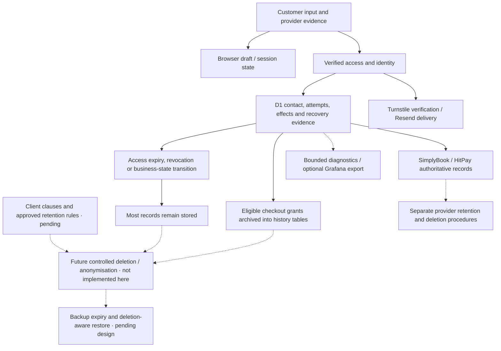

# Data lifecycle — source-based draft

[Database schema](architecture/database-schema.md) owns the D1 and Durable Object table diagrams and keys; this document owns lifecycle and retention.

**Draft for client policy mapping, 28 October 2026.** This document describes what the application currently stores, how access expires and where physical cleanup exists. It does not approve retention periods, authorize deletion or certify compliance. Before implementing cleanup or publishing customer promises, map the client’s PDPA/privacy clauses to these records, resolve exceptions and approve the resulting rules. No customer data, provider settings or cleanup behavior was changed to prepare this draft.

Original policy-review baseline: application code at `dffb24a`, carried unchanged through documentation branch `b137a79`. Later storage changes are reconciled below, including local migration0041. All41 migrations were applied to an empty in-memory SQLite database for the current schema review; no deployed database was queried by that check. Account-level backup, log and provider retention settings have not been verified. [Business rules](business-rules.md) own invariants, [API contracts](api-contracts.md) own interfaces, [technical behavior](code-owners/technical-behavior.md) maps functions and [runbook](runbook.md) owns recovery procedures.

## 1. Lifecycle and evidence boundaries

Four terms must not be confused:

- **Expiry:** a token, grant, cache or checking window stops being valid. Its stored record may remain.
- **Revocation:** retained state prevents future access. Revocation is not account/data erasure.
- **Archival:** an eligible record moves from an active table into a history table. It still exists.
- **Deletion/anonymisation:** data is removed or transformed so the intended identifying relationship is no longer available. This needs an approved scope across copies, linked records and providers. Hashes, attempt IDs and encrypted data are not automatically anonymous.

In this document, **implemented** means inspected source behavior, **not found** means no corresponding general path was identified in that source review, and **pending policy/account verification** means a client decision or external setting is still needed. Neither expiry nor a green CI result establishes production retention compliance.

## 2. Current storage inventory

All rows below need an approved disposal rule even where expiry is already enforced. “No general purge found” does not prove a provider will retain data forever; it means this application does not establish its deletion deadline.

### Browser and downloaded data

| ID    | Data / location and purpose                                                                                | Current behavior                                                                                                                                                                                                                                                                                                                                                                                                                                | Remaining decision                                                                                                                  |
| ----- | ---------------------------------------------------------------------------------------------------------- | ----------------------------------------------------------------------------------------------------------------------------------------------------------------------------------------------------------------------------------------------------------------------------------------------------------------------------------------------------------------------------------------------------------------------------------------------- | ----------------------------------------------------------------------------------------------------------------------------------- |
| DL-01 | `soccerbot-live-draft` in sessionStorage: editable contact/selection continuity                            | [Storage service](../src/services/storage.ts) stores the draft with consent reset to false, including the optional selected-service display name, exact tab-local checkout attempt ID, resume preference and calendar-recovery presentation flag (no booking authority); live attempt/payment authority comes from the server. Session lifetime is browser-controlled, including possible session restoration. No policy-based age purge found. | Whether/when to clear contact and draft on sign-out, completion, inactivity or shared-device use; validate actual browser behavior. |
| DL-02 | `soccerbot-checking:<attemptId>` in localStorage: checking deadline/count/timing                           | [Checking hook](../src/features/booking/confirmation-checking.ts) persists timing, not an access capability. No per-record removal/age cleanup found in this hook.                                                                                                                                                                                                                                                                              | Bound old attempt-key accumulation without renewing a live checking budget.                                                         |
| DL-03 | `soccerbot.completed-exit` in sessionStorage: unfinished completed-exit acknowledgement                    | [Confirmation service](../src/services/confirmation.ts) retains the attempt ID and removes the matching intent on acknowledgement. A failed dismissal retains it for retry.                                                                                                                                                                                                                                                                     | Safe terminal/orphan cleanup and browser notice; preserve uncertain acknowledgement until resolved.                                 |
| DL-04 | `soccerbot-player-app-prompt` localStorage preference; demo draft, identity, profiles and receipt fixtures | [Prompt](../src/components/player-app-prompt.tsx), [storage](../src/services/storage.ts) and [demo adapters](../src/services/demo) use different keys/stores. Demo sign-out removes its identity keys, not a system-wide customer erasure.                                                                                                                                                                                                      | Preference lifetime and test-data hygiene; do not enter real customer data into demo fixtures.                                      |
| DL-05 | Secure HttpOnly access/remembered cookies; downloaded PDF/calendar files                                   | Cookie expiry/revocation is enforced by [access](../worker/access.ts) and [remembered identity](../worker/remembered-identity.ts). Customer PDF/calendar generation is retired; previously downloaded files remain customer-held.                                                                                                                                                                                                               | Explain cookies and downloads appropriately. Server deletion does not recall downloaded files or recipient inbox copies.            |

The tab-local `soccerbot-expiry-reconciliation:<attemptId>` sessionStorage record stores the original payment deadline and a display-only ten-second reconciliation deadline. Reload resumes that original display window; it cannot authorize payment or release a reservation. Records last for the browser session (including possible session restoration); there is no separate age purge. If storage is unavailable, skip this optional foreground wait rather than restarting it on every reload; the original financial lock and background recovery remain intact.

The tab-local `soccerbot-suppressed-slots` sessionStorage entry contains validated affected session display data for conflict/expiry hiding. It grants no booking/payment authority. Successful fresh availability removes released entries; failed/stale reads retain them, and browser session lifetime applies. No independent age-based purge is implemented.

### D1 application state

| ID    | Tables and identifying content / purpose                                                                                                                                                                                                                                                                                  | Current expiry, revocation or movement                                                                                                                                                                                                      | Physical cleanup / gap                                                                                                                                                        |
| ----- | ------------------------------------------------------------------------------------------------------------------------------------------------------------------------------------------------------------------------------------------------------------------------------------------------------------------------- | ------------------------------------------------------------------------------------------------------------------------------------------------------------------------------------------------------------------------------------------- | ----------------------------------------------------------------------------------------------------------------------------------------------------------------------------- |
| DL-06 | `guest_access`: capability hash, owner ID and issue/expiry/revocation timestamps                                                                                                                                                                                                                                          | [authenticate/createAccess/renewAccess/revokeAccess](../worker/access.ts) check or update retained authority and expire the cookie.                                                                                                         | No general access-row purge found. `retentionPreview` only reports bounded expired orphan candidates.                                                                         |
| DL-07 | `identity_challenges`, `identity_bot_tokens`, `identity_delivery_dispatches`, `identity_request_counters`, `identity_request_denials`: email, email/source/code/token hashes, access/owner links, attempts, delivery state, session/source counters, observed request-block deadlines and timestamps                      | [Identity](../worker/identity.ts) checks bounded validity, attempt limits, consumption and supersession. [Delivery](../worker/identity-delivery.ts) records reserved/unknown dispatches and replay/rate-limit evidence.                     | No general purge found. Plain email is retained in challenge rows; hashing other fields does not anonymise the row. Deletion must preserve required rate/replay evidence.     |
| DL-08 | `verified_identity`, `remembered_identity`, `remembered_access`, `identity_revocations`: email, scoped hashed token family, access links and revocation cutoff                                                                                                                                                            | [Remembered identity](../worker/remembered-identity.ts) rotates tokens without extending family expiry; all-device revocation updates retained state. [Schema triggers](../migrations/0013_remembered_identity.sql) propagate revocation.   | No general purge found. Erasing revocation cutoffs/links prematurely could weaken rejection of older proof or restored sessions.                                              |
| DL-09 | `contact_profiles`: account, origin, email, name, phone, updated timestamp                                                                                                                                                                                                                                                | [Contact profile](../worker/contact-profile.ts) requires verified identity and remembered consent for saving; later saves update the existing scoped profile.                                                                               | No dedicated profile-erasure route or age purge found. Sign-out and expired Remember me do not establish profile deletion.                                                    |
| DL-10 | `attempts`, `dispatches`, `session_effects`, `recovery_work`, `no_creation_resolutions`: original intent JSON, customer contact/selection, owner/idempotency links, provider associations, observations and effect/recovery state                                                                                         | [Journal](../worker/journal.ts), [native checkout](../worker/native-checkout.ts) and [recovery](../worker/recovery.ts) retain evidence across uncertain writes. Some identity/association fields have immutable guards.                     | No general purge found. JSON columns may contain personal and booking information even when column names are generic. Review nested payload schemas before any anonymisation. |
| DL-11 | `native_checkout_grants`, `rejected_native_checkout_grants`, `completed_native_checkout_grants`, `expired_native_checkout_grants`: capability/attempt links, contract/result JSON and selection snapshots                                                                                                                 | Eligible grants are copied to the appropriate history table before active rows are deleted by [rejection](../worker/customer-authority.ts), [completed exit](../worker/completed-checkout.ts) or [expiry](../worker/checkout-progress.ts).  | Archival, not erasure. No general history purge found; removing one grant does not remove its attempt, payment, profile or provider record.                                   |
| DL-12 | `checkout_payment_routes`, `hitpay_holds`, `hitpay_payments`, `hitpay_receipts`, `checkout_progress`: references, request/payment IDs, checkout URL, scoped association/intent, confirmation JSON, provider-returned hosted-link expiry (`checkout_expires_ms`), immutable payment/recovery deadlines and webhook digests | [HitPay journal](../worker/hitpay-journal.ts), [recovery](../worker/hitpay-recovery.ts) and [progress](../worker/checkout-progress.ts) enforce original financial identity, verified confirmation and bounded recovery.                     | No general purge found. Payment/hold expiry is not evidence that money cannot settle. Stored URLs/IDs and confirmation payloads require careful access and deletion design.   |
| DL-13 | `webhook_capture_windows`, `webhook_event_scopes`, `webhook_receipts`, `webhook_pending_hints`, `webhook_recovery_scopes`, `webhook_subscription_grants`: account/window metadata, body digest/size/shape, selected booking hints, attempt links, subscription baseline/result                                            | [Capture](../worker/webhook.ts) uses a bounded authenticated capture window and deduplication; retained receipts describe permitted shape rather than a raw webhook-body archive. Related hints/recovery links can still identify bookings. | No general purge found. Review provider retry/replay behavior and retained recovery dependencies before deleting receipts or subscription proofs.                             |
| DL-14 | `developer_operations`, `identity_delivery_window`, `foundation_identity`: authorized-operation results, delivery sender/recipient/window and immutable deployment identity                                                                                                                                               | Operation/window checks limit execution; foundation checks bind the expected environment/resources.                                                                                                                                         | No general purge found. Some records contain recipient/account identifiers. Foundation identity is not a customer record and must not be swept by customer cleanup.           |

The D1 table list is based on the final schema after all [migrations](../migrations), not comments from an early migration. Later migrations extend the original developer-only schema for ongoing customer operation. In particular, `intent_json`, `contract_json`, `result_json`, `observation_json` and `confirmation_json` require field-level review; a policy cannot safely classify them as “technical metadata” by name alone.

- `reservation_sources`: attempt link, customer/IP HMAC hashes and creation timestamp; immutable updates, indexed by customer/IP. No raw IP is stored here.
- `reservation_expiries`: one immutable attempt/expiry timestamp per proven unpaid checkout. No automatic purge is implemented.
- `reservation_denials` (migration0043): scoped customer HMAC, existing opaque owner ID and original blocked-until time. It links an observed refusal across network/identity transitions, contains no contact or raw IP, and adds no strike. Expiry stops enforcement without deleting the row; no automatic purge is introduced. Historical strike timestamps are not rewritten.
- The24-hour IP window controls participation, not deletion. Successful payment changes the customer counting boundary without deleting history; one-hour cooldown expiry does not erase strikes.
- Hashes remain linked to booking attempts and are pseudonymous, not anonymous. Existing pepper rotation changes identity matching; no migration/rekey/cleanup is authorized by this change.

### Terminal no-creation evidence

Migration0041 adds `no_creation_resolutions`: original attempt/intent hash/version/dispatch fence, bounded evidence reference, verification/resolution times, evidence source and an operator-capability hash only for operator verification. The reference identifies restricted evidence; raw provider messages, customer contact details and operator credentials are not copied into this table. It remains linked to the original attempt and is not anonymous.

[Resolution](../worker/native-creation-resolution.ts) archives the exact active grant into `rejected_native_checkout_grants`, preserves attempts/dispatches/session effects, completes recovery and prevents later writes on that attempt. Resolution is neither data erasure nor unpaid expiry and creates no reservation-expiry strike. Browser cleanup removes the resolved attempt's recovery identity. The tab-local `leftBookingFlow` marker retains deliberate departure with the original attempt ID until exact protected re-entry readback: terminal proof starts fresh entry, while an unknown read retains the lock. Active recovery preserves contact/session preferences; deliberate Home departure instead starts a blank draft after resolution. The no-creation notice is in memory only and is not restored after the resolved attempt marker is cleared. The restricted `developer_operations` grant stores its scoped proof until consumption, then its bounded result; the terminal table retains the evidence reference. No automatic purge or disposal period is introduced. Immutable triggers and replay protection must be included in any future authorized retention design.

### Durable Object, caches and external copies

| ID    | Store and purpose                                                                                                                                                          | Current behavior                                                                                                                                                                                                                                                                                                                                                                                                                              | Gap / verification required                                                                                                                                                                                                                                                                                                                                                                           |
| ----- | -------------------------------------------------------------------------------------------------------------------------------------------------------------------------- | --------------------------------------------------------------------------------------------------------------------------------------------------------------------------------------------------------------------------------------------------------------------------------------------------------------------------------------------------------------------------------------------------------------------------------------------- | ----------------------------------------------------------------------------------------------------------------------------------------------------------------------------------------------------------------------------------------------------------------------------------------------------------------------------------------------------------------------------------------------------- |
| DL-15 | DO SQLite `provider_token_cache`: encrypted provider tokens and scope/expiry metadata                                                                                      | [Token cache](../worker/provider-token-cache.ts) deletes invalid/wrong-scope entries when loaded or explicitly invalidated; expired access without a refresh token is removed. Encrypted admin refresh material survives access expiry until consumed, replaced or invalidated; conditional deletion precedes refresh transport. Saves replace that token family. This is access-driven cleanup, not a wall-clock purge of every idle object. | Secret/token lifecycle and external credential rotation are separate from customer-data erasure.                                                                                                                                                                                                                                                                                                      |
| DL-16 | DO SQLite `display_snapshots`, `display_refresh`, `display_warm_month`, `display_release_probes`; memory catalogue/calendar caches                                         | [Display snapshots](../worker/display-snapshots.ts) store public display DTOs with read expiry; saving removes foreign-scope and sufficiently old snapshots. Generation changes fence stale writes. Memory caches are bounded/invalidation-driven.                                                                                                                                                                                            | Release probes retain an attempt ID, date and grid starts; queue inspection purges rows whose base deadline is over one day old. Completed tombstones prevent repeated expiry from restarting probes. Idle expired rows may remain until another save/queue inspection. These caches are not booking/payment authority; verify permitted provider labels before treating all content as non-personal. |
| DL-17 | DO SQLite `budget`, `refreshes`, `admissions`, `admission_releases`, `financial_releases`, `provider_request_admissions`, `provider_transport_releases`, `payment_wakeups` | [Coordinator](../worker/coordinator.ts) retains accounting/admission/release evidence. Payment wakeups retain their next retry deadline; terminal processing removes only the matching generation.                                                                                                                                                                                                                                            | No general historical purge found for accounting/release tables. Do not reset them to clear capacity or erase customer-linked financial fences.                                                                                                                                                                                                                                                       |
| DL-18 | Worker/platform logs, optional Grafana/Tempo data, CI artifacts, operator exports and backups                                                                              | [Diagnostics](../worker/diagnostics.ts) and [telemetry](../worker/telemetry.ts) bound/sanitise known events and apply sampling. CI upload steps declare 14-day artifact retention.                                                                                                                                                                                                                                                            | Sampling and the telemetry `retention` label do not configure storage expiry. Grafana activation/retention, Cloudflare logs/backups, GitHub logs/settings and separately downloaded copies need account verification.                                                                                                                                                                                 |

## 3. Implemented validity periods are not disposal periods

These are source facts, not proposed client retention commitments. Recheck the target configuration and source revision before deployment.

| Mechanism                        | Current source behavior                                                                                                                                                                                                             | What it does not mean                                                                                             |
| -------------------------------- | ----------------------------------------------------------------------------------------------------------------------------------------------------------------------------------------------------------------------------------- | ----------------------------------------------------------------------------------------------------------------- |
| Guest access                     | [Checked-in Worker configuration](../wrangler.jsonc) sets `ACCESS_LIFETIME_MS` to 1,800,000 ms (30 minutes); policy validates configured bounds. Cookie Max-Age and stored expiry follow that duration.                             | The D1 access row is not automatically deleted after 30 minutes.                                                  |
| Email challenge                  | [Identity code](../worker/identity.ts) limits validity to the earlier of ten minutes after creation or access expiry; verification also enforces attempts/state.                                                                    | A consumed/expired challenge row and its email are not automatically erased.                                      |
| Verified identity                | New verification is capped at 30 minutes and access expiry; remembered restoration is also bounded by the remembered family and current access.                                                                                     | Loss of verified access does not delete saved contact, booking or provider data.                                  |
| Remember me family               | [Remembered identity](../worker/remembered-identity.ts) fixes expiry at 90 days from verification; rotation does not extend it.                                                                                                     | Ninety days is a capability lifetime, not an approved retention duration for profiles or identity history.        |
| Provider tokens                  | Public/admin access retention is 50 minutes in [token cache](../worker/provider-token-cache.ts). Encrypted admin refresh tokens survive access expiry and are consumed before use; invalid/wrong-scope entries are removed on load. | This does not define provider credential lifetime or a customer-data retention period.                            |
| Public display snapshots         | [Catalogue contract](../src/domain/catalog.ts) sets a 30-minute display age. Save-time cleanup uses `expires_ms < now - DISPLAY_SNAPSHOT_MAX_AGE_MS`, in addition to removing other scopes.                                         | Expiry at read time is earlier than that cleanup threshold; cleanup still requires a save.                        |
| Booking/payment/checking windows | [Business rules BR-011–012](business-rules.md#payment-reconciliation-and-expiry) define distinct business/recovery clocks.                                                                                                          | None authorizes deleting payment evidence when a browser timer ends.                                              |
| CI artifacts                     | [Verification workflow](../.github/workflows/verify-target.yml) upload steps request 14 days.                                                                                                                                       | This does not prove the lifetime of workflow logs, provider logs, downloaded artifacts, backups or customer data. |

## 4. Existing cleanup and important gaps

**Implemented, narrow cleanup:** token-cache invalidation/removal; save-triggered public snapshot cleanup; generation-safe removal of processed payment wakeups; matched browser completed-exit removal; bounded memory caches; and copy-then-delete movement of eligible active grants into history tables. None is a general personal-data retention service.

**Preview only:** [retentionPreview](../worker/recovery.ts) validates the cutoff and limit, examines at most 100 expired access candidates, excludes owners with attempts and reports `cleanupEnabled: false` / `retention_decision_required`. It explicitly retains attempts, effects, dispatches, recovery, operator proofs and coordinator accounting. It is not an implemented deletion endpoint or scheduled purge. Do not treat “orphan access candidate” as approved deletion eligibility across every identity/profile/provider relationship.

**Not found in the reviewed application paths:** a general age-based D1 purge, a complete customer erasure/anonymisation workflow, a saved-contact deletion endpoint, a cross-provider deletion orchestrator, or deletion-aware backup restoration. [The scheduler](../worker/index.ts) performs recovery, booking-comment work and configured display warming; it is not a general customer-data cleanup scheduler.

**Consequences to resolve before implementation:** terminal histories can accumulate; expiry may leave personal fields stored; account sign-out is not a deletion request; provider records survive application-row deletion; and restored backups can reintroduce older personal data or revoked access unless a specific restoration procedure prevents it.

## 5. External systems must be mapped separately

| System                              | Application relationship                                                                                                                          | Policy/configuration questions still open                                                                                                                                                                          |
| ----------------------------------- | ------------------------------------------------------------------------------------------------------------------------------------------------- | ------------------------------------------------------------------------------------------------------------------------------------------------------------------------------------------------------------------ |
| SimplyBook                          | Booking/customer/contact, schedule and invoice authority; application retains linked evidence and can write supported booking comments.           | Exact fields sent/stored, configured notifications, retention/deletion options, contractual roles, locations/subprocessors and records required for financial/business obligations.                                |
| HitPay                              | Hosted payment authority; application stores scoped IDs/references and reconciliation evidence.                                                   | Merchant/account retention, transaction/dispute obligations, deletion/request procedures and location/subprocessor terms. No payment retention duration is approved here.                                          |
| Resend and recipient mailboxes      | Identity delivery sends verification email through Resend; copies may remain in provider delivery records and the recipient’s inbox.              | Provider log/content retention, access, deletion features and account configuration. Expiring a challenge does not remove an email already delivered.                                                              |
| Turnstile                           | Server-side bot-proof verification sends the supported verification request; application retains hashed proof/source evidence for abuse controls. | Provider privacy terms, actual request fields, processing locations and relevant client disclosures. Do not infer that local hashing controls the provider’s own processing.                                       |
| Cloudflare                          | Hosts Worker/D1/DO, TLS and associated platform facilities.                                                                                       | Account/plan-specific log, backup/recovery and physical deletion behavior; administrative access, export copies and region/transfer disclosures. A placement hint is not a comprehensive data-residency guarantee. |
| Company Grafana                     | Intended central destination for bounded diagnostic summaries; client ingestion/alerts remain unaccepted.                                         | Tenant/service separation, storage retention, receiver settings, access and deletion. Hashed correlation keys can remain linkable.                                                                                 |
| GitHub and operator-managed storage | Repository, CI evidence, deployment receipts and downloaded UAT/incident/backup exports.                                                          | Artifact/log settings, who can download, where copies go and their disposal. Never commit customer data, raw tokens or transfer codes as evidence.                                                                 |

Contractual roles and legal obligations must be confirmed with the client and relevant provider agreements; this source audit does not assign controller/intermediary roles or certify the adequacy of a clause.

## 6. Clause-to-implementation worksheet — complete before cleanup work

All policy values below are **pending client clauses and approval**. Preserve the distinction between a source validity limit, an agreed business retention period and a provider’s independently configured retention.

| Decision                            | Inventory scope                | Required client input                                                                            | Engineering mapping to prepare                                                                                | Approval / evidence |
| ----------------------------------- | ------------------------------ | ------------------------------------------------------------------------------------------------ | ------------------------------------------------------------------------------------------------------------- | ------------------- |
| Purpose and permitted use           | DL-01–18                       | Clause ID/version, purposes, categories and responsible entity                                   | Exact fields, collection points, recipients and access owners                                                 | Pending             |
| Retention start and duration        | Each category separately       | Trigger (creation, completion, last activity, dispute closure, etc.), period and exception basis | Indexed eligibility predicate and dependent records; distinguish mutable timestamps from original creation    | Pending             |
| Saved-details consent/withdrawal    | DL-01, DL-08–09                | Meaning of Remember me versus saved-contact consent; withdrawal behavior                         | UI wording, stored consent evidence, revocation and profile-removal behavior                                  | Pending             |
| Access/correction/deletion requests | DL-06–14 and providers         | Verified-request procedure, response responsibilities and applicable exceptions                  | Subject matching across email, owner/capability, attempt and provider IDs; report/delete/anonymise boundaries | Pending             |
| Financial/security exceptions       | DL-07–08, DL-10–14, DL-17      | Legitimate retention requirements, exception owner and review dates                              | Preserve uncertain writes, deduplication, revocation, reconciliation and necessary audit evidence             | Pending             |
| Backups and restore                 | DL-18 plus all restored stores | Backup lifetime, access, deletion propagation and restoration obligations                        | Deletion-aware restore design; provider reconciliation before reopening access                                | Pending             |
| Diagnostics and exports             | DL-04–05, DL-18                | Log/evidence purpose, duration, access and treatment of downloaded copies                        | Platform/Grafana/GitHub settings and operator procedure                                                       | Pending             |
| Provider disclosures/transfers      | External-system inventory      | Approved provider clauses, agreements and required disclosures                                   | Actual accounts/settings, field flow and location evidence                                                    | Pending             |

For every approved rule, record: `rule ID → clause ID/version → data category → store/fields → trigger → period → exceptions → action → owner → test evidence → deployed revision`. Broad wording such as “as long as necessary” still needs a concrete operational decision; do not invent a duration during implementation.

## 7. Proposed implementation sequence — not implemented or authorised by this draft

1. Obtain and review the client’s clauses; finish the worksheet and resolve contradictions with existing source behavior. If policy requires behavior the app lacks, record the implementation gap before making that customer-facing promise.
2. Perform an authorised, minimised production inventory/count assessment. Confirm actual deployments, provider accounts, backup/log settings and growth; do not export raw customer rows merely to estimate size.
3. Design dependency-aware eligibility and deletion/anonymisation for each category. Immutable attempt/grant triggers, revocation fences and linked JSON require explicit migration/design review; a blanket email-based delete is insufficient.
4. Prepare a read-only dry-run report with counts/reasons and protected-state exclusions. Decide whether minimal deletion evidence is required, what it contains and its own retention; do not create an indefinite duplicate customer record as a deletion receipt.
5. Test bounded batches, stable pagination/indexes, concurrency, safe reruns and interrupted progress on isolated fixtures. Cover expired-but-referenced access, revoked identities, uncertain payments, webhook replay, archived grants and provider failures. Never turn unknown writes into fresh checkout eligibility by deleting evidence.
6. Exercise deletion-aware restore and cross-provider handling. Specify how subsequent approved deletions/revocations are re-applied or otherwise protected after restoring an older backup, with appropriate financial reconciliation before access resumes.
7. Review/approve the concrete change, deploy through normal verified-artifact gates and validate results. Monitor eligible backlog, processed counts, errors and job freshness without logging personal payloads. Keep owner/CI control of browsers and any separately authorised provider operations.

Start with explicit rules and modest bounded jobs when approved; introduce queues, archival storage or more elaborate orchestration only when measured growth, job duration, request volume or operational requirements justify them. There is no need to wait for a large customer base to define policy, and no reason to deploy destructive cleanup before the policy and dependencies are understood.

## 8. Review checklist and handover

- [ ] Client clauses/version received; purposes, periods and exceptions mapped and approved.
- [ ] Source inventory reconciled with actual client accounts/resources and provider settings.
- [ ] Browser storage, downloaded files, nested JSON and archives included—not only obvious profile tables.
- [ ] No promise equates sign-out, expiry, archive or cancellation with deletion/refund.
- [ ] Backup/log retention and cross-provider request ownership confirmed.
- [ ] Dry-run, immutable-state, interruption, replay and restore cases reviewed before implementation.
- [ ] Operational owner and review cadence assigned; alert responders remain separate and currently unassigned.
- [ ] Implemented revision, CI evidence and owner acceptance recorded only after actual execution.

Current status: **source-based draft complete; policy mapping, external-account verification and cleanup implementation pending**. Review when client clauses arrive and whenever storage schemas, identity behavior, provider integrations or retention settings change. This document owns lifecycle policy mapping; the [runbook’s restore procedure](runbook.md#7-data-protection-and-restore) owns operational recovery execution.

Browser confirmation timing retains response timestamps in a WeakMap and a bounded set of emitted stage keys within the mounted view. It adds no local/session storage or database records. Performance holds the latest diagnostic mark per stage; console retention depends on browser tooling and owner export. Exported diagnostic captures include pseudonymous correlation and must follow the same controlled handling as HAR evidence; the app does not upload them automatically.

Invoice display metadata: optional provider numbers remain in observations and saved confirmation JSON. Migration0036 adds `invoice_documents`, keyed by attempt and immutable association, containing the original unpaid number, optional paid document number and observation time. It contains no new contact fields, has no automatic expiry/deletion and follows the pending attempt-record retention policy; cleanup remains unapproved. Only authenticated verified receipt enrichment updates the paid display value. Old records are not backfilled by inference. Customer PDF/calendar generation remains retired; historical files may retain earlier data outside server revocation. Email drafts create no delivery store.

### Verified unpaid release and warming claims

Migration0037 adds immutable per-attempt checking-buffer timing. Verified unpaid release moves the active grant to its existing archive; it deletes neither the payment request journal nor webhook/booking evidence. Later payment remains associated with the original attempt. DO `display_warm_month` stores only scope/month/last-attempt time, with no customer or financial data. Snapshot expiry and affected-day replacement retain the existing original deadline.

Guest capability expiry now renews for the configured lifetime on valid explicit access entry and checkout POST. Issuance identity, revocation, related grants and financial deadlines remain unchanged; expiry/revocation prevents renewal. No new storage table or purge behavior.

The tab-local `soccerbot-conflict-notice` sessionStorage date/start array retains the approved conflict notice and its affected-session bullets across calendar reloads. It carries only validated display dates/times, no contact/payment data and no authority. Leaving the calendar step, leaving the booking, or resetting clears it; background availability and other-tab checkout reads do not recreate it after dismissal.

A deliberate departure from an unresolved booking retains only the original attempt-bound session snapshot needed to suppress affected times after verified non-creation. It is display/recovery correlation, not booking authority or an editable cart. Terminal handling retires the attempt/departure marker; affected-time suppression persists until fresh availability confirms release.

The tab-local `soccerbot-pending-conflict` sessionStorage entry retains a validated original rejected draft and optional exact attempt/index correlation while initial availability classification is pending. It includes the same contact/selection display data as the live draft, never payment or booking authority. It survives refresh, is rejected when its attempt marker differs, and is cleared after completed classification or deliberate cancellation/departure. Protected server evidence is required before replaying an indexed rejection after reload. Browser session lifetime applies; no independent age-based purge is introduced.

Migration 0042 adds `checkout_preparation_rejections` for checkout keys rejected before an attempt exists. It retains the original owner/key, a hash of validated input, bounded session-time/player/total summary, affected-index proof and timestamp. The table does not copy contact details or provider/payment URLs. These links remain personal booking metadata, not anonymous data. Immutable triggers and replay fences preserve this evidence; no automatic purge is introduced. It is distinct from provider-backed `no_creation_resolutions` for an already-dispatched uncertain attempt.

The tab-local live draft stores `calendarNoticeDismissed` only alongside its matching checkout attempt. It records the first Calendar departure so refresh and later financial resolution cannot recreate the expiry notice. It conveys no payment or booking authority; draft cleanup removes it.

Checkout bot-proof receipts (`checkout_bot_proofs`, migration0045) retain attempt keys, capability links, intent/token hashes and verification/expiry timestamps. They contain no raw Turnstile token. Their five-minute logical proof validity bounds new creation; existing owned attempts retain separate recovery authority. No general physical purge is introduced; expiry is not deletion. Preserve replay/ownership evidence when defining any future retention policy.
