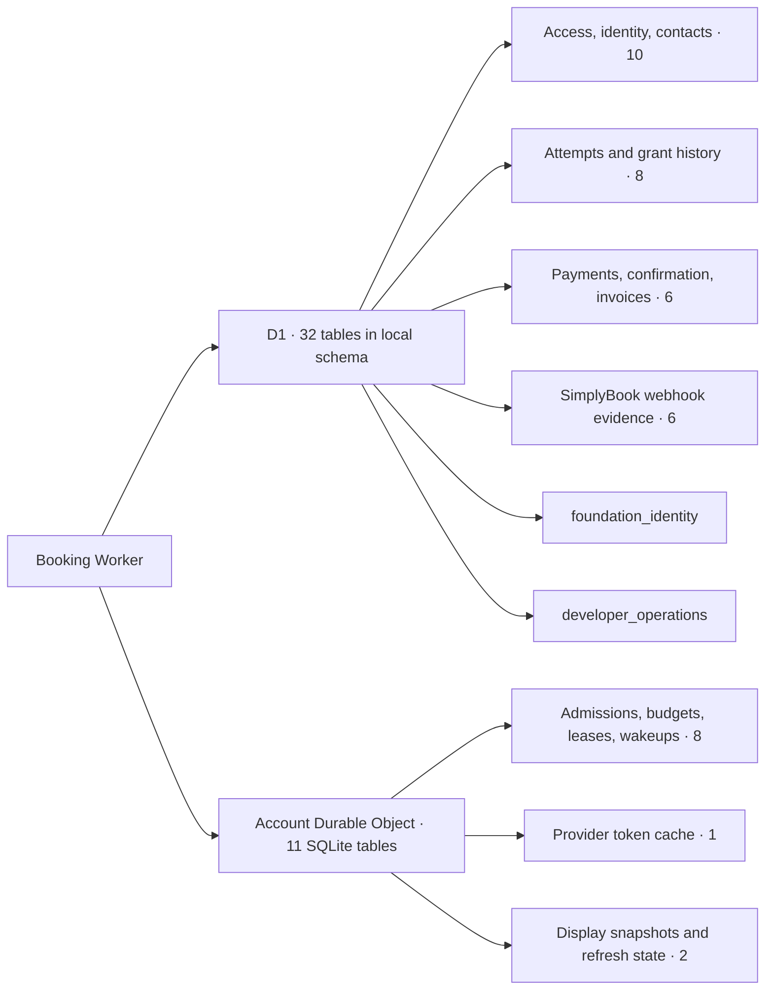

# Project journey and evidence

<!-- document-chapter-menu -->

Chapter menu

- [1. Initial milestone overview](#initial-milestone-overview)
  - [1.1. Milestones and retained acceptance criteria](#milestones-and-retained-acceptance-criteria)
  - [1.2. M1.1 — Reconcile the accepted baseline](#m11--reconcile-the-accepted-baseline)
  - [1.3. M1.2 — Enforce the reviewed release path](#m12--enforce-the-reviewed-release-path)
  - [1.4. M1.3 — Close tooling and delivery findings](#m13--close-tooling-and-delivery-findings)
  - [1.5. M1.4 — Accept the deployed demo visually](#m14--accept-the-deployed-demo-visually)
  - [1.6. M2.1 — Account readiness and temporary setup](#m21--account-readiness-and-temporary-setup)
  - [1.7. M2.2 — Prove scheduling and single-studio slot protection](#m22--prove-scheduling-and-single-studio-slot-protection)
  - [1.8. M2.3 — Prove the native hosted payment route](#m23--prove-the-native-hosted-payment-route)
  - [1.9. M2.4 — Prove failure and recovery semantics](#m24--prove-failure-and-recovery-semantics)
  - [1.10. M2.5 — Freeze the integration contract and mappings](#m25--freeze-the-integration-contract-and-mappings)
  - [1.11. M3.1 — Worker and environment foundation](#m31--worker-and-environment-foundation)
  - [1.12. M3.2 — Named asynchronous service contracts](#m32--named-asynchronous-service-contracts)
  - [1.13. M3.3 — Minimal durable state and migrations](#m33--minimal-durable-state-and-migrations)
  - [1.14. M3.4 — Email challenge and abuse controls](#m34--email-challenge-and-abuse-controls)
  - [1.15. M3.5 — Protected sessions and guest checkout capability](#m35--protected-sessions-and-guest-checkout-capability)
  - [1.16. M3.6 — Safe returning customer prefill](#m36--safe-returning-customer-prefill)
  - [1.17. M4.1 — Authoritative availability and eligible instructors](#m41--authoritative-availability-and-eligible-instructors)
  - [1.18. M4.2 — Connect selection and server revalidation](#m42--connect-selection-and-server-revalidation)
  - [1.19. M4.3 — Create and recover a checkout attempt](#m43--create-and-recover-a-checkout-attempt)
  - [1.20. M4.4 — Create every selected session safely](#m44--create-every-selected-session-safely)
  - [1.21. M4.5 — Handle partial failure and compensation](#m45--handle-partial-failure-and-compensation)
  - [1.22. M4.6 — Close booking recovery end to end](#m46--close-booking-recovery-end-to-end)
  - [1.23. M5.1 — Validate invoice and checkout association](#m51--validate-invoice-and-checkout-association)
  - [1.24. M5.2 — Hosted payment and safe customer return](#m52--hosted-payment-and-safe-customer-return)
  - [1.25. M5.3 — Verify payment status](#m53--verify-payment-status)
  - [1.26. M5.4 — Resolve pending expired late and unknown outcomes](#m54--resolve-pending-expired-late-and-unknown-outcomes)
  - [1.27. M5.5 — Protect the final confirmation](#m55--protect-the-final-confirmation)
  - [1.28. M6.1 — Booking summary and calendar exports](#m61--booking-summary-and-calendar-exports)
  - [1.29. M6.2 — Native emails and approved public content](#m62--native-emails-and-approved-public-content)
  - [1.30. M6.3 — Client staging configuration and full rehearsal](#m63--client-staging-configuration-and-full-rehearsal)
  - [1.31. M6.4 — Production build and deployment pipeline](#m64--production-build-and-deployment-pipeline)
  - [1.32. M6.5 — Monitoring alerts and recovery rehearsal](#m65--monitoring-alerts-and-recovery-rehearsal)
  - [1.33. M6.6 — Release audit and UAT package](#m66--release-audit-and-uat-package)
  - [1.34. M7.1 — Run the full client UAT suite](#m71--run-the-full-client-uat-suite)
  - [1.35. M7.2 — Physical devices and operational walkthrough](#m72--physical-devices-and-operational-walkthrough)
  - [1.36. M7.3 — Close defects and rerun affected acceptance](#m73--close-defects-and-rerun-affected-acceptance)
  - [1.37. M7.4 — Record written build acceptance](#m74--record-written-build-acceptance)
  - [1.38. M8.1 — Production readiness and go live decision](#m81--production-readiness-and-go-live-decision)
  - [1.39. M8.2 — Deploy the verified production candidate](#m82--deploy-the-verified-production-candidate)
  - [1.40. M8.3 — Verify live operation](#m83--verify-live-operation)
  - [1.41. M8.4 — Complete training handover and launch acceptance](#m84--complete-training-handover-and-launch-acceptance)
  - [1.42. M9.1 — Launch stabilization review](#m91--launch-stabilization-review)
  - [1.43. M9.2 — Six month warranty operations](#m92--six-month-warranty-operations)
  - [1.44. M9.3 — Optional maintenance service](#m93--optional-maintenance-service)
  - [1.45. M9.4 — Ongoing changes and eventual exit](#m94--ongoing-changes-and-eventual-exit)
- [2. Reading the retained record](#reading-the-retained-record)
- [3. Part 2 — Dated changes and evidence](#part-2--dated-changes-and-evidence)
  - [3.1. 30 October 2026 — Merged-main I/O stall and bounded temporary storage](#30-october-2026--merged-main-io-stall-and-bounded-temporary-storage)
  - [3.2. 30 October 2026 — Instrument intermittent isolated runtime stalls](#30-october-2026--instrument-intermittent-isolated-runtime-stalls)
  - [3.3. 30 October 2026 — Remove repeated homepage setup from failure journeys](#30-october-2026--remove-repeated-homepage-setup-from-failure-journeys)
  - [3.4. 30 October 2026 — Diagnose client CI and review test-flow freshness](#30-october-2026--diagnose-client-ci-and-review-test-flow-freshness)
  - [3.5. 30 October 2026 — Retire legacy sidebar workflow](#30-october-2026--retire-legacy-sidebar-workflow)
  - [3.6. 30 October 2026 — Consolidate client Actions entries](#30-october-2026--consolidate-client-actions-entries)
  - [3.7. 30 October 2026 — Separate target verification stages for private runners](#30-october-2026--separate-target-verification-stages-for-private-runners)
  - [3.8. 30 October 2026 — Client setup and skip-interaction clock repair](#30-october-2026--client-setup-and-skip-interaction-clock-repair)
  - [3.9. 30 October 2026 — Client GitHub pipeline and closed Worker bootstrap](#30-october-2026--client-github-pipeline-and-closed-worker-bootstrap)
  - [3.10. 29 October 2026 — PR122 rotation-notice cascade correction](#29-october-2026--pr122-rotation-notice-cascade-correction)
  - [3.11. 29 October 2026 — PR122 confirmation typography correction](#29-october-2026--pr122-confirmation-typography-correction)
  - [3.12. 29 October 2026 — calendar navigation and fresh confirmation exports](#29-october-2026--calendar-navigation-and-fresh-confirmation-exports)
  - [3.13. 26 October 2026 — PR90 Worker inventory correction](#26-october-2026--pr90-worker-inventory-correction)
  - [3.14. 26 October 2026 — All-device sign-out from valid remembered sessions](#26-october-2026--all-device-sign-out-from-valid-remembered-sessions)
  - [3.15. 26 October 2026 — Client account verification and Pages routing preparation](#26-october-2026--client-account-verification-and-pages-routing-preparation)
  - [3.16. 22 October 2026 — Client staging and production delivery plan](#22-october-2026--client-staging-and-production-delivery-plan)
  - [3.17. 22 October 2026 — Unique documentation ownership after PR88](#22-october-2026--unique-documentation-ownership-after-pr88)
  - [3.18. 22 October 2026 — One-line major-function documentation](#22-october-2026--one-line-major-function-documentation)
  - [3.19. 22 October 2026 — Retire obsolete examples, receipts and proof packet](#22-october-2026--retire-obsolete-examples-receipts-and-proof-packet)
  - [3.20. 22 October 2026 — Owner waives real-checkout placement experiment](#22-october-2026--owner-waives-real-checkout-placement-experiment)
  - [3.21. 22 October 2026 — Real checkout experiment preparation and isolation correction](#22-october-2026--real-checkout-experiment-preparation-and-isolation-correction)
  - [3.22. 22 October 2026 — Execution location correction and client placement strategy](#22-october-2026--execution-location-correction-and-client-placement-strategy)
  - [3.23. 22 October 2026 — Bounded placement screening after auth patch publication](#22-october-2026--bounded-placement-screening-after-auth-patch-publication)
  - [3.24. 22 October 2026 — Public token refresh-ahead and placement diagnostics](#22-october-2026--public-token-refresh-ahead-and-placement-diagnostics)
  - [3.25. 22 October 2026 — Security scanning and weekly notification scope](#22-october-2026--security-scanning-and-weekly-notification-scope)
  - [3.26. 22 October 2026 — Dependency security maintenance added to backlog](#22-october-2026--dependency-security-maintenance-added-to-backlog)
  - [3.27. 22 October 2026 — Documentation consolidation and client migration plan](#22-october-2026--documentation-consolidation-and-client-migration-plan)
  - [3.28. Acceptance checkpoint — 22 October 2026 SGT](#acceptance-checkpoint--22-october-2026-sgt)
  - [3.29. 21 October 2026 — overload recovery and explicit retry qualification](#21-october-2026--overload-recovery-and-explicit-retry-qualification)
  - [3.30. 21 October 2026 — scope the409 browser alert to main](#21-october-2026--scope-the409-browser-alert-to-main)
  - [3.31. 21 October 2026 — full burst campaign reaches queue limit](#21-october-2026--full-burst-campaign-reaches-queue-limit)
  - [3.32. 21 October 2026 — isolated load campaign preparation](#21-october-2026--isolated-load-campaign-preparation)
  - [3.33. 21 October 2026 — PR82 browser alert locator correction](#21-october-2026--pr82-browser-alert-locator-correction)
  - [3.34. 21 October 2026 — acceptance consolidated and next campaign planned in PR82](#21-october-2026--acceptance-consolidated-and-next-campaign-planned-in-pr82)
  - [3.35. 21 October 2026 — preparation409 readback and owner atomicity decision](#21-october-2026--preparation409-readback-and-owner-atomicity-decision)
  - [3.36. Consistent calendar selection — 21 October 2026 SGT](#consistent-calendar-selection--21-october-2026-sgt)
  - [3.37. 21 October 2026 — concurrent checkout rejection readback](#21-october-2026--concurrent-checkout-rejection-readback)
  - [3.38. 21 October 2026 — unresolved focus and hold-expiry refresh](#21-october-2026--unresolved-focus-and-hold-expiry-refresh)
  - [3.39. 21 October 2026 — acceptance resumed and confirmation details simplified](#21-october-2026--acceptance-resumed-and-confirmation-details-simplified)
  - [3.40. 21 October 2026 — PR79 deployment and backend telemetry preparation](#21-october-2026--pr79-deployment-and-backend-telemetry-preparation)
  - [3.41. 21 October 2026 — PR79 browser colour expectation repair](#21-october-2026--pr79-browser-colour-expectation-repair)
  - [3.42. 21 October 2026 — PR78 handoff and documentation/presentation audit](#21-october-2026--pr78-handoff-and-documentationpresentation-audit)
  - [3.43. Batch checkout and token retention — 21 October 2026 SGT](#batch-checkout-and-token-retention--21-october-2026-sgt)
  - [3.44. Five-round-trip recovery experiment — 21 October 2026 SGT](#five-round-trip-recovery-experiment--21-october-2026-sgt)
  - [3.45. Five-call experiment accepted for integration — 21 October 2026 SGT](#five-call-experiment-accepted-for-integration--21-october-2026-sgt)
  - [3.46. Hometest06 and optimization experiments — 20 October 2026 SGT](#hometest06-and-optimization-experiments--20-october-2026-sgt)
  - [3.47. Confirmation read experiment — 20 October 2026 SGT](#confirmation-read-experiment--20-october-2026-sgt)
  - [3.48. Hometest05 telemetry — 20 October 2026 SGT](#hometest05-telemetry--20-october-2026-sgt)
  - [3.49. Pending confirmation layout consistency — 20 October 2026 SGT](#pending-confirmation-layout-consistency--20-october-2026-sgt)
  - [3.50. PR72 lost-response test setup — 20 October 2026 SGT](#pr72-lost-response-test-setup--20-october-2026-sgt)
  - [3.51. Confirmation tracing — 20 October 2026 SGT](#confirmation-tracing--20-october-2026-sgt)
  - [3.52. Ten-call single checkout integration — 20 October 2026 SGT](#ten-call-single-checkout-integration--20-october-2026-sgt)
  - [3.53. PR70 initial receipt versus download gate — 20 October 2026 SGT](#pr70-initial-receipt-versus-download-gate--20-october-2026-sgt)
  - [3.54. PR70 browser reconciliation-gate correction — 20 October 2026 SGT](#pr70-browser-reconciliation-gate-correction--20-october-2026-sgt)
  - [3.55. Confirmation and queue audit repair — 20 October 2026](#confirmation-and-queue-audit-repair--20-october-2026)
  - [3.56. PR69 main integration — 20 October 2026 SGT](#pr69-main-integration--20-october-2026-sgt)
  - [3.57. Checkout phase tracing — 20 October 2026 SGT](#checkout-phase-tracing--20-october-2026-sgt)
  - [3.58. Batch checkout creation path — 20 October 2026 SGT](#batch-checkout-creation-path--20-october-2026-sgt)
  - [3.59. Checkout D1 consolidation — 20 October 2026 SGT](#checkout-d1-consolidation--20-october-2026-sgt)
  - [3.60. Lean single checkout — 20 October 2026 SGT](#lean-single-checkout--20-october-2026-sgt)
  - [3.61. PR66 CI cookie-adapter correction — 20 October 2026 SGT](#pr66-ci-cookie-adapter-correction--20-october-2026-sgt)
  - [3.62. Authentication rejection diagnostic follow-up — 20 October 2026 SGT](#authentication-rejection-diagnostic-follow-up--20-october-2026-sgt)
  - [3.63. HAR10 confirmation stability and pre-dispatch authentication failure — 20 October 2026 SGT](#har10-confirmation-stability-and-pre-dispatch-authentication-failure--20-october-2026-sgt)
  - [3.64. Confirmation read timestamp race — 20 October 2026 SGT](#confirmation-read-timestamp-race--20-october-2026-sgt)
  - [3.65. Independent payment deadlines — 20 October 2026 SGT](#independent-payment-deadlines--20-october-2026-sgt)
  - [3.66. Interrupted provider transport recovery — 20 October 2026 SGT](#interrupted-provider-transport-recovery--20-october-2026-sgt)
  - [3.67. Lost checkout response test ordering — 20 October 2026](#lost-checkout-response-test-ordering--20-october-2026)
  - [3.68. PR62 checkout transport verification — 20 October 2026 SGT](#pr62-checkout-transport-verification--20-october-2026-sgt)
  - [3.69. Actual batch response investigation and optimization — 20 October 2026 SGT](#actual-batch-response-investigation-and-optimization--20-october-2026-sgt)
  - [3.70. Owner prioritizes checkout URL handoff — 19 October 2026 SGT](#owner-prioritizes-checkout-url-handoff--19-october-2026-sgt)
  - [3.71. Owner adds recurring display warm-up — 19 October 2026 SGT](#owner-adds-recurring-display-warm-up--19-october-2026-sgt)
  - [3.72. Browsing loading and cache investigation — 19 October 2026 SGT](#browsing-loading-and-cache-investigation--19-october-2026-sgt)
  - [3.73. PR60 flow implementation and CI diagnosis — 19 October 2026 SGT](#pr60-flow-implementation-and-ci-diagnosis--19-october-2026-sgt)
  - [3.74. Editable Review, combined checkout and compact confirmation — 19 October 2026 SGT](#editable-review-combined-checkout-and-compact-confirmation--19-october-2026-sgt)
  - [3.75. HAR08 confirmation continuity and record reconciliation — 19 October 2026 SGT](#har08-confirmation-continuity-and-record-reconciliation--19-october-2026-sgt)
  - [3.76. Email-code browser interaction repair — 19 October 2026 SGT](#email-code-browser-interaction-repair--19-october-2026-sgt)
  - [3.77. Fifteen-minute hold and eight-minute payment policy — 19 October 2026 SGT](#fifteen-minute-hold-and-eight-minute-payment-policy--19-october-2026-sgt)
  - [3.78. Completed-dismissal CI setup repair — 19 October 2026 SGT](#completed-dismissal-ci-setup-repair--19-october-2026-sgt)
  - [3.79. Pre-creation concurrency implementation — 19 October 2026 SGT](#pre-creation-concurrency-implementation--19-october-2026-sgt)
  - [3.80. HAR07 upstream failure and measured hold delay — 19 October 2026 SGT](#har07-upstream-failure-and-measured-hold-delay--19-october-2026-sgt)
  - [3.81. Payment-first confirmation and expiry implementation — 19 October 2026 SGT](#payment-first-confirmation-and-expiry-implementation--19-october-2026-sgt)
  - [3.82. Creation-first optimistic Review clarification — 19 October 2026 SGT](#creation-first-optimistic-review-clarification--19-october-2026-sgt)
  - [3.83. HAR06 Details-to-Review latency follow-up — 19 October 2026 SGT](#har06-details-to-review-latency-follow-up--19-october-2026-sgt)
  - [3.84. HAR06 checkout abort and compact pending return — 19 October 2026 SGT](#har06-checkout-abort-and-compact-pending-return--19-october-2026-sgt)
  - [3.85. Owner requires a test-impact pass after every change — 19 October 2026](#owner-requires-a-test-impact-pass-after-every-change--19-october-2026)
  - [3.86. One-month browser expectation repair — 19 October 2026 SGT](#one-month-browser-expectation-repair--19-october-2026-sgt)
  - [3.87. One-month calendar preload — 19 October 2026 SGT](#one-month-calendar-preload--19-october-2026-sgt)
  - [3.88. Final single-booking optimization pass — 19 October 2026 SGT](#final-single-booking-optimization-pass--19-october-2026-sgt)
  - [3.89. Three UI follow-ups to PR55 — 19 October 2026 SGT](#three-ui-follow-ups-to-pr55--19-october-2026-sgt)
  - [3.90. Follow-up latency review and earlier Review — 19 October 2026 SGT](#follow-up-latency-review-and-earlier-review--19-october-2026-sgt)
  - [3.91. Latest05 duplicated loading and measured delay — 19 October 2026 SGT](#latest05-duplicated-loading-and-measured-delay--19-october-2026-sgt)
  - [3.92. Optimistic Review milestone test — 19 October 2026 SGT](#optimistic-review-milestone-test--19-october-2026-sgt)
  - [3.93. Pending-checkout accessible status repair — 19 October 2026 SGT](#pending-checkout-accessible-status-repair--19-october-2026-sgt)
  - [3.94. Latency review, main failure and comment reconciliation — 19 October 2026 SGT](#latency-review-main-failure-and-comment-reconciliation--19-october-2026-sgt)
  - [3.95. Partial-batch recovery CI repair — 19 October 2026 SGT](#partial-batch-recovery-ci-repair--19-october-2026-sgt)
  - [3.96. Location dialog focus repair — 19 October 2026 SGT](#location-dialog-focus-repair--19-october-2026-sgt)
  - [3.97. Latest04 and batch sequencing — 19 October 2026 SGT](#latest04-and-batch-sequencing--19-october-2026-sgt)
  - [3.98. Independent checking-window regression — 19 October 2026 SGT](#independent-checking-window-regression--19-october-2026-sgt)
  - [3.99. Browser failure regression expansion — 18 October 2026](#browser-failure-regression-expansion--18-october-2026)
  - [3.100. Owner-approved combined hold — 18 October 2026](#owner-approved-combined-hold--18-october-2026)
  - [3.101. Latest03 returning-session report and immediate rebooking — 18 October 2026](#latest03-returning-session-report-and-immediate-rebooking--18-october-2026)
  - [3.102. Latest02 investigation, payment wake-up and email blocker — 18 October 2026](#latest02-investigation-payment-wake-up-and-email-blocker--18-october-2026)
  - [3.103. Checkout grant-read consolidation — 18 October 2026](#checkout-grant-read-consolidation--18-october-2026)
  - [3.104. Owner directs initial comments — 18 October 2026](#owner-directs-initial-comments--18-october-2026)
  - [3.105. Handoff flash and missing comments — 18 October 2026](#handoff-flash-and-missing-comments--18-october-2026)
  - [3.106. PR46 browser status assertion repair — 18 October 2026](#pr46-browser-status-assertion-repair--18-october-2026)
  - [3.107. Completed booking exit and provider diagnostics — 18 October 2026](#completed-booking-exit-and-provider-diagnostics--18-october-2026)
  - [3.108. Circular mouse cursor — 18 October 2026](#circular-mouse-cursor--18-october-2026)
  - [3.109. Single-session booking validation optimization — 18 October 2026](#single-session-booking-validation-optimization--18-october-2026)
  - [3.110. Full confirmation, return continuity and transition loading — 17 October 2026](#full-confirmation-return-continuity-and-transition-loading--17-october-2026)
  - [3.111. Paid return continuity and restore-before-prefetch — 17 October 2026](#paid-return-continuity-and-restore-before-prefetch--17-october-2026)
  - [3.112. PR41 CI repair and paid-return diagnosis — 17 October 2026](#pr41-ci-repair-and-paid-return-diagnosis--17-october-2026)
  - [3.113. HAR-fixed-01 booking loading and latency review — 17 October 2026](#har-fixed-01-booking-loading-and-latency-review--17-october-2026)
  - [3.114. Owner-requested migration process and testing documentation — 16 October 2026](#owner-requested-migration-process-and-testing-documentation--16-october-2026)
  - [3.115. Migration sweep: remove old-account session preload — 16 October 2026](#migration-sweep-remove-old-account-session-preload--16-october-2026)
  - [3.116. Migration version activated — 16 October 2026](#migration-version-activated--16-october-2026)
  - [3.117. Deployed provider mismatch — 16 October 2026](#deployed-provider-mismatch--16-october-2026)
  - [3.118. 16 October 2026 — acceptance preparation and inactive legacy work](#16-october-2026--acceptance-preparation-and-inactive-legacy-work)
  - [3.119. Environment readiness and owner confirmations — 16 October 2026](#environment-readiness-and-owner-confirmations--16-october-2026)
  - [3.120. 16 October 2026 — fresh runtime, migration readback and queue optimization](#16-october-2026--fresh-runtime-migration-readback-and-queue-optimization)
  - [3.121. Opening hours, four-hour lead and observed HitPay host — 16 October 2026](#opening-hours-four-hour-lead-and-observed-hitpay-host--16-october-2026)
  - [3.122. HAR06 checkout latency and payment diagnostics — 16 October 2026](#har06-checkout-latency-and-payment-diagnostics--16-october-2026)
  - [3.123. Sandbox deployment and recovery correction — 16 October 2026](#sandbox-deployment-and-recovery-correction--16-october-2026)
  - [3.124. Hold-state experiment evidence — 16 October 2026](#hold-state-experiment-evidence--16-october-2026)
  - [3.125. Complete sandbox configuration readback — 16 October 2026](#complete-sandbox-configuration-readback--16-october-2026)
  - [3.126. Calendar return and local reconciliation — 16 October 2026](#calendar-return-and-local-reconciliation--16-october-2026)
  - [3.127. Stable guest option and HAR04/05 — 16 October 2026](#stable-guest-option-and-har0405--16-october-2026)
  - [3.128. Confirmation restoration race exposed by mechanism tests — 16 October 2026](#confirmation-restoration-race-exposed-by-mechanism-tests--16-october-2026)
  - [3.129. Test longevity audit — 16 October 2026](#test-longevity-audit--16-october-2026)
  - [3.130. Mechanism browser transport and checking evidence — 16 October 2026](#mechanism-browser-transport-and-checking-evidence--16-october-2026)
  - [3.131. Main CI weekday fixture failure — 16 October 2026](#main-ci-weekday-fixture-failure--16-october-2026)
  - [3.132. HAR03 holding request rejected before provider dispatch — 15 October 2026](#har03-holding-request-rejected-before-provider-dispatch--15-october-2026)
  - [3.133. Owner HAR: Review booking interrupted — 15 October 2026](#owner-har-review-booking-interrupted--15-october-2026)
  - [3.134. Preserve hosted navigation until document unload — 15 October 2026](#preserve-hosted-navigation-until-document-unload--15-october-2026)
  - [3.135. HitPay browser handoff correction and activation request — 15 October 2026](#hitpay-browser-handoff-correction-and-activation-request--15-october-2026)
  - [3.136. Direct HitPay final local verification — 15 October 2026](#direct-hitpay-final-local-verification--15-october-2026)
  - [3.137. Direct hosted HitPay implementation resumed — 15 October 2026](#direct-hosted-hitpay-implementation-resumed--15-october-2026)
  - [3.138. Post-reset verification and ongoing email preparation — 15 October 2026](#post-reset-verification-and-ongoing-email-preparation--15-october-2026)
  - [3.139. Coordinator optimization and security-widget layout — 14 October 2026](#coordinator-optimization-and-security-widget-layout--14-october-2026)
  - [3.140. Deployed customer rule; final month exposes token timing — 14 October 2026](#deployed-customer-rule-final-month-exposes-token-timing--14-october-2026)
  - [3.141. Owner replaces customer 48-hour lead — 14 October 2026](#owner-replaces-customer-48-hour-lead--14-october-2026)
  - [3.142. Homepage browser gate catches impossible-date display reads — 14 October 2026](#homepage-browser-gate-catches-impossible-date-display-reads--14-october-2026)
  - [3.143. Homepage public metadata regression alignment — 14 October 2026](#homepage-public-metadata-regression-alignment--14-october-2026)
  - [3.144. Owner refines homepage prefetch and loading presentation — 14 October 2026](#owner-refines-homepage-prefetch-and-loading-presentation--14-october-2026)
  - [3.145. Live prices verified; reproduce cold-prefetch expiry before repair — 14 October 2026](#live-prices-verified-reproduce-cold-prefetch-expiry-before-repair--14-october-2026)
  - [3.146. Preserve two deployment findings and repair their owners — 14 October 2026](#preserve-two-deployment-findings-and-repair-their-owners--14-october-2026)
  - [3.147. Complete browser cache, branded loading and dual native prices — 14 October 2026](#complete-browser-cache-branded-loading-and-dual-native-prices--14-october-2026)
  - [3.148. Replace experiment closure with ordinary customer access — 14 October 2026](#replace-experiment-closure-with-ordinary-customer-access--14-october-2026)
  - [3.149. Physical calendar inspection preparation — 14 October 2026](#physical-calendar-inspection-preparation--14-october-2026)
  - [3.150. Post-merge diagnostic assertion collision — 14 October 2026](#post-merge-diagnostic-assertion-collision--14-october-2026)
  - [3.151. Protected reload readiness — 14 October 2026](#protected-reload-readiness--14-october-2026)
  - [3.152. WebKit exposed a calendar clock race — 14 October 2026](#webkit-exposed-a-calendar-clock-race--14-october-2026)
  - [3.153. Final local checks and inventory correction — 14 October 2026](#final-local-checks-and-inventory-correction--14-october-2026)
  - [3.154. Finish pending code and deploy — 14 October 2026](#finish-pending-code-and-deploy--14-october-2026)
  - [3.155. Interface-first North Star and calendar cache — 14 October 2026](#interface-first-north-star-and-calendar-cache--14-october-2026)
  - [3.156. Owner rejects homepage detour; readiness checked — 14 October 2026](#owner-rejects-homepage-detour-readiness-checked--14-october-2026)
  - [3.157. Invoice34 body and fuller journey proposal — 14 October 2026](#invoice34-body-and-fuller-journey-proposal--14-october-2026)
  - [3.158. Homepage-first checkout34 rendered after displayed due time — 14 October 2026](#homepage-first-checkout34-rendered-after-displayed-due-time--14-october-2026)
  - [3.159. Broader community research: related precedents, no exact verified fix — 13 October 2026](#broader-community-research-related-precedents-no-exact-verified-fix--13-october-2026)
  - [3.160. Existing-evidence diagnosis replaces repeated checkout experiments — 13 October 2026](#existing-evidence-diagnosis-replaces-repeated-checkout-experiments--13-october-2026)
  - [3.161. Same original reference34 link reaches both checkout and e403 — 13 October 2026](#same-original-reference34-link-reaches-both-checkout-and-e403--13-october-2026)
  - [3.162. Native checkout34 reached intermittently with30-minute window — 13 October 2026](#native-checkout34-reached-intermittently-with30-minute-window--13-october-2026)
  - [3.163. Native invoice33 exists; displayed due time confounds the control — 13 October 2026](#native-invoice33-exists-displayed-due-time-confounds-the-control--13-october-2026)
  - [3.164. SBPay transaction33 explicitly has no related invoice document — 13 October 2026](#sbpay-transaction33-explicitly-has-no-related-invoice-document--13-october-2026)
  - [3.165. Native control exact error and post-failure pending state — 13 October 2026](#native-control-exact-error-and-post-failure-pending-state--13-october-2026)
  - [3.166. Native emailed link reproduces invoice-details403 with cookies sent — 13 October 2026](#native-emailed-link-reproduces-invoice-details403-with-cookies-sent--13-october-2026)
  - [3.167. Native dashboard Pay Later link issued; navigation stopped — 13 October 2026](#native-dashboard-pay-later-link-issued-navigation-stopped--13-october-2026)
  - [3.168. Ten-minute payment timeout compared with original failure — 13 October 2026](#ten-minute-payment-timeout-compared-with-original-failure--13-october-2026)
  - [3.169. Invoice 32 now cancelled by timeout — 13 October 2026](#invoice-32-now-cancelled-by-timeout--13-october-2026)
  - [3.170. Owner allowance snapshot and closed browser log — 13 October 2026](#owner-allowance-snapshot-and-closed-browser-log--13-october-2026)
  - [3.171. Invoice403 authorization traced against source and public contract — 13 October 2026](#invoice403-authorization-traced-against-source-and-public-contract--13-october-2026)
  - [3.172. Fresh native link isolates a403 invoice-access failure — 13 October 2026](#fresh-native-link-isolates-a403-invoice-access-failure--13-october-2026)
  - [3.173. Checkout-opening diagnostic stopped at availability — 13 October 2026](#checkout-opening-diagnostic-stopped-at-availability--13-october-2026)
  - [3.174. Checkout-only diagnostic source prerequisite — 13 October 2026](#checkout-only-diagnostic-source-prerequisite--13-october-2026)
  - [3.175. Owner readback narrows checkout investigation — 13 October 2026](#owner-readback-narrows-checkout-investigation--13-october-2026)
  - [3.176. Native settings checked through the connected account — 13 October 2026](#native-settings-checked-through-the-connected-account--13-october-2026)
  - [3.177. Read-only checkout diagnosis — 13 October 2026](#read-only-checkout-diagnosis--13-october-2026)
  - [3.178. Owner payment flight reached an immediate checkout 404 — 13 October 2026](#owner-payment-flight-reached-an-immediate-checkout-404--13-october-2026)
  - [3.179. Checkout verification selected; finite budget source prepared — 13 October 2026](#checkout-verification-selected-finite-budget-source-prepared--13-october-2026)
  - [3.180. Owner requests payment before further webhook investigation — 13 October 2026](#owner-requests-payment-before-further-webhook-investigation--13-october-2026)
  - [3.181. Paired-control ingress investigation completed — 13 October 2026](#paired-control-ingress-investigation-completed--13-october-2026)
  - [3.182. Paired control executed; no signed receipts on either channel — 13 October 2026](#paired-control-executed-no-signed-receipts-on-either-channel--13-october-2026)
  - [3.183. Paired webhook control preparation — 13 October 2026](#paired-webhook-control-preparation--13-october-2026)
  - [3.184. Deeper diagnosis identified an unproven event prerequisite — 13 October 2026](#deeper-diagnosis-identified-an-unproven-event-prerequisite--13-october-2026)
  - [3.185. Read-only delivery diagnosis completed — 13 October 2026](#read-only-delivery-diagnosis-completed--13-october-2026)
  - [3.186. Live acknowledgement fix accepted; no signed receipt at observation — 13 October 2026](#live-acknowledgement-fix-accepted-no-signed-receipt-at-observation--13-october-2026)
  - [3.187. DELETE acknowledgement regression and repair — 13 October 2026](#delete-acknowledgement-regression-and-repair--13-october-2026)
  - [3.188. Empty active list confirmed after unknown DELETE — 13 October 2026](#empty-active-list-confirmed-after-unknown-delete--13-october-2026)
  - [3.189. Cleanup crossed the parser guard and stopped at DELETE response — 13 October 2026](#cleanup-crossed-the-parser-guard-and-stopped-at-delete-response--13-october-2026)
  - [3.190. Subscription flag mismatch repaired in its owner — 13 October 2026](#subscription-flag-mismatch-repaired-in-its-owner--13-october-2026)
  - [3.191. Actual subscription string mismatch observed — 13 October 2026](#actual-subscription-string-mismatch-observed--13-october-2026)
  - [3.192. Webhook flight stopped; access closed, subscription unresolved — 13 October 2026](#webhook-flight-stopped-access-closed-subscription-unresolved--13-october-2026)
  - [3.193. Approved technical payment/webhook campaign — 13 October 2026](#approved-technical-paymentwebhook-campaign--13-october-2026)
  - [3.194. Subscription source verification — 13 October 2026](#subscription-source-verification--13-october-2026)
  - [3.195. Payment/webhook investigation and first repair — 13 October 2026](#paymentwebhook-investigation-and-first-repair--13-october-2026)
  - [3.196. Developer native booking accepted and independently closed — 13 October 2026](#developer-native-booking-accepted-and-independently-closed--13-october-2026)
  - [3.197. Owner roster and instructor priority — 12 October 2026](#owner-roster-and-instructor-priority--12-october-2026)
  - [3.198. Approved setup inspection completed and closed — 12 October 2026](#approved-setup-inspection-completed-and-closed--12-october-2026)
  - [3.199. Full native acceptance execution resumed — 12 October2026](#full-native-acceptance-execution-resumed--12-october2026)
  - [3.200. Native campaign stopped on actual date availability — 12 October2026](#native-campaign-stopped-on-actual-date-availability--12-october2026)
  - [3.201. Actual calendar discovery before the final native gate — 12 October2026](#actual-calendar-discovery-before-the-final-native-gate--12-october2026)
  - [3.202. Native single proof accepted and closed — 12 October2026](#native-single-proof-accepted-and-closed--12-october2026)
  - [3.203. Availability-only stop and actual-attempt accounting — 12 October2026](#availability-only-stop-and-actual-attempt-accounting--12-october2026)
  - [3.204. 12 October — same-date native checkout accepted](#12-october--same-date-native-checkout-accepted)
  - [3.205. 12 October — first autonomous flight reaches batch closure](#12-october--first-autonomous-flight-reaches-batch-closure)
  - [3.206. Owner requests execution to native acceptance — 12 October2026](#owner-requests-execution-to-native-acceptance--12-october2026)
  - [3.207. Approved live trial reaches the second book — 12 October2026](#approved-live-trial-reaches-the-second-book--12-october2026)
  - [3.208. Live test requested; amended limits approved — 12 October2026](#live-test-requested-amended-limits-approved--12-october2026)
  - [3.209. 12 October2026 — local experiment for missing batch echo](#12-october2026--local-experiment-for-missing-batch-echo)
  - [3.210. 12 October2026 — approved follow-up reached batch membership validation](#12-october2026--approved-follow-up-reached-batch-membership-validation)
  - [3.211. 12 October2026 — prepare owner-requested follow-up experiment](#12-october2026--prepare-owner-requested-follow-up-experiment)
  - [3.212. 12 October2026 — exact approved diagnostic found the first failing field](#12-october2026--exact-approved-diagnostic-found-the-first-failing-field)
  - [3.213. 12 October 2026 — audit the intermediate creation contract before a new proof](#12-october-2026--audit-the-intermediate-creation-contract-before-a-new-proof)
  - [3.214. 12 October 2026 — actual retained-booking read passed all independent predicates](#12-october-2026--actual-retained-booking-read-passed-all-independent-predicates)
  - [3.215. 12 October 2026 — owner requests a real format read](#12-october-2026--owner-requests-a-real-format-read)
  - [3.216. 12 October 2026 — diagnose the failed192 checkout without another booking trial](#12-october-2026--diagnose-the-failed192-checkout-without-another-booking-trial)
  - [3.217. 12 October 2026 — owner-approved192 preparation after budget preflight](#12-october-2026--owner-approved192-preparation-after-budget-preflight)
  - [3.218. Owner corrected unfinished-cart interpretation — 12 October 2026](#owner-corrected-unfinished-cart-interpretation--12-october-2026)
  - [3.219. Corrected identity proof retained a partial booking — 12 October 2026](#corrected-identity-proof-retained-a-partial-booking--12-october-2026)
  - [3.220. Preview failure reporting during identity-fix CI — 12 October 2026](#preview-failure-reporting-during-identity-fix-ci--12-october-2026)
  - [3.221. Idle readiness passed; identity expiry reproduced and repaired — 12 October 2026](#idle-readiness-passed-identity-expiry-reproduced-and-repaired--12-october-2026)
  - [3.222. Configuration mismatch isolated; owner requests a controlled fix — 12 October 2026](#configuration-mismatch-isolated-owner-requests-a-controlled-fix--12-october-2026)
  - [3.223. Approved128 proof closed before provider dispatch — 12 October 2026](#approved128-proof-closed-before-provider-dispatch--12-october-2026)
  - [3.224. Owner-approved128-call preparation — 12 October 2026](#owner-approved128-call-preparation--12-october-2026)
  - [3.225. Native prerequisite diagnosis source — 12 October 2026](#native-prerequisite-diagnosis-source--12-october-2026)
  - [3.226. Signing amendment execution and closure — 12 October 2026](#signing-amendment-execution-and-closure--12-october-2026)
  - [3.227. Backend proof first stop — 12 October 2026](#backend-proof-first-stop--12-october-2026)
  - [3.228. 11 October — native uncertainty and compensation continuation](#11-october--native-uncertainty-and-compensation-continuation)
  - [3.229. Native browser fixture correction — 11 October](#native-browser-fixture-correction--11-october)
  - [3.230. 11 October — customer-native continuation after5878001](#11-october--customer-native-continuation-after5878001)
  - [3.231. 11 October — native checkout implementation and owner configuration confirmation](#11-october--native-checkout-implementation-and-owner-configuration-confirmation)
  - [3.232. Metadata discovery accepted and closed — 11 October 2026](#metadata-discovery-accepted-and-closed--11-october-2026)
  - [3.233. 2026-10-11 — Defer physical flight until native and webhook technical completion](#2026-10-11--defer-physical-flight-until-native-and-webhook-technical-completion)
  - [3.234. 2026-10-11 — Execute the six native completion items](#2026-10-11--execute-the-six-native-completion-items)
  - [3.235. 2026-10-11 — Final native checkout decisions](#2026-10-11--final-native-checkout-decisions)
  - [3.236. 2026-10-11 — Native-first North Star and one-studio clarification](#2026-10-11--native-first-north-star-and-one-studio-clarification)
  - [3.237. 2026-10-11 — Remember me consent and reachable contact editing](#2026-10-11--remember-me-consent-and-reachable-contact-editing)
  - [3.238. 2026-10-11 — Owner replaces provider-only prefill with website contact profile](#2026-10-11--owner-replaces-provider-only-prefill-with-website-contact-profile)
  - [3.239. 2026-10-11 — Merged North Star execution package](#2026-10-11--merged-north-star-execution-package)
  - [3.240. 2026-10-10 — PR19 owner proof and explicit closure](#2026-10-10--pr19-owner-proof-and-explicit-closure)
  - [3.241. 2026-10-10 — PR18 merge and finite identity-proof preparation](#2026-10-10--pr18-merge-and-finite-identity-proof-preparation)
  - [3.242. 2026-10-10 — PR18 release-preservation checker repair](#2026-10-10--pr18-release-preservation-checker-repair)
  - [3.243. 2026-10-10 — M3.5 source continuation from merged PR17](#2026-10-10--m35-source-continuation-from-merged-pr17)
  - [3.244. 2026-10-10 — Quotation A3 and next quick-rebooking North Star](#2026-10-10--quotation-a3-and-next-quick-rebooking-north-star)
  - [3.245. 2026-10-10 — Owner email test and explicit closure](#2026-10-10--owner-email-test-and-explicit-closure)
  - [3.246. Unused email window replacement — 10 October 2026](#unused-email-window-replacement--10-october-2026)
  - [3.247. 2026-10-10 — Email activation packet review](#2026-10-10--email-activation-packet-review)
  - [3.248. 8 October 2026 — Developer integration continuation](#8-october-2026--developer-integration-continuation)
  - [3.249. 2026-10-04 — Frontend foundation](#2026-10-04--frontend-foundation)
  - [3.250. Inputs and authority](#inputs-and-authority)
  - [3.251. 2026-10-04 — Documentation/process review before GitHub](#2026-10-04--documentationprocess-review-before-github)
  - [3.252. Scope and reviewed sources](#scope-and-reviewed-sources)
  - [3.253. 2026-10-04 — Reference restoration and standardized guarded update](#2026-10-04--reference-restoration-and-standardized-guarded-update)
  - [3.254. Baseline, authorization and root cause](#baseline-authorization-and-root-cause)
  - [3.255. 4 October 2026 — macOS temporary-directory repair](#4-october-2026--macos-temporary-directory-repair)
  - [3.256. 4 October 2026 — case-insensitive filesystem test repair](#4-october-2026--case-insensitive-filesystem-test-repair)
  - [3.257. 4 October 2026 — restore the required installer delivery format](#4-october-2026--restore-the-required-installer-delivery-format)
  - [3.258. 4 October 2026 — local verification format corrected](#4-october-2026--local-verification-format-corrected)
  - [3.259. 4 October 2026 — correct headless browser preflight](#4-october-2026--correct-headless-browser-preflight)
  - [3.260. 4 October 2026 — first complete user browser run and bounded repair](#4-october-2026--first-complete-user-browser-run-and-bounded-repair)
  - [3.261. 4 October 2026 — enquiry hydration input loss](#4-october-2026--enquiry-hydration-input-loss)
  - [3.262. 4 October 2026 — duplicated generated Next.js types](#4-october-2026--duplicated-generated-nextjs-types)
  - [3.263. 4 October 2026 — PR 2 browser selector failure](#4-october-2026--pr-2-browser-selector-failure)
  - [3.264. 4 October 2026 — frozen-clock regression in the attempted CI repair](#4-october-2026--frozen-clock-regression-in-the-attempted-ci-repair)
  - [3.265. 4 October 2026 — GitHub Pages was publishing the README](#4-october-2026--github-pages-was-publishing-the-readme)
  - [3.266. 4 October 2026 — accepted Pages evidence and complete iteration baseline](#4-october-2026--accepted-pages-evidence-and-complete-iteration-baseline)
  - [3.267. 4 October 2026 — Booking oracle follow-up and instructor rotation](#4-october-2026--booking-oracle-follow-up-and-instructor-rotation)
  - [3.268. 5 October 2026 — instructor selection failure repair](#5-october-2026--instructor-selection-failure-repair)
  - [3.269. 5 October 2026 — accepted local repair and booking-flow update](#5-october-2026--accepted-local-repair-and-booking-flow-update)
  - [3.270. 5 October 2026 — header-blue and typography standardization](#5-october-2026--header-blue-and-typography-standardization)
  - [3.271. 5 October 2026 — latency architecture and measurement planning](#5-october-2026--latency-architecture-and-measurement-planning)
  - [3.272. 6 October 2026 — client read-only discovery and boundary repair](#6-october-2026--client-read-only-discovery-and-boundary-repair)
  - [3.273. 6 October 2026 — Codex Cloud transition and external project source adaptation](#6-october-2026--codex-cloud-transition-and-external-project-source-adaptation)
  - [3.274. 6 October 2026 — verified Mac baseline and separate sync PR](#6-october-2026--verified-mac-baseline-and-separate-sync-pr)
  - [3.275. 6 October 2026 — merge approval failure and enforced check naming](#6-october-2026--merge-approval-failure-and-enforced-check-naming)
  - [3.276. 6 October 2026 — CI status-check naming](#6-october-2026--ci-status-check-naming)
  - [3.277. 6 October 2026 — Cloud experiment refreshed from latest main](#6-october-2026--cloud-experiment-refreshed-from-latest-main)
  - [3.278. 7 October 2026 — booking-page readiness test repair](#7-october-2026--booking-page-readiness-test-repair)
  - [3.279. 7 October 2026 — M2.1 capability reconciliation with Cloud preview deferred](#7-october-2026--m21-capability-reconciliation-with-cloud-preview-deferred)
  - [3.280. 7 October 2026 — elapsed-slot Cloud application trial](#7-october-2026--elapsed-slot-cloud-application-trial)
  - [3.281. 7 October 2026 — YS merge and developer payment evidence reconciliation](#7-october-2026--ys-merge-and-developer-payment-evidence-reconciliation)
  - [3.282. 7 October 2026 — developer API access and planned Cloudflare release workflow](#7-october-2026--developer-api-access-and-planned-cloudflare-release-workflow)
  - [3.283. 7 October 2026 — native invoice checkout research and owner evidence](#7-october-2026--native-invoice-checkout-research-and-owner-evidence)
  - [3.284. 7 October 2026 — staged native checkout experiments replace support gate](#7-october-2026--staged-native-checkout-experiments-replace-support-gate)
  - [3.285. 2026-10-08 — Native developer Card proof reconciled; browser-return reliability preparation](#2026-10-08--native-developer-card-proof-reconciled-browser-return-reliability-preparation)
  - [3.286. 8 October 2026 — Owner canary failed; automatic return control prepared](#8-october-2026--owner-canary-failed-automatic-return-control-prepared)
  - [3.287. 8 October 2026 — CAP05 Cloud-only capacity preparation; no overlapping instructor fixture](#8-october-2026--cap05-cloud-only-capacity-preparation-no-overlapping-instructor-fixture)
  - [3.288. 8 October 2026 — DUP06 scope decision and offline executable preparation](#8-october-2026--dup06-scope-decision-and-offline-executable-preparation)
  - [3.289. DUP06 contact-control correction — 8 October 2026](#dup06-contact-control-correction--8-october-2026)
  - [3.290. 8 October 2026 — approved DUP06 stopped at first authentication](#8-october-2026--approved-dup06-stopped-at-first-authentication)
  - [3.291. 8 October 2026 — agreed payment-confirmation design recorded](#8-october-2026--agreed-payment-confirmation-design-recorded)
  - [3.292. Capacity request43 offline diagnosis and proposed diagnostic continuation — 8 October 2026](#capacity-request43-offline-diagnosis-and-proposed-diagnostic-continuation--8-october-2026)
  - [3.293. 8 October 2026 — bounded developer evidence campaign](#8-october-2026--bounded-developer-evidence-campaign)
  - [3.294. 8 October 2026 — focused continuation, native reconciliation and publication authority](#8-october-2026--focused-continuation-native-reconciliation-and-publication-authority)
  - [3.295. 8 October 2026 — offline protected-confirmation component](#8-october-2026--offline-protected-confirmation-component)
  - [3.296. 8 October 2026 — Cloudflare development foundation campaign](#8-october-2026--cloudflare-development-foundation-campaign)
  - [3.297. 8 October 2026 — Cloudflare campaign publication receipt](#8-october-2026--cloudflare-campaign-publication-receipt)
  - [3.298. 9 October 2026 — M3.2 asynchronous booking implementation](#9-october-2026--m32-asynchronous-booking-implementation)
  - [3.299. 9 October 2026 — M3.3 durable recovery implementation](#9-october-2026--m33-durable-recovery-implementation)
  - [3.300. 9 October 2026 — Experiment 1 separate checkout](#9-october-2026--experiment-1-separate-checkout)
  - [3.301. 9 October 2026 — native sandbox preparation after merged Experiment1](#9-october-2026--native-sandbox-preparation-after-merged-experiment1)
  - [3.302. 9 October 2026 — historical responses to native adapter implementation](#9-october-2026--historical-responses-to-native-adapter-implementation)
  - [3.303. 9 October 2026 — SimplyBook-owned dynamic data continuation](#9-october-2026--simplybook-owned-dynamic-data-continuation)
  - [3.304. 9 October 2026 — precise native discovery after owner-merged PR13](#9-october-2026--precise-native-discovery-after-owner-merged-pr13)
  - [3.305. 9 October 2026 — approved discovery execution stopped before provider dispatch](#9-october-2026--approved-discovery-execution-stopped-before-provider-dispatch)
  - [3.306. 9 October main integration engineering checkpoint](#9-october-main-integration-engineering-checkpoint)
  - [3.307. 9 October 2026 — recovered environment and bounded Resend composition](#9-october-2026--recovered-environment-and-bounded-resend-composition)
  - [3.308. 9 October 2026 — public Turnstile binding and separate live-email evidence](#9-october-2026--public-turnstile-binding-and-separate-live-email-evidence)
  - [3.309. Progress ledger archive — through PR78](#progress-ledger-archive--through-pr78)
  - [3.310. Batch checkout and durable token cache — 21 October 2026 SGT](#batch-checkout-and-durable-token-cache--21-october-2026-sgt)
  - [3.311. Five-round-trip reconciliation experiment — 21 October 2026 SGT](#five-round-trip-reconciliation-experiment--21-october-2026-sgt)
  - [3.312. Five-D1 single checkout integration — 21 October 2026 SGT](#five-d1-single-checkout-integration--21-october-2026-sgt)
  - [3.313. Batch checkout and reconciliation optimization — 20 October 2026 SGT](#batch-checkout-and-reconciliation-optimization--20-october-2026-sgt)
  - [3.314. Confirmation read consolidation — 20 October 2026 SGT](#confirmation-read-consolidation--20-october-2026-sgt)
  - [3.315. Unified pending confirmation presentation — 20 October 2026 SGT](#unified-pending-confirmation-presentation--20-october-2026-sgt)
  - [3.316. Confirmation tracing — 20 October 2026 SGT](#confirmation-tracing--20-october-2026-sgt-1)
  - [3.317. Ten-call checkout implementation — 20 October 2026 SGT](#ten-call-checkout-implementation--20-october-2026-sgt)
  - [3.318. PR70 initial receipt versus download gate — 20 October 2026 SGT](#pr70-initial-receipt-versus-download-gate--20-october-2026-sgt-1)
  - [3.319. PR70 browser reconciliation-gate correction — 20 October 2026 SGT](#pr70-browser-reconciliation-gate-correction--20-october-2026-sgt-1)
  - [3.320. Active audit repair — 20 October 2026](#active-audit-repair--20-october-2026)
  - [3.321. PR69 main integration — 20 October 2026 SGT](#pr69-main-integration--20-october-2026-sgt-1)
  - [3.322. Checkout phase tracing — 20 October 2026 SGT](#checkout-phase-tracing--20-october-2026-sgt-1)
  - [3.323. Batch checkout creation path — 20 October 2026 SGT](#batch-checkout-creation-path--20-october-2026-sgt-1)
  - [3.324. Checkout D1 consolidation — 20 October 2026 SGT](#checkout-d1-consolidation--20-october-2026-sgt-1)
  - [3.325. Lean single checkout — 20 October 2026 SGT](#lean-single-checkout--20-october-2026-sgt-1)
  - [3.326. PR66 CI cookie-adapter correction — 20 October 2026 SGT](#pr66-ci-cookie-adapter-correction--20-october-2026-sgt-1)
  - [3.327. Authentication rejection diagnostic follow-up — 20 October 2026 SGT](#authentication-rejection-diagnostic-follow-up--20-october-2026-sgt-1)
  - [3.328. HAR10 confirmation stability and pre-dispatch authentication failure — 20 October 2026 SGT](#har10-confirmation-stability-and-pre-dispatch-authentication-failure--20-october-2026-sgt-1)
  - [3.329. Confirmation read timestamp race — 20 October 2026 SGT](#confirmation-read-timestamp-race--20-october-2026-sgt-1)
  - [3.330. Independent payment deadlines — 20 October 2026 SGT](#independent-payment-deadlines--20-october-2026-sgt-1)
  - [3.331. Interrupted provider transport recovery — 20 October 2026 SGT](#interrupted-provider-transport-recovery--20-october-2026-sgt-1)
  - [3.332. Lost checkout response test ordering — 20 October 2026](#lost-checkout-response-test-ordering--20-october-2026-1)
  - [3.333. PR62 checkout transport verification — 20 October 2026 SGT](#pr62-checkout-transport-verification--20-october-2026-sgt-1)
  - [3.334. Batch closure fast path — 20 October 2026 SGT](#batch-closure-fast-path--20-october-2026-sgt)
  - [3.335. Active checkout optimization on PR61](#active-checkout-optimization-on-pr61)
  - [3.336. PR61 extension — persistent display snapshots](#pr61-extension--persistent-display-snapshots)
  - [3.337. Browsing-loading successor — 19 October 2026 SGT](#browsing-loading-successor--19-october-2026-sgt)
  - [3.338. PR60 streamed Review restoration race — 19 October 2026 SGT](#pr60-streamed-review-restoration-race--19-october-2026-sgt)
  - [3.339. PR60 final request-count correction — 19 October 2026 SGT](#pr60-final-request-count-correction--19-october-2026-sgt)
  - [3.340. PR60 live-email follow-up — 19 October 2026 SGT](#pr60-live-email-follow-up--19-october-2026-sgt)
  - [3.341. Active PR60 implementation — 19 October 2026 SGT](#active-pr60-implementation--19-october-2026-sgt)
  - [3.342. Editable Review, combined checkout and compact confirmation — 19 October 2026 SGT](#editable-review-combined-checkout-and-compact-confirmation--19-october-2026-sgt-1)
  - [3.343. HAR08 confirmation continuity and record reconciliation — 19 October 2026 SGT](#har08-confirmation-continuity-and-record-reconciliation--19-october-2026-sgt-1)
  - [3.344. Email-code browser interaction repair — 19 October 2026 SGT](#email-code-browser-interaction-repair--19-october-2026-sgt-1)
  - [3.345. Fifteen-minute hold and eight-minute payment policy — 19 October 2026 SGT](#fifteen-minute-hold-and-eight-minute-payment-policy--19-october-2026-sgt-1)
  - [3.346. Completed-dismissal CI setup repair — 19 October 2026 SGT](#completed-dismissal-ci-setup-repair--19-october-2026-sgt-1)
  - [3.347. Bounded pre-creation concurrency — 19 October 2026 SGT](#bounded-pre-creation-concurrency--19-october-2026-sgt)
  - [3.348. HAR07 payment transport investigation — 19 October 2026 SGT](#har07-payment-transport-investigation--19-october-2026-sgt)
  - [3.349. Shared checkout expiry and payment-first confirmation — 19 October 2026 SGT](#shared-checkout-expiry-and-payment-first-confirmation--19-october-2026-sgt)
  - [3.350. Pending task: controlled coordinator concurrency — 19 October 2026 SGT](#pending-task-controlled-coordinator-concurrency--19-october-2026-sgt)
  - [3.351. Creation-first optimistic Review clarification — 19 October 2026 SGT](#creation-first-optimistic-review-clarification--19-october-2026-sgt-1)
  - [3.352. Checkout handoff repair — 19 October 2026 SGT](#checkout-handoff-repair--19-october-2026-sgt)
  - [3.353. Mandatory test-impact pass — 19 October 2026](#mandatory-test-impact-pass--19-october-2026)
  - [3.354. One-month browser expectation repair — 19 October 2026 SGT](#one-month-browser-expectation-repair--19-october-2026-sgt-1)
  - [3.355. One-month calendar preload — 19 October 2026 SGT](#one-month-calendar-preload--19-october-2026-sgt-1)
  - [3.356. Final single-booking optimization pass — 19 October 2026 SGT](#final-single-booking-optimization-pass--19-october-2026-sgt-1)
  - [3.357. Review continuity, pending confirmation and immediate home — 19 October 2026 SGT](#review-continuity-pending-confirmation-and-immediate-home--19-october-2026-sgt)
  - [3.358. Comment milestone and D1 latency pass — 19 October 2026 SGT](#comment-milestone-and-d1-latency-pass--19-october-2026-sgt)
  - [3.359. Latest05 Review transition repair — 19 October 2026 SGT](#latest05-review-transition-repair--19-october-2026-sgt)
  - [3.360. Single-booking verification latency and reference clarity — 19 October 2026 SGT](#single-booking-verification-latency-and-reference-clarity--19-october-2026-sgt)
  - [3.361. Latest04 UI and combined batch follow-up — 19 October 2026 SGT](#latest04-ui-and-combined-batch-follow-up--19-october-2026-sgt)
  - [3.362. Independent checking-window regression — 19 October 2026 SGT](#independent-checking-window-regression--19-october-2026-sgt-1)
  - [3.363. Browser failure coverage expansion — 18 October 2026](#browser-failure-coverage-expansion--18-october-2026)
  - [3.364. Combined Details-to-Review hold — 18 October 2026](#combined-details-to-review-hold--18-october-2026)
  - [3.365. Latest03 immediate rebooking — 18 October 2026](#latest03-immediate-rebooking--18-october-2026)
  - [3.366. Latest02 performance and email access — 18 October 2026](#latest02-performance-and-email-access--18-october-2026)
  - [3.367. Checkout authority optimization — 18 October 2026](#checkout-authority-optimization--18-october-2026)
  - [3.368. Booking presentation repair and measured latency — 17 October 2026](#booking-presentation-repair-and-measured-latency--17-october-2026)
  - [3.369. Migration process and testing requirements documentation — 16 October 2026](#migration-process-and-testing-requirements-documentation--16-october-2026)
  - [3.370. Migration sweep: remove old-account session preload — 16 October 2026](#migration-sweep-remove-old-account-session-preload--16-october-2026-1)
  - [3.371. Migration version activated — 16 October 2026](#migration-version-activated--16-october-2026-1)
  - [3.372. Deployed provider mismatch — 16 October 2026](#deployed-provider-mismatch--16-october-2026-1)
  - [3.373. First new-account acceptance preparation — 16 October 2026](#first-new-account-acceptance-preparation--16-october-2026)
  - [3.374. Environment readiness and owner confirmations — 16 October 2026](#environment-readiness-and-owner-confirmations--16-october-2026-1)
  - [3.375. Migration verification and booking queue review — 16 October 2026](#migration-verification-and-booking-queue-review--16-october-2026)
  - [3.376. Opening hours, four-hour lead and observed HitPay host — 16 October 2026](#opening-hours-four-hour-lead-and-observed-hitpay-host--16-october-2026-1)
  - [3.377. HAR06 checkout latency and payment diagnostics — 16 October 2026](#har06-checkout-latency-and-payment-diagnostics--16-october-2026-1)
  - [3.378. Sandbox deployment and recovery correction — 16 October 2026](#sandbox-deployment-and-recovery-correction--16-october-2026-1)
  - [3.379. Hold-state experiment evidence — 16 October 2026](#hold-state-experiment-evidence--16-october-2026-1)
  - [3.380. Complete sandbox configuration readback — 16 October 2026](#complete-sandbox-configuration-readback--16-october-2026-1)
  - [3.381. Calendar return and local reconciliation — 16 October 2026](#calendar-return-and-local-reconciliation--16-october-2026-1)
  - [3.382. Stable guest option and HAR04/05 — 16 October 2026](#stable-guest-option-and-har0405--16-october-2026-1)
  - [3.383. Confirmation restoration race exposed by mechanism tests — 16 October 2026](#confirmation-restoration-race-exposed-by-mechanism-tests--16-october-2026-1)
  - [3.384. Test reliability audit — 16 October 2026](#test-reliability-audit--16-october-2026)
  - [3.385. Deterministic booking test clock — 16 October 2026](#deterministic-booking-test-clock--16-october-2026)
  - [3.386. Holding HTTP boundary repair — 15 October 2026](#holding-http-boundary-repair--15-october-2026)
  - [3.387. Review booking owner-test repair — 15 October 2026](#review-booking-owner-test-repair--15-october-2026)
  - [3.388. Direct hosted HitPay implementation resumed — 15 October 2026](#direct-hosted-hitpay-implementation-resumed--15-october-2026-1)
  - [3.389. Durable Object read optimization and Turnstile layout — 14 October 2026](#durable-object-read-optimization-and-turnstile-layout--14-october-2026)
  - [3.390. Preparing one checkout-opening diagnostic — 13 October 2026](#preparing-one-checkout-opening-diagnostic--13-october-2026)
  - [3.391. Owner settings evidence received — 13 October 2026](#owner-settings-evidence-received--13-october-2026)
  - [3.392. Read-only native settings checked; owner browser results pending — 13 October 2026](#read-only-native-settings-checked-owner-browser-results-pending--13-october-2026)
  - [3.393. Checkout diagnosis: endpoint and handoff match; native error unresolved — 13 October 2026](#checkout-diagnosis-endpoint-and-handoff-match-native-error-unresolved--13-october-2026)
  - [3.394. Owner checkout 404; test stopped and independently closed — 13 October 2026](#owner-checkout-404-test-stopped-and-independently-closed--13-october-2026)
  - [3.395. Owner payment packet preparation continues — 13 October 2026](#owner-payment-packet-preparation-continues--13-october-2026)
  - [3.396. Payment test preparation, access still closed — 13 October 2026](#payment-test-preparation-access-still-closed--13-october-2026)
  - [3.397. Paired control source prepared — 13 October 2026](#paired-control-source-prepared--13-october-2026)
  - [3.398. Webhook investigation: verify the event prerequisite — 13 October 2026](#webhook-investigation-verify-the-event-prerequisite--13-october-2026)
  - [3.399. Live DELETE fix passed; signed delivery not observed — 13 October 2026](#live-delete-fix-passed-signed-delivery-not-observed--13-october-2026)
  - [3.400. Active subscription baseline restored — 13 October 2026](#active-subscription-baseline-restored--13-october-2026)
  - [3.401. Latest live result: DELETE unknown, test stopped — 13 October 2026](#latest-live-result-delete-unknown-test-stopped--13-october-2026)
  - [3.402. Current source repair — 13 October 2026](#current-source-repair--13-october-2026)
  - [3.403. Latest result: subscription diagnostic closed — 13 October 2026](#latest-result-subscription-diagnostic-closed--13-october-2026)
  - [3.404. Webhook flight stopped; access closed, subscription unresolved — 13 October 2026](#webhook-flight-stopped-access-closed-subscription-unresolved--13-october-2026-1)
  - [3.405. Approved technical payment/webhook campaign — 13 October 2026](#approved-technical-paymentwebhook-campaign--13-october-2026-1)
  - [3.406. Payment/webhook source increment — 13 October 2026](#paymentwebhook-source-increment--13-october-2026)
  - [3.407. Developer native booking accepted and independently closed — 13 October 2026](#developer-native-booking-accepted-and-independently-closed--13-october-2026-1)
  - [3.408. Owner roster and instructor priority — 12 October 2026](#owner-roster-and-instructor-priority--12-october-2026-1)
  - [3.409. Approved setup inspection completed and closed — 12 October 2026](#approved-setup-inspection-completed-and-closed--12-october-2026-1)
  - [3.410. Full native acceptance execution resumed — 12 October2026](#full-native-acceptance-execution-resumed--12-october2026-1)
  - [3.411. Native campaign stopped on actual date availability — 12 October2026](#native-campaign-stopped-on-actual-date-availability--12-october2026-1)
  - [3.412. Actual calendar discovery before the final native gate — 12 October2026](#actual-calendar-discovery-before-the-final-native-gate--12-october2026-1)
  - [3.413. Native single proof accepted and closed — 12 October2026](#native-single-proof-accepted-and-closed--12-october2026-1)
  - [3.414. Availability-only stop and actual-attempt accounting — 12 October2026](#availability-only-stop-and-actual-attempt-accounting--12-october2026-1)
  - [3.415. Native campaign flight2 accepted same-date; independently closed — 12 October2026](#native-campaign-flight2-accepted-same-date-independently-closed--12-october2026)
  - [3.416. Native campaign flight1 closed; batch closure phase isolated — 12 October2026](#native-campaign-flight1-closed-batch-closure-phase-isolated--12-october2026)
  - [3.417. Current task — complete native-booking acceptance, 12 October2026](#current-task--complete-native-booking-acceptance-12-october2026)
  - [3.418. 256 trial executed; second receipt cardinality failure — 12 October2026](#256-trial-executed-second-receipt-cardinality-failure--12-october2026)
  - [3.419. Approved live-test amendment preparation — 12 October2026](#approved-live-test-amendment-preparation--12-october2026)
  - [3.420. Current task — synthetic batch-membership experiment, 12 October2026](#current-task--synthetic-batch-membership-experiment-12-october2026)
  - [3.421. Current task — follow-up experiment identified missing batch echo, 12 October2026](#current-task--follow-up-experiment-identified-missing-batch-echo-12-october2026)
  - [3.422. Next finite experiment prepared — 12 October2026](#next-finite-experiment-prepared--12-october2026)
  - [3.423. Current task — live field identified and correction prepared, 12 October2026](#current-task--live-field-identified-and-correction-prepared-12-october2026)
  - [3.424. Current task — intermediate contract audit and finite proof preparation, 12 October2026](#current-task--intermediate-contract-audit-and-finite-proof-preparation-12-october2026)
  - [3.425. Current task — creation-envelope evidence after the successful read, 12 October 2026](#current-task--creation-envelope-evidence-after-the-successful-read-12-october-2026)
  - [3.426. Historical checkpoint — inspect the retained booking format, 12 October 2026](#historical-checkpoint--inspect-the-retained-booking-format-12-october-2026)
  - [3.427. Historical checkpoint — precise native diagnostics, 12 October 2026](#historical-checkpoint--precise-native-diagnostics-12-october-2026)
  - [3.428. Historical checkpoint — approved192 checkout-proof preparation, 12 October2026](#historical-checkpoint--approved192-checkout-proof-preparation-12-october2026)
  - [3.429. Historical checkpoint — correct the cart lifecycle, 12 October 2026](#historical-checkpoint--correct-the-cart-lifecycle-12-october-2026)
  - [3.430. Historical checkpoint — existing residual recovery, 12 October 2026](#historical-checkpoint--existing-residual-recovery-12-october-2026)
  - [3.431. Preview failure reporting during identity-fix CI — 12 October 2026](#preview-failure-reporting-during-identity-fix-ci--12-october-2026-1)
  - [3.432. Historical checkpoint — identity refresh across native reads, 12 October 2026](#historical-checkpoint--identity-refresh-across-native-reads-12-october-2026)
  - [3.433. Historical checkpoint — test coordinator idle-lifecycle activation, 12 October 2026](#historical-checkpoint--test-coordinator-idle-lifecycle-activation-12-october-2026)
  - [3.434. Historical checkpoint — coordinator readiness and private window diagnosis, 12 October 2026](#historical-checkpoint--coordinator-readiness-and-private-window-diagnosis-12-october-2026)
  - [3.435. Historical checkpoint — exact128-call continuation preparation, 12 October 2026](#historical-checkpoint--exact128-call-continuation-preparation-12-october-2026)
  - [3.436. Historical checkpoint — preserve private prerequisite evidence, 12 October 2026](#historical-checkpoint--preserve-private-prerequisite-evidence-12-october-2026)
  - [3.437. Historical checkpoint — native HTTP/RPC diagnosis after verified closure, 12 October 2026](#historical-checkpoint--native-httprpc-diagnosis-after-verified-closure-12-october-2026)
  - [3.438. Historical checkpoint — missing deployed signing binding, 12 October 2026](#historical-checkpoint--missing-deployed-signing-binding-12-october-2026)
  - [3.439. Historical checkpoint — native failure-path closure, 11 October 2026](#historical-checkpoint--native-failure-path-closure-11-october-2026)
  - [3.440. 11 October — protected native customer flow](#11-october--protected-native-customer-flow)
  - [3.441. 11 October — native checkout implementation and owner configuration confirmation](#11-october--native-checkout-implementation-and-owner-configuration-confirmation-1)
  - [3.442. Metadata discovery accepted and closed — 11 October 2026](#metadata-discovery-accepted-and-closed--11-october-2026-1)
  - [3.443. Current direction — technical integration before combined testing](#current-direction--technical-integration-before-combined-testing)
  - [3.444. Native booking completion task — six deliverables, 11 October 2026](#native-booking-completion-task--six-deliverables-11-october-2026)
  - [3.445. Previous task — native one-studio policy and North Star execution, 11 October 2026](#previous-task--native-one-studio-policy-and-north-star-execution-11-october-2026)
  - [3.446. Previous checkpoint — website-confirmed contact profile, 11 October 2026](#previous-checkpoint--website-confirmed-contact-profile-11-october-2026)
  - [3.447. Previous checkpoint — North Star planning package, 11 October 2026](#previous-checkpoint--north-star-planning-package-11-october-2026)
  - [3.448. Historical checkpoint — PR19 identity proof closed, 10 October 2026](#historical-checkpoint--pr19-identity-proof-closed-10-october-2026)
  - [3.449. Replacement email test closed — 10 October 2026](#replacement-email-test-closed--10-october-2026)
  - [3.450. Historical checkpoints — superseded by the current ledger](#historical-checkpoints--superseded-by-the-current-ledger)
  - [3.451. Unused email window replacement — 10 October 2026](#unused-email-window-replacement--10-october-2026-1)
  - [3.452. Email execution preparation — 10 October 2026](#email-execution-preparation--10-october-2026)
  - [3.453. Live-email preparation continuation — 9 October 2026](#live-email-preparation-continuation--9-october-2026)
  - [3.454. Resend composition continuation — 9 October 2026](#resend-composition-continuation--9-october-2026)
  - [3.455. Main integration campaign — active 9 October 2026](#main-integration-campaign--active-9-october-2026)
  - [3.456. Approved discovery execution — closed 9 October 2026](#approved-discovery-execution--closed-9-october-2026)
  - [3.457. Historical native mapping discovery preparation — 9 October 2026](#historical-native-mapping-discovery-preparation--9-october-2026)
  - [3.458. Historical native adapter checkpoint — completed 9 October 2026](#historical-native-adapter-checkpoint--completed-9-october-2026)
  - [3.459. Historical native preparation checkpoint (completed in PR12)](#historical-native-preparation-checkpoint-completed-in-pr12)
  - [3.460. Preparation history](#preparation-history)
  - [3.461. Historical Experiment1 handover (superseded current status)](#historical-experiment1-handover-superseded-current-status)
  - [3.462. M3.3 technical handover — 9 October 2026](#m33-technical-handover--9-october-2026)
  - [3.463. M3.2 technical handover — 9 October 2026](#m32-technical-handover--9-october-2026)
  - [3.464. M3.1 technical handover — 08 October 2026, 23:21 SGT](#m31-technical-handover--08-october-2026-2321-sgt)
  - [3.465. M3.1 execution record — 8 October 2026, 22:26 SGT](#m31-execution-record--8-october-2026-2226-sgt)
  - [3.466. Closed continuation — 8 October 2026, 18:38 SGT](#closed-continuation--8-october-2026-1838-sgt)
  - [3.467. Continuation execution record — 8 October 2026](#continuation-execution-record--8-october-2026)
  - [3.468. Historical Cloudflare developer campaign — 8 October 2026](#historical-cloudflare-developer-campaign--8-october-2026)
  - [3.469. Finite accounting and resume boundary](#finite-accounting-and-resume-boundary)
  - [3.470. Historical provider continuation checkpoint — 8 October 2026](#historical-provider-continuation-checkpoint--8-october-2026)
  - [3.471. Historical campaign checkpoint — superseded by continuation above](#historical-campaign-checkpoint--superseded-by-continuation-above)
  - [3.472. Historical pre-campaign checkpoint — 8 October 2026](#historical-pre-campaign-checkpoint--8-october-2026)
  - [3.473. Checkpoint — 7 October 2026](#checkpoint--7-october-2026)
  - [3.474. Historical task ledger — superseded by current campaign checkpoint](#historical-task-ledger--superseded-by-current-campaign-checkpoint)
  - [3.475. Native checkout staged preparation — 7 October 2026](#native-checkout-staged-preparation--7-october-2026)
  - [3.476. Developer access and backend-plan reconciliation — 7 October 2026](#developer-access-and-backend-plan-reconciliation--7-october-2026)
  - [3.477. C3 runtime restoration evidence — 7 October 2026](#c3-runtime-restoration-evidence--7-october-2026)
  - [3.478. C4 evidence review — 7 October 2026](#c4-evidence-review--7-october-2026)
  - [3.479. Preparation evidence](#preparation-evidence)
  - [3.480. Provider evidence and remaining work](#provider-evidence-and-remaining-work)
  - [3.481. Documentation handoff — 7 October 2026](#documentation-handoff--7-october-2026)
  - [3.482. Bounded CI repair — 7 October 2026](#bounded-ci-repair--7-october-2026)
  - [3.483. M2.1 reconciliation — 7 October 2026](#m21-reconciliation--7-october-2026)
  - [3.484. Elapsed-slot application trial — 7 October 2026](#elapsed-slot-application-trial--7-october-2026)
  - [3.485. Historical developer native-payment reconciliation — before PR #7 merge](#historical-developer-native-payment-reconciliation--before-pr-7-merge)
  - [3.486. Next run](#next-run)
  - [3.487. Update discipline](#update-discipline)
  - [3.488. Historical contract and rule source index](#historical-contract-and-rule-source-index)
  - [3.489. 26 October 2026 — deployment scaffold and account follow-up](#26-october-2026--deployment-scaffold-and-account-follow-up)
  - [3.490. 27 October 2026 — Client D1 created and primary placement verified](#27-october-2026--client-d1-created-and-primary-placement-verified)
  - [3.491. 27 October 2026 — Explicit coordinator first-use placement prepared](#27-october-2026--explicit-coordinator-first-use-placement-prepared)
  - [3.492. 27 October 2026 — SaaS Worker entry and delivery ownership preparation](#27-october-2026--saas-worker-entry-and-delivery-ownership-preparation)
  - [3.493. 27 October 2026 — Dependency update grouping and action-pin ownership](#27-october-2026--dependency-update-grouping-and-action-pin-ownership)
  - [3.494. 27 October 2026 — Compatible dependency vulnerability remediation](#27-october-2026--compatible-dependency-vulnerability-remediation)
  - [3.495. 27 October 2026 — Security updates and remediation integrated with dependency maintenance](#27-october-2026--security-updates-and-remediation-integrated-with-dependency-maintenance)
  - [3.496. 28 October 2026 — Repository version inventory](#28-october-2026--repository-version-inventory)
  - [3.497. 28 October 2026 — Feature ownership diagrams and rule identifiers](#28-october-2026--feature-ownership-diagrams-and-rule-identifiers)
  - [3.498. 28 October 2026 — Role-based UAT preparation](#28-october-2026--role-based-uat-preparation)
  - [3.499. 28 October 2026 — Operational runbook drafted](#28-october-2026--operational-runbook-drafted)
  - [3.500. 28 October 2026 — Agent instructions own task routing](#28-october-2026--agent-instructions-own-task-routing)
  - [3.501. 28 October 2026 — Standard agent filename restored](#28-october-2026--standard-agent-filename-restored)
  - [3.502. 28 October 2026 — Continuous development guidance replaces root README](#28-october-2026--continuous-development-guidance-replaces-root-readme)
  - [3.503. 28 October 2026 — Architecture decision records](#28-october-2026--architecture-decision-records)
  - [3.504. 28 October 2026 — Business rules, operation contracts and journey split](#28-october-2026--business-rules-operation-contracts-and-journey-split)
  - [3.505. 28 October 2026 — Progress becomes the current-task handover](#28-october-2026--progress-becomes-the-current-task-handover)
  - [3.506. 28 October 2026 — API contract filename standardized](#28-october-2026--api-contract-filename-standardized)
  - [3.507. 28 October 2026 — Documentation stack merge begins](#28-october-2026--documentation-stack-merge-begins)
  - [3.508. 28 October 2026 — Security infrastructure documented](#28-october-2026--security-infrastructure-documented)
  - [3.509. 28 October 2026 — Status, API examples and operational readiness expanded](#28-october-2026--status-api-examples-and-operational-readiness-expanded)
  - [3.510. 28 October 2026 — PR114 concurrent response lifetime repair](#28-october-2026--pr114-concurrent-response-lifetime-repair)
  - [3.511. 28 October 2026 — PR115 dismissal readiness synchronized](#28-october-2026--pr115-dismissal-readiness-synchronized)
  - [3.512. 28 October 2026 — Documentation stack merged and developer main verified](#28-october-2026--documentation-stack-merged-and-developer-main-verified)
    - [3.512.1. Retained PR112 tablet WebKit failure evidence](#retained-pr112-tablet-webkit-failure-evidence)
  - [3.513. 28 October 2026 — Current ownership plan and technical behavior reconciled](#28-october-2026--current-ownership-plan-and-technical-behavior-reconciled)
  - [3.514. 28 October 2026 — Source-based data lifecycle draft](#28-october-2026--source-based-data-lifecycle-draft)
  - [3.515. 28 October 2026 — PR116 checking-budget test initialization repair](#28-october-2026--pr116-checking-budget-test-initialization-repair)
  - [3.516. 29 October 2026 — Repair recovery sequence diagram syntax](#29-october-2026--repair-recovery-sequence-diagram-syntax)
  - [3.517. 29 October 2026 — Campaign operating guide and repository-wide rendering audit](#29-october-2026--campaign-operating-guide-and-repository-wide-rendering-audit)
  - [3.518. 29 October 2026 — per-slot trainer choice and grouped trainer cards](#29-october-2026--per-slot-trainer-choice-and-grouped-trainer-cards)
  - [3.519. 29 October 2026 — Documentation reconciliation skill and PR118 checkpoint](#29-october-2026--documentation-reconciliation-skill-and-pr118-checkpoint)
  - [3.520. 29 October 2026 — Test-maintenance skill added to PR119](#29-october-2026--test-maintenance-skill-added-to-pr119)
  - [3.521. 29 October 2026 — Reconcile PR119 after trainer selection and spacing](#29-october-2026--reconcile-pr119-after-trainer-selection-and-spacing)
  - [3.522. 30 October 2026 — PR4 storage evidence and backend disk exhaustion](#30-october-2026--pr4-storage-evidence-and-backend-disk-exhaustion)
  - [3.523. 30 October 2026 — PR4 merge, repeated main disk failure and browser-lifetime evidence](#30-october-2026--pr4-merge-repeated-main-disk-failure-and-browser-lifetime-evidence)
  - [3.524. 30 October 2026 — Bounded browser batches and concurrent runner shards](#30-october-2026--bounded-browser-batches-and-concurrent-runner-shards)
  - [3.525. 30 October 2026 — Main verification, core-memory containment and deployment eligibility](#30-october-2026--main-verification-core-memory-containment-and-deployment-eligibility)
  - [3.526. 30 October 2026 — Deliberate Worker groups after verified storage containment](#30-october-2026--deliberate-worker-groups-after-verified-storage-containment)
  - [3.527. 30 October 2026 — Closed bootstrap health and retained client resources](#30-october-2026--closed-bootstrap-health-and-retained-client-resources)
  - [3.528. 30 October 2026 — closed-install foundation management prepared](#30-october-2026--closed-install-foundation-management-prepared)
  - [3.529. 30 October 2026 — production deployed; management execution bridge prepared](#30-october-2026--production-deployed-management-execution-bridge-prepared)
  - [3.530. 31 October 2026 — verified client foundation, Osaka execution and provider-rule reconciliation](#31-october-2026--verified-client-foundation-osaka-execution-and-provider-rule-reconciliation)
  - [3.531. 31 October 2026 — owner-authorized pre-opening trainer availability](#31-october-2026--owner-authorized-pre-opening-trainer-availability)
  - [3.532. 31 October 2026 — PR11 deterministic Payment preview calendar fixture](#31-october-2026--pr11-deterministic-payment-preview-calendar-fixture)
  - [3.533. 31 October 2026 — client pricing preparation and growing trainer rosters](#31-october-2026--client-pricing-preparation-and-growing-trainer-rosters)
  - [3.534. 31 October 2026 — PR12 dependent-guard failure and testing-skill correction](#31-october-2026--pr12-dependent-guard-failure-and-testing-skill-correction)
  - [3.535. 31 October 2026 — client credential installation checkpoint](#31-october-2026--client-credential-installation-checkpoint)
  - [3.536. 31 October 2026 — Local client credential and service wiring](#31-october-2026--local-client-credential-and-service-wiring)
  - [3.537. 31 October 2026 — Reuse app404 sandbox for client setup](#31-october-2026--reuse-app404-sandbox-for-client-setup)
  - [3.538. 31 October 2026 — Client guest sandbox scope implementation](#31-october-2026--client-guest-sandbox-scope-implementation)
  - [3.539. 31 October — staging calendar/trainer request audit](#31-october--staging-calendartrainer-request-audit)
  - [3.540. 31 October 2026 — Correct initial calendar discovery and unify time/trainer presentation](#31-october-2026--correct-initial-calendar-discovery-and-unify-timetrainer-presentation)
  - [3.541. 31 October 2026, 22:05 Singapore — client guest sandbox runtime activation](#31-october-2026-2205-singapore--client-guest-sandbox-runtime-activation)
  - [3.542. 31 October 2026 — loader logo cleanup](#31-october-2026--loader-logo-cleanup)
  - [3.543. PR13 first CI failure and repair — 31 October 2026](#pr13-first-ci-failure-and-repair--31-october-2026)
  - [3.544. 1 November 2026 Singapore — guest sandbox re-enabled after logo release](#1-november-2026-singapore--guest-sandbox-re-enabled-after-logo-release)
  - [3.545. Client public catalogue portability repair — 1 November 2026 Singapore](#client-public-catalogue-portability-repair--1-november-2026-singapore)
  - [3.546. 1 November 2026 — restore sandbox after catalogue repair release](#1-november-2026--restore-sandbox-after-catalogue-repair-release)
  - [3.547. 1 November 2026 — configuration presence and webhook recovery audit](#1-november-2026--configuration-presence-and-webhook-recovery-audit)
  - [3.548. 1 November 2026 — successful owner webhook and confirmation timing](#1-november-2026--successful-owner-webhook-and-confirmation-timing)
  - [3.549. 1 November 2026 — return-latency diagnosis](#1-november-2026--return-latency-diagnosis)
  - [3.550. 1 November 2026 — proposed pre-accounting success boundary review](#1-november-2026--proposed-pre-accounting-success-boundary-review)
  - [3.551. 1 November 2026 — payment-recording response fast confirmation candidate](#1-november-2026--payment-recording-response-fast-confirmation-candidate)
  - [3.552. 1 November 2026 — retained payment continuation and dependent browser repair](#1-november-2026--retained-payment-continuation-and-dependent-browser-repair)
  - [3.553. 2 November 2026 — clock-independent continuation and late confirmation proof](#2-november-2026--clock-independent-continuation-and-late-confirmation-proof)
  - [3.554. 2 November 2026 — Dependabot artifact action guard repair](#2-november-2026--dependabot-artifact-action-guard-repair)
  - [3.555. 2 November 2026 — authorized merge campaign and PR16 synchronization](#2-november-2026--authorized-merge-campaign-and-pr16-synchronization)
  - [3.556. 2 November 2026 — Dependabot Playwright runtime alignment](#2-november-2026--dependabot-playwright-runtime-alignment)
  - [3.557. 2 November 2026 — dependency coupling audit and installer compatibility](#2-november-2026--dependency-coupling-audit-and-installer-compatibility)
  - [3.558. 2 November 2026 — Playwright route teardown ordering](#2-november-2026--playwright-route-teardown-ordering)
  - [3.559. 2 November 2026 — PR17 combined-source verification candidate](#2-november-2026--pr17-combined-source-verification-candidate)
  - [3.560. 2 November 2026 — dependency suitability review skill](#2-november-2026--dependency-suitability-review-skill)
  - [3.561. 2 November 2026 — deployment readiness and CI diagnosis skills](#2-november-2026--deployment-readiness-and-ci-diagnosis-skills)
  - [3.562. 2 November 2026 — dependency support ranges and browser coverage](#2-november-2026--dependency-support-ranges-and-browser-coverage)
  - [3.563. 2 November 2026 — explicit support semantics and PR review cleanup](#2-november-2026--explicit-support-semantics-and-pr-review-cleanup)
  - [3.564. 2 November 2026 — PR18 synchronized merge candidate](#2-november-2026--pr18-synchronized-merge-candidate)
- [4. 2 November 2026 — closed deployment propagation repair](#2-november-2026--closed-deployment-propagation-repair)
- [5. 2 November 2026 — production sandbox re-enabled for owner timing tests](#2-november-2026--production-sandbox-re-enabled-for-owner-timing-tests)
- [6. 2 November 2026 — PR19 customer feedback consolidation (prepared)](#2-november-2026--pr19-customer-feedback-consolidation-prepared)
- [7. 2 November 2026 — confirmation render timing and preserved CI failure](#2-november-2026--confirmation-render-timing-and-preserved-ci-failure)
- [8. 2 November 2026 — environment pricing and provider configuration reference](#2-november-2026--environment-pricing-and-provider-configuration-reference)
- [9. 2 November 2026 — invoice document references and notification preparation](#2-november-2026--invoice-document-references-and-notification-preparation)
  - [9.1. 2 November 2026 — PR19 staging physical follow-up](#2-november-2026--pr19-staging-physical-follow-up)
- [10. 2 November 2026 — test8 second-checkout calendar repair (prepared)](#2-november-2026--test8-second-checkout-calendar-repair-prepared)
- [11. 2 November 2026 — combined booking-journey audit (prepared)](#2-november-2026--combined-booking-journey-audit-prepared)
- [12. 2 November 2026 — two-pass full consecutive-journey audit (prepared)](#2-november-2026--two-pass-full-consecutive-journey-audit-prepared)
  - [12.1. 2 November 2026 — Restore provider invoice display for owner UAT](#2-november-2026--restore-provider-invoice-display-for-owner-uat)
  - [12.2. 2 November 2026 — Archived handover checkpoints](#2-november-2026--archived-handover-checkpoints)
    - [12.2.1. Two-pass consecutive-journey audit — 2 November 2026](#two-pass-consecutive-journey-audit--2-november-2026)
    - [12.2.2. Previous combination-journey audit — 2 November 2026](#previous-combination-journey-audit--2-november-2026)
    - [12.2.3. Test8 rebooking investigation — 2 November 2026](#test8-rebooking-investigation--2-november-2026)
    - [12.2.4. Current owner UAT follow-up — 2 November 2026](#current-owner-uat-follow-up--2-november-2026)
    - [12.2.5. Historical preparation — customer invoice references, exports and notification drafts](#historical-preparation--customer-invoice-references-exports-and-notification-drafts)
    - [12.2.6. Pending owner setup and acceptance](#pending-owner-setup-and-acceptance)
    - [12.2.7. Retained owner-test checkpoint — production sandbox on merged PR15–18](#retained-owner-test-checkpoint--production-sandbox-on-merged-pr1518)
    - [12.2.8. Active repair — closed deployment propagation](#active-repair--closed-deployment-propagation)
    - [12.2.9. Current merge campaign — PR15–18](#current-merge-campaign--pr1518)
    - [12.2.10. PR15 implementation checkpoint — historical before merge](#pr15-implementation-checkpoint--historical-before-merge)
    - [12.2.11. Latest owner sandbox acceptance — 1 November 2026, Singapore](#latest-owner-sandbox-acceptance--1-november-2026-singapore)
    - [12.2.12. Current configuration audit — 1 November 2026, Singapore](#current-configuration-audit--1-november-2026-singapore)
    - [12.2.13. Loader logo cleanup — prepared 31 October 2026](#loader-logo-cleanup--prepared-31-october-2026)
    - [12.2.14. Runtime acceptance checkpoint — 31 October 2026, 22:05 Singapore](#runtime-acceptance-checkpoint--31-october-2026-2205-singapore)
    - [12.2.15. PR17 implementation checkpoint — historical before synchronization](#pr17-implementation-checkpoint--historical-before-synchronization)
    - [12.2.16. Current task — client provider configuration and acceptance](#current-task--client-provider-configuration-and-acceptance)
    - [12.2.17. PR18 scope and validation checkpoint](#pr18-scope-and-validation-checkpoint)
    - [12.2.18. Deployment continuation — client provider configuration and acceptance](#deployment-continuation--client-provider-configuration-and-acceptance)
      - [12.2.18.1. Verified deployment checkpoint](#verified-deployment-checkpoint)
      - [12.2.18.2. Confirmed provider rules and inspected configuration](#confirmed-provider-rules-and-inspected-configuration)
      - [12.2.18.3. Test and documentation reconciliation](#test-and-documentation-reconciliation)
    - [12.2.19. Current domain handover — pending vendor action](#current-domain-handover--pending-vendor-action)
    - [12.2.20. Historical deployment checkpoint — retained context, not current task status](#historical-deployment-checkpoint--retained-context-not-current-task-status)
    - [12.2.21. Verified main and completed PR stack](#verified-main-and-completed-pr-stack)
    - [12.2.22. Remaining deployment and handover work](#remaining-deployment-and-handover-work)
    - [12.2.23. Active implementation — pricing and growing rosters](#active-implementation--pricing-and-growing-rosters)
      - [12.2.23.1. Owner-installed client credentials — 31 October 2026](#owner-installed-client-credentials--31-october-2026)
      - [12.2.23.2. Active slice — client guest sandbox integration](#active-slice--client-guest-sandbox-integration)
      - [12.2.23.3. 31 October — staging calendar/trainer request audit](#31-october--staging-calendartrainer-request-audit-1)
      - [12.2.23.4. Active UI correction — calendar discovery and unified time/trainer card](#active-ui-correction--calendar-discovery-and-unified-timetrainer-card)
      - [12.2.23.5. PR13 first CI failure and repair — 31 October 2026](#pr13-first-ci-failure-and-repair--31-october-2026-1)
      - [12.2.23.6. 1 November 2026 Singapore — guest sandbox re-enabled after logo release](#1-november-2026-singapore--guest-sandbox-re-enabled-after-logo-release-1)
      - [12.2.23.7. Client public catalogue portability repair — 1 November 2026 Singapore](#client-public-catalogue-portability-repair--1-november-2026-singapore-1)
      - [12.2.23.8. 1 November 2026 — restore sandbox after catalogue repair release](#1-november-2026--restore-sandbox-after-catalogue-repair-release-1)
      - [12.2.23.9. 1 November 2026 — return-latency diagnosis](#1-november-2026--return-latency-diagnosis-1)
      - [12.2.23.10. 1 November 2026 — proposed pre-accounting success boundary review](#1-november-2026--proposed-pre-accounting-success-boundary-review-1)
  - [12.3. 2 November 2026 — Documentation reconciliation after PR19](#2-november-2026--documentation-reconciliation-after-pr19)
  - [12.4. 2 November2026 — Approved copy, feedback spacing and scenario diagrams](#2-november2026--approved-copy-feedback-spacing-and-scenario-diagrams)
  - [12.5. 2 November2026 — One scenario and message owner](#2-november2026--one-scenario-and-message-owner)
  - [12.6. 2 November 2026 — Approved frontend hardening follow-up](#2-november-2026--approved-frontend-hardening-follow-up)
  - [12.7. 2 November 2026 — Consolidated candidate pre-publication audit](#2-november-2026--consolidated-candidate-pre-publication-audit)
  - [12.8. 3 November 2026 — PR20 browser CI repair](#3-november-2026--pr20-browser-ci-repair)
  - [12.9. 3 November 2026 — Retained checkpoint before Progress cleanup](#3-november-2026--retained-checkpoint-before-progress-cleanup)
    - [12.9.1. SoccerBotStudioSG current task and handover](#soccerbotstudiosg-current-task-and-handover)
    - [12.9.2. Current outcome and scope](#current-outcome-and-scope)
    - [12.9.3. Verified delivery state](#verified-delivery-state)
    - [12.9.4. Local verification and remaining acceptance](#local-verification-and-remaining-acceptance)
    - [12.9.5. Pending owner setup and acceptance](#pending-owner-setup-and-acceptance-1)
    - [12.9.6. Next action and budget](#next-action-and-budget)
  - [12.10. 3 November 2026 — Documentation ownership correction](#3-november-2026--documentation-ownership-correction)
  - [12.11. 3 November 2026 — PR20 merged for owner trial runs](#3-november-2026--pr20-merged-for-owner-trial-runs)
  - [12.12. 3 November 2026 — Formalize code-writing rules](#3-november-2026--formalize-code-writing-rules)
  - [12.13. 3 November 2026 — Guest sandbox checkout reactivated on production](#3-november-2026--guest-sandbox-checkout-reactivated-on-production)
  - [12.14. 3 November 2026 — test9 owner trial and diagnosed gaps](#3-november-2026--test9-owner-trial-and-diagnosed-gaps)
  - [12.15. 3 November 2026 — shared calendar restoration and safety audit (local)](#3-november-2026--shared-calendar-restoration-and-safety-audit-local)
  - [12.16. 3 November 2026 — PR21 production and test10 follow-up](#3-november-2026--pr21-production-and-test10-follow-up)
  - [12.17. 3 November 2026 — schema map added to the local test10 batch](#3-november-2026--schema-map-added-to-the-local-test10-batch)
  - [12.18. 3 November 2026 — test10 batch authorized for CI](#3-november-2026--test10-batch-authorized-for-ci)
  - [12.19. 3 November 2026 — PR22 deployment, sandbox activation and test11](#3-november-2026--pr22-deployment-sandbox-activation-and-test11)
  - [12.20. 3 November 2026 — test11 admin-auth investigation](#3-november-2026--test11-admin-auth-investigation)
  - [12.21. 3 November 2026 — Local admin rotation and deadline recovery implementation](#3-november-2026--local-admin-rotation-and-deadline-recovery-implementation)
  - [12.22. 3 November 2026 — Owner-requested authentication and recovery safety audit](#3-november-2026--owner-requested-authentication-and-recovery-safety-audit)
  - [12.23. 3 November 2026 — Second owner-requested concurrency audit](#3-november-2026--second-owner-requested-concurrency-audit)
  - [12.24. 3 November 2026 — Repeat audit until a clean pass](#3-november-2026--repeat-audit-until-a-clean-pass)
  - [12.25. 3 November 2026 — Deeper combined-failure and journey audit](#3-november-2026--deeper-combined-failure-and-journey-audit)
  - [12.26. 3 November 2026 — Consolidated batch prepared for CI](#3-november-2026--consolidated-batch-prepared-for-ci)
  - [12.27. 4 November 2026 — PR23 deployed and owner sandbox testing restored](#4-november-2026--pr23-deployed-and-owner-sandbox-testing-restored)
  - [12.28. 4 November 2026 — Recording A presentation and scheduling findings](#4-november-2026--recording-a-presentation-and-scheduling-findings)
  - [12.29. 4 November 2026 — Fixed-grid availability and cache follow-up](#4-november-2026--fixed-grid-availability-and-cache-follow-up)
  - [12.30. 4 November 2026 — Recording A batch authorized for draft CI](#4-november-2026--recording-a-batch-authorized-for-draft-ci)
  - [12.31. 4 November 2026 — Public repository CI retry and browser-fixture correction](#4-november-2026--public-repository-ci-retry-and-browser-fixture-correction)
  - [12.32. 4 November 2026 — HitPay test URL classification and minimatch triage](#4-november-2026--hitpay-test-url-classification-and-minimatch-triage)
  - [12.33. 5 November 2026 — A–D trials resumed after PR25 release](#5-november-2026--ad-trials-resumed-after-pr25-release)
  - [12.34. 5 November 2026 — calendar503 investigation (local, unresolved)](#5-november-2026--calendar503-investigation-local-unresolved)
  - [12.35. 5 November 2026 — interval representation identified and local repair](#5-november-2026--interval-representation-identified-and-local-repair)
  - [12.36. 5 November 2026 — consolidated calendar window, efficiency and copy](#5-november-2026--consolidated-calendar-window-efficiency-and-copy)
  - [12.37. 5 November 2026 — PR26 calendar staging and security follow-up](#5-november-2026--pr26-calendar-staging-and-security-follow-up)
  - [12.38. 5 November 2026 — PR26 browser report aggregation diagnosis](#5-november-2026--pr26-browser-report-aggregation-diagnosis)
- [13. 5 November 2026 — Retained PR26 aggregation checkpoint](#5-november-2026--retained-pr26-aggregation-checkpoint)
- [14. 5 November 2026 — Local basket price alignment](#5-november-2026--local-basket-price-alignment)
- [15. 5 November 2026 — December/January test schedules entered](#5-november-2026--decemberjanuary-test-schedules-entered)
- [16. 5 November 2026 — Cart presentation follow-up recorded locally](#5-november-2026--cart-presentation-follow-up-recorded-locally)
- [17. 5 November 2026 — Full recording review and consolidated UI follow-up](#5-november-2026--full-recording-review-and-consolidated-ui-follow-up)
- [18. 5 November 2026 — Verified unpaid release and calendar recovery follow-up](#5-november-2026--verified-unpaid-release-and-calendar-recovery-follow-up)
- [19. 5 November 2026 — Unsafe-flow audit of PR27](#5-november-2026--unsafe-flow-audit-of-pr27)
- [20. 5 November 2026 — Original testFull concern reconciliation](#5-november-2026--original-testfull-concern-reconciliation)
  - [20.1. 5 November 2026 — TestFull-2 recovery and targeted release reads](#5-november-2026--testfull-2-recovery-and-targeted-release-reads)
  - [20.2. 5 November 2026 — local session card and dialog](#5-november-2026--local-session-card-and-dialog)
  - [20.3. 5 November2026 — TestFull-3 evidence and local repair](#5-november2026--testfull-3-evidence-and-local-repair)
  - [20.4. 5 November 2026 — round-four recovery and presentation investigation](#5-november-2026--round-four-recovery-and-presentation-investigation)
  - [20.5. 6 November 2026 — Retain the selected session card](#6-november-2026--retain-the-selected-session-card)
  - [20.6. 6 November 2026 — Local hero information-strip removal](#6-november-2026--local-hero-information-strip-removal)
  - [20.7. 6 November 2026 — PR32 delivery and outstanding-work reconciliation](#6-november-2026--pr32-delivery-and-outstanding-work-reconciliation)
  - [20.8. 6 November 2026 — Resume the missing public-page redesign handover](#6-november-2026--resume-the-missing-public-page-redesign-handover)
  - [20.9. 6 November 2026 — Reference-led presentation and outlet-first selection](#6-november-2026--reference-led-presentation-and-outlet-first-selection)
  - [20.10. 6 November 2026 — compact abstract banners and reversible selection](#6-november-2026--compact-abstract-banners-and-reversible-selection)
  - [20.11. 6 November 2026 — mobile Studio promotion curve clearance](#6-november-2026--mobile-studio-promotion-curve-clearance)
  - [20.12. 6 November 2026 — revised post-merge A–D worksheet prepared locally](#6-november-2026--revised-post-merge-ad-worksheet-prepared-locally)
  - [20.13. 6 November 2026 — local outlet and Contact alignment refinements](#6-november-2026--local-outlet-and-contact-alignment-refinements)
  - [20.14. 6 November 2026 — consolidated refinements authorized for CI/staging](#6-november-2026--consolidated-refinements-authorized-for-cistaging)
  - [20.15. 6 November 2026 — shorter homepage promotion targets](#6-november-2026--shorter-homepage-promotion-targets)
  - [20.16. 6 November 2026 — consistent banner button shape](#6-november-2026--consistent-banner-button-shape)
  - [20.17. 6 November 2026 — tighter banner composition and shared chevrons](#6-november-2026--tighter-banner-composition-and-shared-chevrons)
  - [20.18. 6 November 2026 — contrasting performance strip, header retained](#6-november-2026--contrasting-performance-strip-header-retained)
  - [20.19. 6 November 2026 — neutral blue-grey performance strip](#6-november-2026--neutral-blue-grey-performance-strip)
  - [20.20. 6 November 2026 — Studio footer and flag centring](#6-november-2026--studio-footer-and-flag-centring)
  - [20.21. 6 November 2026 — darker performance strip](#6-november-2026--darker-performance-strip)
  - [20.22. 6 November 2026 — restore strip and lighten homepage promotions](#6-november-2026--restore-strip-and-lighten-homepage-promotions)
  - [20.23. 6 November 2026 — Studio sections share the homepage promotion standard](#6-november-2026--studio-sections-share-the-homepage-promotion-standard)
  - [20.24. 6 November 2026 — muted-orange bottom Contact banner](#6-november-2026--muted-orange-bottom-contact-banner)
  - [20.25. 6 November 2026 — consolidated Studio gallery, banner spacing and footer app links](#6-november-2026--consolidated-studio-gallery-banner-spacing-and-footer-app-links)
  - [20.26. 6 November 2026 — Footer fourth column and Studio image edges](#6-november-2026--footer-fourth-column-and-studio-image-edges)
  - [20.27. 6 November 2026 — Further closing-banner reduction](#6-november-2026--further-closing-banner-reduction)
  - [20.28. 6 November 2026 — Shared scroll motion, sticky header and footer regrouping](#6-november-2026--shared-scroll-motion-sticky-header-and-footer-regrouping)
  - [20.29. 6 November 2026 — Make Studio booking gradient visible](#6-november-2026--make-studio-booking-gradient-visible)
  - [20.30. 6 November 2026 — Synchronize confirmation alignment with section motion](#6-november-2026--synchronize-confirmation-alignment-with-section-motion)
  - [20.31. 6 November 2026 — Exact four-column footer grouping](#6-november-2026--exact-four-column-footer-grouping)
  - [20.32. 6 November 2026 — Thin mobile booking navigation and primary action bar](#6-november-2026--thin-mobile-booking-navigation-and-primary-action-bar)
  - [20.33. 6 November 2026 — Keep navigation and banner hit targets stable](#6-november-2026--keep-navigation-and-banner-hit-targets-stable)
- [21. Documentation consolidation evidence](#documentation-consolidation-evidence)
  - [21.1. UAT detail retained — admin](#uat-detail-retained--admin)
- [22. SimplyBook access and configuration](#simplybook-access-and-configuration)
- [23. Trainer schedules in SimplyBook](#trainer-schedules-in-simplybook)
- [24. Booking, invoice and payment reconciliation](#booking-invoice-and-payment-reconciliation)
- [25. Daily operations and staff boundaries](#daily-operations-and-staff-boundaries)
- [26. HitPay merchant access and payment operations](#hitpay-merchant-access-and-payment-operations)
- [27. Cloudflare domain, DNS and HTTPS checks](#cloudflare-domain-dns-and-https-checks)
- [28. Session outcome](#session-outcome)
- [29. Per-slot trainer choice](#per-slot-trainer-choice)
- [30. Pending mobile staff onboarding and notifications](#pending-mobile-staff-onboarding-and-notifications)
  - [30.1. UAT detail retained — trainers](#uat-detail-retained--trainers)
- [31. SimplyBook staff access](#simplybook-staff-access)
- [32. Enter and maintain your schedule](#enter-and-maintain-your-schedule)
- [33. Bookings and customer operations](#bookings-and-customer-operations)
- [34. Session outcome](#session-outcome-1)
- [35. Per-slot trainer choice](#per-slot-trainer-choice-1)
- [36. Pending individual mobile accounts](#pending-individual-mobile-accounts)
  - [36.1. UAT detail retained — simulated-user](#uat-detail-retained--simulated-user)
- [37. Access, email and saved details](#access-email-and-saved-details)
- [38. Calendar, selection and review](#calendar-selection-and-review)
- [39. Hosted payment, return and confirmation](#hosted-payment-return-and-confirmation)
- [40. Devices, navigation and response time](#devices-navigation-and-response-time)
- [41. Session outcome](#session-outcome-2)
- [42. Per-slot trainer choice](#per-slot-trainer-choice-2)
  - [42.1. Client pricing and growing trainer roster acceptance](#client-pricing-and-growing-trainer-roster-acceptance)
- [43. Confirmation actions and same-tab payment acceptance](#confirmation-actions-and-same-tab-payment-acceptance)
- [44. Combined journey audit matrix](#combined-journey-audit-matrix)
  - [44.1. Three complete journeys before physical acceptance](#three-complete-journeys-before-physical-acceptance)
  - [44.2. Shared calendar regression after test9](#shared-calendar-regression-after-test9)
  - [44.3. Test10 follow-up acceptance](#test10-follow-up-acceptance)
  - [44.4. Test11 follow-up acceptance](#test11-follow-up-acceptance)
  - [44.5. 4 November full owner test round](#4-november-full-owner-test-round)
  - [44.6. Fixed public grid with manual admin bookings — pending owner acceptance](#fixed-public-grid-with-manual-admin-bookings--pending-owner-acceptance)
  - [44.7. A–D acceptance worksheet](#ad-acceptance-worksheet)
- [45. Public presentation redesign — owner acceptance pending](#public-presentation-redesign--owner-acceptance-pending)
  - [45.1. Reference consolidation — December/January test availability — 5 November 2026](#reference-consolidation--decemberjanuary-test-availability--5-november-2026)
  - [45.2. December/January test availability — 5 November 2026](#decemberjanuary-test-availability--5-november-2026)
  - [45.3. Reference consolidation — Admin authentication investigation — 3 November 2026](#reference-consolidation--admin-authentication-investigation--3-november-2026)
  - [45.4. Admin authentication investigation — 3 November 2026](#admin-authentication-investigation--3-november-2026)
  - [45.5. Reference consolidation — 5 November 2026 — PR27 production sandbox reactivation](#reference-consolidation--5-november-2026--pr27-production-sandbox-reactivation)
  - [45.6. 5 November 2026 — PR27 production sandbox reactivation](#5-november-2026--pr27-production-sandbox-reactivation)
  - [45.7. Reference consolidation — 5 November 2026 — observed timeout delay](#reference-consolidation--5-november-2026--observed-timeout-delay)
  - [45.8. 5 November 2026 — observed timeout delay](#5-november-2026--observed-timeout-delay)
  - [45.9. Reference consolidation — 3 November 2026 — production calendar warming re-enabled](#reference-consolidation--3-november-2026--production-calendar-warming-re-enabled)
  - [45.10. 3 November 2026 — production calendar warming re-enabled](#3-november-2026--production-calendar-warming-re-enabled)
  - [45.11. Reference consolidation — 5 November 2026 — resume owner A–D production sandbox trials](#reference-consolidation--5-november-2026--resume-owner-ad-production-sandbox-trials)
  - [45.12. 5 November 2026 — resume owner A–D production sandbox trials](#5-november-2026--resume-owner-ad-production-sandbox-trials)
  - [45.13. Reference consolidation — Checkout timing follow-up — 5 November 2026](#reference-consolidation--checkout-timing-follow-up--5-november-2026)
- [46. Checkout timing follow-up — 5 November 2026](#checkout-timing-follow-up--5-november-2026)
  - [46.1. Reference consolidation — 6 November 2026 — final delivery and sandbox restoration scope](#reference-consolidation--6-november-2026--final-delivery-and-sandbox-restoration-scope)
  - [46.2. 6 November 2026 — final delivery and sandbox restoration scope](#6-november-2026--final-delivery-and-sandbox-restoration-scope)
  - [46.3. Provider reference evidence](#provider-reference-evidence)
  - [46.4. Provider reference evidence](#provider-reference-evidence-1)
  - [46.5. Provider reference evidence](#provider-reference-evidence-2)
  - [46.6. Provider reference evidence](#provider-reference-evidence-3)
  - [46.7. Provider reference evidence](#provider-reference-evidence-4)
  - [46.8. Schedule sampling evidence](#schedule-sampling-evidence)
  - [46.9. Schedule sampling evidence](#schedule-sampling-evidence-1)
  - [46.10. Copy review retained](#copy-review-retained)
- [47. Archived copy review (historical baseline and disposition)](#archived-copy-review-historical-baseline-and-disposition)
  - [47.1. Identity and customer details](#identity-and-customer-details)
  - [47.2. Preview / demo branches](#preview--demo-branches)
  - [47.3. Availability and selection](#availability-and-selection)
  - [47.4. Shared loading, navigation and guidance](#shared-loading-navigation-and-guidance)
  - [47.5. Payment, confirmation and recovery](#payment-confirmation-and-recovery)
  - [47.6. Review and checkout](#review-and-checkout)
  - [47.7. Booking errors and restart recovery](#booking-errors-and-restart-recovery)
  - [47.8. Enquiry](#enquiry)
- [48. Additional controls and labels](#additional-controls-and-labels)
- [49. Not separate customer messages](#not-separate-customer-messages)
  - [49.1. Browser coverage evidence retained](#browser-coverage-evidence-retained)
- [50. Browser testing coverage](#browser-testing-coverage)
  - [50.1. Checkpoint superseded by documentation consolidation](#checkpoint-superseded-by-documentation-consolidation)
- [51. PR32 footer refinement](#pr32-footer-refinement)
- [52. Remaining work](#remaining-work)
  - [52.1. 6 November 2026 — mobile action-bar content-width assertion](#6-november-2026--mobile-action-bar-content-width-assertion)
  - [52.2. Retained reference detail — docs/business-rules.md](#retained-reference-detail--docsbusiness-rulesmd)
  - [52.3. Retained reference detail — docs/architecture/adr.md](#retained-reference-detail--docsarchitectureadrmd)
  - [52.4. Retained reference detail — docs/runbook.md](#retained-reference-detail--docsrunbookmd)
  - [52.5. Retained reference detail — docs/runbook.md](#retained-reference-detail--docsrunbookmd-1)
  - [52.6. Retained reference detail — docs/runbook.md](#retained-reference-detail--docsrunbookmd-2)
  - [52.7. Retained reference detail — docs/runbook.md](#retained-reference-detail--docsrunbookmd-3)
  - [52.8. Retained reference detail — docs/runbook.md](#retained-reference-detail--docsrunbookmd-4)
  - [52.9. Retained reference detail — docs/runbook.md](#retained-reference-detail--docsrunbookmd-5)
  - [52.10. Retained reference detail — docs/runbook.md](#retained-reference-detail--docsrunbookmd-6)
  - [52.11. Retained reference detail — docs/security/security-infrastructure.md](#retained-reference-detail--docssecuritysecurity-infrastructuremd)
  - [52.12. Retained reference detail — docs/security/security-infrastructure.md](#retained-reference-detail--docssecuritysecurity-infrastructuremd-1)
  - [52.13. Retained reference detail — docs/code-owners/technical-behavior.md](#retained-reference-detail--docscode-ownerstechnical-behaviormd)
  - [52.14. Retained reference detail — docs/business-rules.md](#retained-reference-detail--docsbusiness-rulesmd-1)
  - [52.15. Retained reference detail — docs/business-rules.md](#retained-reference-detail--docsbusiness-rulesmd-2)
  - [52.16. Retained reference detail — docs/data-lifecycle.md](#retained-reference-detail--docsdata-lifecyclemd)
  - [52.17. Retained reference detail — docs/data-lifecycle.md](#retained-reference-detail--docsdata-lifecyclemd-1)
  - [52.18. Retained reference detail — docs/code-owners/technical-behavior.md](#retained-reference-detail--docscode-ownerstechnical-behaviormd-1)
  - [52.19. Retained reference detail — docs/code-owners/technical-behavior.md](#retained-reference-detail--docscode-ownerstechnical-behaviormd-2)
  - [52.20. Retained reference detail — docs/code-owners/technical-behavior.md](#retained-reference-detail--docscode-ownerstechnical-behaviormd-3)
  - [52.21. Retained reference detail — docs/code-owners/technical-behavior.md](#retained-reference-detail--docscode-ownerstechnical-behaviormd-4)
  - [52.22. Retained reference detail — docs/code-owners/index.md](#retained-reference-detail--docscode-ownersindexmd)
  - [52.23. Retained reference detail — docs/api-contracts.md](#retained-reference-detail--docsapi-contractsmd)
  - [52.24. Retained reference detail — docs/api-contracts.md](#retained-reference-detail--docsapi-contractsmd-1)
  - [52.25. Retained reference detail — docs/architecture/adr.md](#retained-reference-detail--docsarchitectureadrmd-1)
  - [52.26. Retained reference detail — docs/architecture/adr.md](#retained-reference-detail--docsarchitectureadrmd-2)
  - [52.27. Retained reference detail — docs/architecture/adr.md](#retained-reference-detail--docsarchitectureadrmd-3)
  - [52.28. Closed-install registration control path — 30 October 2026](#closed-install-registration-control-path--30-october-2026)
  - [52.29. Retained reference detail — docs/runbook.md](#retained-reference-detail--docsrunbookmd-7)
  - [52.30. Client bootstrap and staging exposure checkpoint — 31 October 2026](#client-bootstrap-and-staging-exposure-checkpoint--31-october-2026)
  - [52.31. Retained reference detail — docs/runbook.md](#retained-reference-detail--docsrunbookmd-8)
  - [52.32. Retained reference detail — docs/runbook.md](#retained-reference-detail--docsrunbookmd-9)
  - [52.33. Retained reference detail — docs/runbook.md](#retained-reference-detail--docsrunbookmd-10)
  - [52.34. Retained reference detail — docs/architecture/database-schema.md](#retained-reference-detail--docsarchitecturedatabase-schemamd)
  - [52.35. Retained reference detail — docs/security/false-positives.md](#retained-reference-detail--docssecurityfalse-positivesmd)
  - [52.36. Retained reference detail — docs/security/false-positives.md](#retained-reference-detail--docssecurityfalse-positivesmd-1)
  - [52.37. Retained reference detail — docs/security/false-positives.md](#retained-reference-detail--docssecurityfalse-positivesmd-2)
  - [52.38. Retained reference detail — docs/security/false-positives.md](#retained-reference-detail--docssecurityfalse-positivesmd-3)
  - [52.39. Minimatch advisory disposition (4 November 2026)](#minimatch-advisory-disposition-4-november-2026)
  - [52.40. Retained reference detail — docs/security/false-positives.md](#retained-reference-detail--docssecurityfalse-positivesmd-4)
  - [52.41. Retained reference detail — docs/security/false-positives.md](#retained-reference-detail--docssecurityfalse-positivesmd-5)
  - [52.42. Retained reference detail — docs/security/false-positives.md](#retained-reference-detail--docssecurityfalse-positivesmd-6)
  - [52.43. Retained reference detail — docs/security/false-positives.md](#retained-reference-detail--docssecurityfalse-positivesmd-7)
  - [52.44. Retained reference detail — docs/security/false-positives.md](#retained-reference-detail--docssecurityfalse-positivesmd-8)
  - [52.45. Retained reference detail — docs/security/false-positives.md](#retained-reference-detail--docssecurityfalse-positivesmd-9)
  - [52.46. Retained reference detail — docs/security/false-positives.md](#retained-reference-detail--docssecurityfalse-positivesmd-10)
  - [52.47. Retained reference detail — docs/security/false-positives.md](#retained-reference-detail--docssecurityfalse-positivesmd-11)
  - [52.48. Retained reference detail — docs/booking-flows.md](#retained-reference-detail--docsbooking-flowsmd)
- [53. Public entry surfaces](#public-entry-surfaces)
  - [53.1. Information-retention review — original wording and superseded references](#information-retention-review--original-wording-and-superseded-references)
  - [53.2. Scenario reference provenance](#scenario-reference-provenance)
  - [53.3. 6 November 2026 — footer bottom alignment and spacing](#6-november-2026--footer-bottom-alignment-and-spacing)
  - [53.4. 6 November 2026 — footer bottom alignment and spacing](#6-november-2026--footer-bottom-alignment-and-spacing-1)
  - [53.5. 6 November 2026 — remove footer Enquire link](#6-november-2026--remove-footer-enquire-link)
  - [53.6. 6 November 2026 — footer column grouping and app heading](#6-november-2026--footer-column-grouping-and-app-heading)
  - [53.7. UI-parent wording retained for documentation audit](#ui-parent-wording-retained-for-documentation-audit)
  - [53.8. 6 November 2026 — documentation refactor and information-loss audit](#6-november-2026--documentation-refactor-and-information-loss-audit)
  - [53.9. 6 November 2026 — footer text alignment and true row compression](#6-november-2026--footer-text-alignment-and-true-row-compression)
- [54. 6 November 2026 — mobile booking panels and final UI consolidation](#6-november-2026--mobile-booking-panels-and-final-ui-consolidation)
  - [54.1. Previous current checkpoint](#previous-current-checkpoint)
    - [54.1.1. PR32 footer refinement](#pr32-footer-refinement-1)
    - [54.1.2. Remaining work](#remaining-work-1)
  - [54.2. 6 November 2026 — consolidated UI-parent wording retained for audit](#6-november-2026--consolidated-ui-parent-wording-retained-for-audit)
  - [54.3. 6 November 2026 — final documentation audit against mobile UI2b907c5](#6-november-2026--final-documentation-audit-against-mobile-ui2b907c5)
  - [54.4. 6 November 2026 — document chapter menus and staging rerun](#document-chapter-menus-and-staging-rerun)

<!-- /document-chapter-menu -->

- This document owns retained milestones, dated decisions, implementation history and verification evidence.
- [Progress](../PROGRESS.md) contains only the latest checkpoint and immediate tasks.
- [Booking scenarios and messages](booking-flows.md) owns customer flow diagrams and copy; [role UAT](tests/uat/customer.md), [Admin UAT](tests/uat/admin.md) and [Trainers UAT](tests/uat/trainers.md) own acceptance; [Runbook](runbook.md) owns deployment and operational procedures.
- Current rules and contracts remain in their existing owners.

## 1. Initial milestone overview

- The original nine phases and 44 subiterations remain below.
- This is the retained delivery plan, not a blanket completion claim.
- [Progress](../PROGRESS.md) records current evidence, failures and remaining acceptance; later dated decisions can supersede original implementation choices without deleting milestone IDs.

| Phase | Subiterations | Intended outcome                                                          |
| ----- | ------------- | ------------------------------------------------------------------------- |
| M1    | M1.1–M1.4     | Baseline, release discipline, tooling and demo acceptance                 |
| M2    | M2.1–M2.5     | Provider readiness, scheduling/payment proof, recovery and mappings       |
| M3    | M3.1–M3.6     | Worker/data foundation, services, identity and returning-customer access  |
| M4    | M4.1–M4.6     | Authoritative selection, durable checkout and partial-failure recovery    |
| M5    | M5.1–M5.5     | Invoice/payment association, verification, late outcomes and confirmation |
| M6    | M6.1–M6.6     | Exports/content, client rehearsal, delivery, monitoring and UAT package   |
| M7    | M7.1–M7.4     | Client UAT, devices, defect closure and written acceptance                |
| M8    | M8.1–M8.4     | Readiness, verified deployment, live validation and handover              |
| M9    | M9.1–M9.4     | Stabilization, warranty, optional maintenance and retained closeout scope |

### 1.1. Milestones and retained acceptance criteria

- Milestone labels are retained scope, not a live completion ledger; use Progress for the current position.
- M7 UAT, M8 launch/handover and M9 support remain separate.
- Preserve the original 44 IDs and commercial schedule.
- The original criteria below are historical release requirements, not an instruction to repeat waived experiments or use superseded provider designs.

### 1.2. M1.1 — Reconcile the accepted baseline

- [Original scope and exit evidence](https://github.com/LimYouSheng/SoccerBotStudioSG/blob/f0f000c2f600be1930cacf0b2f884103cb23fba7/docs/SOCCERBOT_RULES_AND_ARCHITECTURE.md#m11--reconcile-the-accepted-baseline).

### 1.3. M1.2 — Enforce the reviewed release path

- [Original scope and exit evidence](https://github.com/LimYouSheng/SoccerBotStudioSG/blob/f0f000c2f600be1930cacf0b2f884103cb23fba7/docs/SOCCERBOT_RULES_AND_ARCHITECTURE.md#m12--enforce-the-reviewed-release-path).

### 1.4. M1.3 — Close tooling and delivery findings

- [Original scope and exit evidence](https://github.com/LimYouSheng/SoccerBotStudioSG/blob/f0f000c2f600be1930cacf0b2f884103cb23fba7/docs/SOCCERBOT_RULES_AND_ARCHITECTURE.md#m13--close-tooling-and-delivery-findings).

### 1.5. M1.4 — Accept the deployed demo visually

- [Original scope and exit evidence](https://github.com/LimYouSheng/SoccerBotStudioSG/blob/f0f000c2f600be1930cacf0b2f884103cb23fba7/docs/SOCCERBOT_RULES_AND_ARCHITECTURE.md#m14--accept-the-deployed-demo-visually).

### 1.6. M2.1 — Account readiness and temporary setup

- [Original scope and exit evidence](https://github.com/LimYouSheng/SoccerBotStudioSG/blob/f0f000c2f600be1930cacf0b2f884103cb23fba7/docs/SOCCERBOT_RULES_AND_ARCHITECTURE.md#m21--account-readiness-and-temporary-setup).

### 1.7. M2.2 — Prove scheduling and single-studio slot protection

- [Original scope and exit evidence](https://github.com/LimYouSheng/SoccerBotStudioSG/blob/f0f000c2f600be1930cacf0b2f884103cb23fba7/docs/SOCCERBOT_RULES_AND_ARCHITECTURE.md#m22--prove-scheduling-and-single-studio-slot-protection).

### 1.8. M2.3 — Prove the native hosted payment route

- [Original scope and exit evidence](https://github.com/LimYouSheng/SoccerBotStudioSG/blob/f0f000c2f600be1930cacf0b2f884103cb23fba7/docs/SOCCERBOT_RULES_AND_ARCHITECTURE.md#m23--prove-the-native-hosted-payment-route).

### 1.9. M2.4 — Prove failure and recovery semantics

- [Original scope and exit evidence](https://github.com/LimYouSheng/SoccerBotStudioSG/blob/f0f000c2f600be1930cacf0b2f884103cb23fba7/docs/SOCCERBOT_RULES_AND_ARCHITECTURE.md#m24--prove-failure-and-recovery-semantics).

### 1.10. M2.5 — Freeze the integration contract and mappings

- [Original scope and exit evidence](https://github.com/LimYouSheng/SoccerBotStudioSG/blob/f0f000c2f600be1930cacf0b2f884103cb23fba7/docs/SOCCERBOT_RULES_AND_ARCHITECTURE.md#m25--freeze-the-integration-contract-and-mappings).

### 1.11. M3.1 — Worker and environment foundation

- [Original scope and exit evidence](https://github.com/LimYouSheng/SoccerBotStudioSG/blob/f0f000c2f600be1930cacf0b2f884103cb23fba7/docs/SOCCERBOT_RULES_AND_ARCHITECTURE.md#m31--worker-and-environment-foundation).

### 1.12. M3.2 — Named asynchronous service contracts

- [Original scope and exit evidence](https://github.com/LimYouSheng/SoccerBotStudioSG/blob/f0f000c2f600be1930cacf0b2f884103cb23fba7/docs/SOCCERBOT_RULES_AND_ARCHITECTURE.md#m32--named-asynchronous-service-contracts).

### 1.13. M3.3 — Minimal durable state and migrations

- [Original scope and exit evidence](https://github.com/LimYouSheng/SoccerBotStudioSG/blob/f0f000c2f600be1930cacf0b2f884103cb23fba7/docs/SOCCERBOT_RULES_AND_ARCHITECTURE.md#m33--minimal-durable-state-and-migrations).

### 1.14. M3.4 — Email challenge and abuse controls

- [Original scope and exit evidence](https://github.com/LimYouSheng/SoccerBotStudioSG/blob/f0f000c2f600be1930cacf0b2f884103cb23fba7/docs/SOCCERBOT_RULES_AND_ARCHITECTURE.md#m34--email-challenge-and-abuse-controls).

### 1.15. M3.5 — Protected sessions and guest checkout capability

- [Original scope and exit evidence](https://github.com/LimYouSheng/SoccerBotStudioSG/blob/f0f000c2f600be1930cacf0b2f884103cb23fba7/docs/SOCCERBOT_RULES_AND_ARCHITECTURE.md#m35--protected-sessions-and-guest-checkout-capability).

### 1.16. M3.6 — Safe returning customer prefill

- [Original scope and exit evidence](https://github.com/LimYouSheng/SoccerBotStudioSG/blob/f0f000c2f600be1930cacf0b2f884103cb23fba7/docs/SOCCERBOT_RULES_AND_ARCHITECTURE.md#m36--safe-returning-customer-prefill).

### 1.17. M4.1 — Authoritative availability and eligible instructors

- [Original scope and exit evidence](https://github.com/LimYouSheng/SoccerBotStudioSG/blob/f0f000c2f600be1930cacf0b2f884103cb23fba7/docs/SOCCERBOT_RULES_AND_ARCHITECTURE.md#m41--authoritative-availability-and-eligible-instructors).

### 1.18. M4.2 — Connect selection and server revalidation

- [Original scope and exit evidence](https://github.com/LimYouSheng/SoccerBotStudioSG/blob/f0f000c2f600be1930cacf0b2f884103cb23fba7/docs/SOCCERBOT_RULES_AND_ARCHITECTURE.md#m42--connect-selection-and-server-revalidation).

### 1.19. M4.3 — Create and recover a checkout attempt

- [Original scope and exit evidence](https://github.com/LimYouSheng/SoccerBotStudioSG/blob/f0f000c2f600be1930cacf0b2f884103cb23fba7/docs/SOCCERBOT_RULES_AND_ARCHITECTURE.md#m43--create-and-recover-a-checkout-attempt).

### 1.20. M4.4 — Create every selected session safely

- [Original scope and exit evidence](https://github.com/LimYouSheng/SoccerBotStudioSG/blob/f0f000c2f600be1930cacf0b2f884103cb23fba7/docs/SOCCERBOT_RULES_AND_ARCHITECTURE.md#m44--create-every-selected-session-safely).

### 1.21. M4.5 — Handle partial failure and compensation

- [Original scope and exit evidence](https://github.com/LimYouSheng/SoccerBotStudioSG/blob/f0f000c2f600be1930cacf0b2f884103cb23fba7/docs/SOCCERBOT_RULES_AND_ARCHITECTURE.md#m45--handle-partial-failure-and-compensation).

### 1.22. M4.6 — Close booking recovery end to end

- [Original scope and exit evidence](https://github.com/LimYouSheng/SoccerBotStudioSG/blob/f0f000c2f600be1930cacf0b2f884103cb23fba7/docs/SOCCERBOT_RULES_AND_ARCHITECTURE.md#m46--close-booking-recovery-end-to-end).

### 1.23. M5.1 — Validate invoice and checkout association

- [Original scope and exit evidence](https://github.com/LimYouSheng/SoccerBotStudioSG/blob/f0f000c2f600be1930cacf0b2f884103cb23fba7/docs/SOCCERBOT_RULES_AND_ARCHITECTURE.md#m51--validate-invoice-and-checkout-association).

### 1.24. M5.2 — Hosted payment and safe customer return

- [Original scope and exit evidence](https://github.com/LimYouSheng/SoccerBotStudioSG/blob/f0f000c2f600be1930cacf0b2f884103cb23fba7/docs/SOCCERBOT_RULES_AND_ARCHITECTURE.md#m52--hosted-payment-and-safe-customer-return).

### 1.25. M5.3 — Verify payment status

- [Original scope and exit evidence](https://github.com/LimYouSheng/SoccerBotStudioSG/blob/f0f000c2f600be1930cacf0b2f884103cb23fba7/docs/SOCCERBOT_RULES_AND_ARCHITECTURE.md#m53--verify-payment-status).

### 1.26. M5.4 — Resolve pending expired late and unknown outcomes

- [Original scope and exit evidence](https://github.com/LimYouSheng/SoccerBotStudioSG/blob/f0f000c2f600be1930cacf0b2f884103cb23fba7/docs/SOCCERBOT_RULES_AND_ARCHITECTURE.md#m54--resolve-pending-expired-late-and-unknown-outcomes).

### 1.27. M5.5 — Protect the final confirmation

- [Original scope and exit evidence](https://github.com/LimYouSheng/SoccerBotStudioSG/blob/f0f000c2f600be1930cacf0b2f884103cb23fba7/docs/SOCCERBOT_RULES_AND_ARCHITECTURE.md#m55--protect-the-final-confirmation).

### 1.28. M6.1 — Booking summary and calendar exports

- Retained milestone ID/title;
- PDF/calendar actions were retired by owner decision on2 November2026.
- Current confirmation and receipt authority remain, with no download acceptance obligation.

- [Original scope and exit evidence](https://github.com/LimYouSheng/SoccerBotStudioSG/blob/f0f000c2f600be1930cacf0b2f884103cb23fba7/docs/SOCCERBOT_RULES_AND_ARCHITECTURE.md#m61--booking-summary-and-calendar-exports).

### 1.29. M6.2 — Native emails and approved public content

- [Original scope and exit evidence](https://github.com/LimYouSheng/SoccerBotStudioSG/blob/f0f000c2f600be1930cacf0b2f884103cb23fba7/docs/SOCCERBOT_RULES_AND_ARCHITECTURE.md#m62--native-emails-and-approved-public-content).

### 1.30. M6.3 — Client staging configuration and full rehearsal

- [Original scope and exit evidence](https://github.com/LimYouSheng/SoccerBotStudioSG/blob/f0f000c2f600be1930cacf0b2f884103cb23fba7/docs/SOCCERBOT_RULES_AND_ARCHITECTURE.md#m63--client-staging-configuration-and-full-rehearsal).

### 1.31. M6.4 — Production build and deployment pipeline

- [Original scope and exit evidence](https://github.com/LimYouSheng/SoccerBotStudioSG/blob/f0f000c2f600be1930cacf0b2f884103cb23fba7/docs/SOCCERBOT_RULES_AND_ARCHITECTURE.md#m64--production-build-and-deployment-pipeline).

### 1.32. M6.5 — Monitoring alerts and recovery rehearsal

- [Original scope and exit evidence](https://github.com/LimYouSheng/SoccerBotStudioSG/blob/f0f000c2f600be1930cacf0b2f884103cb23fba7/docs/SOCCERBOT_RULES_AND_ARCHITECTURE.md#m65--monitoring-alerts-and-recovery-rehearsal).

### 1.33. M6.6 — Release audit and UAT package

- [Original scope and exit evidence](https://github.com/LimYouSheng/SoccerBotStudioSG/blob/f0f000c2f600be1930cacf0b2f884103cb23fba7/docs/SOCCERBOT_RULES_AND_ARCHITECTURE.md#m66--release-audit-and-uat-package).

### 1.34. M7.1 — Run the full client UAT suite

- [Original scope and exit evidence](https://github.com/LimYouSheng/SoccerBotStudioSG/blob/f0f000c2f600be1930cacf0b2f884103cb23fba7/docs/SOCCERBOT_RULES_AND_ARCHITECTURE.md#m71--run-the-full-client-uat-suite).

### 1.35. M7.2 — Physical devices and operational walkthrough

- [Original scope and exit evidence](https://github.com/LimYouSheng/SoccerBotStudioSG/blob/f0f000c2f600be1930cacf0b2f884103cb23fba7/docs/SOCCERBOT_RULES_AND_ARCHITECTURE.md#m72--physical-devices-and-operational-walkthrough).

### 1.36. M7.3 — Close defects and rerun affected acceptance

- [Original scope and exit evidence](https://github.com/LimYouSheng/SoccerBotStudioSG/blob/f0f000c2f600be1930cacf0b2f884103cb23fba7/docs/SOCCERBOT_RULES_AND_ARCHITECTURE.md#m73--close-defects-and-rerun-affected-acceptance).

### 1.37. M7.4 — Record written build acceptance

- [Original scope and exit evidence](https://github.com/LimYouSheng/SoccerBotStudioSG/blob/f0f000c2f600be1930cacf0b2f884103cb23fba7/docs/SOCCERBOT_RULES_AND_ARCHITECTURE.md#m74--record-written-build-acceptance).

### 1.38. M8.1 — Production readiness and go live decision

- [Original scope and exit evidence](https://github.com/LimYouSheng/SoccerBotStudioSG/blob/f0f000c2f600be1930cacf0b2f884103cb23fba7/docs/SOCCERBOT_RULES_AND_ARCHITECTURE.md#m81--production-readiness-and-go-live-decision).

### 1.39. M8.2 — Deploy the verified production candidate

- [Original scope and exit evidence](https://github.com/LimYouSheng/SoccerBotStudioSG/blob/f0f000c2f600be1930cacf0b2f884103cb23fba7/docs/SOCCERBOT_RULES_AND_ARCHITECTURE.md#m82--deploy-the-verified-production-candidate).

### 1.40. M8.3 — Verify live operation

- [Original scope and exit evidence](https://github.com/LimYouSheng/SoccerBotStudioSG/blob/f0f000c2f600be1930cacf0b2f884103cb23fba7/docs/SOCCERBOT_RULES_AND_ARCHITECTURE.md#m83--verify-live-operation).

### 1.41. M8.4 — Complete training handover and launch acceptance

- [Original scope and exit evidence](https://github.com/LimYouSheng/SoccerBotStudioSG/blob/f0f000c2f600be1930cacf0b2f884103cb23fba7/docs/SOCCERBOT_RULES_AND_ARCHITECTURE.md#m84--complete-training-handover-and-launch-acceptance).

### 1.42. M9.1 — Launch stabilization review

- [Original scope and exit evidence](https://github.com/LimYouSheng/SoccerBotStudioSG/blob/f0f000c2f600be1930cacf0b2f884103cb23fba7/docs/SOCCERBOT_RULES_AND_ARCHITECTURE.md#m91--launch-stabilization-review).

### 1.43. M9.2 — Six month warranty operations

- [Original scope and exit evidence](https://github.com/LimYouSheng/SoccerBotStudioSG/blob/f0f000c2f600be1930cacf0b2f884103cb23fba7/docs/SOCCERBOT_RULES_AND_ARCHITECTURE.md#m92--six-month-warranty-operations).

### 1.44. M9.3 — Optional maintenance service

- [Original scope and exit evidence](https://github.com/LimYouSheng/SoccerBotStudioSG/blob/f0f000c2f600be1930cacf0b2f884103cb23fba7/docs/SOCCERBOT_RULES_AND_ARCHITECTURE.md#m93--optional-maintenance-service).

### 1.45. M9.4 — Ongoing changes and eventual exit

- [Original scope and exit evidence](https://github.com/LimYouSheng/SoccerBotStudioSG/blob/f0f000c2f600be1930cacf0b2f884103cb23fba7/docs/SOCCERBOT_RULES_AND_ARCHITECTURE.md#m94--ongoing-changes-and-eventual-exit).

## 2. Reading the retained record

- The following milestone IDs and history are preserved from the former service-contracts document.
- Historical “current”, “next” and approval language applies to its recorded date only.
- Superseded provider designs and waived experiments are evidence, not active instructions.
- New history belongs here once; current status belongs in Progress.

## 3. Part 2 — Dated changes and evidence

### 3.1. 30 October 2026 — Merged-main I/O stall and bounded temporary storage

- Owner approved PR1 merge as `930aa230ef1aaa41f4d3e49f9ca2fc26e4e115eb` after head `7a9d96b73ae5ad1532c09543c6a783d04ae678ea` passed all four jobs in run 41001585832.
- Client-repository staging run 41004241912 succeeded; the two-workflow cleanup is now on main.
- Production remains disabled and client production acceptance is separate.

- Independent main run 41006678430 passed Worker/frontend/backend and 83/84 live-email cases.
- Tablet price drift exceeded the unchanged test deadline (job 123908098889, artifact 12956138759).
- The same case passed in 7.18 seconds on PR head (artifact 12955081086).
- Main's fixture runtime-ready phase took 9.42 seconds; its 63.75-second test/cleanup interval recorded host I/O pressure increases of 48.45 seconds some / 33.29 seconds full, versus 27.7 ms / 7.6 ms in the passing 7.20-second interval.
- Two slow passing cases also correlated with I/O pressure.
- Available memory exceeded 5 GB with no recorded OOM or cgroup CPU throttling.
- Host counters establish correlation, not ownership of every stall or the underlying device cause.

- Miniflare default D1/DO files live under randomized temporary directories.
- Prepare a follow-up that mounts live-email `/tmp` as bounded 2 GiB tmpfs and checks the filesystem type before testing.
- Keep real SQLite, isolated cases, full inventories, all assertions/deadlines and disk-backed artifacts.
- Worker/storage tests remain in their separate unchanged job.
- Seven workflow regressions plus policy/version checks passed; exact-head CI remains required to test this hypothesis.
- No new paid resources, production/storage migration or assistant browser/provider operation.
- Further merge authorization is separate.

### 3.2. 30 October 2026 — Instrument intermittent isolated runtime stalls

- Run 40995800145 passed frontend/Worker/backend and 82/84 live-email cases; phone booking-readback and tablet unpaid-return exceeded the unchanged test budget (job 123879760699, artifact 12952654625).
- Previous price-drift/payment-creation cases passed all devices.
- Tablet synthetic setup completed only around 37 seconds.
- Earlier setup reductions have not established the underlying cause.

- Twelve local non-browser hold cycles under two-CPU affinity showed 464–811 ms initialization, 3649–3667 ms holds, 6–9 ms disposal and settled parent RSS near 260 MB.
- This does not reproduce WebKit or private-runner memory/host contention.
- Preserve `repeat-hold-2cpu.log`.
- The initial stdin phase probe failed because inherited `--input-type=module` conflicted with the dependency's Worker-thread evaluation; the file-based three-cycle probe passed and is retained separately.

- Add diagnostic-only fixture phase timings and per-test numeric Linux pressure/memory/cgroup snapshots to existing browser evidence.
- Correlate by test ID, report missing counters as null, and never record arbitrary resource-file text or credentials.
- Collector privacy/missing-data regression and all 162 tooling tests passed; types/source/policy/Worker graph/affected lint passed.
- No test deadline, inventory, assertion, provider implementation, runtime isolation, deployment configuration or browser execution permission changes.
- Exact-head CI measurements are the next evidence required, not a claimed repair.

### 3.3. 30 October 2026 — Remove repeated homepage setup from failure journeys

- Owner let run 40991915866 finish to collect new failures: frontend, Worker/runtime and backend passed; live-email passed 82/84.
- Phone payment-creation failure and tablet price drift hit the existing 30-second budget (job 123861479806, artifact 12950643550).
- Text traces show roughly 12 seconds of isolated runtime initialization plus 9.6–12.1 seconds of homepage warming before booking entry.
- Retain original evidence and secondary closed-page/socket errors; no assertion established an incorrect booking/payment outcome.

- The shared failure helper now enters `/book/account/` directly.
- Keep real guest, calendar/trainer, contact and Review interactions and all fault/storage/payment assertions.
- Homepage warming/navigation remains explicitly asserted by the native guest journey, so this removes repeated unrelated setup rather than retiring coverage.
- Inspected every caller's fault timing and provider-count assumptions; inventory, timeouts and retries unchanged.
- Types, affected lint/format, source integrity and transport regression passed.
- Exact-head browser CI remains pending; existing run 40994040151 is left to finish per owner direction.
- No merge, deployment or external provider action.

### 3.4. 30 October 2026 — Diagnose client CI and review test-flow freshness

- Run 40988799036 passed Worker/runtime, frontend and backend but failed three of 84 live-email cases at the existing 30-second test deadline (job 123851207800, artifact 12949079810).
- Text traces retained revoked-access setup, exhausted-window setup and unpaid-return teardown timing.
- The public developer/private client repository difference implies different standard Ubuntu runner capacity (4 CPU/16 GB versus 2 CPU/8 GB); it is not evidence that every failure has only a hardware cause.

- Owner requested one suite-wide stale-flow pass.
- Inventory 60 test files across service/components, browser, Worker and tooling/installer owners; inspect clocks, transports, contract routes, current flow and retained lower-level scenarios.
- Change payment-recovery and uncertain-booking setup to current checkout; use combined hold for the unpaid-return case so zero-HitPay coverage remains meaningful.
- Retain split-API concurrency and explicit prepared/finite-authority cases, clarifying two old hold names and their inventories.
- Use reduced motion only in the authorization case; preserve dedicated animation tests.
- Closed-page teardown still drains provider work without invoking an already-closed page's route API.
- No retries, skips, force clicks, timeout increases or inventory reductions.

- The review also caught the deployment validator's old three-job assumption.
- Require explicit successful Worker/runtime evidence on the same SHA/run attempt, alongside all three application gates.
- Extend negative coverage for each missing, failed, skipped, wrong-revision and wrong-attempt gate; preserve its first failing receipt before the source repair.
- Update North Star's active workflow/budget link and business-rule deployment checkpoints.
- Application contracts, account resources, migrations, live provider behavior and client activation are unchanged.

- Local checks: 242 service/component tests, 161 tooling tests, 57 installer tests, three hold/checkout regressions and one retained finite-hold regression passed, plus types/source/policy/Worker graph/lint/version checks.
- Fixture measurements distinguish legacy prepare+hold (~5.5s), combined hold (~4.4s, no HitPay) and direct checkout (~0.9s, includes HitPay); no production performance claim.
- Original/repair receipts are under `/workspace/work/client-pipeline/`.
- The source review is not a guarantee that every stale assumption is absent; exact-head browser CI, merge/main, deployment and provider/device acceptance remain separate and pending.

### 3.5. 30 October 2026 — Retire legacy sidebar workflow

- Owner requested removal of unnecessary sidebar workflows.
- Move the inherited developer verification definition from `.github/workflows` to `.github/legacy/verify.yml`, keeping it only for existing historical-policy regression fixtures.
- The active directory now contains target verification and consolidated deployment.
- Update test fixture paths, derive version inventory from active target verification, and reconcile development, artifact-retention links and the test-maintenance skill.
- Default-branch/sidebar adoption remains pending merge; old run history is not deleted.
- Dependabot remains enabled and is managed separately by GitHub.

### 3.6. 30 October 2026 — Consolidate client Actions entries

- Owner requested cleanup of duplicate verification and skipped deployment entries.
- Make inherited `verify.yml` manual-only and replace the two deployment workflows with one `deploy-release.yml`.
- Keep distinct staging/production jobs and secret bindings, explicit manual target, target-specific enable flags and concurrency, trusted-main checkout, verified artifact/provenance checks and no deployment access in PR verification.
- Failed verification may still create one skipped completion workflow because GitHub cannot filter completion triggers by conclusion.
- Existing history remains and completion-controller changes take effect only on default-branch main.
- Update workflow/policy regression checks and development/security links; no application, provider, dependency or deployment activation change.
- The first tooling run exposed a now-no-op mutation of the removed legacy PR trigger; replace it with explicit rejection of restored automatic triggers and retain exact unfiltered PR/main assertions on target verification.
- Preserve tooling-workflow-cleanup.log; all 161 tooling tests passed after correction, alongside source/policy/version, formatting and affected lint checks.

### 3.7. 30 October 2026 — Separate target verification stages for private runners

- Client run 40985961618 at `8488cc3` passed the repaired animation-skip case across all three devices.
- Frontend job 123837833215 passed 77 browser cases but reached the overall tablet expired-selection deadline; artifact 12947831460's text trace shows successful expiry/removal assertions, replacement payment and confirmation before time ran out after reload.
- Preserve the archive and `frontend-40985961618.log`.
- Backend jobs 123837832901 and 123837833221 each passed 454 Worker cases, taking 12–14 minutes, then reached the unchanged 20-minute job deadline during browser checks.
- These cancellations are not completed browser acceptance.

- Move the identical isolated Worker/load checks into a required job, retaining the complete inventory, then require its same-run/attempt artifact before backend/live-email browser execution and packaging.
- Run browser cases serially to reduce private-runner resource competition; keep all device projects, assertions, zero retries, test deadlines and job deadlines.
- The trace establishes cumulative budget exhaustion, not a specific application regression or proven CPU diagnosis;
- CI remains required to assess the scheduling repair.
- Focused workflow tests enforce the prerequisite and artifact identity.
- Production credentials/variables are owner-confirmed prepared with deployment disabled.
- Dependency PRs #2/#3 were closed during cleanup, briefly selected for repair, then explicitly deferred by the owner to a fresh preproduction review.
- Their branch refs were restored after automatic deletion, but PRs remain closed; no update was merged and Dependabot stays enabled.
- GitHub Team/protection is also deferred.
- Test 507 remains untouched.

### 3.8. 30 October 2026 — Client setup and skip-interaction clock repair

- Owner confirmed the staging secret and supplied the client Actions variables for portable deployment to the existing developer account, with staging enabled.
- The previous developer-repository screenshot showed portable mode for deployer cutover.
- Initial client main [run 40983795710](https://github.com/soccerbotstudiosg/soccerbotstudioSG/actions/runs/40983795710), frontend job 123829890820 / artifact 12946457242, passed 77 browser cases but timed out in phone-WebKit clicking “Skip arena transition”: the button was unstable, then detached before the click.
- The test allowed the automatic navigation timer to compete with its scene assertions and normal click.
- Preserve `/workspace/work/client-pipeline/frontend-40983795710.log`.
- Pause the already-installed fixture clock before entry, require the normal click to navigate while automatic completion is paused, then resume for cleanup.
- Natural-completion coverage remains independently advancing; no retries, force, relaxed timeout, skipped cases or inventory changes.
- This is a test-fixture repair, with CI browser confirmation pending; it changes no application animation or provider behavior.
- PR1 remains unmerged and client deployment remains unverified.

### 3.9. 30 October 2026 — Client GitHub pipeline and closed Worker bootstrap

- Owner clarified that staging must deploy from `soccerbotstudiosg/soccerbotstudioSG`, with PR checks then staging, and merged-main checks then client Cloudflare production.
- Owner authorized Workers.dev before domain hookup and required the intended first-use placement hint.
- Read-only inspection confirmed existing client D1 `e2a21801-0107-4db5-8551-ca1ff338df53`, account subdomain `lucky-poetry-b25e`, no Workers, and a still-pending customer zone.
- Created the public widget for the temporary Worker hostname without exporting its secret.
- Preserve coordinator `simplybook-production-account` and `apac-ne`; neither the hint nor the earlier KIX D1 observation proves DO location.

- The handover PR also makes every production static asset pass through the canonical-origin guard on Workers.dev; deployment validates that setting, and 15 affected deployment tests passed after this repair.
- Implemented target verification on exact PR heads/pushed main, trusted-main completion controllers, stale/fork/bot/permission/attempt rejection and closed Workers.dev target validation.
- Retained manual recovery and all gate inventories; client verification uses the target workflow rather than duplicating the legacy gates.
- Client GitHub was initialized at `9328ca0898fdd283796ea7e9e5bb33eec2e45636`; deployment switches and separate credentials still gate external writes.
- The handover PR exercises client-owned staging verification.
- Cloud deployment and credential cutover remain pending.
- The first local tooling run found missing esbuild in the restored October 6 dependencies, not an application failure; retain `/workspace/work/client-pipeline/tooling.log` and reviewed lockfile installation resolved the missing dependency.
- All 160 tooling tests, source/policy and version checks, 354 link targets and both architecture diagram parses then passed.

- Separately reconciled PR122: merge `26554bcc2d3b3091263bcadfcc883a2706d99210`, main run 40843356821 and its deployment receipt match live developer version `c41fc74a-b8f2-4524-aece-7fbe9054fcba`.
- Read-only HTTP checks passed for 11 pages, assets and health with wrong-Origin rejection.
- This does not establish client deployment ownership or provider/device acceptance; 507 remains untouched.

### 3.10. 29 October 2026 — PR122 rotation-notice cascade correction

- Run [40837922507](https://github.com/LimYouSheng/SoccerBotStudioSG/actions/runs/40837922507), frontend job 123327046300 at `a47f4ba`, passed the repaired amount assertion but failed on `
`: 14px instead of 16px across desktop, phone and tablet.
- The other 75 frontend browser cases passed.
- The explicit `.confirmation-section .rotation-notice` selector in the metadata role tied the scoped body selector and won by source order.
- Removed that redundant metadata selector; the generic rotation-notice style remains valid outside booking documents.
- Audited the complete document typography cascade, including summary dates, arrival headings/text, references, paid/total amounts, hints and payment footnotes.
- The browser assertion now reports every size/font mismatch together rather than stopping at the first element.
- No assertion, inventory or timeout was relaxed.
- Original evidence is retained in the run and `/tmp/soccerbot-pr122-run40837922507-failure.txt`.
- Local `verify:code` passed (242 tests, types/lint/build/export), together with 973 links and formatting/diff checks.
- Final-head browser CI remains required.

### 3.11. 29 October 2026 — PR122 confirmation typography correction

- Run [40836216699](https://github.com/LimYouSheng/SoccerBotStudioSG/actions/runs/40836216699), frontend job 123321499184, failed the typography assertion in all three browser projects: confirmation paid amount computed as 24px instead of the requested 16px.
- The other 75 frontend browser cases passed.
- The later `.confirmation-card .paid strong` amount-role selector had the same specificity as the earlier body-role selector, so source order retained 24px.
- Separated amount sizing from shared emphasis styles: confirmation retains its brand colour, weight and numeric formatting, while the existing scoped body-size token remains canonical.
- Kept the 16px expectation and added the element markup to assertion diagnostics.
- Original failure evidence remains in the run/artifact 12881136544 and `/tmp/soccerbot-pr122-frontend-failure-tail.json`.
- The backend job 123321499391 failed at the identical browser assertion after Worker/load checks passed.
- The repair passed full local `verify:code` (242 tests, lint/types/build/export), source/policy/format checks and 974 links.
- New exact-head browser CI remains required; no browser acceptance is inferred from static inspection.

### 3.12. 29 October 2026 — calendar navigation and fresh confirmation exports

- Preceding verified checkpoints: PR120 merged as `a07e31514369e2992ffc9f61e3502a0d5cbc286d`; main run 40820126089 passed verification and existing developer deployments.
- PR121 passed PR run 40827202583 and merged as `9938fdda23deb5a5a0e5da00deb7a234e6339748`; its main deployment was not reverified in this reconciliation.
- These are retained observations, not current production acceptance.

- PR119 reconciliation passed run 40831379149 at `2a735cf2a17213ee179b7a192a5578bd01228bc6` and merged as `ec7aa2316a7363c473e678254b20ab4c484e2729` with owner authority.
- The new `fix/booking-navigation-typography` branch keeps this separate from the application repair.

- An empty October could not reach available November dates through the next-available action.
- The regression failed before the repair (`/tmp/soccerbot-next-month-before-fix.json`) and passes with explicit next-month navigation and the supported public horizon.
- Review/confirmation now share heading/body tokens and left-aligned details; contact and Need help use `contact@soccerbotsg.com`.

- Source inspection found that exports only reread stored confirmation evidence; stale proof was rejected without requesting a refresh.
- Export clicks now permit bounded read-only verification of known bookings/invoice through the existing coordinator, preserving access, account, quota, deadline and financial-state guards.
- The owner chose fresh verification only, including revisits within the existing window.
- Response-local proof cannot reopen recovery or replace the journal.
- This is a reproduced source failure mechanism, not a captured diagnosis of the owner's original network request.

- Focused evidence: 50 component/service tests passed; isolated receipt tests cover success, unchanged retained proof/deadline, pacing/exhaustion, foreign owner, revocation during refresh, changed state, closed window, stale/unpaid/cancelled proof and provider failure.
- The production Worker/coordinator path passed with intercepted providers and unchanged payment rows.
- Complete local verification passed: `verify:code` (242 tests, lint/types/build/export) and `verify:worker` (454 strict-inventory cases, zero live provider requests).
- Final code fingerprint: `15b8108e218f4b08b3eaa2e1513d57f93ed9ea6da218312b06b4cff26116b664`; later changes reconcile documentation only.
- Isolated load smoke passed all four baseline/fault cohorts (`test-results/load-1793259062525/report.json`); 974 local documentation links passed.
- Browser CI and owner acceptance remain pending.
- The final browser assertion preserves the existing mobile stacked details layout and wider-screen columns; the export component also checks the explicit pacing message.
- The first full code pass caught an unsupported `exact` Testing Library option (removed); receipts remain in `/tmp/soccerbot-navigation-first-code-receipt.json` and `/tmp/soccerbot-navigation-first-code-types.log`.
- The first new receipt fixture attempted to alter immutable creation fields; it now creates the aged attempt initially and tests expiry via a separate retained checkout snapshot.
- Original failure: `/tmp/soccerbot-receipt-first-failure.log`.
- No production or owner-device acceptance is claimed.

### 3.13. 26 October 2026 — PR90 Worker inventory correction

- PR90 run `40278282678` passed frontend.
- Both backend and live-email jobs completed all 442 Worker runtime tests with zero failures/skips/cancellations, then the strict verifier rejected the unchanged Worker inventory: the sign-out test title changed and one expiry regression was added without updating `scripts/worker-test-inventory.json`.
- The live-email job therefore did not reach browser acceptance.
- Preserve the original run and artifacts as failure evidence.
- Correct only those two inventory entries; retain exact inventory comparison and all outcome checks.
- Test-impact review covers both application and Worker inventories.
- The complete local Worker verifier now passes 442/442 tests with zero provider requests; source/policy and formatting checks also pass.
- New final-commit CI remains required.

### 3.14. 26 October 2026 — All-device sign-out from valid remembered sessions

- Owner reports a flicker with the signed-in email retained.
- Inspection found the button available while the server required verification within five minutes and rejected remembered restoration; the reported request itself was not captured.
- Owner authorizes removing that extra requirement.
- Retain authenticated access and atomic current email/owner/expiry/revocation checks; report sign-out failures explicitly and prevent competing identity actions while busy.
- Test-impact review updates the obsolete freshness expectation and adds expiry, guest, UI failure/retry and service-error coverage.
- No live sign-outs or browser experiments performed; final-commit CI and deployed owner acceptance remain separate.

### 3.15. 26 October 2026 — Client account verification and Pages routing preparation

- Read-only connector checks verified access to the private, empty client repository and the supplied Cloudflare account;
- Pages, Worker and D1 lists were empty.
- No resources, secrets, DNS or repository contents were provisioned.
- The owner selected `book.soccerbotsg.com` with externally managed DNS and retained HitPay sandbox during preparation; current setup details belong to the hosting contract above.

- Prepared an isolated Pages entry forwarding same-origin API requests over a service binding.
- Four synthetic runtime tests passed, including actual application Worker health/guest-session integration with one retained guest record, backend origin enforcement, raw body/cookie/header preservation, redirects, foreign origins and failed-write no-retry behavior.
- Provider transport was blocked.
- Added the cases to the full Worker runner/inventory and negative source-boundary fixtures.
- Non-browser application verification passed; an initial anonymous-default-export lint warning was repaired without changing assertions.
- Full Worker regression passed 445/445 with no skips or failures; the final named-export Pages entry separately passed all four routing cases.
- Final-commit CI remains required.
- Release packaging, first-install configuration and owner browser acceptance remain pending; this is not a deployed Pages site.

### 3.16. 22 October 2026 — Client staging and production delivery plan

- Owner agrees to one client repository controlling developer-account staging and client-account production.
- The [architecture diagram](architecture/diagram.md#planned-client-delivery-topology) and [explanation](architecture/adr.md) describe the planned relationships, provider isolation, approval flow and handover.
- Preserve existing developer infrastructure; implementation, environment protection availability and client UAT remain pending.
- This documentation update changes no workflows, resources, secrets or provider configuration.
- Test-impact review: inspect delivery workflow references and documentation checks; runtime tests and inventories are unchanged.

### 3.17. 22 October 2026 — Unique documentation ownership after PR88

- Owner requests that each file have one purpose without duplicated instructions.
- AGENTS owns engineering policy and the document map; the local skill becomes a discovery entry point;
- README owns setup/configuration/commands;
- North Star states the goal;
- Progress tracks current evidence and actions;
- Architecture explains topology/interactions;
- Service Contracts retains system rules and dated history.
- Historical records remain intact.
- The external cloud skill cannot be edited through the available tools;
- AGENTS explicitly supersedes its stale repository guidance.
- PR88 is already merged, so this is a linked follow-up rather than an amendment of the merged commit.
- Test-impact review covers planning-document integrity, local links and format/source/policy checks; no runtime, browser test or inventory changes.

- PR88 main run `39729470052` failed one of 81 live-email browser cases after passing frontend/backend;
- Cloudflare deployment was skipped.
- Saved trace evidence indicates slow fixture startup/execution, but the root cause is not established.
- Preserve that failure independently of the documentation cleanup.

### 3.18. 22 October 2026 — One-line major-function documentation

- Owner requests conventional one-line function documentation.
- Add JSDoc/TSDoc summaries to major frontend, service, Worker and JavaScript tooling functions, and PEP 257 docstrings to Python installer functions.
- Preserve detailed safety rationale and generated/runtime declarations, test assertions and inventories.
- AGENTS records the convention for future edits.
- Test-impact review covers source-text checkers, tooling/installer behavior and all application/Worker owners; compare TypeScript output with comments removed and Python ASTs with function docstrings removed, then run non-browser and Worker verification.
- Python function `__doc__` metadata intentionally changes; no business logic, API, dependency or deployment changes are intended.
- Final-commit frontend/backend/live-email CI remains required.

### 3.19. 22 October 2026 — Retire obsolete examples, receipts and proof packet

- Owner approves removal of `.env.example`, the three historical JSON receipts (`verification`, `review-verification`, `source-fingerprint`) and `scripts/prepare-identity-proof.mjs` with its dedicated test.
- The packet is tied to the expired 12 October identity-proof campaign and has no current workflow caller.
- README now explains the public Turnstile build key separately from private Worker secrets; `.env*` remains ignored.
- Historical bytes remain in revision `d7a8d2b209b535d23a62702e4d59538e00a47012`.
- Keep migrations, active synthetic browser/runtime fixtures, installer tooling, test inventories, telemetry setup and assets.
- Test-impact review searched callers, CI, inventories and document links; only tests of the retired packet are removed.
- Remaining source/policy/tooling/installer checks and final-commit frontend/backend/live-email CI remain required.
- No runtime or provider behavior changes.

### 3.20. 22 October 2026 — Owner waives real-checkout placement experiment

- Owner elects to waive the separate four-checkout regional comparison and use the evidence-informed client initial placement strategy.
- No experiment deployment, cold-token reset, booking or provider operation occurred.
- Remove the pending quiet-window decision and experiment implementation gates from current work; preserve the completed read-only probe and SJC/KIX findings.
- Validate client placement and checkout through normal UAT; no measured improvement or 2–3-second guarantee follows.
- The [superseded preparation protocol](https://github.com/LimYouSheng/SoccerBotStudioSG/blob/d95d8df/docs/SERVICE_CONTRACTS.md#owner-operated-checkout-comparison--preparation) retains the setup constraints and proposed controls.
- Documentation-only test-impact review: no runtime/browser/fixture/inventory changes; source/policy/format/diff checks apply.
- PR86 remains unmerged; final-head CI remains required.

### 3.21. 22 October 2026 — Real checkout experiment preparation and isolation correction

- Owner requests preparation of an actual checkout placement comparison without a merge.
- Source inspection found immutable one-coordinator D1 identity, database-wide recovery selection, background token consumers and a main/existing-resource-only release path.
- The earlier config-only/shared-existing-D1 proposal is not executable safely and is replaced by the preparation protocol above.
- No Worker/database was created, no provider call or booking was made, and no active dev configuration changed.
- A quiet provider-account window versus separate-account choice is pending owner input.
- Required experiment profile, bootstrap and cold-token control remain implementation gates, not completed work.
- Test-impact review searched foundation, provider cache/queue, scheduled recovery, browser/CI and release owners; this change itself is documentation-only and uses source/policy/format/diff checks.

### 3.22. 22 October 2026 — Execution location correction and client placement strategy

- Read-only Cloudflare GraphQL analytics for 22 October identify the existing `soccerbot-dev` account DO (`simplybook-developer-account`) in **SJC (San Jose)** in both invocation and periodic datasets.
- The bounded probe's D1 primary reads were served in **KIX (Osaka)**: current compute and database are not both in Japan.
- Matching probe object IDs establish **SIN (Singapore)** for `apac-se` and **CDG (Paris)** for `weur`; no matching `apac-ne` record was returned.
- Its 8–9ms D1 reads suggest proximity to KIX but do not establish its exact execution colo.
- This supersedes the earlier blanket statement that actual DO locations were unverified; it does not locate every entry Worker invocation or prove a checkout saving.

- Owner requests the initial client placement strategy above: create D1 with `apac`, verify its primary location, select a nearby initial DO hint and verify actual execution and end-to-end latency.
- PR86 remains unmerged by owner confirmation; main is still `f0f000c2f600be1930cacf0b2f884103cb23fba7`.
- No runtime configuration, resources, state or deployment changed.
- Test-impact review: documentation-only rules/history/progress update; existing runtime, browser and inventory assertions remain applicable.
- Source/policy/format/diff checks apply; final-head CI remains required.

### 3.23. 22 October 2026 — Bounded placement screening after auth patch publication

- After auth patch `9f74969268e76a051f3f287f5a7b8eb99138ea4b` was pushed to PR86, the owner authorized a bounded placement experiment.
- Temporary Worker `soccerbot-placement-20261022` version `838f8834-6736-4d58-b517-50e006360d3d` used a separate DO namespace with hints `apac-se`, `apac-ne`, `weur`; no public endpoint or provider credentials.
- Nine atomic one-shot claims capped activity at 18 unauthenticated HEAD requests and nine D1 `SELECT 1` reads.
- Repeated schedules reused stored outcomes.
- Local workerd checks covered the budget, concurrent claims, failure/no replay and absolute expiry.
- Scheduled completion reported all nine samples; seven detailed records were retrievable through combined and per-region telemetry queries.
- Missing: apac-ne round 1 and weur round 0.
- Do not infer their values.

| Hint    | Round | SimplyBook HEAD ms | HitPay HEAD ms | D1 round-trip ms | SQL ms |
| ------- | ----: | -----------------: | -------------: | ---------------: | -----: |
| apac-se |     0 |               1070 |            123 |               91 | 0.1437 |
| apac-se |     1 |               1062 |            250 |               87 | 0.0970 |
| apac-se |     2 |                281 |             86 |               87 | 0.1085 |
| apac-ne |     0 |                703 |            507 |                9 | 0.1043 |
| apac-ne |     2 |                191 |            152 |                8 | 0.1835 |
| weur    |     1 |                397 |            226 |              231 | 0.1311 |
| weur    |     2 |                126 |            375 |              229 | 0.1078 |

- Every captured D1 read reached primary KIX.
- SimplyBook HEAD returned 200;
- HitPay HEAD returned 404.
- These screen public endpoint paths, not authenticated token/booking/payment APIs; no p95, actual DO colo or checkout saving is established.
- Response-edge labels SIN/KIX/CDG are upstream edges, not DO location proof.
- Northeast Asia is the first candidate for the current Japan-based D1;
- Southeast Asia remains a client candidate if D1 is provisioned nearby.
- Select client D1 and coordinator placement jointly.
- No active coordinator was moved and no booking/payment was created.

- Schedule removal and temporary Worker deletion succeeded; a subsequent settings read returned 404.
- A proposed logging-only redeploy to consolidate records was rejected by automatic approval review as outside capture/cleanup and was not executed; read-only region queries were used instead.
- Probe source SHA256: `bdd87f50950ca8619192979e2d106d48f9f05e951b78346ccb17392b9992051b`.
- The result update is documentation-only; source/policy/format/diff checks apply and final-head CI remains required.

### 3.24. 22 October 2026 — Public token refresh-ahead and placement diagnostics

- Owner requests implementation of refresh-ahead and preparation for placement experiments.
- The background display queue retires and replaces a public token with at most 20 minutes left, preserving absolute expiry, encrypted persistence, admission and generation protections.
- One-second-before-expiry refresh was rejected as insufficient margin for observed 0.96–1.50s authentication and scheduler delay.
- No undocumented coexistence of token generations is assumed.
- The live developer artifact enables the new switch; closed configuration remains disabled.
- Transport header/body timings and optional D1 SQL/serving-colo metadata extend sanitized diagnostics and the Tail allowlist.
- No coordinator relocation, deployment, live booking or measured speedup is claimed.
- Test-impact review covers provider session/cache, queue warming, transport timing, D1 instrumentation, Tail privacy, release profiles and exact Worker inventory; local and final-head CI receipts are recorded in PROGRESS.

### 3.25. 22 October 2026 — Security scanning and weekly notification scope

- Owner adds dependency vulnerability scanning (Dependabot and npm audit), CodeQL/code scanning, secret scanning/push protection where available, and weekly Dependabot security-email notifications to the future setup.
- Keep targeted authentication/payment/configuration tests and security review; runtime Grafana monitoring and a clean vulnerability scan do not establish security acceptance.
- Personal email preferences require owner configuration.
- Offline inspection found only verify.yml in .github, with no Dependabot configuration, CodeQL workflow or explicit npm audit command.
- The GitHub connector did not expose account-level security settings; do not claim those protections are disabled or enabled.
- Documentation-only task: no scanner, account setting, dependency or deployment changed.
- Source/policy/format/diff checks cover the backlog edit; test inventory and current runtime gates are unchanged.

### 3.26. 22 October 2026 — Dependency security maintenance added to backlog

- Owner requests a to-do item for automatic security detection and update preparation: Dependabot alerts, security-update PRs and weekly grouped routine npm/GitHub Actions updates.
- Review pinned Node and Worker compatibility-date changes deliberately; preserve exact pins and the lockfile.
- Merges require review and all three final-commit CI gates; do not automatically merge or deploy unreviewed updates.
- Cloudflare manages its infrastructure patching; application/toolchain maintenance remains ours.
- This records future work only: no repository settings, dependencies or deployment behavior changed.
- Test-impact review: documentation-only backlog/history update; existing test inventories and workflows remain applicable.

### 3.27. 22 October 2026 — Documentation consolidation and client migration plan

- Owner replaces three overlapping canonical documents with Architecture (diagram and one-page explanation) and this two-part Service Contracts document.
- Cloud setup essentials move into AGENTS.
- No booking/payment behavior changes.
- PR85 acceptance documentation was merged before this refactor.
- The owner will configure client resources before deployment automation and client-repository delivery; portability/provisioning is planned, not implemented.
- Developer pins remain in runtime and release code and need validated environment configuration.

- Test-impact review updated installer document ownership and retained the 44-ID order/missing/duplicate rejection gates; added missing-architecture/contract rejection coverage and formatting coverage for the new folder/local skill.
- The first source check caught a case collision with old architecture images, now removed.
- Historical image bytes remain in Git only.
- Source/policy, installer regressions, formatting and current-link/structure checks passed.
- Initial broad tooling execution hit restricted local networking/child output; its failed receipt is retained; the supported-permission rerun passed all 132 tooling tests.
- Final-commit CI remains required.
- No application or provider behavior changed.

- Historical narrative below condenses each Journey checkpoint while linking its full immutable evidence.
- The archive includes full commit references, failures, raw-evidence hashes, test counts and superseded plans; it is not lost or overwritten.
- Dates retain their original stated context.
- Old plans are not current rules or renewed authorization.
- Historical verification, review-verification and source-fingerprint JSON receipts are retained unchanged in the [pre-cleanup revision](https://github.com/LimYouSheng/SoccerBotStudioSG/tree/d7a8d2b209b535d23a62702e4d59538e00a47012/docs), not the current source tree.

### 3.28. Acceptance checkpoint — 22 October 2026 SGT

- PR84 final head `be31bb91360dc07c37879072d69c1aefa87eae30` passed all three PR gates, then merged as `37adaa3a02fda2fa86e852b1538029dc37749557`.
- Refreshed main run [39626576749](https://github.com/LimYouSheng/SoccerBotStudioSG/actions/runs/39626576749) passed frontend, backend, live-email and deployment.

- [Full dated evidence](https://github.com/LimYouSheng/SoccerBotStudioSG/blob/f0f000c2f600be1930cacf0b2f884103cb23fba7/docs/SOCCERBOT_JOURNEY.md#acceptance-checkpoint--22-october-2026-sgt).

### 3.29. 21 October 2026 — overload recovery and explicit retry qualification

- Merge follow-through: PR82 main39576113663 passed all gates and Cloudflare deployment.
- PR83 merge-resolution9de4c1c passed all three gates in39576302620, then merged as7ced699b1e4fbc25a4d889be8d2e67d0c208faba.

- [Full dated evidence](https://github.com/LimYouSheng/SoccerBotStudioSG/blob/f0f000c2f600be1930cacf0b2f884103cb23fba7/docs/SOCCERBOT_JOURNEY.md#21-october-2026--overload-recovery-and-explicit-retry-qualification).

### 3.30. 21 October 2026 — scope the409 browser alert to main

- PR82 be37f73 run39570386559 passed frontend/backend; live-email again passed78/81.
- All three new409 executions failed because the unscoped alert locator matched both the actual Review error and Next.js’s route announcer.

- [Full dated evidence](https://github.com/LimYouSheng/SoccerBotStudioSG/blob/f0f000c2f600be1930cacf0b2f884103cb23fba7/docs/SOCCERBOT_JOURNEY.md#21-october-2026--scope-the409-browser-alert-to-main).

### 3.31. 21 October 2026 — full burst campaign reaches queue limit

- Owner authorized the next isolated campaign.
- Ran npm run test:load on clean 21bc10c47562d42029be59638552e39699aba594.

- [Full dated evidence](https://github.com/LimYouSheng/SoccerBotStudioSG/blob/f0f000c2f600be1930cacf0b2f884103cb23fba7/docs/SOCCERBOT_JOURNEY.md#21-october-2026--full-burst-campaign-reaches-queue-limit).

### 3.32. 21 October 2026 — isolated load campaign preparation

- Owner requested planning/preparing the combined load, rate-limit and webhook test.
- Created test/resilience-load-preparation from unmerged PR82, preserving the dependency symlink.

- [Full dated evidence](https://github.com/LimYouSheng/SoccerBotStudioSG/blob/f0f000c2f600be1930cacf0b2f884103cb23fba7/docs/SOCCERBOT_JOURNEY.md#21-october-2026--isolated-load-campaign-preparation).

### 3.33. 21 October 2026 — PR82 browser alert locator correction

- Final documentation head ae5694c run39567290859 passed frontend/backend, including435 Worker cases.
- Live-email passed78/81: the new409 case failed on all three devices at its exact-text locator.

- [Full dated evidence](https://github.com/LimYouSheng/SoccerBotStudioSG/blob/f0f000c2f600be1930cacf0b2f884103cb23fba7/docs/SOCCERBOT_JOURNEY.md#21-october-2026--pr82-browser-alert-locator-correction).

### 3.34. 21 October 2026 — acceptance consolidated and next campaign planned in PR82

- Owner confirms payment attempted after expiry previously failed and completed dismissal permits another booking.
- These join earlier accepted normal payment, unpaid timeout/rebooking and close/reopen checks; do not repeat normal paths.

- [Full dated evidence](https://github.com/LimYouSheng/SoccerBotStudioSG/blob/f0f000c2f600be1930cacf0b2f884103cb23fba7/docs/SOCCERBOT_JOURNEY.md#21-october-2026--acceptance-consolidated-and-next-campaign-planned-in-pr82).

### 3.35. 21 October 2026 — preparation409 readback and owner atomicity decision

- PR81 merged asab478e0e926ac8b74a1f4157e99ca892691e942e; main run39559855205 succeeded and health matched that revision (Worker1e01a671-3190-4513-9a6d-469fbd7028c3).
- HAR20 contains successful single checkout;
- HAR19 ends before the rejected batch checkout and does not retain its409 body.

- [Full dated evidence](https://github.com/LimYouSheng/SoccerBotStudioSG/blob/f0f000c2f600be1930cacf0b2f884103cb23fba7/docs/SOCCERBOT_JOURNEY.md#21-october-2026--preparation409-readback-and-owner-atomicity-decision).

### 3.36. Consistent calendar selection — 21 October 2026 SGT

- Owner observed initial entry choosing an available day but browser refresh selecting unavailable today.
- TimeStep initialized the date before asynchronous month data arrived and never adjusted it.

- [Full dated evidence](https://github.com/LimYouSheng/SoccerBotStudioSG/blob/f0f000c2f600be1930cacf0b2f884103cb23fba7/docs/SOCCERBOT_JOURNEY.md#consistent-calendar-selection--21-october-2026-sgt).

### 3.37. 21 October 2026 — concurrent checkout rejection readback

- Owner waived the old unresolved-page refresh retest because home permits another booking after expiry; this is excluded by owner decision, not proven deployed repair.
- Owner reported abandonment/dismissal and return to selection worked; replacement checkout was not independently evidenced.

- [Full dated evidence](https://github.com/LimYouSheng/SoccerBotStudioSG/blob/f0f000c2f600be1930cacf0b2f884103cb23fba7/docs/SOCCERBOT_JOURNEY.md#21-october-2026--concurrent-checkout-rejection-readback).

### 3.38. 21 October 2026 — unresolved focus and hold-expiry refresh

- Owner requested combining confirmation detail cleanup with foreground/focus and original15-minute hold-expiry checks in PR81.
- Test1 mostly demonstrated retained unpaid recovery and provider timeout, but the existing page remained unresolved; home later permitted a new booking.

- [Full dated evidence](https://github.com/LimYouSheng/SoccerBotStudioSG/blob/f0f000c2f600be1930cacf0b2f884103cb23fba7/docs/SOCCERBOT_JOURNEY.md#21-october-2026--unresolved-focus-and-hold-expiry-refresh).

### 3.39. 21 October 2026 — acceptance resumed and confirmation details simplified

- PR80 headb4d452c2ad10d18ed16e4044dd39ca05a4e361d6 passed frontend/backend/live-email in39542179705.
- Owner deferred Grafana hookup and resumed acceptance; no merge/deployment of PR80 occurred.

- [Full dated evidence](https://github.com/LimYouSheng/SoccerBotStudioSG/blob/f0f000c2f600be1930cacf0b2f884103cb23fba7/docs/SOCCERBOT_JOURNEY.md#21-october-2026--acceptance-resumed-and-confirmation-details-simplified).

### 3.40. 21 October 2026 — PR79 deployment and backend telemetry preparation

- Owner explicitly approved PR79 merge.
- Final repaired head e8989b4e61b9a58e5dc0f4855861ac744ca69ebc passed all three PR gates in39528606402; merge3e74b10a8e96f81051c6c257d6c93a5c277f3f11 passed all three main gates and both deployment jobs in39530449830.

- [Full dated evidence](https://github.com/LimYouSheng/SoccerBotStudioSG/blob/f0f000c2f600be1930cacf0b2f884103cb23fba7/docs/SOCCERBOT_JOURNEY.md#21-october-2026--pr79-deployment-and-backend-telemetry-preparation).

### 3.41. 21 October 2026 — PR79 browser colour expectation repair

- Run39525183294 on6ea34d5 passed live-email; frontend/backend each passed72/75 browser cases and failed the same typography journey on desktop Chromium, phone WebKit and tablet WebKit. tests/customer.spec.ts pageHeading still required navy rgb(5,10,47) for Booking confirmed; the observed rgb(23,96,120) is the owner-requested new confirmation accent.
- The earlier impact pass missed that generic helper.

- [Full dated evidence](https://github.com/LimYouSheng/SoccerBotStudioSG/blob/f0f000c2f600be1930cacf0b2f884103cb23fba7/docs/SOCCERBOT_JOURNEY.md#21-october-2026--pr79-browser-colour-expectation-repair).

### 3.42. 21 October 2026 — PR78 handoff and documentation/presentation audit

- PR78 owner-merged as69945cc4ecae4593799f7205beedbc82513f9945; handoff records frontend/backend/live-email CI39481563606 passed on acc82ec11bb00dbcf26a4de322d31e8998ca7cec.
- Remote main fetched at the merge.

- [Full dated evidence](https://github.com/LimYouSheng/SoccerBotStudioSG/blob/f0f000c2f600be1930cacf0b2f884103cb23fba7/docs/SOCCERBOT_JOURNEY.md#21-october-2026--pr78-handoff-and-documentationpresentation-audit).

### 3.43. Batch checkout and token retention — 21 October 2026 SGT

- Owner accepts confirmation presentation and asks only for minimal batch checkout D1 and reliable tokens.
- Hometest07: single5 total D1/4.68s redirect; two-session batch17/8.30s; both public-token misses about964ms six minutes apart.

- [Full dated evidence](https://github.com/LimYouSheng/SoccerBotStudioSG/blob/f0f000c2f600be1930cacf0b2f884103cb23fba7/docs/SOCCERBOT_JOURNEY.md#batch-checkout-and-token-retention--21-october-2026-sgt).

### 3.44. Five-round-trip recovery experiment — 21 October 2026 SGT

- Simulated providers measured5 D1 executions for1/2/4/8 sessions; the predecessor measured25/29/37 for1/2/4.
- With150ms injected D1 latency and400ms booking/invoice reads, matched single-run baseline→candidate times were5561→3232ms,6679→4146ms and8716→5951ms.

- [Full dated evidence](https://github.com/LimYouSheng/SoccerBotStudioSG/blob/f0f000c2f600be1930cacf0b2f884103cb23fba7/docs/SOCCERBOT_JOURNEY.md#five-round-trip-recovery-experiment--21-october-2026-sgt).

### 3.45. Five-call experiment accepted for integration — 21 October 2026 SGT

- Owner requested integration and CI after the fresh single-checkout prototype reached five total D1 round trips including HTTP foundation/authentication.
- Matched simulations with150ms per D1 execution,900ms token,1200ms booking and800ms HitPay gave cold4344→3744ms and warm3576→2824ms means across two fixtures each.

- [Full dated evidence](https://github.com/LimYouSheng/SoccerBotStudioSG/blob/f0f000c2f600be1930cacf0b2f884103cb23fba7/docs/SOCCERBOT_JOURNEY.md#five-call-experiment-accepted-for-integration--21-october-2026-sgt).

### 3.46. Hometest06 and optimization experiments — 20 October 2026 SGT

- Owner two-session HAR: checkout HTTP11.444seconds, redirect starts11.454seconds after checkout request.
- Preparation15 D1/2007ms; booking work27 D1/3580ms; payment save2 D1/264ms.

- [Full dated evidence](https://github.com/LimYouSheng/SoccerBotStudioSG/blob/f0f000c2f600be1930cacf0b2f884103cb23fba7/docs/SOCCERBOT_JOURNEY.md#hometest06-and-optimization-experiments--20-october-2026-sgt).

### 3.47. Confirmation read experiment — 20 October 2026 SGT

- The first consolidation candidate failed a deterministic manual-review-during-admission race: it returned confirmed from its old snapshot.
- It was rejected.

- [Full dated evidence](https://github.com/LimYouSheng/SoccerBotStudioSG/blob/f0f000c2f600be1930cacf0b2f884103cb23fba7/docs/SOCCERBOT_JOURNEY.md#confirmation-read-experiment--20-october-2026-sgt).

### 3.48. Hometest05 telemetry — 20 October 2026 SGT

- PR72 main2c19288 passed CI/deployment39421510974.
- Owner HAR checkout-to-HitPay navigation5.521seconds: one creation1.696seconds, one HitPay1.016seconds, nine coordinator D1 executions1.301seconds, public-token miss941ms, zero queue wait.

- [Full dated evidence](https://github.com/LimYouSheng/SoccerBotStudioSG/blob/f0f000c2f600be1930cacf0b2f884103cb23fba7/docs/SOCCERBOT_JOURNEY.md#hometest05-telemetry--20-october-2026-sgt).

### 3.49. Pending confirmation layout consistency — 20 October 2026 SGT

- Owner hometest05 requests one presentation through confirmation checking and verification.
- Source inspection finds a full-page route Suspense loader and a separate context-loading card before the compact detailed confirmation.

- [Full dated evidence](https://github.com/LimYouSheng/SoccerBotStudioSG/blob/f0f000c2f600be1930cacf0b2f884103cb23fba7/docs/SOCCERBOT_JOURNEY.md#pending-confirmation-layout-consistency--20-october-2026-sgt).

### 3.50. PR72 lost-response test setup — 20 October 2026 SGT

- Run39415858902 on767f760 passed frontend/backend and77/78 live-email cases, including all three new timing-header assertions.
- Offline phone-WebKit trace shows roughly8.5seconds of fixture setup and10seconds of initial calendar loading.

- [Full dated evidence](https://github.com/LimYouSheng/SoccerBotStudioSG/blob/f0f000c2f600be1930cacf0b2f884103cb23fba7/docs/SOCCERBOT_JOURNEY.md#pr72-lost-response-test-setup--20-october-2026-sgt).

### 3.51. Confirmation tracing — 20 October 2026 SGT

- PR71 merged as78098bf after all three gates passed; main CI/deployment run39410852918 succeeded.
- Owner hometest04 records single checkout5.30seconds, nine coordinator D1 calls/1.303seconds, public token cache miss957ms, and return-to-confirmed20.407seconds/receipt21.209seconds.

- [Full dated evidence](https://github.com/LimYouSheng/SoccerBotStudioSG/blob/f0f000c2f600be1930cacf0b2f884103cb23fba7/docs/SOCCERBOT_JOURNEY.md#confirmation-tracing--20-october-2026-sgt).

### 3.52. Ten-call single checkout integration — 20 October 2026 SGT

- Owner authorized merging PR70 after all three CI gates passed on5b350aa (run39401212504).
- PR70 merged as18ccde0; the D1 integration branch starts there.

- [Full dated evidence](https://github.com/LimYouSheng/SoccerBotStudioSG/blob/f0f000c2f600be1930cacf0b2f884103cb23fba7/docs/SOCCERBOT_JOURNEY.md#ten-call-single-checkout-integration--20-october-2026-sgt).

### 3.53. PR70 initial receipt versus download gate — 20 October 2026 SGT

- Run39394733331 on a51594a passed frontend/backend and74/78 live-email cases.
- Downloaded logs confirm the same recovery case failed at the blocked initial receipt on all three devices.

- [Full dated evidence](https://github.com/LimYouSheng/SoccerBotStudioSG/blob/f0f000c2f600be1930cacf0b2f884103cb23fba7/docs/SOCCERBOT_JOURNEY.md#pr70-initial-receipt-versus-download-gate--20-october-2026-sgt).

### 3.54. PR70 browser reconciliation-gate correction — 20 October 2026 SGT

- Run39391908409 passed frontend/backend and75/78 live-email cases.
- The same payment-recovery journey failed on all three devices because it deliberately blocked accept-payment but still expected Booking confirmed before releasing that gate.

- [Full dated evidence](https://github.com/LimYouSheng/SoccerBotStudioSG/blob/f0f000c2f600be1930cacf0b2f884103cb23fba7/docs/SOCCERBOT_JOURNEY.md#pr70-browser-reconciliation-gate-correction--20-october-2026-sgt).

### 3.55. Confirmation and queue audit repair — 20 October 2026

- Against main194cb5f, owner identified early customer confirmation before SimplyBook readback, unbounded workflow queues, missing physical capacity acceptance and conflicting documentation.
- The candidate moves success retention after current confirmed-booking/paid-invoice observation and rejects legacy premature proof until reconciliation.

- [Full dated evidence](https://github.com/LimYouSheng/SoccerBotStudioSG/blob/f0f000c2f600be1930cacf0b2f884103cb23fba7/docs/SOCCERBOT_JOURNEY.md#confirmation-and-queue-audit-repair--20-october-2026).

### 3.56. PR69 main integration — 20 October 2026 SGT

- PR69 had no CI run because its tracing branch conflicted with main after PR68 merged.
- Integrate main194cb5f without rewriting branch history: retain batch creation-only behavior inside request-bound tracing, retain both test sets and ordered inventory, and preserve both historical entries.

- [Full dated evidence](https://github.com/LimYouSheng/SoccerBotStudioSG/blob/f0f000c2f600be1930cacf0b2f884103cb23fba7/docs/SOCCERBOT_JOURNEY.md#pr69-main-integration--20-october-2026-sgt).

### 3.57. Checkout phase tracing — 20 October 2026 SGT

- Owner requests measurement of the7.6-second single checkout before pursuing3seconds.
- Separate tracing branch starts from merged PR67/main dc74690; batch optimization PR68 remains independent.

- [Full dated evidence](https://github.com/LimYouSheng/SoccerBotStudioSG/blob/f0f000c2f600be1930cacf0b2f884103cb23fba7/docs/SOCCERBOT_JOURNEY.md#checkout-phase-tracing--20-october-2026-sgt).

### 3.58. Batch checkout creation path — 20 October 2026 SGT

- After HAR13 single checkout reached HitPay in7.60seconds, owner stops single optimization and authorizes the same provider strategy for direct batch checkout.
- Extend the ongoing creation-only path to batch: public token, createBatch, one sequential book per session, closeBatch, validated complete unpaid invoice and one HitPay request.

- [Full dated evidence](https://github.com/LimYouSheng/SoccerBotStudioSG/blob/f0f000c2f600be1930cacf0b2f884103cb23fba7/docs/SOCCERBOT_JOURNEY.md#batch-checkout-creation-path--20-october-2026-sgt).

### 3.59. Checkout D1 consolidation — 20 October 2026 SGT

- The follow-up reduces isolated warm/cold single checkout from34 to27 D1 executions (HAR12 baseline47).
- Archive/read grants in one primary batch; pass the committed canonical association/version forward; batch checkout completion with the final authenticated access read.

- [Full dated evidence](https://github.com/LimYouSheng/SoccerBotStudioSG/blob/f0f000c2f600be1930cacf0b2f884103cb23fba7/docs/SOCCERBOT_JOURNEY.md#checkout-d1-consolidation--20-october-2026-sgt).

### 3.60. Lean single checkout — 20 October 2026 SGT

- Owner authorizes SimplyBook settings as the one-studio capacity authority and removes per-checkout admin identity/plan, catalogue, required-field, instructor eligibility and slot reads.
- Apply first to ongoing direct single checkout; historical split holds and batch preflight remain unchanged for the staged experiment.

- [Full dated evidence](https://github.com/LimYouSheng/SoccerBotStudioSG/blob/f0f000c2f600be1930cacf0b2f884103cb23fba7/docs/SOCCERBOT_JOURNEY.md#lean-single-checkout--20-october-2026-sgt).

### 3.61. PR66 CI cookie-adapter correction — 20 October 2026 SGT

- Run39365196455 on77f06d3 passed frontend/backend and75/78 live-email cases.
- Only the new identity-warming test failed on all three devices, after its UI/no-effect assertions passed: its direct current-status fetch copied the preview cookie name instead of using the existing adapter that maps it to the real Worker cookie.

- [Full dated evidence](https://github.com/LimYouSheng/SoccerBotStudioSG/blob/f0f000c2f600be1930cacf0b2f884103cb23fba7/docs/SOCCERBOT_JOURNEY.md#pr66-ci-cookie-adapter-correction--20-october-2026-sgt).

### 3.62. Authentication rejection diagnostic follow-up — 20 October 2026 SGT

- The60-second admin-token cache already refreshes on the next identity operation after expiry;
- HAR10 failed during fresh admin-auth, not a missing refresh.
- Existing logs discarded the exact401/403 distinction.

- [Full dated evidence](https://github.com/LimYouSheng/SoccerBotStudioSG/blob/f0f000c2f600be1930cacf0b2f884103cb23fba7/docs/SOCCERBOT_JOURNEY.md#authentication-rejection-diagnostic-follow-up--20-october-2026-sgt).

### 3.63. HAR10 confirmation stability and pre-dispatch authentication failure — 20 October 2026 SGT

- Owner HAR10 ran deployed5e9e2d8 after PR65.
- Its first checkout returned the HitPay handoff in14.8seconds and payment subsequently reconciled.

- [Full dated evidence](https://github.com/LimYouSheng/SoccerBotStudioSG/blob/f0f000c2f600be1930cacf0b2f884103cb23fba7/docs/SOCCERBOT_JOURNEY.md#har10-confirmation-stability-and-pre-dispatch-authentication-failure--20-october-2026-sgt).

### 3.64. Confirmation read timestamp race — 20 October 2026 SGT

- PR64 passed all PR gates and owner merged it as c7ee697.
- Main run39355419233 passed frontend/backend and74/75 live-email cases; tablet WebKit payment recovery timed out and Cloudflare deployment was skipped.

- [Full dated evidence](https://github.com/LimYouSheng/SoccerBotStudioSG/blob/f0f000c2f600be1930cacf0b2f884103cb23fba7/docs/SOCCERBOT_JOURNEY.md#confirmation-read-timestamp-race--20-october-2026-sgt).

### 3.65. Independent payment deadlines — 20 October 2026 SGT

- HAR09 records a29.1second four-session checkout ending in recovery_required.
- The saved batch-close evidence confirms four bookings and an unpaid invoice; correlated deployed c08aa04 telemetry proves HitPay creation returned422 JSON.

- [Full dated evidence](https://github.com/LimYouSheng/SoccerBotStudioSG/blob/f0f000c2f600be1930cacf0b2f884103cb23fba7/docs/SOCCERBOT_JOURNEY.md#independent-payment-deadlines--20-october-2026-sgt).

### 3.66. Interrupted provider transport recovery — 20 October 2026 SGT

- Owner requires errors to be logged and isolated while unrelated customers continue.
- A06:07:38SGT Cloudflare storage reset during read-only warmDisplay left one unclassified admission unfinished; parallel reads then exhausted the remaining slot.

- [Full dated evidence](https://github.com/LimYouSheng/SoccerBotStudioSG/blob/f0f000c2f600be1930cacf0b2f884103cb23fba7/docs/SOCCERBOT_JOURNEY.md#interrupted-provider-transport-recovery--20-october-2026-sgt).

### 3.67. Lost checkout response test ordering — 20 October 2026

- PR62 merged as de71b72 after all three PR gates passed.
- Main run39340832488 passed frontend/backend but failed one of75 live-email cases;
- Cloudflare deployment was skipped.

- [Full dated evidence](https://github.com/LimYouSheng/SoccerBotStudioSG/blob/f0f000c2f600be1930cacf0b2f884103cb23fba7/docs/SOCCERBOT_JOURNEY.md#lost-checkout-response-test-ordering--20-october-2026).

### 3.68. PR62 checkout transport verification — 20 October 2026 SGT

- Owner explicitly authorizes merging PR62 after all three final-head CI gates pass.
- Initial head0b5a76c passed frontend/backend and73/75 live-email cases; two desktop Chromium checkout assertions lost response resources after immediate HitPay navigation.

- [Full dated evidence](https://github.com/LimYouSheng/SoccerBotStudioSG/blob/f0f000c2f600be1930cacf0b2f884103cb23fba7/docs/SOCCERBOT_JOURNEY.md#pr62-checkout-transport-verification--20-october-2026-sgt).

### 3.69. Actual batch response investigation and optimization — 20 October 2026 SGT

- Read-only D1 evidence for owner hometest03 proves cumulative intermediate booking arrays1–4, require_confirm=true and no invoice; final closure invoice has four lines with nested is_confirmed=true, status=new, payment_received=false and a due_datetime equal to subsequent invoice readback.
- Closure receipt to final invoice-read receipt spans5.937seconds, including intervening processing; no promised speedup.

- [Full dated evidence](https://github.com/LimYouSheng/SoccerBotStudioSG/blob/f0f000c2f600be1930cacf0b2f884103cb23fba7/docs/SOCCERBOT_JOURNEY.md#actual-batch-response-investigation-and-optimization--20-october-2026-sgt).

### 3.70. Owner prioritizes checkout URL handoff — 19 October 2026 SGT

- Owner authorizes removing awaited comment I/O and the extra context request before initial HitPay navigation.
- Added durable deferred comments with account queue/cron ownership and one-write claims; the checkout reply carries only its validated, saved URL and expiry to a transient client callback.

- [Full dated evidence](https://github.com/LimYouSheng/SoccerBotStudioSG/blob/f0f000c2f600be1930cacf0b2f884103cb23fba7/docs/SOCCERBOT_JOURNEY.md#owner-prioritizes-checkout-url-handoff--19-october-2026-sgt).

### 3.71. Owner adds recurring display warm-up — 19 October 2026 SGT

- After history review established the old fifteen-minute warmer was proposed but excluded, owner authorizes implementing it with PR61 and requests immediate updates for booking creation.
- Implement account-DO persistent public snapshots, fifteen-minute due claims on existing minute cron, creation-triggered invalidation/background refresh and original thirty-minute display deadlines.

- [Full dated evidence](https://github.com/LimYouSheng/SoccerBotStudioSG/blob/f0f000c2f600be1930cacf0b2f884103cb23fba7/docs/SOCCERBOT_JOURNEY.md#owner-adds-recurring-display-warm-up--19-october-2026-sgt).

### 3.72. Browsing loading and cache investigation — 19 October 2026 SGT

- Started successor from actual main d15caba after PR60 merge.
- Owner reports homepage/guest flicker, awkward locking and slow initial calendar.

- [Full dated evidence](https://github.com/LimYouSheng/SoccerBotStudioSG/blob/f0f000c2f600be1930cacf0b2f884103cb23fba7/docs/SOCCERBOT_JOURNEY.md#browsing-loading-and-cache-investigation--19-october-2026-sgt).

### 3.73. PR60 flow implementation and CI diagnosis — 19 October 2026 SGT

- Inspected failed run39209839579 atf03049e.
- Frontend/backend browser lanes each failed two journeys on all three devices: assertions targeted Studio1 and Selected sessions inside the new collapsed full-details disclosure.

- [Full dated evidence](https://github.com/LimYouSheng/SoccerBotStudioSG/blob/f0f000c2f600be1930cacf0b2f884103cb23fba7/docs/SOCCERBOT_JOURNEY.md#pr60-flow-implementation-and-ci-diagnosis--19-october-2026-sgt).

### 3.74. Editable Review, combined checkout and compact confirmation — 19 October 2026 SGT

- Owner supersedes creation-during-Review and queued provider edits: Details runs fresh read-only availability checks, then opens editable Review without creating a customer, booking or payment.
- Changed details reset consent.

- [Full dated evidence](https://github.com/LimYouSheng/SoccerBotStudioSG/blob/f0f000c2f600be1930cacf0b2f884103cb23fba7/docs/SOCCERBOT_JOURNEY.md#editable-review-combined-checkout-and-compact-confirmation--19-october-2026-sgt).

### 3.75. HAR08 confirmation continuity and record reconciliation — 19 October 2026 SGT

- Owner reports successful checkout and asks for pending do-not-refresh guidance, removal of repeated confirmation loading, and read-only record reconciliation.
- HAR08 shows customerConfirmation in a pending response, followed by confirmed without that snapshot; the hook discarded the proof while the611ms receipt request completed.

- [Full dated evidence](https://github.com/LimYouSheng/SoccerBotStudioSG/blob/f0f000c2f600be1930cacf0b2f884103cb23fba7/docs/SOCCERBOT_JOURNEY.md#har08-confirmation-continuity-and-record-reconciliation--19-october-2026-sgt).

### 3.76. Email-code browser interaction repair — 19 October 2026 SGT

- Final-policy CI39200175005 frontend passed74/75 browser cases.
- Tablet WebKit filled the code while main was still inert during the loading transition; the trace retained an empty input, so native required validation prevented the expected incorrect-code response.

- [Full dated evidence](https://github.com/LimYouSheng/SoccerBotStudioSG/blob/f0f000c2f600be1930cacf0b2f884103cb23fba7/docs/SOCCERBOT_JOURNEY.md#email-code-browser-interaction-repair--19-october-2026-sgt).

### 3.77. Fifteen-minute hold and eight-minute payment policy — 19 October 2026 SGT

- Owner authorizes adding this policy to PR59 and merging only after final-commit required CI passes.
- Owner reports SimplyBook's timeout changed to15minutes; provider behavior is not independently verified.

- [Full dated evidence](https://github.com/LimYouSheng/SoccerBotStudioSG/blob/f0f000c2f600be1930cacf0b2f884103cb23fba7/docs/SOCCERBOT_JOURNEY.md#fifteen-minute-hold-and-eight-minute-payment-policy--19-october-2026-sgt).

### 3.78. Completed-dismissal CI setup repair — 19 October 2026 SGT

- Merged-main50656c9 CI39198249437 passed74/75 live-email cases; phone WebKit timed out before reaching dismissal.
- Trace shows about22seconds spent creating the synthetic hold/payment before navigation, then waiting for fully reconciled confirmation.

- [Full dated evidence](https://github.com/LimYouSheng/SoccerBotStudioSG/blob/f0f000c2f600be1930cacf0b2f884103cb23fba7/docs/SOCCERBOT_JOURNEY.md#completed-dismissal-ci-setup-repair--19-october-2026-sgt).

### 3.79. Pre-creation concurrency implementation — 19 October 2026 SGT

- Owner requests implementing all safe independent pre-creation overlap.
- Source audit found sequential token acquisition, independent preflight reads and provider identity preparation after local persistence.

- [Full dated evidence](https://github.com/LimYouSheng/SoccerBotStudioSG/blob/f0f000c2f600be1930cacf0b2f884103cb23fba7/docs/SOCCERBOT_JOURNEY.md#pre-creation-concurrency-implementation--19-october-2026-sgt).

### 3.80. HAR07 upstream failure and measured hold delay — 19 October 2026 SGT

- HAR07's11:38SGT trial used Worker version4acf4e0f, correlated with deployed sourcef966884.
- Holding succeeded in16.678seconds; the first verifying poll began13.295seconds after dispatch.

- [Full dated evidence](https://github.com/LimYouSheng/SoccerBotStudioSG/blob/f0f000c2f600be1930cacf0b2f884103cb23fba7/docs/SOCCERBOT_JOURNEY.md#har07-upstream-failure-and-measured-hold-delay--19-october-2026-sgt).

### 3.81. Payment-first confirmation and expiry implementation — 19 October 2026 SGT

- Owner clarified that verified matching payment should immediately complete the customer-facing booking when the existing hold remains valid;
- SimplyBook reconciliation must continue regardless of the page.
- A clicked download may wait, but confirmation must stay usable.

- [Full dated evidence](https://github.com/LimYouSheng/SoccerBotStudioSG/blob/f0f000c2f600be1930cacf0b2f884103cb23fba7/docs/SOCCERBOT_JOURNEY.md#payment-first-confirmation-and-expiry-implementation--19-october-2026-sgt).

### 3.82. Creation-first optimistic Review clarification — 19 October 2026 SGT

- Owner clarifies that Review should appear after booking creation, with comments/readback continuing while payment stays disabled.
- Earlier source waited for comment acknowledgement.

- [Full dated evidence](https://github.com/LimYouSheng/SoccerBotStudioSG/blob/f0f000c2f600be1930cacf0b2f884103cb23fba7/docs/SOCCERBOT_JOURNEY.md#creation-first-optimistic-review-clarification--19-october-2026-sgt).

### 3.83. HAR06 Details-to-Review latency follow-up — 19 October 2026 SGT

- Owner manually measures13–14seconds.
- The hold starts09:11:29.401; the last running poll completes about09:11:42.586, the first verifying poll about09:11:43.907 (14.506s after start), and the hold response about09:11:45.135 (15.734s).

- [Full dated evidence](https://github.com/LimYouSheng/SoccerBotStudioSG/blob/f0f000c2f600be1930cacf0b2f884103cb23fba7/docs/SOCCERBOT_JOURNEY.md#har06-details-to-review-latency-follow-up--19-october-2026-sgt).

### 3.84. HAR06 checkout abort and compact pending return — 19 October 2026 SGT

- Safely inspected owner HAR06, captured09:11:00–09:13:02 SGT.
- It records one hold POST200 (15.734s), one HitPay-preparation POST200 (3.407s, paymentAvailable=true), an aborted checkout-context request (28ms), then a successful context read containing an available sandbox HitPay URL.

- [Full dated evidence](https://github.com/LimYouSheng/SoccerBotStudioSG/blob/f0f000c2f600be1930cacf0b2f884103cb23fba7/docs/SOCCERBOT_JOURNEY.md#har06-checkout-abort-and-compact-pending-return--19-october-2026-sgt).

### 3.85. Owner requires a test-impact pass after every change — 19 October 2026

- Repeated CI repairs exposed an incomplete impact review: the one-month preload updated guestDetails and component expectations but missed a separate native guest journey's warmedMonths wait and two four-call assertions.
- CI39176339093 passed frontend/backend but failed that journey on all three devices (69/72 live-email).

- [Full dated evidence](https://github.com/LimYouSheng/SoccerBotStudioSG/blob/f0f000c2f600be1930cacf0b2f884103cb23fba7/docs/SOCCERBOT_JOURNEY.md#owner-requires-a-test-impact-pass-after-every-change--19-october-2026).

### 3.86. One-month browser expectation repair — 19 October 2026 SGT

- CI39176339093 on3a34e2a passed frontend/backend, but live-email passed69/72: the same native guest journey timed out on all three engines.
- Its separate warmedMonths setup still waited for four responses, then asserted four calendar calls twice.

- [Full dated evidence](https://github.com/LimYouSheng/SoccerBotStudioSG/blob/f0f000c2f600be1930cacf0b2f884103cb23fba7/docs/SOCCERBOT_JOURNEY.md#one-month-browser-expectation-repair--19-october-2026-sgt).

### 3.87. One-month calendar preload — 19 October 2026 SGT

- Owner reduces eager calendar loading from four months to the displayed month only.
- Homepage preloads the current Singapore calendar month; another month is fetched only when opened.

- [Full dated evidence](https://github.com/LimYouSheng/SoccerBotStudioSG/blob/f0f000c2f600be1930cacf0b2f884103cb23fba7/docs/SOCCERBOT_JOURNEY.md#one-month-calendar-preload--19-october-2026-sgt).

### 3.88. Final single-booking optimization pass — 19 October 2026 SGT

- CatalogueReads overlaps the independent service/instructor reads only for ongoing customer access under the existing ProviderSession and serialized admission owner.
- The initial full runtime run exposed three finite-path rate rejections; finite/historical reads retain their original sequential dispatch.

- [Full dated evidence](https://github.com/LimYouSheng/SoccerBotStudioSG/blob/f0f000c2f600be1930cacf0b2f884103cb23fba7/docs/SOCCERBOT_JOURNEY.md#final-single-booking-optimization-pass--19-october-2026-sgt).

### 3.89. Three UI follow-ups to PR55 — 19 October 2026 SGT

- Additional owner requests: preferred communication has Email as its default with exactly Email, Call (existing phone identifier), SMS and WhatsApp; remove the placeholder and retain stored preferences.
- The shared method catalogue also supplies SimplyBook comment labels.

- [Full dated evidence](https://github.com/LimYouSheng/SoccerBotStudioSG/blob/f0f000c2f600be1930cacf0b2f884103cb23fba7/docs/SOCCERBOT_JOURNEY.md#three-ui-follow-ups-to-pr55--19-october-2026-sgt).

### 3.90. Follow-up latency review and earlier Review — 19 October 2026 SGT

- Owner requests a full bottleneck pass together with duplicate reference acknowledgement removal, then explicitly asks to show Review after step3 of8 (comment), while readback continues.
- Source confirms progress previously waited for association persistence after comment handling.

- [Full dated evidence](https://github.com/LimYouSheng/SoccerBotStudioSG/blob/f0f000c2f600be1930cacf0b2f884103cb23fba7/docs/SOCCERBOT_JOURNEY.md#follow-up-latency-review-and-earlier-review--19-october-2026-sgt).

### 3.91. Latest05 duplicated loading and measured delay — 19 October 2026 SGT

- The owner reports two loading phases and ineffective optimistic Review.
- Offline HAR confirms holding14.112s and first verifying response at about12.75s; earlier replies are running.

- [Full dated evidence](https://github.com/LimYouSheng/SoccerBotStudioSG/blob/f0f000c2f600be1930cacf0b2f884103cb23fba7/docs/SOCCERBOT_JOURNEY.md#latest05-duplicated-loading-and-measured-delay--19-october-2026-sgt).

### 3.92. Optimistic Review milestone test — 19 October 2026 SGT

- PR53 candidate8d3571b passed frontend/backend and71/72 live browser runs.
- Offline tablet trace showed two protected progress responses still running, before creation was associated; the test incorrectly started its five-second UI assertion from the Details click, including all preflight/provider setup.

- [Full dated evidence](https://github.com/LimYouSheng/SoccerBotStudioSG/blob/f0f000c2f600be1930cacf0b2f884103cb23fba7/docs/SOCCERBOT_JOURNEY.md#optimistic-review-milestone-test--19-october-2026-sgt).

### 3.93. Pending-checkout accessible status repair — 19 October 2026 SGT

- PR52 main39149579852 passed all three gates and deployed verified692cf92 to the developer Worker.
- PR53 CI39151457912 passed Worker verification; frontend/backend each passed69/72 browser runs, failing the same pending-checkout status assertion on three devices.

- [Full dated evidence](https://github.com/LimYouSheng/SoccerBotStudioSG/blob/f0f000c2f600be1930cacf0b2f884103cb23fba7/docs/SOCCERBOT_JOURNEY.md#pending-checkout-accessible-status-repair--19-october-2026-sgt).

### 3.94. Latency review, main failure and comment reconciliation — 19 October 2026 SGT

- PR51/52 exact PR gates passed and both were owner-authorized merged.
- PR51 main39149518497 subsequently failed one tablet dismissal-retry case:53/54 live runs passed, both other gates passed, Cloudflare skipped.

- [Full dated evidence](https://github.com/LimYouSheng/SoccerBotStudioSG/blob/f0f000c2f600be1930cacf0b2f884103cb23fba7/docs/SOCCERBOT_JOURNEY.md#latency-review-main-failure-and-comment-reconciliation--19-october-2026-sgt).

### 3.95. Partial-batch recovery CI repair — 19 October 2026 SGT

- PR52 eb4573c passes frontend and backend gates.
- Live-email passes58/63; later-conflict reload returns native_snapshot_unavailable because the rejected session never acquires a validated offer snapshot.

- [Full dated evidence](https://github.com/LimYouSheng/SoccerBotStudioSG/blob/f0f000c2f600be1930cacf0b2f884103cb23fba7/docs/SOCCERBOT_JOURNEY.md#partial-batch-recovery-ci-repair--19-october-2026-sgt).

### 3.96. Location dialog focus repair — 19 October 2026 SGT

- PR52 candidate179ae0d failed the same desktop Chromium focus-return assertion in both frontend and backend browser gates (71/72 passed in each).
- Closing the location dialog removed it before passive-effect cleanup could reliably restore native focus.

- [Full dated evidence](https://github.com/LimYouSheng/SoccerBotStudioSG/blob/f0f000c2f600be1930cacf0b2f884103cb23fba7/docs/SOCCERBOT_JOURNEY.md#location-dialog-focus-repair--19-october-2026-sgt).

### 3.97. Latest04 and batch sequencing — 19 October 2026 SGT

- Owner supplies latest04, requests contact spacing, signed-in email prominence, header hover repair, studio-location popup and batch duplicate removal.
- Map preference: lowest latency.

- [Full dated evidence](https://github.com/LimYouSheng/SoccerBotStudioSG/blob/f0f000c2f600be1930cacf0b2f884103cb23fba7/docs/SOCCERBOT_JOURNEY.md#latest04-and-batch-sequencing--19-october-2026-sgt).

### 3.98. Independent checking-window regression — 19 October 2026 SGT

- The repaired dismissal journey passes all3 devices on4fc8ce3.
- Two tablet cases timed out when combining full guest selection, uncertain holding, reload and checking-window exhaustion.

- [Full dated evidence](https://github.com/LimYouSheng/SoccerBotStudioSG/blob/f0f000c2f600be1930cacf0b2f884103cb23fba7/docs/SOCCERBOT_JOURNEY.md#independent-checking-window-regression--19-october-2026-sgt).

### 3.99. Browser failure regression expansion — 18 October 2026

- Owner challenged the unchanged69 browser runs and requested comprehensive failure coverage.
- That number is23 legacy scenarios across3 devices; it did not include new failure journeys.

- [Full dated evidence](https://github.com/LimYouSheng/SoccerBotStudioSG/blob/f0f000c2f600be1930cacf0b2f884103cb23fba7/docs/SOCCERBOT_JOURNEY.md#browser-failure-regression-expansion--18-october-2026).

### 3.100. Owner-approved combined hold — 18 October 2026

- Source review of merged PR49/main87fde3c found Details → Review still performed preparation-stage fresh calendar reads followed by authoritative prebooking reads. latest03 measured8.691s preparation plus15.984s holding.
- Owner requested removal of that sequential duplication and initially proposed deleting mutable D1 rows on failure.

- [Full dated evidence](https://github.com/LimYouSheng/SoccerBotStudioSG/blob/f0f000c2f600be1930cacf0b2f884103cb23fba7/docs/SOCCERBOT_JOURNEY.md#owner-approved-combined-hold--18-october-2026).

### 3.101. Latest03 returning-session report and immediate rebooking — 18 October 2026

- Owner reports unavailable-session display after returning with email and requests immediate first-step rebooking with backend work in the background.
- Refreshed main includes merged PR48 atd89ad5e.

- [Full dated evidence](https://github.com/LimYouSheng/SoccerBotStudioSG/blob/f0f000c2f600be1930cacf0b2f884103cb23fba7/docs/SOCCERBOT_JOURNEY.md#latest03-returning-session-report-and-immediate-rebooking--18-october-2026).

### 3.102. Latest02 investigation, payment wake-up and email blocker — 18 October 2026

- Owner requested at least80% latency reduction after latest02.har.
- Fresh deployed revision matches mergedPR47/main45ec58c.

- [Full dated evidence](https://github.com/LimYouSheng/SoccerBotStudioSG/blob/f0f000c2f600be1930cacf0b2f884103cb23fba7/docs/SOCCERBOT_JOURNEY.md#latest02-investigation-payment-wake-up-and-email-blocker--18-october-2026).

### 3.103. Checkout grant-read consolidation — 18 October 2026

- Owner requested removing repeated ownership checks after reviewing the latest single-session HAR.
- Actual observed Details → Review improved28.866s→27.271s while provider calls fell28→24; roughly10s remained outside provider spans.

- [Full dated evidence](https://github.com/LimYouSheng/SoccerBotStudioSG/blob/f0f000c2f600be1930cacf0b2f884103cb23fba7/docs/SOCCERBOT_JOURNEY.md#checkout-grant-read-consolidation--18-october-2026).

### 3.104. Owner directs initial comments — 18 October 2026

- Owner says to send the comment without further considerations.
- Apply that current decision over the earlier conditional-update prerequisite: wire the already validated formatter into the admitted admin comment write for the newly created booking set.

- [Full dated evidence](https://github.com/LimYouSheng/SoccerBotStudioSG/blob/f0f000c2f600be1930cacf0b2f884103cb23fba7/docs/SOCCERBOT_JOURNEY.md#owner-directs-initial-comments--18-october-2026).

### 3.105. Handoff flash and missing comments — 18 October 2026

- Owner reports Review flashing after the spinner before the first HitPay navigation, plus missing players, school and communication method in provider Comments.
- A focused regression reproduces loading becoming success before navigation completes.

- [Full dated evidence](https://github.com/LimYouSheng/SoccerBotStudioSG/blob/f0f000c2f600be1930cacf0b2f884103cb23fba7/docs/SOCCERBOT_JOURNEY.md#handoff-flash-and-missing-comments--18-october-2026).

### 3.106. PR46 browser status assertion repair — 18 October 2026

- CI39120279412 passed frontend/backend gates and17/18 live-email browser cases.
- The new completed-exit journey passed desktop Chromium, phone WebKit and tablet WebKit.

- [Full dated evidence](https://github.com/LimYouSheng/SoccerBotStudioSG/blob/f0f000c2f600be1930cacf0b2f884103cb23fba7/docs/SOCCERBOT_JOURNEY.md#pr46-browser-status-assertion-repair--18-october-2026).

### 3.107. Completed booking exit and provider diagnostics — 18 October 2026

- Owner reports Make another booking returns to confirmation after successful payment and requests both explicit exit actions deactivate that routing.
- Source reset rejects restored checking attempts; hard navigation restores the same server-bound grant.

- [Full dated evidence](https://github.com/LimYouSheng/SoccerBotStudioSG/blob/f0f000c2f600be1930cacf0b2f884103cb23fba7/docs/SOCCERBOT_JOURNEY.md#completed-booking-exit-and-provider-diagnostics--18-october-2026).

### 3.108. Circular mouse cursor — 18 October 2026

- Owner requests a circular cursor with a lagging centre dot.
- Added one root-level pointer decoration with bounded dot travel and an animation loop that stops when settled.

- [Full dated evidence](https://github.com/LimYouSheng/SoccerBotStudioSG/blob/f0f000c2f600be1930cacf0b2f884103cb23fba7/docs/SOCCERBOT_JOURNEY.md#circular-mouse-cursor--18-october-2026).

### 3.109. Single-session booking validation optimization — 18 October 2026

- Owner chooses single-session optimization first; multi-session atomicity testing remains deferred.
- Refreshed main6b8555a includes merged PR43.

- [Full dated evidence](https://github.com/LimYouSheng/SoccerBotStudioSG/blob/f0f000c2f600be1930cacf0b2f884103cb23fba7/docs/SOCCERBOT_JOURNEY.md#single-session-booking-validation-optimization--18-october-2026).

### 3.110. Full confirmation, return continuity and transition loading — 17 October 2026

- Owner HAR captured two sessions: prepare5.311s, hold44.370s, payment creation8.483s and checkout context0.737s.
- Return polling starts18:37:52SGT, first reports payment received at18:38:38 and confirmed at18:38:49; receipt200 completes around18:38:51.

- [Full dated evidence](https://github.com/LimYouSheng/SoccerBotStudioSG/blob/f0f000c2f600be1930cacf0b2f884103cb23fba7/docs/SOCCERBOT_JOURNEY.md#full-confirmation-return-continuity-and-transition-loading--17-october-2026).

### 3.111. Paid return continuity and restore-before-prefetch — 17 October 2026

- Owner requests repair after merged main4b59217 failed live-email CI39016144380.
- Frontend/backend passed;
- Cloudflare deployment was skipped.

- [Full dated evidence](https://github.com/LimYouSheng/SoccerBotStudioSG/blob/f0f000c2f600be1930cacf0b2f884103cb23fba7/docs/SOCCERBOT_JOURNEY.md#paid-return-continuity-and-restore-before-prefetch--17-october-2026).

### 3.112. PR41 CI repair and paid-return diagnosis — 17 October 2026

- PR41 run39012995799 failed browser checks: remembered identity expanded the email card and moved the guest action on desktop/tablet; confirmation tests still expected an inline heading; overlapping context/status work exposed the wrong accessible loading label.
- Keep the guest card independent of secondary account actions, reserve equal description space, and preserve equal primary button dimensions.

- [Full dated evidence](https://github.com/LimYouSheng/SoccerBotStudioSG/blob/f0f000c2f600be1930cacf0b2f884103cb23fba7/docs/SOCCERBOT_JOURNEY.md#pr41-ci-repair-and-paid-return-diagnosis--17-october-2026).

### 3.113. HAR-fixed-01 booking loading and latency review — 17 October 2026

- Owner reports unequal guest/email buttons, layout movement during requests, a long Review booking wait, and requests the same full-page logo loader used for home-to-studio navigation.
- Stretch the account cards and give both primary actions the same full width/minimum height.

- [Full dated evidence](https://github.com/LimYouSheng/SoccerBotStudioSG/blob/f0f000c2f600be1930cacf0b2f884103cb23fba7/docs/SOCCERBOT_JOURNEY.md#har-fixed-01-booking-loading-and-latency-review--17-october-2026).

### 3.114. Owner-requested migration process and testing documentation — 16 October 2026

- Owner asks whether the booking optimization is available for the next test and requests a separate documentation PR for the full migration process, environment files, actual-API browser tests, mutation testing and latency/performance requirements.
- At this checkpoint PR39 head2c03fe1 is unmerged; the Worker serves source be9982b3 using activated new-account version140 c2a562d1.

- [Full dated evidence](https://github.com/LimYouSheng/SoccerBotStudioSG/blob/f0f000c2f600be1930cacf0b2f884103cb23fba7/docs/SOCCERBOT_JOURNEY.md#owner-requested-migration-process-and-testing-documentation--16-october-2026).

### 3.115. Migration sweep: remove old-account session preload — 16 October 2026

- The owner-requested final pass found the experimental NativeSessionInit frame still loading soccerbotstudiosg on every live booking selection.
- Direct HitPay checkout does not use that native hosted-session experiment.

- [Full dated evidence](https://github.com/LimYouSheng/SoccerBotStudioSG/blob/f0f000c2f600be1930cacf0b2f884103cb23fba7/docs/SOCCERBOT_JOURNEY.md#migration-sweep-remove-old-account-session-preload--16-october-2026).

### 3.116. Migration version activated — 16 October 2026

- Owner explicitly authorized activation.
- Deployment ad3432df-b58f-4c74-b1a6-d5db7fb6729a activated saved version140 c2a562d1-3469-4b5c-8ecc-cd22837377f4 at17:29:45SGT,100% traffic.

- [Full dated evidence](https://github.com/LimYouSheng/SoccerBotStudioSG/blob/f0f000c2f600be1930cacf0b2f884103cb23fba7/docs/SOCCERBOT_JOURNEY.md#migration-version-activated--16-october-2026).

### 3.117. Deployed provider mismatch — 16 October 2026

- Ordinary curl through the supported managed network returns HTTP200 for Worker health, catalogue and October calendar; the earlier Python HTTP403/1010 is client-dependent evidence, not general Cloudflare unreachability.
- Health still identifies source be9982b3 and version f2400190-6db5-4436-8c74-16371055b117.

- [Full dated evidence](https://github.com/LimYouSheng/SoccerBotStudioSG/blob/f0f000c2f600be1930cacf0b2f884103cb23fba7/docs/SOCCERBOT_JOURNEY.md#deployed-provider-mismatch--16-october-2026).

### 3.118. 16 October 2026 — acceptance preparation and inactive legacy work

- Owner confirms HitPay works locally, old records are noncritical test history, new-account settings complete, webhook unchanged and the new environment shell saved.
- They request verification and readiness for the first owner acceptance.

- [Full dated evidence](https://github.com/LimYouSheng/SoccerBotStudioSG/blob/f0f000c2f600be1930cacf0b2f884103cb23fba7/docs/SOCCERBOT_JOURNEY.md#16-october-2026--acceptance-preparation-and-inactive-legacy-work).

### 3.119. Environment readiness and owner confirmations — 16 October 2026

- Owner reports latest environment changes installed, confirms migration checklist item3 complete (new-account signing/settings/schedules), and confirms item4 webhook configuration remains unchanged.
- Record these as owner confirmations, separate from independently observed provider evidence.

- [Full dated evidence](https://github.com/LimYouSheng/SoccerBotStudioSG/blob/f0f000c2f600be1930cacf0b2f884103cb23fba7/docs/SOCCERBOT_JOURNEY.md#environment-readiness-and-owner-confirmations--16-october-2026).

### 3.120. 16 October 2026 — fresh runtime, migration readback and queue optimization

- Refreshed remote main and actual Cloudflare SOURCE_REVISION: be9982b3b0420db88907ecb727d049cd87a86ee4.
- The clean historical experiment checkout 897cbfe was 196 commits behind, with no unique commits; it remains unchanged.

- [Full dated evidence](https://github.com/LimYouSheng/SoccerBotStudioSG/blob/f0f000c2f600be1930cacf0b2f884103cb23fba7/docs/SOCCERBOT_JOURNEY.md#16-october-2026--fresh-runtime-migration-readback-and-queue-optimization).

### 3.121. Opening hours, four-hour lead and observed HitPay host — 16 October 2026

- Owner requested the noon–20:00 permanent opening window and four-hour lead together with the diagnosed HitPay fix.
- Read-only owner-local API checks returned HTTP200, one exact reference, matching amount/currency and path, and the checkout.sandbox.hit-pay.com host.

- [Full dated evidence](https://github.com/LimYouSheng/SoccerBotStudioSG/blob/f0f000c2f600be1930cacf0b2f884103cb23fba7/docs/SOCCERBOT_JOURNEY.md#opening-hours-four-hour-lead-and-observed-hitpay-host--16-october-2026).

### 3.122. HAR06 checkout latency and payment diagnostics — 16 October 2026

- Owner HAR06 and redacted Worker/D1 evidence establish booking49/invoice40 created successfully at11:38SGT, with confirmed booking flags and an unpaid invoice.
- Details-to-Review took about53seconds: roughly20seconds queued behind background month work,5seconds for the browser-triggered fresh day read,6seconds for preparation (another fresh read), and21seconds for holding creation/readback (19 provider calls).

- [Full dated evidence](https://github.com/LimYouSheng/SoccerBotStudioSG/blob/f0f000c2f600be1930cacf0b2f884103cb23fba7/docs/SOCCERBOT_JOURNEY.md#har06-checkout-latency-and-payment-diagnostics--16-october-2026).

### 3.123. Sandbox deployment and recovery correction — 16 October 2026

- Expanded local verification exposed an existing fixture calling Date.now separately for the start and end of an exactly20-minute grant.
- A millisecond boundary violates the unchanged database maximum.

- [Full dated evidence](https://github.com/LimYouSheng/SoccerBotStudioSG/blob/f0f000c2f600be1930cacf0b2f884103cb23fba7/docs/SOCCERBOT_JOURNEY.md#sandbox-deployment-and-recovery-correction--16-october-2026).

### 3.124. Hold-state experiment evidence — 16 October 2026

- CI38836809759 passed frontend verification and all337 runtime tests in both Worker jobs, but the strict ordered inventory rejected the two new titles appended at the end.
- Move only those two entries to their native-test execution position; all335 existing titles and every assertion remain unchanged.

- [Full dated evidence](https://github.com/LimYouSheng/SoccerBotStudioSG/blob/f0f000c2f600be1930cacf0b2f884103cb23fba7/docs/SOCCERBOT_JOURNEY.md#hold-state-experiment-evidence--16-october-2026).

### 3.125. Complete sandbox configuration readback — 16 October 2026

- Owner requested a full configuration check, which exposed five missing bindings beyond the previously restored route/enablement flags.
- Owner then authorized setting them.

- [Full dated evidence](https://github.com/LimYouSheng/SoccerBotStudioSG/blob/f0f000c2f600be1930cacf0b2f884103cb23fba7/docs/SOCCERBOT_JOURNEY.md#complete-sandbox-configuration-readback--16-october-2026).

### 3.126. Calendar return and local reconciliation — 16 October 2026

- Owner verified24October09:00 is correctly unavailable; that report is withdrawn.
- A separate frontend pause survives successful fresh validation followed by preparation failure, leaving Back-to-calendar loading until a selection edit.

- [Full dated evidence](https://github.com/LimYouSheng/SoccerBotStudioSG/blob/f0f000c2f600be1930cacf0b2f884103cb23fba7/docs/SOCCERBOT_JOURNEY.md#calendar-return-and-local-reconciliation--16-october-2026).

### 3.127. Stable guest option and HAR04/05 — 16 October 2026

- PR34 is owner-merged as4e98eae after all three PR gates passed in38828870612.
- Owner reports guest-button movement when saved identity restores.

- [Full dated evidence](https://github.com/LimYouSheng/SoccerBotStudioSG/blob/f0f000c2f600be1930cacf0b2f884103cb23fba7/docs/SOCCERBOT_JOURNEY.md#stable-guest-option-and-har0405--16-october-2026).

### 3.128. Confirmation restoration race exposed by mechanism tests — 16 October 2026

- CI38823092566 reaches real holding/payment on all browser projects.
- Paid return passes on phone/tablet, while desktop receives confirmed200 then remains Checking: initial BookingProvider hydration/restoration changes the revision and cancels that protected read before a second request is throttled.

- [Full dated evidence](https://github.com/LimYouSheng/SoccerBotStudioSG/blob/f0f000c2f600be1930cacf0b2f884103cb23fba7/docs/SOCCERBOT_JOURNEY.md#confirmation-restoration-race-exposed-by-mechanism-tests--16-october-2026).

### 3.129. Test longevity audit — 16 October 2026

- Owner requests a review of all tests following the weekday-dependent CI failure.
- Inventory:50 files, comprising24 frontend/unit,10 Worker,3 browser and13 tooling/installer files.

- [Full dated evidence](https://github.com/LimYouSheng/SoccerBotStudioSG/blob/f0f000c2f600be1930cacf0b2f884103cb23fba7/docs/SOCCERBOT_JOURNEY.md#test-longevity-audit--16-october-2026).

### 3.130. Mechanism browser transport and checking evidence — 16 October 2026

- Run38820026896 exposed assumptions hidden by instantaneous API mocks: calendar warming/holding require response-based synchronization, and WebKit interception omitted the guest cookie.
- Run38821167567 passed335 Worker tests and frontend CI; its desktop journey reached payment and confirmation but an immediate second read met the real five-second quota.

- [Full dated evidence](https://github.com/LimYouSheng/SoccerBotStudioSG/blob/f0f000c2f600be1930cacf0b2f884103cb23fba7/docs/SOCCERBOT_JOURNEY.md#mechanism-browser-transport-and-checking-evidence--16-october-2026).

### 3.131. Main CI weekday fixture failure — 16 October 2026

- Owner merged PR33 as6a88134.
- Main run38816624792 failed frontend unit verification: two booking receipt tests expected8800 but received10800 after Singapore midnight made their real-clock tomorrow a Saturday.

- [Full dated evidence](https://github.com/LimYouSheng/SoccerBotStudioSG/blob/f0f000c2f600be1930cacf0b2f884103cb23fba7/docs/SOCCERBOT_JOURNEY.md#main-ci-weekday-fixture-failure--16-october-2026).

### 3.132. HAR03 holding request rejected before provider dispatch — 15 October 2026

- PR32 merged/deployed40cca80; main run38755799186 succeeded.
- HAR02 exposed reset sandbox flags; these were restored/read back with unrelated bindings and secrets preserved.

- [Full dated evidence](https://github.com/LimYouSheng/SoccerBotStudioSG/blob/f0f000c2f600be1930cacf0b2f884103cb23fba7/docs/SOCCERBOT_JOURNEY.md#har03-holding-request-rejected-before-provider-dispatch--15-october-2026).

### 3.133. Owner HAR: Review booking interrupted — 15 October 2026

- PR31 merged as1971d26;
- GitHub main run38747070570 passed verification and deployment.
- Owner registered completed/failed HitPay webhook and replaced placeholder salt; sandbox activation was separately read back.

- [Full dated evidence](https://github.com/LimYouSheng/SoccerBotStudioSG/blob/f0f000c2f600be1930cacf0b2f884103cb23fba7/docs/SOCCERBOT_JOURNEY.md#owner-har-review-booking-interrupted--15-october-2026).

### 3.134. Preserve hosted navigation until document unload — 15 October 2026

- PR31 run38742439558 passed frontend/backend gates and the desktop live checkout journey.
- Phone/tablet WebKit exposed a second race: setting checkout success after location.assign lets the route guard issue an internal payment navigation before the external document commits.

- [Full dated evidence](https://github.com/LimYouSheng/SoccerBotStudioSG/blob/f0f000c2f600be1930cacf0b2f884103cb23fba7/docs/SOCCERBOT_JOURNEY.md#preserve-hosted-navigation-until-document-unload--15-october-2026).

### 3.135. HitPay browser handoff correction and activation request — 15 October 2026

- PR31 run38740776215 passed frontend and Worker checks but the live-email journey failed on all three browser projects: the route guard changed review to /book/payment/ while protected HitPay context was still loading, unmounting review and cancelling its request.
- Keep review mounted during the active live checkout handoff; cancellation/unknown outcomes retain existing recovery behavior.

- [Full dated evidence](https://github.com/LimYouSheng/SoccerBotStudioSG/blob/f0f000c2f600be1930cacf0b2f884103cb23fba7/docs/SOCCERBOT_JOURNEY.md#hitpay-browser-handoff-correction-and-activation-request--15-october-2026).

### 3.136. Direct HitPay final local verification — 15 October 2026

- Final non-browser application verification passed177 unit tests plus source/tooling/lint/types and the production export.
- Final Worker verification passed333 tests with zero failures/skips and zero provider requests.

- [Full dated evidence](https://github.com/LimYouSheng/SoccerBotStudioSG/blob/f0f000c2f600be1930cacf0b2f884103cb23fba7/docs/SOCCERBOT_JOURNEY.md#direct-hitpay-final-local-verification--15-october-2026).

### 3.137. Direct hosted HitPay implementation resumed — 15 October 2026

- Owner approves source implementation and hosted HitPay navigation after disclaimer; no intermediate payment screen.
- Owner moves fresh availability checking to after Details and requires retained details on calendar reselection.

- [Full dated evidence](https://github.com/LimYouSheng/SoccerBotStudioSG/blob/f0f000c2f600be1930cacf0b2f884103cb23fba7/docs/SOCCERBOT_JOURNEY.md#direct-hosted-hitpay-implementation-resumed--15-october-2026).

### 3.138. Post-reset verification and ongoing email preparation — 15 October 2026

- Live health/SQL confirmed deployedb20f481/versionfdd603d2, both admission indexes and1 row read for each targeted indexed query.
- Catalogue and October calendar succeeded.

- [Full dated evidence](https://github.com/LimYouSheng/SoccerBotStudioSG/blob/f0f000c2f600be1930cacf0b2f884103cb23fba7/docs/SOCCERBOT_JOURNEY.md#post-reset-verification-and-ongoing-email-preparation--15-october-2026).

### 3.139. Coordinator optimization and security-widget layout — 14 October 2026

- Owner reports roughly1,461 rows per admission query and4,690,285 daily rows read.
- Source optimization adds two indexes without relaxing provider limits or deleting history.

- [Full dated evidence](https://github.com/LimYouSheng/SoccerBotStudioSG/blob/f0f000c2f600be1930cacf0b2f884103cb23fba7/docs/SOCCERBOT_JOURNEY.md#coordinator-optimization-and-security-widget-layout--14-october-2026).

### 3.140. Deployed customer rule; final month exposes token timing — 14 October 2026

- PR27/source95df33c passed172 local unit/component tests and all three PR gates, merged as9d1d107, then passed all main gates and GitHub Cloudflare deployment.
- Worker suite303 and live browser15 passed; user browser execution and paid/webhook acceptance remain separate.

- [Full dated evidence](https://github.com/LimYouSheng/SoccerBotStudioSG/blob/f0f000c2f600be1930cacf0b2f884103cb23fba7/docs/SOCCERBOT_JOURNEY.md#deployed-customer-rule-final-month-exposes-token-timing--14-october-2026).

### 3.141. Owner replaces customer 48-hour lead — 14 October 2026

- YS sets the latest business decision to 2.5 hours before session start and explicitly confirms it supersedes 48 hours.
- Implementation shares 150 minutes across customer display and server checks; finite historical trials remain unchanged.

- [Full dated evidence](https://github.com/LimYouSheng/SoccerBotStudioSG/blob/f0f000c2f600be1930cacf0b2f884103cb23fba7/docs/SOCCERBOT_JOURNEY.md#owner-replaces-customer-48-hour-lead--14-october-2026).

### 3.142. Homepage browser gate catches impossible-date display reads — 14 October 2026

- CI38508429832 passed Worker boundaries and frontend browsers.
- The expanded native homepage flight rejected two pre-Continue daily requests for today, while retaining the expected four calendar requests and one catalogue request.

- [Full dated evidence](https://github.com/LimYouSheng/SoccerBotStudioSG/blob/f0f000c2f600be1930cacf0b2f884103cb23fba7/docs/SOCCERBOT_JOURNEY.md#homepage-browser-gate-catches-impossible-date-display-reads--14-october-2026).

### 3.143. Homepage public metadata regression alignment — 14 October 2026

- CI38507816042 rejected the old ongoing-access assertion that anonymous /api/catalogue returns401.
- The authorized homepage contract now returns only public service metadata.

- [Full dated evidence](https://github.com/LimYouSheng/SoccerBotStudioSG/blob/f0f000c2f600be1930cacf0b2f884103cb23fba7/docs/SOCCERBOT_JOURNEY.md#homepage-public-metadata-regression-alignment--14-october-2026).

### 3.144. Owner refines homepage prefetch and loading presentation — 14 October 2026

- While PR27 cold-cache CI ran, YS requested immediate homepage warming, no new cache request on guest/email entry, a larger centred spinning logo without visible status text, and a check of Details ordering.
- Inspection found public months already start on homepage but member/service transitions could restart reads; session metadata was only fetched after entry.

- [Full dated evidence](https://github.com/LimYouSheng/SoccerBotStudioSG/blob/f0f000c2f600be1930cacf0b2f884103cb23fba7/docs/SOCCERBOT_JOURNEY.md#owner-refines-homepage-prefetch-and-loading-presentation--14-october-2026).

### 3.145. Live prices verified; reproduce cold-prefetch expiry before repair — 14 October 2026

- PR26 passed all PR/main gates and deployed46b3201/versiona42014f2-3171-401c-ba78-9ce1d3cf0d46 through successful GitHub run38504874365.
- October public offers now validate at the intended two native service prices.

- [Full dated evidence](https://github.com/LimYouSheng/SoccerBotStudioSG/blob/f0f000c2f600be1930cacf0b2f884103cb23fba7/docs/SOCCERBOT_JOURNEY.md#live-prices-verified-reproduce-cold-prefetch-expiry-before-repair--14-october-2026).

### 3.146. Preserve two deployment findings and repair their owners — 14 October 2026

- PR25/source45655ab passed all three gates, merged asb8917b1, and all three main gates passed.
- GitHub uploaded and activated Worker75b5c5d8 at10:51 Singapore, but its immediate health response still named36b84bd.

- [Full dated evidence](https://github.com/LimYouSheng/SoccerBotStudioSG/blob/f0f000c2f600be1930cacf0b2f884103cb23fba7/docs/SOCCERBOT_JOURNEY.md#preserve-two-deployment-findings-and-repair-their-owners--14-october-2026).

### 3.147. Complete browser cache, branded loading and dual native prices — 14 October 2026

- Owner requested immediate cached date/time selection, fresh validation at main Continue, SoccerBot spinning-logo loading throughout booking, and SGD88 weekday / SGD108 weekend/public-holiday native checkout.
- Created premium service3 with the explicitly approved three providers.

- [Full dated evidence](https://github.com/LimYouSheng/SoccerBotStudioSG/blob/f0f000c2f600be1930cacf0b2f884103cb23fba7/docs/SOCCERBOT_JOURNEY.md#complete-browser-cache-branded-loading-and-dual-native-prices--14-october-2026).

### 3.148. Replace experiment closure with ordinary customer access — 14 October 2026

- YS asked to remove automatic live-access closure, enable native checkout continuously and deploy from GitHub.
- Clarified that private browsing resets browser state but shares the backend/cache and produces real booking/payment effects.

- [Full dated evidence](https://github.com/LimYouSheng/SoccerBotStudioSG/blob/f0f000c2f600be1930cacf0b2f884103cb23fba7/docs/SOCCERBOT_JOURNEY.md#replace-experiment-closure-with-ordinary-customer-access--14-october-2026).

### 3.149. Physical calendar inspection preparation — 14 October 2026

- Fresh Cloudflare settings confirm a39cee7 deployed, provider/delivery disabled, end0, ceiling704 and no public calendar window.
- YS requested live access after observing unavailable session information.

- [Full dated evidence](https://github.com/LimYouSheng/SoccerBotStudioSG/blob/f0f000c2f600be1930cacf0b2f884103cb23fba7/docs/SOCCERBOT_JOURNEY.md#physical-calendar-inspection-preparation--14-october-2026).

### 3.150. Post-merge diagnostic assertion collision — 14 October 2026

- PR22 merged as4536186.
- Main run38476420076 passed frontend, live-email and Pages deployment, but backend passed294/295 Worker cases: the privacy assertion's unanchored2099 marker matched the generated correlation UUID, not leaked provider data.

- [Full dated evidence](https://github.com/LimYouSheng/SoccerBotStudioSG/blob/f0f000c2f600be1930cacf0b2f884103cb23fba7/docs/SOCCERBOT_JOURNEY.md#post-merge-diagnostic-assertion-collision--14-october-2026).

### 3.151. Protected reload readiness — 14 October 2026

- CI run38444619826 passed backend and live-email, including the repaired native guest journey on all three browser projects and295 Worker cases.
- Frontend passed165 unit/component cases and68 browser cases; one phone-WebKit synthetic reload assertion expired while its protected checkout read was still pending.

- [Full dated evidence](https://github.com/LimYouSheng/SoccerBotStudioSG/blob/f0f000c2f600be1930cacf0b2f884103cb23fba7/docs/SOCCERBOT_JOURNEY.md#protected-reload-readiness--14-october-2026).

### 3.152. WebKit exposed a calendar clock race — 14 October 2026

- CI run38442449150 passed frontend and all295 live Worker cases, but the live guest journey timed out on phone/tablet WebKit clicking a disabled known-available date.
- The provider receipt was newer than BookingProvider's minute-based display clock, so the freshness upper bound rejected it until the next minute.

- [Full dated evidence](https://github.com/LimYouSheng/SoccerBotStudioSG/blob/f0f000c2f600be1930cacf0b2f884103cb23fba7/docs/SOCCERBOT_JOURNEY.md#webkit-exposed-a-calendar-clock-race--14-october-2026).

### 3.153. Final local checks and inventory correction — 14 October 2026

- Full website non-browser verification passed with164 unit/component cases, production build and export checks.
- All295 Worker cases passed with zero failures/skips, but the verification wrapper correctly rejected the reviewed inventory because its file ordering differed from Node execution ordering.

- [Full dated evidence](https://github.com/LimYouSheng/SoccerBotStudioSG/blob/f0f000c2f600be1930cacf0b2f884103cb23fba7/docs/SOCCERBOT_JOURNEY.md#final-local-checks-and-inventory-correction--14-october-2026).

### 3.154. Finish pending code and deploy — 14 October 2026

- YS requested completion and deployment.
- Refreshed PR22/local b2862e0 and retained preceding changes.

- [Full dated evidence](https://github.com/LimYouSheng/SoccerBotStudioSG/blob/f0f000c2f600be1930cacf0b2f884103cb23fba7/docs/SOCCERBOT_JOURNEY.md#finish-pending-code-and-deploy--14-october-2026).

### 3.155. Interface-first North Star and calendar cache — 14 October 2026

- YS requested a North Star making the live interface1:1 with demo first, retaining Turnstile and security additions, and explicitly removed trainer priority.
- YS then requested shared prefetch up to four months and updating both view/cache after failed selection.

- [Full dated evidence](https://github.com/LimYouSheng/SoccerBotStudioSG/blob/f0f000c2f600be1930cacf0b2f884103cb23fba7/docs/SOCCERBOT_JOURNEY.md#interface-first-north-star-and-calendar-cache--14-october-2026).

### 3.156. Owner rejects homepage detour; readiness checked — 14 October 2026

- Owner clarified that customers must not open SimplyBook homepage and asked whether the website is ready.
- Inspected local HEAD/status and relevant source: b2862e0, documentation-only modifications, unchanged direct checkout anchor and no browser initialization candidate.

- [Full dated evidence](https://github.com/LimYouSheng/SoccerBotStudioSG/blob/f0f000c2f600be1930cacf0b2f884103cb23fba7/docs/SOCCERBOT_JOURNEY.md#owner-rejects-homepage-detour-readiness-checked--14-october-2026).

### 3.157. Invoice34 body and fuller journey proposal — 14 October 2026

- Owner supplied actual invoice-details body linking34 to confirmed booking43 for SGD88, not released by timeout, but with status paid / payment_received false / processor delay / null payment date.
- Recorded safe projection; no payment acceptance inferred.

- [Full dated evidence](https://github.com/LimYouSheng/SoccerBotStudioSG/blob/f0f000c2f600be1930cacf0b2f884103cb23fba7/docs/SOCCERBOT_JOURNEY.md#invoice34-body-and-fuller-journey-proposal--14-october-2026).

### 3.158. Homepage-first checkout34 rendered after displayed due time — 14 October 2026

- Owner reports loading the public homepage, then opening the original reference34 link exactly once in this trial at00:09 Singapore on14October.
- Supplied screenshot shows checkout with HitPay option,Payment pending,Pay later,$88,Kickoff Special15October19:00,created13October17:48 and due13October18:18.

- [Full dated evidence](https://github.com/LimYouSheng/SoccerBotStudioSG/blob/f0f000c2f600be1930cacf0b2f884103cb23fba7/docs/SOCCERBOT_JOURNEY.md#homepage-first-checkout34-rendered-after-displayed-due-time--14-october-2026).

### 3.159. Broader community research: related precedents, no exact verified fix — 13 October 2026

- YS requested looking beyond documentation.
- Searched WordPress support, Reddit, Stack Overflow, GitHub, runtime issue trackers, general web and provider user reports.

- [Full dated evidence](https://github.com/LimYouSheng/SoccerBotStudioSG/blob/f0f000c2f600be1930cacf0b2f884103cb23fba7/docs/SOCCERBOT_JOURNEY.md#broader-community-research-related-precedents-no-exact-verified-fix--13-october-2026).

### 3.160. Existing-evidence diagnosis replaces repeated checkout experiments — 13 October 2026

- YS challenged repeated403 tests and authorized analysis of retained evidence instead.
- Compared six exact b2862e0 source owners and public provider/HTTP documentation; app link flow matches documented generate-and-redirect contract.

- [Full dated evidence](https://github.com/LimYouSheng/SoccerBotStudioSG/blob/f0f000c2f600be1930cacf0b2f884103cb23fba7/docs/SOCCERBOT_JOURNEY.md#existing-evidence-diagnosis-replaces-repeated-checkout-experiments--13-october-2026).

### 3.161. Same original reference34 link reaches both checkout and e403 — 13 October 2026

- Owner confirms pasting the same provider-issued /v2/client/pay-later/id/{id}/hash/{token} entry link.
- Success redirects to #invoice/pay/{id}/direct-link/1; failure redirects to #error/e403.

- [Full dated evidence](https://github.com/LimYouSheng/SoccerBotStudioSG/blob/f0f000c2f600be1930cacf0b2f884103cb23fba7/docs/SOCCERBOT_JOURNEY.md#same-original-reference34-link-reaches-both-checkout-and-e403--13-october-2026).

### 3.162. Native checkout34 reached intermittently with30-minute window — 13 October 2026

- Owner requested one more native test opening immediately, proposed a temporary payment timeout30 minutes, and reported the change complete.
- Manual protocole208ef1793fe bounded one new booking/link/navigation, existing automatic test notifications, no payment or retry, and restoration to10 minutes.

- [Full dated evidence](https://github.com/LimYouSheng/SoccerBotStudioSG/blob/f0f000c2f600be1930cacf0b2f884103cb23fba7/docs/SOCCERBOT_JOURNEY.md#native-checkout34-reached-intermittently-with30-minute-window--13-october-2026).

### 3.163. Native invoice33 exists; displayed due time confounds the control — 13 October 2026

- Owner supplied SimplyBook invoice detail #O-0000033: Pending payment / Pending(Pay Later), created13October17:02, due13October17:12, matching existing test client, Kickoff Special15October18:00,quantity1,SGD88,tax0.
- This establishes the SimplyBook invoice/order exists despite SBPay showing no related invoice document.

- [Full dated evidence](https://github.com/LimYouSheng/SoccerBotStudioSG/blob/f0f000c2f600be1930cacf0b2f884103cb23fba7/docs/SOCCERBOT_JOURNEY.md#native-invoice33-exists-displayed-due-time-confounds-the-control--13-october-2026).

### 3.164. SBPay transaction33 explicitly has no related invoice document — 13 October 2026

- Owner supplied transaction33 detail and status-log screenshots: Pending Pay later,SGD88, existing test customer39; booking line Kickoff Special15October18:00,quantity1, with Nabil tag.
- Created and last changed both display13October17:02.

- [Full dated evidence](https://github.com/LimYouSheng/SoccerBotStudioSG/blob/f0f000c2f600be1930cacf0b2f884103cb23fba7/docs/SOCCERBOT_JOURNEY.md#sbpay-transaction33-explicitly-has-no-related-invoice-document--13-october-2026).

### 3.165. Native control exact error and post-failure pending state — 13 October 2026

- Owner supplied the exact reference33 response {"error":"Access denied","data":[]} and confirmed payment remains Pending after the403.
- This matches the earlier invoice32 error; no visible timeout cancellation explains the current control, though pending alone does not prove every link/session authority remains valid.

- [Full dated evidence](https://github.com/LimYouSheng/SoccerBotStudioSG/blob/f0f000c2f600be1930cacf0b2f884103cb23fba7/docs/SOCCERBOT_JOURNEY.md#native-control-exact-error-and-post-failure-pending-state--13-october-2026).

### 3.166. Native emailed link reproduces invoice-details403 with cookies sent — 13 October 2026

- Owner approved successor manual packetb750ac59776c to open existing payment reference33 email link once after reporting it still pending and previously unopened.
- No new booking/link or Worker action.

- [Full dated evidence](https://github.com/LimYouSheng/SoccerBotStudioSG/blob/f0f000c2f600be1930cacf0b2f884103cb23fba7/docs/SOCCERBOT_JOURNEY.md#native-emailed-link-reproduces-invoice-details403-with-cookies-sent--13-october-2026).

### 3.167. Native dashboard Pay Later link issued; navigation stopped — 13 October 2026

- Owner approved sealed manual packet36f2efe5b74a for one existing-test-client/Nabil/Kickoff Special booking on15October18:00–18:50, leaving the displayed50-minute interval unchanged as a native-path control, not app40-minute acceptance.
- Pending (Pay Later) was selected.

- [Full dated evidence](https://github.com/LimYouSheng/SoccerBotStudioSG/blob/f0f000c2f600be1930cacf0b2f884103cb23fba7/docs/SOCCERBOT_JOURNEY.md#native-dashboard-pay-later-link-issued-navigation-stopped--13-october-2026).

### 3.168. Ten-minute payment timeout compared with original failure — 13 October 2026

- Owner reports the payment timeout is10 minutes.
- Invoice32 dashboard creation is15:41 Singapore (minute precision); retained handoff occurred15:41:32 and the owner failure report was received15:43:33.

- [Full dated evidence](https://github.com/LimYouSheng/SoccerBotStudioSG/blob/f0f000c2f600be1930cacf0b2f884103cb23fba7/docs/SOCCERBOT_JOURNEY.md#ten-minute-payment-timeout-compared-with-original-failure--13-october-2026).

### 3.169. Invoice 32 now cancelled by timeout — 13 October 2026

- Owner dashboard screenshot shows invoice #O-00000032, SGD88, created 13 October 15:41, item 15 October 16:30, payment status “Cancelled by timeout” and no payment received shown.
- Rows31 and30 visibly show the same status.

- [Full dated evidence](https://github.com/LimYouSheng/SoccerBotStudioSG/blob/f0f000c2f600be1930cacf0b2f884103cb23fba7/docs/SOCCERBOT_JOURNEY.md#invoice-32-now-cancelled-by-timeout--13-october-2026).

### 3.170. Owner allowance snapshot and closed browser log — 13 October 2026

- YS reported the original Network log closed, leaving native cookie/session handling unverified.
- Later supplied account valid until19October2026,6 days displayed,9 bookings remaining and0 SMS/WhatsApp/AI booking credits; blank custom-feature allowance recorded as unknown.

- [Full dated evidence](https://github.com/LimYouSheng/SoccerBotStudioSG/blob/f0f000c2f600be1930cacf0b2f884103cb23fba7/docs/SOCCERBOT_JOURNEY.md#owner-allowance-snapshot-and-closed-browser-log--13-october-2026).

### 3.171. Invoice403 authorization traced against source and public contract — 13 October 2026

- YS authorized investigation after supplying GET invoice-details403 and Access denied.
- Verified five exact b2862e0 source owners and the private handoff shape without publishing its hash.

- [Full dated evidence](https://github.com/LimYouSheng/SoccerBotStudioSG/blob/f0f000c2f600be1930cacf0b2f884103cb23fba7/docs/SOCCERBOT_JOURNEY.md#invoice403-authorization-traced-against-source-and-public-contract--13-october-2026).

### 3.172. Fresh native link isolates a403 invoice-access failure — 13 October 2026

- After YS requested the next step, prepared b78955c40c72 using the same exact tested b2862e0 artifact and current25-migration state.
- A new complete-history SELECT consumed1 management request, bringing the carried count532.

- [Full dated evidence](https://github.com/LimYouSheng/SoccerBotStudioSG/blob/f0f000c2f600be1930cacf0b2f884103cb23fba7/docs/SOCCERBOT_JOURNEY.md#fresh-native-link-isolates-a403-invoice-access-failure--13-october-2026).

### 3.173. Checkout-opening diagnostic stopped at availability — 13 October 2026

- YS chose desktop Chrome/Edge and approved sealed ae8d4e8ba18b once.
- CI38360169797 passed frontend/backend/live-email on b2862e0; exact artifact11795270145 and287 Worker tests verified.

- [Full dated evidence](https://github.com/LimYouSheng/SoccerBotStudioSG/blob/f0f000c2f600be1930cacf0b2f884103cb23fba7/docs/SOCCERBOT_JOURNEY.md#checkout-opening-diagnostic-stopped-at-availability--13-october-2026).

### 3.174. Checkout-only diagnostic source prerequisite — 13 October 2026

- YS authorized proceeding with the next fresh checkout-opening diagnostic.
- Preparation found native_checkout_grants still capped624 while carried usage is618, so even the32-call availability admission cannot proceed.

- [Full dated evidence](https://github.com/LimYouSheng/SoccerBotStudioSG/blob/f0f000c2f600be1930cacf0b2f884103cb23fba7/docs/SOCCERBOT_JOURNEY.md#checkout-only-diagnostic-source-prerequisite--13-october-2026).

### 3.175. Owner readback narrows checkout investigation — 13 October 2026

- YS answered: “1.
- Yes 2.

- [Full dated evidence](https://github.com/LimYouSheng/SoccerBotStudioSG/blob/f0f000c2f600be1930cacf0b2f884103cb23fba7/docs/SOCCERBOT_JOURNEY.md#owner-readback-narrows-checkout-investigation--13-october-2026).

### 3.176. Native settings checked through the connected account — 13 October 2026

- After YS authorized the next read-only step, verified the connector company matches configured developer identity, then read Accept Payments and the complete90-feature list.
- Accept Payments is enabled/configured;
- Client Login is off;
- Take Me Back Home is on, differing from the historical off state.

- [Full dated evidence](https://github.com/LimYouSheng/SoccerBotStudioSG/blob/f0f000c2f600be1930cacf0b2f884103cb23fba7/docs/SOCCERBOT_JOURNEY.md#native-settings-checked-through-the-connected-account--13-october-2026).

### 3.177. Read-only checkout diagnosis — 13 October 2026

- YS requested diagnosis after confirming the link came directly from SimplyBook.
- Local/remote branch heads remainadd9cc2; retained outcome documentation is uncommitted.

- [Full dated evidence](https://github.com/LimYouSheng/SoccerBotStudioSG/blob/f0f000c2f600be1930cacf0b2f884103cb23fba7/docs/SOCCERBOT_JOURNEY.md#read-only-checkout-diagnosis--13-october-2026).

### 3.178. Owner payment flight reached an immediate checkout 404 — 13 October 2026

- YS approved packet301173108ab6 and the finite amended budgets.
- Exact-source CI38355111288 passed all three gates onadd9cc2, artifact11792912177 verified151 sealed files/287 Worker tests.

- [Full dated evidence](https://github.com/LimYouSheng/SoccerBotStudioSG/blob/f0f000c2f600be1930cacf0b2f884103cb23fba7/docs/SOCCERBOT_JOURNEY.md#owner-payment-flight-reached-an-immediate-checkout-404--13-october-2026).

### 3.179. Checkout verification selected; finite budget source prepared — 13 October 2026

- YS says "verify on checkout", removing the dashboard-name lookup dependency.
- Added explicit704 policy support because the proposed80-call payment/capture flight cannot fit the remaining57 ordinary calls under640.

- [Full dated evidence](https://github.com/LimYouSheng/SoccerBotStudioSG/blob/f0f000c2f600be1930cacf0b2f884103cb23fba7/docs/SOCCERBOT_JOURNEY.md#checkout-verification-selected-finite-budget-source-prepared--13-october-2026).

### 3.180. Owner requests payment before further webhook investigation — 13 October 2026

- YS reports that SimplyBook provides no developer support, asks to test payment first, and suggests payment-link completion may activate callbacks.
- YS explicitly agrees to prepare an owner-operated payment test.

- [Full dated evidence](https://github.com/LimYouSheng/SoccerBotStudioSG/blob/f0f000c2f600be1930cacf0b2f884103cb23fba7/docs/SOCCERBOT_JOURNEY.md#owner-requests-payment-before-further-webhook-investigation--13-october-2026).

### 3.181. Paired-control ingress investigation completed — 13 October 2026

- Following YS's “ok lets do that”, used a bounded five-request maximum read-only inspection; four management requests were consumed.
- The first callback-prefix query returned zero events through 12:31:07 Singapore.

- [Full dated evidence](https://github.com/LimYouSheng/SoccerBotStudioSG/blob/f0f000c2f600be1930cacf0b2f884103cb23fba7/docs/SOCCERBOT_JOURNEY.md#paired-control-ingress-investigation-completed--13-october-2026).

### 3.182. Paired control executed; no signed receipts on either channel — 13 October 2026

- Retained preparation failures: packet221ce3fe2188 stopped before live mutation because its expected subscription fingerprint came from a prior preservation subset with two rows, omitting that prior flight's own closed third record.
- A read-only closure proved all23 historical tables unchanged.

- [Full dated evidence](https://github.com/LimYouSheng/SoccerBotStudioSG/blob/f0f000c2f600be1930cacf0b2f884103cb23fba7/docs/SOCCERBOT_JOURNEY.md#paired-control-executed-no-signed-receipts-on-either-channel--13-october-2026).

### 3.183. Paired webhook control preparation — 13 October 2026

- After the owner said “ok do it”, implemented separate fixed capture routes for booking and invoice notifications.
- Structural-only capture cannot safely infer event identity, so immutable per-window scope metadata isolates the diagnostic channels without storing payload values.

- [Full dated evidence](https://github.com/LimYouSheng/SoccerBotStudioSG/blob/f0f000c2f600be1930cacf0b2f884103cb23fba7/docs/SOCCERBOT_JOURNEY.md#paired-webhook-control-preparation--13-october-2026).

### 3.184. Deeper diagnosis identified an unproven event prerequisite — 13 October 2026

- YS requested looking deeper.
- Rechecked the exact subscription destination/event proof and fixed-origin routing, extended stored-log search through10:44:54 Singapore, read Cloudflare Access/subdomain configuration and retained subscription2's closed local reference.

- [Full dated evidence](https://github.com/LimYouSheng/SoccerBotStudioSG/blob/f0f000c2f600be1930cacf0b2f884103cb23fba7/docs/SOCCERBOT_JOURNEY.md#deeper-diagnosis-identified-an-unproven-event-prerequisite--13-october-2026).

### 3.185. Read-only delivery diagnosis completed — 13 October 2026

- After YS said “ok determine”, compared stored developer HTTP telemetry with the sealed test's request IDs.
- All 14 expected operator requests matched correlation ID and status; all returned events were untruncated.

- [Full dated evidence](https://github.com/LimYouSheng/SoccerBotStudioSG/blob/f0f000c2f600be1930cacf0b2f884103cb23fba7/docs/SOCCERBOT_JOURNEY.md#read-only-delivery-diagnosis-completed--13-october-2026).

### 3.186. Live acknowledgement fix accepted; no signed receipt at observation — 13 October 2026

- YS approved packet7ec56094976f and amended limits.
- Exact-source CI and the282-test artifact were verified before execution.

- [Full dated evidence](https://github.com/LimYouSheng/SoccerBotStudioSG/blob/f0f000c2f600be1930cacf0b2f884103cb23fba7/docs/SOCCERBOT_JOURNEY.md#live-acknowledgement-fix-accepted-no-signed-receipt-at-observation--13-october-2026).

### 3.187. DELETE acknowledgement regression and repair — 13 October 2026

- YS requested resolving response handling and another acceptance test after the empty active list was verified.
- Official webhook documentation describes DELETE and active-list semantics without prescribing the DELETE body.

- [Full dated evidence](https://github.com/LimYouSheng/SoccerBotStudioSG/blob/f0f000c2f600be1930cacf0b2f884103cb23fba7/docs/SOCCERBOT_JOURNEY.md#delete-acknowledgement-regression-and-repair--13-october-2026).

### 3.188. Empty active list confirmed after unknown DELETE — 13 October 2026

- After clarifying that subscription DELETE does not cancel a booking, YS requested the read-only check and approved the one-extra-deployment amendment31→32.
- Packet1089bf8b452a reused tested source1e6bfbe and executed one authenticated active-list read.

- [Full dated evidence](https://github.com/LimYouSheng/SoccerBotStudioSG/blob/f0f000c2f600be1930cacf0b2f884103cb23fba7/docs/SOCCERBOT_JOURNEY.md#empty-active-list-confirmed-after-unknown-delete--13-october-2026).

### 3.189. Cleanup crossed the parser guard and stopped at DELETE response — 13 October 2026

- YS approved packet10c62a001eea with amended limits, then asked for status.
- The packet executed once on CI-passing source1e6bfbe.

- [Full dated evidence](https://github.com/LimYouSheng/SoccerBotStudioSG/blob/f0f000c2f600be1930cacf0b2f884103cb23fba7/docs/SOCCERBOT_JOURNEY.md#cleanup-crossed-the-parser-guard-and-stopped-at-delete-response--13-october-2026).

### 3.190. Subscription flag mismatch repaired in its owner — 13 October 2026

- YS requested “ok fix” after the read-only diagnostic.
- A new lifecycle regression with string flags failed on the prior numeric-only parser with `webhook_subscription_proof_incomplete`; the private failing receipt is retained.

- [Full dated evidence](https://github.com/LimYouSheng/SoccerBotStudioSG/blob/f0f000c2f600be1930cacf0b2f884103cb23fba7/docs/SOCCERBOT_JOURNEY.md#subscription-flag-mismatch-repaired-in-its-owner--13-october-2026).

### 3.191. Actual subscription string mismatch observed — 13 October 2026

- After YS approved packet46b93ebc17fa7, its exact CI-passing source27f03fc executed one active-subscription read.
- Five physical calls advanced455→460.

- [Full dated evidence](https://github.com/LimYouSheng/SoccerBotStudioSG/blob/f0f000c2f600be1930cacf0b2f884103cb23fba7/docs/SOCCERBOT_JOURNEY.md#actual-subscription-string-mismatch-observed--13-october-2026).

### 3.192. Webhook flight stopped; access closed, subscription unresolved — 13 October 2026

- Packet `b918a81d06e991549f9d67e449098bf87e8109bc9ea6affc98d69d7773d06a99` executed once under the approved campaign on source `f2e0a3e91824f569a161f29447471d5081259719`.
- All three gates passed in CI38313369930; artifact11776470322/SHA256 `ed0207005a4ce1a38bc3f8c9302e05895be968d9afbeddf40a05d5725c3d1e14` matched150 sealed files and273 strict Worker tests.

- [Full dated evidence](https://github.com/LimYouSheng/SoccerBotStudioSG/blob/f0f000c2f600be1930cacf0b2f884103cb23fba7/docs/SOCCERBOT_JOURNEY.md#webhook-flight-stopped-access-closed-subscription-unresolved--13-october-2026).

### 3.193. Approved technical payment/webhook campaign — 13 October 2026

- Current subscription increment: all273 Worker runtime tests passed with zero failures/skips and no external provider calls; generated types, source/policy guards, affected lint and checker regressions passed.
- The packaged release now verifies preservation through pending0022/0023.

- [Full dated evidence](https://github.com/LimYouSheng/SoccerBotStudioSG/blob/f0f000c2f600be1930cacf0b2f884103cb23fba7/docs/SOCCERBOT_JOURNEY.md#approved-technical-paymentwebhook-campaign--13-october-2026).

### 3.194. Subscription source verification — 13 October 2026

- The first focused run retained six passing and two failed subscription cases: immediate create-to-cleanup transition hit the existing four-per-second account limiter because each operation initialized pacing at zero.
- Initialize each bounded operation's first admission at the current time, preserving the300ms physical-request spacing across the boundary.

- [Full dated evidence](https://github.com/LimYouSheng/SoccerBotStudioSG/blob/f0f000c2f600be1930cacf0b2f884103cb23fba7/docs/SOCCERBOT_JOURNEY.md#subscription-source-verification--13-october-2026).

### 3.195. Payment/webhook investigation and first repair — 13 October 2026

- YS approved merging PR21 because of its size.
- It merged as383cc2e at00:17:30Singapore; main CI38276366243 passed frontend/backend/live-email and demo deployment.

- [Full dated evidence](https://github.com/LimYouSheng/SoccerBotStudioSG/blob/f0f000c2f600be1930cacf0b2f884103cb23fba7/docs/SOCCERBOT_JOURNEY.md#paymentwebhook-investigation-and-first-repair--13-october-2026).

### 3.196. Developer native booking accepted and independently closed — 13 October 2026

- Packet `217dfd4e4df2` executed once after YS approved the exact packet and amended resource limits.
- Source `8bd66c1` passed all three CI gates in run `38273011816`; artifact `11758121123` matched 148 sealed files, 257 Worker tests and all 21 immutable migrations.

- [Full dated evidence](https://github.com/LimYouSheng/SoccerBotStudioSG/blob/f0f000c2f600be1930cacf0b2f884103cb23fba7/docs/SOCCERBOT_JOURNEY.md#developer-native-booking-accepted-and-independently-closed--13-october-2026).

### 3.197. Owner roster and instructor priority — 12 October 2026

- YS supplied the October 2026 roster and explicitly set instructor priority **Faisal → Caelan → Nabil** when multiple instructors are available.
- Apply priority only among instructors eligible and freshly available for the entire selected session; do not replace an unavailable preferred instructor with an unverified one.

- [Full dated evidence](https://github.com/LimYouSheng/SoccerBotStudioSG/blob/f0f000c2f600be1930cacf0b2f884103cb23fba7/docs/SOCCERBOT_JOURNEY.md#owner-roster-and-instructor-priority--12-october-2026).

### 3.198. Approved setup inspection completed and closed — 12 October 2026

- Packet `87a458a946d513e8e466dcf52f1f0cc9888d7bdf313cd1c0b347224bec94f87e` consumed the explicitly approved read-only scope on source `3af1323eda250b29f2bd95e2583d5dc49cbe161b`.
- Company, service 2, instructor 3 and combined working-hour reads all returned 15 October 09:00–21:00 Singapore and an empty interval list for 16 October.

- [Full dated evidence](https://github.com/LimYouSheng/SoccerBotStudioSG/blob/f0f000c2f600be1930cacf0b2f884103cb23fba7/docs/SOCCERBOT_JOURNEY.md#approved-setup-inspection-completed-and-closed--12-october-2026).

### 3.199. Full native acceptance execution resumed — 12 October2026

- YS instructed “execute it now” against the consolidated full native acceptance draft.
- Continue technical implementation, evidence-backed discovery preparation, tests and PR21 publication.

- [Full dated evidence](https://github.com/LimYouSheng/SoccerBotStudioSG/blob/f0f000c2f600be1930cacf0b2f884103cb23fba7/docs/SOCCERBOT_JOURNEY.md#full-native-acceptance-execution-resumed--12-october2026).

### 3.200. Native campaign stopped on actual date availability — 12 October2026

- Sealed packet3f6019db7880 ran sourcee122ba5 after all-three CI38236452119/artifact11740802365 passed.
- The authenticated15–29October calendar returned14 start times on15October and no other offered date.

- [Full dated evidence](https://github.com/LimYouSheng/SoccerBotStudioSG/blob/f0f000c2f600be1930cacf0b2f884103cb23fba7/docs/SOCCERBOT_JOURNEY.md#native-campaign-stopped-on-actual-date-availability--12-october2026).

### 3.201. Actual calendar discovery before the final native gate — 12 October2026

- Flight4 accepted single booking35/invoice27; its independent22October availability probe returned zero offers.
- Two Cloudflare settings GET timeouts during closure were both charged as unknown management reads.

- [Full dated evidence](https://github.com/LimYouSheng/SoccerBotStudioSG/blob/f0f000c2f600be1930cacf0b2f884103cb23fba7/docs/SOCCERBOT_JOURNEY.md#actual-calendar-discovery-before-the-final-native-gate--12-october2026).

### 3.202. Native single proof accepted and closed — 12 October2026

- Flight4 consumed packet50e2a1263ac7 on24153c3, all-three CI38232933900/artifact11740055253. single proof at15 October 14:00Singapore: bookings35, invoice27, 1 signed confirmed booking reads, authoritative unpaid invoice, SGD88/tax0 and one native link retained unopened.
- Attempt375bbc00-297f-43fd-9671-2b0961aa5979 is observed.

- [Full dated evidence](https://github.com/LimYouSheng/SoccerBotStudioSG/blob/f0f000c2f600be1930cacf0b2f884103cb23fba7/docs/SOCCERBOT_JOURNEY.md#native-single-proof-accepted-and-closed--12-october2026).

### 3.203. Availability-only stop and actual-attempt accounting — 12 October2026

- Flight3 consumed packet8e6824f42e2b on ee2853a (all-three CI38230887077/artifact11739086074).16October returned zero offers.
- The grant cache and request ledger prove no prepare/native POST, no attempt and no booking dispatch.

- [Full dated evidence](https://github.com/LimYouSheng/SoccerBotStudioSG/blob/f0f000c2f600be1930cacf0b2f884103cb23fba7/docs/SOCCERBOT_JOURNEY.md#availability-only-stop-and-actual-attempt-accounting--12-october2026).

### 3.204. 12 October — same-date native checkout accepted

- Flight2 used exact-source6ac6165 from all-green CI38229148061/artifact11737163517 under sealed packet5eb211c4ac62.
- New15October12:20/13:10Singapore selections completed batch7/bookings33/34 and invoice26.

- [Full dated evidence](https://github.com/LimYouSheng/SoccerBotStudioSG/blob/f0f000c2f600be1930cacf0b2f884103cb23fba7/docs/SOCCERBOT_JOURNEY.md#12-october--same-date-native-checkout-accepted).

### 3.205. 12 October — first autonomous flight reaches batch closure

- The exact-source a206106 artifact passed all three CI38226503628 gates.
- Sealed packet dea4fe21baae ran once under YS's bounded campaign approval, applied0021 preserving history, and selected15October10:40/11:30Singapore.

- [Full dated evidence](https://github.com/LimYouSheng/SoccerBotStudioSG/blob/f0f000c2f600be1930cacf0b2f884103cb23fba7/docs/SOCCERBOT_JOURNEY.md#12-october--first-autonomous-flight-reaches-batch-closure).

### 3.206. Owner requests execution to native acceptance — 12 October2026

- Current public book-response prose permits multi-entry batch responses; the accompanying recurring example does not supply aliases or a membership rule.
- A reproduced synthetic cumulative response failed on old code at the observed creation.bookings/mismatch.

- [Full dated evidence](https://github.com/LimYouSheng/SoccerBotStudioSG/blob/f0f000c2f600be1930cacf0b2f884103cb23fba7/docs/SOCCERBOT_JOURNEY.md#owner-requests-execution-to-native-acceptance--12-october2026).

### 3.207. Approved live trial reaches the second book — 12 October2026

- YS approved exact packet c0916326b895 after the limits amendment and final-source CI.
- Artifact11735290126 bound6bc54f7,147 sealed files and241 passing Worker cases.

- [Full dated evidence](https://github.com/LimYouSheng/SoccerBotStudioSG/blob/f0f000c2f600be1930cacf0b2f884103cb23fba7/docs/SOCCERBOT_JOURNEY.md#approved-live-trial-reaches-the-second-book--12-october2026).

### 3.208. Live test requested; amended limits approved — 12 October2026

- After the batch-association correction passed all three final-source CI38220464328 gates, YS requested live testing.
- The carried196/224 ledger leaves12 ordinary calls and cannot admit normal availability/checkout.

- [Full dated evidence](https://github.com/LimYouSheng/SoccerBotStudioSG/blob/f0f000c2f600be1930cacf0b2f884103cb23fba7/docs/SOCCERBOT_JOURNEY.md#live-test-requested-amended-limits-approved--12-october2026).

### 3.209. 12 October2026 — local experiment for missing batch echo

- YS requested “start experiment” after the approved follow-up identified creation.batch_id/missing.
- Refreshed current6759773/PR21 and canonical evidence.

- [Full dated evidence](https://github.com/LimYouSheng/SoccerBotStudioSG/blob/f0f000c2f600be1930cacf0b2f884103cb23fba7/docs/SOCCERBOT_JOURNEY.md#12-october2026--local-experiment-for-missing-batch-echo).

### 3.210. 12 October2026 — approved follow-up reached batch membership validation

- YS approved sealed packet a14dfea95559506c2a78c664d9436a22e29cfd38587a355399b5ab1139f27c4e with “approved, go”.
- Executed exact4671f3791560f9a7d09ba87de1643130a8267b69 after all three CI38217379501 gates passed and live-email artifact11732905946/archive2f0215674d0abe1085521e7bafead7e9cadbf026dd1304238b6ed4873afedf47 verified146 sealed files.

- [Full dated evidence](https://github.com/LimYouSheng/SoccerBotStudioSG/blob/f0f000c2f600be1930cacf0b2f884103cb23fba7/docs/SOCCERBOT_JOURNEY.md#12-october2026--approved-follow-up-reached-batch-membership-validation).

### 3.211. 12 October2026 — prepare owner-requested follow-up experiment

- YS requested another experiment after the precise require_payment correction and all three final-source CI38216192722 gates passed.
- Checked local/remote d21e2b8 and the private independent closure receipt.

- [Full dated evidence](https://github.com/LimYouSheng/SoccerBotStudioSG/blob/f0f000c2f600be1930cacf0b2f884103cb23fba7/docs/SOCCERBOT_JOURNEY.md#12-october2026--prepare-owner-requested-follow-up-experiment).

### 3.212. 12 October2026 — exact approved diagnostic found the first failing field

- YS approved sealed packet5a170ff0d98c54ff012d4980d8138942238afc9e0db1e61dd55bf717e30b82c7 with “approve go”.
- Executed exact source47b37dbb46480e66e17cfa763bb2acff1ea2b574 after all three CI38213290654 gates passed and artifact11729658054 verified145 sealed files (archive SHA2567f8b9247c1a30081b70e99ccac078d8c79eaf5bef9cfd5b03d66c5c1181a4967).

- [Full dated evidence](https://github.com/LimYouSheng/SoccerBotStudioSG/blob/f0f000c2f600be1930cacf0b2f884103cb23fba7/docs/SOCCERBOT_JOURNEY.md#12-october2026--exact-approved-diagnostic-found-the-first-failing-field).

### 3.213. 12 October 2026 — audit the intermediate creation contract before a new proof

- YS requested all three proposed steps: inspect official contract/examples, compare every consumed field, correct demonstrated mismatches with tests, and prepare a bounded diagnostic proof if documentation remains incomplete.
- Reviewed the public wiki's actual response-example section, current API index and provider staff batch/client-signature guidance.

- [Full dated evidence](https://github.com/LimYouSheng/SoccerBotStudioSG/blob/f0f000c2f600be1930cacf0b2f884103cb23fba7/docs/SOCCERBOT_JOURNEY.md#12-october-2026--audit-the-intermediate-creation-contract-before-a-new-proof).

### 3.214. 12 October 2026 — actual retained-booking read passed all independent predicates

- Owner approved packet120046b5 with “Approve, go”.
- Preflight corroborated the handover closed version,125/192/active0,18 applied migrations and exact retained key/session custody.

- [Full dated evidence](https://github.com/LimYouSheng/SoccerBotStudioSG/blob/f0f000c2f600be1930cacf0b2f884103cb23fba7/docs/SOCCERBOT_JOURNEY.md#12-october-2026--actual-retained-booking-read-passed-all-independent-predicates).

### 3.215. 12 October 2026 — owner requests a real format read

- YS challenged continuing from guessed response semantics and requested a current read checked against all applicable fields.
- The preceding private-diagnostics source a9ecf38 passed all three CI38207930497 jobs.

- [Full dated evidence](https://github.com/LimYouSheng/SoccerBotStudioSG/blob/f0f000c2f600be1930cacf0b2f884103cb23fba7/docs/SOCCERBOT_JOURNEY.md#12-october-2026--owner-requests-a-real-format-read).

### 3.216. 12 October 2026 — diagnose the failed192 checkout without another booking trial

- Owner handover reports the approved exact192 packet executed from5dacab5, applied0018 with historical preservation, passed readiness/availability/immutable preparation and retained one batch/booking.
- Integration validation stopped at book/session0 with native_representation_unverified and125 cumulative provider calls after independent cleanup reads.

- [Full dated evidence](https://github.com/LimYouSheng/SoccerBotStudioSG/blob/f0f000c2f600be1930cacf0b2f884103cb23fba7/docs/SOCCERBOT_JOURNEY.md#12-october-2026--diagnose-the-failed192-checkout-without-another-booking-trial).

### 3.217. 12 October 2026 — owner-approved192 preparation after budget preflight

- Cart lifecycle source9843246 passed all three CI38201415046 gates and229 local Worker tests.
- User requested the live checkout proof.

- [Full dated evidence](https://github.com/LimYouSheng/SoccerBotStudioSG/blob/f0f000c2f600be1930cacf0b2f884103cb23fba7/docs/SOCCERBOT_JOURNEY.md#12-october-2026--owner-approved192-preparation-after-budget-preflight).

### 3.218. Owner corrected unfinished-cart interpretation — 12 October 2026

- The approved residual-only pass installed the verified source, passed readiness and read the retained booking.
- No invoice reference was present.

- [Full dated evidence](https://github.com/LimYouSheng/SoccerBotStudioSG/blob/f0f000c2f600be1930cacf0b2f884103cb23fba7/docs/SOCCERBOT_JOURNEY.md#owner-corrected-unfinished-cart-interpretation--12-october-2026).

### 3.219. Corrected identity proof retained a partial booking — 12 October 2026

- Exact-source CI for6e845cb passed all three gates after the preview diagnostic correction.
- Its approved developer proof passed baseline/active readiness, availability and immutable preparation, then returned recovery_required.

- [Full dated evidence](https://github.com/LimYouSheng/SoccerBotStudioSG/blob/f0f000c2f600be1930cacf0b2f884103cb23fba7/docs/SOCCERBOT_JOURNEY.md#corrected-identity-proof-retained-a-partial-booking--12-october-2026).

### 3.220. Preview failure reporting during identity-fix CI — 12 October 2026

- The corrected identity source passed backend and live-email CI, including224 Worker cases and their browser/release gates.
- Frontend passed68/69 browser cases; one tablet synthetic checkout received HTML404 instead of200.

- [Full dated evidence](https://github.com/LimYouSheng/SoccerBotStudioSG/blob/f0f000c2f600be1930cacf0b2f884103cb23fba7/docs/SOCCERBOT_JOURNEY.md#preview-failure-reporting-during-identity-fix-ci--12-october-2026).

### 3.221. Idle readiness passed; identity expiry reproduced and repaired — 12 October 2026

- The exact approved idle-lifecycle experiment passed baseline, activation and closure readiness.
- Availability and immutable preparation succeeded; native checkout stopped before effects at provider_identity_expired while reading catalogue instructors for the second session.

- [Full dated evidence](https://github.com/LimYouSheng/SoccerBotStudioSG/blob/f0f000c2f600be1930cacf0b2f884103cb23fba7/docs/SOCCERBOT_JOURNEY.md#idle-readiness-passed-identity-expiry-reproduced-and-repaired--12-october-2026).

### 3.222. Configuration mismatch isolated; owner requests a controlled fix — 12 October 2026

- The latest finite proof confirmed Worker activation while protected coordinator readiness retained the previous disabled configuration.
- All bounded observations agreed; execution stopped before native authority, provider calls or bookings, then verified closure.

- [Full dated evidence](https://github.com/LimYouSheng/SoccerBotStudioSG/blob/f0f000c2f600be1930cacf0b2f884103cb23fba7/docs/SOCCERBOT_JOURNEY.md#configuration-mismatch-isolated-owner-requests-a-controlled-fix--12-october-2026).

### 3.223. Approved128 proof closed before provider dispatch — 12 October 2026

- YS approved the exact finite packet.
- It applied0017 while preserving all historical rows and installed the reviewed128 policy.

- [Full dated evidence](https://github.com/LimYouSheng/SoccerBotStudioSG/blob/f0f000c2f600be1930cacf0b2f884103cb23fba7/docs/SOCCERBOT_JOURNEY.md#approved128-proof-closed-before-provider-dispatch--12-october-2026).

### 3.224. Owner-approved128-call preparation — 12 October 2026

- YS approved preparing a128-call cumulative continuation with33 already consumed and16 reserved for recovery.
- Implemented an explicit80-or128 configuration policy with80 as the committed default, preserving the account/campaign ledger and old per-grant limits.

- [Full dated evidence](https://github.com/LimYouSheng/SoccerBotStudioSG/blob/f0f000c2f600be1930cacf0b2f884103cb23fba7/docs/SOCCERBOT_JOURNEY.md#owner-approved128-call-preparation--12-october-2026).

### 3.225. Native prerequisite diagnosis source — 12 October 2026

- Inspection found orchestration deliberately converted preflight failures into prerequisites_unavailable while the finite checkout retained no private cause.
- Added a bounded private diagnostic in the existing grant result, with observation of existing prebooking reads.

- [Full dated evidence](https://github.com/LimYouSheng/SoccerBotStudioSG/blob/f0f000c2f600be1930cacf0b2f884103cb23fba7/docs/SOCCERBOT_JOURNEY.md#native-prerequisite-diagnosis-source--12-october-2026).

### 3.226. Signing amendment execution and closure — 12 October 2026

- YS explicitly approved the prepared signing amendment.
- Execution applied only0015/0016, preserved every historical row, uploaded the exact sealed native release and installed the missing encrypted binding.

- [Full dated evidence](https://github.com/LimYouSheng/SoccerBotStudioSG/blob/f0f000c2f600be1930cacf0b2f884103cb23fba7/docs/SOCCERBOT_JOURNEY.md#signing-amendment-execution-and-closure--12-october-2026).

### 3.227. Backend proof first stop — 12 October 2026

- After explicit owner approval, the backend proof ran its first two read-only management checks at00:14:28–00:14:29SGT.
- The current deployment version matched the expected baseline, but the returned binding inventory lacked the required native signing secret.

- [Full dated evidence](https://github.com/LimYouSheng/SoccerBotStudioSG/blob/f0f000c2f600be1930cacf0b2f884103cb23fba7/docs/SOCCERBOT_JOURNEY.md#backend-proof-first-stop--12-october-2026).

### 3.228. 11 October — native uncertainty and compensation continuation

- YS requested native booking be carried through settlement rather than stopped at another PR checkpoint.
- Inspection found returned references could be lost before strict creation validation, and a failed checkout handoff could leave saved state dispatching.

- [Full dated evidence](https://github.com/LimYouSheng/SoccerBotStudioSG/blob/f0f000c2f600be1930cacf0b2f884103cb23fba7/docs/SOCCERBOT_JOURNEY.md#11-october--native-uncertainty-and-compensation-continuation).

### 3.229. Native browser fixture correction — 11 October

- At2972d2d, CI38135134330 passed the Worker gates and all12 existing live identity/browser cases.
- The three new native journey cases stopped at the Details action because the new fixture asked for a button named Continue; the existing product action is Review booking (also used by the original customer suite).

- [Full dated evidence](https://github.com/LimYouSheng/SoccerBotStudioSG/blob/f0f000c2f600be1930cacf0b2f884103cb23fba7/docs/SOCCERBOT_JOURNEY.md#native-browser-fixture-correction--11-october).

### 3.230. 11 October — customer-native continuation after5878001

- Checkpoint5878001 passed CI38133435815.
- Continued immediately into native availability/selection/Details/Review/preparation/checkout/restore in the existing owners, with no provider or remote account operations.

- [Full dated evidence](https://github.com/LimYouSheng/SoccerBotStudioSG/blob/f0f000c2f600be1930cacf0b2f884103cb23fba7/docs/SOCCERBOT_JOURNEY.md#11-october--customer-native-continuation-after5878001).

### 3.231. 11 October — native checkout implementation and owner configuration confirmation

- Owner answered that tax is disabled,S$88 is the full total,40+10minutes is configured and Client Login is disabled.
- Implemented a scoped expiring owner declaration, fresh guest/native-client separation, native multi-session batching/line joins, durable keys and signed known-ID recovery, and a finite protected checkout composition under new empty0016.

- [Full dated evidence](https://github.com/LimYouSheng/SoccerBotStudioSG/blob/f0f000c2f600be1930cacf0b2f884103cb23fba7/docs/SOCCERBOT_JOURNEY.md#11-october--native-checkout-implementation-and-owner-configuration-confirmation).

### 3.232. Metadata discovery accepted and closed — 11 October 2026

- YS approved packet SHA256 `e535f54372e47d6cde632f8b643b91dd669cb90eade2efbcdc9c50343831321a` in this session.
- Executed10:07:35–10:09:04UTC (18:07:35–18:09:04SGT),89.318 seconds within the20-minute limit.

- [Full dated evidence](https://github.com/LimYouSheng/SoccerBotStudioSG/blob/f0f000c2f600be1930cacf0b2f884103cb23fba7/docs/SOCCERBOT_JOURNEY.md#metadata-discovery-accepted-and-closed--11-october-2026).

### 3.233. 2026-10-11 — Defer physical flight until native and webhook technical completion

- YS asked for webhook instructions after native technical readiness, with a strong directive to resolve the integration, and clarified that the whole flight should be tested together.
- Recorded one combined acceptance stage, preserving automated/contract validation now and physical acceptance pending.

- [Full dated evidence](https://github.com/LimYouSheng/SoccerBotStudioSG/blob/f0f000c2f600be1930cacf0b2f884103cb23fba7/docs/SOCCERBOT_JOURNEY.md#2026-10-11--defer-physical-flight-until-native-and-webhook-technical-completion).

### 3.234. 2026-10-11 — Execute the six native completion items

- YS asked to draft and execute the six remaining native-booking items, then merged PR20 after exact head2d48ed0 CI38128735760 completed frontend/backend/live-email successfully.
- Verified merge25aac892.

- [Full dated evidence](https://github.com/LimYouSheng/SoccerBotStudioSG/blob/f0f000c2f600be1930cacf0b2f884103cb23fba7/docs/SOCCERBOT_JOURNEY.md#2026-10-11--execute-the-six-native-completion-items).

### 3.235. 2026-10-11 — Final native checkout decisions

- Every booking automatically attempts a Comments entry `Number of players: N` (default1, range1–4).
- When the optional fifth Details field is filled, append `School / organisation: VALUE` on the next line; omit that line when blank.

- [Full dated evidence](https://github.com/LimYouSheng/SoccerBotStudioSG/blob/f0f000c2f600be1930cacf0b2f884103cb23fba7/docs/SOCCERBOT_JOURNEY.md#2026-10-11--final-native-checkout-decisions).

### 3.236. 2026-10-11 — Native-first North Star and one-studio clarification

- YS requested the full plan and immediate execution with native booking followed by webhooks.
- Refreshed cleanf881510/PR20 and green three-job CI38116387515; drafted the complete dependency sequence through client UAT/launch/support.

- [Full dated evidence](https://github.com/LimYouSheng/SoccerBotStudioSG/blob/f0f000c2f600be1930cacf0b2f884103cb23fba7/docs/SOCCERBOT_JOURNEY.md#2026-10-11--native-first-north-star-and-one-studio-clarification).

### 3.237. 2026-10-11 — Remember me consent and reachable contact editing

- YS specified that contact details save only when Remember me is selected, on Details form submission, without a separate booking save button or duration in the label.
- The90-day absolute policy remains.

- [Full dated evidence](https://github.com/LimYouSheng/SoccerBotStudioSG/blob/f0f000c2f600be1930cacf0b2f884103cb23fba7/docs/SOCCERBOT_JOURNEY.md#2026-10-11--remember-me-consent-and-reachable-contact-editing).

### 3.238. 2026-10-11 — Owner replaces provider-only prefill with website contact profile

- YS explicitly selected latest name/phone confirmed on this website, including one shared profile for a shared email and no changes to old bookings.
- This replaces the prior prerequisite for SimplyBook-only prefill.

- [Full dated evidence](https://github.com/LimYouSheng/SoccerBotStudioSG/blob/f0f000c2f600be1930cacf0b2f884103cb23fba7/docs/SOCCERBOT_JOURNEY.md#2026-10-11--owner-replaces-provider-only-prefill-with-website-contact-profile).

### 3.239. 2026-10-11 — Merged North Star execution package

- Owner merged PR19 at298c9c8f443063f8b21a2e7b006993a1ec76a9e7.
- Main CI38112617043 passed all three verification jobs and Pages deployment; this is separate from PR-headc2f2506/CI38049449145 and deployed Worker4a10133.

- [Full dated evidence](https://github.com/LimYouSheng/SoccerBotStudioSG/blob/f0f000c2f600be1930cacf0b2f884103cb23fba7/docs/SOCCERBOT_JOURNEY.md#2026-10-11--merged-north-star-execution-package).

### 3.240. 2026-10-10 — PR19 owner proof and explicit closure

- User approved the exact37-management/4-deployment packet and confirmed two-profile readiness.
- Seven preflight reads matched closed sourcef2795a1/version3bb98b99, secret binding types, no schedules,0001–0012 schema/history and two closed windows.

- [Full dated evidence](https://github.com/LimYouSheng/SoccerBotStudioSG/blob/f0f000c2f600be1930cacf0b2f884103cb23fba7/docs/SOCCERBOT_JOURNEY.md#2026-10-10--pr19-owner-proof-and-explicit-closure).

### 3.241. 2026-10-10 — PR18 merge and finite identity-proof preparation

- Owner merged PR18 atfe179d205437850884d5fb5dc7ed177245ccead9.
- Main independently passed38044816610 frontend/backend/live-email and Pages deployment.

- [Full dated evidence](https://github.com/LimYouSheng/SoccerBotStudioSG/blob/f0f000c2f600be1930cacf0b2f884103cb23fba7/docs/SOCCERBOT_JOURNEY.md#2026-10-10--pr18-merge-and-finite-identity-proof-preparation).

### 3.242. 2026-10-10 — PR18 release-preservation checker repair

- Candidate47cc928 CI38043587921 passed172 Worker cases and9 live-browser executions before sealed-release validation failed on a read of `_cf_METADATA.key` with SQLITE_AUTH.
- The new preservation inventory accidentally included D1's protected internal table.

- [Full dated evidence](https://github.com/LimYouSheng/SoccerBotStudioSG/blob/f0f000c2f600be1930cacf0b2f884103cb23fba7/docs/SOCCERBOT_JOURNEY.md#2026-10-10--pr18-release-preservation-checker-repair).

### 3.243. 2026-10-10 — M3.5 source continuation from merged PR17

- Refreshed GitHub and local state: main2f08b1c contains PR17/headb94b14a and PR16 functionality; main's separate CI38041760947 passed.
- Preserved the clean historical experiment checkout897cbfe and opened a new feature worktree.

- [Full dated evidence](https://github.com/LimYouSheng/SoccerBotStudioSG/blob/f0f000c2f600be1930cacf0b2f884103cb23fba7/docs/SOCCERBOT_JOURNEY.md#2026-10-10--m35-source-continuation-from-merged-pr17).

### 3.244. 2026-10-10 — Quotation A3 and next quick-rebooking North Star

- Owner clarified that quick rebooking is a core requirement, then supplied APP404-SBS-Q-WEB-001.pdf.
- Read p3 A3 directly: verified approved SimplyBook name/phone prefill, customer review/correction, safe duplicate/shared-email handling and expiring single-use verification/rate limits.

- [Full dated evidence](https://github.com/LimYouSheng/SoccerBotStudioSG/blob/f0f000c2f600be1930cacf0b2f884103cb23fba7/docs/SOCCERBOT_JOURNEY.md#2026-10-10--quotation-a3-and-next-quick-rebooking-north-star).

### 3.245. 2026-10-10 — Owner email test and explicit closure

- Replacement sourcef2795a1 passed all three CI jobs and local139-file seal plus17 compiled-Worker cases.
- Approved0012 preserved the original closed record and every baseline table fingerprint.

- [Full dated evidence](https://github.com/LimYouSheng/SoccerBotStudioSG/blob/f0f000c2f600be1930cacf0b2f884103cb23fba7/docs/SOCCERBOT_JOURNEY.md#2026-10-10--owner-email-test-and-explicit-closure).

### 3.246. Unused email window replacement — 10 October 2026

- The first live-email candidate087576ed was deployed after preserving original asset202 and URL-check failures; corrected account HTML/sitekey JS matched sealed bytes.
- Source/version readiness passed.

- [Full dated evidence](https://github.com/LimYouSheng/SoccerBotStudioSG/blob/f0f000c2f600be1930cacf0b2f884103cb23fba7/docs/SOCCERBOT_JOURNEY.md#unused-email-window-replacement--10-october-2026).

### 3.247. 2026-10-10 — Email activation packet review

- Reconciled owner Dashboard setup and five approved read-only checks: initial plaintext bindings were corrected by owner, then secret_text types verified.
- Prior deployment budget is exhausted; unknown Dashboard usage remains explicit.

- [Full dated evidence](https://github.com/LimYouSheng/SoccerBotStudioSG/blob/f0f000c2f600be1930cacf0b2f884103cb23fba7/docs/SOCCERBOT_JOURNEY.md#2026-10-10--email-activation-packet-review).

### 3.248. 8 October 2026 — Developer integration continuation

- Fresh deployed Worker authentication now succeeds for both public and admin credentials; company login matches and booking allowance is26/50.
- Four durably reserved requests, active0; operator grant closed after identical read-back.

- [Full dated evidence](https://github.com/LimYouSheng/SoccerBotStudioSG/blob/f0f000c2f600be1930cacf0b2f884103cb23fba7/docs/SOCCERBOT_JOURNEY.md#8-october-2026--developer-integration-continuation).

### 3.249. 2026-10-04 — Frontend foundation

### 3.250. Inputs and authority

- [Full dated evidence](https://github.com/LimYouSheng/SoccerBotStudioSG/blob/f0f000c2f600be1930cacf0b2f884103cb23fba7/docs/SOCCERBOT_JOURNEY.md#2026-10-04--frontend-foundation).

### 3.251. 2026-10-04 — Documentation/process review before GitHub

### 3.252. Scope and reviewed sources

- [Full dated evidence](https://github.com/LimYouSheng/SoccerBotStudioSG/blob/f0f000c2f600be1930cacf0b2f884103cb23fba7/docs/SOCCERBOT_JOURNEY.md#2026-10-04--documentationprocess-review-before-github).

### 3.253. 2026-10-04 — Reference restoration and standardized guarded update

### 3.254. Baseline, authorization and root cause

- [Full dated evidence](https://github.com/LimYouSheng/SoccerBotStudioSG/blob/f0f000c2f600be1930cacf0b2f884103cb23fba7/docs/SOCCERBOT_JOURNEY.md#2026-10-04--reference-restoration-and-standardized-guarded-update).

### 3.255. 4 October 2026 — macOS temporary-directory repair

- User reached Node 24.19.0, then the delivered installer refused its own temporary candidate under `/var/folders/.../T`.
  - The stack ends in candidate preflight, before backup or source application.

- [Full dated evidence](https://github.com/LimYouSheng/SoccerBotStudioSG/blob/f0f000c2f600be1930cacf0b2f884103cb23fba7/docs/SOCCERBOT_JOURNEY.md#4-october-2026--macos-temporary-directory-repair).

### 3.256. 4 October 2026 — case-insensitive filesystem test repair

- User's macOS receipt confirms the restoration applied and source/policy gates passed.
  - The tooling gate executed 43 cases: 41 passed and two failed (`rejects case-colliding files`, `rejects case-colliding parent directories`).

- [Full dated evidence](https://github.com/LimYouSheng/SoccerBotStudioSG/blob/f0f000c2f600be1930cacf0b2f884103cb23fba7/docs/SOCCERBOT_JOURNEY.md#4-october-2026--case-insensitive-filesystem-test-repair).

### 3.257. 4 October 2026 — restore the required installer delivery format

- User supplied the completed macOS run of `SoccerBotStudioSG_MacOS_Checks_2026-10-04.sh`: 45 tooling, 24 installer and 29 application/component cases passed, with formatting, lint, types, exact unit receipt and production export.
  - Node was 24.19.0 and npm 11.17.0.

- [Full dated evidence](https://github.com/LimYouSheng/SoccerBotStudioSG/blob/f0f000c2f600be1930cacf0b2f884103cb23fba7/docs/SOCCERBOT_JOURNEY.md#4-october-2026--restore-the-required-installer-delivery-format).

### 3.258. 4 October 2026 — local verification format corrected

- The user supplied two external local-delivery and publication shell examples dated 4 October 2026.
- Both were decoded and inspected as text, never executed.

- [Full dated evidence](https://github.com/LimYouSheng/SoccerBotStudioSG/blob/f0f000c2f600be1930cacf0b2f884103cb23fba7/docs/SOCCERBOT_JOURNEY.md#4-october-2026--local-verification-format-corrected).

### 3.259. 4 October 2026 — correct headless browser preflight

- User run `SoccerBotStudioSG_Standard_Local_2026-10-04.icv43q_h` passed runtime, Git/source, staged health and all 25 installed dependency-version checks, then stopped on full Chromium before source writes.
- The supplied external project local reference does not make this additional executable check.

- [Full dated evidence](https://github.com/LimYouSheng/SoccerBotStudioSG/blob/f0f000c2f600be1930cacf0b2f884103cb23fba7/docs/SOCCERBOT_JOURNEY.md#4-october-2026--correct-headless-browser-preflight).

### 3.260. 4 October 2026 — first complete user browser run and bounded repair

- Uploaded log `Pasted markdown(2).md`, run `SoccerBotStudioSG_Standard_Local_2026-10-04.7vmw50eb`: runtime/source/dependency/browser/port preflight passed, source applied, code checks and all 29 unit/component cases passed, and a fresh static export completed.
- The browser matrix executed all 30 cases: 25 passed and five failed.

- [Full dated evidence](https://github.com/LimYouSheng/SoccerBotStudioSG/blob/f0f000c2f600be1930cacf0b2f884103cb23fba7/docs/SOCCERBOT_JOURNEY.md#4-october-2026--first-complete-user-browser-run-and-bounded-repair).

### 3.261. 4 October 2026 — enquiry hydration input loss

- User run `SoccerBotStudioSG_Standard_Local_2026-10-04.m_abcjyr` passed code/build and 29 of 30 browser cases.
- Guardian cases passed on all projects; the assistant journey passed desktop/tablet.

- [Full dated evidence](https://github.com/LimYouSheng/SoccerBotStudioSG/blob/f0f000c2f600be1930cacf0b2f884103cb23fba7/docs/SOCCERBOT_JOURNEY.md#4-october-2026--enquiry-hydration-input-loss).

### 3.262. 4 October 2026 — duplicated generated Next.js types

- User run `SoccerBotStudioSG_Standard_Local_2026-10-04.62mfyqb4` applied the enquiry hydration candidate (`8062281fbed3a75a2eb6aa0b6963cfe895477c5ab759c41325a47c6c34703a6f`) and retained unchanged Git state.
- Source, policy, tooling, installer, formatting and lint gates passed.

- [Full dated evidence](https://github.com/LimYouSheng/SoccerBotStudioSG/blob/f0f000c2f600be1930cacf0b2f884103cb23fba7/docs/SOCCERBOT_JOURNEY.md#4-october-2026--duplicated-generated-nextjs-types).

### 3.263. 4 October 2026 — PR 2 browser selector failure

- PR 2 was published at `b987f01c10f1c3822eb0cbe0713938da7d224ccd`.
- Its complete remote tree matches the reviewed generated-type repair candidate.

- [Full dated evidence](https://github.com/LimYouSheng/SoccerBotStudioSG/blob/f0f000c2f600be1930cacf0b2f884103cb23fba7/docs/SOCCERBOT_JOURNEY.md#4-october-2026--pr-2-browser-selector-failure).

### 3.264. 4 October 2026 — frozen-clock regression in the attempted CI repair

- User receipt and failure archive `SoccerBotStudioSG_Standard_Local_2026-10-04.wqezwg0h` bind to candidate `201d73121041b176510749c4212d3f63799da2ae1ac64c6e63d247c816fcb6a0` on unchanged PR head `b987f01c10f1c3822eb0cbe0713938da7d224ccd`.
- Every non-browser gate passed, including all 33 application cases and the build.

- [Full dated evidence](https://github.com/LimYouSheng/SoccerBotStudioSG/blob/f0f000c2f600be1930cacf0b2f884103cb23fba7/docs/SOCCERBOT_JOURNEY.md#4-october-2026--frozen-clock-regression-in-the-attempted-ci-repair).

### 3.265. 4 October 2026 — GitHub Pages was publishing the README

- PR #2 merged at `168b19bc7ab680ac236cb348b48514df64a26c7b`; previous feature head `02dc272d54b3b3cb3f0ab3e4ba9b935ec9ee043e` shares tree `0516f3c2d7cd9bc936df1535d387f022ad9d1ef9`.
- All 109 reviewed files matched that remote tree byte-for-byte before this repair.

- [Full dated evidence](https://github.com/LimYouSheng/SoccerBotStudioSG/blob/f0f000c2f600be1930cacf0b2f884103cb23fba7/docs/SOCCERBOT_JOURNEY.md#4-october-2026--github-pages-was-publishing-the-readme).

### 3.266. 4 October 2026 — accepted Pages evidence and complete iteration baseline

- The user requested durable engineering rules and exact installer examples after repeated wrong-file/fingerprint mistakes, then a numbered roadmap through deployment/post-deployment and a guarded local installer for that plan.
- Reviewed the attached iteration handoff, current repository owners, latest external project handbook, general guidelines, exact external project local example and SoccerBot Pages local/R2 publication shells as data.

- [Full dated evidence](https://github.com/LimYouSheng/SoccerBotStudioSG/blob/f0f000c2f600be1930cacf0b2f884103cb23fba7/docs/SOCCERBOT_JOURNEY.md#4-october-2026--accepted-pages-evidence-and-complete-iteration-baseline).

### 3.267. 4 October 2026 — Booking oracle follow-up and instructor rotation

- YS reported “ok pass” for the planning installer, then requested exact rolling/footer logos and booking sizing/placement, full-width actions, instructor choice retained at the time step, and instructor names on slots across 9am–9pm in three-hour blocks.
- A temporary instruction prohibited crossing rotations; the subsequent repeated correction allows crossings with a customer disclaimer.

- [Full dated evidence](https://github.com/LimYouSheng/SoccerBotStudioSG/blob/f0f000c2f600be1930cacf0b2f884103cb23fba7/docs/SOCCERBOT_JOURNEY.md#4-october-2026--booking-oracle-follow-up-and-instructor-rotation).

### 3.268. 5 October 2026 — instructor selection failure repair

- YS supplied the unchanged `SoccerBotStudioSG_Standard_Local_2026-10-04.ji57rqjm` receipt and failure ZIP.
- Application completed with candidate-map fingerprint `04cbf8201e128b1df082956bb26eadd016e3474309fa1207ea88b81bc305c80e`; branch `fix/pages-deployment`, HEAD `12c174a98c97a5d7c7b0cd041c090e31a903e95b`, and index were preserved.

- [Full dated evidence](https://github.com/LimYouSheng/SoccerBotStudioSG/blob/f0f000c2f600be1930cacf0b2f884103cb23fba7/docs/SOCCERBOT_JOURNEY.md#5-october-2026--instructor-selection-failure-repair).

### 3.269. 5 October 2026 — accepted local repair and booking-flow update

- YS supplied `SoccerBotStudioSG_Instructor_Selection_Local_2026-10-05.962a08ae.json`.
- Its full local verification passed: 13 gates, 38 unit/component cases and 33 browser executions, with browser execution true and no omitted/extra cases.

- [Full dated evidence](https://github.com/LimYouSheng/SoccerBotStudioSG/blob/f0f000c2f600be1930cacf0b2f884103cb23fba7/docs/SOCCERBOT_JOURNEY.md#5-october-2026--accepted-local-repair-and-booking-flow-update).

### 3.270. 5 October 2026 — header-blue and typography standardization

- At 07:01 SGT, YS reported the booking-flow update “all good” and requested a deep colour/font/size audit with clear heading/body boundaries, especially inside booking.
- The client identified teal as inconsistent with the actual main header.

- [Full dated evidence](https://github.com/LimYouSheng/SoccerBotStudioSG/blob/f0f000c2f600be1930cacf0b2f884103cb23fba7/docs/SOCCERBOT_JOURNEY.md#5-october-2026--header-blue-and-typography-standardization).

### 3.271. 5 October 2026 — latency architecture and measurement planning

- At 07:38 SGT YS reported the design-system update “all good” and paused implementation to examine SimplyBook latency.
- At 08:43 SGT YS authorized deep incorporation into the design/architecture plan plus baseline measurements and best-target acceptance planning.

- [Full dated evidence](https://github.com/LimYouSheng/SoccerBotStudioSG/blob/f0f000c2f600be1930cacf0b2f884103cb23fba7/docs/SOCCERBOT_JOURNEY.md#5-october-2026--latency-architecture-and-measurement-planning).

### 3.272. 6 October 2026 — client read-only discovery and boundary repair

- YS first exercised developer account `app404`, then supplied the separate client account `soccerbotstudio` and exact service `Kickoff Special`.
- Client access was authorized read-only;
- YS stated native booking goes live on 7 October.

- [Full dated evidence](https://github.com/LimYouSheng/SoccerBotStudioSG/blob/f0f000c2f600be1930cacf0b2f884103cb23fba7/docs/SOCCERBOT_JOURNEY.md#6-october-2026--client-read-only-discovery-and-boundary-repair).

### 3.273. 6 October 2026 — Codex Cloud transition and external project source adaptation

- At 20:51 SGT YS requested a remaining-API check, refactored documents ready for Codex Cloud, and forwarding the work to GitHub.
- The named “Model Context Protocol Overview” and “Engineering Workflow Principles” discussions establish bounded North Stars/Ralph runs, autonomous routine repairs, focused iteration/full CI, Cloud Playwright and optional local viewing, a usable preview, and a human merge/deploy boundary.

- [Full dated evidence](https://github.com/LimYouSheng/SoccerBotStudioSG/blob/f0f000c2f600be1930cacf0b2f884103cb23fba7/docs/SOCCERBOT_JOURNEY.md).

### 3.274. 6 October 2026 — verified Mac baseline and separate sync PR

- YS uploaded `SoccerBotStudioSG_Local_Checkpoint_2026-10-06.569kaq7o.json` at 21:36 SGT.
- The receipt was collected at 21:35:24 SGT; its SHA-256 is `a896ceb7d09e88dd44ded1425031d7fc90702364ce6b59cf3128db692818d431`, and its shell SHA matches the delivered `b23a49d1708809e8ac1ced74b56406b3cc36ef49004428281f5ba3a7d9b67ddd`.

- [Full dated evidence](https://github.com/LimYouSheng/SoccerBotStudioSG/blob/f0f000c2f600be1930cacf0b2f884103cb23fba7/docs/SOCCERBOT_JOURNEY.md#6-october-2026--verified-mac-baseline-and-separate-sync-pr).

### 3.275. 6 October 2026 — merge approval failure and enforced check naming

- YS objected to the unauthorized PR #4 merge.
- The assistant acknowledged the error and paused further writes.

- [Full dated evidence](https://github.com/LimYouSheng/SoccerBotStudioSG/blob/f0f000c2f600be1930cacf0b2f884103cb23fba7/docs/SOCCERBOT_JOURNEY.md#6-october-2026--merge-approval-failure-and-enforced-check-naming).

### 3.276. 6 October 2026 — CI status-check naming

- YS requested the same `verify / frontend` status-check name as external project.
- Read the actual external project `pages.yml` caller and reusable `verify.yml`: its `verify` caller invokes the `frontend` job.

- [Full dated evidence](https://github.com/LimYouSheng/SoccerBotStudioSG/blob/f0f000c2f600be1930cacf0b2f884103cb23fba7/docs/SOCCERBOT_JOURNEY.md#6-october-2026--ci-status-check-naming).

### 3.277. 6 October 2026 — Cloud experiment refreshed from latest main

- At 23:11 SGT YS requested the Cloud migration PR updated from latest main and concrete Codex Cloud setup steps.
- Independently matched all 121 baseline blob hashes/modes to tree `61918e04933afd960358903a2aa152a0872c7024`; prepared an isolated candidate and reconciled the eight experimental documents.

- [Full dated evidence](https://github.com/LimYouSheng/SoccerBotStudioSG/blob/f0f000c2f600be1930cacf0b2f884103cb23fba7/docs/SOCCERBOT_JOURNEY.md#6-october-2026--cloud-experiment-refreshed-from-latest-main).

### 3.278. 7 October 2026 — booking-page readiness test repair

- The C3/C4 documentation handoff at `74ca490f8a52025eff16933e500933c359eebfee` failed required [CI run 37559663874](https://github.com/LimYouSheng/SoccerBotStudioSG/actions/runs/37559663874), attempt 1: the time-step interaction expected two instructor cards and received one.
- The [original failure artifact](https://github.com/LimYouSheng/SoccerBotStudioSG/actions/runs/37559663874/artifacts/11456785312) and C3 receipts are preserved.

- [Full dated evidence](https://github.com/LimYouSheng/SoccerBotStudioSG/blob/f0f000c2f600be1930cacf0b2f884103cb23fba7/docs/SOCCERBOT_JOURNEY.md#7-october-2026--booking-page-readiness-test-repair).

### 3.279. 7 October 2026 — M2.1 capability reconciliation with Cloud preview deferred

- YS's handoff authorizes M2 provider feasibility while retaining CLOUD-01's unresolved user-preview acceptance.
- Started from clean `experiment/codex-cloud-workflow-2026-10-06` at `a6f1a6cc151200727d7806ff97a79c963edb2516`, with passing [full CI 37560542328](https://github.com/LimYouSheng/SoccerBotStudioSG/actions/runs/37560542328) and unchanged original C3 receipts.

- [Full dated evidence](https://github.com/LimYouSheng/SoccerBotStudioSG/blob/f0f000c2f600be1930cacf0b2f884103cb23fba7/docs/SOCCERBOT_JOURNEY.md#7-october-2026--m21-capability-reconciliation-with-cloud-preview-deferred).

### 3.280. 7 October 2026 — elapsed-slot Cloud application trial

- YS authorized one meaningful demo application cycle from reviewed `d6b3ccdbf7455ddcda4103484caedf6b8b57a928`, with clean tree/index and draft PR #6.
- It supersedes M2 planning as the bounded active task without closing any provider prerequisite.

- [Full dated evidence](https://github.com/LimYouSheng/SoccerBotStudioSG/blob/f0f000c2f600be1930cacf0b2f884103cb23fba7/docs/SOCCERBOT_JOURNEY.md#7-october-2026--elapsed-slot-cloud-application-trial).

### 3.281. 7 October 2026 — YS merge and developer payment evidence reconciliation

- YS merged PR #6 at main `37c220a33caa85f875baaf98726205cec7b9d495`;
- GitHub run `37568173451` is completed/success for that main SHA.
- YS explicitly moved application inspection to deployed main.

- [Full dated evidence](https://github.com/LimYouSheng/SoccerBotStudioSG/blob/f0f000c2f600be1930cacf0b2f884103cb23fba7/docs/SOCCERBOT_JOURNEY.md#7-october-2026--ys-merge-and-developer-payment-evidence-reconciliation).

### 3.282. 7 October 2026 — developer API access and planned Cloudflare release workflow

- YS merged PR #7 at 14:21 SGT as main `e883c1af117a960eeae9359c4db9923d774888dd`, tree `16920dff690824b89e4e129d1742bd932b11e1ec`.
- Main run `37581074421` passed independent `verify / frontend` and the existing Pages deployment;
- PR head `34effa7f5182368de0a28a16c8e878cb0551e6aa` had passed run `37579661636`.

- [Full dated evidence](https://github.com/LimYouSheng/SoccerBotStudioSG/blob/f0f000c2f600be1930cacf0b2f884103cb23fba7/docs/SOCCERBOT_JOURNEY.md#7-october-2026--developer-api-access-and-planned-cloudflare-release-workflow).

### 3.283. 7 October 2026 — native invoice checkout research and owner evidence

- YS requested public-document research before asking for technical answers, with zero additional provider-account calls and no single-session execution.
- Refreshed PR #8: open at reviewed `04e82f800508c08defa433776f715259333772cf`, earlier successful run `37583277947`; fetched main remains `e883c1af117a960eeae9359c4db9923d774888dd`.

- [Full dated evidence](https://github.com/LimYouSheng/SoccerBotStudioSG/blob/f0f000c2f600be1930cacf0b2f884103cb23fba7/docs/SOCCERBOT_JOURNEY.md#7-october-2026--native-invoice-checkout-research-and-owner-evidence).

### 3.284. 7 October 2026 — staged native checkout experiments replace support gate

- YS confirmed PR #8 merged and directed official research plus controlled experiments rather than requiring six live-chat answers.
- Refreshed actual main `97b42c7d561ffa0167eb3ca1113d18e143a9e0d9`, tree `976cf0a064a82bb655d22fc9156c5a4663a80068`; independently rechecked main run `37589441392` with successful required job `112687131937` and existing deployment.

- [Full dated evidence](https://github.com/LimYouSheng/SoccerBotStudioSG/blob/f0f000c2f600be1930cacf0b2f884103cb23fba7/docs/SOCCERBOT_JOURNEY.md#7-october-2026--staged-native-checkout-experiments-replace-support-gate).

### 3.285. 2026-10-08 — Native developer Card proof reconciled; browser-return reliability preparation

- PR #9 was independently refreshed open, draft and unmerged at `21c8fc855a0e6d8371b541b7ef35d3d4ee1b4e75` on `docs/native-checkout-stages-2026-10-07`.
- The existing detached PR worktree and historical `897cbfe737d31069ae25dca39c638cdededf3593` checkout were initially clean and preserved; no new checkout, reset or publication.

- [Full dated evidence](https://github.com/LimYouSheng/SoccerBotStudioSG/blob/f0f000c2f600be1930cacf0b2f884103cb23fba7/docs/SOCCERBOT_JOURNEY.md#2026-10-08--native-developer-card-proof-reconciled-browser-return-reliability-preparation).

### 3.286. 8 October 2026 — Owner canary failed; automatic return control prepared

- Owner Edge showed Fetch.requestPaused followed by Fetch.continueRequest, then DNS_PROBE_FINISHED_NXDOMAIN for the reserved canary.
- This fails return prevention; the source of continuation is unknown.

- [Full dated evidence](https://github.com/LimYouSheng/SoccerBotStudioSG/blob/f0f000c2f600be1930cacf0b2f884103cb23fba7/docs/SOCCERBOT_JOURNEY.md#8-october-2026--owner-canary-failed-automatic-return-control-prepared).

### 3.287. 8 October 2026 — CAP05 Cloud-only capacity preparation; no overlapping instructor fixture

- YS requested executable Cloud-only preparation, zero provider-account calls and no local terminal/browser dependency.
- PR#9 was freshly checked open/draft/unmerged at21c8fc855a0e6d8371b541b7ef35d3d4ee1b4e75; reused its existing detached worktree and seven documentation edits with empty index.

- [Full dated evidence](https://github.com/LimYouSheng/SoccerBotStudioSG/blob/f0f000c2f600be1930cacf0b2f884103cb23fba7/docs/SOCCERBOT_JOURNEY.md#8-october-2026--cap05-cloud-only-capacity-preparation-no-overlapping-instructor-fixture).

### 3.288. 8 October 2026 — DUP06 scope decision and offline executable preparation

- YS clarified that one studio uses non-overlapping instructor timetables and explicitly deferred cross-instructor shared-resource testing and further resource allocation.
- CAP05's invalid pair is retired unexecuted, not accepted.

- [Full dated evidence](https://github.com/LimYouSheng/SoccerBotStudioSG/blob/f0f000c2f600be1930cacf0b2f884103cb23fba7/docs/SOCCERBOT_JOURNEY.md#8-october-2026--dup06-scope-decision-and-offline-executable-preparation).

### 3.289. DUP06 contact-control correction — 8 October 2026

- YS requested automatic clear identities and repeated continuation.
- Names are APP404 DUP06 A and APP404 DUP06 B.

- [Full dated evidence](https://github.com/LimYouSheng/SoccerBotStudioSG/blob/f0f000c2f600be1930cacf0b2f884103cb23fba7/docs/SOCCERBOT_JOURNEY.md#dup06-contact-control-correction--8-october-2026).

### 3.290. 8 October 2026 — approved DUP06 stopped at first authentication

- DUP06 execution stopped after request43: Admin authentication transport outcome unknown, no HTTP status retained and no retry.
- No public authentication, availability, booking or recovery request was sent; no new booking exists from this run.

- [Full dated evidence](https://github.com/LimYouSheng/SoccerBotStudioSG/blob/f0f000c2f600be1930cacf0b2f884103cb23fba7/docs/SOCCERBOT_JOURNEY.md#8-october-2026--approved-dup06-stopped-at-first-authentication).

### 3.291. 8 October 2026 — agreed payment-confirmation design recorded

- YS agreed that the intended supported native-checkout return should end at our frontend confirmation route.
- Initial copy is “Checking your payment and booking…”.

- [Full dated evidence](https://github.com/LimYouSheng/SoccerBotStudioSG/blob/f0f000c2f600be1930cacf0b2f884103cb23fba7/docs/SOCCERBOT_JOURNEY.md#8-october-2026--agreed-payment-confirmation-design-recorded).

### 3.292. Capacity request43 offline diagnosis and proposed diagnostic continuation — 8 October 2026

- Capacity remains the active objective.
- Usage stays43 (2 owner-reported +41 journaled), with19 capacity requests paused and14 NR04 requests reserved; no booking was created by DUP06.

- [Full dated evidence](https://github.com/LimYouSheng/SoccerBotStudioSG/blob/f0f000c2f600be1930cacf0b2f884103cb23fba7/docs/SOCCERBOT_JOURNEY.md#capacity-request43-offline-diagnosis-and-proposed-diagnostic-continuation--8-october-2026).

### 3.293. 8 October 2026 — bounded developer evidence campaign

- Owner adopted a complete A–G campaign, superseding prior future-operation approval gates while preserving the expired DUP06/NR04 history.
- Verified start43 (2 owner-reported +41 journaled); private campaign journal explicitly absorbed unused19+14 into200 additional, cumulative243.

- [Full dated evidence](https://github.com/LimYouSheng/SoccerBotStudioSG/blob/f0f000c2f600be1930cacf0b2f884103cb23fba7/docs/SOCCERBOT_JOURNEY.md#8-october-2026--bounded-developer-evidence-campaign).

### 3.294. 8 October 2026 — focused continuation, native reconciliation and publication authority

- The owner opened a new four-hour continuation after the73-request campaign and supplied native-dashboard findings for24.
- Preflight14:14:10SGT set deadline18:14:10SGT, start73 (2 owner-reported +71 journaled),60 additional within outer243, effective ceiling133, six possible bookings/two sandbox submissions and12-call recovery floor.

- [Full dated evidence](https://github.com/LimYouSheng/SoccerBotStudioSG/blob/f0f000c2f600be1930cacf0b2f884103cb23fba7/docs/SOCCERBOT_JOURNEY.md#8-october-2026--focused-continuation-native-reconciliation-and-publication-authority).

### 3.295. 8 October 2026 — offline protected-confirmation component

- Owner explicitly approved the narrow dependency exception before M2.5: implement and publish one offline domain verifier, review relevant M1 prerequisites, preserve every live/release gate, and make zero provider-account requests.
- M1 source and test controls support this slice; fresh main-protection read returned GitHub403, advisory disposition/full release controls remain open, and no physical/visual acceptance is inferred.

- [Full dated evidence](https://github.com/LimYouSheng/SoccerBotStudioSG/blob/f0f000c2f600be1930cacf0b2f884103cb23fba7/docs/SOCCERBOT_JOURNEY.md#8-october-2026--offline-protected-confirmation-component).

### 3.296. 8 October 2026 — Cloudflare development foundation campaign

- The new direct North Star authorizes a narrow development dependency exception, named isolated Cloudflare resources/deployment and draft publication; no merge, production, paid service, client writes or provider settings change.
- One working agent and one PROGRESS ledger.

- [Full dated evidence](https://github.com/LimYouSheng/SoccerBotStudioSG/blob/f0f000c2f600be1930cacf0b2f884103cb23fba7/docs/SOCCERBOT_JOURNEY.md#8-october-2026--cloudflare-development-foundation-campaign).

### 3.297. 8 October 2026 — Cloudflare campaign publication receipt

- Draft PR #11 publishes application revision `8c56f2658e9586b2b841e53c3ee179925b809d89`.
- CI [37754354471](https://github.com/LimYouSheng/SoccerBotStudioSG/actions/runs/37754354471) passed both verification jobs: 84 application cases, 25 actual Worker/D1/coordinator cases, and 48 browser executions for each hosting path.

- [Full dated evidence](https://github.com/LimYouSheng/SoccerBotStudioSG/blob/f0f000c2f600be1930cacf0b2f884103cb23fba7/docs/SOCCERBOT_JOURNEY.md#8-october-2026--cloudflare-campaign-publication-receipt).

### 3.298. 9 October 2026 — M3.2 asynchronous booking implementation

- 01:00SGT bounded task, deadline07:00; explicit M1/M2.5 dependency exception, one agent and zero provider calls.
- Refreshed cleanc10d843, main3bf8e3b, draftPR11, green37800070002 and existing deployment9d0a3c9f.

- [Full dated evidence](https://github.com/LimYouSheng/SoccerBotStudioSG/blob/f0f000c2f600be1930cacf0b2f884103cb23fba7/docs/SOCCERBOT_JOURNEY.md#9-october-2026--m32-asynchronous-booking-implementation).

### 3.299. 9 October 2026 — M3.3 durable recovery implementation

- 08:34SGT start,14:34SGT deadline; one agent and explicit dependency exception.
- PR connector reports accepted0ab4085, draft/unmerged, main3bf8e3b.

- [Full dated evidence](https://github.com/LimYouSheng/SoccerBotStudioSG/blob/f0f000c2f600be1930cacf0b2f884103cb23fba7/docs/SOCCERBOT_JOURNEY.md#9-october-2026--m33-durable-recovery-implementation).

### 3.300. 9 October 2026 — Experiment 1 separate checkout

- The owner reordered the next task ahead of M3.4: implement and visibly demonstrate separate checkout while preserving M3.3 and all closed campaigns.
- A typed protected checkout context now supplies a summary and explicitly unavailable live capability.

- [Full dated evidence](https://github.com/LimYouSheng/SoccerBotStudioSG/blob/f0f000c2f600be1930cacf0b2f884103cb23fba7/docs/SOCCERBOT_JOURNEY.md#9-october-2026--experiment-1-separate-checkout).

### 3.301. 9 October 2026 — native sandbox preparation after merged Experiment1

- PR11 is owner-merged at49000e6716cf9aeabd3d7a62f1b2579fb9a59078.
- Its final source0363e70 passed PR CI37875189183.

- [Full dated evidence](https://github.com/LimYouSheng/SoccerBotStudioSG/blob/f0f000c2f600be1930cacf0b2f884103cb23fba7/docs/SOCCERBOT_JOURNEY.md#9-october-2026--native-sandbox-preparation-after-merged-experiment1).

### 3.302. 9 October 2026 — historical responses to native adapter implementation

- PR12 was rechecked open/draft/unmerged at7b83a8b; its completed two-job CI37884721443 and repairs are reused.
- Current main49000e6 remains unchanged.

- [Full dated evidence](https://github.com/LimYouSheng/SoccerBotStudioSG/blob/f0f000c2f600be1930cacf0b2f884103cb23fba7/docs/SOCCERBOT_JOURNEY.md#9-october-2026--historical-responses-to-native-adapter-implementation).

### 3.303. 9 October 2026 — SimplyBook-owned dynamic data continuation

- Start14:01SGT, finite stop20:01SGT, one agent and at most3 repairs per issue.
- PR12 was found owner-merged at e91fb12;
- PR13 remained open at8a4226b.

- [Full dated evidence](https://github.com/LimYouSheng/SoccerBotStudioSG/blob/f0f000c2f600be1930cacf0b2f884103cb23fba7/docs/SOCCERBOT_JOURNEY.md#9-october-2026--simplybook-owned-dynamic-data-continuation).

### 3.304. 9 October 2026 — precise native discovery after owner-merged PR13

- Started15:10SGT with one agent and21:10SGT deadline.
- Actual main757fd28 and run37896841542 were inspected: both required verification jobs and existing Pages deployment succeeded.

- [Full dated evidence](https://github.com/LimYouSheng/SoccerBotStudioSG/blob/f0f000c2f600be1930cacf0b2f884103cb23fba7/docs/SOCCERBOT_JOURNEY.md#9-october-2026--precise-native-discovery-after-owner-merged-pr13).

### 3.305. 9 October 2026 — approved discovery execution stopped before provider dispatch

- YS approved the exact discovery-only packet.
- Source661cbf54ae33bd8e08f00d631ea78772f9ea2ded, tested merge13479d792bcd3ed2d66614dfd15c4973dd87ab75, treeb002e2c8cd7e0fe14ea627d5db17929080aab669 passed both jobs in CI37899051046.

- [Full dated evidence](https://github.com/LimYouSheng/SoccerBotStudioSG/blob/f0f000c2f600be1930cacf0b2f884103cb23fba7/docs/SOCCERBOT_JOURNEY.md#9-october-2026--approved-discovery-execution-stopped-before-provider-dispatch).

### 3.306. 9 October main integration engineering checkpoint

- The governing continuation permits one agent/24 active hours/72 elapsed hours/60 loops/six evidence-based repairs, not new external execution.
- PR14 adds an asynchronous guest/identity boundary, protected finite customer catalogue and an unconfigured scheduled recovery handler using the existing durable and canonical confirmation owners.

- [Full dated evidence](https://github.com/LimYouSheng/SoccerBotStudioSG/blob/f0f000c2f600be1930cacf0b2f884103cb23fba7/docs/SOCCERBOT_JOURNEY.md#9-october-main-integration-engineering-checkpoint).

### 3.307. 9 October 2026 — recovered environment and bounded Resend composition

- Fresh workspace contained a clean older experiment checkout, not the retained campaign worktrees.
- Recovered exact PR14/15 through Git and confirmed both reported final CI runs.

- [Full dated evidence](https://github.com/LimYouSheng/SoccerBotStudioSG/blob/f0f000c2f600be1930cacf0b2f884103cb23fba7/docs/SOCCERBOT_JOURNEY.md#9-october-2026--recovered-environment-and-bounded-resend-composition).

### 3.308. 9 October 2026 — public Turnstile binding and separate live-email evidence

- Fresh attachment recovered PR16 source/tree exactly while preserving the older experiment checkout.
- Earlier private campaign worktrees/receipts were absent.

- [Full dated evidence](https://github.com/LimYouSheng/SoccerBotStudioSG/blob/f0f000c2f600be1930cacf0b2f884103cb23fba7/docs/SOCCERBOT_JOURNEY.md#9-october-2026--public-turnstile-binding-and-separate-live-email-evidence).

### 3.309. Progress ledger archive — through PR78

- Complete PROGRESS.md from merge69945cc4ecae4593799f7205beedbc82513f9945, moved here on21October2026.
- These are dated historical checkpoints, not current status or reusable execution authority.

- [Full dated evidence](https://github.com/LimYouSheng/SoccerBotStudioSG/blob/f0f000c2f600be1930cacf0b2f884103cb23fba7/docs/SOCCERBOT_JOURNEY.md#progress-ledger-archive--through-pr78).

### 3.310. Batch checkout and durable token cache — 21 October 2026 SGT

- PR77 is merged as432300a.
- Current branch perf/batch-checkout-token-cache consolidates existing checkout owners: total batch D1 target17→11 for2sessions,23→15 for4,35→23 for8; single remains5.

- [Full dated evidence](https://github.com/LimYouSheng/SoccerBotStudioSG/blob/f0f000c2f600be1930cacf0b2f884103cb23fba7/docs/SOCCERBOT_JOURNEY.md#batch-checkout-and-durable-token-cache--21-october-2026-sgt).

### 3.311. Five-round-trip reconciliation experiment — 21 October 2026 SGT

- Owner confirms PR75 merged and requests reconciliation targeting five D1 round trips for single booking with minimal batch growth.
- PR76 checkout was retargeted to main and updated to cd00252; its final-head CI39467856039 passed.

- [Full dated evidence](https://github.com/LimYouSheng/SoccerBotStudioSG/blob/f0f000c2f600be1930cacf0b2f884103cb23fba7/docs/SOCCERBOT_JOURNEY.md#five-round-trip-reconciliation-experiment--21-october-2026-sgt).

### 3.312. Five-D1 single checkout integration — 21 October 2026 SGT

- PR75 was updated with main at fb0c87c without source-tree changes.
- Owner authorized integration and CI on21October.

- [Full dated evidence](https://github.com/LimYouSheng/SoccerBotStudioSG/blob/f0f000c2f600be1930cacf0b2f884103cb23fba7/docs/SOCCERBOT_JOURNEY.md#five-d1-single-checkout-integration--21-october-2026-sgt).

### 3.313. Batch checkout and reconciliation optimization — 20 October 2026 SGT

- PR74 fbbd18c full CI39431684472 passed.
- Follow-up branch perf/batch-and-confirmation is stacked on it.

- [Full dated evidence](https://github.com/LimYouSheng/SoccerBotStudioSG/blob/f0f000c2f600be1930cacf0b2f884103cb23fba7/docs/SOCCERBOT_JOURNEY.md#batch-checkout-and-reconciliation-optimization--20-october-2026-sgt).

### 3.314. Confirmation read consolidation — 20 October 2026 SGT

- Integrate the safe local experiment onto main e178bf6 (PR73).
- Request-local primary snapshots reduce context D1 executions10→4, pending status7→5 and confirmed status5→4; receipt remains5.

- [Full dated evidence](https://github.com/LimYouSheng/SoccerBotStudioSG/blob/f0f000c2f600be1930cacf0b2f884103cb23fba7/docs/SOCCERBOT_JOURNEY.md#confirmation-read-consolidation--20-october-2026-sgt).

### 3.315. Unified pending confirmation presentation — 20 October 2026 SGT

- Branch fix/confirmation-pending-layout starts from merged PR72/main2c19288.
- Owner hometest05 shows protected context followed by pending payment-received status and verified confirmation; request success does not establish browser paint.

- [Full dated evidence](https://github.com/LimYouSheng/SoccerBotStudioSG/blob/f0f000c2f600be1930cacf0b2f884103cb23fba7/docs/SOCCERBOT_JOURNEY.md#unified-pending-confirmation-presentation--20-october-2026-sgt).

### 3.316. Confirmation tracing — 20 October 2026 SGT

- PR72 head767f760 passed frontend/backend but live-email run39415858902 passed77/78.
- Offline phone-WebKit trace shows slow cold fixture/browsing setup and preserved original-attempt recovery, then exhaustion of the unchanged30-second budget before reload.

- [Full dated evidence](https://github.com/LimYouSheng/SoccerBotStudioSG/blob/f0f000c2f600be1930cacf0b2f884103cb23fba7/docs/SOCCERBOT_JOURNEY.md#confirmation-tracing--20-october-2026-sgt).

### 3.317. Ten-call checkout implementation — 20 October 2026 SGT

- PR70 passed final-head CI and was merged with owner authorization as18ccde0.
- Active branch perf/checkout-ten-d1 integrates guarded D1 consolidation into the actual single checkout.

- [Full dated evidence](https://github.com/LimYouSheng/SoccerBotStudioSG/blob/f0f000c2f600be1930cacf0b2f884103cb23fba7/docs/SOCCERBOT_JOURNEY.md#ten-call-checkout-implementation--20-october-2026-sgt).

### 3.318. PR70 initial receipt versus download gate — 20 October 2026 SGT

- Run39394733331 on a51594a passed frontend/backend and74/78 live-email cases.
- Downloaded logs confirm the same recovery case failed at the blocked initial receipt on all three devices.

- [Full dated evidence](https://github.com/LimYouSheng/SoccerBotStudioSG/blob/f0f000c2f600be1930cacf0b2f884103cb23fba7/docs/SOCCERBOT_JOURNEY.md#pr70-initial-receipt-versus-download-gate--20-october-2026-sgt).

### 3.319. PR70 browser reconciliation-gate correction — 20 October 2026 SGT

- Run39391908409 passed frontend/backend and75/78 live-email cases.
- The same payment-recovery journey failed on all three devices because it deliberately blocked accept-payment but still expected Booking confirmed before releasing that gate.

- [Full dated evidence](https://github.com/LimYouSheng/SoccerBotStudioSG/blob/f0f000c2f600be1930cacf0b2f884103cb23fba7/docs/SOCCERBOT_JOURNEY.md#pr70-browser-reconciliation-gate-correction--20-october-2026-sgt).

### 3.320. Active audit repair — 20 October 2026

- Branch fix/confirmation-and-queue-guards from main194cb5f.
- Implement current-booking confirmation gate, bounded queue admission/recovery priority, and canonical current-rule summaries.

- [Full dated evidence](https://github.com/LimYouSheng/SoccerBotStudioSG/blob/f0f000c2f600be1930cacf0b2f884103cb23fba7/docs/SOCCERBOT_JOURNEY.md#active-audit-repair--20-october-2026).

### 3.321. PR69 main integration — 20 October 2026 SGT

- PR69 had no CI run because its tracing branch conflicted with main after PR68 merged.
- Integrate main194cb5f without rewriting branch history: retain batch creation-only behavior inside request-bound tracing, retain both test sets and ordered inventory, and preserve both historical entries.

- [Full dated evidence](https://github.com/LimYouSheng/SoccerBotStudioSG/blob/f0f000c2f600be1930cacf0b2f884103cb23fba7/docs/SOCCERBOT_JOURNEY.md#pr69-main-integration--20-october-2026-sgt).

### 3.322. Checkout phase tracing — 20 October 2026 SGT

- Owner requests measurement of the7.6-second single checkout before pursuing3seconds.
- Separate tracing branch starts from merged PR67/main dc74690; batch optimization PR68 remains independent.

- [Full dated evidence](https://github.com/LimYouSheng/SoccerBotStudioSG/blob/f0f000c2f600be1930cacf0b2f884103cb23fba7/docs/SOCCERBOT_JOURNEY.md#checkout-phase-tracing--20-october-2026-sgt).

### 3.323. Batch checkout creation path — 20 October 2026 SGT

- After HAR13 single checkout reached HitPay in7.60seconds, owner stops single optimization and authorizes the same provider strategy for direct batch checkout.
- Extend the ongoing creation-only path to batch: public token, createBatch, one sequential book per session, closeBatch, validated complete unpaid invoice and one HitPay request.

- [Full dated evidence](https://github.com/LimYouSheng/SoccerBotStudioSG/blob/f0f000c2f600be1930cacf0b2f884103cb23fba7/docs/SOCCERBOT_JOURNEY.md#batch-checkout-creation-path--20-october-2026-sgt).

### 3.324. Checkout D1 consolidation — 20 October 2026 SGT

- The follow-up reduces isolated warm/cold single checkout from34 to27 D1 executions (HAR12 baseline47).
- Archive/read grants in one primary batch; pass the committed canonical association/version forward; batch checkout completion with the final authenticated access read.

- [Full dated evidence](https://github.com/LimYouSheng/SoccerBotStudioSG/blob/f0f000c2f600be1930cacf0b2f884103cb23fba7/docs/SOCCERBOT_JOURNEY.md#checkout-d1-consolidation--20-october-2026-sgt).

### 3.325. Lean single checkout — 20 October 2026 SGT

- Owner authorizes SimplyBook settings as the one-studio capacity authority and removes per-checkout admin identity/plan, catalogue, required-field, instructor eligibility and slot reads.
- Apply first to ongoing direct single checkout; historical split holds and batch preflight remain unchanged for the staged experiment.

- [Full dated evidence](https://github.com/LimYouSheng/SoccerBotStudioSG/blob/f0f000c2f600be1930cacf0b2f884103cb23fba7/docs/SOCCERBOT_JOURNEY.md#lean-single-checkout--20-october-2026-sgt).

### 3.326. PR66 CI cookie-adapter correction — 20 October 2026 SGT

- Run39365196455 on77f06d3 passed frontend/backend and75/78 live-email cases.
- Only the new identity-warming test failed on all three devices, after its UI/no-effect assertions passed: its direct current-status fetch copied the preview cookie name instead of using the existing adapter that maps it to the real Worker cookie.

- [Full dated evidence](https://github.com/LimYouSheng/SoccerBotStudioSG/blob/f0f000c2f600be1930cacf0b2f884103cb23fba7/docs/SOCCERBOT_JOURNEY.md#pr66-ci-cookie-adapter-correction--20-october-2026-sgt).

### 3.327. Authentication rejection diagnostic follow-up — 20 October 2026 SGT

- The60-second admin-token cache already refreshes on the next identity operation after expiry;
- HAR10 failed during fresh admin-auth, not a missing refresh.
- Existing logs discarded the exact401/403 distinction.

- [Full dated evidence](https://github.com/LimYouSheng/SoccerBotStudioSG/blob/f0f000c2f600be1930cacf0b2f884103cb23fba7/docs/SOCCERBOT_JOURNEY.md#authentication-rejection-diagnostic-follow-up--20-october-2026-sgt).

### 3.328. HAR10 confirmation stability and pre-dispatch authentication failure — 20 October 2026 SGT

- Owner HAR10 ran deployed5e9e2d8 after PR65.
- Its first checkout returned the HitPay handoff in14.8seconds and payment subsequently reconciled.

- [Full dated evidence](https://github.com/LimYouSheng/SoccerBotStudioSG/blob/f0f000c2f600be1930cacf0b2f884103cb23fba7/docs/SOCCERBOT_JOURNEY.md#har10-confirmation-stability-and-pre-dispatch-authentication-failure--20-october-2026-sgt).

### 3.329. Confirmation read timestamp race — 20 October 2026 SGT

- PR64 passed all PR gates and owner merged it as c7ee697.
- Main run39355419233 passed frontend/backend and74/75 live-email cases; tablet WebKit payment recovery timed out and Cloudflare deployment was skipped.

- [Full dated evidence](https://github.com/LimYouSheng/SoccerBotStudioSG/blob/f0f000c2f600be1930cacf0b2f884103cb23fba7/docs/SOCCERBOT_JOURNEY.md#confirmation-read-timestamp-race--20-october-2026-sgt).

### 3.330. Independent payment deadlines — 20 October 2026 SGT

- HAR09 records a29.1second four-session checkout ending in recovery_required.
- The saved batch-close evidence confirms four bookings and an unpaid invoice; correlated deployed c08aa04 telemetry proves HitPay creation returned422 JSON.

- [Full dated evidence](https://github.com/LimYouSheng/SoccerBotStudioSG/blob/f0f000c2f600be1930cacf0b2f884103cb23fba7/docs/SOCCERBOT_JOURNEY.md#independent-payment-deadlines--20-october-2026-sgt).

### 3.331. Interrupted provider transport recovery — 20 October 2026 SGT

- Owner requires errors to be logged and isolated while unrelated customers continue.
- A06:07:38SGT Cloudflare storage reset during read-only warmDisplay left one unclassified admission unfinished; parallel reads then exhausted the remaining slot.

- [Full dated evidence](https://github.com/LimYouSheng/SoccerBotStudioSG/blob/f0f000c2f600be1930cacf0b2f884103cb23fba7/docs/SOCCERBOT_JOURNEY.md#interrupted-provider-transport-recovery--20-october-2026-sgt).

### 3.332. Lost checkout response test ordering — 20 October 2026

- PR62 merged as de71b72 after all three PR gates passed.
- Main run39340832488 passed frontend/backend but failed one of75 live-email cases;
- Cloudflare deployment was skipped.

- [Full dated evidence](https://github.com/LimYouSheng/SoccerBotStudioSG/blob/f0f000c2f600be1930cacf0b2f884103cb23fba7/docs/SOCCERBOT_JOURNEY.md#lost-checkout-response-test-ordering--20-october-2026).

### 3.333. PR62 checkout transport verification — 20 October 2026 SGT

- Owner explicitly authorizes merging PR62 after all three final-head CI gates pass.
- Initial head0b5a76c passed frontend/backend and73/75 live-email cases; two desktop Chromium checkout assertions lost response resources after immediate HitPay navigation.

- [Full dated evidence](https://github.com/LimYouSheng/SoccerBotStudioSG/blob/f0f000c2f600be1930cacf0b2f884103cb23fba7/docs/SOCCERBOT_JOURNEY.md#pr62-checkout-transport-verification--20-october-2026-sgt).

### 3.334. Batch closure fast path — 20 October 2026 SGT

- Owner authorizes validated final batch-close evidence reuse and fewer persistence round trips.
- Based on main d0c0be8 and bounded read-only evidence from hometest03: intermediate books accumulate1–4 entries without invoice; closeBatch includes four confirmed nested invoice bookings, unpaid state and due_datetime matching later readback.

- [Full dated evidence](https://github.com/LimYouSheng/SoccerBotStudioSG/blob/f0f000c2f600be1930cacf0b2f884103cb23fba7/docs/SOCCERBOT_JOURNEY.md#batch-closure-fast-path--20-october-2026-sgt).

### 3.335. Active checkout optimization on PR61

- Cache extension checkpoint21000da passed full local code and386 runtime tests; the inventory-order gate failure was identified during the final combined run.
- Owner now prioritizes deferred comment I/O and returning the saved URL in the authenticated checkout response.

- [Full dated evidence](https://github.com/LimYouSheng/SoccerBotStudioSG/blob/f0f000c2f600be1930cacf0b2f884103cb23fba7/docs/SOCCERBOT_JOURNEY.md#active-checkout-optimization-on-pr61).

### 3.336. PR61 extension — persistent display snapshots

- Owner authorizes fifteen-minute scheduled warming plus booking-triggered refresh, with eager browser download on site entry.
- Source implemented and focused persistence/scheduled/failure/checkout-handoff/client/release checks passed; full verify:code passed215 tests plus tooling/types/lint/build/export and 386/386 Worker runtime tests passed; the inventory-order gate failure was subsequently identified and corrected during the final combined run; final-head CI pending.

- [Full dated evidence](https://github.com/LimYouSheng/SoccerBotStudioSG/blob/f0f000c2f600be1930cacf0b2f884103cb23fba7/docs/SOCCERBOT_JOURNEY.md#pr61-extension--persistent-display-snapshots).

### 3.337. Browsing-loading successor — 19 October 2026 SGT

- Baseline main d15caba; branch fix/browsing-loading-cache.
- Fix explicit local display loading and stable guest feedback; serve valid public calendar/catalogue cache hits before provider queue; start short catalogue prefetch before month work.

- [Full dated evidence](https://github.com/LimYouSheng/SoccerBotStudioSG/blob/f0f000c2f600be1930cacf0b2f884103cb23fba7/docs/SOCCERBOT_JOURNEY.md#browsing-loading-successor--19-october-2026-sgt).

### 3.338. PR60 streamed Review restoration race — 19 October 2026 SGT

- Headbe08170 passed frontend/backend; live-email passed74/75.
- Tablet WebKit exposed a mount-order race: restoration finished before Review mounted, so the default browsing flag launched calendar/catalogue reads.

- [Full dated evidence](https://github.com/LimYouSheng/SoccerBotStudioSG/blob/f0f000c2f600be1930cacf0b2f884103cb23fba7/docs/SOCCERBOT_JOURNEY.md#pr60-streamed-review-restoration-race--19-october-2026-sgt).

### 3.339. PR60 final request-count correction — 19 October 2026 SGT

- Head13650ab frontend/backend passed; live-email passed72/75.
- The three device failures reached a second stale availability-count assertion after checkout return: expected1 instead of the agreed0.

- [Full dated evidence](https://github.com/LimYouSheng/SoccerBotStudioSG/blob/f0f000c2f600be1930cacf0b2f884103cb23fba7/docs/SOCCERBOT_JOURNEY.md#pr60-final-request-count-correction--19-october-2026-sgt).

### 3.340. PR60 live-email follow-up — 19 October 2026 SGT

- Head580f6aa passed frontend and backend including75/75 browser cases each and383 Worker tests.
- Live-email passed66/75: extra catalogue prefetch on restored editable Review (reproduced in component test), revoked access now correctly enters protected denied UI instead of the old Details alert, and an expiry alert selector also matched the framework route announcer.

- [Full dated evidence](https://github.com/LimYouSheng/SoccerBotStudioSG/blob/f0f000c2f600be1930cacf0b2f884103cb23fba7/docs/SOCCERBOT_JOURNEY.md#pr60-live-email-follow-up--19-october-2026-sgt).

### 3.341. Active PR60 implementation — 19 October 2026 SGT

- Working branch fix/confirmation-return-loading, starting headf03049e; main0fd2c6e.
- Run39209839579 failed browser gates; underlying Worker checks passed.

- [Full dated evidence](https://github.com/LimYouSheng/SoccerBotStudioSG/blob/f0f000c2f600be1930cacf0b2f884103cb23fba7/docs/SOCCERBOT_JOURNEY.md#active-pr60-implementation--19-october-2026-sgt).

### 3.342. Editable Review, combined checkout and compact confirmation — 19 October 2026 SGT

- Owner supersedes creation-during-Review and queued provider edits: Details runs fresh read-only availability checks, then opens editable Review without creating a customer, booking or payment.
- Changed details reset consent.

- [Full dated evidence](https://github.com/LimYouSheng/SoccerBotStudioSG/blob/f0f000c2f600be1930cacf0b2f884103cb23fba7/docs/SOCCERBOT_JOURNEY.md#editable-review-combined-checkout-and-compact-confirmation--19-october-2026-sgt).

### 3.343. HAR08 confirmation continuity and record reconciliation — 19 October 2026 SGT

- Owner reports successful checkout and asks for pending do-not-refresh guidance, removal of repeated confirmation loading, and read-only record reconciliation.
- HAR08 shows customerConfirmation in a pending response, followed by confirmed without that snapshot; the hook discarded the proof while the611ms receipt request completed.

- [Full dated evidence](https://github.com/LimYouSheng/SoccerBotStudioSG/blob/f0f000c2f600be1930cacf0b2f884103cb23fba7/docs/SOCCERBOT_JOURNEY.md#har08-confirmation-continuity-and-record-reconciliation--19-october-2026-sgt).

### 3.344. Email-code browser interaction repair — 19 October 2026 SGT

- Final-policy CI39200175005 frontend passed74/75 browser cases.
- Tablet WebKit filled the code while main was still inert during the loading transition; the trace retained an empty input, so native required validation prevented the expected incorrect-code response.

- [Full dated evidence](https://github.com/LimYouSheng/SoccerBotStudioSG/blob/f0f000c2f600be1930cacf0b2f884103cb23fba7/docs/SOCCERBOT_JOURNEY.md#email-code-browser-interaction-repair--19-october-2026-sgt).

### 3.345. Fifteen-minute hold and eight-minute payment policy — 19 October 2026 SGT

- Owner authorizes adding this policy to PR59 and merging only after final-commit required CI passes.
- Owner reports SimplyBook's timeout changed to15minutes; provider behavior is not independently verified.

- [Full dated evidence](https://github.com/LimYouSheng/SoccerBotStudioSG/blob/f0f000c2f600be1930cacf0b2f884103cb23fba7/docs/SOCCERBOT_JOURNEY.md#fifteen-minute-hold-and-eight-minute-payment-policy--19-october-2026-sgt).

### 3.346. Completed-dismissal CI setup repair — 19 October 2026 SGT

- Merged-main50656c9 CI39198249437 passed74/75 live-email cases; phone WebKit timed out before reaching dismissal.
- Trace shows about22seconds spent creating the synthetic hold/payment before navigation, then waiting for fully reconciled confirmation.

- [Full dated evidence](https://github.com/LimYouSheng/SoccerBotStudioSG/blob/f0f000c2f600be1930cacf0b2f884103cb23fba7/docs/SOCCERBOT_JOURNEY.md#completed-dismissal-ci-setup-repair--19-october-2026-sgt).

### 3.347. Bounded pre-creation concurrency — 19 October 2026 SGT

- Owner authorizes concurrency after HAR06/07 analysis: booking response arrived11.19/11.33seconds after coordinator start, while first Review-eligible browser response improved14.51→13.64seconds and full hold worsened15.73→16.68seconds.
- Implement within one serialized booking job: overlap public/admin authentication for ongoing customers; run required-fields, eligibility and availability through two drained read lanes after fresh catalogue; overlap validated local attempt persistence with provider identity preparation.

- [Full dated evidence](https://github.com/LimYouSheng/SoccerBotStudioSG/blob/f0f000c2f600be1930cacf0b2f884103cb23fba7/docs/SOCCERBOT_JOURNEY.md#bounded-pre-creation-concurrency--19-october-2026-sgt).

### 3.348. HAR07 payment transport investigation — 19 October 2026 SGT

- Owner HAR07 at11:38SGT shows hold200 in16.678seconds, first verifying reply beginning13.295seconds after hold dispatch, then HitPay preparation503 hitpay_transport_unknown in3.262seconds.
- No checkout URL reached the browser.

- [Full dated evidence](https://github.com/LimYouSheng/SoccerBotStudioSG/blob/f0f000c2f600be1930cacf0b2f884103cb23fba7/docs/SOCCERBOT_JOURNEY.md#har07-payment-transport-investigation--19-october-2026-sgt).

### 3.349. Shared checkout expiry and payment-first confirmation — 19 October 2026 SGT

- Owner authorizes implementing a five-minute payment deadline from successful booking creation, expiry return to calendar with contact retained, customer confirmation after verified matching HitPay payment, download-only waiting for reconciliation, and CI repair.
- This supersedes the earlier requirement to hide all success/actions until SimplyBook accounting finishes.

- [Full dated evidence](https://github.com/LimYouSheng/SoccerBotStudioSG/blob/f0f000c2f600be1930cacf0b2f884103cb23fba7/docs/SOCCERBOT_JOURNEY.md#shared-checkout-expiry-and-payment-first-confirmation--19-october-2026-sgt).

### 3.350. Pending task: controlled coordinator concurrency — 19 October 2026 SGT

- **Pending; start after single-booking checkout is stable.** Review latest main, then implement [controlled account-coordinator concurrency](https://github.com/LimYouSheng/SoccerBotStudioSG/blob/f0f000c2f600be1930cacf0b2f884103cb23fba7/docs/docs/SOCCERBOT_RULES_AND_ARCHITECTURE.md#pending-controlled-account-coordinator-concurrency--19-october-2026-sgt).
- Browsing/provider work may overlap within shared limits, valid cache hits avoid slow work, booking writes initially stay serialized, and reconciliation must not starve.

- [Full dated evidence](https://github.com/LimYouSheng/SoccerBotStudioSG/blob/f0f000c2f600be1930cacf0b2f884103cb23fba7/docs/SOCCERBOT_JOURNEY.md#pending-task-controlled-coordinator-concurrency--19-october-2026-sgt).

### 3.351. Creation-first optimistic Review clarification — 19 October 2026 SGT

- Owner clarifies that Review should appear after booking creation, with comments/readback continuing while payment stays disabled.
- Earlier source waited for comment acknowledgement.

- [Full dated evidence](https://github.com/LimYouSheng/SoccerBotStudioSG/blob/f0f000c2f600be1930cacf0b2f884103cb23fba7/docs/SOCCERBOT_JOURNEY.md#creation-first-optimistic-review-clarification--19-october-2026-sgt).

### 3.352. Checkout handoff repair — 19 October 2026 SGT

- HAR06 is parsed: successful hold/payment preparation, available sandbox checkout URL, aborted first context request, then pending confirmation polling without captured external navigation.
- Retained Details-rendered Review was missing from BookingPage's handoff guard; its cleanup aborted the redirect owner.

- [Full dated evidence](https://github.com/LimYouSheng/SoccerBotStudioSG/blob/f0f000c2f600be1930cacf0b2f884103cb23fba7/docs/SOCCERBOT_JOURNEY.md#checkout-handoff-repair--19-october-2026-sgt).

### 3.353. Mandatory test-impact pass — 19 October 2026

- Owner requires one complete test-impact review after every logical change and repair.
- Follow AGENTS Verify and the [Service Contracts procedure](https://github.com/LimYouSheng/SoccerBotStudioSG/blob/f0f000c2f600be1930cacf0b2f884103cb23fba7/docs/docs/SERVICE_CONTRACTS.md#mandatory-test-impact-pass-after-every-change--19-october-2026), including all duplicated setup/response waits and final exact-commit CI.

- [Full dated evidence](https://github.com/LimYouSheng/SoccerBotStudioSG/blob/f0f000c2f600be1930cacf0b2f884103cb23fba7/docs/SOCCERBOT_JOURNEY.md#mandatory-test-impact-pass--19-october-2026).

### 3.354. One-month browser expectation repair — 19 October 2026 SGT

- CI39176339093 on3a34e2a passed frontend/backend, but live-email passed69/72: the same native guest journey timed out on all three engines.
- Its separate warmedMonths setup still waited for four responses, then asserted four calendar calls twice.

- [Full dated evidence](https://github.com/LimYouSheng/SoccerBotStudioSG/blob/f0f000c2f600be1930cacf0b2f884103cb23fba7/docs/SOCCERBOT_JOURNEY.md#one-month-browser-expectation-repair--19-october-2026-sgt).

### 3.355. One-month calendar preload — 19 October 2026 SGT

- Owner reduces eager calendar loading from four months to the displayed month only.
- Homepage preloads the current Singapore calendar month; another month is fetched only when opened.

- [Full dated evidence](https://github.com/LimYouSheng/SoccerBotStudioSG/blob/f0f000c2f600be1930cacf0b2f884103cb23fba7/docs/SOCCERBOT_JOURNEY.md#one-month-calendar-preload--19-october-2026-sgt).

### 3.356. Final single-booking optimization pass — 19 October 2026 SGT

- CatalogueReads overlaps the independent service/instructor reads only for ongoing customer access under the existing ProviderSession and serialized admission owner.
- The initial full runtime run exposed three finite-path rate rejections; finite/historical reads retain their original sequential dispatch.

- [Full dated evidence](https://github.com/LimYouSheng/SoccerBotStudioSG/blob/f0f000c2f600be1930cacf0b2f884103cb23fba7/docs/SOCCERBOT_JOURNEY.md#final-single-booking-optimization-pass--19-october-2026-sgt).

### 3.357. Review continuity, pending confirmation and immediate home — 19 October 2026 SGT

- Additional owner requests: preferred communication has Email as its default with exactly Email, Call (existing phone identifier), SMS and WhatsApp; remove the placeholder and retain stored preferences.
- The shared method catalogue also supplies SimplyBook comment labels.

- [Full dated evidence](https://github.com/LimYouSheng/SoccerBotStudioSG/blob/f0f000c2f600be1930cacf0b2f884103cb23fba7/docs/SOCCERBOT_JOURNEY.md#review-continuity-pending-confirmation-and-immediate-home--19-october-2026-sgt).

### 3.358. Comment milestone and D1 latency pass — 19 October 2026 SGT

- Source baseline origin/main40e735e (PR54); isolated branch perf/review-comment-milestone.
- Single-booking Review now qualifies from its matched acknowledged comment before association persistence, with payment still gated by all completed hold checks.

- [Full dated evidence](https://github.com/LimYouSheng/SoccerBotStudioSG/blob/f0f000c2f600be1930cacf0b2f884103cb23fba7/docs/SOCCERBOT_JOURNEY.md#comment-milestone-and-d1-latency-pass--19-october-2026-sgt).

### 3.359. Latest05 Review transition repair — 19 October 2026 SGT

- Owner HAR latest05 records a14.112s combined hold; first verifying reply is visible about12.75s after dispatch, leaving only about1.36s before completion.
- Main/deployed baseline836a5c4 is confirmed by the preceding successful PR53/main deployment.

- [Full dated evidence](https://github.com/LimYouSheng/SoccerBotStudioSG/blob/f0f000c2f600be1930cacf0b2f884103cb23fba7/docs/SOCCERBOT_JOURNEY.md#latest05-review-transition-repair--19-october-2026-sgt).

### 3.360. Single-booking verification latency and reference clarity — 19 October 2026 SGT

- PR51 merged as abad20d and PR52 as 692cf92 after their exact PR gates passed.
- PR51's subsequent main run39149518497 failed one tablet live-email dismissal-retry case (53/54); frontend/backend passed and Cloudflare deployment was skipped.

- [Full dated evidence](https://github.com/LimYouSheng/SoccerBotStudioSG/blob/f0f000c2f600be1930cacf0b2f884103cb23fba7/docs/SOCCERBOT_JOURNEY.md#single-booking-verification-latency-and-reference-clarity--19-october-2026-sgt).

### 3.361. Latest04 UI and combined batch follow-up — 19 October 2026 SGT

- Owner requests contact-action spacing, more prominent signed-in email, navy Book now hover text, an on-demand studio location popup, and removal of duplicate batch checks before an owner-operated two-browser conflict test.
- Branch feat/batch-preflight-location-ui builds on PR51's browser failures repair (4fc8ce3); do not confuse that pending parent PR with main.

- [Full dated evidence](https://github.com/LimYouSheng/SoccerBotStudioSG/blob/f0f000c2f600be1930cacf0b2f884103cb23fba7/docs/SOCCERBOT_JOURNEY.md#latest04-ui-and-combined-batch-follow-up--19-october-2026-sgt).

### 3.362. Independent checking-window regression — 19 October 2026 SGT

- The repaired dismissal journey passes all3 devices on4fc8ce3.
- Two tablet cases timed out when combining full guest selection, uncertain holding, reload and checking-window exhaustion.

- [Full dated evidence](https://github.com/LimYouSheng/SoccerBotStudioSG/blob/f0f000c2f600be1930cacf0b2f884103cb23fba7/docs/SOCCERBOT_JOURNEY.md#independent-checking-window-regression--19-october-2026-sgt).

### 3.363. Browser failure coverage expansion — 18 October 2026

- The owner explicitly requires browser regression coverage for error handling, not only mechanism tests.
- The legacy suite remains23 scenarios across3 devices (69 runs).

- [Full dated evidence](https://github.com/LimYouSheng/SoccerBotStudioSG/blob/f0f000c2f600be1930cacf0b2f884103cb23fba7/docs/SOCCERBOT_JOURNEY.md#browser-failure-coverage-expansion--18-october-2026).

### 3.364. Combined Details-to-Review hold — 18 October 2026

- Owner authorizes one request with one authoritative single-session prebooking validation.
- Branch `perf/combined-booking-hold` starts from owner-merged PR49/main87fde3c.

- [Full dated evidence](https://github.com/LimYouSheng/SoccerBotStudioSG/blob/f0f000c2f600be1930cacf0b2f884103cb23fba7/docs/SOCCERBOT_JOURNEY.md#combined-details-to-review-hold--18-october-2026).

### 3.365. Latest03 immediate rebooking — 18 October 2026

- Current branch `fix/returning-session-rebooking` starts from refreshed merged main d89ad5e (PR48).
- Latest03 shows successful email verification/contact reads, valid catalogue responses and a13.031s completed-attempt dismissal before navigation.

- [Full dated evidence](https://github.com/LimYouSheng/SoccerBotStudioSG/blob/f0f000c2f600be1930cacf0b2f884103cb23fba7/docs/SOCCERBOT_JOURNEY.md#latest03-immediate-rebooking--18-october-2026).

### 3.366. Latest02 performance and email access — 18 October 2026

- Branch `perf/payment-recovery-wakeup` starts from refreshed main45ec58c.
- Source adds durable webhook-triggered payment recovery, coordinator recovery D1 timing and the ongoing contact authority repair.

- [Full dated evidence](https://github.com/LimYouSheng/SoccerBotStudioSG/blob/f0f000c2f600be1930cacf0b2f884103cb23fba7/docs/SOCCERBOT_JOURNEY.md#latest02-performance-and-email-access--18-october-2026).

### 3.367. Checkout authority optimization — 18 October 2026

- Branch `perf/checkout-authority` starts from refreshed main9a15cae.
- Consolidate repeated forward checkout grant reads while preserving entry/response authentication, write-boundary grants, atomic dispatch/effect claims, cleanup and payment recovery.

- [Full dated evidence](https://github.com/LimYouSheng/SoccerBotStudioSG/blob/f0f000c2f600be1930cacf0b2f884103cb23fba7/docs/SOCCERBOT_JOURNEY.md#checkout-authority-optimization--18-october-2026).

### 3.368. Booking presentation repair and measured latency — 17 October 2026

- Owner HAR-fixed-01 reached hold200, payment handoff200 and eventual confirmation/receipt200 on deployed PR39 source b9f2b51.
- Measured preparation7.8seconds plus hold21.1seconds remains too long for the owner.

- [Full dated evidence](https://github.com/LimYouSheng/SoccerBotStudioSG/blob/f0f000c2f600be1930cacf0b2f884103cb23fba7/docs/SOCCERBOT_JOURNEY.md#booking-presentation-repair-and-measured-latency--17-october-2026).

### 3.369. Migration process and testing requirements documentation — 16 October 2026

- Owner requests a separate documentation-only PR for the next client migration: per-environment secret configuration, saved-versus-active deployment verification, legacy recovery/receipt continuity, actual application-API browser tests, isolated code mutation and side-effect tests, and measured latency/performance acceptance.
- Rules and Architecture and Service Contracts own the requirements;
- Journey records the decision.

- [Full dated evidence](https://github.com/LimYouSheng/SoccerBotStudioSG/blob/f0f000c2f600be1930cacf0b2f884103cb23fba7/docs/SOCCERBOT_JOURNEY.md#migration-process-and-testing-requirements-documentation--16-october-2026).

### 3.370. Migration sweep: remove old-account session preload — 16 October 2026

- The owner-requested final pass found the experimental NativeSessionInit frame still loading soccerbotstudiosg on every live booking selection.
- Direct HitPay checkout does not use that native hosted-session experiment.

- [Full dated evidence](https://github.com/LimYouSheng/SoccerBotStudioSG/blob/f0f000c2f600be1930cacf0b2f884103cb23fba7/docs/SOCCERBOT_JOURNEY.md#migration-sweep-remove-old-account-session-preload--16-october-2026).

### 3.371. Migration version activated — 16 October 2026

- Owner explicitly authorized activation.
- Deployment ad3432df-b58f-4c74-b1a6-d5db7fb6729a activated saved version140 c2a562d1-3469-4b5c-8ecc-cd22837377f4 at17:29:45SGT,100% traffic.

- [Full dated evidence](https://github.com/LimYouSheng/SoccerBotStudioSG/blob/f0f000c2f600be1930cacf0b2f884103cb23fba7/docs/SOCCERBOT_JOURNEY.md#migration-version-activated--16-october-2026).

### 3.372. Deployed provider mismatch — 16 October 2026

- Ordinary curl through the supported managed network returns HTTP200 for Worker health, catalogue and October calendar; the earlier Python HTTP403/1010 is client-dependent evidence, not general Cloudflare unreachability.
- Health still identifies source be9982b3 and version f2400190-6db5-4436-8c74-16371055b117.

- [Full dated evidence](https://github.com/LimYouSheng/SoccerBotStudioSG/blob/f0f000c2f600be1930cacf0b2f884103cb23fba7/docs/SOCCERBOT_JOURNEY.md#deployed-provider-mismatch--16-october-2026).

### 3.373. First new-account acceptance preparation — 16 October 2026

- Owner requests verification and readiness for one first acceptance test, confirms local HitPay connectivity, treats old test records as noncritical, confirms new-account checklist settings complete and webhook unchanged.
- Keep old rows intact; original-scope application receipt continuity is outside this new-account acceptance scope.

- [Full dated evidence](https://github.com/LimYouSheng/SoccerBotStudioSG/blob/f0f000c2f600be1930cacf0b2f884103cb23fba7/docs/SOCCERBOT_JOURNEY.md#first-new-account-acceptance-preparation--16-october-2026).

### 3.374. Environment readiness and owner confirmations — 16 October 2026

- Owner reports latest environment changes installed, confirms migration checklist item3 complete (new-account signing/settings/schedules), and confirms item4 webhook configuration remains unchanged.
- Record these as owner confirmations, separate from independently observed provider evidence.

- [Full dated evidence](https://github.com/LimYouSheng/SoccerBotStudioSG/blob/f0f000c2f600be1930cacf0b2f884103cb23fba7/docs/SOCCERBOT_JOURNEY.md#environment-readiness-and-owner-confirmations--16-october-2026).

### 3.375. Migration verification and booking queue review — 16 October 2026

- Fresh GitHub main and Cloudflare SOURCE_REVISION both remain be9982b3b0420db88907ecb727d049cd87a86ee4.
- Preserve the clean historical checkout at 897cbfe; current local work is on fix/migration-booking-check-review in /workspace/work/soccerbot-migration.

- [Full dated evidence](https://github.com/LimYouSheng/SoccerBotStudioSG/blob/f0f000c2f600be1930cacf0b2f884103cb23fba7/docs/SOCCERBOT_JOURNEY.md#migration-verification-and-booking-queue-review--16-october-2026).

### 3.376. Opening hours, four-hour lead and observed HitPay host — 16 October 2026

- PR37 is merged in remote main9d9e273.
- New branch applies the owner-approved noon–20:00 SGT opening window,240-minute lead and exact checkout.sandbox.hit-pay.com allowance established by local read-only evidence.

- [Full dated evidence](https://github.com/LimYouSheng/SoccerBotStudioSG/blob/f0f000c2f600be1930cacf0b2f884103cb23fba7/docs/SOCCERBOT_JOURNEY.md#opening-hours-four-hour-lead-and-observed-hitpay-host--16-october-2026).

### 3.377. HAR06 checkout latency and payment diagnostics — 16 October 2026

- Owner HAR06 and redacted Worker/D1 evidence establish booking49/invoice40 created successfully at11:38SGT, with confirmed booking flags and an unpaid invoice.
- Details-to-Review took about53seconds: roughly20seconds queued behind background month work,5seconds for the browser-triggered fresh day read,6seconds for preparation (another fresh read), and21seconds for holding creation/readback (19 provider calls).

- [Full dated evidence](https://github.com/LimYouSheng/SoccerBotStudioSG/blob/f0f000c2f600be1930cacf0b2f884103cb23fba7/docs/SOCCERBOT_JOURNEY.md#har06-checkout-latency-and-payment-diagnostics--16-october-2026).

### 3.378. Sandbox deployment and recovery correction — 16 October 2026

- Owner requests durable sandbox settings, automatic calendar return for confirmed reservation conflicts, and webhook recovery from recoverable manual review.
- Main dd3c31b passed all three CI gates and deployed, but the generated live artifact inherited native/disabled payment defaults and omitted five sandbox settings.

- [Full dated evidence](https://github.com/LimYouSheng/SoccerBotStudioSG/blob/f0f000c2f600be1930cacf0b2f884103cb23fba7/docs/SOCCERBOT_JOURNEY.md#sandbox-deployment-and-recovery-correction--16-october-2026).

### 3.379. Hold-state experiment evidence — 16 October 2026

- Owner authorizes narrow diagnostic capture before the next physical hold experiment.
- Deployed4e98eae retained structural errors and identifiers but not rejected status values.

- [Full dated evidence](https://github.com/LimYouSheng/SoccerBotStudioSG/blob/f0f000c2f600be1930cacf0b2f884103cb23fba7/docs/SOCCERBOT_JOURNEY.md#hold-state-experiment-evidence--16-october-2026).

### 3.380. Complete sandbox configuration readback — 16 October 2026

- Owner requested a full configuration check, which exposed five missing bindings beyond the previously restored route/enablement flags.
- Owner then authorized setting them.

- [Full dated evidence](https://github.com/LimYouSheng/SoccerBotStudioSG/blob/f0f000c2f600be1930cacf0b2f884103cb23fba7/docs/SOCCERBOT_JOURNEY.md#complete-sandbox-configuration-readback--16-october-2026).

### 3.381. Calendar return and local reconciliation — 16 October 2026

- Owner verified24October09:00 is correctly unavailable; that report is withdrawn.
- A separate frontend pause survives successful fresh validation followed by preparation failure, leaving Back-to-calendar loading until a selection edit.

- [Full dated evidence](https://github.com/LimYouSheng/SoccerBotStudioSG/blob/f0f000c2f600be1930cacf0b2f884103cb23fba7/docs/SOCCERBOT_JOURNEY.md#calendar-return-and-local-reconciliation--16-october-2026).

### 3.382. Stable guest option and HAR04/05 — 16 October 2026

- PR34 is owner-merged as4e98eae after all three PR gates passed in38828870612.
- Owner reports guest-button movement when saved identity restores.

- [Full dated evidence](https://github.com/LimYouSheng/SoccerBotStudioSG/blob/f0f000c2f600be1930cacf0b2f884103cb23fba7/docs/SOCCERBOT_JOURNEY.md#stable-guest-option-and-har0405--16-october-2026).

### 3.383. Confirmation restoration race exposed by mechanism tests — 16 October 2026

- CI38823092566 reaches real holding/payment on all browser projects.
- Paid return passes on phone/tablet, while desktop receives confirmed200 then remains Checking: initial BookingProvider hydration/restoration changes the revision and cancels that protected read before a second request is throttled.

- [Full dated evidence](https://github.com/LimYouSheng/SoccerBotStudioSG/blob/f0f000c2f600be1930cacf0b2f884103cb23fba7/docs/SOCCERBOT_JOURNEY.md#confirmation-restoration-race-exposed-by-mechanism-tests--16-october-2026).

### 3.384. Test reliability audit — 16 October 2026

- Reviewed the inventory of50 test files (24 frontend/unit,10 Worker,3 browser,13 tooling/installer) for clock dependence, fixture coupling, weak assertions, isolation and mocked boundaries.
- PR34 fixes the weekday clock failure.

- [Full dated evidence](https://github.com/LimYouSheng/SoccerBotStudioSG/blob/f0f000c2f600be1930cacf0b2f884103cb23fba7/docs/SOCCERBOT_JOURNEY.md#test-reliability-audit--16-october-2026).

### 3.385. Deterministic booking test clock — 16 October 2026

- PR33 merged6a88134; main run38816624792 frontend failed two real-clock tomorrow fixtures at Singapore midnight (expected8800, correct Saturday price10800).
- Pin the test Date clock to a known weekday without changing product pricing or receipt assertions.

- [Full dated evidence](https://github.com/LimYouSheng/SoccerBotStudioSG/blob/f0f000c2f600be1930cacf0b2f884103cb23fba7/docs/SOCCERBOT_JOURNEY.md#deterministic-booking-test-clock--16-october-2026).

### 3.386. Holding HTTP boundary repair — 15 October 2026

- Baseline deployed40cca80, branch fix/allow-booking-hold-request.
- HAR03 and bounded backend evidence identify a missing hold=1 query allowance before authentication/provider dispatch.

- [Full dated evidence](https://github.com/LimYouSheng/SoccerBotStudioSG/blob/f0f000c2f600be1930cacf0b2f884103cb23fba7/docs/SOCCERBOT_JOURNEY.md#holding-http-boundary-repair--15-october-2026).

### 3.387. Review booking owner-test repair — 15 October 2026

- Current branch fix/review-hold-continuation starts from deployed main1971d26.
- HAR and D1 establish preparation without holding/payment.

- [Full dated evidence](https://github.com/LimYouSheng/SoccerBotStudioSG/blob/f0f000c2f600be1930cacf0b2f884103cb23fba7/docs/SOCCERBOT_JOURNEY.md#review-booking-owner-test-repair--15-october-2026).

### 3.388. Direct hosted HitPay implementation resumed — 15 October 2026

- Worktree /workspace/work/direct-hitpay, branch feat/direct-hitpay-sandbox, refreshed main baseline49eed77f10811c8787596b1ca44a49dfb50c889c.
- Source implementation now includes direct hosted navigation, Details-stage fresh selection validation, additive0029 payment provenance, independent HitPay ingress/retrieval, one-shot external SimplyBook finalisation and bounded financial recovery.

- [Full dated evidence](https://github.com/LimYouSheng/SoccerBotStudioSG/blob/f0f000c2f600be1930cacf0b2f884103cb23fba7/docs/SOCCERBOT_JOURNEY.md#direct-hosted-hitpay-implementation-resumed--15-october-2026).

### 3.389. Durable Object read optimization and Turnstile layout — 14 October 2026

- Current baseline is deployed f268988.
- Additive admission indexes and a populated-object runtime regression are implemented; focused regression and Worker types/source checks passed.

- [Full dated evidence](https://github.com/LimYouSheng/SoccerBotStudioSG/blob/f0f000c2f600be1930cacf0b2f884103cb23fba7/docs/SOCCERBOT_JOURNEY.md#durable-object-read-optimization-and-turnstile-layout--14-october-2026).

### 3.390. Preparing one checkout-opening diagnostic — 13 October 2026

- Source-only0025 raises native grant schema cap624→688; carried618 otherwise cannot satisfy availability admission.
- Focused extended-grant runtime test passed; full checks/CI/artifact and a new executor remain in progress.

- [Full dated evidence](https://github.com/LimYouSheng/SoccerBotStudioSG/blob/f0f000c2f600be1930cacf0b2f884103cb23fba7/docs/SOCCERBOT_JOURNEY.md#preparing-one-checkout-opening-diagnostic--13-october-2026).

### 3.391. Owner settings evidence received — 13 October 2026

- Homepage loads;
- SBPay PRO on free trial;
- Take Me Back Home enabled with no settings available to owner.
- General homepage failure/disabled PRO are not supported causes.

- [Full dated evidence](https://github.com/LimYouSheng/SoccerBotStudioSG/blob/f0f000c2f600be1930cacf0b2f884103cb23fba7/docs/SOCCERBOT_JOURNEY.md#owner-settings-evidence-received--13-october-2026).

### 3.392. Read-only native settings checked; owner browser results pending — 13 October 2026

- Connected SimplyBook identity matches the developer binding.
- Accept Payments enabled/configured;
- Client Login off;
- Take Me Back Home on.

- [Full dated evidence](https://github.com/LimYouSheng/SoccerBotStudioSG/blob/f0f000c2f600be1930cacf0b2f884103cb23fba7/docs/SOCCERBOT_JOURNEY.md#read-only-native-settings-checked-owner-browser-results-pending--13-october-2026).

### 3.393. Checkout diagnosis: endpoint and handoff match; native error unresolved — 13 October 2026

- Confirmed exact handoff/retained URL equality, invoice31 association and failure before the original submission/checkout deadlines and access closure.
- Official documentation matches our payment-link endpoint.

- [Full dated evidence](https://github.com/LimYouSheng/SoccerBotStudioSG/blob/f0f000c2f600be1930cacf0b2f884103cb23fba7/docs/SOCCERBOT_JOURNEY.md#checkout-diagnosis-endpoint-and-handoff-match-native-error-unresolved--13-october-2026).

### 3.394. Owner checkout 404; test stopped and independently closed — 13 October 2026

- Packet301173108ab6 created booking40 and exact unpaid invoice31, SGD88, for Nabil3/service2 on15October15:40 Singapore.
- Both callback subscriptions were active and the protected checkout handoff passed.

- [Full dated evidence](https://github.com/LimYouSheng/SoccerBotStudioSG/blob/f0f000c2f600be1930cacf0b2f884103cb23fba7/docs/SOCCERBOT_JOURNEY.md#owner-checkout-404-test-stopped-and-independently-closed--13-october-2026).

### 3.395. Owner payment packet preparation continues — 13 October 2026

- Merchant verification will occur on the owner checkout before payment, as requested.
- Application preparation adds explicit704 budget support and refreshes release metadata; current live640 remains closed.

- [Full dated evidence](https://github.com/LimYouSheng/SoccerBotStudioSG/blob/f0f000c2f600be1930cacf0b2f884103cb23fba7/docs/SOCCERBOT_JOURNEY.md#owner-payment-packet-preparation-continues--13-october-2026).

### 3.396. Payment test preparation, access still closed — 13 October 2026

- Owner readiness is confirmed for one proposed native payment test.
- YS confirms Sandbox mode and tentatively names app404; actual merchant display identity remains to be checked in the owner browser.

- [Full dated evidence](https://github.com/LimYouSheng/SoccerBotStudioSG/blob/f0f000c2f600be1930cacf0b2f884103cb23fba7/docs/SOCCERBOT_JOURNEY.md#payment-test-preparation-access-still-closed--13-october-2026).

### 3.397. Paired control source prepared — 13 October 2026

- The next experiment uses fixed booking/invoice callback routes with independent finite windows, caps and deduplication.
- Each subscription keeps its one-use grant and exact baseline checks; remove invoice first, then booking, preserving prior subscriptions.

- [Full dated evidence](https://github.com/LimYouSheng/SoccerBotStudioSG/blob/f0f000c2f600be1930cacf0b2f884103cb23fba7/docs/SOCCERBOT_JOURNEY.md#paired-control-source-prepared--13-october-2026).

### 3.398. Webhook investigation: verify the event prerequisite — 13 October 2026

- No callback was recorded through 10:44:54 Singapore.
- The exact destination and active `new_booking` registration were verified before booking 38; current Cloudflare reads report Access not enabled and the public Worker address enabled.

- [Full dated evidence](https://github.com/LimYouSheng/SoccerBotStudioSG/blob/f0f000c2f600be1930cacf0b2f884103cb23fba7/docs/SOCCERBOT_JOURNEY.md#webhook-investigation-verify-the-event-prerequisite--13-october-2026).

### 3.399. Live DELETE fix passed; signed delivery not observed — 13 October 2026

- Packet7ec56094976f created confirmed booking38 and exact unpaid invoice29, SGD88, with Nabil on15October15:40 Singapore.
- The checkout link remains unopened.

- [Full dated evidence](https://github.com/LimYouSheng/SoccerBotStudioSG/blob/f0f000c2f600be1930cacf0b2f884103cb23fba7/docs/SOCCERBOT_JOURNEY.md#live-delete-fix-passed-signed-delivery-not-observed--13-october-2026).

### 3.400. Active subscription baseline restored — 13 October 2026

- Approved read-only packet1089bf8b452a returned an empty active-subscription array without repeating DELETE.
- The original empty active baseline is restored; this does not establish permanent deletion of inactive provider records or webhook delivery acceptance.

- [Full dated evidence](https://github.com/LimYouSheng/SoccerBotStudioSG/blob/f0f000c2f600be1930cacf0b2f884103cb23fba7/docs/SOCCERBOT_JOURNEY.md#active-subscription-baseline-restored--13-october-2026).

### 3.401. Latest live result: DELETE unknown, test stopped — 13 October 2026

- Approved packet10c62a001eea passed actual string-flag and unique subscription identity checks, then dispatched DELETE once and stopped on `provider_representation_unknown`.
- No new live booking/subscription test started.

- [Full dated evidence](https://github.com/LimYouSheng/SoccerBotStudioSG/blob/f0f000c2f600be1930cacf0b2f884103cb23fba7/docs/SOCCERBOT_JOURNEY.md#latest-live-result-delete-unknown-test-stopped--13-october-2026).

### 3.402. Current source repair — 13 October 2026

- YS requested the subscription parser fix.
- Exact string"0"/"1" and numeric0/1 are now accepted; unknown flags remain rejected with private field codes.

- [Full dated evidence](https://github.com/LimYouSheng/SoccerBotStudioSG/blob/f0f000c2f600be1930cacf0b2f884103cb23fba7/docs/SOCCERBOT_JOURNEY.md#current-source-repair--13-october-2026).

### 3.403. Latest result: subscription diagnostic closed — 13 October 2026

- Approved packet46b93ebc17fa7 observed a string `is_active`, rejected by the numeric-only subscription validator.
- Its exact value and subscription identity remain unproven.

- [Full dated evidence](https://github.com/LimYouSheng/SoccerBotStudioSG/blob/f0f000c2f600be1930cacf0b2f884103cb23fba7/docs/SOCCERBOT_JOURNEY.md#latest-result-subscription-diagnostic-closed--13-october-2026).

### 3.404. Webhook flight stopped; access closed, subscription unresolved — 13 October 2026

- Packet `b918a81d06e991549f9d67e449098bf87e8109bc9ea6affc98d69d7773d06a99` executed once under the approved campaign on source `f2e0a3e91824f569a161f29447471d5081259719`.
- All three gates passed in CI38313369930; artifact11776470322/SHA256 `ed0207005a4ce1a38bc3f8c9302e05895be968d9afbeddf40a05d5725c3d1e14` matched150 sealed files and273 strict Worker tests.

- [Full dated evidence](https://github.com/LimYouSheng/SoccerBotStudioSG/blob/f0f000c2f600be1930cacf0b2f884103cb23fba7/docs/SOCCERBOT_JOURNEY.md#webhook-flight-stopped-access-closed-subscription-unresolved--13-october-2026).

### 3.405. Approved technical payment/webhook campaign — 13 October 2026

- Current subscription increment: all273 Worker runtime tests passed with zero failures/skips and no external provider calls; generated types, source/policy guards, affected lint and checker regressions passed.
- The packaged release now verifies preservation through pending0022/0023.

- [Full dated evidence](https://github.com/LimYouSheng/SoccerBotStudioSG/blob/f0f000c2f600be1930cacf0b2f884103cb23fba7/docs/SOCCERBOT_JOURNEY.md#approved-technical-paymentwebhook-campaign--13-october-2026).

### 3.406. Payment/webhook source increment — 13 October 2026

- PR21 merged at `383cc2e70d952f2a37377046ccfd226c0e2a403e` after explicit owner approval.
- Independent main CI `38276366243` passed frontend, backend, live-email and Pages demo publication.

- [Full dated evidence](https://github.com/LimYouSheng/SoccerBotStudioSG/blob/f0f000c2f600be1930cacf0b2f884103cb23fba7/docs/SOCCERBOT_JOURNEY.md#paymentwebhook-source-increment--13-october-2026).

### 3.407. Developer native booking accepted and independently closed — 13 October 2026

- Packet `217dfd4e4df2` executed once after YS approved the exact packet and amended resource limits.
- Source `8bd66c1` passed all three CI gates in run `38273011816`; artifact `11758121123` matched 148 sealed files, 257 Worker tests and all 21 immutable migrations.

- [Full dated evidence](https://github.com/LimYouSheng/SoccerBotStudioSG/blob/f0f000c2f600be1930cacf0b2f884103cb23fba7/docs/SOCCERBOT_JOURNEY.md#developer-native-booking-accepted-and-independently-closed--13-october-2026).

### 3.408. Owner roster and instructor priority — 12 October 2026

- YS supplied the October 2026 roster and explicitly set instructor priority **Faisal → Caelan → Nabil** when multiple instructors are available.
- Apply priority only among instructors eligible and freshly available for the entire selected session; do not replace an unavailable preferred instructor with an unverified one.

- [Full dated evidence](https://github.com/LimYouSheng/SoccerBotStudioSG/blob/f0f000c2f600be1930cacf0b2f884103cb23fba7/docs/SOCCERBOT_JOURNEY.md#owner-roster-and-instructor-priority--12-october-2026).

### 3.409. Approved setup inspection completed and closed — 12 October 2026

- Independent closure at 23:21:46 Singapore verified source `3af1323` / version `bd48335e-de9b-4b11-b0ba-b6ed5267f2f5`: Worker and coordinator matched, provider and identity access disabled, end 0, 387/512 calls with active 0 and 16 recovery calls untouched.
- Both new capabilities expired and returned 401; schedules remain empty; all 18 historical table snapshots and 21 applied migrations are preserved.

- [Full dated evidence](https://github.com/LimYouSheng/SoccerBotStudioSG/blob/f0f000c2f600be1930cacf0b2f884103cb23fba7/docs/SOCCERBOT_JOURNEY.md#approved-setup-inspection-completed-and-closed--12-october-2026).

### 3.410. Full native acceptance execution resumed — 12 October2026

- YS instructed “execute it now” against the consolidated full native acceptance draft.
- Continue technical implementation, evidence-backed discovery preparation, tests and PR21 publication.

- [Full dated evidence](https://github.com/LimYouSheng/SoccerBotStudioSG/blob/f0f000c2f600be1930cacf0b2f884103cb23fba7/docs/SOCCERBOT_JOURNEY.md#full-native-acceptance-execution-resumed--12-october2026).

### 3.411. Native campaign stopped on actual date availability — 12 October2026

- Sealed packet3f6019db7880 ran sourcee122ba5 after all-three CI38236452119/artifact11740802365 passed.
- The authenticated15–29October calendar returned14 start times on15October and no other offered date.

- [Full dated evidence](https://github.com/LimYouSheng/SoccerBotStudioSG/blob/f0f000c2f600be1930cacf0b2f884103cb23fba7/docs/SOCCERBOT_JOURNEY.md#native-campaign-stopped-on-actual-date-availability--12-october2026).

### 3.412. Actual calendar discovery before the final native gate — 12 October2026

- Current actual campaign totals:373 provider,128 management,57 direct Worker,12 deployments;4 flights/3 actual attempts,5 conservative book allowances,1 consumed migration.
- One actual attempt remains, with original512 total/16 recovery and20:30Singapore deadline.

- [Full dated evidence](https://github.com/LimYouSheng/SoccerBotStudioSG/blob/f0f000c2f600be1930cacf0b2f884103cb23fba7/docs/SOCCERBOT_JOURNEY.md#actual-calendar-discovery-before-the-final-native-gate--12-october2026).

### 3.413. Native single proof accepted and closed — 12 October2026

- Flight4 consumed packet50e2a1263ac7 on24153c3, all-three CI38232933900/artifact11740055253. single proof at15 October 14:00Singapore: bookings35, invoice27, 1 signed confirmed booking reads, authoritative unpaid invoice, SGD88/tax0 and one native link retained unopened.
- Attempt375bbc00-297f-43fd-9671-2b0961aa5979 is observed.

- [Full dated evidence](https://github.com/LimYouSheng/SoccerBotStudioSG/blob/f0f000c2f600be1930cacf0b2f884103cb23fba7/docs/SOCCERBOT_JOURNEY.md#native-single-proof-accepted-and-closed--12-october2026).

### 3.414. Availability-only stop and actual-attempt accounting — 12 October2026

- Flight3 consumed packet8e6824f42e2b on ee2853a (all-three CI38230887077/artifact11739086074).16October returned zero offers.
- The grant cache and request ledger prove no prepare/native POST, no attempt and no booking dispatch.

- [Full dated evidence](https://github.com/LimYouSheng/SoccerBotStudioSG/blob/f0f000c2f600be1930cacf0b2f884103cb23fba7/docs/SOCCERBOT_JOURNEY.md#availability-only-stop-and-actual-attempt-accounting--12-october2026).

### 3.415. Native campaign flight2 accepted same-date; independently closed — 12 October2026

- Source6ac6165 passed all three CI38229148061 gates.
- Artifact11737163517 verified148 sealed files/exact tree/246 Worker tests.

- [Full dated evidence](https://github.com/LimYouSheng/SoccerBotStudioSG/blob/f0f000c2f600be1930cacf0b2f884103cb23fba7/docs/SOCCERBOT_JOURNEY.md#native-campaign-flight2-accepted-same-date-independently-closed--12-october2026).

### 3.416. Native campaign flight1 closed; batch closure phase isolated — 12 October2026

- Sealed dea4fe21baae executed sourcea206106 from all-green CI38226503628/artifact11736683975 (148 sealed files,244 Worker cases).
- Applied0021 with preservation.

- [Full dated evidence](https://github.com/LimYouSheng/SoccerBotStudioSG/blob/f0f000c2f600be1930cacf0b2f884103cb23fba7/docs/SOCCERBOT_JOURNEY.md#native-campaign-flight1-closed-batch-closure-phase-isolated--12-october2026).

### 3.417. Current task — complete native-booking acceptance, 12 October2026

- YS requests a fixed North Star and continued execution until accepted.
- Rechecked clean local/remote b582a46 on draft PR21 and successful final CI38224131965.

- [Full dated evidence](https://github.com/LimYouSheng/SoccerBotStudioSG/blob/f0f000c2f600be1930cacf0b2f884103cb23fba7/docs/SOCCERBOT_JOURNEY.md#current-task--complete-native-booking-acceptance-12-october2026).

### 3.418. 256 trial executed; second receipt cardinality failure — 12 October2026

- Exact approved packet c0916326b895 executed once on6bc54f7 after all three CI38222064282 gates and artifact11735290126 verification.
- Applied0020 with preservation.

- [Full dated evidence](https://github.com/LimYouSheng/SoccerBotStudioSG/blob/f0f000c2f600be1930cacf0b2f884103cb23fba7/docs/SOCCERBOT_JOURNEY.md#256-trial-executed-second-receipt-cardinality-failure--12-october2026).

### 3.419. Approved live-test amendment preparation — 12 October2026

- YS requested a live test and explicitly approved cumulative256 with196 carried/16 reserved and deadline17:30Singapore today.
- Corrected source3e3628d passed all three CI38220464328 gates.

- [Full dated evidence](https://github.com/LimYouSheng/SoccerBotStudioSG/blob/f0f000c2f600be1930cacf0b2f884103cb23fba7/docs/SOCCERBOT_JOURNEY.md#approved-live-test-amendment-preparation--12-october2026).

### 3.420. Current task — synthetic batch-membership experiment, 12 October2026

- YS asked to start an experiment.
- Rechecked clean6759773/remote PR21 and the closed196/224 ledger evidence.

- [Full dated evidence](https://github.com/LimYouSheng/SoccerBotStudioSG/blob/f0f000c2f600be1930cacf0b2f884103cb23fba7/docs/SOCCERBOT_JOURNEY.md#current-task--synthetic-batch-membership-experiment-12-october2026).

### 3.421. Current task — follow-up experiment identified missing batch echo, 12 October2026

- Approved packet a14dfea95559 executed exact4671f37 from all-green CI38217379501/artifact11732905946.
- Migration0019 applied and independently preserved all historical rows/foreign keys;0001–0019 immutable, none pending.

- [Full dated evidence](https://github.com/LimYouSheng/SoccerBotStudioSG/blob/f0f000c2f600be1930cacf0b2f884103cb23fba7/docs/SOCCERBOT_JOURNEY.md#current-task--follow-up-experiment-identified-missing-batch-echo-12-october2026).

### 3.422. Next finite experiment prepared — 12 October2026

- Preparing the owner-requested next experiment using the corrected intermediate validator.
- Final prior source d21e2b8 passed all three CI38216192722 gates.

- [Full dated evidence](https://github.com/LimYouSheng/SoccerBotStudioSG/blob/f0f000c2f600be1930cacf0b2f884103cb23fba7/docs/SOCCERBOT_JOURNEY.md#next-finite-experiment-prepared--12-october2026).

### 3.423. Current task — live field identified and correction prepared, 12 October2026

- Approved packet5a170ff0 executed on tested47b37db (all three CI38213290654 gates; artifact11729658054).
- First book returned a five-field object and failed creation.booking.require_payment/missing, meaning absent or null.

- [Full dated evidence](https://github.com/LimYouSheng/SoccerBotStudioSG/blob/f0f000c2f600be1930cacf0b2f884103cb23fba7/docs/SOCCERBOT_JOURNEY.md#current-task--live-field-identified-and-correction-prepared-12-october2026).

### 3.424. Current task — intermediate contract audit and finite proof preparation, 12 October2026

- Compared every consumed creation field with official public docs/examples and staff guidance.
- Public example is recurring, so current multiple-booking batch_id echo, batch/client hash details and intermediate end representation remain unresolved.

- [Full dated evidence](https://github.com/LimYouSheng/SoccerBotStudioSG/blob/f0f000c2f600be1930cacf0b2f884103cb23fba7/docs/SOCCERBOT_JOURNEY.md#current-task--intermediate-contract-audit-and-finite-proof-preparation-12-october2026).

### 3.425. Current task — creation-envelope evidence after the successful read, 12 October 2026

- Approved packet120046b5 executed and closed from tested8ac2227.
- The single retained-booking read passed all13 independent predicates, including50-minute occupied end, with40+10 service/buffer and confirmed status.

- [Full dated evidence](https://github.com/LimYouSheng/SoccerBotStudioSG/blob/f0f000c2f600be1930cacf0b2f884103cb23fba7/docs/SOCCERBOT_JOURNEY.md#current-task--creation-envelope-evidence-after-the-successful-read-12-october-2026).

### 3.426. Historical checkpoint — inspect the retained booking format, 12 October 2026

- Owner requested an actual existing-record read instead of guessed provider semantics.
- Read-only source is prepared: explicit one-use inspect mode, one exact retained key, shared independent predicates, no invoice/cancel/finalize/write, no scheduler/replay and no attempt/effect mutation.

- [Full dated evidence](https://github.com/LimYouSheng/SoccerBotStudioSG/blob/f0f000c2f600be1930cacf0b2f884103cb23fba7/docs/SOCCERBOT_JOURNEY.md#historical-checkpoint--inspect-the-retained-booking-format-12-october-2026).

### 3.427. Historical checkpoint — precise native diagnostics, 12 October 2026

- Owner requested specific private validation errors and evidence-based diagnosis before another booking trial.
- Continued draft PR21 from5dacab5 on feat/native-checkout-completion-20261011; main25aac892 is unchanged.

- [Full dated evidence](https://github.com/LimYouSheng/SoccerBotStudioSG/blob/f0f000c2f600be1930cacf0b2f884103cb23fba7/docs/SOCCERBOT_JOURNEY.md#historical-checkpoint--precise-native-diagnostics-12-october-2026).

### 3.428. Historical checkpoint — approved192 checkout-proof preparation, 12 October2026

- Owner approved preparation only: carry90 used toward192, reserve16, at most102 further provider calls (86 ordinary).
- Existing128 policy cannot start availability with22 ordinary calls because32 must remain for checkout.

- [Full dated evidence](https://github.com/LimYouSheng/SoccerBotStudioSG/blob/f0f000c2f600be1930cacf0b2f884103cb23fba7/docs/SOCCERBOT_JOURNEY.md#historical-checkpoint--approved192-checkout-proof-preparation-12-october2026).

### 3.429. Historical checkpoint — correct the cart lifecycle, 12 October 2026

- Residual-only recovery is closed and booking/cart unchanged.
- The owner corrected our premature expectation of an invoice for an unfinished cart.

- [Full dated evidence](https://github.com/LimYouSheng/SoccerBotStudioSG/blob/f0f000c2f600be1930cacf0b2f884103cb23fba7/docs/SOCCERBOT_JOURNEY.md#historical-checkpoint--correct-the-cart-lifecycle-12-october-2026).

### 3.430. Historical checkpoint — existing residual recovery, 12 October 2026

- The corrected identity proof is closed with one retained native booking and no verified link or cancellation.
- Native booking is not settled.

- [Full dated evidence](https://github.com/LimYouSheng/SoccerBotStudioSG/blob/f0f000c2f600be1930cacf0b2f884103cb23fba7/docs/SOCCERBOT_JOURNEY.md#historical-checkpoint--existing-residual-recovery-12-october-2026).

### 3.431. Preview failure reporting during identity-fix CI — 12 October 2026

- The corrected identity source passed backend and live-email CI, including224 Worker cases and their browser/release gates.
- Frontend passed68/69 browser cases; one tablet synthetic checkout received HTML404 instead of200.

- [Full dated evidence](https://github.com/LimYouSheng/SoccerBotStudioSG/blob/f0f000c2f600be1930cacf0b2f884103cb23fba7/docs/SOCCERBOT_JOURNEY.md#preview-failure-reporting-during-identity-fix-ci--12-october-2026).

### 3.432. Historical checkpoint — identity refresh across native reads, 12 October 2026

- The approved idle procedure passed exact baseline/activation/closure readiness.
- Native checkout reached a distinct retained failure: provider_identity_expired on sessionIndex1, catalogue-instructors, before booking.

- [Full dated evidence](https://github.com/LimYouSheng/SoccerBotStudioSG/blob/f0f000c2f600be1930cacf0b2f884103cb23fba7/docs/SOCCERBOT_JOURNEY.md#historical-checkpoint--identity-refresh-across-native-reads-12-october-2026).

### 3.433. Historical checkpoint — test coordinator idle-lifecycle activation, 12 October 2026

- The protected-readiness proof isolated an actual mismatch: active Worker, same-source coordinator still on the preceding closed configuration.
- Four observations exhausted the packet's readiness bound before creating native authority or making any provider request.

- [Full dated evidence](https://github.com/LimYouSheng/SoccerBotStudioSG/blob/f0f000c2f600be1930cacf0b2f884103cb23fba7/docs/SOCCERBOT_JOURNEY.md#historical-checkpoint--test-coordinator-idle-lifecycle-activation-12-october-2026).

### 3.434. Historical checkpoint — coordinator readiness and private window diagnosis, 12 October 2026

- The exact approved128 proof executed and closed.
- Migration0017 preserved all existing rows; availability stopped at customer-window admission before any provider call, attempt or booking.

- [Full dated evidence](https://github.com/LimYouSheng/SoccerBotStudioSG/blob/f0f000c2f600be1930cacf0b2f884103cb23fba7/docs/SOCCERBOT_JOURNEY.md#historical-checkpoint--coordinator-readiness-and-private-window-diagnosis-12-october-2026).

### 3.435. Historical checkpoint — exact128-call continuation preparation, 12 October 2026

- YS approved preparing a finite128-call cumulative policy, carrying33 used and reserving16 for recovery; no live action is approved.
- Source keeps the same campaign and persistent coordinator ledger.

- [Full dated evidence](https://github.com/LimYouSheng/SoccerBotStudioSG/blob/f0f000c2f600be1930cacf0b2f884103cb23fba7/docs/SOCCERBOT_JOURNEY.md#historical-checkpoint--exact128-call-continuation-preparation-12-october-2026).

### 3.436. Historical checkpoint — preserve private prerequisite evidence, 12 October 2026

- The finite native checkout's prerequisite failure previously discarded its cause.
- Source now retains bounded private stage/code/operation/representation evidence in the existing grant result while preserving the customer response and one-use behavior.

- [Full dated evidence](https://github.com/LimYouSheng/SoccerBotStudioSG/blob/f0f000c2f600be1930cacf0b2f884103cb23fba7/docs/SOCCERBOT_JOURNEY.md#historical-checkpoint--preserve-private-prerequisite-evidence-12-october-2026).

### 3.437. Historical checkpoint — native HTTP/RPC diagnosis after verified closure, 12 October 2026

- Approved signing amendment is executed and explicitly closed.
- Encrypted signing binding installed;0015/0016 applied and immutable.

- [Full dated evidence](https://github.com/LimYouSheng/SoccerBotStudioSG/blob/f0f000c2f600be1930cacf0b2f884103cb23fba7/docs/SOCCERBOT_JOURNEY.md#historical-checkpoint--native-httprpc-diagnosis-after-verified-closure-12-october-2026).

### 3.438. Historical checkpoint — missing deployed signing binding, 12 October 2026

- Approved native backend proof stopped after two read-only management requests: required signing binding absent from the developer Worker.
- No migration, deployment, activation, provider request, booking, checkout link, cancellation, payment or notification occurred.

- [Full dated evidence](https://github.com/LimYouSheng/SoccerBotStudioSG/blob/f0f000c2f600be1930cacf0b2f884103cb23fba7/docs/SOCCERBOT_JOURNEY.md#historical-checkpoint--missing-deployed-signing-binding-12-october-2026).

### 3.439. Historical checkpoint — native failure-path closure, 11 October 2026

- Continuation on PR21/feat/native-checkout-completion-20261011 from5e89220, actual main25aac892 unchanged.
- Implemented pre-validation reference retention, durable post-booking handoff recovery, strict known-reference compensation and default-denied finite cleanup permission in source-only0016.

- [Full dated evidence](https://github.com/LimYouSheng/SoccerBotStudioSG/blob/f0f000c2f600be1930cacf0b2f884103cb23fba7/docs/SOCCERBOT_JOURNEY.md#historical-checkpoint--native-failure-path-closure-11-october-2026).

### 3.440. 11 October — protected native customer flow

- The existing customer journey now carries native service/provider IDs and current names/prices from catalogue and bounded date availability through players, Details, Review, immutable preparation and the one-use native checkout.
- Submitted slots must match server-retained offers; the Worker still rechecks the entire cart and each write.

- [Full dated evidence](https://github.com/LimYouSheng/SoccerBotStudioSG/blob/f0f000c2f600be1930cacf0b2f884103cb23fba7/docs/SOCCERBOT_JOURNEY.md#11-october--protected-native-customer-flow).

### 3.441. 11 October — native checkout implementation and owner configuration confirmation

- Owner confirmed developer tax0/S$88 final,40+10minutes and Client Login off.
- Source now has scoped declaration-based prebooking, fresh guest/native-client separation, single and multi-session native booking/invoice validation, no-replay effects, lost-finalization known-ID recovery and a one-use protected checkout route.

- [Full dated evidence](https://github.com/LimYouSheng/SoccerBotStudioSG/blob/f0f000c2f600be1930cacf0b2f884103cb23fba7/docs/SOCCERBOT_JOURNEY.md#11-october--native-checkout-implementation-and-owner-configuration-confirmation).

### 3.442. Metadata discovery accepted and closed — 11 October 2026

- YS approved packet SHA256 `e535f54372e47d6cde632f8b643b91dd669cb90eade2efbcdc9c50343831321a` in this session.
- Executed10:07:35–10:09:04UTC (18:07:35–18:09:04SGT),89.318 seconds within the20-minute limit.

- [Full dated evidence](https://github.com/LimYouSheng/SoccerBotStudioSG/blob/f0f000c2f600be1930cacf0b2f884103cb23fba7/docs/SOCCERBOT_JOURNEY.md#metadata-discovery-accepted-and-closed--11-october-2026).

### 3.443. Current direction — technical integration before combined testing

- YS now wants native booking and webhook/reconciliation technical work settled first, then one combined physical acceptance flight.
- Native source increment remains in PR21;
- Service Contracts contains the complete webhook execution brief with explicit delivery/signature/acknowledgement/idempotency/reconciliation/fallback/negative-test and closure gates.

- [Full dated evidence](https://github.com/LimYouSheng/SoccerBotStudioSG/blob/f0f000c2f600be1930cacf0b2f884103cb23fba7/docs/SOCCERBOT_JOURNEY.md#current-direction--technical-integration-before-combined-testing).

### 3.444. Native booking completion task — six deliverables, 11 October 2026

- Outcome: complete the supported customer booking path before treating native checkout or later webhooks as accepted.
- Owner-approved policies above remain unchanged.

- [Full dated evidence](https://github.com/LimYouSheng/SoccerBotStudioSG/blob/f0f000c2f600be1930cacf0b2f884103cb23fba7/docs/SOCCERBOT_JOURNEY.md#native-booking-completion-task--six-deliverables-11-october-2026).

### 3.445. Previous task — native one-studio policy and North Star execution, 11 October 2026

- Every booking automatically attempts a Comments entry `Number of players: N` (default1, range1–4).
- When the optional fifth Details field is filled, append `School / organisation: VALUE` on the next line; omit that line when blank.

- [Full dated evidence](https://github.com/LimYouSheng/SoccerBotStudioSG/blob/f0f000c2f600be1930cacf0b2f884103cb23fba7/docs/SOCCERBOT_JOURNEY.md#previous-task--native-one-studio-policy-and-north-star-execution-11-october-2026).

### 3.446. Previous checkpoint — website-confirmed contact profile, 11 October 2026

- YS explicitly replaced SimplyBook-only prefill with latest website-confirmed name/phone.
- One profile per normalized verified email/account/origin, shared by users of that email; saving only with Remember me selected at form submission, existing booking history untouched.

- [Full dated evidence](https://github.com/LimYouSheng/SoccerBotStudioSG/blob/f0f000c2f600be1930cacf0b2f884103cb23fba7/docs/SOCCERBOT_JOURNEY.md#previous-checkpoint--website-confirmed-contact-profile-11-october-2026).

### 3.447. Previous checkpoint — North Star planning package, 11 October 2026

- YS approved execution of the full North Star plan.
- Refreshed main `298c9c8f443063f8b21a2e7b006993a1ec76a9e7` contains owner-merged PR19; independent main CI38112617043 passed frontend/backend/live-email and Pages demo deployment.

- [Full dated evidence](https://github.com/LimYouSheng/SoccerBotStudioSG/blob/f0f000c2f600be1930cacf0b2f884103cb23fba7/docs/SOCCERBOT_JOURNEY.md#previous-checkpoint--north-star-planning-package-11-october-2026).

### 3.448. Historical checkpoint — PR19 identity proof closed, 10 October 2026

- Owner approved exact packet SHA256 `29eaa053cf5f251744aea5accbcf4fff121de90b6906b32b70d04fd3cb785148` and confirmed readiness.
- Executed sealed source `4a10133a001e1c1a4552e120a3d91b3c875bc664`, CI38045722099 (all three jobs passed), live artifact11667384145/ZIP SHA256 `8de0df981805a6f1f5aa81f0e0e14194182bd9740d649e820dcbaf08b2b23790`.

- [Full dated evidence](https://github.com/LimYouSheng/SoccerBotStudioSG/blob/f0f000c2f600be1930cacf0b2f884103cb23fba7/docs/SOCCERBOT_JOURNEY.md#historical-checkpoint--pr19-identity-proof-closed-10-october-2026).

### 3.449. Replacement email test closed — 10 October 2026

- Deployed sourcef2795a1ef9c54e06ac2335f824a59e20c3b17f5e passed all three CI38036772168 jobs.
- Artifact11663527637/SHA2569bfc92f07ce78b73ab63d4d08c0d136f7b3cc6c57aab70bb05714f3119c06254,139 sealed files and12 migration byte identities verified;17 exact compiled-Worker cases passed.

- [Full dated evidence](https://github.com/LimYouSheng/SoccerBotStudioSG/blob/f0f000c2f600be1930cacf0b2f884103cb23fba7/docs/SOCCERBOT_JOURNEY.md#replacement-email-test-closed--10-october-2026).

### 3.450. Historical checkpoints — superseded by the current ledger

### 3.451. Unused email window replacement — 10 October 2026

- [Full dated evidence](https://github.com/LimYouSheng/SoccerBotStudioSG/blob/f0f000c2f600be1930cacf0b2f884103cb23fba7/docs/SOCCERBOT_JOURNEY.md#historical-checkpoints--superseded-by-the-current-ledger).

### 3.452. Email execution preparation — 10 October 2026

- PR17 remains draft/open.
- Pinned deployment candidate is source `087576edbebe90bc60097d8655d6f758d91ab722`, successful CI37943447592, live artifact11622777711, ZIP SHA256 `14d31042f96a44f4b1d1124a1aa1104f84086ba8141de6a7e030bb60ab8e287c`.

- [Full dated evidence](https://github.com/LimYouSheng/SoccerBotStudioSG/blob/f0f000c2f600be1930cacf0b2f884103cb23fba7/docs/SOCCERBOT_JOURNEY.md#email-execution-preparation--10-october-2026).

### 3.453. Live-email preparation continuation — 9 October 2026

- Recovered exact PR16 `d8180f82e9556e9640227edd76c58d72e33b1b4b` / tree `85f4f011f65f883c5bb75921320c3a359645443b`;
- GitHub still reports draft/open/unmerged.
- New branch `feat/live-email-candidate-20261009` is stacked on it.

- [Full dated evidence](https://github.com/LimYouSheng/SoccerBotStudioSG/blob/f0f000c2f600be1930cacf0b2f884103cb23fba7/docs/SOCCERBOT_JOURNEY.md#live-email-preparation-continuation--9-october-2026).

### 3.454. Resend composition continuation — 9 October 2026

- Recovered PR14 source5673e79 and PR15 sourcea43ffb8, both draft/open/unmerged.
- Independently re-read both required successful CI jobs37909399171/37909424450.

- [Full dated evidence](https://github.com/LimYouSheng/SoccerBotStudioSG/blob/f0f000c2f600be1930cacf0b2f884103cb23fba7/docs/SOCCERBOT_JOURNEY.md#resend-composition-continuation--9-october-2026).

### 3.455. Main integration campaign — active 9 October 2026

- Governing instruction: MAIN INTEGRATION NORTH STAR, supplied9October.
- One agent.

- [Full dated evidence](https://github.com/LimYouSheng/SoccerBotStudioSG/blob/f0f000c2f600be1930cacf0b2f884103cb23fba7/docs/SOCCERBOT_JOURNEY.md#main-integration-campaign--active-9-october-2026).

### 3.456. Approved discovery execution — closed 9 October 2026

- YS approved the concrete discovery-only packet with “Yes Go.” Management window07:42:10–08:42:10UTC; one180-second grant, maximum5 provider calls,66 management requests and4 deployments including rollback.
- Exact approved/deployed source661cbf54ae33bd8e08f00d631ea78772f9ea2ded passed both CI jobs37899051046; backend artifact11600959051 was downloaded, SHA256-checked and its135 sealed files/eight migrations verified without rebuilding.

- [Full dated evidence](https://github.com/LimYouSheng/SoccerBotStudioSG/blob/f0f000c2f600be1930cacf0b2f884103cb23fba7/docs/SOCCERBOT_JOURNEY.md#approved-discovery-execution--closed-9-october-2026).

### 3.457. Historical native mapping discovery preparation — 9 October 2026

- One agent, start15:10SGT, hard stop21:10SGT, maximum3 repairs per distinct issue.
- Owner-merged PR13 verified at main757fd288084d0e76c7cb7b766e33c4724d6988d0; main CI37896841542 actually passed verify/frontend and verify/backend and existing Pages deploy.

- [Full dated evidence](https://github.com/LimYouSheng/SoccerBotStudioSG/blob/f0f000c2f600be1930cacf0b2f884103cb23fba7/docs/SOCCERBOT_JOURNEY.md#historical-native-mapping-discovery-preparation--9-october-2026).

### 3.458. Historical native adapter checkpoint — completed 9 October 2026

- One agent; start13:00SGT, deadline19:00SGT; at most3 repairs per distinct issue.
- PR12 remains draft/unmerged, reviewed7b83a8b passed both CI jobs37884721443 (123 application,97 Worker,69 browser per path).

- [Full dated evidence](https://github.com/LimYouSheng/SoccerBotStudioSG/blob/f0f000c2f600be1930cacf0b2f884103cb23fba7/docs/SOCCERBOT_JOURNEY.md#historical-native-adapter-checkpoint--completed-9-october-2026).

### 3.459. Historical native preparation checkpoint (completed in PR12)

### 3.460. Preparation history

- [Full dated evidence](https://github.com/LimYouSheng/SoccerBotStudioSG/blob/f0f000c2f600be1930cacf0b2f884103cb23fba7/docs/SOCCERBOT_JOURNEY.md#historical-native-preparation-checkpoint-completed-in-pr12).

### 3.461. Historical Experiment1 handover (superseded current status)

- **Technical checkpoint passed:** source842adb94cdd0cc9c2952d8e13a62c3f43d98c30f, [Verify37874680093](https://github.com/LimYouSheng/SoccerBotStudioSG/actions/runs/37874680093): exact `verify / frontend` and `verify / backend` both success.95 Worker cases,121 application cases and63 browser executions per root/Pages path, all original Chromium/phone-WebKit/tablet-WebKit projects, strict zero-skip/retry receipts.
- CI tested merge of this source into unchanged main3bf8e3b; deploy skipped.

- [Full dated evidence](https://github.com/LimYouSheng/SoccerBotStudioSG/blob/f0f000c2f600be1930cacf0b2f884103cb23fba7/docs/SOCCERBOT_JOURNEY.md#historical-experiment1-handover-superseded-current-status).

### 3.462. M3.3 technical handover — 9 October 2026

- **Implemented:** existing access/intent/idempotency/effect/association/coordinator owners reused.
- Additive0006 records due work atomically with dispatch; internal bounded recovery claims fence original processes, expire/reclaim with durable generations and attempts, reject stale completion and retain unknown effect identity.

- [Full dated evidence](https://github.com/LimYouSheng/SoccerBotStudioSG/blob/f0f000c2f600be1930cacf0b2f884103cb23fba7/docs/SOCCERBOT_JOURNEY.md#m33-technical-handover--9-october-2026).

### 3.463. M3.2 technical handover — 9 October 2026

- **Implemented / Synthetic-tested:** the existing Preview journey now uses named asynchronous availability, checkout, pay, check and resolve contracts.
- Customers see loading and safe failure/unavailable states; selections/contact input survive errors.

- [Full dated evidence](https://github.com/LimYouSheng/SoccerBotStudioSG/blob/f0f000c2f600be1930cacf0b2f884103cb23fba7/docs/SOCCERBOT_JOURNEY.md#m32-technical-handover--9-october-2026).

### 3.464. M3.1 technical handover — 08 October 2026, 23:21 SGT

- **M3.1 technical scope verified under the approved exception; formal milestone closure pending the named dependencies.** Technical verification uses isolated runtime/concurrency evidence plus deployed foundation checks.
- Live log retrieval is separately unverified because the scoped observability query returned403; no production timing/placement or owner acceptance is claimed.

- [Full dated evidence](https://github.com/LimYouSheng/SoccerBotStudioSG/blob/f0f000c2f600be1930cacf0b2f884103cb23fba7/docs/SOCCERBOT_JOURNEY.md#m31-technical-handover--08-october-2026-2321-sgt).

### 3.465. M3.1 execution record — 8 October 2026, 22:26 SGT

- One agent; maximum six hours, deadline 9 October 04:26 SGT.
- Provider campaign stays closed: zero new provider calls/bookings/payments authorized.

- [Full dated evidence](https://github.com/LimYouSheng/SoccerBotStudioSG/blob/f0f000c2f600be1930cacf0b2f884103cb23fba7/docs/SOCCERBOT_JOURNEY.md#m31-execution-record--8-october-2026-2226-sgt).

### 3.466. Closed continuation — 8 October 2026, 18:38 SGT

- **Campaign complete;
- North Star incomplete.** One-agent continuation ran from the conservative17:26SGT start; closed before23:26SGT deadline.
- No automatic restart.

- [Full dated evidence](https://github.com/LimYouSheng/SoccerBotStudioSG/blob/f0f000c2f600be1930cacf0b2f884103cb23fba7/docs/SOCCERBOT_JOURNEY.md#closed-continuation--8-october-2026-1838-sgt).

### 3.467. Continuation execution record — 8 October 2026

- Window: conservative start 17:26 SGT, deadline 23:26 SGT, maximum six hours; no automatic restart.
  - One agent.

- [Full dated evidence](https://github.com/LimYouSheng/SoccerBotStudioSG/blob/f0f000c2f600be1930cacf0b2f884103cb23fba7/docs/SOCCERBOT_JOURNEY.md#continuation-execution-record--8-october-2026).

### 3.468. Historical Cloudflare developer campaign — 8 October 2026

- Base: PR #10 owner-merged at `3bf8e3b45b0d771bc76e9087932c0180000d83d0`; main CI37743098312 passed.
  - Historical checkout897cbfe remains unchanged.

- [Full dated evidence](https://github.com/LimYouSheng/SoccerBotStudioSG/blob/f0f000c2f600be1930cacf0b2f884103cb23fba7/docs/SOCCERBOT_JOURNEY.md#historical-cloudflare-developer-campaign--8-october-2026).

### 3.469. Finite accounting and resume boundary

- Conservative execution window 16:00–22:00 SGT on 8 October 2026, maximum six hours; no automatic restart.
- Final automated management accounting is **56/200** Cloudflare requests, including 11 preflight and 36 Wrangler requests.

- [Full dated evidence](https://github.com/LimYouSheng/SoccerBotStudioSG/blob/f0f000c2f600be1930cacf0b2f884103cb23fba7/docs/SOCCERBOT_JOURNEY.md#finite-accounting-and-resume-boundary).

### 3.470. Historical provider continuation checkpoint — 8 October 2026

- Provider continuation closed with concrete blockers; **M2 remains incomplete**.
  - Execution source was PR#9 candidate `21c8fc855a0e6d8371b541b7ef35d3d4ee1b4e75`.

- [Full dated evidence](https://github.com/LimYouSheng/SoccerBotStudioSG/blob/f0f000c2f600be1930cacf0b2f884103cb23fba7/docs/SOCCERBOT_JOURNEY.md#historical-provider-continuation-checkpoint--8-october-2026).

### 3.471. Historical campaign checkpoint — superseded by continuation above

- Developer evidence campaign finished with concrete blockers;
  - M2 is not complete.
  - Source remains PR9 draft/unmerged at `21c8fc855a0e6d8371b541b7ef35d3d4ee1b4e75`, detached isolated worktree.

- [Full dated evidence](https://github.com/LimYouSheng/SoccerBotStudioSG/blob/f0f000c2f600be1930cacf0b2f884103cb23fba7/docs/SOCCERBOT_JOURNEY.md#historical-campaign-checkpoint--superseded-by-continuation-above).

### 3.472. Historical pre-campaign checkpoint — 8 October 2026

- PR#9 refreshed open/draft/unmerged at `21c8fc855a0e6d8371b541b7ef35d3d4ee1b4e75`.
  - Reused detached worktree; historical `897cbfe737d31069ae25dca39c638cdededf3593`, empty index and seven existing documentation edits preserved.

- [Full dated evidence](https://github.com/LimYouSheng/SoccerBotStudioSG/blob/f0f000c2f600be1930cacf0b2f884103cb23fba7/docs/SOCCERBOT_JOURNEY.md#historical-pre-campaign-checkpoint--8-october-2026).

### 3.473. Checkpoint — 7 October 2026

- Active North Star: official research plus staged controlled developer experiments; no blanket six-answer support gate.
  - Current preparation uses **0 provider-account requests, 0 business writes**; original allowance remains **3/3 exhausted**. - Refreshed main after merged PR #8: `97b42c7d561ffa0167eb3ca1113d18e143a9e0d9`, tree `976cf0a064a82bb655d22fc9156c5a4663a80068`.

- [Full dated evidence](https://github.com/LimYouSheng/SoccerBotStudioSG/blob/f0f000c2f600be1930cacf0b2f884103cb23fba7/docs/SOCCERBOT_JOURNEY.md#checkpoint--7-october-2026).

### 3.474. Historical task ledger — superseded by current campaign checkpoint

- Detailed checkpoint, decisions and verification evidence retained in the immutable source below.

- [Full dated evidence](https://github.com/LimYouSheng/SoccerBotStudioSG/blob/f0f000c2f600be1930cacf0b2f884103cb23fba7/docs/SOCCERBOT_JOURNEY.md#historical-task-ledger--superseded-by-current-campaign-checkpoint).

### 3.475. Native checkout staged preparation — 7 October 2026

- YS confirms development company/merchant/HitPay isolation, intended service/instructor/resource/timing/price-tax/intake structure, controlled notification inbox and YS dashboard reconciliation.
  - Recorded as owner confirmations, not executed API evidence; do not request them again. - Service Contracts retains D6–D14 native invoice/payment-link research and adds D15–D20 corrections.

- [Full dated evidence](https://github.com/LimYouSheng/SoccerBotStudioSG/blob/f0f000c2f600be1930cacf0b2f884103cb23fba7/docs/SOCCERBOT_JOURNEY.md#native-checkout-staged-preparation--7-october-2026).

### 3.476. Developer access and backend-plan reconciliation — 7 October 2026

- Fresh managed attachment: source configuration `5b37073b-4577-4be4-ac01-85c7f49399d0~cecfg_6ac526346c988198a82b0507650e2a7b`, version `5b37073b-4577-4be4-ac01-85c7f49399d0~cecfgver_6ac5dbcc564881988d31dffcafbb93e5`, desired/observed revision **4**, observations current, phase running.
  - No environment display name was returned; the exact environment ID is in the sanitized receipt.

- [Full dated evidence](https://github.com/LimYouSheng/SoccerBotStudioSG/blob/f0f000c2f600be1930cacf0b2f884103cb23fba7/docs/SOCCERBOT_JOURNEY.md#developer-access-and-backend-plan-reconciliation--7-october-2026).

### 3.477. C3 runtime restoration evidence — 7 October 2026

- Verified reviewed checkpoint: `experiment/codex-cloud-workflow-2026-10-06` at full HEAD `897cbfe737d31069ae25dca39c638cdededf3593`; base `0cea68168738c722d05be9d3580938b65a4860c7` ancestry passed.
  - Source and index were clean and unchanged throughout verification.

- [Full dated evidence](https://github.com/LimYouSheng/SoccerBotStudioSG/blob/f0f000c2f600be1930cacf0b2f884103cb23fba7/docs/SOCCERBOT_JOURNEY.md#c3-runtime-restoration-evidence--7-october-2026).

### 3.478. C4 evidence review — 7 October 2026

- Existing [PR #6](https://github.com/LimYouSheng/SoccerBotStudioSG/pull/6) was open, draft and unmerged at that historical review.
  - At review, the head was `897cbfe737d31069ae25dca39c638cdededf3593` on `experiment/codex-cloud-workflow-2026-10-06`, matching local HEAD and the C3 checkpoint.

- [Full dated evidence](https://github.com/LimYouSheng/SoccerBotStudioSG/blob/f0f000c2f600be1930cacf0b2f884103cb23fba7/docs/SOCCERBOT_JOURNEY.md#c4-evidence-review--7-october-2026).

### 3.479. Preparation evidence

- Latest external project comparison: PR #8 head `16eea945f9324b6f20610d0a0b98b1a1cb6014e9`, based on main `7970f65b5975a6554c46eb521c7ca118939e4bb9`.
  - Re-read its four entry/Cloud files and the relevant canonical docs/runbook sections.

- [Full dated evidence](https://github.com/LimYouSheng/SoccerBotStudioSG/blob/f0f000c2f600be1930cacf0b2f884103cb23fba7/docs/SOCCERBOT_JOURNEY.md#preparation-evidence).

### 3.480. Provider evidence and remaining work

- Client public catalogue, timezone, timeframe, work-calendar envelopes, 1/7/31-day availability and sampled end-time reads were exercised.
  - Read-only discovery is sufficient to proceed with this source transition. - Latest R2: 51/51 calls passed, no retries, 268 offered starts unchanged between snapshots, 16 offered end-time samples all 50 minutes.

- [Full dated evidence](https://github.com/LimYouSheng/SoccerBotStudioSG/blob/f0f000c2f600be1930cacf0b2f884103cb23fba7/docs/SOCCERBOT_JOURNEY.md#provider-evidence-and-remaining-work).

### 3.481. Documentation handoff — 7 October 2026

- The user authorized committing/pushing only the intended documentation to existing draft PR #6 and updating its description.
- This handoff preserves the C3/C4 findings above and replaces obsolete host-install instructions in `docs/CODEX_CLOUD.md` with the verified retained Docker reuse procedure.

- [Full dated evidence](https://github.com/LimYouSheng/SoccerBotStudioSG/blob/f0f000c2f600be1930cacf0b2f884103cb23fba7/docs/SOCCERBOT_JOURNEY.md#documentation-handoff--7-october-2026).

### 3.482. Bounded CI repair — 7 October 2026

- Documentation handoff commit `74ca490f8a52025eff16933e500933c359eebfee` reached [CI run 37559663874](https://github.com/LimYouSheng/SoccerBotStudioSG/actions/runs/37559663874), attempt 1, but `verify / frontend` failed at `time-step.test.tsx:47` (two instructor cards expected, one received).
  - Preserve the [original failure artifact](https://github.com/LimYouSheng/SoccerBotStudioSG/actions/runs/37559663874/artifacts/11456785312); 42 unit/component/service cases passed and one failed, so build/browser gates did not execute.

- [Full dated evidence](https://github.com/LimYouSheng/SoccerBotStudioSG/blob/f0f000c2f600be1930cacf0b2f884103cb23fba7/docs/SOCCERBOT_JOURNEY.md#bounded-ci-repair--7-october-2026).

### 3.483. M2.1 reconciliation — 7 October 2026

- Started from clean branch `experiment/codex-cloud-workflow-2026-10-06`, HEAD `a6f1a6cc151200727d7806ff97a79c963edb2516`, clean index.
  - [Full CI 37560542328](https://github.com/LimYouSheng/SoccerBotStudioSG/actions/runs/37560542328) passed that repair candidate (43 unit/component/service, 42 browser cases);
  - C3 runtime/evidence and original failures are reused, not rerun or rewritten. - [Service Contracts](https://github.com/LimYouSheng/SoccerBotStudioSG/blob/f0f000c2f600be1930cacf0b2f884103cb23fba7/docs/docs/SERVICE_CONTRACTS.md#m21-capability-matrix--reconciled-7-october-2026) now owns the 14-row capability matrix, dated official sources, exact next proof, responsible access roles and synthetic reconciliation plan.
  - No production adapter, Worker API or payment flow is implemented. - Reused the canonical 51/51 R2 findings, 268 unchanged starts and 16 offered-start 50-minute intervals.

- [Full dated evidence](https://github.com/LimYouSheng/SoccerBotStudioSG/blob/f0f000c2f600be1930cacf0b2f884103cb23fba7/docs/SOCCERBOT_JOURNEY.md#m21-reconciliation--7-october-2026).

### 3.484. Elapsed-slot application trial — 7 October 2026

- Preserved checkpoint/index identity in `/workspace/work/elapsed-slot-trial/baseline.json`.
  - Preparation key/image and all three inherited variables match the C3 configuration.

- [Full dated evidence](https://github.com/LimYouSheng/SoccerBotStudioSG/blob/f0f000c2f600be1930cacf0b2f884103cb23fba7/docs/SOCCERBOT_JOURNEY.md#elapsed-slot-application-trial--7-october-2026).

### 3.485. Historical developer native-payment reconciliation — before PR #7 merge

- Four original private chat attachments inspected: Card HitPay `Screenshot 2026-10-07 121355.png`, Card SimplyBook/SBPay `121405.png`, PayNow HitPay `122134.png`, PayNow SimplyBook/SBPay `122144.png` (same filename prefix/date).
  - Originals remain with YS/in the conversation; no repository image copies, contact data or reconstructed original files.

- [Full dated evidence](https://github.com/LimYouSheng/SoccerBotStudioSG/blob/f0f000c2f600be1930cacf0b2f884103cb23fba7/docs/SOCCERBOT_JOURNEY.md#historical-developer-native-payment-reconciliation--before-pr-7-merge).

### 3.486. Next run

- Use the single next-ready task in the current ledger above and the proposed ordering in NORTH_STAR.
- Historical discovery/email setup instructions below are not fresh authority.

- [Full dated evidence](https://github.com/LimYouSheng/SoccerBotStudioSG/blob/f0f000c2f600be1930cacf0b2f884103cb23fba7/docs/SOCCERBOT_JOURNEY.md#next-run).

### 3.487. Update discipline

- Keep one current ledger, not a transcript.
  - Move completed milestone summaries to Journey. - Retain source identity, command, environment, result/count, log/workflow reference and limitations. - Carry diagnoses and next actions forward.

- [Full dated evidence](https://github.com/LimYouSheng/SoccerBotStudioSG/blob/f0f000c2f600be1930cacf0b2f884103cb23fba7/docs/SOCCERBOT_JOURNEY.md#update-discipline).

### 3.488. Historical contract and rule source index

- The superseded [4 October diagram](https://github.com/LimYouSheng/SoccerBotStudioSG/blob/f0f000c2f600be1930cacf0b2f884103cb23fba7/docs/architecture/SoccerBotStudio_Architecture.svg) remains in Git history.

- Supporting sections not repeated in the narrative remain available at the exact pre-refactor revision.
- These links preserve complete details without duplicating current rules.

- [Complete historical service_contracts.md](https://github.com/LimYouSheng/SoccerBotStudioSG/blob/f0f000c2f600be1930cacf0b2f884103cb23fba7/docs/SERVICE_CONTRACTS.md).
- [Complete historical SOCCERBOT_RULES_AND_ARCHITECTURE.md](https://github.com/LimYouSheng/SoccerBotStudioSG/blob/f0f000c2f600be1930cacf0b2f884103cb23fba7/docs/SOCCERBOT_RULES_AND_ARCHITECTURE.md).
- [Complete historical CODEX_CLOUD.md](https://github.com/LimYouSheng/SoccerBotStudioSG/blob/f0f000c2f600be1930cacf0b2f884103cb23fba7/docs/CODEX_CLOUD.md).

Historical section index: service_contracts.md

- [Prepared isolated load runner — 21 October 2026](https://github.com/LimYouSheng/SoccerBotStudioSG/blob/f0f000c2f600be1930cacf0b2f884103cb23fba7/docs/SERVICE_CONTRACTS.md#prepared-isolated-load-runner--21-october-2026).
- [Burst results and overload follow-up — 21 October 2026](https://github.com/LimYouSheng/SoccerBotStudioSG/blob/f0f000c2f600be1930cacf0b2f884103cb23fba7/docs/SERVICE_CONTRACTS.md#burst-results-and-overload-follow-up--21-october-2026).
- [Remaining acceptance and combined resilience campaign — 21 October 2026](https://github.com/LimYouSheng/SoccerBotStudioSG/blob/f0f000c2f600be1930cacf0b2f884103cb23fba7/docs/SERVICE_CONTRACTS.md#remaining-acceptance-and-combined-resilience-campaign--21-october-2026).
- [Consistent calendar selection — 21 October 2026 SGT](https://github.com/LimYouSheng/SoccerBotStudioSG/blob/f0f000c2f600be1930cacf0b2f884103cb23fba7/docs/SERVICE_CONTRACTS.md#consistent-calendar-selection--21-october-2026-sgt).
- [Rejected checkout readback — 21 October 2026 SGT](https://github.com/LimYouSheng/SoccerBotStudioSG/blob/f0f000c2f600be1930cacf0b2f884103cb23fba7/docs/SERVICE_CONTRACTS.md#rejected-checkout-readback--21-october-2026-sgt).
- [Unresolved confirmation refresh — 21 October 2026 SGT](https://github.com/LimYouSheng/SoccerBotStudioSG/blob/f0f000c2f600be1930cacf0b2f884103cb23fba7/docs/SERVICE_CONTRACTS.md#unresolved-confirmation-refresh--21-october-2026-sgt).
- [Confirmation details and acceptance follow-up — 21 October 2026](https://github.com/LimYouSheng/SoccerBotStudioSG/blob/f0f000c2f600be1930cacf0b2f884103cb23fba7/docs/SERVICE_CONTRACTS.md#confirmation-details-and-acceptance-follow-up--21-october-2026).
- [Backend OpenTelemetry export — preparation, 21 October 2026](https://github.com/LimYouSheng/SoccerBotStudioSG/blob/f0f000c2f600be1930cacf0b2f884103cb23fba7/docs/SERVICE_CONTRACTS.md#backend-opentelemetry-export--preparation-21-october-2026).
- [Test-suite audit — 21 October 2026](https://github.com/LimYouSheng/SoccerBotStudioSG/blob/f0f000c2f600be1930cacf0b2f884103cb23fba7/docs/SERVICE_CONTRACTS.md#test-suite-audit--21-october-2026).
- [Checkout and recovery storage contracts](https://github.com/LimYouSheng/SoccerBotStudioSG/blob/f0f000c2f600be1930cacf0b2f884103cb23fba7/docs/SERVICE_CONTRACTS.md#checkout-and-recovery-storage-contracts).
- [Provider token cache contract](https://github.com/LimYouSheng/SoccerBotStudioSG/blob/f0f000c2f600be1930cacf0b2f884103cb23fba7/docs/SERVICE_CONTRACTS.md#provider-token-cache-contract).
- [Confirmation read snapshot contract](https://github.com/LimYouSheng/SoccerBotStudioSG/blob/f0f000c2f600be1930cacf0b2f884103cb23fba7/docs/SERVICE_CONTRACTS.md#confirmation-read-snapshot-contract).
- [Current checkout and queue contracts — 20 October 2026](https://github.com/LimYouSheng/SoccerBotStudioSG/blob/f0f000c2f600be1930cacf0b2f884103cb23fba7/docs/SERVICE_CONTRACTS.md#current-checkout-and-queue-contracts--20-october-2026).
- [Historical contracts and evidence](https://github.com/LimYouSheng/SoccerBotStudioSG/blob/f0f000c2f600be1930cacf0b2f884103cb23fba7/docs/SERVICE_CONTRACTS.md#historical-contracts-and-evidence).
- [Checkout phase tracing — 20 October 2026 SGT](https://github.com/LimYouSheng/SoccerBotStudioSG/blob/f0f000c2f600be1930cacf0b2f884103cb23fba7/docs/SERVICE_CONTRACTS.md#checkout-phase-tracing--20-october-2026-sgt).
- [Batch checkout creation path — 20 October 2026 SGT](https://github.com/LimYouSheng/SoccerBotStudioSG/blob/f0f000c2f600be1930cacf0b2f884103cb23fba7/docs/SERVICE_CONTRACTS.md#batch-checkout-creation-path--20-october-2026-sgt).
- [Checkout D1 consolidation — 20 October 2026 SGT](https://github.com/LimYouSheng/SoccerBotStudioSG/blob/f0f000c2f600be1930cacf0b2f884103cb23fba7/docs/SERVICE_CONTRACTS.md#checkout-d1-consolidation--20-october-2026-sgt).
- [Lean single checkout — 20 October 2026 SGT](https://github.com/LimYouSheng/SoccerBotStudioSG/blob/f0f000c2f600be1930cacf0b2f884103cb23fba7/docs/SERVICE_CONTRACTS.md#lean-single-checkout--20-october-2026-sgt).
- [PR66 CI cookie-adapter correction — 20 October 2026 SGT](https://github.com/LimYouSheng/SoccerBotStudioSG/blob/f0f000c2f600be1930cacf0b2f884103cb23fba7/docs/SERVICE_CONTRACTS.md#pr66-ci-cookie-adapter-correction--20-october-2026-sgt).
- [Authentication rejection diagnostic follow-up — 20 October 2026 SGT](https://github.com/LimYouSheng/SoccerBotStudioSG/blob/f0f000c2f600be1930cacf0b2f884103cb23fba7/docs/SERVICE_CONTRACTS.md#authentication-rejection-diagnostic-follow-up--20-october-2026-sgt).
- [HAR10 confirmation stability and pre-dispatch authentication failure — 20 October 2026 SGT](https://github.com/LimYouSheng/SoccerBotStudioSG/blob/f0f000c2f600be1930cacf0b2f884103cb23fba7/docs/SERVICE_CONTRACTS.md#har10-confirmation-stability-and-pre-dispatch-authentication-failure--20-october-2026-sgt).
- [Confirmation read timestamp race — 20 October 2026 SGT](https://github.com/LimYouSheng/SoccerBotStudioSG/blob/f0f000c2f600be1930cacf0b2f884103cb23fba7/docs/SERVICE_CONTRACTS.md#confirmation-read-timestamp-race--20-october-2026-sgt).
- [Independent payment deadlines — 20 October 2026 SGT](https://github.com/LimYouSheng/SoccerBotStudioSG/blob/f0f000c2f600be1930cacf0b2f884103cb23fba7/docs/SERVICE_CONTRACTS.md#independent-payment-deadlines--20-october-2026-sgt).
- [Interrupted provider transport recovery — 20 October 2026 SGT](https://github.com/LimYouSheng/SoccerBotStudioSG/blob/f0f000c2f600be1930cacf0b2f884103cb23fba7/docs/SERVICE_CONTRACTS.md#interrupted-provider-transport-recovery--20-october-2026-sgt).
- [Lost checkout response test ordering — 20 October 2026](https://github.com/LimYouSheng/SoccerBotStudioSG/blob/f0f000c2f600be1930cacf0b2f884103cb23fba7/docs/SERVICE_CONTRACTS.md#lost-checkout-response-test-ordering--20-october-2026).
- [PR62 checkout transport verification — 20 October 2026 SGT](https://github.com/LimYouSheng/SoccerBotStudioSG/blob/f0f000c2f600be1930cacf0b2f884103cb23fba7/docs/SERVICE_CONTRACTS.md#pr62-checkout-transport-verification--20-october-2026-sgt).
- [Validated batch closure handoff — 20 October 2026 SGT](https://github.com/LimYouSheng/SoccerBotStudioSG/blob/f0f000c2f600be1930cacf0b2f884103cb23fba7/docs/SERVICE_CONTRACTS.md#validated-batch-closure-handoff--20-october-2026-sgt).
- [Direct saved checkout handoff — 19 October 2026 SGT](https://github.com/LimYouSheng/SoccerBotStudioSG/blob/f0f000c2f600be1930cacf0b2f884103cb23fba7/docs/SERVICE_CONTRACTS.md#direct-saved-checkout-handoff--19-october-2026-sgt).
- [Scheduled public snapshots — 19 October 2026 SGT](https://github.com/LimYouSheng/SoccerBotStudioSG/blob/f0f000c2f600be1930cacf0b2f884103cb23fba7/docs/SERVICE_CONTRACTS.md#scheduled-public-snapshots--19-october-2026-sgt).
- [Public display cache fast path and loading scope — 19 October 2026 SGT](https://github.com/LimYouSheng/SoccerBotStudioSG/blob/f0f000c2f600be1930cacf0b2f884103cb23fba7/docs/SERVICE_CONTRACTS.md#public-display-cache-fast-path-and-loading-scope--19-october-2026-sgt).
- [Local Review and fixed payment-checking contract — 19 October 2026 SGT](https://github.com/LimYouSheng/SoccerBotStudioSG/blob/f0f000c2f600be1930cacf0b2f884103cb23fba7/docs/SERVICE_CONTRACTS.md#local-review-and-fixed-payment-checking-contract--19-october-2026-sgt).
- [Editable Review, combined checkout and compact confirmation — 19 October 2026 SGT](https://github.com/LimYouSheng/SoccerBotStudioSG/blob/f0f000c2f600be1930cacf0b2f884103cb23fba7/docs/SERVICE_CONTRACTS.md#editable-review-combined-checkout-and-compact-confirmation--19-october-2026-sgt).
- [HAR08 confirmation continuity and record reconciliation — 19 October 2026 SGT](https://github.com/LimYouSheng/SoccerBotStudioSG/blob/f0f000c2f600be1930cacf0b2f884103cb23fba7/docs/SERVICE_CONTRACTS.md#har08-confirmation-continuity-and-record-reconciliation--19-october-2026-sgt).
- [Email-code browser interaction repair — 19 October 2026 SGT](https://github.com/LimYouSheng/SoccerBotStudioSG/blob/f0f000c2f600be1930cacf0b2f884103cb23fba7/docs/SERVICE_CONTRACTS.md#email-code-browser-interaction-repair--19-october-2026-sgt).
- [Fifteen-minute hold and eight-minute payment policy — 19 October 2026 SGT](https://github.com/LimYouSheng/SoccerBotStudioSG/blob/f0f000c2f600be1930cacf0b2f884103cb23fba7/docs/SERVICE_CONTRACTS.md#fifteen-minute-hold-and-eight-minute-payment-policy--19-october-2026-sgt).
- [Completed-dismissal CI setup repair — 19 October 2026 SGT](https://github.com/LimYouSheng/SoccerBotStudioSG/blob/f0f000c2f600be1930cacf0b2f884103cb23fba7/docs/SERVICE_CONTRACTS.md#completed-dismissal-ci-setup-repair--19-october-2026-sgt).
- [Pre-creation read concurrency — 19 October 2026 SGT](https://github.com/LimYouSheng/SoccerBotStudioSG/blob/f0f000c2f600be1930cacf0b2f884103cb23fba7/docs/SERVICE_CONTRACTS.md#pre-creation-read-concurrency--19-october-2026-sgt).
- [HitPay transport failure diagnostics — 19 October 2026 SGT](https://github.com/LimYouSheng/SoccerBotStudioSG/blob/f0f000c2f600be1930cacf0b2f884103cb23fba7/docs/SERVICE_CONTRACTS.md#hitpay-transport-failure-diagnostics--19-october-2026-sgt).
- [Checkout progress, expiry and customer success — 19 October 2026 SGT](https://github.com/LimYouSheng/SoccerBotStudioSG/blob/f0f000c2f600be1930cacf0b2f884103cb23fba7/docs/SERVICE_CONTRACTS.md#checkout-progress-expiry-and-customer-success--19-october-2026-sgt).
- [Checkout handoff lifecycle regression — 19 October 2026](https://github.com/LimYouSheng/SoccerBotStudioSG/blob/f0f000c2f600be1930cacf0b2f884103cb23fba7/docs/SERVICE_CONTRACTS.md#checkout-handoff-lifecycle-regression--19-october-2026).
- [Mandatory test-impact pass after every change — 19 October 2026](https://github.com/LimYouSheng/SoccerBotStudioSG/blob/f0f000c2f600be1930cacf0b2f884103cb23fba7/docs/SERVICE_CONTRACTS.md#mandatory-test-impact-pass-after-every-change--19-october-2026).
- [One-month calendar preload — 19 October 2026 SGT](https://github.com/LimYouSheng/SoccerBotStudioSG/blob/f0f000c2f600be1930cacf0b2f884103cb23fba7/docs/SERVICE_CONTRACTS.md#one-month-calendar-preload--19-october-2026-sgt).
- [Final single-booking optimization pass — 19 October 2026 SGT](https://github.com/LimYouSheng/SoccerBotStudioSG/blob/f0f000c2f600be1930cacf0b2f884103cb23fba7/docs/SERVICE_CONTRACTS.md#final-single-booking-optimization-pass--19-october-2026-sgt).
- [Checkout display details and immediate confirmed-page exit — 19 October 2026 SGT](https://github.com/LimYouSheng/SoccerBotStudioSG/blob/f0f000c2f600be1930cacf0b2f884103cb23fba7/docs/SERVICE_CONTRACTS.md#checkout-display-details-and-immediate-confirmed-page-exit--19-october-2026-sgt).
- [Latest05 latency pass and comment milestone — 19 October 2026 SGT](https://github.com/LimYouSheng/SoccerBotStudioSG/blob/f0f000c2f600be1930cacf0b2f884103cb23fba7/docs/SERVICE_CONTRACTS.md#latest05-latency-pass-and-comment-milestone--19-october-2026-sgt).
- [Review presentation continuity — 19 October 2026 SGT](https://github.com/LimYouSheng/SoccerBotStudioSG/blob/f0f000c2f600be1930cacf0b2f884103cb23fba7/docs/SERVICE_CONTRACTS.md#review-presentation-continuity--19-october-2026-sgt).
- [Single-booking latency contract — 19 October 2026 SGT](https://github.com/LimYouSheng/SoccerBotStudioSG/blob/f0f000c2f600be1930cacf0b2f884103cb23fba7/docs/SERVICE_CONTRACTS.md#single-booking-latency-contract--19-october-2026-sgt).
- [Combined batch validation and owner conflict check — 19 October 2026 SGT](https://github.com/LimYouSheng/SoccerBotStudioSG/blob/f0f000c2f600be1930cacf0b2f884103cb23fba7/docs/SERVICE_CONTRACTS.md#combined-batch-validation-and-owner-conflict-check--19-october-2026-sgt).
- [Independent checking-window regression — 19 October 2026 SGT](https://github.com/LimYouSheng/SoccerBotStudioSG/blob/f0f000c2f600be1930cacf0b2f884103cb23fba7/docs/SERVICE_CONTRACTS.md#independent-checking-window-regression--19-october-2026-sgt).
- [Browser failure acceptance matrix — 18 October 2026](https://github.com/LimYouSheng/SoccerBotStudioSG/blob/f0f000c2f600be1930cacf0b2f884103cb23fba7/docs/SERVICE_CONTRACTS.md#browser-failure-acceptance-matrix--18-october-2026).
- [Combined holding request — 18 October 2026](https://github.com/LimYouSheng/SoccerBotStudioSG/blob/f0f000c2f600be1930cacf0b2f884103cb23fba7/docs/SERVICE_CONTRACTS.md#combined-holding-request--18-october-2026).
- [Rebooking background dismissal and latest03 evidence — 18 October 2026](https://github.com/LimYouSheng/SoccerBotStudioSG/blob/f0f000c2f600be1930cacf0b2f884103cb23fba7/docs/SERVICE_CONTRACTS.md#rebooking-background-dismissal-and-latest03-evidence--18-october-2026).
- [Latest02 latency and email repair — 18 October 2026](https://github.com/LimYouSheng/SoccerBotStudioSG/blob/f0f000c2f600be1930cacf0b2f884103cb23fba7/docs/SERVICE_CONTRACTS.md#latest02-latency-and-email-repair--18-october-2026).
- [Checkout authority and timing — 18 October 2026](https://github.com/LimYouSheng/SoccerBotStudioSG/blob/f0f000c2f600be1930cacf0b2f884103cb23fba7/docs/SERVICE_CONTRACTS.md#checkout-authority-and-timing--18-october-2026).
- [Initial comments enabled in source — 18 October 2026](https://github.com/LimYouSheng/SoccerBotStudioSG/blob/f0f000c2f600be1930cacf0b2f884103cb23fba7/docs/SERVICE_CONTRACTS.md#initial-comments-enabled-in-source--18-october-2026).
- [Comment-delivery audit and HitPay handoff — 18 October 2026](https://github.com/LimYouSheng/SoccerBotStudioSG/blob/f0f000c2f600be1930cacf0b2f884103cb23fba7/docs/SERVICE_CONTRACTS.md#comment-delivery-audit-and-hitpay-handoff--18-october-2026).
- [Completed booking exit and provider diagnostics — 18 October 2026](https://github.com/LimYouSheng/SoccerBotStudioSG/blob/f0f000c2f600be1930cacf0b2f884103cb23fba7/docs/SERVICE_CONTRACTS.md#completed-booking-exit-and-provider-diagnostics--18-october-2026).
- [Single-session validation consolidation — 18 October 2026](https://github.com/LimYouSheng/SoccerBotStudioSG/blob/f0f000c2f600be1930cacf0b2f884103cb23fba7/docs/SERVICE_CONTRACTS.md#single-session-validation-consolidation--18-october-2026).
- [Saved confirmation and current receipt — 17 October 2026](https://github.com/LimYouSheng/SoccerBotStudioSG/blob/f0f000c2f600be1930cacf0b2f884103cb23fba7/docs/SERVICE_CONTRACTS.md#saved-confirmation-and-current-receipt--17-october-2026).
- [Paid return continuity and restore-before-prefetch — 17 October 2026](https://github.com/LimYouSheng/SoccerBotStudioSG/blob/f0f000c2f600be1930cacf0b2f884103cb23fba7/docs/SERVICE_CONTRACTS.md#paid-return-continuity-and-restore-before-prefetch--17-october-2026).
- [PR41 CI repair and paid-return diagnosis — 17 October 2026](https://github.com/LimYouSheng/SoccerBotStudioSG/blob/f0f000c2f600be1930cacf0b2f884103cb23fba7/docs/SERVICE_CONTRACTS.md#pr41-ci-repair-and-paid-return-diagnosis--17-october-2026).
- [HAR-fixed-01 booking loading and latency review — 17 October 2026](https://github.com/LimYouSheng/SoccerBotStudioSG/blob/f0f000c2f600be1930cacf0b2f884103cb23fba7/docs/SERVICE_CONTRACTS.md#har-fixed-01-booking-loading-and-latency-review--17-october-2026).
- [Migration runbook and required acceptance evidence — 16 October 2026](https://github.com/LimYouSheng/SoccerBotStudioSG/blob/f0f000c2f600be1930cacf0b2f884103cb23fba7/docs/SERVICE_CONTRACTS.md#migration-runbook-and-required-acceptance-evidence--16-october-2026).
- [Migration sweep: remove old-account session preload — 16 October 2026](https://github.com/LimYouSheng/SoccerBotStudioSG/blob/f0f000c2f600be1930cacf0b2f884103cb23fba7/docs/SERVICE_CONTRACTS.md#migration-sweep-remove-old-account-session-preload--16-october-2026).
- [One-attempt new-account acceptance packet — 16 October 2026](https://github.com/LimYouSheng/SoccerBotStudioSG/blob/f0f000c2f600be1930cacf0b2f884103cb23fba7/docs/SERVICE_CONTRACTS.md#one-attempt-new-account-acceptance-packet--16-october-2026).
- [Environment readiness and owner confirmations — 16 October 2026](https://github.com/LimYouSheng/SoccerBotStudioSG/blob/f0f000c2f600be1930cacf0b2f884103cb23fba7/docs/SERVICE_CONTRACTS.md#environment-readiness-and-owner-confirmations--16-october-2026).
- [Booking-check review and legacy continuity requirements — 16 October 2026](https://github.com/LimYouSheng/SoccerBotStudioSG/blob/f0f000c2f600be1930cacf0b2f884103cb23fba7/docs/SERVICE_CONTRACTS.md#booking-check-review-and-legacy-continuity-requirements--16-october-2026).
- [Opening hours, four-hour lead and observed HitPay host — 16 October 2026](https://github.com/LimYouSheng/SoccerBotStudioSG/blob/f0f000c2f600be1930cacf0b2f884103cb23fba7/docs/SERVICE_CONTRACTS.md#opening-hours-four-hour-lead-and-observed-hitpay-host--16-october-2026).
- [HAR06 checkout latency and payment diagnostics — 16 October 2026](https://github.com/LimYouSheng/SoccerBotStudioSG/blob/f0f000c2f600be1930cacf0b2f884103cb23fba7/docs/SERVICE_CONTRACTS.md#har06-checkout-latency-and-payment-diagnostics--16-october-2026).
- [Sandbox deployment and recovery correction — 16 October 2026](https://github.com/LimYouSheng/SoccerBotStudioSG/blob/f0f000c2f600be1930cacf0b2f884103cb23fba7/docs/SERVICE_CONTRACTS.md#sandbox-deployment-and-recovery-correction--16-october-2026).
- [Private hold evidence — 16 October 2026](https://github.com/LimYouSheng/SoccerBotStudioSG/blob/f0f000c2f600be1930cacf0b2f884103cb23fba7/docs/SERVICE_CONTRACTS.md#private-hold-evidence--16-october-2026).
- [Holding request HTTP boundary — 15 October 2026](https://github.com/LimYouSheng/SoccerBotStudioSG/blob/f0f000c2f600be1930cacf0b2f884103cb23fba7/docs/SERVICE_CONTRACTS.md#holding-request-http-boundary--15-october-2026).
- [Review booking continuation and failed selection — 15 October 2026](https://github.com/LimYouSheng/SoccerBotStudioSG/blob/f0f000c2f600be1930cacf0b2f884103cb23fba7/docs/SERVICE_CONTRACTS.md#review-booking-continuation-and-failed-selection--15-october-2026).
- [Direct hosted HitPay handoff — 15 October 2026](https://github.com/LimYouSheng/SoccerBotStudioSG/blob/f0f000c2f600be1930cacf0b2f884103cb23fba7/docs/SERVICE_CONTRACTS.md#direct-hosted-hitpay-handoff--15-october-2026).
- [Ongoing identity and physical-test readiness — 15 October 2026](https://github.com/LimYouSheng/SoccerBotStudioSG/blob/f0f000c2f600be1930cacf0b2f884103cb23fba7/docs/SERVICE_CONTRACTS.md#ongoing-identity-and-physical-test-readiness--15-october-2026).
- [Indexed admission acceptance — 14 October 2026](https://github.com/LimYouSheng/SoccerBotStudioSG/blob/f0f000c2f600be1930cacf0b2f884103cb23fba7/docs/SERVICE_CONTRACTS.md#indexed-admission-acceptance--14-october-2026).
- [Token-boundary calendar failure and correction — 14 October 2026](https://github.com/LimYouSheng/SoccerBotStudioSG/blob/f0f000c2f600be1930cacf0b2f884103cb23fba7/docs/SERVICE_CONTRACTS.md#token-boundary-calendar-failure-and-correction--14-october-2026).
- [Customer lead-time contract — 14 October 2026](https://github.com/LimYouSheng/SoccerBotStudioSG/blob/f0f000c2f600be1930cacf0b2f884103cb23fba7/docs/SERVICE_CONTRACTS.md#customer-lead-time-contract--14-october-2026).
- [Anonymous homepage metadata and entry reuse — 14 October 2026](https://github.com/LimYouSheng/SoccerBotStudioSG/blob/f0f000c2f600be1930cacf0b2f884103cb23fba7/docs/SERVICE_CONTRACTS.md#anonymous-homepage-metadata-and-entry-reuse--14-october-2026).
- [Cold calendar prefetch freshness contract — 14 October 2026](https://github.com/LimYouSheng/SoccerBotStudioSG/blob/f0f000c2f600be1930cacf0b2f884103cb23fba7/docs/SERVICE_CONTRACTS.md#cold-calendar-prefetch-freshness-contract--14-october-2026).
- [Premium catalogue map and deployment health evidence — 14 October 2026](https://github.com/LimYouSheng/SoccerBotStudioSG/blob/f0f000c2f600be1930cacf0b2f884103cb23fba7/docs/SERVICE_CONTRACTS.md#premium-catalogue-map-and-deployment-health-evidence--14-october-2026).
- [Cached time offers and priced native services — 14 October 2026](https://github.com/LimYouSheng/SoccerBotStudioSG/blob/f0f000c2f600be1930cacf0b2f884103cb23fba7/docs/SERVICE_CONTRACTS.md#cached-time-offers-and-priced-native-services--14-october-2026).
- [Continuous customer browsing and checkout — 14 October 2026](https://github.com/LimYouSheng/SoccerBotStudioSG/blob/f0f000c2f600be1930cacf0b2f884103cb23fba7/docs/SERVICE_CONTRACTS.md#continuous-customer-browsing-and-checkout--14-october-2026).
- [Session/calendar inspection window — 14 October 2026](https://github.com/LimYouSheng/SoccerBotStudioSG/blob/f0f000c2f600be1930cacf0b2f884103cb23fba7/docs/SERVICE_CONTRACTS.md#sessioncalendar-inspection-window--14-october-2026).
- [Anonymous calendar and final receipt — 14 October 2026](https://github.com/LimYouSheng/SoccerBotStudioSG/blob/f0f000c2f600be1930cacf0b2f884103cb23fba7/docs/SERVICE_CONTRACTS.md#anonymous-calendar-and-final-receipt--14-october-2026).
- [Calendar overview, fresh continuation and hidden initialization — 14 October 2026](https://github.com/LimYouSheng/SoccerBotStudioSG/blob/f0f000c2f600be1930cacf0b2f884103cb23fba7/docs/SERVICE_CONTRACTS.md#calendar-overview-fresh-continuation-and-hidden-initialization--14-october-2026).
- [Revised experiment: no visible provider-homepage detour — 14 October 2026](https://github.com/LimYouSheng/SoccerBotStudioSG/blob/f0f000c2f600be1930cacf0b2f884103cb23fba7/docs/SERVICE_CONTRACTS.md#revised-experiment-no-visible-provider-homepage-detour--14-october-2026).
- [Proposed full customer-journey experiment — 14 October 2026](https://github.com/LimYouSheng/SoccerBotStudioSG/blob/f0f000c2f600be1930cacf0b2f884103cb23fba7/docs/SERVICE_CONTRACTS.md#proposed-full-customer-journey-experiment--14-october-2026).
- [Homepage-first checkout34 rendered after displayed due time — 14 October 2026](https://github.com/LimYouSheng/SoccerBotStudioSG/blob/f0f000c2f600be1930cacf0b2f884103cb23fba7/docs/SERVICE_CONTRACTS.md#homepage-first-checkout34-rendered-after-displayed-due-time--14-october-2026).
- [Broader community research: related precedents, no exact verified fix — 13 October 2026](https://github.com/LimYouSheng/SoccerBotStudioSG/blob/f0f000c2f600be1930cacf0b2f884103cb23fba7/docs/SERVICE_CONTRACTS.md#broader-community-research-related-precedents-no-exact-verified-fix--13-october-2026).
- [Invoice authorization investigation: session continuity is the specific lead — 13 October 2026](https://github.com/LimYouSheng/SoccerBotStudioSG/blob/f0f000c2f600be1930cacf0b2f884103cb23fba7/docs/SERVICE_CONTRACTS.md#invoice-authorization-investigation-session-continuity-is-the-specific-lead--13-october-2026).
- [Same original reference34 link reaches both checkout and e403 — 13 October 2026](https://github.com/LimYouSheng/SoccerBotStudioSG/blob/f0f000c2f600be1930cacf0b2f884103cb23fba7/docs/SERVICE_CONTRACTS.md#same-original-reference34-link-reaches-both-checkout-and-e403--13-october-2026).
- [Native checkout34 reached intermittently with30-minute window — 13 October 2026](https://github.com/LimYouSheng/SoccerBotStudioSG/blob/f0f000c2f600be1930cacf0b2f884103cb23fba7/docs/SERVICE_CONTRACTS.md#native-checkout34-reached-intermittently-with30-minute-window--13-october-2026).
- [Native invoice33 exists; displayed due time confounds the control — 13 October 2026](https://github.com/LimYouSheng/SoccerBotStudioSG/blob/f0f000c2f600be1930cacf0b2f884103cb23fba7/docs/SERVICE_CONTRACTS.md#native-invoice33-exists-displayed-due-time-confounds-the-control--13-october-2026).
- [SBPay transaction33 explicitly has no related invoice document — 13 October 2026](https://github.com/LimYouSheng/SoccerBotStudioSG/blob/f0f000c2f600be1930cacf0b2f884103cb23fba7/docs/SERVICE_CONTRACTS.md#sbpay-transaction33-explicitly-has-no-related-invoice-document--13-october-2026).
- [Native control exact error and post-failure pending state — 13 October 2026](https://github.com/LimYouSheng/SoccerBotStudioSG/blob/f0f000c2f600be1930cacf0b2f884103cb23fba7/docs/SERVICE_CONTRACTS.md#native-control-exact-error-and-post-failure-pending-state--13-october-2026).
- [Native emailed link reproduces invoice-details403 with cookies sent — 13 October 2026](https://github.com/LimYouSheng/SoccerBotStudioSG/blob/f0f000c2f600be1930cacf0b2f884103cb23fba7/docs/SERVICE_CONTRACTS.md#native-emailed-link-reproduces-invoice-details403-with-cookies-sent--13-october-2026).
- [Native dashboard Pay Later link issued; navigation stopped — 13 October 2026](https://github.com/LimYouSheng/SoccerBotStudioSG/blob/f0f000c2f600be1930cacf0b2f884103cb23fba7/docs/SERVICE_CONTRACTS.md#native-dashboard-pay-later-link-issued-navigation-stopped--13-october-2026).
- [Ten-minute payment timeout compared with original failure — 13 October 2026](https://github.com/LimYouSheng/SoccerBotStudioSG/blob/f0f000c2f600be1930cacf0b2f884103cb23fba7/docs/SERVICE_CONTRACTS.md#ten-minute-payment-timeout-compared-with-original-failure--13-october-2026).
- [Invoice 32 now cancelled by timeout — 13 October 2026](https://github.com/LimYouSheng/SoccerBotStudioSG/blob/f0f000c2f600be1930cacf0b2f884103cb23fba7/docs/SERVICE_CONTRACTS.md#invoice-32-now-cancelled-by-timeout--13-october-2026).
- [Owner-reported remaining account allowance — 13 October 2026](https://github.com/LimYouSheng/SoccerBotStudioSG/blob/f0f000c2f600be1930cacf0b2f884103cb23fba7/docs/SERVICE_CONTRACTS.md#owner-reported-remaining-account-allowance--13-october-2026).
- [Native invoice-link authorization: documented boundary — 13 October 2026](https://github.com/LimYouSheng/SoccerBotStudioSG/blob/f0f000c2f600be1930cacf0b2f884103cb23fba7/docs/SERVICE_CONTRACTS.md#native-invoice-link-authorization-documented-boundary--13-october-2026).
- [Native invoice access403 captured; browser payment remains blocked — 13 October 2026](https://github.com/LimYouSheng/SoccerBotStudioSG/blob/f0f000c2f600be1930cacf0b2f884103cb23fba7/docs/SERVICE_CONTRACTS.md#native-invoice-access403-captured-browser-payment-remains-blocked--13-october-2026).
- [Checkout diagnostic budget failure and verified closure — 13 October 2026](https://github.com/LimYouSheng/SoccerBotStudioSG/blob/f0f000c2f600be1930cacf0b2f884103cb23fba7/docs/SERVICE_CONTRACTS.md#checkout-diagnostic-budget-failure-and-verified-closure--13-october-2026).
- [Fresh checkout-opening diagnostic preparation — 13 October 2026](https://github.com/LimYouSheng/SoccerBotStudioSG/blob/f0f000c2f600be1930cacf0b2f884103cb23fba7/docs/SERVICE_CONTRACTS.md#fresh-checkout-opening-diagnostic-preparation--13-october-2026).
- [Owner confirms native homepage and PRO trial — 13 October 2026](https://github.com/LimYouSheng/SoccerBotStudioSG/blob/f0f000c2f600be1930cacf0b2f884103cb23fba7/docs/SERVICE_CONTRACTS.md#owner-confirms-native-homepage-and-pro-trial--13-october-2026).
- [Current native settings readback — 13 October 2026](https://github.com/LimYouSheng/SoccerBotStudioSG/blob/f0f000c2f600be1930cacf0b2f884103cb23fba7/docs/SERVICE_CONTRACTS.md#current-native-settings-readback--13-october-2026).
- [Checkout 404 diagnosis narrowed — 13 October 2026](https://github.com/LimYouSheng/SoccerBotStudioSG/blob/f0f000c2f600be1930cacf0b2f884103cb23fba7/docs/SERVICE_CONTRACTS.md#checkout-404-diagnosis-narrowed--13-october-2026).
- [Native payment-link navigation failure — 13 October 2026](https://github.com/LimYouSheng/SoccerBotStudioSG/blob/f0f000c2f600be1930cacf0b2f884103cb23fba7/docs/SERVICE_CONTRACTS.md#native-payment-link-navigation-failure--13-october-2026).
- [Proposed owner payment and paired callback test — 13 October 2026](https://github.com/LimYouSheng/SoccerBotStudioSG/blob/f0f000c2f600be1930cacf0b2f884103cb23fba7/docs/SERVICE_CONTRACTS.md#proposed-owner-payment-and-paired-callback-test--13-october-2026).
- [Booking 39 ingress correlation and provider trace boundary — 13 October 2026](https://github.com/LimYouSheng/SoccerBotStudioSG/blob/f0f000c2f600be1930cacf0b2f884103cb23fba7/docs/SERVICE_CONTRACTS.md#booking-39-ingress-correlation-and-provider-trace-boundary--13-october-2026).
- [Paired delivery control result and next evidence — 13 October 2026](https://github.com/LimYouSheng/SoccerBotStudioSG/blob/f0f000c2f600be1930cacf0b2f884103cb23fba7/docs/SERVICE_CONTRACTS.md#paired-delivery-control-result-and-next-evidence--13-october-2026).
- [Paired booking/invoice capture contract — 13 October 2026](https://github.com/LimYouSheng/SoccerBotStudioSG/blob/f0f000c2f600be1930cacf0b2f884103cb23fba7/docs/SERVICE_CONTRACTS.md#paired-bookinginvoice-capture-contract--13-october-2026).
- [Deeper investigation: pre-payment event expectation is unproven — 13 October 2026](https://github.com/LimYouSheng/SoccerBotStudioSG/blob/f0f000c2f600be1930cacf0b2f884103cb23fba7/docs/SERVICE_CONTRACTS.md#deeper-investigation-pre-payment-event-expectation-is-unproven--13-october-2026).
- [Stored delivery evidence: no recorded arrival at the Worker — 13 October 2026](https://github.com/LimYouSheng/SoccerBotStudioSG/blob/f0f000c2f600be1930cacf0b2f884103cb23fba7/docs/SERVICE_CONTRACTS.md#stored-delivery-evidence-no-recorded-arrival-at-the-worker--13-october-2026).
- [New booking accepted; webhook observation failed; cleanup verified — 13 October 2026](https://github.com/LimYouSheng/SoccerBotStudioSG/blob/f0f000c2f600be1930cacf0b2f884103cb23fba7/docs/SERVICE_CONTRACTS.md#new-booking-accepted-webhook-observation-failed-cleanup-verified--13-october-2026).
- [Body-independent DELETE acknowledgement — 13 October 2026](https://github.com/LimYouSheng/SoccerBotStudioSG/blob/f0f000c2f600be1930cacf0b2f884103cb23fba7/docs/SERVICE_CONTRACTS.md#body-independent-delete-acknowledgement--13-october-2026).
- [Read-only reconciliation restored the active baseline — 13 October 2026](https://github.com/LimYouSheng/SoccerBotStudioSG/blob/f0f000c2f600be1930cacf0b2f884103cb23fba7/docs/SERVICE_CONTRACTS.md#read-only-reconciliation-restored-the-active-baseline--13-october-2026).
- [Cleanup DELETE outcome unknown; access closed — 13 October 2026](https://github.com/LimYouSheng/SoccerBotStudioSG/blob/f0f000c2f600be1930cacf0b2f884103cb23fba7/docs/SERVICE_CONTRACTS.md#cleanup-delete-outcome-unknown-access-closed--13-october-2026).
- [Subscription flag repair — 13 October 2026](https://github.com/LimYouSheng/SoccerBotStudioSG/blob/f0f000c2f600be1930cacf0b2f884103cb23fba7/docs/SERVICE_CONTRACTS.md#subscription-flag-repair--13-october-2026).
- [Subscription diagnostic executed and closed — 13 October 2026](https://github.com/LimYouSheng/SoccerBotStudioSG/blob/f0f000c2f600be1930cacf0b2f884103cb23fba7/docs/SERVICE_CONTRACTS.md#subscription-diagnostic-executed-and-closed--13-october-2026).
- [Webhook flight stopped; access closed, subscription unresolved — 13 October 2026](https://github.com/LimYouSheng/SoccerBotStudioSG/blob/f0f000c2f600be1930cacf0b2f884103cb23fba7/docs/SERVICE_CONTRACTS.md#webhook-flight-stopped-access-closed-subscription-unresolved--13-october-2026).
- [Read-only subscription structure diagnostic](https://github.com/LimYouSheng/SoccerBotStudioSG/blob/f0f000c2f600be1930cacf0b2f884103cb23fba7/docs/SERVICE_CONTRACTS.md#read-only-subscription-structure-diagnostic).
- [Approved technical payment/webhook campaign — 13 October 2026](https://github.com/LimYouSheng/SoccerBotStudioSG/blob/f0f000c2f600be1930cacf0b2f884103cb23fba7/docs/SERVICE_CONTRACTS.md#approved-technical-paymentwebhook-campaign--13-october-2026).
- [Finite webhook subscription lifecycle](https://github.com/LimYouSheng/SoccerBotStudioSG/blob/f0f000c2f600be1930cacf0b2f884103cb23fba7/docs/SERVICE_CONTRACTS.md#finite-webhook-subscription-lifecycle).
- [Payment correction and authenticated webhook capture — 13 October 2026](https://github.com/LimYouSheng/SoccerBotStudioSG/blob/f0f000c2f600be1930cacf0b2f884103cb23fba7/docs/SERVICE_CONTRACTS.md#payment-correction-and-authenticated-webhook-capture--13-october-2026).
- [Developer native booking accepted and independently closed — 13 October 2026](https://github.com/LimYouSheng/SoccerBotStudioSG/blob/f0f000c2f600be1930cacf0b2f884103cb23fba7/docs/SERVICE_CONTRACTS.md#developer-native-booking-accepted-and-independently-closed--13-october-2026).
- [Owner roster and instructor priority — 12 October 2026](https://github.com/LimYouSheng/SoccerBotStudioSG/blob/f0f000c2f600be1930cacf0b2f884103cb23fba7/docs/SERVICE_CONTRACTS.md#owner-roster-and-instructor-priority--12-october-2026).
- [Approved setup inspection completed and closed — 12 October 2026](https://github.com/LimYouSheng/SoccerBotStudioSG/blob/f0f000c2f600be1930cacf0b2f884103cb23fba7/docs/SERVICE_CONTRACTS.md#approved-setup-inspection-completed-and-closed--12-october-2026).
- [Full native acceptance execution resumed — 12 October2026](https://github.com/LimYouSheng/SoccerBotStudioSG/blob/f0f000c2f600be1930cacf0b2f884103cb23fba7/docs/SERVICE_CONTRACTS.md#full-native-acceptance-execution-resumed--12-october2026).
- [Native campaign stopped on actual date availability — 12 October2026](https://github.com/LimYouSheng/SoccerBotStudioSG/blob/f0f000c2f600be1930cacf0b2f884103cb23fba7/docs/SERVICE_CONTRACTS.md#native-campaign-stopped-on-actual-date-availability--12-october2026).
- [Actual calendar discovery before the final native gate — 12 October2026](https://github.com/LimYouSheng/SoccerBotStudioSG/blob/f0f000c2f600be1930cacf0b2f884103cb23fba7/docs/SERVICE_CONTRACTS.md#actual-calendar-discovery-before-the-final-native-gate--12-october2026).
- [Native single proof accepted and closed — 12 October2026](https://github.com/LimYouSheng/SoccerBotStudioSG/blob/f0f000c2f600be1930cacf0b2f884103cb23fba7/docs/SERVICE_CONTRACTS.md#native-single-proof-accepted-and-closed--12-october2026).
- [Availability-only stop and actual-attempt accounting — 12 October2026](https://github.com/LimYouSheng/SoccerBotStudioSG/blob/f0f000c2f600be1930cacf0b2f884103cb23fba7/docs/SERVICE_CONTRACTS.md#availability-only-stop-and-actual-attempt-accounting--12-october2026).
- [Native acceptance evidence after flight2 — 12 October2026](https://github.com/LimYouSheng/SoccerBotStudioSG/blob/f0f000c2f600be1930cacf0b2f884103cb23fba7/docs/SERVICE_CONTRACTS.md#native-acceptance-evidence-after-flight2--12-october2026).
- [Observed closeBatch envelope and invoice validation contract — 12 October2026](https://github.com/LimYouSheng/SoccerBotStudioSG/blob/f0f000c2f600be1930cacf0b2f884103cb23fba7/docs/SERVICE_CONTRACTS.md#observed-closebatch-envelope-and-invoice-validation-contract--12-october2026).
- [Native acceptance checklist and approved autonomous campaign — 12 October2026](https://github.com/LimYouSheng/SoccerBotStudioSG/blob/f0f000c2f600be1930cacf0b2f884103cb23fba7/docs/SERVICE_CONTRACTS.md#native-acceptance-checklist-and-approved-autonomous-campaign--12-october2026).
- [Batch response collection validation — 12 October2026](https://github.com/LimYouSheng/SoccerBotStudioSG/blob/f0f000c2f600be1930cacf0b2f884103cb23fba7/docs/SERVICE_CONTRACTS.md#batch-response-collection-validation--12-october2026).
- [256 trial: second book receipt collection rejected — 12 October2026](https://github.com/LimYouSheng/SoccerBotStudioSG/blob/f0f000c2f600be1930cacf0b2f884103cb23fba7/docs/SERVICE_CONTRACTS.md#256-trial-second-book-receipt-collection-rejected--12-october2026).
- [Approved limits and next live-test packet — 12 October2026](https://github.com/LimYouSheng/SoccerBotStudioSG/blob/f0f000c2f600be1930cacf0b2f884103cb23fba7/docs/SERVICE_CONTRACTS.md#approved-limits-and-next-live-test-packet--12-october2026).
- [Retained batch identity and optional receipt echo — 12 October2026](https://github.com/LimYouSheng/SoccerBotStudioSG/blob/f0f000c2f600be1930cacf0b2f884103cb23fba7/docs/SERVICE_CONTRACTS.md#retained-batch-identity-and-optional-receipt-echo--12-october2026).
- [Observed missing intermediate batch echo — 12 October2026](https://github.com/LimYouSheng/SoccerBotStudioSG/blob/f0f000c2f600be1930cacf0b2f884103cb23fba7/docs/SERVICE_CONTRACTS.md#observed-missing-intermediate-batch-echo--12-october2026).
- [Next finite experiment prepared — 12 October2026](https://github.com/LimYouSheng/SoccerBotStudioSG/blob/f0f000c2f600be1930cacf0b2f884103cb23fba7/docs/SERVICE_CONTRACTS.md#next-finite-experiment-prepared--12-october2026).
- [Observed intermediate payment-flag absence — 12 October2026](https://github.com/LimYouSheng/SoccerBotStudioSG/blob/f0f000c2f600be1930cacf0b2f884103cb23fba7/docs/SERVICE_CONTRACTS.md#observed-intermediate-payment-flag-absence--12-october2026).
- [Intermediate creation contract audit — 12 October 2026](https://github.com/LimYouSheng/SoccerBotStudioSG/blob/f0f000c2f600be1930cacf0b2f884103cb23fba7/docs/SERVICE_CONTRACTS.md#intermediate-creation-contract-audit--12-october-2026).
- [Executed existing-record inspection — 12 October 2026](https://github.com/LimYouSheng/SoccerBotStudioSG/blob/f0f000c2f600be1930cacf0b2f884103cb23fba7/docs/SERVICE_CONTRACTS.md#executed-existing-record-inspection--12-october-2026).
- [Native validation diagnosis contract — 12 October 2026](https://github.com/LimYouSheng/SoccerBotStudioSG/blob/f0f000c2f600be1930cacf0b2f884103cb23fba7/docs/SERVICE_CONTRACTS.md#native-validation-diagnosis-contract--12-october-2026).
- [Finite192-call continuation contract — 12 October 2026](https://github.com/LimYouSheng/SoccerBotStudioSG/blob/f0f000c2f600be1930cacf0b2f884103cb23fba7/docs/SERVICE_CONTRACTS.md#finite192-call-continuation-contract--12-october-2026).
- [Documented native lifecycle and validation phases — 12 October 2026](https://github.com/LimYouSheng/SoccerBotStudioSG/blob/f0f000c2f600be1930cacf0b2f884103cb23fba7/docs/SERVICE_CONTRACTS.md#documented-native-lifecycle-and-validation-phases--12-october-2026).
- [Residual-only recovery and post-write diagnostics — 12 October 2026](https://github.com/LimYouSheng/SoccerBotStudioSG/blob/f0f000c2f600be1930cacf0b2f884103cb23fba7/docs/SERVICE_CONTRACTS.md#residual-only-recovery-and-post-write-diagnostics--12-october-2026).
- [Preview handler error boundary](https://github.com/LimYouSheng/SoccerBotStudioSG/blob/f0f000c2f600be1930cacf0b2f884103cb23fba7/docs/SERVICE_CONTRACTS.md#preview-handler-error-boundary).
- [Forward-read identity contract — 12 October 2026](https://github.com/LimYouSheng/SoccerBotStudioSG/blob/f0f000c2f600be1930cacf0b2f884103cb23fba7/docs/SERVICE_CONTRACTS.md#forward-read-identity-contract--12-october-2026).
- [Idle-lifecycle configuration experiment — 12 October 2026](https://github.com/LimYouSheng/SoccerBotStudioSG/blob/f0f000c2f600be1930cacf0b2f884103cb23fba7/docs/SERVICE_CONTRACTS.md#idle-lifecycle-configuration-experiment--12-october-2026).
- [Native readiness contract after verified closure — 12 October 2026](https://github.com/LimYouSheng/SoccerBotStudioSG/blob/f0f000c2f600be1930cacf0b2f884103cb23fba7/docs/SERVICE_CONTRACTS.md#native-readiness-contract-after-verified-closure--12-october-2026).
- [Finite128-call policy contract — 12 October 2026](https://github.com/LimYouSheng/SoccerBotStudioSG/blob/f0f000c2f600be1930cacf0b2f884103cb23fba7/docs/SERVICE_CONTRACTS.md#finite128-call-policy-contract--12-october-2026).
- [Internal native prerequisite diagnosis — 12 October 2026](https://github.com/LimYouSheng/SoccerBotStudioSG/blob/f0f000c2f600be1930cacf0b2f884103cb23fba7/docs/SERVICE_CONTRACTS.md#internal-native-prerequisite-diagnosis--12-october-2026).
- [Native proof observations and safe RPC errors — 12 October 2026](https://github.com/LimYouSheng/SoccerBotStudioSG/blob/f0f000c2f600be1930cacf0b2f884103cb23fba7/docs/SERVICE_CONTRACTS.md#native-proof-observations-and-safe-rpc-errors--12-october-2026).
- [Deployed signing prerequisite — 12 October 2026](https://github.com/LimYouSheng/SoccerBotStudioSG/blob/f0f000c2f600be1930cacf0b2f884103cb23fba7/docs/SERVICE_CONTRACTS.md#deployed-signing-prerequisite--12-october-2026).
- [Native failure recovery and compensation — 11 October 2026](https://github.com/LimYouSheng/SoccerBotStudioSG/blob/f0f000c2f600be1930cacf0b2f884103cb23fba7/docs/SERVICE_CONTRACTS.md#native-failure-recovery-and-compensation--11-october-2026).
- [Protected customer-native operations — 11 October](https://github.com/LimYouSheng/SoccerBotStudioSG/blob/f0f000c2f600be1930cacf0b2f884103cb23fba7/docs/SERVICE_CONTRACTS.md#protected-customer-native-operations--11-october).
- [11 October — native checkout implementation and owner configuration confirmation](https://github.com/LimYouSheng/SoccerBotStudioSG/blob/f0f000c2f600be1930cacf0b2f884103cb23fba7/docs/SERVICE_CONTRACTS.md#11-october--native-checkout-implementation-and-owner-configuration-confirmation).
- [Current metadata evidence — 11 October 2026](https://github.com/LimYouSheng/SoccerBotStudioSG/blob/f0f000c2f600be1930cacf0b2f884103cb23fba7/docs/SERVICE_CONTRACTS.md#current-metadata-evidence--11-october-2026).
- [Webhook and payment reconciliation task — 11 October 2026](https://github.com/LimYouSheng/SoccerBotStudioSG/blob/f0f000c2f600be1930cacf0b2f884103cb23fba7/docs/SERVICE_CONTRACTS.md#webhook-and-payment-reconciliation-task--11-october-2026).
- [Native completion implementation contract — 11 October 2026](https://github.com/LimYouSheng/SoccerBotStudioSG/blob/f0f000c2f600be1930cacf0b2f884103cb23fba7/docs/SERVICE_CONTRACTS.md#native-completion-implementation-contract--11-october-2026).
- [Native execution priority and studio allocation — 11 October 2026](https://github.com/LimYouSheng/SoccerBotStudioSG/blob/f0f000c2f600be1930cacf0b2f884103cb23fba7/docs/SERVICE_CONTRACTS.md#native-execution-priority-and-studio-allocation--11-october-2026).
- [Next A3 delivery package — source preparation, 11 October 2026](https://github.com/LimYouSheng/SoccerBotStudioSG/blob/f0f000c2f600be1930cacf0b2f884103cb23fba7/docs/SERVICE_CONTRACTS.md#next-a3-delivery-package--source-preparation-11-october-2026).
- [PR19 proof execution outcome — closed, 10 October 2026](https://github.com/LimYouSheng/SoccerBotStudioSG/blob/f0f000c2f600be1930cacf0b2f884103cb23fba7/docs/SERVICE_CONTRACTS.md#pr19-proof-execution-outcome--closed-10-october-2026).
- [Historical M3.4–M3.5 packet — prepared then approved and closed, 10 October 2026](https://github.com/LimYouSheng/SoccerBotStudioSG/blob/f0f000c2f600be1930cacf0b2f884103cb23fba7/docs/SERVICE_CONTRACTS.md#historical-m34m35-packet--prepared-then-approved-and-closed-10-october-2026).
- [M3.5 implementation design — 10 October 2026](https://github.com/LimYouSheng/SoccerBotStudioSG/blob/f0f000c2f600be1930cacf0b2f884103cb23fba7/docs/SERVICE_CONTRACTS.md#m35-implementation-design--10-october-2026).
- [M2.5/M3.6 lookup research — 10 October 2026](https://github.com/LimYouSheng/SoccerBotStudioSG/blob/f0f000c2f600be1930cacf0b2f884103cb23fba7/docs/SERVICE_CONTRACTS.md#m25m36-lookup-research--10-october-2026).
- [Historical proposed A3 remembered identity and prefill contract — 10 October 2026](https://github.com/LimYouSheng/SoccerBotStudioSG/blob/f0f000c2f600be1930cacf0b2f884103cb23fba7/docs/SERVICE_CONTRACTS.md#historical-proposed-a3-remembered-identity-and-prefill-contract--10-october-2026).
- [Replacement email test result — 10 October 2026](https://github.com/LimYouSheng/SoccerBotStudioSG/blob/f0f000c2f600be1930cacf0b2f884103cb23fba7/docs/SERVICE_CONTRACTS.md#replacement-email-test-result--10-october-2026).
- [Unused email window replacement — 10 October 2026](https://github.com/LimYouSheng/SoccerBotStudioSG/blob/f0f000c2f600be1930cacf0b2f884103cb23fba7/docs/SERVICE_CONTRACTS.md#unused-email-window-replacement--10-october-2026).
- [Corrected readiness and discovery package — prepared, not authorized](https://github.com/LimYouSheng/SoccerBotStudioSG/blob/f0f000c2f600be1930cacf0b2f884103cb23fba7/docs/SERVICE_CONTRACTS.md#corrected-readiness-and-discovery-package--prepared-not-authorized).
- [End-to-end developer acceptance matrix — reconciled 11 October 2026](https://github.com/LimYouSheng/SoccerBotStudioSG/blob/f0f000c2f600be1930cacf0b2f884103cb23fba7/docs/SERVICE_CONTRACTS.md#end-to-end-developer-acceptance-matrix--reconciled-11-october-2026).
- [Connected developer composition — source checkpoint, 9 October 2026](https://github.com/LimYouSheng/SoccerBotStudioSG/blob/f0f000c2f600be1930cacf0b2f884103cb23fba7/docs/SERVICE_CONTRACTS.md#connected-developer-composition--source-checkpoint-9-october-2026).
- [M3.3 durable recovery contract — 9 October 2026](https://github.com/LimYouSheng/SoccerBotStudioSG/blob/f0f000c2f600be1930cacf0b2f884103cb23fba7/docs/SERVICE_CONTRACTS.md#m33-durable-recovery-contract--9-october-2026).
- [Implemented developer foundation — 8 October 2026](https://github.com/LimYouSheng/SoccerBotStudioSG/blob/f0f000c2f600be1930cacf0b2f884103cb23fba7/docs/SERVICE_CONTRACTS.md#implemented-developer-foundation--8-october-2026).
- [Composition and authority — M3.2, 9 October 2026](https://github.com/LimYouSheng/SoccerBotStudioSG/blob/f0f000c2f600be1930cacf0b2f884103cb23fba7/docs/SERVICE_CONTRACTS.md#composition-and-authority--m32-9-october-2026).
- [Implemented operations — demo only](https://github.com/LimYouSheng/SoccerBotStudioSG/blob/f0f000c2f600be1930cacf0b2f884103cb23fba7/docs/SERVICE_CONTRACTS.md#implemented-operations--demo-only).
- [Demo instructor rotation and customer disclosure](https://github.com/LimYouSheng/SoccerBotStudioSG/blob/f0f000c2f600be1930cacf0b2f884103cb23fba7/docs/SERVICE_CONTRACTS.md#demo-instructor-rotation-and-customer-disclosure).
- [Current data and state model](https://github.com/LimYouSheng/SoccerBotStudioSG/blob/f0f000c2f600be1930cacf0b2f884103cb23fba7/docs/SERVICE_CONTRACTS.md#current-data-and-state-model).
- [Future Worker contract requirements — not implemented endpoints](https://github.com/LimYouSheng/SoccerBotStudioSG/blob/f0f000c2f600be1930cacf0b2f884103cb23fba7/docs/SERVICE_CONTRACTS.md#future-worker-contract-requirements--not-implemented-endpoints).
- [Planned latency-aware live operations — design only, 5 October 2026](https://github.com/LimYouSheng/SoccerBotStudioSG/blob/f0f000c2f600be1930cacf0b2f884103cb23fba7/docs/SERVICE_CONTRACTS.md#planned-latency-aware-live-operations--design-only-5-october-2026).
- [Required evidence and change discipline](https://github.com/LimYouSheng/SoccerBotStudioSG/blob/f0f000c2f600be1930cacf0b2f884103cb23fba7/docs/SERVICE_CONTRACTS.md#required-evidence-and-change-discipline).
- [Presentation navigation boundary — 4 October restoration](https://github.com/LimYouSheng/SoccerBotStudioSG/blob/f0f000c2f600be1930cacf0b2f884103cb23fba7/docs/SERVICE_CONTRACTS.md#presentation-navigation-boundary--4-october-restoration).
- [Iteration dependencies — current planning baseline](https://github.com/LimYouSheng/SoccerBotStudioSG/blob/f0f000c2f600be1930cacf0b2f884103cb23fba7/docs/SERVICE_CONTRACTS.md#iteration-dependencies--current-planning-baseline).
- [Observed SimplyBook reads — 6 October 2026](https://github.com/LimYouSheng/SoccerBotStudioSG/blob/f0f000c2f600be1930cacf0b2f884103cb23fba7/docs/SERVICE_CONTRACTS.md#observed-simplybook-reads--6-october-2026).
- [M2.1 capability matrix — reconciled 7 October 2026](https://github.com/LimYouSheng/SoccerBotStudioSG/blob/f0f000c2f600be1930cacf0b2f884103cb23fba7/docs/SERVICE_CONTRACTS.md#m21-capability-matrix--reconciled-7-october-2026).
- [Developer native-payment evidence and first proof — 7 October 2026](https://github.com/LimYouSheng/SoccerBotStudioSG/blob/f0f000c2f600be1930cacf0b2f884103cb23fba7/docs/SERVICE_CONTRACTS.md#developer-native-payment-evidence-and-first-proof--7-october-2026).
- [M2 Card proof and browser-return reliability preparation — 8 October 2026](https://github.com/LimYouSheng/SoccerBotStudioSG/blob/f0f000c2f600be1930cacf0b2f884103cb23fba7/docs/SERVICE_CONTRACTS.md#m2-card-proof-and-browser-return-reliability-preparation--8-october-2026).
- [Historical M2.2 CAP05 preparation — retired by subsequent owner scope decision](https://github.com/LimYouSheng/SoccerBotStudioSG/blob/f0f000c2f600be1930cacf0b2f884103cb23fba7/docs/SERVICE_CONTRACTS.md#historical-m22-cap05-preparation--retired-by-subsequent-owner-scope-decision).
- [Historical M2.2 DUP06 same-instructor duplicate-slot preparation — 8 October 2026](https://github.com/LimYouSheng/SoccerBotStudioSG/blob/f0f000c2f600be1930cacf0b2f884103cb23fba7/docs/SERVICE_CONTRACTS.md#historical-m22-dup06-same-instructor-duplicate-slot-preparation--8-october-2026).
- [DUP06 contact-control correction — 8 October 2026](https://github.com/LimYouSheng/SoccerBotStudioSG/blob/f0f000c2f600be1930cacf0b2f884103cb23fba7/docs/SERVICE_CONTRACTS.md#dup06-contact-control-correction--8-october-2026).
- [8 October 2026 — approved DUP06 stopped at first authentication](https://github.com/LimYouSheng/SoccerBotStudioSG/blob/f0f000c2f600be1930cacf0b2f884103cb23fba7/docs/SERVICE_CONTRACTS.md#8-october-2026--approved-dup06-stopped-at-first-authentication).
- [Historical capacity request43 offline diagnosis and proposed diagnostic continuation — 8 October 2026](https://github.com/LimYouSheng/SoccerBotStudioSG/blob/f0f000c2f600be1930cacf0b2f884103cb23fba7/docs/SERVICE_CONTRACTS.md#historical-capacity-request43-offline-diagnosis-and-proposed-diagnostic-continuation--8-october-2026).
- [Historical developer integration campaign disposition — 8 October 2026](https://github.com/LimYouSheng/SoccerBotStudioSG/blob/f0f000c2f600be1930cacf0b2f884103cb23fba7/docs/SERVICE_CONTRACTS.md#historical-developer-integration-campaign-disposition--8-october-2026).
- [Focused continuation contracts and disposition — 8 October 2026](https://github.com/LimYouSheng/SoccerBotStudioSG/blob/f0f000c2f600be1930cacf0b2f884103cb23fba7/docs/SERVICE_CONTRACTS.md#focused-continuation-contracts-and-disposition--8-october-2026).
- [M3.2 bounded native-contract research — 9 October 2026](https://github.com/LimYouSheng/SoccerBotStudioSG/blob/f0f000c2f600be1930cacf0b2f884103cb23fba7/docs/SERVICE_CONTRACTS.md#m32-bounded-native-contract-research--9-october-2026).
- [Finite developer email composition — 9 October continuation](https://github.com/LimYouSheng/SoccerBotStudioSG/blob/f0f000c2f600be1930cacf0b2f884103cb23fba7/docs/SERVICE_CONTRACTS.md#finite-developer-email-composition--9-october-continuation).
- [Native single-session preparation — 9 October 2026](https://github.com/LimYouSheng/SoccerBotStudioSG/blob/f0f000c2f600be1930cacf0b2f884103cb23fba7/docs/SERVICE_CONTRACTS.md#native-single-session-preparation--9-october-2026).
- [Native adapter contracts — PR13 checkpoint, 9 October 2026](https://github.com/LimYouSheng/SoccerBotStudioSG/blob/f0f000c2f600be1930cacf0b2f884103cb23fba7/docs/SERVICE_CONTRACTS.md#native-adapter-contracts--pr13-checkpoint-9-october-2026).
- [Dynamic catalogue and pre-booking — current contract](https://github.com/LimYouSheng/SoccerBotStudioSG/blob/f0f000c2f600be1930cacf0b2f884103cb23fba7/docs/SERVICE_CONTRACTS.md#dynamic-catalogue-and-pre-booking--current-contract).
- [Native configuration discovery — current, 9 October 2026](https://github.com/LimYouSheng/SoccerBotStudioSG/blob/f0f000c2f600be1930cacf0b2f884103cb23fba7/docs/SERVICE_CONTRACTS.md#native-configuration-discovery--current-9-october-2026).

Historical section index: SOCCERBOT_RULES_AND_ARCHITECTURE.md

- [Consistent calendar selection — 21 October 2026 SGT](https://github.com/LimYouSheng/SoccerBotStudioSG/blob/f0f000c2f600be1930cacf0b2f884103cb23fba7/docs/SOCCERBOT_RULES_AND_ARCHITECTURE.md#consistent-calendar-selection--21-october-2026-sgt).
- [Rejected checkout presentation — 21 October 2026 SGT](https://github.com/LimYouSheng/SoccerBotStudioSG/blob/f0f000c2f600be1930cacf0b2f884103cb23fba7/docs/SOCCERBOT_RULES_AND_ARCHITECTURE.md#rejected-checkout-presentation--21-october-2026-sgt).
- [Unresolved return-page refresh — 21 October 2026 SGT](https://github.com/LimYouSheng/SoccerBotStudioSG/blob/f0f000c2f600be1930cacf0b2f884103cb23fba7/docs/SOCCERBOT_RULES_AND_ARCHITECTURE.md#unresolved-return-page-refresh--21-october-2026-sgt).
- [Confirmation details presentation — 21 October 2026](https://github.com/LimYouSheng/SoccerBotStudioSG/blob/f0f000c2f600be1930cacf0b2f884103cb23fba7/docs/SOCCERBOT_RULES_AND_ARCHITECTURE.md#confirmation-details-presentation--21-october-2026).
- [Backend telemetry preparation — 21 October 2026](https://github.com/LimYouSheng/SoccerBotStudioSG/blob/f0f000c2f600be1930cacf0b2f884103cb23fba7/docs/SOCCERBOT_RULES_AND_ARCHITECTURE.md#backend-telemetry-preparation--21-october-2026).
- [Current implementation rules — 20 October 2026](https://github.com/LimYouSheng/SoccerBotStudioSG/blob/f0f000c2f600be1930cacf0b2f884103cb23fba7/docs/SOCCERBOT_RULES_AND_ARCHITECTURE.md#current-implementation-rules--20-october-2026).
- [Isolated load preparation — 21 October 2026](https://github.com/LimYouSheng/SoccerBotStudioSG/blob/f0f000c2f600be1930cacf0b2f884103cb23fba7/docs/SOCCERBOT_RULES_AND_ARCHITECTURE.md#isolated-load-preparation--21-october-2026).
- [Milestone status — 21 October 2026](https://github.com/LimYouSheng/SoccerBotStudioSG/blob/f0f000c2f600be1930cacf0b2f884103cb23fba7/docs/SOCCERBOT_RULES_AND_ARCHITECTURE.md#milestone-status--21-october-2026).
- [Historical design record](https://github.com/LimYouSheng/SoccerBotStudioSG/blob/f0f000c2f600be1930cacf0b2f884103cb23fba7/docs/SOCCERBOT_RULES_AND_ARCHITECTURE.md#historical-design-record).
- [Checkout phase tracing — 20 October 2026 SGT](https://github.com/LimYouSheng/SoccerBotStudioSG/blob/f0f000c2f600be1930cacf0b2f884103cb23fba7/docs/SOCCERBOT_RULES_AND_ARCHITECTURE.md#checkout-phase-tracing--20-october-2026-sgt).
- [Batch checkout creation path — 20 October 2026 SGT](https://github.com/LimYouSheng/SoccerBotStudioSG/blob/f0f000c2f600be1930cacf0b2f884103cb23fba7/docs/SOCCERBOT_RULES_AND_ARCHITECTURE.md#batch-checkout-creation-path--20-october-2026-sgt).
- [Checkout D1 consolidation — 20 October 2026 SGT](https://github.com/LimYouSheng/SoccerBotStudioSG/blob/f0f000c2f600be1930cacf0b2f884103cb23fba7/docs/SOCCERBOT_RULES_AND_ARCHITECTURE.md#checkout-d1-consolidation--20-october-2026-sgt).
- [Lean single checkout — 20 October 2026 SGT](https://github.com/LimYouSheng/SoccerBotStudioSG/blob/f0f000c2f600be1930cacf0b2f884103cb23fba7/docs/SOCCERBOT_RULES_AND_ARCHITECTURE.md#lean-single-checkout--20-october-2026-sgt).
- [PR66 CI cookie-adapter correction — 20 October 2026 SGT](https://github.com/LimYouSheng/SoccerBotStudioSG/blob/f0f000c2f600be1930cacf0b2f884103cb23fba7/docs/SOCCERBOT_RULES_AND_ARCHITECTURE.md#pr66-ci-cookie-adapter-correction--20-october-2026-sgt).
- [Authentication rejection diagnostic follow-up — 20 October 2026 SGT](https://github.com/LimYouSheng/SoccerBotStudioSG/blob/f0f000c2f600be1930cacf0b2f884103cb23fba7/docs/SOCCERBOT_RULES_AND_ARCHITECTURE.md#authentication-rejection-diagnostic-follow-up--20-october-2026-sgt).
- [HAR10 confirmation stability and pre-dispatch authentication failure — 20 October 2026 SGT](https://github.com/LimYouSheng/SoccerBotStudioSG/blob/f0f000c2f600be1930cacf0b2f884103cb23fba7/docs/SOCCERBOT_RULES_AND_ARCHITECTURE.md#har10-confirmation-stability-and-pre-dispatch-authentication-failure--20-october-2026-sgt).
- [Confirmation read timestamp race — 20 October 2026 SGT](https://github.com/LimYouSheng/SoccerBotStudioSG/blob/f0f000c2f600be1930cacf0b2f884103cb23fba7/docs/SOCCERBOT_RULES_AND_ARCHITECTURE.md#confirmation-read-timestamp-race--20-october-2026-sgt).
- [Independent payment deadlines — 20 October 2026 SGT](https://github.com/LimYouSheng/SoccerBotStudioSG/blob/f0f000c2f600be1930cacf0b2f884103cb23fba7/docs/SOCCERBOT_RULES_AND_ARCHITECTURE.md#independent-payment-deadlines--20-october-2026-sgt).
- [Interrupted provider transport recovery — 20 October 2026 SGT](https://github.com/LimYouSheng/SoccerBotStudioSG/blob/f0f000c2f600be1930cacf0b2f884103cb23fba7/docs/SOCCERBOT_RULES_AND_ARCHITECTURE.md#interrupted-provider-transport-recovery--20-october-2026-sgt).
- [Lost checkout response test ordering — 20 October 2026](https://github.com/LimYouSheng/SoccerBotStudioSG/blob/f0f000c2f600be1930cacf0b2f884103cb23fba7/docs/SOCCERBOT_RULES_AND_ARCHITECTURE.md#lost-checkout-response-test-ordering--20-october-2026).
- [PR62 checkout transport verification — 20 October 2026 SGT](https://github.com/LimYouSheng/SoccerBotStudioSG/blob/f0f000c2f600be1930cacf0b2f884103cb23fba7/docs/SOCCERBOT_RULES_AND_ARCHITECTURE.md#pr62-checkout-transport-verification--20-october-2026-sgt).
- [Batch evidence reuse and bounded persistence — 20 October 2026 SGT](https://github.com/LimYouSheng/SoccerBotStudioSG/blob/f0f000c2f600be1930cacf0b2f884103cb23fba7/docs/SOCCERBOT_RULES_AND_ARCHITECTURE.md#batch-evidence-reuse-and-bounded-persistence--20-october-2026-sgt).
- [Checkout handoff optimization — 19 October 2026 SGT](https://github.com/LimYouSheng/SoccerBotStudioSG/blob/f0f000c2f600be1930cacf0b2f884103cb23fba7/docs/SOCCERBOT_RULES_AND_ARCHITECTURE.md#checkout-handoff-optimization--19-october-2026-sgt).
- [Persistent display warming and booking-triggered refresh — 19 October 2026 SGT](https://github.com/LimYouSheng/SoccerBotStudioSG/blob/f0f000c2f600be1930cacf0b2f884103cb23fba7/docs/SOCCERBOT_RULES_AND_ARCHITECTURE.md#persistent-display-warming-and-booking-triggered-refresh--19-october-2026-sgt).
- [Browsing cache priority and local loading — 19 October 2026 SGT](https://github.com/LimYouSheng/SoccerBotStudioSG/blob/f0f000c2f600be1930cacf0b2f884103cb23fba7/docs/SOCCERBOT_RULES_AND_ARCHITECTURE.md#browsing-cache-priority-and-local-loading--19-october-2026-sgt).
- [Local Review and anchored return checking — 19 October 2026 SGT](https://github.com/LimYouSheng/SoccerBotStudioSG/blob/f0f000c2f600be1930cacf0b2f884103cb23fba7/docs/SOCCERBOT_RULES_AND_ARCHITECTURE.md#local-review-and-anchored-return-checking--19-october-2026-sgt).
- [Editable Review, combined checkout and compact confirmation — 19 October 2026 SGT](https://github.com/LimYouSheng/SoccerBotStudioSG/blob/f0f000c2f600be1930cacf0b2f884103cb23fba7/docs/SOCCERBOT_RULES_AND_ARCHITECTURE.md#editable-review-combined-checkout-and-compact-confirmation--19-october-2026-sgt).
- [HAR08 confirmation continuity and record reconciliation — 19 October 2026 SGT](https://github.com/LimYouSheng/SoccerBotStudioSG/blob/f0f000c2f600be1930cacf0b2f884103cb23fba7/docs/SOCCERBOT_RULES_AND_ARCHITECTURE.md#har08-confirmation-continuity-and-record-reconciliation--19-october-2026-sgt).
- [Email-code browser interaction repair — 19 October 2026 SGT](https://github.com/LimYouSheng/SoccerBotStudioSG/blob/f0f000c2f600be1930cacf0b2f884103cb23fba7/docs/SOCCERBOT_RULES_AND_ARCHITECTURE.md#email-code-browser-interaction-repair--19-october-2026-sgt).
- [Fifteen-minute hold and eight-minute payment policy — 19 October 2026 SGT](https://github.com/LimYouSheng/SoccerBotStudioSG/blob/f0f000c2f600be1930cacf0b2f884103cb23fba7/docs/SOCCERBOT_RULES_AND_ARCHITECTURE.md#fifteen-minute-hold-and-eight-minute-payment-policy--19-october-2026-sgt).
- [Completed-dismissal CI setup repair — 19 October 2026 SGT](https://github.com/LimYouSheng/SoccerBotStudioSG/blob/f0f000c2f600be1930cacf0b2f884103cb23fba7/docs/SOCCERBOT_RULES_AND_ARCHITECTURE.md#completed-dismissal-ci-setup-repair--19-october-2026-sgt).
- [Pre-creation concurrency ownership — 19 October 2026 SGT](https://github.com/LimYouSheng/SoccerBotStudioSG/blob/f0f000c2f600be1930cacf0b2f884103cb23fba7/docs/SOCCERBOT_RULES_AND_ARCHITECTURE.md#pre-creation-concurrency-ownership--19-october-2026-sgt).
- [Payment failure diagnostic boundary — 19 October 2026 SGT](https://github.com/LimYouSheng/SoccerBotStudioSG/blob/f0f000c2f600be1930cacf0b2f884103cb23fba7/docs/SOCCERBOT_RULES_AND_ARCHITECTURE.md#payment-failure-diagnostic-boundary--19-october-2026-sgt).
- [Customer confirmation and shared checkout deadline — 19 October 2026 SGT](https://github.com/LimYouSheng/SoccerBotStudioSG/blob/f0f000c2f600be1930cacf0b2f884103cb23fba7/docs/SOCCERBOT_RULES_AND_ARCHITECTURE.md#customer-confirmation-and-shared-checkout-deadline--19-october-2026-sgt).
- [Pending: controlled account-coordinator concurrency — 19 October 2026 SGT](https://github.com/LimYouSheng/SoccerBotStudioSG/blob/f0f000c2f600be1930cacf0b2f884103cb23fba7/docs/SOCCERBOT_RULES_AND_ARCHITECTURE.md#pending-controlled-account-coordinator-concurrency--19-october-2026-sgt).
- [Retained Review checkout handoff — 19 October 2026](https://github.com/LimYouSheng/SoccerBotStudioSG/blob/f0f000c2f600be1930cacf0b2f884103cb23fba7/docs/SOCCERBOT_RULES_AND_ARCHITECTURE.md#retained-review-checkout-handoff--19-october-2026).
- [Test-impact review is part of every change — 19 October 2026](https://github.com/LimYouSheng/SoccerBotStudioSG/blob/f0f000c2f600be1930cacf0b2f884103cb23fba7/docs/SOCCERBOT_RULES_AND_ARCHITECTURE.md#test-impact-review-is-part-of-every-change--19-october-2026).
- [One-month calendar preload — 19 October 2026 SGT](https://github.com/LimYouSheng/SoccerBotStudioSG/blob/f0f000c2f600be1930cacf0b2f884103cb23fba7/docs/SOCCERBOT_RULES_AND_ARCHITECTURE.md#one-month-calendar-preload--19-october-2026-sgt).
- [Final single-booking optimization pass — 19 October 2026 SGT](https://github.com/LimYouSheng/SoccerBotStudioSG/blob/f0f000c2f600be1930cacf0b2f884103cb23fba7/docs/SOCCERBOT_RULES_AND_ARCHITECTURE.md#final-single-booking-optimization-pass--19-october-2026-sgt).
- [Stable Review and confirmation presentation — 19 October 2026 SGT](https://github.com/LimYouSheng/SoccerBotStudioSG/blob/f0f000c2f600be1930cacf0b2f884103cb23fba7/docs/SOCCERBOT_RULES_AND_ARCHITECTURE.md#stable-review-and-confirmation-presentation--19-october-2026-sgt).
- [Comment-complete Review and D1 round trips — 19 October 2026 SGT](https://github.com/LimYouSheng/SoccerBotStudioSG/blob/f0f000c2f600be1930cacf0b2f884103cb23fba7/docs/SOCCERBOT_RULES_AND_ARCHITECTURE.md#comment-complete-review-and-d1-round-trips--19-october-2026-sgt).
- [Review route continuity — 19 October 2026 SGT](https://github.com/LimYouSheng/SoccerBotStudioSG/blob/f0f000c2f600be1930cacf0b2f884103cb23fba7/docs/SOCCERBOT_RULES_AND_ARCHITECTURE.md#review-route-continuity--19-october-2026-sgt).
- [Verification latency ownership — 19 October 2026 SGT](https://github.com/LimYouSheng/SoccerBotStudioSG/blob/f0f000c2f600be1930cacf0b2f884103cb23fba7/docs/SOCCERBOT_RULES_AND_ARCHITECTURE.md#verification-latency-ownership--19-october-2026-sgt).
- [Combined batch and location UI ownership — 19 October 2026 SGT](https://github.com/LimYouSheng/SoccerBotStudioSG/blob/f0f000c2f600be1930cacf0b2f884103cb23fba7/docs/SOCCERBOT_RULES_AND_ARCHITECTURE.md#combined-batch-and-location-ui-ownership--19-october-2026-sgt).
- [Independent checking-window regression — 19 October 2026 SGT](https://github.com/LimYouSheng/SoccerBotStudioSG/blob/f0f000c2f600be1930cacf0b2f884103cb23fba7/docs/SOCCERBOT_RULES_AND_ARCHITECTURE.md#independent-checking-window-regression--19-october-2026-sgt).
- [Browser failure-test ownership — 18 October 2026](https://github.com/LimYouSheng/SoccerBotStudioSG/blob/f0f000c2f600be1930cacf0b2f884103cb23fba7/docs/SOCCERBOT_RULES_AND_ARCHITECTURE.md#browser-failure-test-ownership--18-october-2026).
- [Combined holding ownership — 18 October 2026](https://github.com/LimYouSheng/SoccerBotStudioSG/blob/f0f000c2f600be1930cacf0b2f884103cb23fba7/docs/SOCCERBOT_RULES_AND_ARCHITECTURE.md#combined-holding-ownership--18-october-2026).
- [Immediate explicit rebooking — 18 October 2026](https://github.com/LimYouSheng/SoccerBotStudioSG/blob/f0f000c2f600be1930cacf0b2f884103cb23fba7/docs/SOCCERBOT_RULES_AND_ARCHITECTURE.md#immediate-explicit-rebooking--18-october-2026).
- [Immediate payment recovery and ongoing contact access — 18 October 2026](https://github.com/LimYouSheng/SoccerBotStudioSG/blob/f0f000c2f600be1930cacf0b2f884103cb23fba7/docs/SOCCERBOT_RULES_AND_ARCHITECTURE.md#immediate-payment-recovery-and-ongoing-contact-access--18-october-2026).
- [Checkout authority consolidation — 18 October 2026](https://github.com/LimYouSheng/SoccerBotStudioSG/blob/f0f000c2f600be1930cacf0b2f884103cb23fba7/docs/SOCCERBOT_RULES_AND_ARCHITECTURE.md#checkout-authority-consolidation--18-october-2026).
- [New-booking comment delivery — 18 October 2026](https://github.com/LimYouSheng/SoccerBotStudioSG/blob/f0f000c2f600be1930cacf0b2f884103cb23fba7/docs/SOCCERBOT_RULES_AND_ARCHITECTURE.md#new-booking-comment-delivery--18-october-2026).
- [HitPay navigation loading and missing booking comments — 18 October 2026](https://github.com/LimYouSheng/SoccerBotStudioSG/blob/f0f000c2f600be1930cacf0b2f884103cb23fba7/docs/SOCCERBOT_RULES_AND_ARCHITECTURE.md#hitpay-navigation-loading-and-missing-booking-comments--18-october-2026).
- [Completed booking exit and provider diagnostics — 18 October 2026](https://github.com/LimYouSheng/SoccerBotStudioSG/blob/f0f000c2f600be1930cacf0b2f884103cb23fba7/docs/SOCCERBOT_RULES_AND_ARCHITECTURE.md#completed-booking-exit-and-provider-diagnostics--18-october-2026).
- [Circular mouse cursor — 18 October 2026](https://github.com/LimYouSheng/SoccerBotStudioSG/blob/f0f000c2f600be1930cacf0b2f884103cb23fba7/docs/SOCCERBOT_RULES_AND_ARCHITECTURE.md#circular-mouse-cursor--18-october-2026).
- [Single-session holding validation — 18 October 2026](https://github.com/LimYouSheng/SoccerBotStudioSG/blob/f0f000c2f600be1930cacf0b2f884103cb23fba7/docs/SOCCERBOT_RULES_AND_ARCHITECTURE.md#single-session-holding-validation--18-october-2026).
- [Confirmation return presentation — 17 October 2026](https://github.com/LimYouSheng/SoccerBotStudioSG/blob/f0f000c2f600be1930cacf0b2f884103cb23fba7/docs/SOCCERBOT_RULES_AND_ARCHITECTURE.md#confirmation-return-presentation--17-october-2026).
- [Paid return continuity and restore-before-prefetch — 17 October 2026](https://github.com/LimYouSheng/SoccerBotStudioSG/blob/f0f000c2f600be1930cacf0b2f884103cb23fba7/docs/SOCCERBOT_RULES_AND_ARCHITECTURE.md#paid-return-continuity-and-restore-before-prefetch--17-october-2026).
- [PR41 CI repair and paid-return diagnosis — 17 October 2026](https://github.com/LimYouSheng/SoccerBotStudioSG/blob/f0f000c2f600be1930cacf0b2f884103cb23fba7/docs/SOCCERBOT_RULES_AND_ARCHITECTURE.md#pr41-ci-repair-and-paid-return-diagnosis--17-october-2026).
- [Booking loading presentation — 17 October 2026](https://github.com/LimYouSheng/SoccerBotStudioSG/blob/f0f000c2f600be1930cacf0b2f884103cb23fba7/docs/SOCCERBOT_RULES_AND_ARCHITECTURE.md#booking-loading-presentation--17-october-2026).
- [Account migration and test evidence requirements — 16 October 2026](https://github.com/LimYouSheng/SoccerBotStudioSG/blob/f0f000c2f600be1930cacf0b2f884103cb23fba7/docs/SOCCERBOT_RULES_AND_ARCHITECTURE.md#account-migration-and-test-evidence-requirements--16-october-2026).
- [Migration sweep: remove old-account session preload — 16 October 2026](https://github.com/LimYouSheng/SoccerBotStudioSG/blob/f0f000c2f600be1930cacf0b2f884103cb23fba7/docs/SOCCERBOT_RULES_AND_ARCHITECTURE.md#migration-sweep-remove-old-account-session-preload--16-october-2026).
- [Foreground booking scheduling and migration boundary — 16 October 2026](https://github.com/LimYouSheng/SoccerBotStudioSG/blob/f0f000c2f600be1930cacf0b2f884103cb23fba7/docs/SOCCERBOT_RULES_AND_ARCHITECTURE.md#foreground-booking-scheduling-and-migration-boundary--16-october-2026).
- [Opening hours, four-hour lead and observed HitPay host — 16 October 2026](https://github.com/LimYouSheng/SoccerBotStudioSG/blob/f0f000c2f600be1930cacf0b2f884103cb23fba7/docs/SOCCERBOT_RULES_AND_ARCHITECTURE.md#opening-hours-four-hour-lead-and-observed-hitpay-host--16-october-2026).
- [HAR06 checkout latency and payment diagnostics — 16 October 2026](https://github.com/LimYouSheng/SoccerBotStudioSG/blob/f0f000c2f600be1930cacf0b2f884103cb23fba7/docs/SOCCERBOT_RULES_AND_ARCHITECTURE.md#har06-checkout-latency-and-payment-diagnostics--16-october-2026).
- [Approved sandbox deployment and recoverable rejection — 16 October 2026](https://github.com/LimYouSheng/SoccerBotStudioSG/blob/f0f000c2f600be1930cacf0b2f884103cb23fba7/docs/SOCCERBOT_RULES_AND_ARCHITECTURE.md#approved-sandbox-deployment-and-recoverable-rejection--16-october-2026).
- [Holding request ingress — 15 October 2026](https://github.com/LimYouSheng/SoccerBotStudioSG/blob/f0f000c2f600be1930cacf0b2f884103cb23fba7/docs/SOCCERBOT_RULES_AND_ARCHITECTURE.md#holding-request-ingress--15-october-2026).
- [Review booking repair boundary — 15 October 2026](https://github.com/LimYouSheng/SoccerBotStudioSG/blob/f0f000c2f600be1930cacf0b2f884103cb23fba7/docs/SOCCERBOT_RULES_AND_ARCHITECTURE.md#review-booking-repair-boundary--15-october-2026).
- [Direct hosted HitPay handoff — 15 October 2026](https://github.com/LimYouSheng/SoccerBotStudioSG/blob/f0f000c2f600be1930cacf0b2f884103cb23fba7/docs/SOCCERBOT_RULES_AND_ARCHITECTURE.md#direct-hosted-hitpay-handoff--15-october-2026).
- [Ongoing developer identity — 15 October 2026](https://github.com/LimYouSheng/SoccerBotStudioSG/blob/f0f000c2f600be1930cacf0b2f884103cb23fba7/docs/SOCCERBOT_RULES_AND_ARCHITECTURE.md#ongoing-developer-identity--15-october-2026).
- [Admission storage query cost — 14 October 2026](https://github.com/LimYouSheng/SoccerBotStudioSG/blob/f0f000c2f600be1930cacf0b2f884103cb23fba7/docs/SOCCERBOT_RULES_AND_ARCHITECTURE.md#admission-storage-query-cost--14-october-2026).
- [Identity cache cannot outlive provider tokens — 14 October 2026](https://github.com/LimYouSheng/SoccerBotStudioSG/blob/f0f000c2f600be1930cacf0b2f884103cb23fba7/docs/SOCCERBOT_RULES_AND_ARCHITECTURE.md#identity-cache-cannot-outlive-provider-tokens--14-october-2026).
- [Customer booking cutoff is 150 minutes — 14 October 2026](https://github.com/LimYouSheng/SoccerBotStudioSG/blob/f0f000c2f600be1930cacf0b2f884103cb23fba7/docs/SOCCERBOT_RULES_AND_ARCHITECTURE.md#customer-booking-cutoff-is-150-minutes--14-october-2026).
- [Homepage display cache survives entry — 14 October 2026](https://github.com/LimYouSheng/SoccerBotStudioSG/blob/f0f000c2f600be1930cacf0b2f884103cb23fba7/docs/SOCCERBOT_RULES_AND_ARCHITECTURE.md#homepage-display-cache-survives-entry--14-october-2026).
- [Fresh catalogue for cold month reads — 14 October 2026](https://github.com/LimYouSheng/SoccerBotStudioSG/blob/f0f000c2f600be1930cacf0b2f884103cb23fba7/docs/SOCCERBOT_RULES_AND_ARCHITECTURE.md#fresh-catalogue-for-cold-month-reads--14-october-2026).
- [Observed catalogue representation and deployment propagation — 14 October 2026](https://github.com/LimYouSheng/SoccerBotStudioSG/blob/f0f000c2f600be1930cacf0b2f884103cb23fba7/docs/SOCCERBOT_RULES_AND_ARCHITECTURE.md#observed-catalogue-representation-and-deployment-propagation--14-october-2026).
- [Browser availability and date-dependent pricing — 14 October 2026](https://github.com/LimYouSheng/SoccerBotStudioSG/blob/f0f000c2f600be1930cacf0b2f884103cb23fba7/docs/SOCCERBOT_RULES_AND_ARCHITECTURE.md#browser-availability-and-date-dependent-pricing--14-october-2026).
- [Ongoing developer customer access — 14 October 2026](https://github.com/LimYouSheng/SoccerBotStudioSG/blob/f0f000c2f600be1930cacf0b2f884103cb23fba7/docs/SOCCERBOT_RULES_AND_ARCHITECTURE.md#ongoing-developer-customer-access--14-october-2026).
- [Live inspection admission repair — 14 October 2026](https://github.com/LimYouSheng/SoccerBotStudioSG/blob/f0f000c2f600be1930cacf0b2f884103cb23fba7/docs/SOCCERBOT_RULES_AND_ARCHITECTURE.md#live-inspection-admission-repair--14-october-2026).
- [Homepage reads and protected receipt parity — 14 October 2026](https://github.com/LimYouSheng/SoccerBotStudioSG/blob/f0f000c2f600be1930cacf0b2f884103cb23fba7/docs/SOCCERBOT_RULES_AND_ARCHITECTURE.md#homepage-reads-and-protected-receipt-parity--14-october-2026).
- [Demo parity and cached calendar implementation — 14 October 2026](https://github.com/LimYouSheng/SoccerBotStudioSG/blob/f0f000c2f600be1930cacf0b2f884103cb23fba7/docs/SOCCERBOT_RULES_AND_ARCHITECTURE.md#demo-parity-and-cached-calendar-implementation--14-october-2026).
- [Customer-path constraint and readiness — 14 October 2026](https://github.com/LimYouSheng/SoccerBotStudioSG/blob/f0f000c2f600be1930cacf0b2f884103cb23fba7/docs/SOCCERBOT_RULES_AND_ARCHITECTURE.md#customer-path-constraint-and-readiness--14-october-2026).
- [Current checkout experiment direction — 14 October 2026](https://github.com/LimYouSheng/SoccerBotStudioSG/blob/f0f000c2f600be1930cacf0b2f884103cb23fba7/docs/SOCCERBOT_RULES_AND_ARCHITECTURE.md#current-checkout-experiment-direction--14-october-2026).
- [Separate invoice due time, checkout rendering and link authorization — 14 October2026](https://github.com/LimYouSheng/SoccerBotStudioSG/blob/f0f000c2f600be1930cacf0b2f884103cb23fba7/docs/SOCCERBOT_RULES_AND_ARCHITECTURE.md#separate-invoice-due-time-checkout-rendering-and-link-authorization--14-october2026).
- [Current checkout reliability boundary — 13 October 2026](https://github.com/LimYouSheng/SoccerBotStudioSG/blob/f0f000c2f600be1930cacf0b2f884103cb23fba7/docs/SOCCERBOT_RULES_AND_ARCHITECTURE.md#current-checkout-reliability-boundary--13-october-2026).
- [Native diagnostic grant support remains bounded — 13 October 2026](https://github.com/LimYouSheng/SoccerBotStudioSG/blob/f0f000c2f600be1930cacf0b2f884103cb23fba7/docs/SOCCERBOT_RULES_AND_ARCHITECTURE.md#native-diagnostic-grant-support-remains-bounded--13-october-2026).
- [Interpret the native error before repairing — 13 October 2026](https://github.com/LimYouSheng/SoccerBotStudioSG/blob/f0f000c2f600be1930cacf0b2f884103cb23fba7/docs/SOCCERBOT_RULES_AND_ARCHITECTURE.md#interpret-the-native-error-before-repairing--13-october-2026).
- [Checkout reachability is an outstanding acceptance gate — 13 October 2026](https://github.com/LimYouSheng/SoccerBotStudioSG/blob/f0f000c2f600be1930cacf0b2f884103cb23fba7/docs/SOCCERBOT_RULES_AND_ARCHITECTURE.md#checkout-reachability-is-an-outstanding-acceptance-gate--13-october-2026).
- [Payment preparation retains a separate submission gate — 13 October 2026](https://github.com/LimYouSheng/SoccerBotStudioSG/blob/f0f000c2f600be1930cacf0b2f884103cb23fba7/docs/SOCCERBOT_RULES_AND_ARCHITECTURE.md#payment-preparation-retains-a-separate-submission-gate--13-october-2026).
- [Owner payment is the next diagnostic boundary — 13 October 2026](https://github.com/LimYouSheng/SoccerBotStudioSG/blob/f0f000c2f600be1930cacf0b2f884103cb23fba7/docs/SOCCERBOT_RULES_AND_ARCHITECTURE.md#owner-payment-is-the-next-diagnostic-boundary--13-october-2026).
- [Read-only ingress evidence — 13 October 2026](https://github.com/LimYouSheng/SoccerBotStudioSG/blob/f0f000c2f600be1930cacf0b2f884103cb23fba7/docs/SOCCERBOT_RULES_AND_ARCHITECTURE.md#read-only-ingress-evidence--13-october-2026).
- [Current developer acceptance state — 13 October 2026, 12:14 Singapore](https://github.com/LimYouSheng/SoccerBotStudioSG/blob/f0f000c2f600be1930cacf0b2f884103cb23fba7/docs/SOCCERBOT_RULES_AND_ARCHITECTURE.md#current-developer-acceptance-state--13-october-2026-1214-singapore).
- [Paired diagnostic channels retain independent authority — 13 October 2026](https://github.com/LimYouSheng/SoccerBotStudioSG/blob/f0f000c2f600be1930cacf0b2f884103cb23fba7/docs/SOCCERBOT_RULES_AND_ARCHITECTURE.md#paired-diagnostic-channels-retain-independent-authority--13-october-2026).
- [Verify event prerequisites before delivery acceptance — 13 October 2026](https://github.com/LimYouSheng/SoccerBotStudioSG/blob/f0f000c2f600be1930cacf0b2f884103cb23fba7/docs/SOCCERBOT_RULES_AND_ARCHITECTURE.md#verify-event-prerequisites-before-delivery-acceptance--13-october-2026).
- [Separate accepted checkout/cleanup from failed signed-delivery observation — 13 October 2026](https://github.com/LimYouSheng/SoccerBotStudioSG/blob/f0f000c2f600be1930cacf0b2f884103cb23fba7/docs/SOCCERBOT_RULES_AND_ARCHITECTURE.md#separate-accepted-checkoutcleanup-from-failed-signed-delivery-observation--13-october-2026).
- [DELETE acknowledgement is separate from restoration proof — 13 October 2026](https://github.com/LimYouSheng/SoccerBotStudioSG/blob/f0f000c2f600be1930cacf0b2f884103cb23fba7/docs/SOCCERBOT_RULES_AND_ARCHITECTURE.md#delete-acknowledgement-is-separate-from-restoration-proof--13-october-2026).
- [Active webhook baseline reconciled — 13 October 2026](https://github.com/LimYouSheng/SoccerBotStudioSG/blob/f0f000c2f600be1930cacf0b2f884103cb23fba7/docs/SOCCERBOT_RULES_AND_ARCHITECTURE.md#active-webhook-baseline-reconciled--13-october-2026).
- [Cleanup response boundary reached; access closed — 13 October 2026](https://github.com/LimYouSheng/SoccerBotStudioSG/blob/f0f000c2f600be1930cacf0b2f884103cb23fba7/docs/SOCCERBOT_RULES_AND_ARCHITECTURE.md#cleanup-response-boundary-reached-access-closed--13-october-2026).
- [Subscription flag repair prepared — 13 October 2026](https://github.com/LimYouSheng/SoccerBotStudioSG/blob/f0f000c2f600be1930cacf0b2f884103cb23fba7/docs/SOCCERBOT_RULES_AND_ARCHITECTURE.md#subscription-flag-repair-prepared--13-october-2026).
- [Current webhook diagnostic result — 13 October 2026](https://github.com/LimYouSheng/SoccerBotStudioSG/blob/f0f000c2f600be1930cacf0b2f884103cb23fba7/docs/SOCCERBOT_RULES_AND_ARCHITECTURE.md#current-webhook-diagnostic-result--13-october-2026).
- [Webhook flight stopped; access closed, subscription unresolved — 13 October 2026](https://github.com/LimYouSheng/SoccerBotStudioSG/blob/f0f000c2f600be1930cacf0b2f884103cb23fba7/docs/SOCCERBOT_RULES_AND_ARCHITECTURE.md#webhook-flight-stopped-access-closed-subscription-unresolved--13-october-2026).
- [Approved technical payment/webhook campaign — 13 October 2026](https://github.com/LimYouSheng/SoccerBotStudioSG/blob/f0f000c2f600be1930cacf0b2f884103cb23fba7/docs/SOCCERBOT_RULES_AND_ARCHITECTURE.md#approved-technical-paymentwebhook-campaign--13-october-2026).
- [Payment and callback boundaries — 13 October 2026](https://github.com/LimYouSheng/SoccerBotStudioSG/blob/f0f000c2f600be1930cacf0b2f884103cb23fba7/docs/SOCCERBOT_RULES_AND_ARCHITECTURE.md#payment-and-callback-boundaries--13-october-2026).
- [Developer native booking accepted and independently closed — 13 October 2026](https://github.com/LimYouSheng/SoccerBotStudioSG/blob/f0f000c2f600be1930cacf0b2f884103cb23fba7/docs/SOCCERBOT_RULES_AND_ARCHITECTURE.md#developer-native-booking-accepted-and-independently-closed--13-october-2026).
- [Owner roster and instructor priority — 12 October 2026](https://github.com/LimYouSheng/SoccerBotStudioSG/blob/f0f000c2f600be1930cacf0b2f884103cb23fba7/docs/SOCCERBOT_RULES_AND_ARCHITECTURE.md#owner-roster-and-instructor-priority--12-october-2026).
- [Approved setup inspection completed and closed — 12 October 2026](https://github.com/LimYouSheng/SoccerBotStudioSG/blob/f0f000c2f600be1930cacf0b2f884103cb23fba7/docs/SOCCERBOT_RULES_AND_ARCHITECTURE.md#approved-setup-inspection-completed-and-closed--12-october-2026).
- [Full native acceptance execution resumed — 12 October2026](https://github.com/LimYouSheng/SoccerBotStudioSG/blob/f0f000c2f600be1930cacf0b2f884103cb23fba7/docs/SOCCERBOT_RULES_AND_ARCHITECTURE.md#full-native-acceptance-execution-resumed--12-october2026).
- [Native campaign stopped on actual date availability — 12 October2026](https://github.com/LimYouSheng/SoccerBotStudioSG/blob/f0f000c2f600be1930cacf0b2f884103cb23fba7/docs/SOCCERBOT_RULES_AND_ARCHITECTURE.md#native-campaign-stopped-on-actual-date-availability--12-october2026).
- [Actual calendar discovery before the final native gate — 12 October2026](https://github.com/LimYouSheng/SoccerBotStudioSG/blob/f0f000c2f600be1930cacf0b2f884103cb23fba7/docs/SOCCERBOT_RULES_AND_ARCHITECTURE.md#actual-calendar-discovery-before-the-final-native-gate--12-october2026).
- [Native single proof accepted and closed — 12 October2026](https://github.com/LimYouSheng/SoccerBotStudioSG/blob/f0f000c2f600be1930cacf0b2f884103cb23fba7/docs/SOCCERBOT_RULES_AND_ARCHITECTURE.md#native-single-proof-accepted-and-closed--12-october2026).
- [Availability-only stop and actual-attempt accounting — 12 October2026](https://github.com/LimYouSheng/SoccerBotStudioSG/blob/f0f000c2f600be1930cacf0b2f884103cb23fba7/docs/SOCCERBOT_RULES_AND_ARCHITECTURE.md#availability-only-stop-and-actual-attempt-accounting--12-october2026).
- [Same-date closure/readback authority verified — 12 October2026](https://github.com/LimYouSheng/SoccerBotStudioSG/blob/f0f000c2f600be1930cacf0b2f884103cb23fba7/docs/SOCCERBOT_RULES_AND_ARCHITECTURE.md#same-date-closurereadback-authority-verified--12-october2026).
- [Separate allocation and batch closure evidence — 12 October2026](https://github.com/LimYouSheng/SoccerBotStudioSG/blob/f0f000c2f600be1930cacf0b2f884103cb23fba7/docs/SOCCERBOT_RULES_AND_ARCHITECTURE.md#separate-allocation-and-batch-closure-evidence--12-october2026).
- [Acceptance-driven native continuation — 12 October2026](https://github.com/LimYouSheng/SoccerBotStudioSG/blob/f0f000c2f600be1930cacf0b2f884103cb23fba7/docs/SOCCERBOT_RULES_AND_ARCHITECTURE.md#acceptance-driven-native-continuation--12-october2026).
- [Second-response collection boundary observed — 12 October2026](https://github.com/LimYouSheng/SoccerBotStudioSG/blob/f0f000c2f600be1930cacf0b2f884103cb23fba7/docs/SOCCERBOT_RULES_AND_ARCHITECTURE.md#second-response-collection-boundary-observed--12-october2026).
- [Owner-approved live-test limits — 12 October2026](https://github.com/LimYouSheng/SoccerBotStudioSG/blob/f0f000c2f600be1930cacf0b2f884103cb23fba7/docs/SOCCERBOT_RULES_AND_ARCHITECTURE.md#owner-approved-live-test-limits--12-october2026).
- [Batch association from retained creation identity — 12 October2026](https://github.com/LimYouSheng/SoccerBotStudioSG/blob/f0f000c2f600be1930cacf0b2f884103cb23fba7/docs/SOCCERBOT_RULES_AND_ARCHITECTURE.md#batch-association-from-retained-creation-identity--12-october2026).
- [Follow-up evidence and accepted boundary — 12 October2026](https://github.com/LimYouSheng/SoccerBotStudioSG/blob/f0f000c2f600be1930cacf0b2f884103cb23fba7/docs/SOCCERBOT_RULES_AND_ARCHITECTURE.md#follow-up-evidence-and-accepted-boundary--12-october2026).
- [Next finite experiment prepared — 12 October2026](https://github.com/LimYouSheng/SoccerBotStudioSG/blob/f0f000c2f600be1930cacf0b2f884103cb23fba7/docs/SOCCERBOT_RULES_AND_ARCHITECTURE.md#next-finite-experiment-prepared--12-october2026).
- [Latest creation evidence and correction boundary — 12 October2026](https://github.com/LimYouSheng/SoccerBotStudioSG/blob/f0f000c2f600be1930cacf0b2f884103cb23fba7/docs/SOCCERBOT_RULES_AND_ARCHITECTURE.md#latest-creation-evidence-and-correction-boundary--12-october2026).
- [Creation-contract comparison and next proof boundary — 12 October 2026](https://github.com/LimYouSheng/SoccerBotStudioSG/blob/f0f000c2f600be1930cacf0b2f884103cb23fba7/docs/SOCCERBOT_RULES_AND_ARCHITECTURE.md#creation-contract-comparison-and-next-proof-boundary--12-october-2026).
- [Current provider read evidence — 12 October 2026](https://github.com/LimYouSheng/SoccerBotStudioSG/blob/f0f000c2f600be1930cacf0b2f884103cb23fba7/docs/SOCCERBOT_RULES_AND_ARCHITECTURE.md#current-provider-read-evidence--12-october-2026).
- [Existing-record inspection boundary — 12 October 2026](https://github.com/LimYouSheng/SoccerBotStudioSG/blob/f0f000c2f600be1930cacf0b2f884103cb23fba7/docs/SOCCERBOT_RULES_AND_ARCHITECTURE.md#existing-record-inspection-boundary--12-october-2026).
- [Specific native diagnostics and closed192 proof — 12 October 2026](https://github.com/LimYouSheng/SoccerBotStudioSG/blob/f0f000c2f600be1930cacf0b2f884103cb23fba7/docs/SOCCERBOT_RULES_AND_ARCHITECTURE.md#specific-native-diagnostics-and-closed192-proof--12-october-2026).
- [Approved192 continuation preparation — 12 October 2026](https://github.com/LimYouSheng/SoccerBotStudioSG/blob/f0f000c2f600be1930cacf0b2f884103cb23fba7/docs/SOCCERBOT_RULES_AND_ARCHITECTURE.md#approved192-continuation-preparation--12-october-2026).
- [Cart allocation and invoice finalization are separate — 12 October 2026](https://github.com/LimYouSheng/SoccerBotStudioSG/blob/f0f000c2f600be1930cacf0b2f884103cb23fba7/docs/SOCCERBOT_RULES_AND_ARCHITECTURE.md#cart-allocation-and-invoice-finalization-are-separate--12-october-2026).
- [Existing-residual operator recovery — 12 October 2026](https://github.com/LimYouSheng/SoccerBotStudioSG/blob/f0f000c2f600be1930cacf0b2f884103cb23fba7/docs/SOCCERBOT_RULES_AND_ARCHITECTURE.md#existing-residual-operator-recovery--12-october-2026).
- [Identity freshness between forward reads — 12 October 2026](https://github.com/LimYouSheng/SoccerBotStudioSG/blob/f0f000c2f600be1930cacf0b2f884103cb23fba7/docs/SOCCERBOT_RULES_AND_ARCHITECTURE.md#identity-freshness-between-forward-reads--12-october-2026).
- [Binding lifecycle evidence — 12 October 2026](https://github.com/LimYouSheng/SoccerBotStudioSG/blob/f0f000c2f600be1930cacf0b2f884103cb23fba7/docs/SOCCERBOT_RULES_AND_ARCHITECTURE.md#binding-lifecycle-evidence--12-october-2026).
- [Coordinator readiness and admission diagnostics — 12 October 2026](https://github.com/LimYouSheng/SoccerBotStudioSG/blob/f0f000c2f600be1930cacf0b2f884103cb23fba7/docs/SOCCERBOT_RULES_AND_ARCHITECTURE.md#coordinator-readiness-and-admission-diagnostics--12-october-2026).
- [Explicit developer budget continuation — 12 October 2026](https://github.com/LimYouSheng/SoccerBotStudioSG/blob/f0f000c2f600be1930cacf0b2f884103cb23fba7/docs/SOCCERBOT_RULES_AND_ARCHITECTURE.md#explicit-developer-budget-continuation--12-october-2026).
- [Private native prerequisite evidence — 12 October 2026](https://github.com/LimYouSheng/SoccerBotStudioSG/blob/f0f000c2f600be1930cacf0b2f884103cb23fba7/docs/SOCCERBOT_RULES_AND_ARCHITECTURE.md#private-native-prerequisite-evidence--12-october-2026).
- [Native amendment executed and closed — 12 October 2026](https://github.com/LimYouSheng/SoccerBotStudioSG/blob/f0f000c2f600be1930cacf0b2f884103cb23fba7/docs/SOCCERBOT_RULES_AND_ARCHITECTURE.md#native-amendment-executed-and-closed--12-october-2026).
- [Native proof preflight status — 12 October 2026](https://github.com/LimYouSheng/SoccerBotStudioSG/blob/f0f000c2f600be1930cacf0b2f884103cb23fba7/docs/SOCCERBOT_RULES_AND_ARCHITECTURE.md#native-proof-preflight-status--12-october-2026).
- [11 October — native recovery and compensation source](https://github.com/LimYouSheng/SoccerBotStudioSG/blob/f0f000c2f600be1930cacf0b2f884103cb23fba7/docs/SOCCERBOT_RULES_AND_ARCHITECTURE.md#11-october--native-recovery-and-compensation-source).
- [11 October — protected native customer flow](https://github.com/LimYouSheng/SoccerBotStudioSG/blob/f0f000c2f600be1930cacf0b2f884103cb23fba7/docs/SOCCERBOT_RULES_AND_ARCHITECTURE.md#11-october--protected-native-customer-flow).
- [11 October — native checkout implementation and owner configuration confirmation](https://github.com/LimYouSheng/SoccerBotStudioSG/blob/f0f000c2f600be1930cacf0b2f884103cb23fba7/docs/SOCCERBOT_RULES_AND_ARCHITECTURE.md#11-october--native-checkout-implementation-and-owner-configuration-confirmation).
- [Metadata discovery accepted and closed — 11 October 2026](https://github.com/LimYouSheng/SoccerBotStudioSG/blob/f0f000c2f600be1930cacf0b2f884103cb23fba7/docs/SOCCERBOT_RULES_AND_ARCHITECTURE.md#metadata-discovery-accepted-and-closed--11-october-2026).
- [Combined acceptance direction — 11 October 2026](https://github.com/LimYouSheng/SoccerBotStudioSG/blob/f0f000c2f600be1930cacf0b2f884103cb23fba7/docs/SOCCERBOT_RULES_AND_ARCHITECTURE.md#combined-acceptance-direction--11-october-2026).
- [Native completion source increment — 11 October 2026](https://github.com/LimYouSheng/SoccerBotStudioSG/blob/f0f000c2f600be1930cacf0b2f884103cb23fba7/docs/SOCCERBOT_RULES_AND_ARCHITECTURE.md#native-completion-source-increment--11-october-2026).
- [Native-first execution direction — 11 October 2026](https://github.com/LimYouSheng/SoccerBotStudioSG/blob/f0f000c2f600be1930cacf0b2f884103cb23fba7/docs/SOCCERBOT_RULES_AND_ARCHITECTURE.md#native-first-execution-direction--11-october-2026).
- [Current M3.6 decision — website-confirmed contact, 11 October 2026](https://github.com/LimYouSheng/SoccerBotStudioSG/blob/f0f000c2f600be1930cacf0b2f884103cb23fba7/docs/SOCCERBOT_RULES_AND_ARCHITECTURE.md#current-m36-decision--website-confirmed-contact-11-october-2026).
- [Governing North Star execution checkpoint — 11 October 2026](https://github.com/LimYouSheng/SoccerBotStudioSG/blob/f0f000c2f600be1930cacf0b2f884103cb23fba7/docs/SOCCERBOT_RULES_AND_ARCHITECTURE.md#governing-north-star-execution-checkpoint--11-october-2026).
- [Current accepted state — finite identity proof closed, 10 October 2026](https://github.com/LimYouSheng/SoccerBotStudioSG/blob/f0f000c2f600be1930cacf0b2f884103cb23fba7/docs/SOCCERBOT_RULES_AND_ARCHITECTURE.md#current-accepted-state--finite-identity-proof-closed-10-october-2026).
- [Finite remembered-identity proof preparation — 10 October 2026](https://github.com/LimYouSheng/SoccerBotStudioSG/blob/f0f000c2f600be1930cacf0b2f884103cb23fba7/docs/SOCCERBOT_RULES_AND_ARCHITECTURE.md#finite-remembered-identity-proof-preparation--10-october-2026).
- [Remembered identity source checkpoint — 10 October 2026](https://github.com/LimYouSheng/SoccerBotStudioSG/blob/f0f000c2f600be1930cacf0b2f884103cb23fba7/docs/SOCCERBOT_RULES_AND_ARCHITECTURE.md#remembered-identity-source-checkpoint--10-october-2026).
- [Historical A3 quick rebooking and remembered-device decision — 10 October 2026](https://github.com/LimYouSheng/SoccerBotStudioSG/blob/f0f000c2f600be1930cacf0b2f884103cb23fba7/docs/SOCCERBOT_RULES_AND_ARCHITECTURE.md#historical-a3-quick-rebooking-and-remembered-device-decision--10-october-2026).
- [Developer email acceptance checkpoint — 10 October 2026](https://github.com/LimYouSheng/SoccerBotStudioSG/blob/f0f000c2f600be1930cacf0b2f884103cb23fba7/docs/SOCCERBOT_RULES_AND_ARCHITECTURE.md#developer-email-acceptance-checkpoint--10-october-2026).
- [Unused email window replacement — 10 October 2026](https://github.com/LimYouSheng/SoccerBotStudioSG/blob/f0f000c2f600be1930cacf0b2f884103cb23fba7/docs/SOCCERBOT_RULES_AND_ARCHITECTURE.md#unused-email-window-replacement--10-october-2026).
- [Governing main integration continuation — 9 October 2026](https://github.com/LimYouSheng/SoccerBotStudioSG/blob/f0f000c2f600be1930cacf0b2f884103cb23fba7/docs/SOCCERBOT_RULES_AND_ARCHITECTURE.md#governing-main-integration-continuation--9-october-2026).
- [Live-email candidate preparation — 9 October 2026](https://github.com/LimYouSheng/SoccerBotStudioSG/blob/f0f000c2f600be1930cacf0b2f884103cb23fba7/docs/SOCCERBOT_RULES_AND_ARCHITECTURE.md#live-email-candidate-preparation--9-october-2026).
- [M3.2 exception — 9 October 2026](https://github.com/LimYouSheng/SoccerBotStudioSG/blob/f0f000c2f600be1930cacf0b2f884103cb23fba7/docs/SOCCERBOT_RULES_AND_ARCHITECTURE.md#m32-exception--9-october-2026).
- [Development foundation exception — 8 October 2026](https://github.com/LimYouSheng/SoccerBotStudioSG/blob/f0f000c2f600be1930cacf0b2f884103cb23fba7/docs/SOCCERBOT_RULES_AND_ARCHITECTURE.md#development-foundation-exception--8-october-2026).
- [Authority and current scope](https://github.com/LimYouSheng/SoccerBotStudioSG/blob/f0f000c2f600be1930cacf0b2f884103cb23fba7/docs/SOCCERBOT_RULES_AND_ARCHITECTURE.md#authority-and-current-scope).
- [Current accepted developer evidence and reliability boundary — 8 October 2026](https://github.com/LimYouSheng/SoccerBotStudioSG/blob/f0f000c2f600be1930cacf0b2f884103cb23fba7/docs/SOCCERBOT_RULES_AND_ARCHITECTURE.md#current-accepted-developer-evidence-and-reliability-boundary--8-october-2026).
- [Historical work boundary and standing source rules — 7 October 2026](https://github.com/LimYouSheng/SoccerBotStudioSG/blob/f0f000c2f600be1930cacf0b2f884103cb23fba7/docs/SOCCERBOT_RULES_AND_ARCHITECTURE.md#historical-work-boundary-and-standing-source-rules--7-october-2026).
- [Current product rules — latest quotation](https://github.com/LimYouSheng/SoccerBotStudioSG/blob/f0f000c2f600be1930cacf0b2f884103cb23fba7/docs/SOCCERBOT_RULES_AND_ARCHITECTURE.md#current-product-rules--latest-quotation).
- [Target stack and ownership](https://github.com/LimYouSheng/SoccerBotStudioSG/blob/f0f000c2f600be1930cacf0b2f884103cb23fba7/docs/SOCCERBOT_RULES_AND_ARCHITECTURE.md#target-stack-and-ownership).
- [Source ownership](https://github.com/LimYouSheng/SoccerBotStudioSG/blob/f0f000c2f600be1930cacf0b2f884103cb23fba7/docs/SOCCERBOT_RULES_AND_ARCHITECTURE.md#source-ownership).
- [Booking invariants](https://github.com/LimYouSheng/SoccerBotStudioSG/blob/f0f000c2f600be1930cacf0b2f884103cb23fba7/docs/SOCCERBOT_RULES_AND_ARCHITECTURE.md#booking-invariants).
- [Booking oracle and instructor preview — 4 October follow-up](https://github.com/LimYouSheng/SoccerBotStudioSG/blob/f0f000c2f600be1930cacf0b2f884103cb23fba7/docs/SOCCERBOT_RULES_AND_ARCHITECTURE.md#booking-oracle-and-instructor-preview--4-october-follow-up).
- [Central colour and typography contract — 5 October](https://github.com/LimYouSheng/SoccerBotStudioSG/blob/f0f000c2f600be1930cacf0b2f884103cb23fba7/docs/SOCCERBOT_RULES_AND_ARCHITECTURE.md#central-colour-and-typography-contract--5-october).
- [Low-latency booking architecture and acceptance plan — 5 October 2026](https://github.com/LimYouSheng/SoccerBotStudioSG/blob/f0f000c2f600be1930cacf0b2f884103cb23fba7/docs/SOCCERBOT_RULES_AND_ARCHITECTURE.md#low-latency-booking-architecture-and-acceptance-plan--5-october-2026).
- [B1 provider evidence register — 6 October 2026](https://github.com/LimYouSheng/SoccerBotStudioSG/blob/f0f000c2f600be1930cacf0b2f884103cb23fba7/docs/SOCCERBOT_RULES_AND_ARCHITECTURE.md#b1-provider-evidence-register--6-october-2026).
- [Development process — latest external project adaptation](https://github.com/LimYouSheng/SoccerBotStudioSG/blob/f0f000c2f600be1930cacf0b2f884103cb23fba7/docs/SOCCERBOT_RULES_AND_ARCHITECTURE.md).
- [Development accounts and client cutover](https://github.com/LimYouSheng/SoccerBotStudioSG/blob/f0f000c2f600be1930cacf0b2f884103cb23fba7/docs/SOCCERBOT_RULES_AND_ARCHITECTURE.md#development-accounts-and-client-cutover).
- [Architecture picture and component costs](https://github.com/LimYouSheng/SoccerBotStudioSG/blob/f0f000c2f600be1930cacf0b2f884103cb23fba7/docs/SOCCERBOT_RULES_AND_ARCHITECTURE.md#architecture-picture-and-component-costs).
- [Guarded local delivery — retained for transition and optional use](https://github.com/LimYouSheng/SoccerBotStudioSG/blob/f0f000c2f600be1930cacf0b2f884103cb23fba7/docs/SOCCERBOT_RULES_AND_ARCHITECTURE.md#guarded-local-delivery--retained-for-transition-and-optional-use).
- [Presentation fidelity and early tooling baseline](https://github.com/LimYouSheng/SoccerBotStudioSG/blob/f0f000c2f600be1930cacf0b2f884103cb23fba7/docs/SOCCERBOT_RULES_AND_ARCHITECTURE.md#presentation-fidelity-and-early-tooling-baseline).
- [GitHub demo release contract](https://github.com/LimYouSheng/SoccerBotStudioSG/blob/f0f000c2f600be1930cacf0b2f884103cb23fba7/docs/SOCCERBOT_RULES_AND_ARCHITECTURE.md#github-demo-release-contract).
- [Current acceptance and transition gate](https://github.com/LimYouSheng/SoccerBotStudioSG/blob/f0f000c2f600be1930cacf0b2f884103cb23fba7/docs/SOCCERBOT_RULES_AND_ARCHITECTURE.md#current-acceptance-and-transition-gate).
- [Bounded planning delivery and identity safeguards](https://github.com/LimYouSheng/SoccerBotStudioSG/blob/f0f000c2f600be1930cacf0b2f884103cb23fba7/docs/SOCCERBOT_RULES_AND_ARCHITECTURE.md#bounded-planning-delivery-and-identity-safeguards).
- [M1–M9 iteration plan — 4 October 2026](https://github.com/LimYouSheng/SoccerBotStudioSG/blob/f0f000c2f600be1930cacf0b2f884103cb23fba7/docs/SOCCERBOT_RULES_AND_ARCHITECTURE.md#m1m9-iteration-plan--4-october-2026).
- [M1 — Foundation closure and delivery safeguards](https://github.com/LimYouSheng/SoccerBotStudioSG/blob/f0f000c2f600be1930cacf0b2f884103cb23fba7/docs/SOCCERBOT_RULES_AND_ARCHITECTURE.md#m1--foundation-closure-and-delivery-safeguards).
- [Current M2 acceptance — 8 October 2026](https://github.com/LimYouSheng/SoccerBotStudioSG/blob/f0f000c2f600be1930cacf0b2f884103cb23fba7/docs/SOCCERBOT_RULES_AND_ARCHITECTURE.md#current-m2-acceptance--8-october-2026).
- [M2 — Provider feasibility and account configuration](https://github.com/LimYouSheng/SoccerBotStudioSG/blob/f0f000c2f600be1930cacf0b2f884103cb23fba7/docs/SOCCERBOT_RULES_AND_ARCHITECTURE.md#m2--provider-feasibility-and-account-configuration).
- [M3 — Server foundation and customer identity](https://github.com/LimYouSheng/SoccerBotStudioSG/blob/f0f000c2f600be1930cacf0b2f884103cb23fba7/docs/SOCCERBOT_RULES_AND_ARCHITECTURE.md#m3--server-foundation-and-customer-identity).
- [M4 — Live availability and reliable booking creation](https://github.com/LimYouSheng/SoccerBotStudioSG/blob/f0f000c2f600be1930cacf0b2f884103cb23fba7/docs/SOCCERBOT_RULES_AND_ARCHITECTURE.md#m4--live-availability-and-reliable-booking-creation).
- [M5 — Hosted payment and authoritative confirmation](https://github.com/LimYouSheng/SoccerBotStudioSG/blob/f0f000c2f600be1930cacf0b2f884103cb23fba7/docs/SOCCERBOT_RULES_AND_ARCHITECTURE.md#m5--hosted-payment-and-authoritative-confirmation).
- [M6 — Complete the customer flow and release preparation](https://github.com/LimYouSheng/SoccerBotStudioSG/blob/f0f000c2f600be1930cacf0b2f884103cb23fba7/docs/SOCCERBOT_RULES_AND_ARCHITECTURE.md#m6--complete-the-customer-flow-and-release-preparation).
- [M7 — Client testing and acceptance](https://github.com/LimYouSheng/SoccerBotStudioSG/blob/f0f000c2f600be1930cacf0b2f884103cb23fba7/docs/SOCCERBOT_RULES_AND_ARCHITECTURE.md#m7--client-testing-and-acceptance).
- [M8 — Production deployment and handover](https://github.com/LimYouSheng/SoccerBotStudioSG/blob/f0f000c2f600be1930cacf0b2f884103cb23fba7/docs/SOCCERBOT_RULES_AND_ARCHITECTURE.md#m8--production-deployment-and-handover).
- [M9 — Post deployment support and maintenance](https://github.com/LimYouSheng/SoccerBotStudioSG/blob/f0f000c2f600be1930cacf0b2f884103cb23fba7/docs/SOCCERBOT_RULES_AND_ARCHITECTURE.md#m9--post-deployment-support-and-maintenance).
- [Planning scope coverage and support boundaries](https://github.com/LimYouSheng/SoccerBotStudioSG/blob/f0f000c2f600be1930cacf0b2f884103cb23fba7/docs/SOCCERBOT_RULES_AND_ARCHITECTURE.md#planning-scope-coverage-and-support-boundaries).
- [Developer evidence campaign invariants — 8 October 2026](https://github.com/LimYouSheng/SoccerBotStudioSG/blob/f0f000c2f600be1930cacf0b2f884103cb23fba7/docs/SOCCERBOT_RULES_AND_ARCHITECTURE.md#developer-evidence-campaign-invariants--8-october-2026).
- [Experiment 1 — separate checkout scope exception, 9 October 2026](https://github.com/LimYouSheng/SoccerBotStudioSG/blob/f0f000c2f600be1930cacf0b2f884103cb23fba7/docs/SOCCERBOT_RULES_AND_ARCHITECTURE.md#experiment-1--separate-checkout-scope-exception-9-october-2026).
- [Combined developer release packet — 9 October 2026](https://github.com/LimYouSheng/SoccerBotStudioSG/blob/f0f000c2f600be1930cacf0b2f884103cb23fba7/docs/SOCCERBOT_RULES_AND_ARCHITECTURE.md#combined-developer-release-packet--9-october-2026).
- [Native adapter preparation boundary — 9 October 2026](https://github.com/LimYouSheng/SoccerBotStudioSG/blob/f0f000c2f600be1930cacf0b2f884103cb23fba7/docs/SOCCERBOT_RULES_AND_ARCHITECTURE.md#native-adapter-preparation-boundary--9-october-2026).
- [Dynamic-data findings — current, 9 October 2026](https://github.com/LimYouSheng/SoccerBotStudioSG/blob/f0f000c2f600be1930cacf0b2f884103cb23fba7/docs/SOCCERBOT_RULES_AND_ARCHITECTURE.md#dynamic-data-findings--current-9-october-2026).
- [Native discovery release boundary — current, 9 October 2026](https://github.com/LimYouSheng/SoccerBotStudioSG/blob/f0f000c2f600be1930cacf0b2f884103cb23fba7/docs/SOCCERBOT_RULES_AND_ARCHITECTURE.md#native-discovery-release-boundary--current-9-october-2026).
- [Main integration composition checkpoint — 9 October 2026](https://github.com/LimYouSheng/SoccerBotStudioSG/blob/f0f000c2f600be1930cacf0b2f884103cb23fba7/docs/SOCCERBOT_RULES_AND_ARCHITECTURE.md#main-integration-composition-checkpoint--9-october-2026).
- [Resend source preparation — 9 October continuation](https://github.com/LimYouSheng/SoccerBotStudioSG/blob/f0f000c2f600be1930cacf0b2f884103cb23fba7/docs/SOCCERBOT_RULES_AND_ARCHITECTURE.md#resend-source-preparation--9-october-continuation).

### 3.489. 26 October 2026 — deployment scaffold and account follow-up

- Prepared target manifests, separate manual developer/client deployment workflows and target verification gates on the PR91 merged baseline.
- External vendor setup remains paused.
- The client manifest intentionally lacks unconfirmed IDs/origin/widget key and rejects activation; no resources, secrets, DNS, client repository or deployed state changed.
- Runtime account/database/coordinator validation now accepts explicit target identities while retaining immutable foundation checks.
- Developer identities are preserved.
- Legacy developer payment/provider runtime scope is not generalized to client live operation by this scaffold.

- Owner reported email verification unavailable after all-device sign-out with Remember me selected, but proceeding when unticked.
- Root cause remains unconfirmed; added an isolated fresh-login/revoked-family regression without changing revocation or rate limits.
- Saved-contact management now returns to booking options only after successful save; failed/aborted saves remain guarded.
- Local component checks pass; full Worker/browser evidence remains CI-owned.

### 3.490. 27 October 2026 — Client D1 created and primary placement verified

- Owner explicitly requested assistant resource creation with deliberate placement.
- Rechecked the `soccerbot` connection against account `0b36822648e6905c681a90b6bec5ca7f` and confirmed its D1 inventory was empty before creation.
- Created `soccerbot-production-state`, ID `e2a21801-0107-4db5-8551-ca1ff338df53`, at `2026-10-27T03:21:42.867Z` (11:21:42 Singapore), using `primary_location_hint: apac` and read replication disabled.
- Cloudflare returned `created_in_region: APAC`.

- The read-only `SELECT 1 AS placement_probe` returned `served_by_primary: true`, `served_by_region: APAC`, `served_by_colo: KIX`, `changed_db: false`, zero rows read/written and SQL duration 0.1929 ms.
- That duration is database execution time, not end-to-end application latency.
- KIX establishes the observed primary location in Osaka, Japan.
- Select `apac-ne` for the new coordinator first-use hint according to the placement strategy; it remains a best-effort request requiring actual DO execution evidence.
- No object has been initialized by this step.
- Current production call sites lack a hint; prepare and verify their common placement configuration before first use.

- The public production target now records account/database IDs, while missing origin/sitekey and the existing closed-access guard continue to reject deployment.
- No application schema or foundation registration was written.
- Worker/DO creation must consume the reviewed application artifact after SaaS routing and placement changes pass required gates.
- Developer resources, DNS, email and provider accounts were unchanged.

### 3.491. 27 October 2026 — Explicit coordinator first-use placement prepared

- Added `coordinatorLocationHint` to sealed deployment targets and rendered `COORDINATOR_LOCATION_HINT` bindings.
- The client KIX primary selects `apac-ne`; developer staging keeps an empty hint and its original coordinator name/identity.
- Centralized all application HTTP, catalogue, operator, scheduler and webhook acquisitions in `worker/bindings.ts`.
- Production without a supported nonempty hint fails before object acquisition.
- Foundation identity derivation remains unchanged and does not acquire a stub.
- Source validation rejects direct production coordinator acquisition outside the binding owner.

- Focused tests cover client placement on repeated acquisition, missing/invalid hint rejection before acquisition, unchanged developer selection, malformed-name rejection, artifact digest changes and source-rule rejection fixtures.
- These synthetic tests establish call/configuration behavior, not physical placement.
- Cloudflare first-use hints are best effort; actual namespace/object execution location must be observed after verified deployment, with no replacement of an existing identity.

- Local placement preparation verification: 25 focused deployment/placement/source-rule checks and the full 448-case Worker suite passed, including strict inventory and zero failures/skips/cancellations/TODOs.
- Generated Worker types, source/policy checks and affected lint/format checks passed.
- Browser execution remains CI/owner-operated; final-commit CI, merge, application deployment and physical placement acceptance are pending.

### 3.492. 27 October 2026 — SaaS Worker entry and delivery ownership preparation

- Owner confirmed that the client repository must retain developer SimplyBook/Resend/Turnstile/payment sandbox connections for PR staging, with production provider secrets kept in the client Worker only when integrations are accepted.
- Grafana belongs to the owner's company central account, with separated environment ingestion credentials and labels.
- Prepared weekly grouped Dependabot version updates; account-level security updates/scanning remain unverified and automatic trusted PR deployment remains future work.

- Client target now chooses the dedicated `soccerbotsg.win` SaaS zone and `https://booking.standardsoftwares.com` origin rather than a Pages project.
- Target generation seals the zone-scoped `*/*` route, disables Workers.dev/previews and runs the Worker before every asset.
- Deployment verifies the selected account owns the active zone, the active fallback has its declared proxied originless AAAA record, and no competing route would be replaced.
- After upload it verifies route ownership before health acceptance.
- It does not edit DNS or custom hostnames.
- Production static access rejects foreign or HTTP origins and unsafe methods;
- API authority and provider closures remain unchanged.
- The optional Pages adapter and its existing coverage remain intact.

- 121 affected local tests passed with zero failures/skips/cancellations/TODOs, plus Worker types, source/policy and affected lint/format checks.
- Initial new HEAD-body expectation failed and was corrected to HTTP HEAD semantics without changing application behavior or prior assertions.
- Full combined-revision CI, deployment and provider/browser acceptance remain pending; the prior placement-only CI pass does not certify this new candidate.

### 3.493. 27 October 2026 — Dependency update grouping and action-pin ownership

- Owner requested repair after the initial Dependabot PR failures.
- Routine groups now include minor/patch updates only, with coordinated tooling excluded and major upgrades proposed individually.
- CI policy no longer duplicates workflow action hashes; it still requires approved action identities, full commit pins, unchanged deployment commands/permissions and verified artifacts.
- TypeScript 7 migration is not included; source compiler API and lint compatibility require separate acceptance.
- PR94/95 original failure runs are retained in Progress.
- No dependency update, merge or deployment is authorized by this policy change alone.

### 3.494. 27 October 2026 — Compatible dependency vulnerability remediation

- Owner requested remediation after the dependency audit.
- Update Next.js and its lint configuration together, Zod, compatible transitive DOMPurify/Vite/Undici, and the Wrangler/Miniflare pair.
- The chosen Miniflare beta matches Wrangler's own dependency and provides patched Sharp/Undici; do not use the audit's suggested historical downgrade.
- Preserve the compiler/lint/browser baseline, strict source checks, test inventories and production closures.
- Progress owns package versions, audit snapshots and verification/deployment evidence.
- Known advisory clearance on a branch is distinct from deployment and provider acceptance.
- Full/code verification now runs a blocking high/critical dependency audit and retains its result; audit-service errors fail rather than silently skipping security checks.

### 3.495. 27 October 2026 — Security updates and remediation integrated with dependency maintenance

- Owner requested version updates, Dependabot alerts and security updates together.
- The YAML now explicitly separates scheduled version updates from minor/patch npm security-update grouping, preserving individual major/tooling fixes and existing CI/deployment authority.
- Repository-level Dependency graph, alerts and automatic security-update settings need separate confirmation in both repositories; configuration copying alone does not enable them.
- Current audit findings and activation evidence are owned by Progress, with the operational workflow in README.
- Failed compatibility gates require a reviewed fix or mitigation, not automatic advisory dismissal or weakened verification.
- No dependency upgrades are included in this configuration change.

### 3.496. 28 October 2026 — Repository version inventory

- Owner requested a standalone Versions file in the repository root.
- Generate `Versions.md` from toolchain declarations and the complete npm lock inventory, preserving nested paths and optional/development labels.
- Verification rejects stale documentation and emits observed tools with checkout revision and lock hash into existing evidence artifacts and Actions summaries.
- Configured Python series and observed patch version are distinct; verification inventory does not establish production deployment.
- No automated documentation commits or elevated workflow permissions are introduced.

### 3.497. 28 October 2026 — Feature ownership diagrams and rule identifiers

- Owner requested recursive Mermaid code-ownership diagrams and numbered business rules.
- `docs/code-owners.md` owns feature-to-file navigation and the rule-to-owner index;
- Part 1 retains rule authority with stable BR-001 through BR-032 identifiers for the existing rule groups.
- Existing rule text, heading anchors and milestone IDs are preserved.
- Implemented feature responsibility is distinct from test evidence and client deployment status.
- Demo adapters are identified only where current service composition selects them.

### 3.498. 28 October 2026 — Role-based UAT preparation

- Owner requested the external project role-worksheet format adapted to SoccerBot, explicitly including SimplyBook Admin operations and Trainer schedule entry.
- `docs/uat` provides only Admin, Trainers and Simulated-User worksheets with blank results and rule/owner references, following the owner’s scope correction.
- Shared instructions are embedded in each sheet; there is no UAT README or Owner sheet.
- Existing provider permissions and approved test accounts govern execution; no new staff portal, production transaction authority or acceptance result is introduced.

### 3.499. 28 October 2026 — Operational runbook drafted

- Owner requested dependency/observability guidance moved out of README and a complete runbook with Grafana signal interpretation and potential fixes.
- `docs/runbook.md` owns these procedures; source-derived event/panel dictionaries distinguish Tempo diagnostics from raw logs, sampled observations from traffic counts and prepared telemetry from activation.
- Source review also identifies current developer-only producer/service filtering and absent production environment labels.
- Operational alerts, restore objectives, provider recovery and client deployment acceptance remain evidence-dependent; no operational action was executed by drafting the runbook.

### 3.500. 28 October 2026 — Agent instructions own task routing

- Owner replaced the README-directory request with an enhancement to the existing agent document map.
- `Agents.md` is the canonical cased instruction owner and includes ordered task routes;
- The previous uppercase file is removed to preserve case-insensitive checkout compatibility; the local engineering skill points to `Agents.md`.
- README retains setup/configuration; no parallel Development guide remains.

- The owner also requested the generated version inventory at `docs/versions.md`; its generator, freshness check, tests and current document links follow that path.

### 3.501. 28 October 2026 — Standard agent filename restored

- Owner confirmed standard `AGENTS.md` after reviewing automatic discovery behavior.
- Retained the enhanced task routes and restored this exact filename across current links, local skill, formatting commands and installer ownership checks.
- Only one case variant exists.
- This supersedes the earlier filename decision.

### 3.502. 28 October 2026 — Continuous development guidance replaces root README

- Owner requested removal of the root README and a guidance-only `docs/development.md` covering local VS Code, Codex Cloud and ZIP-attached chat development.
- Existing setup/verification/configuration content is retained there, with GitHub publication, CI expectations, safe archive integration and guarded delivery guidance.
- AGENTS remains authoritative; current links and formatting commands use the new guide.

### 3.503. 28 October 2026 — Architecture decision records

- Owner requested a separate PR replacing the architecture explanation with ADRs covering stack rationale, tradeoffs, scaling and alternatives.
- `docs/architecture/adr.md` distinguishes implemented choices, pending activation and proposed contingencies; reconstructed reasoning is not presented as historical comparative benchmarking.
- Topology remains in diagram.md and operational recovery remains in the runbook.

### 3.504. 28 October 2026 — Business rules, operation contracts and journey split

- Split the former service-contracts owner into three lowercase documents.
- Retain all BR IDs and milestone IDs; expand named operations with source status, policy, implementation and test owners using external project’s inventory structure.
- Document actual API routes, schemas, guards, effects and failure semantics.
- Place milestone overview and criteria before the complete role-based journey; retain prior dated history unchanged.
- Navigation and installer ownership follow the split.
- No runtime, provider configuration, deployment or acceptance claim changes.

### 3.505. 28 October 2026 — Progress becomes the current-task handover

- Replaced the accumulated Progress ledger with the detailed active documentation task, stacked PR/base and revision observations, completed checks, exact leave-off, unresolved PR112 browser evidence, ordered continuation and deferred client-deployment checkpoints.
- Current status belongs in Progress; milestones, complete flows and dated history belong here.
- The [prior Progress snapshot](https://github.com/LimYouSheng/SoccerBotStudioSG/blob/f40e8ef9a526df65b5861049e3cbe8068c40fc73/PROGRESS.md) preserves all earlier receipts and superseded status without duplicating this history.
- No runtime change or renewed provider/deployment authorization.

### 3.506. 28 October 2026 — API contract filename standardized

- Renamed the combined domain operation inventory and HTTP contract owner to `api-contracts.md` at the owner’s request.
- Updated document links, Progress handover and installer planning requirements; contract content and runtime behavior are unchanged.

### 3.507. 28 October 2026 — Documentation stack merge begins

- Owner authorized merge when eligible.
- PR111 merged as `cb33dec4102d2b9cb4a3219c920d99046483840e` after all three final-head checks passed.
- PR112 was retargeted to main;
- GitHub reported it behind, so main was merged into its branch and that update carried into PR113 without content conflicts.
- Remaining merges await checks on the refreshed heads; no bypass or automatic production activation was performed.
- Progress owns the next merge/handover checkpoint.

### 3.508. 28 October 2026 — Security infrastructure documented

- Added security.md with a top-level Mermaid trust-boundary diagram, asset/threat map, identity/access, environment validation, financial effects/recovery, webhook/provider boundaries, token/data controls, bounded availability, supply-chain protections and observability/operator responsibilities.
- Current source controls are distinguished from pending client/domain/Grafana/MFA/restore acceptance and proposed future layers.
- A prioritized adoption matrix records rationale and acceptance evidence.
- Linked from AGENTS and the Runbook; no security setting, credential, runtime or provider state changed.

### 3.509. 28 October 2026 — Status, API examples and operational readiness expanded

- Reconciled business-rule checkpoints with actual source/recorded evidence: selected client Worker hosting does not require Pages; placement hints are implemented in validated configuration/binding source but actual DO location acceptance is pending; developer dependency-security settings were owner-confirmed.
- Added fictional API examples and cross-operation state interpretation without weakening authority/recovery rules.
- Runbook now provides proposed alert thresholds, source prerequisites, routing acceptance, draft RPO/RTO, isolated restore steps, stop conditions and a blank evidence record.
- Owner requested leaving alert responders and destinations unassigned.
- No alert, credential, provider or restore operation was executed.

- Owner reported DNS settings/nameserver/record-pointing rights, then confirmed `soccerbotsg.com`: vendor supplied “PP unlock” and email records, with transfer not yet performed.
- Registrar/account, meaning of the unlock and actual authoritative DNS editing rights remain unverified.
- This records access information, not a completed transfer/DNS change or an approved nameserver migration; no transfer code is stored here.

### 3.510. 28 October 2026 — PR114 concurrent response lifetime repair

- Preserved failure run 40659464431/job 122718693323: competing-customer checkout test tried to parse an already-consumed response.
- A minimal Miniflare/Undici forced-GC experiment reproduced cancellation of the original response’s shared unread stream before caller consumption.
- Changed three concurrent checkout tests to consume each response as it arrives before joining results; retained original HTTP/booking/financial assertions, concurrency and timeouts.
- No runtime or provider behavior changed.
- All three affected tests passed together and the immediate-consumption GC comparison passed; source/Worker checks, lint and formatting passed.
- Final-head CI remains required.

### 3.511. 28 October 2026 — PR115 dismissal readiness synchronized

- Retained run 40665671472 and artifact 12806647325.
- Static trace inspection showed automatic payment recovery/browser polling consumed most of the dismissal scenario’s 30-second budget: visible confirmation at 24.61 seconds, explicit retry at 27.86 seconds, timeout before return-navigation assertions.
- Closed-connection cleanup errors followed the timeout; underlying runner/storage latency remains unproven.
- Dismissal now awaits the real automatic recovery-completion event before browser navigation, asserting its complete outcome.
- Existing recovery journey and every dismissal assertion remain; no retries, sleeps, extended timeout or application change.
- A new isolated Worker regression passed, verifying committed confirmation, repeated dismissal, retained receipt and single financial effects.
- Final-head browser CI remains required.

### 3.512. 28 October 2026 — Documentation stack merged and developer main verified

- PR113 merged as `28333129b94e2b6a728724e5c19f602125d951e1`, PR114 as `f176954c88a47419baa1a034255c8745a11e88cf`, and PR115 as `dffb24a12aae68de4ee32d6e7477bf227b3f0c50`.
- PR115 initially omitted its new Worker regression from the strict inventory: run 40669492573 passed all 450 runtime tests but failed inventory comparison.
- The missing entry was added without weakening the guard.
- Final PR run 40681775555 and [merged main run 40684219386](https://github.com/LimYouSheng/SoccerBotStudioSG/actions/runs/40684219386) passed; main frontend and Cloudflare deployment jobs also passed.
- The completed stack left no open PRs or pending CI at the checkpoint.
- This is developer-deployment evidence, not client production activation.

#### 3.512.1. Retained PR112 tablet WebKit failure evidence

- [Original run 40652609843](https://github.com/LimYouSheng/SoccerBotStudioSG/actions/runs/40652609843), revision `1b25b892165934282479e3676d4456d2a3403045`: frontend and live-email passed; backend browser verification had 73 passes and two failures.
- Preserve [backend evidence artifact 12801265051](https://github.com/LimYouSheng/SoccerBotStudioSG/actions/runs/40652609843/artifacts/12801265051), named `backend-evidence-40652609843-1`.

1. `tests/experiment.spec.ts` — “synthetic paid but invalid booking needs recovery instead of claiming success”: Open checkout was visible, but `.booking-flow-overlay` intercepted clicks until the 30-second test timeout.
2. Same file — “synthetic access revocation hides protected details and stops checking”: preparation timed out waiting for `/api/attempts/:id/checkout`.

- Root cause is **not established**.
- Inspection owners: [experiment tests](../tests/experiment.spec.ts), [loading provider](../src/features/booking/booking-loading.tsx), [protected confirmation](../src/features/booking/protected-confirmation.tsx), [checking lifecycle](../src/features/booking/confirmation-checking.ts), and [preview server](../scripts/serve-export.mjs).
- No runtime repair, forced click, longer timeout, retry or weakened assertion was applied.
- A later green run would not by itself explain the original failure.

### 3.513. 28 October 2026 — Current ownership plan and technical behavior reconciled

- Owner requested reconciling stale Progress/hosting statements and completing the function-level behavior documentation.
- Current plan is `soccerbotsg.com` registrar transfer first, then client-managed Cloudflare DNS; neither transfer nor delegation is verified complete.
- The earlier vendor-retained DNS/SaaS assumption is superseded as an ownership decision, while the actual closed SaaS target remains unchanged pending reviewed reassessment.
- Updated architecture/security/rules/runbook/UAT and the current Journey overview; historical entries remain historical.

- Moved the feature map to `docs/code-owners/index.md`, preserved its diagrams and BR mapping, and added `technical-behavior.md` for named feature functions, guards, failures, recovery, diagrams and evidence.
- Screenshot capture is explicitly pending owner/CI; no screenshots, provider effects or DNS/registrar actions were performed.
- Progress now records the completed stack and this new documentation task separately.

### 3.514. 28 October 2026 — Source-based data lifecycle draft

- Owner requested documenting actual application behavior before mapping the client’s pending PDPA/privacy clauses.
- Added [data lifecycle](data-lifecycle.md) with a diagram, browser/D1/DO/provider/log/backup inventory, implemented validity and narrow cleanup behavior, retained-data gaps, clause worksheet and proposed implementation gates.
- Inspected 35 migrations in empty in-memory SQLite and source paths only; no deployed records or account retention settings were queried.
- Expiry/revocation and active-grant archival are distinguished from deletion; retention preview remains disabled for cleanup.
- Corrected the security overview’s public snapshot storage to Durable Objects and linked the owning document from AGENTS/runbook/security.
- No retention periods approved, cleanup implemented or provider/runtime changes made.
- Policy mapping and external-account verification remain pending.

### 3.515. 28 October 2026 — PR116 checking-budget test initialization repair

- [Run 40706485933](https://github.com/LimYouSheng/SoccerBotStudioSG/actions/runs/40706485933), revision `b137a79`, passed frontend/live-email but failed one of 75 backend browser cases: phone WebKit “reload and duplicate tabs retain one checking window with a shared server allowance” read a null initial budget and threw at `budget.deadline`.
- Preserve [backend artifact 12825031736](https://github.com/LimYouSheng/SoccerBotStudioSG/actions/runs/40706485933/artifacts/12825031736).
- The link-visible setup did not synchronize with the checking hook’s later effect that saves localStorage.
- The test now arms a first-confirmation-request listener before setup; that request follows budget persistence.
- It validates the attempt and numeric deadline before reloading.
- Existing cross-reload/tab deadline and server allowance assertions remain unchanged; no retry, sleep, forced click, timeout increase or runtime modification.
- Browser validation belongs to CI.
- PR117’s later run 40714296582 passed all three gates with unchanged application/test code; that pass does not repair PR116’s race or replace its own final-head checks.

### 3.516. 29 October 2026 — Repair recovery sequence diagram syntax

- The section 7 note in [technical behavior](code-owners/technical-behavior.md#7-recovery-confirmation-exports-and-completed-exit) contained a literal semicolon, which Mermaid interpreted as a sequence statement separator.
- Reproduced the original parse failure with a temporary Mermaid 11 installation outside the repository, then confirmed the comma replacement parses.
- Diagram meaning, operations and application behavior are unchanged.
- No browser rendering or repository dependency change was performed.

### 3.517. 29 October 2026 — Campaign operating guide and repository-wide rendering audit

- Adapted the user-supplied the supplied external reference into [North Star](../NORTH_STAR.md), retaining scoped campaigns, bounded evidence-driven iterations, budgets, completion states and handover.
- Replaced external project/AWS/PostgreSQL-specific assumptions with SoccerBot owners, actual workflow limits, isolated Worker storage evidence and owner/CI browser/provider boundaries.
- AGENTS retains authority;
- Progress owns the active outcome.
- No scheduler, background agent, permissions or CI behavior was added.

- Inspected all 18 tracked Markdown files: all 30 Mermaid diagrams pass parsing after the section 7 repair.
- Markdown structure and local-link checks accompany this audit; these are syntax checks, not owner-side GitHub visual acceptance.
- Temporary parser dependencies remain outside the repository.

### 3.518. 29 October 2026 — per-slot trainer choice and grouped trainer cards

- Owner explicitly chose independent trainer selection for every slot while retaining one booking per time across the studio.
- Subsequent direction specifies a dropdown in the time slot and trainer cards below the right-hand summary, grouping multiple times under the same trainer and stacking different trainers.
- Availability now retains simultaneous trainer alternatives; selections still forbid overlapping sessions.
- Ongoing customer grants allow selected eligible trainers; finite non-overlapping trial contracts retain their old guard.
- Shared SimplyBook capacity remains an owner-configured prerequisite, not proven by UI options or a serialized Worker queue.

- Test impact includes dropdown selection/change/removal/restoration, trainer-card grouping, duplicate-offer rejection, immutable trainer identities, multi-trainer batch restoration and cross-trainer studio conflicts using intercepted synthetic providers.
- First local failures identified obsolete single-offer demo expectations, a new test expecting the wrong existing conflict status (`late`), and a prebooking test missing its required contact-mode fixture.
- Those fixtures/assertions were corrected without changing application failure semantics.
- The source audit also rejected local font sizes; the new controls now use existing typography tokens.
- Full isolated Worker verification passed 454 cases.
- All frontend/code stages passed, but its initial receipt correctly refused documentation changes during verification; unchanged-source verification is required before publication.
- Current verification and delivery state remain in [Progress](../PROGRESS.md); no live provider acceptance is implied.

### 3.519. 29 October 2026 — Documentation reconciliation skill and PR118 checkpoint

- PR118 merged as `3c39f882d1106185bda10227a21784cafc357e1d` after final-head run 40804424347 passed frontend/backend/live-email.
- Main run 40811741772 was still in progress at this task's inspection: frontend/backend and frontend deployment passed; live-email was running and Cloudflare deployment unconfirmed.
- Earlier parser failure and correction evidence remain retained.

- Adapted the requested the supplied external reference into [SoccerBot's local skill](../.agents/skills/soccerbot-documentation/SKILL.md).
- AGENTS explicitly invokes it for all PRs and delivery-state changes.
- The procedure covers owner impact, validation, exact evidence, concise PR receipts and status reconciliation without recursive status-only commits.
- SoccerBot's UAT paths, source contracts, isolated Worker tests, three gates and owner/CI browser restrictions replace project-specific assumptions.
- No runtime, dependency, workflow, provider or permissions change; no unattended enforcement is claimed.

### 3.520. 29 October 2026 — Test-maintenance skill added to PR119

- Owner requested an explicit procedure to prevent test maintenance being missed across PRs.
- Added [soccerbot-testing](../.agents/skills/soccerbot-testing/SKILL.md), invoked by AGENTS alongside documentation reconciliation.
- It maps full PR behavior to assertions/fixtures and frontend/browser or Worker inventories, requires add/update/retain/retire dispositions, independent expected outcomes, relevant negative/concurrency/recovery coverage, evidence-driven race diagnosis and a concise PR test-impact receipt.
- No blanket test additions, weakened assertions, inventory reductions, rerun-until-green or new external/browser authority.
- This is agent/reviewer guidance, not an automated enforcement hook.
- For this procedure-only change, existing executable tests, fixtures and inventories remain unchanged with a documented rationale; existing coverage has not been comprehensively re-audited.

### 3.521. 29 October 2026 — Reconcile PR119 after trainer selection and spacing

- Reconciled the documentation/test-maintenance procedures with main `9938fdd` (PR121), retaining PR120 trainer functionality, PR121 presentation and all current test inventories.
- Earlier PR119 CI passed at `4cb7bdd`; the merge reconciliation creates a new revision requiring its own complete gates.
- The owner authorized reconciliation and merge once green.
- Progress now records the merged trainer changes and the separately authorized, read-back-verified SimplyBook test schedules; no runtime or provider mutation is included in this PR.
- Local link, format, source/policy and diff checks accompany the revised handover; final CI, merge and subsequent main deployment are separate receipts.

### 3.522. 30 October 2026 — PR4 storage evidence and backend disk exhaustion

- PR4 head `4971c4f366762a8856ac9cd68d14ece1e6d95f10`, run [41009857773](https://github.com/soccerbotstudiosg/soccerbotstudioSG/actions/runs/41009857773), passed frontend, Worker/runtime and all 84 live-email cases (10.8 minutes).
- The earlier failing price-drift case's runtime initialization improved from 9.42 seconds to 0.50 seconds with `/tmp` tmpfs; this is encouraging case-level evidence, not proof of whole-suite speedup or the sole cause of historical failures.

- Backend job 123917861105 failed with `SQLITE_FULL` followed immediately by the GitHub runner failing to write its own log with `No space left on device`.
- Its saved artifact 12957803459 is 2,561,347 bytes uncompressed; its restored npm cache was roughly 253 MB compressed.
- The original runner was torn down without disk usage measurements, so the specific consumer remains unknown.
- Client Cloudflare D1 capacity is not implicated by these local CI errors.

- Retained tmpfs only for live-email.
- Added numeric per-test filesystem bytes/inodes and backend before-setup/before-browser/after-browser directory and filesystem diagnostics, with post-browser output attempted even after failure.
- No deletion, reduced assertions/inventories, retry or deadline relaxation.
- Extended the existing resource-evidence regression for zero capacity, inode and missing-filesystem values without exposing arbitrary contents.
- Progress and Development own the updated checkpoint and diagnostic contract; application/API/security/data-lifecycle/UAT/version owners are unchanged.
- Focused checks accompany the diagnostic candidate;
- CI, PR4 merge and independent main acceptance remain pending.

### 3.523. 30 October 2026 — PR4 merge, repeated main disk failure and browser-lifetime evidence

- Owner approved PR4 merge as `5637bc9fa9b75259b00075acecb56f837352206c` after all four gates passed run 41013267782 at `07c6e2c90a1c1e896b9f1855e6dbdeff920d4d43`.
- Independent main run 41017685933 again failed backend (job 123942861745, artifact 12961222544), while frontend, Worker/runtime and live-email passed.
- Disk free space fell from 9.0 GB to 24 MB; inodes remained plentiful.
- Small temporary/build/artifact directories and stable measured caches did not account for the loss.

- Per-test filesystem evidence stayed around 8.7 GiB free during Chromium, dropped to 2.69 GiB during phone WebKit, recovered to 8.71 GiB at the phone/tablet boundary, then exhausted during tablet WebKit.
- This supports browser-lifetime allocations as the next hypothesis, not a proven deleted-file diagnosis.
- Owner requested CI reliability and efficiency optimization; preserve complete inventories/devices/gates and require both exact-final-head PR and independent main receipts.

- Prepared bounded unlinked descriptor/mapping inspection at material disk changes, deduplicated by device/inode with allocated-byte and filesystem-type measurements.
- It emits only allowlisted process categories and numeric metadata, never file contents, paths or command lines, and marks inaccessible/truncated scans.
- Expanded bounded size snapshots to the whole checkout and previously unmeasured container roots; inspect core-dump settings without modifying them.
- Retained live-email tmpfs and all test semantics.
- Existing evidence regression now verifies a real unlinked-file allocation and duplicate-descriptor accounting.
- Eight focused tests passed; other source checks accompany publication.
- Diagnosis, CI and a scoped repair remain pending; no production deployment or provider acceptance is claimed.

### 3.524. 30 October 2026 — Bounded browser batches and concurrent runner shards

- PR5's diagnostic head `ff40ef7ccf32c70c546c9ab73fb73e01ea74ce13` passed run 41021290101 with all 454 Worker, 78 backend-browser and 84 live-email cases, but backend still consumed roughly 6.2 GB and `/proc` mappings were partly inaccessible.
- This did not repair the earlier disk failure or prove its allocation source.
- Owner requested sharding and bounded browser lifetime, retaining all coverage and exact-artifact deployment.

- Prepared one build per root release configuration, two independent runner shards per configuration, and 42 disjoint fresh-process batches accepting one or two complete cases each.
- Shards run alongside Worker verification; final named backend/live-email gates wait for all dependencies, reject missing/duplicate/foreign/mixed-attempt evidence and validate the complete device/case inventory before packaging the identical downloaded export.
- Frontend's separate project-path build retains combined code/browser verification through sequential fresh-process batches.
- No timeout/retry/assertion/device reduction; in-test recovery/reload/multi-tab behavior remains intact.
- Existing live-email tmpfs stays scoped to its shard containers.
- Per-batch pre/post-process storage receipts measure whether teardown releases space; the underlying upstream allocation remains unresolved.

- Extended workflow/provenance regressions and added synthetic aggregation tests across both full inventories, including absent/duplicate batches/cases, oversize, skips, retries, changed builds and mixed attempts.
- Tooling passed 164 tests; focused final refinements and source checks accompany publication.
- Development, ADR-007, Security, Runbook, Progress and the factual campaign budget document the new execution/evidence boundary.
- Application/provider/API/data-lifecycle/UAT/version behavior is unchanged.
- Final-head CI, merge authorization, independent main and deployment/provider acceptance remain pending.
- Future GitHub writes use developer `LimYouSheng`, while the client organization remains repository owner.

### 3.525. 30 October 2026 — Main verification, core-memory containment and deployment eligibility

- PR5 merged as `6461333e6bacc68a7833f1c2e0c6386f1478e5c7`; independent main run 41029098361 passed all ten jobs in roughly 18m10s, but sampled free space reached 0.059 GiB frontend, 2.650 GiB backend and 2.886 GiB live-email.
- Earlier claims of storage containment therefore remain limited to their observed run.
- Production stayed disabled; staging attempts 41024136843/41028108011 rejected the then-draft PR before deployment.

- Owner requested completion of storage repair, clean deployment exclusions, verified client-repository staging and closed client bootstrap.
- Retained runtime evidence showed unlimited core size and a host systemd-coredump pipe.
- Retrieved Linux `Documentation/filesystems/proc.rst` section 3.4 confirms process memory filtering and child inheritance.
- Candidate sets only the CI browser parent process's coredump_filter to zero, validates application and child inheritance, and retains crash statuses, all test semantics and Playwright evidence.
- Full memory cores are excluded; global host settings and prior evidence remain untouched.
- This is a scoped mitigation requiring exact-head measurement, not proof of the underlying crash cause.

- Added credential-free trusted-main deployment eligibility, treating expected automatic PR exclusions as skipped while preserving complete candidate checks before deployment.
- Manual invalid candidates and incorrect revisions/accounts are not accepted.
- Tests retain all prior rejection cases and verify core filter failures/disabled local behavior.
- Tooling passed 165 tests; source checks accompany publication;
- CI, staging, merge/main and bootstrap acceptance are pending.

- Read-only account inspection confirmed existing client D1 `e2a21801-0107-4db5-8551-ca1ff338df53` with no tables, no Worker/DO namespaces and Workers subdomain `lucky-poetry-b25e`.
- Billing OAuth read was unsupported; no subscription change attempted.
- Staging Access is not enabled;
- Workers.dev remains enabled and previews disabled.
- Owner made the developer repository private; this was verified, but it does not gate staging.
- Owner was asked to disable the legacy Verify workflow because variable/workflow management is unavailable through connected tools and shell API access is denied.
- Preserve test 507.
- Runbook records the closed bootstrap/resource and staging-exposure boundaries;
- Development/Security describe the executable changes.
- Application/API/provider/data-lifecycle/UAT/version behavior is unchanged.

### 3.526. 30 October 2026 — Deliberate Worker groups after verified storage containment

- PR6 merged as `23d64aec64650e9b817d59a5d0957e428b19349e`.
- PR run 41034336627 and main 41039538712 passed all ten jobs.
- Main retained 78/78/84 browser cases and sampled minimum free disk of 8.589/8.742/8.907 GiB, versus earlier near-full main evidence; all 732 samples confirmed the zero core-memory filter.
- Client-repository staging deployment 41036494066 installed `9148e2a` as Worker version `de4005c9-d110-4a3a-bbeb-6075b932ee50`.
- Production remained disabled; owner confirmed the old developer Verify workflow disabled, preserving 507.

- Owner paused deployment to review isolation, sustained journeys/concurrency and restart evidence, then requested clearer grouping and deliberate sharding.
- The source audit found good isolated booking fixtures and genuine persisted runtime restarts, but legacy suite-shared runtime/native/foundation/identity fixtures remain;
- DO eviction and helper reconstruction are not whole-runtime crash evidence.
- The new scheduler groups complete suites as contracts, sustained and recovery, with 109/181/164 unchanged cases and load smoke in sustained.
- Two suite processes per group bound contention without splitting scenario steps.
- File/title inventory conversion preserves every previous title in order.
- The stable Worker gate validates all group TAP and exact source/target/repository/run/attempt identities before release consumers proceed.
- Local checks and final-head CI are recorded in the PR receipt; grouping performance and deployment are not claimed from source alone.

### 3.527. 30 October 2026 — Closed bootstrap health and retained client resources

- PR7 merged as `54ee49aa558d6b8825b0b2f3c65044d6602c8adf`; independent main 41055120073 passed.
- Owner resumed production bootstrap.
- Run 41058572295 applied 35 migrations to existing client D1 and installed Worker version `16e561b7-143f-4a8e-80d8-dbc12e3badd9` with DO namespace `8420d1cf21eb4af996ecc06adbd6bef4`.
- It failed on immediate health HTTP 404; owner later observed application `environment_unavailable`.
- The initial routing cause remains unconfirmed.
- Read-only API inspection confirmed no foundation row, D1 primary KIX/Osaka metadata, no explicit Worker placement and zero listed DO objects; `apac-ne` is a retained first-use hint, not proved object placement.

- Exact deployed artifact in an isolated runtime reproduced missing-foundation 503 and locally registered 200 with zero outbound requests; the old health label also always said developer.
- Owner authorized repair.
- Read-only closed-production health now reports explicit pending registration without claiming the database, creating a coordinator or granting protected access; existing foreign identity and any enabled effect switch fail.
- Deployment requires the configured environment and explicit registration state and records that state.
- Three fresh-runtime regression cases extend Worker inventory to 457; protected operation and immutability assertions remain.
- No production storage mutation, recreation or HTTP-error retry was introduced.
- Full CI, staging/main deployment and separate registration/activation remain acceptance steps in the PR receipt.

### 3.528. 30 October 2026 — closed-install foundation management prepared

- Following the production health failure and PR8, the owner authorized the careful registration plan.
- Added an internal service-binding management entrypoint and sealed-artifact/control-plane checked command with separate inspection, insert-only registration and hinted initialization.
- Inspection derives a real namespace ID without creating the object.
- Matching repeats/concurrent requests preserve one immutable registration; foreign state fails.
- Initialization checks alarms/wakeups without provider transport and does not claim physical location.
- Added isolated sustained runtime tests, including full-runtime restart with durable storage retained, and tooling receipt/lost-acknowledgement tests.
- Inventory grows from 457 to 461 without removing prior cases.
- Initial local RPC-proxy assertion/serialization failures were retained and corrected with explicit field handling.
- No client registration, object initialization, new resource, provider action or placement acceptance occurred during source preparation.
- CI, merge, cloud transport and installation acceptance remain separate checkpoints.

- Local validation completed: foundation 17/17, tooling 173/173 and affected type/lint/source/policy/format checks passed.
- A missing-variable fixture initially supplied unsupported JavaScript `undefined` to Miniflare; it now omits that binding, preserving the intended fail-closed assertion.
- The restart test captures primitive identity values before disposing the old RPC runtime.
- PR8 CI41061444056 passed all 13 jobs; staging41063448713 was running at this checkpoint.

### 3.529. 30 October 2026 — production deployed; management execution bridge prepared

- PR8 and PR9 merged as6f5b595 and b1c007a.
- Independent main CI41067934442 passed.
- The older PR8 production candidate was correctly rejected after main advanced.
- Production41070141827 attempt1 failed before Worker upload at Cloudflare assets-upload-session (10013); one failed-job rerun passed with unchanged code/configuration/artifact, consistent with a transient upload-service failure.
- Active version7fbbd68c-9970-41c6-b8eb-911a13db07b0 serves b1c007a at100%; closed health passed, foundation remains empty, and DO placement remains unverified.

- The owner authorized inspection, registration and initialization.
- Workspace inspection found only the developer-scoped Cloudflare credential; client-settings authentication returned403/10000 before any write.
- Added a manual setup operation to the existing release workflow using its existing client secret and shared production lock, avoiding token copying or new public management endpoints.
- The operation consumes current-main verified evidence, performs all three phases in order and checks final registered/closed health; automatic deployments are unchanged.
- Focused workflow/registration/deployment tests passed24/24; full tooling passed177/177, lint/source/policy checks passed, and the exact deployed sealed artifact validated against the client target.
- Exact-head CI remains pending publication.
- Cloud setup still requires reviewed merge, deployment and an owner dispatch because connected GitHub tools lack workflow dispatch.
- No registration or initialization was performed during preparation.

### 3.530. 31 October 2026 — verified client foundation, Osaka execution and provider-rule reconciliation

- PR10 merged as 21c3f16eb0e31ede252bbc08e809584cb4371e0d; main verification 41081622665 and production deployment 41083613159 passed.
- Setup 41084843753 registered the retained client D1/coordinator identity and initialized the named object with apac-ne.
- The initially empty object-list response later contained the matching coordinator with stored data.
- Attempt 2 repeated the guarded setup successfully while native tracing was temporarily enabled.
- At 00:07:57 SGT trace eb3b9672b2663f6dc31fc7c8a3c4a482, RPC span bf047c6b8eec0c4f, associated inspectFoundation and coordinator c8a6f33d2f0f3d6b32a8a51ae9f74459a87692feb73c765ac4c5219a09783cd0 with cloudflare.colo KIX.
- This is direct observed Osaka coordinator execution, independent of D1 primary KIX metadata.
- Original tracing settings were restored; customer/provider access stayed disabled.
- No permanent placement or Grafana activation is claimed.

- Owner confirmed soccerbotadmin as the client SimplyBook company and superseded earlier staging admin-exemption evidence: both environments have one simultaneous booking account-wide, without an admin override.
- Weekly trainer days off are intentional; date-specific entries supply availability.
- Read-only inspection found two services (3/S$108 and 4/S$128), 40-minute sessions plus 10-minute buffer, five trainers linked to both services, and noon–8pm company/service hours daily.
- Service-day pricing, actual date-specific schedules, cutoff/invoice timeout, credentials and production provider/payment adaptation remain pending.
- No provider settings or live bookings were changed.

- Reconciled Progress, runbook, business rules and Admin/Trainer UAT masters; renamed the development-guide environment to Cloud Containers.
- Test impact: retain executable synthetic suites and strict inventories unchanged; update manual capacity checks to require admin rejection and scheduling checks to preserve weekly days off.
- Automated CI cannot establish SimplyBook configuration enforcement; owner/provider UAT remains unperformed.
- Historical failures and earlier settings are retained as dated evidence.

### 3.531. 31 October 2026 — owner-authorized pre-opening trainer availability

- Owner approved mock availability in client company soccerbotadmin for all five existing trainers (IDs2–6),3–21 November2026 inclusive, noon–8pm Singapore time, with no breaks.
- Five date-specific update requests covering95 trainer-date entries returned success.
- Existing matching entries were not counted as newly created.
- Readback checked21 November for every trainer; exhaustive intermediate-date verification remains unperformed.
- No weekly schedule, service, booking, payment or notification was changed.
- Every write excluded22 November onward.
- A subsequent read found existing noon–8pm availability on22 November for all five; those opening-day entries were preserved, not created by this operation.

- Draft PR11 run41153806593 exposed a separate Payment preview test date-boundary failure in both backend browser shards across three devices: the test selects tomorrow (1 November) without advancing from October.
- Worker groups passed.
- Original failure logs/artifacts are retained; no blind rerun or timeout increase was performed.

### 3.532. 31 October 2026 — PR11 deterministic Payment preview calendar fixture

- Run 41153806593 failed the same retention test on three devices while waiting for 1 November from the October calendar.
- The test used the host date to select tomorrow without changing the displayed month.
- Scope expanded within PR11: pin the browser calendar to 5 October and select 6 October, then restore real wall time before server-backed synthetic checkout.
- Preserve all selection/contact equality assertions, timeouts and inventory titles.
- Existing customer-suite month/year boundary tests remain in place.
- No application behavior, provider records or CI retry policy changed.
- Local static checks are separate from the required new exact-head browser CI.

### 3.533. 31 October 2026 — client pricing preparation and growing trainer rosters

- PR11 merged at e3f2301f17673cca85bd990003b9891048ff909d after final-head run41155626100 passed; independent main41157066046 and production deployment41158088719 passed with operations closed.
- Original calendar-boundary failure41153806593 remains retained evidence.
- Owner confirmed final client prices S$108/S$128, four-hour booking notice and a 15-minute unpaid provider invoice timeout.
- Timeline reads sampled all five trainers on 3 November/service3 and21 November/service4: nine starts,12:00–18:40 every50minutes; no schedule changes followed these reads.

- Owner confirmed client Resend ownership; domain soccerbotsg.com was created sending-only in Tokyo with tracking disabled.
- Intended sender contact@soccerbotsg.com;
- DNS verification is paused because owner lacks authoritative access.
- No DNS or email send occurred.
- HitPay merchant/bank setup is not configured; owner will conduct guest acceptance later.

- Source inspection found a three-provider calendar cap and a separate100-offer daily DTO cap.
- At owner request, branch feat/client-provider-configuration prepares environment-specific pricing and full-roster reads with explicit request, response and freshness budgets.
- Two ongoing read lanes retain serialized admission and existing account controls; missing trainer/date responses fail rather than silently shortening the list.
- Cache isolation, shared reads and invalidation fences remain.
- Twenty-trainer synthetic coverage verifies180 choices/day and60 range calls/month.
- Added tests/inventories retain existing capacity/payment recovery coverage.
- Focused checks and publication evidence belong to the active Progress checkpoint and PR receipt; no production provider activation or real payment acceptance is claimed.

- Focused final checks for the growing-roster slice:52/52 pricing and booking-service assertions and43/43 Worker catalogue assertions passed.
- Added admission coverage proves300ms spacing and budget rejection with controlled timers.
- Source/policy, Worker boundaries/types and changed-code lint passed after rewording a comment caught by the existing blanket unsafe-type regex; no checker was weakened.
- Full frontend/backend/live-email CI, merge and deployment remain separate pending evidence.

### 3.534. 31 October 2026 — PR12 dependent-guard failure and testing-skill correction

- Run41164857960 at3f87d2a1777f51f872b96a9a5ed81f734e57a598 exposed incomplete test-maintenance work.
- Frontend job124430111549 failed worker-groups tooling: expected461total/109contracts cases were stale after four additions, and the old109-to108 pass-count mutation no longer altered its fixture.
- Contracts job124430111546 passed all113runtime cases but the ordered TAP validator rejected the appended inventory positions.
- Original artifact13028607374 is retained.
- Sustained/recovery groups and both backend browser shards passed in that run; complete new-head CI remains separate.

- The repair preserves every case and strict ordered validation: four inventory entries move to declaration order, reviewed totals become465(113contracts/188sustained/164recovery), malformed-count fixtures derive the mutation from fixture size and must differ from valid input, and a literal declaration-order regression catches this mismatch before runtime.
- That regression failed against the original inventory.
- Replaying the same captured CI TAP failed before and passed after the order-only repair.
- At the owner's request, the repository testing skill now requires reviewing all dependent counts, order, schemas, fixtures, shard/aggregate/report/release guards and verifying wrappers or retained evidence, with specific evidence in each PR.
- No application assertions, runtime protections or test cases were weakened or removed.

- Repair validation:178/178 tooling checks and7/7 focused shard/group checks passed, including original-failure reproduction and corrected CI-log replay.
- All four original browser shards and sustained/recovery Worker groups finished successfully; the original aggregate gates remained skipped.
- New final-head CI is required after publication.

### 3.535. 31 October 2026 — client credential installation checkpoint

- PR12 head0cfc27d9b58ac597f2ad4ef53d421d7d70782b86 passed all13 verification jobs in41166049859, then owner-authorized staging deployment41167107951 attempt2 passed.
- Production was skipped;
- PR remains unmerged.
- Owner requested consolidating remaining configuration before spending another full CI round.

- Owner privately installed the five SIMPLYBOOK_PROD credential bindings and TURNSTILE_SECRET_KEY on soccerbot-production.
- Names-only readback confirmed all six.
- The client Turnstile widget's public configuration matches the Workers.dev hostname in managed mode.
- No secret value, authentication success, signature validation or browser acceptance was inferred from presence.
- The current source still needs production credential/service integration.
- API User Key expiry was described as five years; exact date and renewal responsibility remain pending, with no reminder created.
- HitPay merchant setup and Resend/DNS remain blocked or paused as previously recorded.
- No customer/provider operations were activated.

### 3.536. 31 October 2026 — Local client credential and service wiring

- Prepared the uncommitted PR12 follow-up without pushing or consuming Actions minutes.
- Validated environment selects SimplyBook DEV/PROD credentials, company and signing keys with no cross-environment fallback; production company must match its sealed target mapping.
- Client service3/4 mapping is carried through rendering, calendar selection and artifact validation.
- Native grants, production payments and identity delivery remain closed/pending.
- Turnstile wiring now matches the owner-installed production `TURNSTILE_SECRET_KEY`, retaining staging `TURNSTILE_SECRET`.
- This is configuration support, not real credential authentication, bot acceptance or client activation.

- Initial checks caught generated Env's developer literal narrowing and the cache isolation fixture's invented environment name.
- Validated parsing resolves the type check; a valid production scope with matching synthetic credential contents now verifies developer ciphertext remains unusable across environments.
- Original failure retained in `/tmp/soccerbot-config-contracts.log`.
- Final local checks:179 tooling tests; strict contracts115, sustained188 plus load smoke, recovery164 all passed (467 Worker cases), with source/layer/types/policy and changed-code lint passing.
- Runtime source fingerprint `a8ce2de4d941a373af19f488a3ab30e67367283fff8eb2448f21e90a2c7fb0b2`; documentation reconciled afterward.
- Added credential/mapping assertions and artifact substitutions; retained existing journey, restart, identity and webhook tests.
- Inventories/order and dependent group totals updated together; no removed cases.
- Both repository documentation and test-maintenance procedures applied.
- Development, API contracts, security, technical behavior, runbook and Progress were reconciled; no changes to topology, migrations, retention, UAT requirements or engineering authority were needed.
- Full final-head CI, merge/deployment and provider/browser acceptance remain separate and unperformed for this follow-up.

### 3.537. 31 October 2026 — Reuse app404 sandbox for client setup

- Owner chose the existing app404 HitPay sandbox instead of creating a client-owned sandbox.
- Names-only client Worker readback retained the six SimplyBook/Turnstile secrets and found no HitPay API key or webhook salt.
- Prepared owner installation instructions for sandbox secrets only, with production customer/payment access closed.
- Existing developer staging, webhook configuration and historical payment authority remain unchanged; no financial/provider calls occurred.
- Live merchant ownership/readiness and reviewed production sandbox integration remain outstanding.

- 31 October follow-up: owner reported saving the app404 sandbox API key and webhook salt on soccerbot-production.
- Names-only Cloudflare readback confirmed HITPAY_SANDBOX_API_KEY and HITPAY_WEBHOOK_SALT, bringing the client Worker to eight secret bindings.
- Values were not inspected; no authentication, signature acceptance, payment request or webhook setup was performed.
- Existing production contract guards remain closed; reviewed client-company sandbox integration is the next engineering step.

### 3.538. 31 October 2026 — Client guest sandbox scope implementation

- Following owner authorization to reuse app404 sandbox, prepared a local extension supporting client company/service credentials and pricing while retaining production identity in native grant, catalogue, journal, payment and confirmation records.
- Explicit client sandbox access requires the reviewed company and merchant/business pairing.
- Production targets still render that switch disabled, and artifact validation rejects activation/substitution.
- HitPay transport remains sandbox-only; developer finite tools, staging history and identity-email restrictions remain unchanged.
- Payment, booking and invoice effects were exercised only through intercepted synthetic providers.
- Actual client SimplyBook acceptance, webhook setup, live merchant readiness and deployment remain pending.

- New tests cover scoped client guest duplicate holds, one payment request despite repeat payment calls, paid recovery/receipt and foreign/disabled no-dispatch rejection, plus contract and artifact mutations.
- Preserved all earlier cases and updated strict Worker inventory to470 (116/190/164).
- Original focused failures exposed incorrect new test assumptions about combined-checkout replay and guest-cookie creation; corrected the fixture to use the established hold-replay scenario and exact booking rejection guard without loosening existing tests.
- Logs remain `/tmp/soccerbot-client-sandbox-focused*.log`.
- Both repository skills applied; affected owners are Progress, Journey, Development, API contracts, Security, Runbook and Technical behavior.
- Architecture topology, retention/migrations, UAT requirements and authority remain unchanged.

- Final local client-sandbox validation: strict wrappers passed116 contracts,190 sustained plus load smoke,164 recovery (470 total); all180 tooling tests passed and the final four group/inventory guards passed.
- The first contracts run115/116 failed the legacy assertion rejecting production catalogue scope.
- Replaced it with separate-cache read counts, cache-only miss before a client read, retained client cache after developer invalidation, and unknown-environment rejection.
- No case/title was removed.
- Sustained/recovery receipts use fingerprint `6dbf6af68c3624a8ec327f7cea783b453c34ac41f9ef476010d74bfd2ada9dc4`; contracts rerun uses `574ab6eb5209183e281d103fe1dfa102c851ce49ad39698f30fdcc236bb3f148` after that catalogue-test-only correction.
- These are local scoped receipts, not a fabricated same-fingerprint aggregate or final-head CI pass.
- Original failure `/tmp/soccerbot-sandbox-contracts.log`; successful `/tmp/soccerbot-sandbox-contracts-final.log`, sustained/recovery logs and test-results receipts retained.
- Documentation and a grant-description comment were reconciled after verification; runtime behavior was unchanged.
- Next: review the consolidated local candidate for the planned single CI run; no push/merge/deployment or real provider actions occurred in this slice.

### 3.539. 31 October — staging calendar/trainer request audit

- Owner reports staging does not show the previously requested single time/trainer section and first-available-day/loading behavior.
- Read-only staging health confirms revision0cfc27d9b58ac597f2ad4ef53d421d7d70782b86, version39480c81-db76-438f-ae9d-8b87a582dc3e.
- Served booking JS includes trainer-choice/time-choice, trainer selection, Checking available dates and See next month markers; this is HTTP/source evidence, not browser visual acceptance.
- GitHub confirms developer PR120 and121 merged.
- Current source retains per-slot trainer selection, but PR121 deliberately styles the dropdown as a separate bordered section.
- First-available-date selection from fa5a30c is limited to the displayed month; the existing regression explicitly requires manual navigation from empty October to November.
- The date grid renders immediately with a compact loader below it, not a calendar-area loading replacement.
- Therefore the stronger requested cohesive-card and cross-month initial selection/loading behavior is not fully implemented; no missing deployment or browser-cache cause was established.
- No UI code changed during this audit.
- Owner confirmed the inspected endpoint is the page being viewed: soccerbot-dev.limyousheng-94.workers.dev/book/time/.

### 3.540. 31 October 2026 — Correct initial calendar discovery and unify time/trainer presentation

- Owner confirmed the staging page and authorized the missing behavior after the audit distinguished merged implementation from the stronger requested UI.
- TimeStep now displays a calendar-area loader until its initial availability is resolved, advancing sequentially through at most four supported months for a new unsaved live booking.
- Failure and user navigation stop automatic discovery; valid saved selection and later manual navigation remain.
- Time and trainer selection share one bordered card with an internal divider and visible keyboard focus.
- Calendar transport/caching, pricing, backend/provider access and booking authority remain unchanged.26 focused component tests passed.
- Added one inventoried test with deferred success/empty/failure/manual-navigation scenarios (frontend/browser299→300) and updated the existing CI browser trainer case for shared borders/divider; no browser execution or visual acceptance claimed.
- Both repository skills applied;
- Technical behavior and Simulated-user UAT updated, with current evidence in Progress.
- Other architecture/security/provider/data-lifecycle owners require no additional changes for this UI slice.
- All changes remain local alongside the verified client sandbox work.

- UI correction validation: full local `npm run verify:code` passed with246 unit/component tests, exact300-title frontend/browser inventory (browser titles not executed locally), tooling/installer checks, format/lint/types, optimized build and11-route static export.
- Receipt fingerprint `dad9b9b48678fbd95711f6bb9aa6790643eb9f339bebf0c6c5aee1afe1026b29`; documentation updated afterward.
- The dependency audit passed its high-severity gate with16 moderate vulnerabilities still reported; dependency changes were outside this UI slice.
- No browser visual acceptance, push, CI run, merge or staging deployment occurred.

### 3.541. 31 October 2026, 22:05 Singapore — client guest sandbox runtime activation

- PR12 merged as `bcb5e8e85cd31aece7394a8c1b6ff68d60061068` after all 13 final-head jobs passed in run41203309066.
- Independent main run41206136608 and production deployment41207347576 passed.
- Owner explicitly authorized enabling client guest sandbox checkout for an owner-operated test.
- Cloudflare settings PATCH succeeded and readback confirmed client sandbox/provider/customer access, HitPay checkout/recovery/webhook and live readback enabled, with the existing app404 sandbox pairing and SimplyBook services3/4.
- Public display warming and token refresh-ahead switches are enabled.
- Identity email remains disabled; all eight installed secrets were preserved by inherited bindings.
- No booking, payment or email was performed by the assistant.

- This is an explicitly authorized runtime override, not a change to the sealed release manifest: the manifest remains closed and the next normal deployment will disable access.
- Reconcile release activation policy in a reviewed follow-up before relying on persistence across releases.
- D1, coordinator identity and apac-ne hint are unchanged.

- Application timing logs are enabled/persisted at sampling1;
- Cloudflare telemetry query returned production foundation_trace events, including the new runtime version `1170ba6b-b929-4b30-8c55-377d4f4861b9`.
- Query-string redaction is now enabled.
- Native distributed traces remain disabled;
- Grafana production export/alerts remain inactive.
- Payment/recovery timings cannot be claimed before the owner's test.
- Workspace HTTP health read was blocked by CONNECT403; dashboard settings evidence does not replace public route/provider acceptance.

- Automatic approval review rejected installation of the persistent once-per-minute schedule as not specifically authorized.
- Explicit owner approval was requested; no schedule mutation succeeded.
- Pending: schedule approval, public health/calendar/provider checks, owner guest sandbox payment, correlated checkout/recovery timing report.
- Earlier closed checkpoints below are historical and superseded by this runtime observation.

- 31 October 2026, 22:08:59 Singapore follow-up: after explicit owner approval, the client Worker once-per-minute schedule was installed successfully.
- API readback confirmed exactly `* * * * *`.
- The earlier automatic-review rejection remains retained above; later owner authorization allowed this action.
- Schedule execution, provider acceptance and owner guest sandbox payment remain unverified.
- No subscription change was made.

### 3.542. 31 October 2026 — loader logo cleanup

- The owner reported noisy cyan in the spinning loader and paused sandbox acceptance.
- Static source rendering reproduced compression speckling: the previous dark-logo SVG embeds a JPEG and recolours it through a matrix.
- Prepared a cleaned image restoration and optimized WebP, wired through the existing darkLogo owner for loader/footer.
- Header light logo, loader mechanics and payment state remain unchanged.
- Asset rendering was inspected without a browser; visual owner acceptance and final CI remain pending.
- Existing test inventories are retained because no executable behaviour or test titles changed.

- Logo validation: all nine `src/components/booking-navigation.test.tsx` cases passed; `npm run check:source` and `npm run check:policy` passed.
- No new test or inventory change is needed for an asset-only mapping change; existing loader behaviour assertions remain intact.
- Payment/recovery/runtime owners and rules are unchanged by the logo repair.

### 3.543. PR13 first CI failure and repair — 31 October 2026

- Run41209467303 on head11267bfc8cac639a7233db143f4906937def1836 failed frontend and both backend browser shards because the existing oracle booking sizing test still asserted the old footer SVG filename.
- Desktop Chromium, phone WebKit and tablet WebKit all received the intended new WebP.
- This was an incomplete dependent-test review by the assistant, not an observed payment/runtime failure.
- All Worker groups and both live-email browser shards passed; aggregate gates were skipped after the browser failure.
- Original job evidence is retained in jobs124561232153,124561835019,124561835049 and their uploaded artifacts.

- Repair updates the exact expected footer asset path without changing the header assertion, layout checks, test title, retries or timeouts.
- Full-source search found no other executable reference to the retired dark-logo filename.
- Earlier statements that no test update was necessary are superseded by this finding.
- Inventories, counts and shard assignments remain unchanged because this updates an existing assertion.
- Browser execution remains CI/owner-operated; new exact-head CI is required.

### 3.544. 1 November 2026 Singapore — guest sandbox re-enabled after logo release

- Owner requested test checkout activation after PR13 merge.
- Main verification41216341934 and deployment41217448707 passed for d49dc3e5b67ae0701568a54bfb57a9651332feb1.
- Cloudflare readback confirmed that release had restored closed access.
- Re-enabled the previously authorized client guest sandbox pairing and access/payment/recovery/webhook switches on this exact revision, preserving secret/resource bindings.
- Identity email remains disabled.
- The persistent once-per-minute schedule already existed and was verified, not duplicated.
- Application timing logs remain enabled/persisted; restored query-string redaction.
- These remain runtime overrides and will require reconciliation with the closed release manifest.
- Owner test/provider acceptance and timing measurements are pending; no assistant booking/payment/email operation occurred.

### 3.545. Client public catalogue portability repair — 1 November 2026 Singapore

- Owner observed session information unavailable after authorized activation of d49dc3e.
- Production telemetry confirms /api/catalogue returned503 (correlation9635ad97-45f5-4669-901e-97ca776d7e51); an earlier request e73961f0-4c01-4943-9ca1-31e2e74f2fb8 had an admin-auth transport success and failed after provider reads.
- The public endpoint's precise error text remains unavailable through workspace/web fetch.
- Read-only SimplyBook connector confirms client services3/4 at108/128,40-minute sessions,10-minute buffers and five providers.

- Source inspection found a definite portability defect: internal catalogue bindings accepted production, but customerCatalogueSchema retained z.literal(developer), rejecting the public production projection on both Worker and browser.
- Existing browser-service rejection tests incorrectly classified production as foreign.
- A new production iteration within the existing service test failed before the schema repair (1 failed/3 passed; /tmp/client-catalogue-before.log) and passes after.
- The schema now accepts only developer/production; unknown environments, extra/private fields, stale/future/partial/oversized responses remain rejected.
- Extended the existing Worker public-window case through production projection and customerCatalogue route.

- Dependent review: searched remaining developer-only schema checks and catalogue consumers; retained same-origin transport, public-only DTO, service filtering, caching/deadlines and strict field guards.
- No test titles/counts changed, so inventories and shards are retained.
- Focused service tests8/8 and Worker catalogue46/46 passed.
- Full code/contract-wrapper verification and exact-head CI pending.
- No provider mutation, booking/payment/email, merge or deployment occurred in this repair.

- Verification process correction: the first local contracts wrapper completed its runtime cases but rejected the receipt because documentation was updated during verification, changing the source fingerprint.
- Its original log is retained at /tmp/client-catalogue-contracts.log.
- The concurrent code wrapper has the same invalidated baseline; neither is claimed as a final candidate pass.
- Freeze the candidate before rerunning final wrappers; exact-final-head CI remains required.

### 3.546. 1 November 2026 — restore sandbox after catalogue repair release

- Main verification41254073431 and deployment41255109162 passed for f99a1ee1d92b8413e54baf7600a82ebbc78ca60d.
- Owner still saw unavailable sessions.
- API inspection found the new revision installed but CLIENT_SANDBOX_ACCESS, LIVE_CUSTOMER_ACCESS, PROVIDER_ACCESS and HITPAY_CHECKOUT disabled by the closed deployment manifest.
- Restored all previously authorized guest sandbox/recovery/webhook/readback/warming settings, preserving eight secret bindings and identity email disabled.
- Settings readback succeeded; no CI rerun, booking or payment occurred.
- Workspace public catalogue HTTP remains blocked by CONNECT403, so end-to-end availability after restoration requires owner refresh and correlated telemetry.
- The permanent manifest/runtime mismatch remains unresolved and must be reconciled before another release.

### 3.547. 1 November 2026 — configuration presence and webhook recovery audit

- Read-only Worker settings confirm eight client guest-sandbox secrets and ten staging secrets by name/type, separate account/storage identities and once-per-minute recovery schedules.
- Client webhook authentication returned401, while the original owner attempt completed automatically at08:35:03 SGT (7794ms processing); per-endpoint salt correctness remains unresolved.
- Production email secrets/integration remain pending with delivery disabled.
- Closed production source still differs from enabled runtime; another release will close sandbox access.
- GitHub settings listing is unsupported by the connected tool; successful deployment is historical functional evidence, not a current settings inventory.
- See PROGRESS current audit for limitations.
- No credentials exposed, provider effects initiated or CI run for this inspection.

### 3.548. 1 November 2026 — successful owner webhook and confirmation timing

- Owner test3 capture confirms payment flow reached confirmed/verified and receipt200.
- Correlated webhook returned202 in929ms; automatic recovery completed in5758ms (including1373ms queue), with no recorded provider-operation errors in that recovery.
- Browser return-side API start to confirmed response8.663s, to receipt response9.128s; catalogue224ms/calendar281ms/checkout3070ms.
- This accepts the tested sandbox delivery after earlier401s, not all failure scenarios or live payments.
- Current audit receipt and unresolved configuration gaps are in PROGRESS.
- No assistant provider effects or CI run.

### 3.549. 1 November 2026 — return-latency diagnosis

- Read-only queue query for owner test3 confirms foreground start00:47:30.889UTC, display jobs start00:47:33.624 and00:47:37.403, recovery enters00:47:46.090 and starts00:47:47.463 (1373ms wait), completes00:47:51.848.
- The preceding display job therefore occupies the serial queue for about10.060s. holdCustomer queues bookingComments followed by refreshDisplayAfterWrite; calendar warming is the likely second job but current provider_queue telemetry lacks an operation label, so exact attribution remains inferred.
- Recovery priority cannot preempt active display I/O.
- Recovery's active processing4385ms plus queue1373ms and subsequent browser poll account for the observed delay.
- Commit7ef7503 (20 October) deliberately gated customer success on current confirmed-booking/paid-invoice readback, replacing early payment-only confirmation; this predates client migration.
- No source/runtime changes or real provider operations were performed.
- Next owner experiment: two sequential one-session sandbox checkouts, immediate payment versus waiting20seconds on HitPay before paying, preserve DevTools logs through receipt.
- Compare background queue overlap and return timing; do not infer general latency from two samples.

### 3.550. 1 November 2026 — proposed pre-accounting success boundary review

- Inspected recovery, native transport, confirmation/proof guards and October19/20 history.
- The proposed fresh valid-booking plus verified HitPay payment boundary still permits an unpaid SimplyBook invoice.
- Recording external payment is PUT /admin/invoices/{id}/accept-payment, not optional local bookkeeping.
- SimplyBook's Accept Payments documentation states unpaid transactions/bookings are automatically cancelled at the configured timeout; owner configuration is15minutes.
- Therefore pre-accounting success cannot meet the requested no-false-success guarantee if accounting fails or remains unknown.
- Existing lost-write handling retains unknown state and uses readback without duplicate writes.
- A successful mutation response alone has not been established as an atomic booking-and-paid-invoice guarantee.
- Keep current success gate; do not restore legacy pre-read/payment-only proof.
- Four focused isolated regressions passed (lost accounting response, cancelled booking, failed booking read, on-time payment after hold expiry), log /tmp/confirmation-boundary-review.log.
- No application/test source changed and no CI/provider effects.
- Queue scheduling and browser confirmation-delivery improvements remain separate latency candidates; they do not require weakening this boundary.

### 3.551. 1 November 2026 — payment-recording response fast confirmation candidate

- Owner clarified success should follow recording payment, not precede it.
- Candidate reuses complete validated paid invoice/nested booking evidence from accept-payment instead of unconditionally fetching it again.
- Durable claim/version publication remains the success boundary.
- Incomplete/invalid bodies use readback; transport uncertainty never publishes early success or repeats accounting.
- Confirmed status carries retained attempt-bound receipt details so the existing proof UI renders before separate receipt completion.
- Existing test titles/inventories remain, with additional mismatch, fallback and delayed-receipt assertions.
- Live response contract and latency remain owner acceptance, not synthetic evidence.
- No activation or deployment change is included.

- Candidate verification retained first failed HitPay stale-claim boundary receipt40/41 (/tmp/payment-response-worker.log) and the dependent single/batch read-count failure (/tmp/payment-response-batch-before.log).
- The paid-booking injection now forces the incomplete-response fallback; the accounting boundary still checks fast-path stale-generation rejection.
- Single/batch read counts now require one booking read per session and one invoice read.
- Existing titles/counts/shards remain unchanged.
- Initial full verify:code passed before these dependent test repairs; final consolidated checks follow.

### 3.552. 1 November 2026 — retained payment continuation and dependent browser repair

- PR15 scope now includes the original-link Continue payment action and original-deadline countdown.
- No fresh booking/payment, no extra provider check on click, no extension into the recovery buffer.
- Payment detection persists through later pending responses; expiry hides controls without asserting settlement.
- Expanded existing component cases cover same URL, no click fetch, reload deadline, expiry and stale available-context suppression after payment.
- CI41265735490 retained a three-device stale delayed-receipt expectation; repaired it to require confirmation before receipt completion.
- A local missing-loading-placeholder regression was caught and repaired without weakening its assertion.
- Titles, inventories and sharding remain unchanged.
- Consolidated local checks and new-head CI are pending; owner sandbox duplicate-payment and device acceptance remain separate.

### 3.553. 2 November 2026 — clock-independent continuation and late confirmation proof

- PR15 head720f5db passed all gates in CI41268704987.
- Owner-approved audit follow-up anchors checkout expiry/polling to authenticated response Date plus monotonic elapsed time, conservatively including second precision and request transit.
- HitPay continuation is withheld without usable server time.
- A fresh confirmed decision after the checking deadline carries the same retained proof as the normal path; no new polling budget or provider operation.
- Expanded existing regressions retain inventories/shards.
- Late-proof fixture failures exposed an approval newer than its simulated deadline, immutable creation protection, and a legacy five-minute window expectation; setup was corrected without relaxing production guards.
- Consolidated verification/new-head CI remain pending, and no deployment or real payment was performed.

### 3.554. 2 November 2026 — Dependabot artifact action guard repair

- PR16 updates the SHA-pinned download-artifact action to8.0.2.
- CI41371387964 proved the download paths through all browser shards and Worker groups, but frontend tooling compared the new pin to a duplicated4.3.0 hash.
- The guard now checks the exact official action name and full commit pin while retaining artifact identity/path/run-attempt/credential assertions.
- Existing test titles and inventories remain unchanged.
- Both repository skills applied; local code verification and final-head CI remain pending, followed by owner review/merge.
- No application/provider/runtime-resource change or deployment.

### 3.555. 2 November 2026 — authorized merge campaign and PR16 synchronization

- Owner authorized merging PR15–18 after reviewing testing-tool versus customer impact.
- PR15 passed all13 final-head jobs and merged as beb657a8363044445b57c57554cd08f5f21a00e3.
- Owner accepts post-deployment testing on the not-yet-live client Worker with repository access closed and manual sandbox activation when needed.
- PR16 synchronization retains the payment history and action-maintenance history; conflicts were limited to Progress/Journey.
- Fresh synchronized-head CI is required before continuing.
- No manual deployment activation or provider transaction performed; protected507 untouched.

### 3.556. 2 November 2026 — Dependabot Playwright runtime alignment

- PR17 changes Playwright to1.64.1.
- CI41371551538 rejected stale generated versions and all four browser shards could not launch because CI still used1.58.2 browser images.
- Matching Noble images now accompany the package/lock update in active workflows and the retained legacy policy fixture; generated dependency inventory is refreshed.
- The version-drift guard derives the current version and asserts every negative mutation changes its fixture, preserving rejection instead of copying an old version.
- Local dependency directory1.58.2 was retained under /workspace/soccerbot-dependency-backups before npm ci installed the reviewed lock.
- Existing synthetic installer fixture versions are self-contained inputs, not production pins, and remain unchanged.
- The first local code check also caught a removed internal clockSource.js path; the Node-VM clock test now extracts exactly one installed injected clock from the Playwright bundle via TypeScript AST.
- Both clock behaviours and the policy suite passed37/37 without a browser.
- Original failure is retained in /tmp/dependabot17-code.log.
- Both repository skills applied.
- Consolidated local code verification and full new-head CI remain pending, then owner review/merge; no browser was run by the assistant and no deployment occurred.

### 3.557. 2 November 2026 — dependency coupling audit and installer compatibility

- Owner requested checking the rest of the application for dependency hardcoding.
- Search of production src/worker found public package imports and no embedded package-version checks; application data-schema versions remain intentional.
- Tooling review found a second Playwright1.64.1 compatibility break: the local installer imported the removed lib/server/registry/index.js.
- Its isolated metadata adapter now resolves the exact headless-shell/WebKit paths through Playwright’s exported core bundle; the real installed adapter is exercised without launching/downloading browsers, alongside retained missing-executable, headless-only and full-Chromium-not-a-substitute regressions.
- This remains an explicitly tested version-sensitive boundary, not a stable public Playwright API.
- Manifest/lock/image pins, reviewed prerelease policy and standalone installer Node policy remain deliberate.
- PR17 follow-up local verification and exact-head CI pending;
- PR16 and payment PR15 remain separate.
- No merge, deployment or provider actions.

### 3.558. 2 November 2026 — Playwright route teardown ordering

- PR17 run41374085710 at e7ce012 exposed two live-email desktop Chromium failures in job125051191066: route.fulfill reported Route is already handled after fixture cleanup removed interception while Worker responses remained pending.
- Inspection of Playwright1.64.1 confirms removing an active handler continues its route.
- All transport cleanup callers already stop application traffic with about:blank; transport.drain now finishes its tracked response work before unrouteAll, preserving real Worker bodies and strict error propagation.
- The existing Node transport regression now models a delayed response and fails if handler removal precedes fulfillment.
- No browser test cases, retries, timeouts, inventories or application behavior changed.
- Original logs/artifacts retained; consolidated verification and final CI pending.

### 3.559. 2 November 2026 — PR17 combined-source verification candidate

- PR17 incorporates synchronized PR16 head8cbb8d8, which includes merged payment PR15.
- Workflow changes and the payment/browser transport source merged without conflict; only Progress/Journey required preserving both histories.
- The candidate retains original payment safety/continuation assertions and the Playwright teardown fix, with no manual activation or provider actions.
- Local code verification and exact-head CI follow for this combined candidate before the authorized sequential merges.

### 3.560. 2 November 2026 — dependency suitability review skill

- Owner requested a dedicated repository skill after reviewing Dependabot compatibility failures, and declined an automated Actions summary.
- Added soccerbot-dependencies to own full-version-interval upstream research, benefit and suitability, platform/peer/runtime and supply-chain review, justified application changes versus fixture/environment repairs, and a PR merge/defer/reject recommendation.
- AGENTS and the dependency runbook link it; testing/documentation skills retain their existing owners and cross-link the new procedure.
- Exact pins, independent assertions, original failure evidence and separate merge/deployment authority remain required.
- No application/dependency/workflow/test-inventory behavior changed.
- Source/CI-policy checks and formatting passed; skill metadata, instruction-only scope and 87 local link targets were validated.
- Separate draft publication follows; this instruction does not execute automatically in Actions.

- At this checkpoint PR16 and PR17 final heads passed all13 CI jobs in runs41373470332 and41375585310 respectively; neither was merged at the last review.
- The Playwright review also identified platform support changes across intermediate releases, illustrating why green Linux CI alone is not universal platform acceptance.
- Existing dependency and payment branches remain separate.

### 3.561. 2 November 2026 — deployment readiness and CI diagnosis skills

- Owner requested the first two proposed operational skills.
- Extended draft PR18 with soccerbot-deployment for source-to-artifact provenance, verified account/resource identity, configuration stores and secret-name-only checks, partial deployment, placement evidence, activation and rollback readiness; soccerbot-ci-diagnosis for preserved first-failure evidence, causal classification, SQLite/filesystem/process lifecycle investigation, complete shards and distinct independent/journey/restart scenarios, bounded experiments and CI cost tradeoffs.
- AGENTS, the deployment runbook and development verification guide link the procedures.
- Existing testing/documentation owners, explicit protected runs and merge/deployment/provider permissions remain authoritative.
- No executable behavior, workflow, dependency or inventory changed; no performance skill or automated Actions summary added.
- Follow-up source/CI-policy and formatting checks passed; 133 local link targets, new skill metadata/anchors and Markdown-only scope validated.
- Publication follows; final-head CI and merge remain separate.

### 3.562. 2 November 2026 — dependency support ranges and browser coverage

- Owner requested explicit support-version changes in every dependency PR and an appropriate browser coverage owner.
- Extended soccerbot-dependencies with a mandatory before/after table for upstream requirements, repository pins, added/removed/unchanged support and exact verified coverage, citing version-specific sources and evidence.
- Unknown or unspecified bounds remain explicit rather than invented.
- Development now owns the dated baseline1.58.2/proposed1.64.1 bundled-engine matrix and Linux emulation limits; customer UAT records model and exact OS/browser versions.
- The runbook links the requirement.
- Test-host support is distinct from customer-browser policy; no continuous customer range, application change or new test execution is implied.
- Browser metadata was inspected without launching browsers; source/CI-policy and formatting checks passed, along with 87 local link targets and new support/coverage anchors.
- Draft publication follows.

### 3.563. 2 November 2026 — explicit support semantics and PR review cleanup

- Owner requested cleaned PR descriptions and consultation before any merge.
- Dependency review and browser-coverage guidance now require distinct Testing-tool support, Our verified test coverage and Customer impact statements.
- Untested does not mean broken; removal of upstream test-host support can affect tool installation/execution without itself changing customer-browser requirements.
- PR15–18 descriptions are consolidated around final behavior, exact-head evidence, retained original failures and outstanding acceptance, replacing accumulating contradictory status notes.
- No merge, auto-merge, deployment or provider action is part of this cleanup.
- Follow-up source/CI-policy and formatting checks passed; affected local link targets validated.
- Publication follows; the owner must be consulted before merging.

### 3.564. 2 November 2026 — PR18 synchronized merge candidate

- The owner's explicit merge-all instruction supplies the requested consultation outcome.
- PR18 now incorporates PR17 head807dd43, including PR16 synchronized head8cbb8d8 and merged payment PR15.
- Progress/Journey conflicts were reconciled by retaining each history; instructions, coverage matrix and UAT fields merge with the reviewed code without additional application changes.
- Updated the coverage checkpoint to distinguish this branch's1.64.1 pin from historical1.58.2 evidence.
- The combined payment/action/Playwright candidate passed local verify:code at fingerprint e87aab1210ee2473c4142d7ad208dfe8124bbe42778bc30b22d19b60aa0b3d59 before instruction-only integration.
- Fresh final-head CI remains required; keep closed production defaults and manual owner sandbox activation as agreed.
- No provider transaction, runtime activation or management of507 performed.

## 4. 2 November 2026 — closed deployment propagation repair

- Release [41386001023](https://github.com/soccerbotstudiosg/soccerbotstudioSG/actions/runs/41386001023) uploaded PR15 merge beb657a (Worker version9093bac7-b578-4f77-84a8-8f4d0a5581b0), then job125087292909 rejected still-visible predecessor f99a1ee against undefined.
- Closed-mode first-install support introduced in915de5f2 skipped predecessor capture even for redeployments.
- Earlier passes did not exercise this transition; they do not establish correct propagation handling.

- The focused repair reads the predecessor in either access mode, allows only HTTP404 for a missing closed first installation, and keeps exact final revision/health, bounded observations and rejection of unknown revisions, malformed health and transport/HTTP errors.
- A regression with the original shortcut failed locally in `/tmp/closed-propagation-before.log`; repaired deployment tests passed11/11 in `/tmp/closed-propagation-after.log`.
- Testing and documentation skills applied; tooling tests are automatically discovered and no frontend/browser/Worker inventory or sharding change is required.
- Runbook owns the operational distinction.
- Full local `npm run verify:code` passed, with the receipt retained at `/tmp/closed-propagation-code-receipt.json`; final-head CI and actual post-release health remain pending; no access activation, booking, payment or notification was performed.

- The previously authorized merge campaign completed after all13 jobs passed on each synchronized head: PR16/run41384996754 → merge872b62d;
- PR17/run41385294723 → merge7ceea60;
- PR18/run41385462579 → merge4454b334.
- The propagation repair is a separate follow-up; fresh-main CI/deployment and provider acceptance are not implied by these merges.

## 5. 2 November 2026 — production sandbox re-enabled for owner timing tests

- Staging deployment41391686571 and production deployment41389536404 passed for merged revision4454b334;
- Cloudflare settings independently report that revision on both Workers.
- At owner request, production sandbox settings were restored for payment-confirmation latency and leaving/returning to the original checkout link with its timer.
- Reviewed account/company/service/merchant identity and eight installed secret names before PATCH; readback confirmed enabled guest/provider/payment/recovery/webhook/readback/warming settings and disabled identity email.
- Secret/resource bindings were inherited.
- Timing logs remain persisted at sampling1 and query-string redaction was restored.
- Existing cron `* * * * *` was confirmed unchanged.
- No CI rerun or assistant booking/payment/email operation.
- Owner browser/provider measurements and timing analysis remain pending; source closed-mode defaults still overwrite runtime activation on a later release.
- PR19 remains draft/unmerged despite passing CI; staging-before-merge process documentation/enforcement is still outstanding.

## 6. 2 November 2026 — PR19 customer feedback consolidation (prepared)

- Owner tests found Continue payment on the hosted-payment return while payment was still checking, and excessive pending details.
- The original booking payment step now explicitly opts into unpaid continuation; the confirmation-return route never offers it and route parameters remain non-evidence.
- Pending presentation ends with summary, original-deadline timer and button; confirmed details/exports keep their authorization boundaries.
- Expanded regressions failed against the original runtime components before passing the repaired implementation.

- Long loading explanations and error messages are shortened to customer outcomes and safe next steps.
- Unexpected account/enquiry errors are no longer rendered verbatim; locally authored guidance is explicitly marked.
- Shared alert/notice styles replace inconsistent plain errors, with field validation and loader layouts retained.
- Browser locators, fixtures and the renamed inventory title are reconciled; owner visual/device acceptance and final CI remain pending.
- The release procedure now explicitly requires actual exact-head staging and owner acceptance, including drafts/bot exclusions, but does not claim an automated production prerequisite.
- All changes remain on draft PR19; no merge, deployment or new CI for the local scope.

- Local consolidated `npm run verify:code` passed: 246 unit/component cases and strict inventory, 182 tooling cases, installers, source/policy, format/lint/types and build/export.
- Audit had no high-severity failure, but reported 16 moderate lint-tool dependency findings; no dependency mutation.
- Receipt retained at `/tmp/pr19-final-code-receipt.json`.
- Updated evidence-only documentation is separately checked; no assistant browser execution, staging acceptance or merge claim.

## 7. 2 November 2026 — confirmation render timing and preserved CI failure

- Run41396104194 on PR19 head8e7691a failed three distinct browser message assertions across frontend/backend/live-email: old receipt-failure wording, old checking-deadline wording and malformed `Your Contact...`.
- These are missed test-copy migrations, not evidence of failed Worker verification; all Worker groups passed.
- Repair exact messages without removing their safety assertions.

- Owner-reuploaded test4 HAR was read successfully: checkout handoff3.164s; after confirmation navigation, context0.978s, payment-pending1.542s, paid-booking-pending4.301s, verified proof6.990s, receipt7.381s.
- Test5 contained pending responses and no confirmed result.
- HAR does not establish paint timing.
- Recorded deployed JavaScript and source render the pending booking card early, with success withheld until proof; the owner's report of earlier success remains unresolved rather than dismissed.

- Owner authorized UI tracing.
- Prepared bounded, local Performance/console events with hashed server correlation, build checkout revision and response/post-commit/visible-frame observations.
- No new network/telemetry endpoint or customer data payload.
- Added explicit no-confirmed-event-without-proof, hidden/unmount/error-isolation tests and a real-API browser assertion.
- Runbook/UAT explain capture and limitations.
- Final verification and owner screen acceptance pending; no merge/deployment.

- Final local `npm run verify:code` passed with248 unit/component cases, strict inventory,182 tooling cases, installers, source/policy, format/lint/types and build/export.
- The high-severity audit gate passed with the previously reported moderate lint-tool findings.
- Receipt `/tmp/pr19-render-final-code-receipt.json`; evidence-only documentation checked separately.
- New browser assertions and the three CI repairs still require final-head browser CI.

## 8. 2 November 2026 — environment pricing and provider configuration reference

- PR19 head `eace296782601c1fb787a953dcfbc9ef11f2bb04` passed verification41398617144 (all13 jobs) and staging deployment41400005340; exact revision and runner health were confirmed.
- This repaired the earlier obsolete browser-message assertions and staged local-only confirmation render timing.
- Production remained4454b334; owner acceptance/merge were not claimed.

- Owner then identified staging pricing and requested a separate provider configuration reference.
- Read-only service APIs reconfirmed developer88/108 and client108/128,40-minute sessions,10-minute buffers and all five linked client trainers.
- Source inspection found homepage88 and live session88/108 text hardcoded; both now select the centralized profile using the validated live catalogue environment, with no numeric homepage fallback when unavailable.
- Two component regressions and five existing pricing/two catalogue cases passed locally.
- Inventory increases from248 to250.
- Full `npm run verify:code` passed, including250 unit/component and182 tooling cases, strict inventory, installer/source/policy, format/lint/types and11-route build/export (`/tmp/pr19-pricing-code-receipt.json`).
- New-head CI/staging pending at preparation.

- `external-providers-config.md` records SimplyBook, Resend, HitPay and Cloudflare roles/settings with API-observed, owner-confirmed, historical and pending boundaries.
- It excludes credential values/customer records and explains temporary sandbox settings, notification evidence limits and unrelated provider-hosted marketing drift.
- AGENTS, documentation skill, development/runbook, technical behavior and customer UAT link or describe their affected ownership.
- No provider settings, bookings, payments or notifications were changed.

## 9. 2 November 2026 — invoice document references and notification preparation

- Pricing/provider-reference head895091414674a513862685648cf1f7002a438146 passed all13 jobs in41402237300 and deployed staging in41403617840, Worker528f8f20-cc17-4059-b764-58ef14fc8c5c.
- Owner expanded PR19 before merge to replace visible internal references, update downloads/contact and draft full HTML emails.
- Glenna's WhatsApp number is +65 9014 3819; change/cancel messages remain requests until studio confirmation.
- Owner clarified staff accounts are for mobile use, not phone-number login.

- Read-only SimplyBook paid invoice inspection confirmed a separate `number` field; visual mapping to the SBPay document remains owner acceptance.
- Optional validated metadata flows through existing observations/confirmation receipts without additional reads or changing financial identity.
- Visible IDs are removed from confirmation/PDF, calendar UIDs remain stable, legacy missing numbers remain compatible.
- Two new export cases and extended existing normalization/recovery/receipt/customer tests accompany the change.
- Focused57 service/component/domain and one native regression passed; full final gates/staging pending at preparation.

- Three complete HTML drafts include unchanged approved logo pixels as PNG, recipient-specific content and unbound editor placeholders.
- API inspection reports Custom email/Flexible Notifications disabled and the connector has no template write operation.
- No provider setting, invitation, email, booking or payment was performed.
- Existing provider/config/UAT owners record pending email productionization, mobile staff role/permission checks, WhatsApp handling and notification trigger/variable/recipient acceptance.

- Local source guard caught the obsolete `confirmation-provider-references` CSS rule after its panel was removed.
- The rule was removed rather than weakening source checks; first failure receipt `/tmp/pr19-invoice-source-failure.json` retained.
- No CI run was spent on that incomplete candidate.

- The next local tooling pass rejected the new pure provider-reference contract import at the Worker boundary.
- Added that exact shared contract to the allowlist with an adjacent-path negative regression, retaining component/demo/unknown-layer rejection.
- Failure receipts `/tmp/pr19-invoice-layer-failure.json` and `/tmp/pr19-invoice-layer-tooling.log` preserved; no CI spent.

- Final consolidated local verification passed:252 unit/component cases,182 tooling cases, installer/source/policy/format/lint/types/build/export and all470 isolated Worker cases with exact inventory.
- Receipts `/tmp/pr19-invoice-code-receipt.json` and `/tmp/pr19-invoice-worker-receipt.json`.
- HTML structure and changed-document relative paths passed; email-client rendering remains unperformed.
- Owner paused custom email and requested staging PR19 followed by flow/physical checks.
- Preserve drafts inactive, publish one candidate and require new-head CI/staging before owner testing; no merge/production activation.

### 9.1. 2 November 2026 — PR19 staging physical follow-up

- Exact candidate75891e9 passed all13 verification jobs (41407426255) and staging41408849972, version9b316f22-721f-40f5-8f03-18c7a55740c6.
- Owner test6 confirmed the original booking page reaches confirmed status but reported resumed checkout tab behavior, mismatched invoice prefix, failed details download and presentation issues.
- HAR retained outside source:252 requests, final receipt200; no failing export click is captured.
- Same-tab continuation, formal pending copy, stable download controls and arrival/WhatsApp presentation are prepared with23 focused cases passing.
- Actual Pay document mapping and export failure remain investigation items; no invented root cause, relaxed freshness or provider changes.

- Owner then explicitly retired Download booking details and Add to calendar rather than continue failure diagnosis.
- Removed their handlers/formatters and unused jsPDF4.2.1; the source guard first reported the unreachable formatter and was preserved.
- Two formatter-only cases retired; multi-session/trainer and receipt/financial safety assertions remain.
- Invoice display withheld because the owner cannot verify Pay after trial expiry;
- O→SI is not assumed.
- Same-tab browser history/continuation/paid-return coverage extends the existing isolated Worker journey, with physical HitPay redirect still pending owner UAT.

- Local complete verification caught an obsolete mutable test gate and the five-action confirmation layout assertion (plus its browser count).
- Corrected both before publication; retained `/tmp/pr19-retire-exports-lint-failure.json` and `/tmp/pr19-test6-action-count-failure.json`.
- No CI was spent on these incomplete candidates.

- PR19 candidate8b1e4d0: frozen local verification passed250 unit/component and182 tooling checks.
- CI41413610923 failed only the new same-tab continuation journey in live-email shard1/job125173237425 on all3 device projects.
- Artifact13127516321 retained; trace confirms checkout available/unexpired but HTTP Date missing because dispatchFetch bypasses the HTTP server.
- Fixture transport now supplies Date from its host clock when absent, and the journey checks that prerequisite.
- No extra retries/timeouts, application-clock fallback or weaker assertions.
- Remaining executed CI checks passed; final dependent aggregations skipped after the shard failure.

- CI41415574981 on36fd07a: missing-Date repair lets Chromium complete the full same-tab journey.
- WebKit phone/tablet reach the synthetic paid completion but Playwright rejects route.fulfill302 (job125179386536).
- Replace only the hosted-provider simulator with a200 HTML completion document calling location.replace to the verified return URL; actual Worker confirmation remains authoritative.
- Retain all devices, assertions and timeouts.
- Real HitPay redirect acceptance remains separate.

## 10. 2 November 2026 — test8 second-checkout calendar repair (prepared)

- Owner recording on staged38c2134 confirms the first payment/booking, dismissal, then a distinct checkout for the identical slot.
- No calendar reread occurs between bookings.
- Second checkout stops at SimplyBook book with private provider_rpc_failed diagnostic and zero HitPay calls; exact provider rejection is unavailable.
- Confirmation restart retained browser display data despite server post-write invalidation.
- The repair invalidates browser month/day state before the new draft; existing regression demonstrates old-source failure and22 focused cases pass.
- Server unknown-write recovery remains conservative.
- Full verification/delivery and the expanded owner second-booking UAT remain pending; this is not proof of the precise provider rejection or successful second live checkout.

## 11. 2 November 2026 — combined booking-journey audit (prepared)

- Verified7dd0bfe CI41422527794/all13 and staging41424174940 exact-source deployment (Worker23aec032-988e-456a-b8f3-1b9119fc11f9).
- Owner requested combinations beyond isolated happy paths.
- The audit reproduced an expiry-release error leaking across confirmation attempts; scope it to attempt/revision.
- It also reproduced calendar reads staying paused when confirmation restart follows checkout in the same mounted app; explicitly resume reads alongside cache invalidation.
- Existing tests now chain old-dismissal/new-active-attempt protection and paid-return/new-calendar/reload/old-receipt navigation.
- Focused60 component cases pass; original failure is retained.
- Test counts/titles/shards unchanged.
- UAT owns the transition matrix and explicitly retains two successful independent paid bookings as provider acceptance because the existing mechanism models one reservation.
- Full code/new-head CI/staging pending; no merge, production change or live provider action.

## 12. 2 November 2026 — two-pass full consecutive-journey audit (prepared)

- Reconciled270e97d's successful all13 CI41438559984 and exact staging41440199901/Worker91179174-df10-4769-a770-41f0c83688f9.
- Owner requested three complete successive journeys, including multi then single.
- Pass1 traces state/payment ownership and executes three single and multi→single→single reservations in one isolated runtime/customer session.
- Pass2 checks retained earlier receipts, repeated old dismissal during a new unpaid attempt, independent identities/totals, capacity consumption and final empty restoration.
- Both Worker sequences pass; no additional application logic error found.
- New corresponding browser cases cover forms, Back/reload/old-link/Continue and three paid confirmations;
- CI pending.
- Sequence provider uses distinct retained records, replacing the prior one-reservation coverage limitation for these scenarios.
- Initial synthetic expiry-format failure retained and corrected; no application guard relaxed.
- Worker inventory472 (116/192/164), browser inventory+2; exact ordering/group guards updated.
- Full checks, CI/staging and owner provider acceptance remain separate and pending.

- Local sustained wrapper passed192 cases plus load smoke; first full code verification caught the increased90 live device cases exceeding42 batches at two cases maximum.
- Browser layout increases to45 (23/22 per runner shard), with path bounds/types and independent guard expectations reconciled; original failure retained, no bound weakening.
- This is verification infrastructure only, not customer runtime behavior.

### 12.1. 2 November 2026 — Restore provider invoice display for owner UAT

- After PR19 merged as fc52077 with explicit owner authorization before remaining physical checks, owner requested the invoice number visible again to compare full flows.
- Restore optional provider invoice metadata unchanged on confirmed live cards; absent/pending metadata stays hidden and internal IDs remain excluded.
- Same-tab navigation does not prove the O/SI difference resolved.
- No financial checks, API calls, dependencies or configuration changed.
- Update existing component expectation and exact inventory title; preserve case counts.
- Owner comparison with SimplyBook Pay, reload and old/new tabs remains pending.

- Owner expanded the unpushed follow-up to a short confirmation-icon pop and a full customer-message review.
- Invoice-only21 component cases and full non-browser code verification passed; subsequent CSS uses380ms transform animation only with no-preference motion.
- Added the UAT copy worksheet with recovery/reconciliation scenario mappings, exact current copy and proposed replacements.
- No copy replacements or CI publication yet; consolidate wording before final verification.

### 12.2. 2 November 2026 — Archived handover checkpoints

- The following is the retained pre-reconciliation Progress record.
- All status, authorization and next-step statements in this subsection describe their original checkpoints, not the current release.
- Current state and pending work are owned exclusively by [Progress](../PROGRESS.md).
- Preserved failures and historical hashes are not acceptance of later candidates.

#### 12.2.1. Two-pass consecutive-journey audit — 2 November 2026

- Baseline270e97d passed all13 jobs in CI41438559984 and staging41440199901; exact-source Worker91179174-df10-4769-a770-41f0c83688f9 installed at19:55 Singapore time.
- PR19 remains unmerged.
- This supersedes earlier pending delivery checkpoints below.
- Owner requested two audit passes before physical acceptance, specifically three complete back-to-back journeys and multi-session → single-session.

- Pass1: traced draft reset/calendar resume, completed-grant archival, active-attempt restoration, immutable payment identity/deadlines and retained receipts.
- Added a sequence provider fixture over the existing isolated real Worker harness, with independent booking/invoice/payment records and persistent capacity.
- Both full sequences [single,single,single] and [multi,single,single] pass locally without resetting runtime, customer cookie, database or provider history.
- No additional application defect found in this pass.

- Pass2: verified old receipts and repeated old dismissals while a newer booking is unpaid, distinct payment references/requests, exact session totals/players, zero remaining capacity and empty current-attempt restoration after final dismissal.
- Both isolated sequences pass again.
- Added corresponding browser journeys: actual customer forms and payment creation, same-tab hosted completion, second-journey Back/reload/old-confirmation/current-payment continuation, unchanged original payment identity/deadline, three distinct paid confirmations and customer details.
- Browser execution remains CI-only and pending.
- New three-journey cases have an explicit90-second total budget; existing cases, per-action timeouts and retries are unchanged.
- No test timeout was increased in response to a failure.

- Test/guard impact: two Worker cases (470→472; sustained190→192; contracts116/recovery164 unchanged), two browser cases across desktop/phone/tablet.
- Exact declaration-order inventories and group-count guard updated.
- The full code tooling gate caught90 live device cases exceeding42 batches at2 cases maximum; expand to45 batches (23/22 per shard), preserving the1–2-case bound and updating path validation/types/independent negative fixtures.
- Original /tmp/sequence-first-code-failure.json and /tmp/sequence-code.log retained; no CI run spent on that candidate.
- Source/type checks and4 worker-group guard tests pass; sustained wrapper passed all192 cases and its1/3-customer baseline/fault smoke scenarios; frozen code verification follows after the browser batching guard repair.
- First fixture run rejected a millisecond-bearing invoice expiry; corrected synthetic provider format to match the existing accepted provider fixture, retaining /tmp/three-journeys-first.log and /tmp/three-journeys-diagnostic.log.
- Passing second-pass receipt /tmp/three-journeys-pass2.log.
- No production source, schema, dependency or permission change.
- Next: full local checks, one consolidated PR19 CI/staging update, then owner provider/device acceptance.
- No merge/production action; email remains on hold.

#### 12.2.2. Previous combination-journey audit — 2 November 2026

- Baseline7dd0bfe passed all13 jobs in CI41422527794 and staging41424174940; deploy job125207109781 installed exact revision as Worker23aec032-988e-456a-b8f3-1b9119fc11f9 at09:55UTC.
- Production skipped.
- This supersedes the pending delivery note below.
- Owner requested combination-flow audit; no merge/production changes or assistant provider/browser actions.

- Audit scope: paid Back/Continue return → new journey → reload → old confirmation; old completed dismissal while a newer attempt is active; lost responses/reload; duplicate tabs; expiry/grace/late payment; multi-session partial failure.
- Existing tests were inspected by assertions, not titles.
- Concrete defect: ProtectedConfirmation retained an unscoped expiry-release error across attempt/revision changes.
- Extended expiry regression fails on baseline and passes when the error is bound to its originating attempt/revision.
- A second composition (checkout in the same mounted provider → confirmation restart) showed calendar reads remain paused: invalidate alone removes old entries but does not start the replacement read.
- Explicitly resume calendar reads on confirmation restart.
- That regression fails on the previous candidate; original evidence /tmp/journey-audit-paused-original.log.
- No payment decision, provider call, expiry authorization or recovery policy changed.

- Existing rebooking regression additionally rejects an old confirmation exit before and after delayed dismissal finishes while a newer attempt remains active.
- Existing three-device paid-return browser journey now continues through Make another booking, a new empty provider calendar, dismissal, reload and reopening the old confirmed link, with original one-booking/payment/accounting assertions retained.
- This single-reservation provider fixture does not prove two different successful paid reservations in succession; that owner UAT remains explicitly pending.
- The audit matrix is in simulated-user UAT.
- The first consolidated full code verification passed before the pause finding; rerun the frozen complete candidate after that source change.
- Focused60 component cases pass; original expiry failure retained in /tmp/journey-audit-expiry-original.log.
- Test titles/counts/inventories/shards unchanged; full local verification/new-head CI/staging pending.
- Budget: one bounded audit pass, consolidate into existing PR19.
- Custom email remains on hold.

#### 12.2.3. Test8 rebooking investigation — 2 November 2026

- Starting candidate38c2134 passed all13 jobs in41417374930 and staging41418928595 (Worker be93da41-e491-4217-babd-aa507e0e8d5f).
- Owner test8 used normal checkout after Back → Continue → paid confirmation → Make another booking.
- HAR shows distinct attempts but the same service/trainer/start, no calendar read between bookings, and second checkout returning recovery_required before any HitPay call.
- Read-only staging D1 diagnostic confirms execution/book/provider_rpc_failed; it does not retain the provider's exact rejection reason.
- An occupied-slot rejection is plausible, not proven.
- No provider writes/replays or runtime changes were performed.

- Prepared repair: restartAfterConfirmation invalidates browser calendar/day availability before clearing the draft.
- Server post-write display invalidation/refresh already exists; no extra synchronous payment check, provider retry, financial proof change or recovery relaxation.
- Existing rebooking regression now proves a retained available calendar disappears while the replacement read is pending and resolves to unavailable, while preserving dismissal gating/failure assertions.
- The test fails against original source and all22 focused cases pass with the fix.
- Initial fixture failure (availability capability incorrectly retained as demo inside a live adapter) is preserved in /tmp/test8-focused.log; calendar coverage now uses a consistent demo adapter, separately from the retained live dismissal fixture.
- Inventories/titles/counts unchanged.
- Full local verification, final-head CI/staging and owner second-booking acceptance pending.
- UAT explicitly covers the second checkout and cross-trainer occupied-time exclusion.
- No merge/production authorization; email remains on hold.

#### 12.2.4. Current owner UAT follow-up — 2 November 2026

- PR19 candidate `75891e9e8450880c02696c5d4682832e6ee4da6f` passed all13 CI jobs in41407426255 and staging41408849972;
- Worker version9b316f22-721f-40f5-8f03-18c7a55740c6 and revision independently read back.
- Owner test6 reports successful confirmation in the original tab, but resumed HitPay opens another tab, invoice prefix differs from Pay, and details download fails.
- Acceptance is not complete.
- No merge/production authorization; custom email remains on hold.

- Current repair: same-tab continuation and formal copy;
- WhatsApp Enquiry; instructor guidance inside arrival box with the separate footer removed.
- Owner subsequently removed both download actions; their UI handlers, local PDF/calendar module and unused jsPDF4.2.1 dependency are retired.
- Live invoice label is withheld: owner screenshot confirms O order and SI paid-invoice labels with different sequences, but the exact paid-document API mapping is unverified; no invented prefix.
- Protected receipt/financial/storage contracts remain.
- Existing browser journey now exercises Back → same-link continuation → synthetic signed payment/hosted redirect → confirmed in the same tab, preserving deadline, one booking/request and accounting effect.
- Two export-only tests retired (252→250 unit cases); multi-date/trainer assertions retained and renamed inventories synchronized.
- Initial source guard correctly rejected the now-unreachable export module; remove it rather than relax reachability.
- Download failure itself remains undiagnosed, not repaired; no need for further owner download capture after removal.
- Local failures retained: unreachable retired formatter, obsolete `let` in the browser fixture, and a five-action layout expectation after two actions were removed.
- Corresponding module cleanup, const correction, component/browser action assertions and exact inventory names are reconciled.
- Published candidate8b1e4d0 passed frozen local code verification.
- CI41413610923 passed frontend, all Worker groups/aggregation and three browser shards; live-email shard1 failed the new continuation case on desktop Chromium, phone/tablet WebKit.
- Retained artifact13127516321 proves valid checkout context but no HTTP Date header in the in-process transport, so the required server clock is absent and continuation correctly stays hidden.
- Repair adds Date in the synthetic HTTP adapter from the fixture host clock, preserving any provider header and all application guards; the journey now asserts it.
- No application behavior change for this repair.
- Original failure ZIP retained outside source.
- Revised CI41415574981 confirms the Date repair: Chromium completes the new journey; phone/tablet WebKit fail only because Playwright route.fulfill rejects synthetic302 responses.
- Replace that provider simulation with a completion document using same-tab location.replace; retain real Worker/signed payment and all navigation/identity assertions.
- Job125179386536 logs are the retained failure evidence.
- No application change or timeout relaxation.
- Revised final CI/staging pending.

- Updated 2 November 2026, Singapore.
- This file owns the current task and verified leave-off; [Journey](journey.md) retains dated evidence and [AGENTS](../AGENTS.md) owns engineering rules.

#### 12.2.5. Historical preparation — customer invoice references, exports and notification drafts

- PR19 on `fix/closed-deployment-propagation` remains ready/unmerged.
- Head `895091414674a513862685648cf1f7002a438146` passed all13 CI jobs in41402237300 and staging41403617840 (Worker version528f8f20-cc17-4059-b764-58ef14fc8c5c); runner revision/health passed.
- This includes pricing, provider documentation and earlier customer-feedback/render tracing work.
- Production remains4454b334.
- New local follow-up below is not covered by that staging receipt.

- Owner requested building customer-facing invoice/document and contact/export changes on PR19, drafting full branded HTML notifications and staging again.
- Replace visible internal IDs with the optional official SimplyBook invoice number; preserve financial identities/calendar UIDs, legacy receipts and safe confirmation timing.
- No extra provider read is added for the number.
- Glenna +65 9014 3819 owns WhatsApp change/cancellation requests; messages do not themselves mutate a booking.
- Three complete customer/admin/trainer HTML drafts and an unchanged-pixel PNG logo are prepared.
- SimplyBook Custom email/Flexible Notifications are API-observed disabled; connector exposes no template editing capability.
- Draft placeholders must be mapped to the editor's actual variables, paid/confirmed trigger and correct recipients before activation; no email/feature was enabled or sent.

- Focused evidence:57 component/domain/service cases passed; native normalization regression passed with pending/paid number changes and missing/invalid display metadata.
- Existing Worker recovery/receipt tests are extended; two export cases increase unit inventory250→252 while Worker470-case inventory/grouping is retained.
- First full code pass stopped at the source guard because removal of the provider-ID panel left its CSS class unused; removed that obsolete rule, retaining `/tmp/pr19-invoice-source-failure.json` and `/tmp/pr19-invoice-code.log`.
- A second local tooling guard identified the new pure `provider-references` contract import missing from the Worker layer allowlist; explicitly allowed only that contract and retained an adjacent-path rejection regression (`/tmp/pr19-invoice-layer-failure.json`).
- Final local `npm run verify:code` passed252 unit/component and182 tooling cases plus installer/source/policy/format/lint/types/build/export; `npm run verify:worker` passed all470 cases with strict inventories/source/types.
- Receipts `/tmp/pr19-invoice-code-receipt.json` and `/tmp/pr19-invoice-worker-receipt.json`.
- HTML parser/relative-link checks passed; no email-client/browser rendering acceptance is claimed.
- New-head CI/staging remain pending.
- Keep all related work in PR19 and stage only after final-head gates.
- Owner visual/payment/email acceptance and merge remain pending.

- Custom email is **on hold at owner request**.
- Retain HTML drafts only; do not enable/configure/send notifications.
- Immediate next action: publish the consolidated application candidate, verify exact-head CI and staging, then guide owner visual/navigation, unpaid continuation, payment return, timing and export/WhatsApp tests one at a time.
- No merge or production deployment.

#### 12.2.6. Pending owner setup and acceptance

- Productionize email: client DNS/sender verification, reviewed credential/sender scope and all three identity/account actions; verify provider booking-notification triggers and eliminate duplicates.
  - Configuration and draft templates: `docs/external-providers-config.md`; acceptance: customer/Admin UAT.
- WhatsApp booking changes/cancellations: number supplied, UI/export implementation in progress; confirm operational handling/policy with Glenna.
  - Never imply automatic change/refund.
- Junior employee and trainer individual accounts on mobile phones (not phone-number login): verify roles, seats/costs, permitted duties/denials and existing provider mappings.
  - Owner creates/invites, configures recovery/MFA and performs mobile permission tests.
  - Proposed matrices in Admin/Trainer UAT remain subject to actual capabilities/owner approval.
- Compare invoice document number to SimplyBook Pay display, validate legacy/multiple-session downloads and calendar identity, and preview supported notification variables/layouts before enabling.

#### 12.2.7. Retained owner-test checkpoint — production sandbox on merged PR15–18

- On 2 November 2026 Singapore, owner authorized enabling the required configuration for payment-confirmation latency and leave/return checkout-timer tests.
- Both staging and production installed revision4454b334; staging deployment41391686571 and production deployment41389536404 passed.
- PR19 head1c3af975 passed all13 jobs in41387551473 but remains draft/unmerged; its published deployment repair and newer local customer changes are not installed.

- Production settings PATCH and independent readback restored the previously approved soccerbotadmin/services3/4 + app404 HitPay sandbox pairing, guest/customer/provider access, HitPay checkout/recovery/webhook, live readback and display/token warming.
- All8 secret bindings were retained by inheritance; identity delivery stays disabled.
- Application timing logs remain enabled/persisted at sampling1; query-string redaction is restored.
- Existing once-per-minute schedule was read back unchanged.
- Settings evidence does not establish browser/provider acceptance.
- Owner performs all checkout/payment actions; assistant correlates timings and reports receipt/confirmation publication separately from actual browser rendering.
- The source manifest remains closed and a subsequent deployment can disable this runtime override.
- No new CI run is needed for the settings change.

- Next: owner captures one immediate sandbox payment and one leave-unpaid/return/continue-original-link case with timer observations.
- Record Singapore timestamps and browser evidence; inspect telemetry before claiming latency improvement, countdown preservation or no duplicate provider effects.
- Documentation edits are retained locally for consolidation, avoiding a status-only CI run.
- The agreed draft→ready→verified staging→owner acceptance→merge policy and its automated enforcement remain outstanding work.

#### 12.2.8. Active repair — closed deployment propagation

- Branch `fix/closed-deployment-propagation` builds on the verified PR18 stack, now merged into main4454b334.
- PR16–18 each passed all13 final-head checks before their authorized merges.
- Production release [41386001023](https://github.com/soccerbotstudiosg/soccerbotstudioSG/actions/runs/41386001023), job125087292909, uploaded revision beb657a and Worker version9093bac7-b578-4f77-84a8-8f4d0a5581b0, then failed health verification: the old revision f99a1ee was compared with an undefined predecessor.
- Closed mode had skipped preflight predecessor capture since commit915de5f2; this is an existing propagation defect, not evidence of invalid closed configuration.
- New-version public health and owner acceptance remain unverified.

- The repair captures existing health for closed releases, permitting only HTTP404 for absent first-install health.
- It retains exact-revision/closed-state checks, the existing observation bound and unknown-revision/error rejection.
- The regression failed against the original shortcut, then all11 deployment tests passed after repair.
- Browser/Worker inventories and shards are unchanged; this adds tooling cases only.
- Full local `npm run verify:code` passed (including tooling, installer, source/policy, audit, formatting, lint, types, unit inventory and build/export); final-head CI remains required before merge; no runtime activation or provider effects.
- Next: publish the focused repair, require its final-head CI and review, then verify a fresh-main release.
- Leave507 untouched.

#### 12.2.9. Current merge campaign — PR15–18

- Owner authorized merging all ready PRs on 2 November after consultation.
- PR15 headc827924 passed all13 jobs in run41369195891 and merged as beb657a8363044445b57c57554cd08f5f21a00e3.
- Owner accepts testing on the not-yet-live client production Worker after deployment; pre-merge staging UAT is waived for this change.
- Keep repository production access closed; manual sandbox activation is the accepted testing procedure and a later deployment may close it again.
- This supersedes older statements treating that intentional setup as a merge blocker.
- Provider/device/latency acceptance remains outstanding.

- PR16 synchronized head8cbb8d8 passed all13 jobs in run41384996754 and merged as872b62d.
- PR17 head807dd43 passed all13 jobs in run41385294723 and merged as7ceea60.
- PR18 headd741014 passed all13 jobs in run41385462579 and merged as4454b334.
- Both source and retained documentation histories are integrated.
- Fresh-main verification/deployment is separate; the propagation repair above is still pending.
- No live provider effects or manual activation were performed.
- Leave507 untouched.

#### 12.2.10. PR15 implementation checkpoint — historical before merge

- Draft PR #15, branch fix/payment-response-confirmation.
- Head720f5dbaa4a6c483304fdab97f62da61ac2dc014 passed all required CI gates in run41268704987.
- Owner requested an audit, then approved tightening two findings: device-clock dependence in continuation and the late-confirmation branch omitting retained proof.
- Prepared server-Date/monotonic timing shared by context validation, polling, countdown and click guard; missing server time hides Continue payment.
- Fresh confirmed results after the checking deadline now include retained proof without renewing checks or financial effects.

- Both repository skills applied.
- Existing tests expanded for clock skew in both directions, wall-clock changes, reload, click-before-timer expiry, missing server time, and late confirmed proof with unchanged payment journal.
- Titles/counts/shards remain unchanged.
- Focused37 UI/service tests passed before the final boundary assertions; isolated late-proof fixture initially failed due an inconsistent approval/deadline timeline, then its immutable creation guard correctly rejected an attempted fixture adjustment.
- Fixture setup now seeds the older approval at insertion; its legacy five-minute payment-window expectation was also reconciled.
- Original local logs /tmp/tighten-late-proof*.log retained.
- The first consolidated local check was stopped to separate conservative expiry bounds from polling and preserve integer budget timestamps.
- Consolidated verification follows before one PR update.
- No merge/deployment/provider acceptance.
- Production sandbox/manifest mismatch remains a release blocker.

#### 12.2.11. Latest owner sandbox acceptance — 1 November 2026, Singapore

- Owner reports success and supplied test3.devtools.
- HAR confirms checkout association3070ms, confirmed/verified response after three polls, and receipt200.
- From first return-side API request to confirmed response was8.663s; receipt completed9.128s after that request (network evidence, not measured paint).
- Catalogue224ms/calendar281ms.
- Matching attempt hash93a829933d0fa165df5b36b65404bae8c897027e152b92916cbdf0b83b383128 correlates recovery to successful webhook correlation2fbf3d58-81c3-40cf-861e-fd87d44cc5e7: HTTP202 in929ms, recovery complete in5758ms including1373ms queue,330ms HitPay read,1077ms booking-before,1854ms accounting and1015ms booking-after.
- Runtime version101c45da-cf01-4689-bb15-e969cf8dac67.
- This supersedes the earlier webhook-authentication failure for this tested delivery; no secret contents inspected.
- One owner sandbox sample does not establish latency percentiles or live-payment acceptance.
- Two zero-duration internal context/status error traces coexist with successful HAR responses; their cause is not established.
- No assistant payment/replay or CI run.
- The closed-manifest/runtime mismatch and production email setup remain pending.

#### 12.2.12. Current configuration audit — 1 November 2026, Singapore

- This read-only checkpoint supersedes earlier closed-runtime statements below; those remain dated history.
- Canonical main and client deployment are f99a1ee1d92b8413e54baf7600a82ebbc78ca60d (deployment41255109162 successful); staging reports PR14 head aa5885275b8c9a2c1537023c7e6a61c6ef93cd13.
- Cloudflare settings confirm all eight client guest-sandbox secrets and all ten staging secrets by name/type, matching account/D1/coordinator bindings, enabled sandbox/recovery switches and a once-per-minute schedule on each Worker.
- Secret presence does not establish secret correctness.
- Client webhook deliveries returned401 during signature validation; its per-endpoint salt remains unverified.
- The owner's captured attempt subsequently completed through automatic recovery at08:35:03 SGT, with7794ms recovery processing.
- No assistant payment/replay occurred.

- Production RESEND_API_KEY and IDENTITY_PEPPER are absent with identity delivery deliberately disabled; client sender integration/DNS acceptance remains pending.
- Staging TURNSTILE_SECRET versus client TURNSTILE_SECRET_KEY is intentional.
- Production manifest remains closed and will disable the current runtime sandbox overrides on another normal release; reconcile before releasing again.
- Production query-string redaction is true, staging false; native traces remain disabled, application logs enabled.
- GitHub connector rejects Actions secret/variable listing, so current repository settings cannot be directly certified; workflow requirements and successful deployment evidence were inspected instead.
- Cloud Containers reports configured developer credentials ready, not client credentials; its developer signing secret is still represented as a runtime variable.
- No secret values inspected, settings changed, CI triggered or application tests altered by this audit.

#### 12.2.13. Loader logo cleanup — prepared 31 October 2026

- Owner paused guest sandbox testing to fix speckled cyan in the loader logo.
- Branch `fix/clean-loading-logo` starts from merged main `bcb5e8e85cd31aece7394a8c1b6ff68d60061068`.
- Inspection reproduced the noise in a static render: darkLogo was an SVG wrapper around a JPEG with a colour matrix, not vector artwork.
- Prepared a cleaned raster restoration with solid cyan lettering/strokes, optimized to a 44,650-byte WebP at 1130px width.
- The shared darkLogo mapping updates the loader and footer; the header's separate light logo is unchanged.
- Original source asset remains available for comparison.
- Loader animation, timing, accessibility and payment logic are unchanged.
- Visual fidelity still needs owner review; no browser was operated by the assistant.

#### 12.2.14. Runtime acceptance checkpoint — 31 October 2026, 22:05 Singapore

- PR12 merged as `bcb5e8e85cd31aece7394a8c1b6ff68d60061068` after all 13 final-head jobs passed in run41203309066.
- Independent main run41206136608 and production deployment41207347576 passed.
- Owner explicitly authorized enabling client guest sandbox checkout for an owner-operated test.
- Cloudflare settings PATCH succeeded and readback confirmed client sandbox/provider/customer access, HitPay checkout/recovery/webhook and live readback enabled, with the existing app404 sandbox pairing and SimplyBook services3/4.
- Public display warming and token refresh-ahead switches are enabled.
- Identity email remains disabled; all eight installed secrets were preserved by inherited bindings.
- No booking, payment or email was performed by the assistant.

- This is an explicitly authorized runtime override, not a change to the sealed release manifest: the manifest remains closed and the next normal deployment will disable access.
- Reconcile release activation policy in a reviewed follow-up before relying on persistence across releases.
- D1, coordinator identity and apac-ne hint are unchanged.

- Application timing logs are enabled/persisted at sampling1;
- Cloudflare telemetry query returned production foundation_trace events, including the new runtime version `1170ba6b-b929-4b30-8c55-377d4f4861b9`.
- Query-string redaction is now enabled.
- Native distributed traces remain disabled;
- Grafana production export/alerts remain inactive.
- Payment/recovery timings cannot be claimed before the owner's test.
- Workspace HTTP health read was blocked by CONNECT403; dashboard settings evidence does not replace public route/provider acceptance.

- Automatic approval review rejected installation of the persistent once-per-minute schedule as not specifically authorized.
- Owner subsequently explicitly approved the persistent schedule.
- At 22:08:59 Singapore, PUT succeeded and GET readback confirmed exactly `* * * * *` on soccerbot-production.
- This proves schedule configuration, not execution or recovery acceptance.
- Pending: first scheduled execution, public health/calendar/provider checks, owner guest sandbox payment, correlated checkout/recovery timing report.
- Earlier closed checkpoints below are historical and superseded by this runtime observation.

#### 12.2.15. PR17 implementation checkpoint — historical before synchronization

- Owner requested repairing Dependabot PRs16/17 to passing CI before personally reviewing/merging.
- This branch updates Playwright1.58.2→1.64.1 with matching Noble images in the active target workflow and retained legacy policy fixture.
- The version-drift negative test now derives its input version from package.json and verifies mutations change valid configuration.
- Generated versions are refreshed from the lockfile.
- Original CI41371551538 failed frontend's stale versions inventory and every browser shard at launch because the image still contained1.58.2 browser binaries;
- Worker groups passed.
- These failures did not exercise application browser behavior.
- Existing Node24 meets the new Node20 minimum.
- First local verification caught Playwright removing lib/generated/clockSource.js.
- The existing Node-VM clock regression now extracts the installed injected clock from coreBundle.js using TypeScript AST, requiring exactly one source and retaining both timing assertions; it never loads a browser or substitutes a mock.
- Original failure /tmp/dependabot17-code.log retained; clock/policy checks37/37 passed.
- Full consolidated local verification/new-head CI follow; browser/device compatibility remains CI/owner evidence.
- Broader dependency audit found no package-version literals or private package imports in production src/worker.
- It did find the installer’s removed private registry path; the adapter now uses the installed exported bundle and has a real-package metadata-only regression alongside its retained executable checks.
- Reviewed runtime/CI pins and standalone installer runtime policy remain deliberate; this does not promise compatibility with arbitrary future versions.
- Consolidated local verification and final-head CI are required after this follow-up.
- Original repaired run41374085710 then exposed two live-email Chromium teardown failures (job125051191066): removing the route handler before pending Worker responses finished caused Playwright to continue the route and reject its later fulfill.
- All transport teardown callers already stop app traffic; drain now awaits tracked response work before unrouteAll.
- A deterministic delayed-response regression proves that ordering without suppressing errors, retries or changing product assertions.
- The intermediate installer-only follow-up does not fix this race; final consolidated CI remains required.
- No merge/deployment.
- PR16's action guard repair and PR15's payment work remain separate branches.

#### 12.2.16. Current task — client provider configuration and acceptance

#### 12.2.17. PR18 scope and validation checkpoint

- PR18 adds dependency suitability, deployment/configuration readiness and CI failure/efficiency skills, with AGENTS/runbook/development discovery links.
- It requires separate Testing-tool support, Our verified test coverage and Customer impact statements in dependency PRs; development owns exact browser coverage and UAT records exact OS/browser/device versions.
- Existing testing/documentation ownership and runtime permissions remain authoritative.
- No Actions summary or performance skill added.
- Local source/policy/format/link checks passed on the instruction-only revisions; original exact-head CI7bbdb1f passed all13 jobs in run41382500330.

- For the authorized merge campaign, PR18 now incorporates PR17 synchronized head807dd43, including merged PR15 and refreshed PR16.
- Application and testing changes are inherited from those PRs;
- PR18's own delta remains instructions/documentation only.
- All histories are retained.
- The combined source passed local verify:code before instruction-only integration; final combined-head CI is required before merging.
- The owner's subsequent “merge all accordingly” is the requested consultation outcome and authorizes these merges after verification; no additional permission is needed for that same scope.
- Production remains closed in source, with manual activation accepted for owner testing.

#### 12.2.18. Deployment continuation — client provider configuration and acceptance

- Client GitHub deployment ownership and closed Cloudflare foundation are established.
- Client customer operations are **not activated**.
- Continue on Workers.dev while domain delegation/transfer is pending; do not repeat completed bootstrap work.
- Leave test 507 untouched.

##### 12.2.18.1. Verified deployment checkpoint

- Canonical repository: `soccerbotstudiosg/soccerbotstudioSG`; developer writes use `LimYouSheng`.
  - PR11 merged as `e3f2301f17673cca85bd990003b9891048ff909d`.
  - Final-head verification [41155626100](https://github.com/soccerbotstudiosg/soccerbotstudioSG/actions/runs/41155626100), independent main verification [41157066046](https://github.com/soccerbotstudiosg/soccerbotstudioSG/actions/runs/41157066046) and production deployment [41158088719](https://github.com/soccerbotstudiosg/soccerbotstudioSG/actions/runs/41158088719) passed.
  - Customer/provider access remains disabled.
  - Earlier PR10 bootstrap evidence is retained in Journey.
- Normal releases use Deploy verified release, operation `deploy`: trusted ready PR verification precedes staging; independently verified current main precedes production.
  - `setup-foundation` is a separate manual operation, not part of each release.
  - Developer legacy Verify is owner-confirmed disabled and its repository private; staging remains a separate public endpoint without confirmed Access protection.
- Client account `0b36822648e6905c681a90b6bec5ca7f`, Worker `soccerbot-production`, origin `https://soccerbot-production.lucky-poetry-b25e.workers.dev`, D1 `e2a21801-0107-4db5-8551-ca1ff338df53`, namespace `8420d1cf21eb4af996ecc06adbd6bef4` are retained.
  - All 35 migrations were applied during bootstrap.
- Foundation setup [41084843753](https://github.com/soccerbotstudiosg/soccerbotstudioSG/actions/runs/41084843753) passed.
  - D1 registration matches named coordinator `simplybook-production-account`, ID `c8a6f33d2f0f3d6b32a8a51ae9f74459a87692feb73c765ac4c5219a09783cd0`; the object-list API subsequently returned that ID with `hasStoredData: true`.
  - No alarm or pending wakeups were reported.
- On 31 October at 00:07:57 SGT, a controlled repeat (attempt 2) passed with native tracing temporarily enabled.
  - Trace `eb3b9672b2663f6dc31fc7c8a3c4a482` ties the exact coordinator ID and `inspectFoundation` RPC to `cloudflare.colo=KIX`.
  - This proves observed coordinator execution in Osaka, independently of D1 primary KIX metadata; it is not a permanent placement guarantee.
  - The `apac-ne` hint and identity remain unchanged.
  - Original tracing settings were restored;
  - Grafana production export is not activated.
- Customer/provider access remains disabled.
  - The owner subsequently installed six client secret bindings (names-only evidence below).
  - Authentication acceptance, production payment contracts and owner acceptance remain pending.
  - Initial 404/missing-foundation failure and Cloudflare assets-upload error10013 are retained historical failures; later success does not erase them.

##### 12.2.18.2. Confirmed provider rules and inspected configuration

- Owner confirmed client SimplyBook company `soccerbotadmin`, business SoccerBotStudio Singapore, timezone Asia/Singapore.
- Keep developer company `soccerbot` separate.
- On 31 October the owner confirmed **both staging and production permit only one simultaneous booking across the account, with no admin exemption**.
- This supersedes earlier staging exemption evidence.
- Settings are owner-confirmed; controlled cross-trainer/customer/admin enforcement acceptance remains unperformed.

- Read-only inspection of client company: service 3 Kickoff Special S$108 and service 4 Weekend/Public Holiday S$128, each 40 minutes plus a 10-minute buffer.
- Active providers Faisal (2), Nabil (3), Caelan (4), Rifqi (5) and Azam (6) are linked to both services.
- Company and both service weekly hours are noon–8pm daily.
- All trainer weekly days are off; owner confirmed this is intentional and availability is entered by date.
- Owner authorized mock date-specific availability for all five trainers, 3–21 November 2026, noon–8pm Singapore time: all five 19-date update requests succeeded (95 trainer-date entries).
- Readback verified 21 November for all five; not every intermediate date was independently reread.
- Weekly schedules and 22 November onward were excluded from every write.
- Read-only checks found existing noon–8pm entries on 22 November for all five, left untouched; the owner identifies that as the official opening date.
- Owner confirmed final client weekday/weekend-or-public-holiday prices of S$108/S$128, four-hour booking notice and a 15-minute unpaid invoice timeout.
- Read-only timeline probes for all five providers on 3 November (service 3) and 21 November (service 4) returned the same nine 50-minute starts from 12:00 through 18:40; this sampled two dates, not every mock date.
- API, Accept payments, Multiple bookings, Limit bookings and custom booking interval features are enabled; enablement alone does not verify their settings, plan entitlements, cutoff or invoice timeout.

- Next steps: complete reviewed production provider/service/credential integration and owner acceptance.
- Owner confirms HitPay merchant/bank setup is still pending; live guest payment testing cannot proceed.
- Resend domain `soccerbotsg.com` was created in the confirmed client-owned account (Tokyo region, sending only, tracking off), but DNS verification/setup is paused at owner request because authoritative DNS access is unavailable.
- Intended sender is contact@soccerbotsg.com.
- No DNS changes or email sends occurred.
- Preserve developer mappings and historical booking/payment records.

##### 12.2.18.3. Test and documentation reconciliation

- The checkpoint update changes capacity acceptance and scheduling instructions.
- PR11 additionally repairs the browser retention test calendar fixture after its first CI failed at the October/November boundary.
- Retained `worker/tests/catalogue.test.mjs` checks reject unverified shared capacity and contradictory provider schedules without booking writes; these synthetic assertions do not verify account-wide or admin provider enforcement.
- Existing Worker/catalogue tests remain valid; no test titles, fixtures or strict inventories are removed or altered.
- Admin UAT must test the shared limit across different trainers and an admin attempt;
- Trainer UAT must preserve weekly days off and verify date-specific availability.
- These checks remain unperformed, not inferred from CI.
- Foundation CI and cloud execution receipts are separate from provider, device, payment and email acceptance.
- Source owners still require a reviewed implementation for production provider portability.

#### 12.2.19. Current domain handover — pending vendor action

- The client zone was prepared and inspected, with assigned nameservers `daniella.ns.cloudflare.com` and `merlin.ns.cloudflare.com`.
- Cloudflare Registrar requires the destination zone to become active **before** initiating the EPP transfer.
- Existing registrar DS status and five extra cPanel service proxy settings require vendor review.
- Preserve email hosting; no assistant DNS change or message send.
- Once the vendor confirms the nameserver change, recheck zone activation and email routing before guiding the owner through EPP/payment submission.
- Never place the EPP code in repository evidence.

#### 12.2.20. Historical deployment checkpoint — retained context, not current task status

#### 12.2.21. Verified main and completed PR stack

- Final merged revision: `dffb24a12aae68de4ee32d6e7477bf227b3f0c50`.
- [Main run 40684219386](https://github.com/LimYouSheng/SoccerBotStudioSG/actions/runs/40684219386) completed successfully: frontend, backend and live-email gates, frontend deployment and Cloudflare deployment.
- This proves the existing developer deployment workflow, not client production activation.
- Before starting this new documentation branch, GitHub had zero open PRs and zero pending/queued/running workflows; that is a checkpoint, not a continuously live count.

| PR                                                               | Outcome | Merge revision                             |
| ---------------------------------------------------------------- | ------- | ------------------------------------------ |
| [111](https://github.com/LimYouSheng/SoccerBotStudioSG/pull/111) | Merged  | `cb33dec4102d2b9cb4a3219c920d99046483840e` |
| [112](https://github.com/LimYouSheng/SoccerBotStudioSG/pull/112) | Merged  | `e9e6bbe4d35ac161dbf8651bff9ee521a51279ae` |
| [113](https://github.com/LimYouSheng/SoccerBotStudioSG/pull/113) | Merged  | `28333129b94e2b6a728724e5c19f602125d951e1` |
| [114](https://github.com/LimYouSheng/SoccerBotStudioSG/pull/114) | Merged  | `f176954c88a47419baa1a034255c8745a11e88cf` |
| [115](https://github.com/LimYouSheng/SoccerBotStudioSG/pull/115) | Merged  | `dffb24a12aae68de4ee32d6e7477bf227b3f0c50` |

- PR114’s consumed-response repair and PR115’s dismissal setup/inventory repair passed final checks.
- Original failure receipts and their explanations are retained in [Journey’s dated history](journey.md#part-2--dated-changes-and-evidence).
- The earlier PR112 tablet timing failure has no established root cause; later green runs do not retroactively diagnose it.
- It is a retained investigation item, not a currently failing final-main gate.

#### 12.2.22. Remaining deployment and handover work

- Domain/email preservation, registrar transfer and final domain/HTTPS acceptance remain pending vendor/owner action; use the current domain handover above.
- Configure client SimplyBook, Resend, Turnstile secret and HitPay with separate staging/production credentials.
  - Preserve account/host guards and require exact-final-head gates for implementation changes.
- Company-central Grafana ingestion, environment separation, dashboards, alert delivery and primary/backup responders remain pending.
  - Temporary native tracing did not activate that system.
- Complete owner booking/payment/account-action UAT, controlled capacity checks, rollback/recovery evidence and billing/MFA/access handover before customer activation.

- Working checkout: `/workspace/SoccerBotStudioSG`; preserve the dependency symlink and unknown files.
- No provider changes or live financial/customer actions are authorized by this documentation checkpoint.

#### 12.2.23. Active implementation — pricing and growing rosters

- Branch `feat/client-provider-configuration`, base `e3f2301f17673cca85bd990003b9891048ff909d`.
- Scope: environment-specific prices and complete bounded calendar reads for a growing trainer roster.
- Production activation, live payment/notification actions and DNS are excluded.
- Acceptance: all linked trainers retained, two concurrent ongoing reads, complete-cache-only behavior, deterministic failures and bounded work/payload; staging prices and shared-studio capacity retained.
- One implementation/check/review block, at most six iterations/90 active minutes; exact-head CI required before a separately authorized merge.

- Implemented: developer/client pricing profiles; calendar catalogue price validation uses the trusted environment.
- The three-trainer cap is replaced by 96 range reads per service/calendar request, two ongoing read lanes and serialized admission.
- Daily/monthly offers and encoded payloads are bounded; incomplete trainer/date results reject the refresh.
- Finite experiments remain sequential.
- Existing expiry, cache isolation and invalidation guards remain.
- The local client sandbox follow-up supports environment-bound native grants and sandbox payment recovery; deployment remains closed and live merchant integration is pending.
- Local follow-up configuration adds explicit client company/service mapping and environment-selected credentials; it does not complete production checkout.

- Tests: added environment-price/cart, large-roster browser-service and schema-budget assertions; added four Worker catalogue cases for 20 trainers, shared caching/concurrency, excessive work/response size failed sibling drainage and serialized admission/budget checks.
- Updated omitted-date expectations to reject incomplete trainer lists.
- Inventories include all new cases; no removals.
- Final focused pricing/booking/browser-service checks passed 52/52.
- Worker catalogue checks passed 43/43, including the added admission test.
- Source/policy checks, Worker boundaries/types and changed-code lint passed.
- One initial Worker source check rejected the English word “any” in a comment under its blanket unsafe-type pattern; the comment was reworded without changing or relaxing the checker.
- Original PR12 head `3f87d2a1777f51f872b96a9a5ed81f734e57a598`, run41164857960, failed frontend tooling and contracts evidence validation.
- Frontend job124430111549 retained stale461/109 counts and a no-op negative fixture; contracts job124430111546 passed113/113 runtime cases but rejected the four new inventory entries appended out of declaration order.
- Artifact13028607374 preserves the contracts receipt.
- This was an incomplete dependent-guard update, not a failed booking assertion.
- Repaired inventory order without adding/removing cases, updated reviewed totals to465 (113/188/164), made the negative count fixture size-independent and explicitly non-no-op, and added literal-source-order regression coverage.
- The new regression rejected the original ordering; the same captured CI TAP rejected before and passed after the order-only repair.
- The testing skill now explicitly requires all dependent-guard updates and wrapper/evidence validation.
- Repair validation: all178 tooling tests and seven focused shard/group tests passed; source/policy/lint/format checks passed.
- The original run finished with all four browser shards and sustained/recovery groups passing; aggregate backend/live-email gates were skipped because contracts evidence failed.
- New exact-head CI remains required.
- Browser execution remains CI/owner-operated.

- PR11's original run41153806593 failed its calendar-boundary retention fixture; final head d508b4806490fe2b32c37dc985dcb8f6ae00c077 passed and merged.
- Original jobs124396706565/124396706641 and failure artifacts remain evidence; the advancing fixed-date fixture repaired the October/November mismatch.
- The prior shard audit retained all 296 frontend/browser titles and 454 original Worker cases plus seven foundation additions; this branch adds cases without reducing any group.

- PR12 final head `0cfc27d9b58ac597f2ad4ef53d421d7d70782b86` passed all 13 jobs in verification run41166049859.
- Owner-authorized staging deployment41167107951 attempt2 passed with Worker version39480c81-db76-438f-ae9d-8b87a582dc3e.
- PR is ready for review but remains unmerged.
- Owner requested consolidating configuration before another CI run; keep subsequent edits local until the next coherent candidate.

##### 12.2.23.1. Owner-installed client credentials — 31 October 2026

- Names-only Cloudflare inspection confirmed these six secret bindings on client account `0b36822648e6905c681a90b6bec5ca7f`, Worker `soccerbot-production`: `SIMPLYBOOK_PROD_API_KEY`, `SIMPLYBOOK_PROD_SIGNING_SECRET`, `SIMPLYBOOK_PROD_ADMIN_API_USER_KEY`, `SIMPLYBOOK_PROD_COMPANY_LOGIN`, `SIMPLYBOOK_PROD_ADMIN_LOGIN` and `TURNSTILE_SECRET_KEY`.
- Owner supplied them privately.
- Company login is soccerbotadmin; the owner identified the API user's login as contact@soccerbotsg.com.
- Presence does not prove correct values, successful authentication or webhook signing.
- Deployed production still uses the earlier code.
- Local follow-up wiring selects production SimplyBook names and verifies the expected company, without fallback to developer keys.

- Turnstile widget SoccerBot client Worker, public sitekey `0x4AAAAAAFr7YXp64r3SY34-`, was inspected in the client account: managed mode, allowed hostname soccerbot-production.lucky-poetry-b25e.workers.dev.
- Secret contents were not returned or compared; browser token/siteverify acceptance remains pending.
- Owner reports a five-year API User Key expiry; exact expiry and responsible renewal owner are unrecorded, and no reminder has been created.

- Local configuration implementation now selects production credentials, company and service mapping (3 weekday,4 premium), preserving developer isolation and closed production operations.
- It also resolves the installed Turnstile binding name: production uses TURNSTILE_SECRET_KEY; staging retains TURNSTILE_SECRET.
- Consolidate changes before the next full CI.
- HitPay merchant configuration remains pending;
- Resend/DNS remains owner-paused.
- No merge, production activation, booking, payment or email send follows from installing these secrets.

- Earlier local configuration validation (31 October, before the client-sandbox slice below): all179 tooling tests passed; strict Worker wrappers passed contracts115/115, sustained188/188 plus load smoke, and recovery164/164 (467 total).
- Execution source fingerprint: `a8ce2de4d941a373af19f488a3ab30e67367283fff8eb2448f21e90a2c7fb0b2`; subsequent edits reconcile documentation only.
- Worker types, source/layer checks, source/policy and changed-code lint passed.
- No test cases were removed; inventory declaration order and dependent totals now115/188/164 were checked.
- First local checks caught generated developer-literal type narrowing and an invalid `another-environment` token-cache fixture; use validated environment parsing and a valid production credential scope to preserve the cross-environment cache rejection assertion.
- The first failed contracts log is retained at `/tmp/soccerbot-config-contracts.log`; successful local logs use `/tmp/soccerbot-config-*.log` and strict receipts under `test-results/worker-group-*.json`.
- No new CI, push, merge or deployment occurred.
- This earlier configuration slice is superseded by the client-sandbox implementation and final local evidence below.
- Client live payment and identity-email contracts, real authentication and owner acceptance remain pending; do not activate access from these local passes.

- HitPay setup decision: owner authorized reusing the existing app404 sandbox for client testing; a separate client sandbox account is not required.
- Preserve developer staging's existing merchant and historical payment scope.
- After the owner saved the app404 sandbox credentials, names-only client Worker readback confirmed HITPAY_SANDBOX_API_KEY and HITPAY_WEBHOOK_SALT alongside the six existing SimplyBook/Turnstile secrets (eight total).
- Secret values were not read and authentication/signature acceptance was not established.
- Client-company sandbox payment/grant integration has now been implemented locally as described below, retaining closed payment/access switches until separately accepted testing.
- Secret installation alone does not authorize activation.
- The subsequent local client sandbox integration and its validation are described below; deployment remains closed.
- No webhook destination or sandbox credential rotation is authorized by this step.
- Eventual live client merchant setup remains separate.

##### 12.2.23.2. Active slice — client guest sandbox integration

- Owner authorized reusing app404 sandbox with client SimplyBook soccerbotadmin.
- Local implementation adds an explicit client sandbox access gate, validates company/service and sandbox merchant/business pairing, permits environment-bound native grants/journal/payment scope, and preserves production identity during confirmation.
- Client grants require the client pricing profile, four-hour notice, premium mapping and customer-choice scheduling without finite developer trial exceptions.
- HitPay transport remains sandbox-only.
- Production target rendering forces CLIENT_SANDBOX_ACCESS=disabled; deployment validation rejects activation or substituted expected merchant/business values.
- Developer staging resources, provider credentials and history remain unchanged.
- Client email identity flows, live HitPay, provider webhook onboarding, deployment and owner acceptance remain outstanding.

- Added client guest runtime coverage for duplicate holds, repeated payment creation, paid recovery and receipt; rejected disabled/foreign pairings before provider dispatch.
- Added contract cross-scope/price/trial-exception rejections and artifact mapping/activation mutations; extended the existing frontend catalogue test to accept the correctly scoped client response and reject a cross-environment response.
- No removed titles;
- Worker inventory increases467→470 (116 contracts,190 sustained,164 recovery), with dependent totals and literal ordering updated together.
- First focused fixture assertions incorrectly expected duplicate combined-checkout requests to both return200 and a guest-cookie request to return503 when closed; actual routes distinguish hold replay from checkout execution and permit guest capability creation.
- The test now exercises the existing duplicate-hold path and asserts the booking guard's exact400 combined_hold_unavailable response with zero provider effects.
- No application guard or timeout was relaxed.
- Original focused logs remain `/tmp/soccerbot-client-sandbox-focused*.log`.

- Work block: local client-sandbox slice, up to6 iterations/90 active minutes; four implementation/fixture-check iterations completed.
- Focused client tests3/3, tooling180/180, frontend service checks12/12 plus the updated catalogue4/4, Worker types/source/policy and changed-code lint passed.
- Complete Worker wrappers passed as recorded below; final-head CI, merge and deployment remain unperformed.
- Do not open the client sandbox merely because the code or secret names exist.

- Final local client-sandbox validation: strict wrappers passed116 contracts,190 sustained plus load smoke,164 recovery (470 total); all180 tooling tests passed and the final four group/inventory guards passed.
- The first contracts run115/116 failed the legacy assertion rejecting production catalogue scope.
- Replaced it with separate-cache read counts, cache-only miss before a client read, retained client cache after developer invalidation, and unknown-environment rejection.
- No case/title was removed.
- Sustained/recovery receipts use fingerprint `6dbf6af68c3624a8ec327f7cea783b453c34ac41f9ef476010d74bfd2ada9dc4`; contracts rerun uses `574ab6eb5209183e281d103fe1dfa102c851ce49ad39698f30fdcc236bb3f148` after that catalogue-test-only correction.
- These are local scoped receipts, not a fabricated same-fingerprint aggregate or final-head CI pass.
- Original failure `/tmp/soccerbot-sandbox-contracts.log`; successful `/tmp/soccerbot-sandbox-contracts-final.log`, sustained/recovery logs and test-results receipts retained.
- Documentation and a grant-description comment were reconciled after verification; runtime behavior was unchanged.
- Next: review the consolidated local candidate for the planned single CI run; no push/merge/deployment or real provider actions occurred in this slice.

##### 12.2.23.3. 31 October — staging calendar/trainer request audit

- Owner reports staging does not show the previously requested single time/trainer section and first-available-day/loading behavior.
- Read-only staging health confirms revision0cfc27d9b58ac597f2ad4ef53d421d7d70782b86, version39480c81-db76-438f-ae9d-8b87a582dc3e.
- Served booking JS includes trainer-choice/time-choice, trainer selection, Checking available dates and See next month markers; this is HTTP/source evidence, not browser visual acceptance.
- GitHub confirms developer PR120 and121 merged.
- Current source retains per-slot trainer selection, but PR121 deliberately styles the dropdown as a separate bordered section.
- First-available-date selection from fa5a30c is limited to the displayed month; the existing regression explicitly requires manual navigation from empty October to November.
- The date grid renders immediately with a compact loader below it, not a calendar-area loading replacement.
- Therefore the stronger requested cohesive-card and cross-month initial selection/loading behavior is not fully implemented; no missing deployment or browser-cache cause was established.
- No UI code changed during this audit.
- Owner confirmed the inspected endpoint is the page being viewed: soccerbot-dev.limyousheng-94.workers.dev/book/time/.

##### 12.2.23.4. Active UI correction — calendar discovery and unified time/trainer card

- Owner authorized correcting the audited staging behavior.
- Implemented one shared outer time/trainer card with an internal divider and keyboard focus outline.
- Initial live calendar entry without saved sessions now shows an in-panel spinner instead of provisional dates/times, searches current plus three following months sequentially, and selects the first eligible date.
- It stops on failure or manual navigation; valid saved/selected dates and later manual browsing/refresh semantics remain.
- No retries, polling, expanded horizon or backend changes.
- Focused26/26 component tests passed, including new deferred-response scenarios for initial loading, next-month availability, all-empty horizon, failure and manual navigation superseding an old reply.
- Existing valid-choice/refresh/restoration tests retained.
- Frontend/browser inventory299→300;
- Worker inventory remains470.
- Existing owner/CI browser trainer test now checks shared-card borders/divider; browser execution and visual acceptance remain unperformed.
- Documentation and Simulated-user UAT reconciled.
- Full local verify:code passed on the consolidated candidate:246 unit/component cases with exact inventory and zero skips/retries, tooling/installer, format/lint/types, build and export11 routes.
- Browser execution remains CI/owner-only; no push, merge or deployment occurred.
- Dependency audit passed the configured high-severity threshold but reports16 moderate vulnerabilities, retained for the separate dependency/security review.

- UI verification receipt: `test-results/verification-code.json`, status passed, source fingerprint `dad9b9b48678fbd95711f6bb9aa6790643eb9f339bebf0c6c5aee1afe1026b29`; execution preceded this documentation-only evidence update.
- Full log `/tmp/soccerbot-ui-verify-code.log`.
- The deployed staging revision remains0cfc27d until the consolidated candidate is published, verified and deployed.

- Logo validation: all nine `src/components/booking-navigation.test.tsx` cases passed; `npm run check:source` and `npm run check:policy` passed.
- No new test or inventory change is needed for an asset-only mapping change; existing loader behaviour assertions remain intact.
- Payment/recovery/runtime owners and rules are unchanged by the logo repair.

##### 12.2.23.5. PR13 first CI failure and repair — 31 October 2026

- Run41209467303 on head11267bfc8cac639a7233db143f4906937def1836 failed frontend and both backend browser shards because the existing oracle booking sizing test still asserted the old footer SVG filename.
- Desktop Chromium, phone WebKit and tablet WebKit all received the intended new WebP.
- This was an incomplete dependent-test review by the assistant, not an observed payment/runtime failure.
- All Worker groups and both live-email browser shards passed; aggregate gates were skipped after the browser failure.
- Original job evidence is retained in jobs124561232153,124561835019,124561835049 and their uploaded artifacts.

- Repair updates the exact expected footer asset path without changing the header assertion, layout checks, test title, retries or timeouts.
- Full-source search found no other executable reference to the retired dark-logo filename.
- Earlier statements that no test update was necessary are superseded by this finding.
- Inventories, counts and shard assignments remain unchanged because this updates an existing assertion.
- Browser execution remains CI/owner-operated; new exact-head CI is required.

##### 12.2.23.6. 1 November 2026 Singapore — guest sandbox re-enabled after logo release

- Owner requested test checkout activation after PR13 merge.
- Main verification41216341934 and deployment41217448707 passed for d49dc3e5b67ae0701568a54bfb57a9651332feb1.
- Cloudflare readback confirmed that release had restored closed access.
- Re-enabled the previously authorized client guest sandbox pairing and access/payment/recovery/webhook switches on this exact revision, preserving secret/resource bindings.
- Identity email remains disabled.
- The persistent once-per-minute schedule already existed and was verified, not duplicated.
- Application timing logs remain enabled/persisted; restored query-string redaction.
- These remain runtime overrides and will require reconciliation with the closed release manifest.
- Owner test/provider acceptance and timing measurements are pending; no assistant booking/payment/email operation occurred.

##### 12.2.23.7. Client public catalogue portability repair — 1 November 2026 Singapore

- Owner observed session information unavailable after authorized activation of d49dc3e.
- Production telemetry confirms /api/catalogue returned503 (correlation9635ad97-45f5-4669-901e-97ca776d7e51); an earlier request e73961f0-4c01-4943-9ca1-31e2e74f2fb8 had an admin-auth transport success and failed after provider reads.
- The public endpoint's precise error text remains unavailable through workspace/web fetch.
- Read-only SimplyBook connector confirms client services3/4 at108/128,40-minute sessions,10-minute buffers and five providers.

- Source inspection found a definite portability defect: internal catalogue bindings accepted production, but customerCatalogueSchema retained z.literal(developer), rejecting the public production projection on both Worker and browser.
- Existing browser-service rejection tests incorrectly classified production as foreign.
- A new production iteration within the existing service test failed before the schema repair (1 failed/3 passed; /tmp/client-catalogue-before.log) and passes after.
- The schema now accepts only developer/production; unknown environments, extra/private fields, stale/future/partial/oversized responses remain rejected.
- Extended the existing Worker public-window case through production projection and customerCatalogue route.

- Dependent review: searched remaining developer-only schema checks and catalogue consumers; retained same-origin transport, public-only DTO, service filtering, caching/deadlines and strict field guards.
- No test titles/counts changed, so inventories and shards are retained.
- Focused service tests8/8 and Worker catalogue46/46 passed.
- Full code/contract-wrapper verification and exact-head CI pending.
- No provider mutation, booking/payment/email, merge or deployment occurred in this repair.

- Verification process correction: the first local contracts wrapper completed its runtime cases but rejected the receipt because documentation was updated during verification, changing the source fingerprint.
- Its original log is retained at /tmp/client-catalogue-contracts.log.
- The concurrent code wrapper has the same invalidated baseline; neither is claimed as a final candidate pass.
- Freeze the candidate before rerunning final wrappers; exact-final-head CI remains required.

##### 12.2.23.8. 1 November 2026 — restore sandbox after catalogue repair release

- Main verification41254073431 and deployment41255109162 passed for f99a1ee1d92b8413e54baf7600a82ebbc78ca60d.
- Owner still saw unavailable sessions.
- API inspection found the new revision installed but CLIENT_SANDBOX_ACCESS, LIVE_CUSTOMER_ACCESS, PROVIDER_ACCESS and HITPAY_CHECKOUT disabled by the closed deployment manifest.
- Restored all previously authorized guest sandbox/recovery/webhook/readback/warming settings, preserving eight secret bindings and identity email disabled.
- Settings readback succeeded; no CI rerun, booking or payment occurred.
- Workspace public catalogue HTTP remains blocked by CONNECT403, so end-to-end availability after restoration requires owner refresh and correlated telemetry.
- The permanent manifest/runtime mismatch remains unresolved and must be reconciled before another release.

##### 12.2.23.9. 1 November 2026 — return-latency diagnosis

- Read-only queue query for owner test3 confirms foreground start00:47:30.889UTC, display jobs start00:47:33.624 and00:47:37.403, recovery enters00:47:46.090 and starts00:47:47.463 (1373ms wait), completes00:47:51.848.
- The preceding display job therefore occupies the serial queue for about10.060s. holdCustomer queues bookingComments followed by refreshDisplayAfterWrite; calendar warming is the likely second job but current provider_queue telemetry lacks an operation label, so exact attribution remains inferred.
- Recovery priority cannot preempt active display I/O.
- Recovery's active processing4385ms plus queue1373ms and subsequent browser poll account for the observed delay.
- Commit7ef7503 (20 October) deliberately gated customer success on current confirmed-booking/paid-invoice readback, replacing early payment-only confirmation; this predates client migration.
- No source/runtime changes or real provider operations were performed.
- Next owner experiment: two sequential one-session sandbox checkouts, immediate payment versus waiting20seconds on HitPay before paying, preserve DevTools logs through receipt.
- Compare background queue overlap and return timing; do not infer general latency from two samples.

##### 12.2.23.10. 1 November 2026 — proposed pre-accounting success boundary review

- Inspected recovery, native transport, confirmation/proof guards and October19/20 history.
- The proposed fresh valid-booking plus verified HitPay payment boundary still permits an unpaid SimplyBook invoice.
- Recording external payment is PUT /admin/invoices/{id}/accept-payment, not optional local bookkeeping.
- SimplyBook's Accept Payments documentation states unpaid transactions/bookings are automatically cancelled at the configured timeout; owner configuration is15minutes.
- Therefore pre-accounting success cannot meet the requested no-false-success guarantee if accounting fails or remains unknown.
- Existing lost-write handling retains unknown state and uses readback without duplicate writes.
- A successful mutation response alone has not been established as an atomic booking-and-paid-invoice guarantee.
- Keep current success gate; do not restore legacy pre-read/payment-only proof.
- Four focused isolated regressions passed (lost accounting response, cancelled booking, failed booking read, on-time payment after hold expiry), log /tmp/confirmation-boundary-review.log.
- No application/test source changed and no CI/provider effects.
- Queue scheduling and browser confirmation-delivery improvements remain separate latency candidates; they do not require weakening this boundary.

### 12.3. 2 November 2026 — Documentation reconciliation after PR19

- PR19 merged asfc52077; independent main CI41463340174 and production deployment41465604404 passed.
- Production job125346381997 installed Workere18d326e-f191-4f4a-92f0-cda7e2efcfa8 with closed customer/provider/payment/email switches.
- Staging retains tested7634a29.
- Local invoice display, confirmation animation and proposed message refactoring are not deployed.
- Replaced competing Progress checkpoints with one current handover, preserving their full prior evidence in the archived subsection.
- At owner request removed cross-project names/links from current and historical documentation while retaining the decisions and failure evidence; original bytes remain in Git history.
- Corrected retired export references, invoice/storage wording and implemented client topology.
- The subsequent owner request authorizes the small scenario catalogue, now in docs/booking-flows.md; it describes local source and does not establish physical/provider acceptance.

### 12.4. 2 November2026 — Approved copy, feedback spacing and scenario diagrams

- Applied the owner's twelve-row copy selection exactly, including the loader instruction and Continue-payment wording.
- Unselected recommendations remain proposals.
- Paid-but-unresolved fallback now retains the payment-received message rather than contradicting it; extended the existing proof-invalidated regression to assert this and the alert container.
- Feedback uses existing alert/notice classes,12px title/body spacing and8px paragraph spacing; pending header paragraphs have12px separation.
- Source message inventory and browser locators were reviewed without changing case counts.
- Focused151-case run initially passed149 with two stale substring expectations (saved confirmation and changed email session); retained /tmp/approved-copy-focused.log, updated those expected customer outcomes, and all22 cases in that file passed in /tmp/approved-copy-retest.log.
- No authorization/payment guard was relaxed.
- Added19 compact Mermaid scenario diagrams with one-line descriptions, including revoked access, partial batch, reconciliation, expiry, OTP return and consecutive journeys.
- Full final verification follows on frozen source; no new CI or deployment.

- Validation receipt: combined non-browser `verify:code` passed250 unit/component and182 tooling cases plus installer/source/policy/format/lint/types/build and11-route export.
- Full documentation audit parsed50 Mermaid diagrams and resolved1299 local links/anchors across26 Markdown files.
- Normalized comparison confirms original committed Progress evidence is preserved in its archive.
- No cross-project naming reference remains in repository documentation.
- Results are local; browser layout/physical provider acceptance and final-head CI remain pending.
- This receipt-only update changes no executable source; the saved full-code receipt is /tmp/combined-feedback-code-receipt.json.

### 12.5. 2 November2026 — One scenario and message owner

- At owner request consolidated current scenario messages and remaining copy-review proposals into docs/booking-flows.md.
- The19 small diagrams remain the primary view; the complete review is retained in an expandable section for reference.
- Removed the separate message-review document and updated ownership/navigation links.
- No application, test or deployment changes.
- Earlier references to a separate worksheet describe the preparation stage; the linked consolidated document is now authoritative.

- Post-consolidation validation: all50 Mermaid diagrams parsed and1294 local links/anchors resolved across25 Markdown files.
- AGENTS, the documentation skill, Progress, UAT, code-owner guidance and Journey navigation point to the single scenario/message owner.
- No obsolete separate-message path remains.
- Existing executable verification remains applicable because this consolidation changes only documentation.

### 12.6. 2 November 2026 — Approved frontend hardening follow-up

- Owner approved shorter availability, identity and new-booking messages, accurate selection/reservation/checkout-expiry guidance, consistent notice actions, wrapping invoice references and accessible dialog headings/close controls.
- The first focused run passed166/169; three assertions still expected old copy.
- Retained `/tmp/frontend-hardening-focused.log`; updated those expectations without changing test titles, counts or guards.
- Existing leave-dialog browser assertion now checks the expiry-aware wording.
- No browser or provider execution, publication or deployment is implied.

- Final consolidated `npm run verify:code` passed:250 unit/component cases,182 tooling cases, installer/source/policy guards, formatting, lint, types, production build and11-route export.
- Evidence: `/tmp/frontend-final-code.log` and `/tmp/frontend-final-code-receipt.json`.
- Documentation checks passed:50 Mermaid diagrams and1294 local links across25 Markdown files.
- Browser/physical acceptance remains pending; no new CI, publication or deployment.

### 12.7. 2 November 2026 — Consolidated candidate pre-publication audit

- Reviewed current AGENTS and repository testing/documentation skills, actual remote main fc52077, source diff, confirmed/pending invoice and animation guards, paid fallback, checkout expiry guidance, dialog semantics and test/inventory consumers.
- No new blocking logic issue found in this bounded pass.
- Worker contracts, dependencies, migrations, provider calls and workflow gates are unchanged.
- Existing full local verification is retained; browser CI and physical acceptance remain pending.
- Owner authorized publishing one draft follow-up PR and CI, not merge or deployment.

### 12.8. 3 November 2026 — PR20 browser CI repair

- [Run41512855656](https://github.com/soccerbotstudiosg/soccerbotstudioSG/actions/runs/41512855656) on0bff7c6 failed in jobs125510336963 and125510336783.
- The dismissal test retained the obsolete “Your confirmation is saved” assertion on all three profiles.
- Desktop Chromium also measured the icon during its380ms scale animation (45.139px versus the48px minimum).
- Frontend, all Worker groups and backend browser shards passed; final backend/live-email aggregation was skipped, not accepted.

- Update the dismissal expectation to the approved full message; retain saved-receipt, retry, attempt-identity and provider-effect assertions.
- Await the actual icon animation finished promises before measuring its final rendered bounds; reduced motion returns immediately.
- Keep the48px minimum, with no sleeps, retries, skips, timeout increases or inventory changes.
- This is a browser-test repair, not an application/payment change.
- Original run/artifacts remain failure evidence; owner/CI browser execution remains required.

- Repair validation: source ownership/import/graph/test-control and policy guards, TypeScript, targeted ESLint and formatting passed.
- All1294 documentation links and50 Mermaid diagrams passed.
- No browser run was executed locally; the unchanged full application suite receipt is retained, and the repaired browser cases require new-head CI.

### 12.9. 3 November 2026 — Retained checkpoint before Progress cleanup

- The following snapshot preserves prior implementation details, receipts, failures and deferred setup items moved out of Progress.
- Its status statements describe the earlier observation only; use Progress and PR20 for the current checkpoint.

#### 12.9.1. SoccerBotStudioSG current task and handover

- Updated 2 November 2026, Singapore.
- [Journey](journey.md#part-2--dated-changes-and-evidence) owns historical decisions and retained failures; its archived handover subsection preserves the former Progress checkpoints.
- This file is the only active checkpoint.

#### 12.9.2. Current outcome and scope

- Working branch `fix/confirmation-invoice-number`; draft [PR20](https://github.com/soccerbotstudiosg/soccerbotstudioSG/pull/20), inspected head `0bff7c6080992aee2bd37790000451c92c7e0058`.
- CI run41512855656 started automatically after publication and failed in live-email browser shards.
- Repairing two browser-test assumptions before one new push; no merge or deployment authorized.

- Owner requested restoring optional provider invoice display for flow tests, a brief confirmation pop, a complete customer-message review, and reconciliation of all documentation.
- Current local implementation restores the provider number unchanged only on confirmed live cards when present; internal IDs stay hidden.
- The O/SI discrepancy is unresolved: same-tab navigation is a hypothesis, not proof of the provider's final paid-document mapping.
- The confirmed icon animates for380ms only when reduced motion is not requested.
- Neither change modifies payment/booking proof, expiry, accounting or provider calls.

- [Customer message review](journey.md#copy-review-baseline-and-disposition) contains251 message/guidance entries, current wording, proposed wording, safety constraints and recovery/reconciliation state mappings.
- The owner-approved twelve-row selection is applied locally; the additional frontend hardening suggestions are also approved and applied locally.
- Remaining unapproved proposals stay unapplied.
- Paid-evidence/unresolved fallback now preserves the payment-received message instead of contradicting it.
- Feedback uses shared alert/notice styling with explicit heading/body spacing.
- Consolidate any further owner copy changes before CI publication.
- No follow-up merge authorization.
- Custom email remains **on hold**.

#### 12.9.3. Verified delivery state

| Surface    | Exact evidence                                                                                                                                                         | Meaning                                                                                                                                                                                                       |
| ---------- | ---------------------------------------------------------------------------------------------------------------------------------------------------------------------- | ------------------------------------------------------------------------------------------------------------------------------------------------------------------------------------------------------------- |
| PR19       | Head7634a29; all13 jobs passed in [CI41458664464](https://github.com/soccerbotstudiosg/soccerbotstudioSG/actions/runs/41458664464)                                     | Includes472 Worker cases and the two three-journey browser sequences on all three configured profiles                                                                                                         |
| Staging    | [Deployment41461046935](https://github.com/soccerbotstudiosg/soccerbotstudioSG/actions/runs/41461046935), source7634a29; Worker9751ec72-2d61-4cff-80b2-6d440f182e9d    | Verified staging candidate; no later staging deployment claimed                                                                                                                                               |
| Merge      | [PR19](https://github.com/soccerbotstudiosg/soccerbotstudioSG/pull/19) merged asfc52077 at explicit owner instruction                                                  | Owner elected to merge before remaining physical/provider acceptance; not a standing waiver                                                                                                                   |
| Main CI    | [41463340174](https://github.com/soccerbotstudiosg/soccerbotstudioSG/actions/runs/41463340174), success                                                                | Independent merged-revision verification completed                                                                                                                                                            |
| Production | [Deployment41465604404](https://github.com/soccerbotstudiosg/soccerbotstudioSG/actions/runs/41465604404), job125346381997; Worker e18d326e-f191-4f4a-92f0-cda7e2efcfa8 | Exactfc52077 deployed at22:51 Singapore; release health passed. Deployment log records customer/provider/checkout/identity-delivery/client-sandbox switches disabled. Not live trading or provider acceptance |

- The production release restores closed source defaults.
- Earlier manually enabled sandbox settings are historical and must not be described as currently enabled.
- No runtime activation was performed during this documentation work.

#### 12.9.4. Local verification and remaining acceptance

- Invoice-only change:21 protected-confirmation component cases and complete non-browser `npm run verify:code` passed; logs `/tmp/invoice-restore-focused.log` and `/tmp/invoice-restore-code.log`.
  - Existing test title/inventory updated together; case counts unchanged.
- Subsequent animation: source ownership/import/graph/test-control check passed.
  - Full combined non-browser verification passed before this receipt-only documentation update; browser rendering and CI remain pending.
  - No assistant browser/provider execution.
- Documentation reconciliation: archive competing Progress checkpoints, remove cross-project naming/links at owner request, reconcile retired exports, invoice visibility, client topology, production closed state and pending UAT.
  - Review all canonical owners; unchanged dependencies, storage schemas and operational permissions require no invented changes.
  - The initial link audit found four links affected by the archive/heading move; corrected relative paths and retained the former topology anchor.
  - Initial Mermaid audit parsed all31 existing diagrams including historical Journey diagrams.
  - Final checks passed: all50 Mermaid diagrams (including historical ones),1294 local links/anchors across25 Markdown files after consolidation, and no cross-project naming references.
  - Normalized comparison confirms all original committed Progress evidence survives in the archive.
- [Booking scenarios](booking-flows.md) now contains19 small Mermaid diagrams at owner request, each with one-line scenario description and actions/messages.
  - Includes revoked identity/confirmation access, unknown writes, partial batches, paid reconciliation, expiry/grace, OTP return, retained receipts and three consecutive journeys.
  - Journey retains overview/history; contracts retain authority; role UAT retains acceptance.

#### 12.9.5. Pending owner setup and acceptance

- Full provider/device tests: single → single → single; multi → single → single;
  - Back → Continue → pay → same-tab return; reload/old links; correct separate receipts/payment identity; expiry/grace and interrupted card OTP/3DS/bank-app return.
  - Synthetic passes do not establish issuer/browser behavior.
- Compare provider invoice number at first confirmation, saved confirmation, reload and old/new tabs with SimplyBook Pay.
  - PDF/calendar actions are retired; no download acceptance remains required.
  - WhatsApp Enquiry is implemented for Glenna +65 9014 3819; confirm staff handling/policies.
  - Enquiry/dismissal does not cancel or refund.
- Productionize email: client DNS/sender verification, reviewed credential/sender scope, identity actions and duplicate-free provider booking notifications.
  - Keep [HTML drafts](external-providers-config.md#complete-html-drafts-and-editor-setup) inactive until variables, paid triggers, recipients and layout are accepted.
- Junior employee/trainer individual SimplyBook accounts on mobile phones: owner creates/invites accounts, validates roles, costs, recovery/MFA and allowed/denied tasks.
  - Proposed matrices remain in [Admin](tests/uat/admin.md) and [Trainer](tests/uat/trainers.md) UAT.
- Domain/email preservation and registrar transfer remain vendor/owner work.
  - Destination zone nameservers were recorded as `daniella.ns.cloudflare.com` and `merlin.ns.cloudflare.com`; current delegation/DNSSEC/HTTPS acceptance has not been rechecked.
  - Preserve mail hosting; never record EPP secrets.
- Live HitPay merchant/bank setup, sender delivery, controlled shared-studio capacity checks, rollback/recovery rehearsal, monitoring ingestion/alert delivery and operator access handover remain separately accepted work.
  - Existing sandbox credentials do not establish live readiness.

#### 12.9.6. Next action and budget

- Push the bounded PR20 browser-test repair after local source/type/lint/format and documentation checks.
- Preserve original run41512855656.
- The icon-size assertion now awaits the actual finite animation completion before retaining the48px rendered-size checks; dismissal feedback expects approved wording while saved receipt, identity, retry and effect-count checks remain unchanged.
- Test titles/counts/inventories and workflow gates are unchanged.
- Verify the new exact-head CI; draft status still prevents staging.

- Focused copy verification:149/151 initially passed; two obsolete substring assertions updated for the approved wording, then all22 cases in the affected file passed.
- Logs `/tmp/approved-copy-focused.log` and `/tmp/approved-copy-retest.log`; no skipped cases, retries or relaxed guards.
- Full `npm run verify:code` passed on the frozen application/test/diagram candidate:250 unit/component cases,182 tooling cases, installer/source/policy, format/lint/types/build and11-route export.
- Evidence `/tmp/combined-feedback-code.log` and `/tmp/combined-feedback-code-receipt.json`.
- This subsequent edit records results only; executable source is unchanged, documentation checks rerun, and new-head browser CI remains pending.

- Documentation consolidation: owner requested one scenario/message document.
- Current messages stay in the19 small diagrams; the complete251-row review and remaining proposals are preserved in an expandable section of docs/booking-flows.md.
- Removed the separate message Markdown file and updated AGENTS, the documentation skill and all references.
- Application/test source unchanged; document/link/diagram checks passed for this consolidation.
- No separate message-document path remains.

- Frontend hardening approved and implemented: shorter identity/availability/transition copy, accurate checkout-expiry guidance, consistent retry action layout, long invoice wrapping, unique dialog heading IDs and nonshrinking close controls.
- Updated existing assertions; no new or removed cases.
- First focused run166/169 retained in `/tmp/frontend-hardening-focused.log`; three obsolete copy expectations corrected.
- Final consolidated `npm run verify:code` passed:250 unit/component cases,182 tooling cases, installer/source/policy guards, formatting, lint, types, production build and11-route export.
- Evidence: `/tmp/frontend-final-code.log` and `/tmp/frontend-final-code-receipt.json`.
- Documentation checks passed:50 Mermaid diagrams and1294 local links across25 Markdown files.
- Browser/physical acceptance remains pending; no new CI, publication or deployment.

- Repair validation: source ownership/import/graph/test-control and policy guards, TypeScript, targeted ESLint and formatting passed.
- All1294 documentation links and50 Mermaid diagrams passed.
- No browser run was executed locally; the unchanged full application suite receipt is retained, and the repaired browser cases require new-head CI.

### 12.10. 3 November 2026 — Documentation ownership correction

- Reduce Progress to one current checkpoint and immediate tasks.
- Preserve its former detailed evidence above, alongside the earlier archived checkpoints.
- Remove duplicated end-to-end, customer, recovery, staff and deployment overviews; their current owners are booking-flows, role UAT, business rules/contracts and the runbook.
- In particular, the removed deployment sketch omitted the required staging acceptance step and must not be used as a release procedure.
- Original milestone criteria and dated history remain intact.
- Update AGENTS and the documentation skill to prevent appending historical receipts to Progress again.
- This is a documentation-only change; no application, tests, workflow or provider configuration changes.

### 12.11. 3 November 2026 — PR20 merged for owner trial runs

- All13 jobs in CI41544574146 passed for61ff22e, including the corrected browser assertions.
- Owner then explicitly requested merge followed by trial runs.
- PR20 merged as662bea3764bb7546a216f1f4f3790fbcb1e28a67.
- Actual PR20 staging/provider acceptance was not established before this merge; it must not be inferred from green CI.
- Independent main verification/release remains separately checked.
- The local Progress/Journey cleanup is unpushed and excluded from the merge.

### 12.12. 3 November 2026 — Formalize code-writing rules

- Owner requested a repository code-writing skill guided by ZY-Ang/clawdy CLAUDE.md.
- Added soccerbot-code-writing: root-cause repair in existing owners, removal of superseded workarounds, authoritative configuration/provider values, legitimate literals/pins, positive outcome assertions, bounded regression/mutation evidence and proof of guard execution.
- The external repository's commands, hooks and merge policy are not imported.
- AGENTS routes code work to the skill; documentation skill cross-links its ownership.
- This is local instruction/documentation work, not a new automated enforcement hook or an application/configuration change; kept with the unpushed documentation batch.

- Owner also requested adapting the reference to existing skills.
- Testing now owns bounded pre-fix/mutation proof, positive evidence of execution, copy-substring/animation review and missing-guard rejection;
- CI diagnosis checks these before treating an absent failure as success.
- Code-writing cross-links these procedures rather than duplicating them.
- Documentation skill links code-writing ownership.
- Reviewed dependency/deployment skills remain unchanged: the reference does not justify altering version pins, release permissions or provider acceptance.
- No mutation, browser or CI execution is claimed for this instruction-only update.

### 12.13. 3 November 2026 — Guest sandbox checkout reactivated on production

- Owner requested activation for trial runs on662bea3.
- The first broad settings update was rejected by automatic approval review; no mutation occurred.
- After checking the sandbox-only payment transport and required gates, a narrower settings PATCH succeeded: guest/customer/provider access, HitPay sandbox checkout/recovery/webhook and the previously reviewed app404/company soccerbotadmin/services3/4 pairing.
- Background warming, ongoing native readback, observability, email, schedules and resource settings were not changed.
- Independent settings readback confirms activation and retention of eight secret bindings.
- Public HTTP remains blocked by this workspace proxy; browser/provider acceptance belongs to the owner.
- Repository defaults stay closed and the next deployment can disable this override.
- No CI or assistant booking/payment operation.

### 12.14. 3 November 2026 — test9 owner trial and diagnosed gaps

- Owner accepted confirmation animation and requested a compact Refresh control right of the month chooser.
- Implemented locally with equal grid columns and44px minimum height; retained accessible name and retry owner.
- All17 booking-parity component cases passed; browser layout remains owner/CI acceptance.
- No push/deployment.

- Offline HAR test9: checkout4210ms; initial catalogue6001ms; calendar16922ms initially and16683ms after Make another booking; first confirmed response approximately8792ms after return checks started.
- This HAR does not contain browser performance-mark entries, so it does not establish exact confirmation paint time.
- Server confirmation tracing establishes6120ms recovery: booking_before3030ms, accounting1737ms, booking_after1006ms, plus other stages.
- The booking_after fallback means the direct accounting response did not satisfy the existing validator; do not remove safety readback based only on latency.
- Approximately1.9s passed between recovery completion and the browser's confirmed response.

- Server telemetry fills the missing HAR failure: catalogue and completed-dismissal requests each returned503 after approximately15.7s; display queue expiry was15000ms while the month calendar performed25 provider operations and returned200.
- Confirmed defect: long calendar work blocks catalogue and foreground dismissal.
- Runtime display warming/token refresh were left disabled during the narrower sandbox activation; this differs from earlier warm-cache trials, so timings are not an equivalent regression benchmark.
- Backend repair must prevent starvation while retaining provider admission, response correlation, bounded queues and transactional dismissal safety; it is not implemented in this checkpoint.

- Receipt supplied order number O-00000006; owner supplied paid invoice SI-2026000005.
- Read-only SimplyBook Production invoice lookup independently confirmed the same provider invoice ID6 is now paid with number SI-2026000005.
- Thus number is stale provider metadata, not a UI-generated prefix.
- The current receipt reads retained observation data; correct final-document enrichment must remain separate from immediate safe confirmation, validate invoice association and avoid guessed prefixes.
- This backend repair also remains pending.
- Original telemetry/HAR retained, no assistant booking/payment/cancel/email actions.

### 12.15. 3 November 2026 — shared calendar restoration and safety audit (local)

- Owner requested restoring the shared calendar design, enabling warming before the next trial, consolidating the existing local changes and auditing unsafe paths.
- Branch `fix/shared-calendar-cache` starts from merged main `662bea3`; existing skills, documentation reconciliation and Refresh layout edits were preserved.
- Checkout no longer invalidates all month snapshots or starts a whole-month rebuild.
- Owner-scoped journalled dispatch excludes affected shared-studio times, including uncertain dispatches; preflight rejection removes only the rejected trainer/service offer.
- Price/transient errors are not occupancy evidence.
- Authoritative fresh day reads merge into retained display data without extending original expiry.
- Provider-confirmed day/scheduled reads can restore released capacity; local timeout alone cannot.
- Generation fences prevent older refreshes restoring exclusions.
- Cache-maintenance errors are diagnosed without replacing durable payment results.
- D1-only completed dismissal bypasses provider work and concurrent acknowledgements retain a single archive.
- Scheduled warming yields between provider operations when checkout/recovery waits; started reads drain, incomplete months remain unpublished, and deferred refresh retries on the next scheduler turn.

- Configuration PATCH and independent readback verified production `PUBLIC_DISPLAY_WARMING=enabled`, preserving the other45 bindings and eight secrets on source662bea3.
- Minute cron already exists; token refresh-ahead remains disabled.
- This is configuration evidence, not deployment or provider acceptance of the local repair.
- Recheck activation after the next deployment because closed source defaults may overwrite runtime settings.

- Intermediate local evidence:98 catalogue/combined-hold cases passed before the safety-audit additions; four focused warming, blocked-refresh concurrent dismissal and consecutive single/multi journeys passed; the rejection-cache regression and snapshot tests passed.
- An intermediate sustained wrapper executed192 cases successfully, but its source-identity check was invalidated by the continuing audit edits and branch update; it is not final-head evidence.
- Final verification remains pending in Progress.
- Test inventories retain existing case titles; assertions were strengthened in their owning cases.
- Invoice metadata enrichment remains a separate unresolved test9 item; no new CI, source deployment, merge or browser acceptance is claimed here.

- Final local audit evidence: the full Worker wrapper ran472 cases against the repaired application source:471 passed, with one outdated `provider.test.mjs` catalogue-key assertion failing because persisted catalogue responses now include `displayExpiresAtMs`.
- Updated the strict expected key list and asserted the fixed30-minute expiry; the focused case passed and the complete recovery-group wrapper passed164/164 with its inventory/source-identity checks.
- No application change was needed for that repair.
- The original full-run failure is retained in `/tmp/cache-full-runtime-first.log` and `/tmp/cache-full-receipt-first.json`; repaired-group evidence is `/tmp/cache-recovery-final.log` and `test-results/worker-group-recovery.json`.
- All472 cases are covered across those executions, not a fabricated single green full-run receipt.
- Additional evidence:53 cache/queue cases, four focused journey/dismissal cases, four guard cases, Worker types, source/policy/lint/format and26-file1297-link checks passed.
- Isolated exclusion and yield mutations failed their intended assertions; the first yield-mutation setup missed its copied manifest, was preserved, then corrected before meaningful mutation evidence.
- No browser, real booking/payment or notification was executed.
- No new CI or source deployment was started.
- Remaining acceptance: provider shared-studio enforcement with stale tabs, real release timing, scheduled-read handoff, invoice metadata repair and owner physical flows.
- A single in-flight provider operation is deliberately not preempted.

- Owner requested one complete local green run rather than combined evidence.
- Executed `node scripts/verify-worker.mjs` again without application edits during execution:472/472 passed, zero failures/skips/cancellations, runtime522.514s.
- Source checks, Worker and telemetry type generation, type checking and runtime inventory validation all passed.
- Receipt `test-results/verification-worker.json` has status `passed`; full log `/tmp/cache-complete-rerun.log`.
- This is now a single complete green local run; the prior failed receipt remains historical evidence.
- No CI push, merge, source deployment or provider/browser acceptance was performed.

- Owner subsequently authorized pushing this tested consolidated batch to CI.
- Prepare a draft PR on `fix/shared-calendar-cache` against main662bea3, reusing the complete472/472 local evidence.
- Include the preserved Refresh layout and skills/documentation work.
- Invoice metadata enrichment remains explicitly open; this publication is not a claim that it is repaired.
- Draft CI does not deploy staging, and this instruction does not authorize merge or production deployment.
- Record the exact PR/run in the publication receipt rather than making a status-only follow-up commit.

### 12.16. 3 November 2026 — PR21 production and test10 follow-up

- PR21 merged by explicit owner request as86e3cd58316bb60b1c43989e9180451661e9d44b.
- Main CI41571261491 and production deploy41572619343 succeeded.
- Owner then authorized checkout and warming activation; settings readback verified both, with HitPay sandbox, identity delivery disabled and token refresh-ahead disabled.
- Cache snapshot timestamps confirmed warming.
- This did not establish staging acceptance or complete provider UAT.

- Owner test10 reported numbered tests1,2,4 complete, with calendar/control spacing, countdown alignment and invoice defects.
- HAR returned O-00000007/8 in both first confirmation and receipt, with no subsequent enrichment.
- Read-only SimplyBook lookup returned SI-2026000006/7 for the same invoice IDs.
- Owner reports client email already had the correct number almost immediately;
- HAR alone does not establish UI paint timing.

- Local branch `fix/test10-confirmation-details` compacts calendar controls, removes ordinary availability helper text while retaining errors/loading and legend, and centres the payment countdown.
- Invoice enrichment records the original unpaid document before accounting, compares authenticated paid numbers without guessing prefixes, and retains final display metadata separately in migration0036.
- Normal/saved confirmation can receive bounded receipt updates without replaying financial recovery.
- Historical records without a captured baseline omit unverified numbers; no provider changes or historical backfill performed.

- Initial component run exposed the obsolete saved-confirmation no-read expectation (29/30); its replacement checks late invoice enrichment, receipt precedence, refresh header and stopping once final metadata arrives.
- The corrected focused run passed30/30.
- Initial targeted Worker run passed; subsequent receipt regression verifies fresh-proof enrichment, hidden order number, persisted display data and unchanged financial observation.
- An intermediate full wrapper was interrupted during consolidation; its remaining process tree was stopped and its partial output is not pass evidence.
- Final verification receipts are generated in `test-results/verification-worker.json` and `test-results/verification-code.json`.
- Owner visual/provider acceptance and publication remain pending.

- Owner additionally requested a mini invoice-value loader and the same pop animation on late invoice arrival.
- Implemented16px spinner, polite value announcement and reduced-motion-aware380ms pop without replaying the confirmation checkmark.
- A code verification attempt caught a local calendar font-size token violation; corrected to the existing shared label token.
- The code wrapper is rerun against the consolidated source; its generated receipt owns the final result.

- Regression evidence: focused confirmation/calendar tests passed30/30; the expanded confirmation case passed21/21 including mini-loader stop after six unsuccessful reads.
- In isolated copies, restoring saved-proof precedence failed at the missing FINAL-DOCUMENT-7 assertion; accepting the unpaid order as a final document failed with ORDER-SYNTHETIC-42 where no invoice was expected.
- The first backend mutation invocation lacked a helper script and is not mutation evidence; the corrected invocation reached the intended assertion.
- A complete frontend code attempt passed its individual checks,250 unit/component tests and static build/export, but rejected its combined receipt because source changed during execution; a fresh consolidated run is required.
- Browser execution remains owner/CI-controlled.

- The first complete Worker run finished470/472: exact D1-count assertions exposed redundant metadata round trips.
- Rather than relaxing the measured contract, confirmation/recovery now join invoice metadata into existing snapshots and batch original-document capture with the accounting reservation.
- The unchanged confirmation and single/batch reconciliation assertions pass again, including five reconciliation round trips.
- The full wrapper is rerun after this repair; the original failed output remains `/tmp/test10-final-worker.log`.
- Frontend code verification passed all14 checks,250 tests and static build/export on its consolidated candidate; the final source receipt is regenerated after the Worker repair.

- Owner also requested the special-contact recipient check.
- Source composition in the deployed86e3cd5 selects `demoEnquiryService` even in live mode; it validates locally and returns delivered:false.
- No live enquiry endpoint or recipient binding exists.
- Read-only production settings confirmed the deployed revision and no enquiry/contact/recipient binding.
- The public contact address is contact@soccerbotsg.com, not an implemented form recipient.
- No test email or provider mutation was performed.
- Live delivery is a separate unimplemented task.

### 12.17. 3 November 2026 — schema map added to the local test10 batch

- At owner request, added [Database schema](architecture/database-schema.md) with a compact overview, grouped crow’s-foot ER diagrams, separate application-managed relationship diagrams and one-line inventories for all32 final D1 tables and11 coordinator SQLite tables.
- Explained crow’s-foot versus Chen relationship diamonds and the line-end cardinalities.
- Reconstructed the D1 schema by applying migrations0001–0036 in an isolated in-memory SQLite database; extracted coordinator/token/display runtime declarations separately.
- Archive tables correctly show unique attempt indexes without inherited primary/foreign keys;
- JSON/provider and cross-store relationships are not presented as foreign keys.
- Migration0036 remains local and not deployed.
- No production rows were read or modified for the map.

- Linked the schema owner from AGENTS, the documentation skill, topology/ADR, code owners and data lifecycle.
- Retention rules remain in data-lifecycle; no new schema or application changes were made in this documentation step.
- Final application verification from the preceding batch passed all14 code checks/250 frontend-unit tests and the full472/472 Worker run, with zero Worker failures/skips/cancellations; outputs are `/tmp/test10-code-release.log` and `/tmp/test10-worker-consolidated.log`.
- Later documentation edits change the whole-tree fingerprint but not the tested application inputs; reuse those checks and run final-head CI on publication.
- Physical/provider acceptance, PR publication and deployment remain pending.

- Schema map checks matched all32 D1 and11 Durable Object tables, all19 distinct declared foreign-key table pairs and1246 local documentation links.
- Added constraint-ownership guidance and explained why application-managed archive links do not make archive tables removable.
- Source ownership checks passed; no application, migration or runtime changes were made in this documentation step.

### 12.18. 3 November 2026 — test10 batch authorized for CI

- Owner authorized CI publication of the consolidated invoice/calendar/countdown/schema-documentation batch.
- GitHub inspection found no open client PR;
- PR21 was already merged.
- Publish the tested work from `fix/test10-confirmation-details` as a new draft against main86e3cd5, with final-head CI pending.
- Reuse the passing local250-test frontend and472-test Worker evidence; later documentation changes passed source/schema/link/format checks.
- Enquiry/Resend setup stays deferred.
- This authorization does not include merging, deployment or external email sends.

### 12.19. 3 November 2026 — PR22 deployment, sandbox activation and test11

- PR22 merged by owner request as c561b8857f778cc0048f89dde2d1f14e2203dab3.
- Main verification41590019557 and production deployment41591600463 succeeded; deployment completed at14:45 Singapore time.
- Settings inspection confirmed the revision and unchanged D1/coordinator resources.
- Closed deployment defaults had disabled testing.
- Owner then authorized activation; independent readback confirmed customer/sandbox access, trusted provider reads, HitPay checkout/recovery/webhook, sandbox accounting pairing, ongoing readback and display warming.
- Secret bindings were retained.
- Identity delivery and public token refresh-ahead remained disabled.
- Public health from the workspace was blocked by CONNECT403; deployment health checks passed.
- No assistant booking, payment or notification operation occurred.

- Owner completed current checklist tests1–5 on test11, requesting review/confirmation wording consistency, actual Trainer labels, collapsed supporting details and a bold payment timer.
- The uploaded ZIP contains a41,082,095-byte HAR with1095 entries.
- Three checkout requests took3.440s,2.500s and2.957s.
- Payment-return document start to confirmed API response completion took10.479s,152.474s and8.547s respectively.
- All three first receipts omitted the invoice, then later reads returned SI numbers; this supports late enrichment, not exact email matching or visual animation acceptance.
- One later saved-receipt refresh returned409 after11.146s; the preceding saved context still contained confirmed proof and the final SI invoice.

- Second-journey diagnosis: browser polls continued returning payment-received/booking-pending.
- Sanitized production telemetry recorded SimplyBook admin-auth403 during deferred work in holdCustomer.
- The initial payment recovery retained payment evidence but could not proceed during the account cooldown.
- The next recovery started about137.4s after the first run started, consistent with the existing90-second retry delay and minute cron pickup.
- It completed in12.529s: admin authentication5.521s, pre-accounting reads/setup9.254s overall, accounting1.931s, post-accounting verification1.006s and publication33ms.
- Queue wait was0.
- Recovery began before the owner's refresh, so refresh is not established as the cause of recovery.
- No premature confirmation is shown in the HAR.
- Why SimplyBook rejected that authentication request is not established; retry/token/cooldown policy remains unchanged.

- Local fix/test11-booking-summary retains display service/trainer names from the validated account-scoped public catalogue snapshot during direct checkout, reusing the existing journalled selection snapshot.
- No browser-supplied name, added provider request, D1 roundtrip, price authority or capacity authority is introduced.
- Missing catalogue data uses neutral display labels without blocking checkout or guessing a trainer.
- Historical labels are not rewritten.
- Confirmation uses the review's per-session/full-guidance wording; shared session lists prefix Trainer; existing full-details disclosure stays closed initially; payment timer is bold.
- Existing browser copy expectations and warm/cold checkout assertions were updated without changing case inventories.
- Focused UI30 tests and direct-checkout regression passed; frontend code verification passed250 tests/all14 checks.
- An isolated mutation removing the trainer lookup failed at the intended Native Trainer assertion; the corrected warm/cold test passed.
- An earlier mutation invocation used the main checkout working directory and is not mutation evidence.
- Source ownership/import/integrity checks and415 local documentation paths passed.
- Documentation-only reconciliation followed frontend verification, without changing its executable inputs.
- The complete Worker wrapper subsequently passed472/472 with zero failures/skips/cancellations in544.5s; receipt test-results/verification-worker.json and /tmp/test11-worker-full.log retain the result.
- Frontend receipt is test-results/verification-code.json with /tmp/test11-code.log.
- No new CI or deployment is claimed.

### 12.20. 3 November 2026 — test11 admin-auth investigation

- Read-only follow-up found six admin-auth transport events in the test window, with successive pre-failure login gaps about61,72 and69 seconds.
- Current code intentionally caches admin tokens for60 seconds and does not retain or rotate refresh tokens.
- SimplyBook's19 October2026 REST Admin support reply describes one-hour access tokens (shorter under HIPAA) and single-use rotating refresh tokens; older support answers differ, so no account-specific lifetime is assumed.
- Support's intermittent403 login discussion identifies login limits and recommends refresh tokens.
- These findings make repeated-login throttling plausible, but the actual403 body was not retained and no numeric provider login threshold was verified.
- The provider config owner records citations, limitations and the proposed implementation scope.

- Source review also identified the failed login's30-second refresh claim, which remains until expiry, overlapping the60-second account cooldown.
- The first recovery can be refused locally before another authentication request; historical final payment rows overwrite intermediate reasons, so they do not independently preserve the precise refusal code.
- The90-second payment retry plus cron pickup explains the long later gap.
- Deferred booking comments run after checkout handoff under the holdCustomer invocation and can initiate admin login before payment recovery.
- No production or application behaviour changed, no provider credential login or support message was sent, and no new tests/CI were run for this research/documentation step.
- Existing test11 executable verification remains unchanged.

### 12.21. 3 November 2026 — Local admin rotation and deadline recovery implementation

- At the owner's authorization, the test11 batch now retains encrypted admin access/refresh pairs under the existing credential scope.
- Normal access retention is50 minutes against SimplyBook's documented one-hour lifetime; provider401/419 still retires access early and defers rotation to the next admitted operation.403 invalidates the family.
- Refresh consumes its encrypted row conditionally before transport; a lost response cannot replay the single-use token.
- Authentication publication checks the claim after encryption.
- No protected booking/accounting operation is automatically replayed.

- Nonessential comments now require complete/observed payment accounting and retain original grant, guest and unknown-effect fences, including completed grants.
- Recovery persists its existing D1 retry deadline into a generation-protected DO alarm; early alarms do not call providers or spend attempts.
- Cron remains fallback.
- A runtime additive DO column is required, with default0 preserving legacy immediate wakeups; no D1 migration or production setting changed.
- The transport allowlist explicitly adds only the documented admin-refresh endpoint.
- Status-derived failure classes and local cooldown/retry timestamps contain no upstream bodies, credentials or customer fields.

- Existing test titles/inventories were extended, not reduced: encrypted-token tests cover restoration, concurrent identity sharing, rotation, early rejection, lost refresh response and stale publication; alarm/cron/unknown-write tests retain original effect counts and add deadline/early-alarm assertions; comment tests now assert zero pre-payment admin login/comment and one non-replayed annotation after payment.
- Initial focused failures exposed the obsolete minute-login expectation and comment assertions that previously preceded payment reads.
- The comment test now consumes the webhook response and expects the actual one booking/one invoice read required by successful payment recovery.
- Focused checks pass.
- A separate isolated mutation restored60-second admin expiry and failed at the intended extra-rotation assertion (2 versus1); an earlier command resolved the main checkout because of its working directory and is not counted as mutation evidence.
- Full final-batch verification is recorded when complete.
- No browser/provider acceptance, push, CI or deployment is claimed.

- Local verification follow-up: code verification passed all14 checks and250 tests with browserExecuted=false.
- The first full Worker run executed472 tests:471 passed, one failed because its exact diagnostic key list omitted the newly implemented retry timestamp.
- The strict key list was updated, not removed; status classification and timestamp-bound assertions were added to the existing rate-failure test, including419.
- Both focused diagnostics tests then passed.
- The first wrapper preflight had also correctly rejected the new refresh endpoint until its explicit fixed-host allowlist was reconciled.
- Original failure logs remain retained locally.
- No application code changed after the first complete runtime run; a final full wrapper run is underway for a clean consolidated receipt.

- Final local receipt for this uncommitted consolidated batch: `node scripts/verify-worker.mjs` passed source/type generation/type checking and all472 runtime tests, with0 failures/skips/cancellations (524830ms).
- The retained earlier full run remains471/472 with its diagnostic assertion failure; the final pass does not erase that evidence.
- Frontend `npm run verify:code` passed250 tests and all14 checks with no browser execution; later edits were the Worker diagnostic test and documentation only, with affected lint/format/source checks passed.
- All1244 local documentation links resolve.
- Existing test names, order, inventories and expected group totals remain unchanged.
- No real provider effects, production configuration changes, push, CI, merge or deployment occurred in this implementation step.
- Actual account refresh and post-deployment customer acceptance remain pending.

### 12.22. 3 November 2026 — Owner-requested authentication and recovery safety audit

- Audited the consolidated local batch against token scope/expiry/revocation, single-use refresh consumption, asynchronous publication, provider admission, early/due alarms, newer receipt generations, unknown accounting writes, comment eligibility and unchanged UI behavior.
- Found one reproducible publication race: credential invalidation after the encrypted save resolved could be followed by stale in-memory publication.
- The new regression changed credentials through the public checkout-token path at that boundary and failed on the pre-audit code with a missing expected `provider_auth_stale` rejection.
- The repair rechecks the original invalidation epoch after awaiting save, without deleting a potentially newer persisted token.

- Extended existing inventoried cases with real coordinator eviction/early401/refresh/restoration and with due-alarm completion of an unknown accounting write without a cron call.
- The runtime refresh scenario initially hit the fixture's deliberate rate limit; it now uses the existing synthetic elapsed-admission pattern between evictions, while retaining production governor behavior and exact login/refresh counts.
- Focused cases pass.
- No test titles/counts changed.
- Clarified D1 measurement boundaries: single checkout is four coordinator calls plus one HTTP call, while reconciliation is five; the earlier totals were correct but the boundary was implicit.
- Provider403 cause is still unclassified; the change removes avoidable login frequency and cron delay, not provider outages or the existing recovery cooldown.
- Full final-audit Worker verification is pending; no production operation or publication was performed.

- Audit verification completed locally: the final full Worker wrapper passed source, type generation, type checking and472/472 runtime tests, with zero failures/skips/cancellations (527740ms).
- The pre-fix publication-race failure remains retained as regression evidence; the new test passes on the repaired code.
- Focused runtime checks also passed for refresh after eviction and for due-alarm completion without cron or a duplicate accounting write.
- Affected ESLint/format/source integrity checks passed; all1244 local documentation links resolve.
- Frontend code and its250-test/all14-check evidence are unchanged.
- No additional blocking issue was found in this bounded review.
- No push, CI, merge, deployment or real provider operation was performed; the account's exact403 cause and deployed latency remain unverified.

### 12.23. 3 November 2026 — Second owner-requested concurrency audit

- Reviewed concurrent rejection, single-use refresh interruption, alarm replacement, durable retry generations and unchanged financial-effect fences.
- Reproduced another availability race: an old admin invoice read returned401 while its access token was being refreshed; because the refresh token had already been consumed, the late rejection invalidated the family and discarded a valid replacement with `provider_auth_stale`.
- The pre-fix adversarial test fails at that intended error.
- The repair explicitly retires access during renewal and treats repeated401/419 rejection of retired access as stale for cache invalidation only.
- The old request still fails, transport accounting/cooldown remain unchanged, and403 or rejection of the refresh request itself still invalidates the family.

- Extended the existing late-rejection test with gated old-read/refresh interleavings for401 and403.
- The401 case verifies one credential login, one refresh, durable successor retention and restoration without refresh replay; the403 case verifies rejection and absent admin cache.
- All46 catalogue/authentication cases pass; lint and source guards pass.
- Test titles/order/inventory totals remain unchanged.
- No further issue was found in the reviewed alarm-generation paths.
- A full Worker wrapper run is pending on the repaired source.
- The exact original production403 cause and post-deployment latency remain unverified; no production effects or publication were performed.

- An additional isolated boundary probe placed the old invoice read one second before local access expiry, advanced the simulated clock1001ms, and interleaved its rejection with refresh.
- Both401 and403 assertions passed on the actual local ProviderSession source.
- This supplements the suite regression without changing the running full-suite candidate; no real50-minute or provider wait was performed.

- Second-audit final verification: `node scripts/verify-worker.mjs` passed source/type generation/type checking and all472 runtime tests, with zero failures/skips/cancellations (525755ms).
- The pre-fix `provider_auth_stale` failure is retained as regression evidence.
- Catalogue/authentication46/46, the isolated near-expiry probe, affected lint/format/source guards and all1244 local documentation links passed.
- Frontend code and its250-test/all14-check evidence are unchanged.
- No additional blocking issue was found in this bounded pass.
- The batch remains local; no CI, publication, deployment or real provider effects occurred.

### 12.24. 3 November 2026 — Repeat audit until a clean pass

- At the owner's request, repeated the review across authentication retirement/publication, concurrent expiry/rejection, encrypted refresh consumption and restoration, admission/cooldown accounting, alarm replacement/newer wakeup generations, D1 retry/claim fences, late or cancelled payments, unknown financial writes and comment eligibility.
- No new defect was found in this fresh pass, so no application/test-suite source was changed.

- Fresh permitted checks passed53 catalogue/authentication/queue tests and9 targeted real-runtime recovery tests, including alarm-versus-cron, a newer webhook during recovery, early/due alarms, unknown accounting writes, claim exhaustion, persistence failure and expired/cancelled booking boundaries.
- An isolated fault-injection test additionally exercised both malformed refresh output and stale completion claims, each preceded by admission refusal: refusal leaves the unused refresh intact with zero transport; dispatched refresh is consumed durably; invalid replacement does not persist; subsequent restoration uses one new login without replaying consumed refresh.
- These diagnostic probes ran against actual local source with intercepted synthetic providers, outside the committed suite/inventory.

- The scoped source diff fingerprint remained unchanged throughout this pass.
- The preceding full Worker472/472 and unchanged frontend250-test/all14-check receipts remain applicable; they were not rerun merely to repeat unchanged evidence.
- The audit-and-fix cycle has reached its requested clean-pass stopping condition within the consolidated batch's scope.
- This is not proof of absence of all defects or real-provider latency acceptance.
- No publication, CI, deployment, production setting change or real provider effect occurred.

### 12.25. 3 November 2026 — Deeper combined-failure and journey audit

- At the owner's request to try more unusual ways to break the system, exercised12 additional isolated scenarios against the actual consolidated local source.
- Four authentication cases injected failure while consuming refresh storage, failure while publishing the successor after provider consumption, malformed JSON, and refresh403.
- Assertions checked transport release, absence of invalid durable successors, preservation of an undispatched refresh, and restoration without replaying a consumed refresh.
- All four passed.

- Three real Worker notification-storm cases delivered eight concurrent duplicate receipts during the HitPay read, during the accounting write, or during an accounting write whose response was lost.
- Each subsequently received another eight receipts after completion.
- Recovery completed with exactly one accounting write; completed attempts spent no additional retries or provider reads.
- Two further cases sent12 distinct signed completed notifications against wrong-amount or cancelled-booking evidence: both remained manual review with zero accounting writes, including a subsequent notification.
- All five passed.

- Three additional complete consecutive-journey combinations passed using one customer/runtime/provider history: single→two-session→single, two-session→single→two-session, and four-session→single→single.
- Assertions retained distinct invoices/payment requests and old receipts, active-attempt ownership, exact booking/payment effect counts, and final cached-calendar occupancy.
- The first four-session probe was rejected by the existing sequence fixture's explicit one/two-session input restriction before application execution.
- The isolated fixture was then extended to accept four sessions while preserving its provider-state/effect assertions; that probe passed.
- The original fixture failure is retained and is not classified as an application defect.

- Diagnostic copies and bounded receipts are retained locally under `/tmp/deep-booking-audit/`: `auth.log`, `payment.log`, `rejection.log`, `journeys.log` and `journeys-four.log`.
- These probes are outside the committed suite/inventory; no production code or suite assertions were altered.
- No new application defect was found, so the existing full Worker472/472 and frontend250-test/all14-check receipts remain applicable.
- Only Progress and Journey were updated for this audit.
- No browser execution, live provider effects, publication, CI or deployment occurred; actual provider rotation and deployed latency still require acceptance.

### 12.26. 3 November 2026 — Consolidated batch prepared for CI

- The owner authorized pushing the consolidated local batch for CI.
- Remote main remains `c561b8857f778cc0048f89dde2d1f14e2203dab3`; the task branch has not previously been published and no open PR was found.
- Preparing one draft PR with the UI summary/trainer/countdown changes, admin refresh lifecycle, payment recovery alarms, confirmed-payment comment eligibility, regressions and reconciled documentation.
- Reuse the valid local verification above; exact-published-head frontend/backend/live-email gates remain pending.
- This request does not authorize merge, deployment or production activation.
- The PR receipt will hold the final commit and CI links without another status-only commit.

### 12.27. 4 November 2026 — PR23 deployed and owner sandbox testing restored

- PR23 merged as `04d1c30398255515c75d2a21dff8f8fe94c3b377`;
- PR run41652822836, independent main run41657081086 and production deploy41659567883 passed.
- Owner explained staging SimplyBook has no remaining booking capacity and will be reconnected after production launch.
- The PR records the exception to continue acceptance on the production sandbox; staging was not claimed tested.

- Inspected Cloudflare production settings and found the release's closed defaults.
- Under the standing test-activation authorization, restored customer/client sandbox access, trusted provider reads, HitPay route/checkout/recovery/webhook, reviewed merchant/business pairing, manual external processor, ongoing readback and calendar warming.
- Kept identity delivery and public-token refresh-ahead disabled.
- PATCH preserved all untouched binding names and existing secrets/resources; readback verified source revision, all intended switches, D1 and coordinator namespace.
- Existing minute cron was observed, not modified.
- No provider booking/payment or credential-authentication probe was performed.

- Public health from the workspace failed at the network proxy CONNECT boundary with403; this is not an application health result.
- Deployment's production job passed its health checks before activation; current browser reachability and actual warming/provider execution remain owner/telemetry checks.
- Updated the UAT owner with12 cases including confirmation idle/away for5–10 minutes, foreground/background countdown expiry, three consecutive full journeys, stale-tab capacity and natural token renewal.
- Progress now contains this checkpoint and immediate remaining tasks only.
- Documentation updates remain local and do not trigger another CI run.

### 12.28. 4 November 2026 — Recording A presentation and scheduling findings

- Owner completed A and requested identical review/cart/confirmation headings, service wording, typography and spacing, plus Paid immediately before the price.
- Local shared SessionSummaryHeading removes three separate presentations; confirmed totals align the badge and price together while pending totals retain their layout.
- The new visible heading requires updating the existing exact heading inventory, without weakening its collapsed-detail assertions.

- Owner reported the account-wide booking-limit feature was not enabled and showed actual overlapping bookings across trainers on4 November.
- This supersedes earlier configuration assumptions; service-level `limit_booking:1` alone does not establish account-wide capacity enforcement.
- Read-only connector inspection found service3 duration40/buffer10 and sampled date-specific trainer hours12:00–20:00.
- Provider timeline then returned14:40,15:30,16:20 etc. for Faisal and Nabil.
- BR-001 now explicitly records the intended noon-anchored grid and the live enforcement gap.
- Demo generation already follows the shared opening/closing/interval policy; no invented production bookings or provider settings were changed in this investigation.
- Owner retests capacity; existing overlapping records are not altered.

- The recording exceeds the attachment download32 MiB limit and was not found among workspace attachments.
- Requested a ZIP; screenshots and read-only provider evidence do not substitute for HAR latency analysis.
- Local formatting initially detected an incorrect edit boundary in confirmation JSX; it was repaired before testing.
- The focused test run then identified the newly added Your sessions heading absent from the previous exact expectation; updated that expectation.
- Original local failure receipts remain in `/tmp/testA-ui*.log`.

- Local verification of the presentation follow-up passed all250 frontend tests across27 files, TypeScript checking, affected ESLint and source ownership/integrity checks.
- The exact heading expectation now includes Your sessions; test titles/inventories are unchanged.
- Formatting and diff checks passed.
- No Worker runtime logic changed, so no full Worker rerun was performed.
- Browser layout acceptance and HAR analysis remain pending.
- No commit, push, CI or deployment occurred.

### 12.29. 4 November 2026 — Fixed-grid availability and cache follow-up

- Owner clarified that date-specific trainer availability is entered by admins and off-grid manual package/event records must remain supported.
- Public starts remain anchored at noon; each offered trainer must have a continuous free50-minute interval, including changeover.
- Added one provider-interval normalizer used by ongoing calendar/availability and prebooking reads; finite experiments retain the original generated-start contract.
- Local selection and pre-write guards reject off-grid starts.
- Browser and durable snapshot ingress remove retained off-grid offers without renewing expiry.
- Known dispatches and selection-unavailable results remove overlapping50-minute offers across the shared studio and invalidate the affected short read cache.
- Existing manual/paid records are not rewritten, and local timer expiry does not restore capacity.

- The implementation follows SimplyBook's documented getAvailableTimeIntervals contract; live raw interval shape, buffer semantics and shared-resource/manual-booking exclusion remain unaccepted.
- Existing connector access exposes generated timelines, not raw interval reads.
- Manual admin edits reach display through fresh reads or warming; this change does not add push invalidation.
- No provider settings or records were changed.

- Retained first failures: frontend cached-hours expectation included19:20 and a positive native fixture used08:10; updated to valid grid values.
- The original combined-hold fixture used12:10 and its run was stopped after the invalid baseline prevented dependent work; moved it to12:00 and retained off-grid rejection cases.
- Interval integration initially found the customer-calendar fixture still returning generated starts; changed the synthetic response to the documented free-interval shape.
- No assertion loosening, retries or inventory reduction.
- Existing cases now cover short windows, disjoint windows, touching intervals, end boundaries, malformed/foreign responses, retained snapshot repair and cross-trainer buffer exclusion.

- Current focused evidence:46/46 catalogue tests,4/4 focused real Worker checkout/provider cases, frontend250/250, Worker TypeScript/source checks pass.
- Full `npm run verify:worker` completed472/472 tests with zero skipped/cancelled cases in526 seconds, including source, generated types and Worker TypeScript gates.
- Lint, formatting, source/policy checks and625 local documentation links also passed.
- The frontend complete code/build gate was not rerun for this batch; browser/provider acceptance and publication remain pending.
- Original and corrected receipts are retained under `/tmp/testA-grid-*`.
- No assistant browser, live booking/payment, CI or deployment occurred.

### 12.30. 4 November 2026 — Recording A batch authorized for draft CI

- Owner reported exhausted Actions minutes and explicitly requested pushing the consolidated batch to try CI.
- Remote main remains04d1c30398255515c75d2a21dff8f8fe94c3b377; no open PR was found.
- Publish fix/testA-summary-consistency as a draft and reuse the passing local evidence above.
- Capture whether Actions actually starts; a billing/allowance rejection is infrastructure evidence, not a test failure.
- No billing changes, gate bypass, merge or deployment are authorized.
- Recording A remains completed with presentation/scheduling exceptions; retain its successful checks and retest affected behavior after deployment.

### 12.31. 4 November 2026 — Public repository CI retry and browser-fixture correction

- Owner changed repository visibility to public after the read-only credential/history scan and authorized retry.
- PR24 head e7facb864a7fc1f59878579bfbe320d97566db40, run41770102499 attempt2 executed actual jobs: frontend, all Worker groups/runtime, both browser builds and both backend browser shards passed.
- Live-email shards1/2 failed; dependent final backend/live-email aggregation skipped.
- This failure is not CodeQL or a secret-scanning alert.

- Both failed scenarios repeated on desktop Chromium, phone WebKit and tablet WebKit.
- The native guest journey waited for12:10–12:50 and its trainer selector although the shared fixture now starts12:00.
- The lost-successful-hold-response case seeded a12:10 saved draft, which the intended grid guard rejects before Review.
- The earlier fixture impact review missed these three browser references.
- Changed only those selectors/draft values to12:00–12:40/start12:00; retained all route, response-loss, identity, effect-count, timing, inventory and assertion checks.
- No application guard was relaxed and no retry/sleep was added.

- Original failed jobs126383454636/126383454703 and uploaded artifacts remain in GitHub; local logs are under /tmp/testA-ci-failure.
- Formatting, affected lint, frontend typecheck and source/policy guards pass.
- Browser execution remains CI-owned; no assistant browser run or unchanged full Worker repeat.
- Update the existing draft PR, then inspect new-head complete gates.
- No merge or deployment authorized.
- Business/API/scenario/storage/security/dependency owners are unchanged because the repair only reconciles positive browser fixtures with the already documented grid.

### 12.32. 4 November 2026 — HitPay test URL classification and minimatch triage

- Based on merged main `c76964451034bae7db8699d7786716713ed47b7e`, replace 51 HitPay URL substring predicates in Worker/browser test histories with one exact-host classifier.
- Both real and sandbox API hostnames remain classified so the separate sandbox-only assertion still detects wrong-environment dispatch; path/query/credential/suffix lookalikes are rejected.
- No application transport, booking state, payment authority, test title/count or browser inventory changes.
- Add one tooling regression (outside browser/Worker inventories) for legitimate hosts and spoofed URLs.
- The original substring predicate accepts the spoofed path example; the regression rejects it.

- Research: [minimatch 11 changelog](https://github.com/isaacs/minimatch/blob/v11.0.4/changelog.md), exact npm registry metadata and installed callers, checked 4 November.
- Apply only a scoped typescript-estree override from minimatch 10.2.6 to 11.0.4.
- The caller uses the retained named matching function.
- Global replacement is rejected: older ESLint plugins use the callable v3 CommonJS export and removed `makeRe()`.
- No compatible v3 patched release is published (legacy-v3 is 3.1.5).
- The v3 source has no described amplification preprocessor; the broad advisory still flags it.
- See the [security disposition](journey.md#minimatch-advisory-disposition-4-november-2026); this remains partial remediation, not an all-clear or alert dismissal.

| Compatibility surface          | Before                                       | After                                                     | Impact / evidence                                                                                     |
| ------------------------------ | -------------------------------------------- | --------------------------------------------------------- | ----------------------------------------------------------------------------------------------------- |
| Updated minimatch Node range   | 18 or 20 or >=22                             | 20 or >=22                                                | Removes Node18 for this transitive caller; project remains Node24.19.0/npm11.9.0                      |
| Consumer API                   | Named `minimatch(path, pattern, {dot:true})` | Same named function                                       | Positive, negative, dotfile and globstar probes pass through actual typescript-estree resolution      |
| Legacy callers                 | minimatch3.1.5 callable CommonJS and makeRe  | Unchanged                                                 | Global override refused; alert remains open                                                           |
| License / added dependency     | BlueOak-1.0.0                                | BlueOak-1.0.0; @isaacs/nonrecursive-glob-match1.0.3 added | Registry/integrity reviewed; new package declares no Node/OS/architecture restriction or install hook |
| Browser, Worker and test hosts | Existing pinned versions/profiles            | Unchanged                                                 | No customer browser restriction or application behavior change                                        |

- **Testing-tool support:** only the scoped minimatch host minimum changes; no browser-engine/device changes.
- **Our verified test coverage:** local Node24.19.0; exact checks are recorded with the candidate receipt; physical platforms remain unverified.
- **Customer impact:** test classification and lint tooling only; no customer functionality or supported-browser policy change.
- Major-release semantics (including empty path portions, globstar and Windows normalization) were reviewed; physical Windows/macOS execution remains unverified.

- Documentation review: generated Versions and Security disposition updated;
- Progress owns the active task.
- Business/API/scenario/customer copy, storage/schema/retention, architecture, provider configuration and deployment workflows are unchanged.
- No alert dismissal, workflow change, staging/production deployment or merge under this repair.
- Owner will explicitly request staging before future merges.

- Security repair verification: full isolated Worker472/472 passes with no skipped/cancelled cases.
- Full code verification passes, including183 tooling tests, installer checks, formatting/lint/types,250 frontend tests, build and export.
- First code verification correctly rejected the missing `.d.mts` declaration for the new fixture; added it using the existing fixture pattern and reran successfully.
- First type failure/receipt and before/after npm audit JSON remain under `/tmp/security-*` and `/tmp/soccerbot-security-audit-*`.
- The same URL regression demonstrably fails against the original substring predicate at the spoofed-path assertion.
- Four Worker grouping/receipt guard tests pass; changed-suite literal titles/order remain identical.111 changed-document link paths checked.
- No browser executed locally; new-head CI and CodeQL remain pending. npm audit retains only the legacy minimatch installation for this advisory (15 moderate dependency-chain entries, zero high/critical); this does not mean15 independent advisories.

- Staging catch-up preparation: owner manually ran staging verification41806584127 against merged main c769644; all13 jobs passed and artifact logs confirm staging target.
- Supplied exact trusted-main manual-deployment inputs, retaining the reservation requirement.
- No deployment success claimed from verification; security branch is a separate candidate.

### 12.33. 5 November 2026 — A–D trials resumed after PR25 release

- PR25 staging41810661006 attempt2 succeeded on c4e6ada; owner then authorized merge/production.
- Merge5f179a0 passed all13 main CI jobs41811349741 and production release41812600575 with exact-source health/settings checks.
- Owner supplied main CodeQL screenshot showing0 open and51 closed findings; legacy minimatch alert remains open.
- Owner explicitly controls staging before future merges and declined workflow changes.

- Owner resumed A–D trials on5 November.
- Restored previously authorized production sandbox settings after deployment had reset them; independent GET confirms enabled customer/client access, trusted reads, HitPay checkout/recovery/webhook, readback and warming, hitpay route and sandbox-reviewed manual accounting.
- Identity email/token refresh-ahead remain disabled, all eight secrets inherited, existing minute cron unchanged.
- Source remains5f179a0; no code/CI/deployment or provider booking/payment action.
- Current settings receipt belongs in External providers configuration; continuation groups belong in simulated-user UAT.
- Prior A successes retained with presentation/capacity exceptions; new provider/device acceptance pending.

- 5 November activation correction: initial resume restored switches but omitted HITPAY_MERCHANT, HITPAY_BUSINESS_ID and HITPAY_CONTRACT_ACCEPTED.
- Owner reported settings not enabled; inspection of clientSandboxAccess established these missing values kept effective access closed.
- Restored actual merchant/business from the existing reviewed expected pairing and sandbox-reviewed acceptance, preserving other bindings.
- Earlier readiness claim was premature.
- Public-route confirmation remains owner-run because workspace direct health returned403; do not treat this transport failure as application-health evidence.

### 12.34. 5 November 2026 — calendar503 investigation (local, unresolved)

- After sandbox activation, production calendar requests returned503 and scheduled warming logged `display_refresh_unavailable`.
- The A-recheck HAR has46 successful/redirect/not-modified entries but no calendar request; owner headers confirm the separate failed endpoint.
- DevTools supplied no response body.
- A51-byte response is consistent with interval representation rejection but is not proof of its code or shape.
- Official SimplyBook API documentation still describes date → provider → `[from,to]` intervals; no captured production interval body is available.

- Reviewed the actual population path: a revision changes snapshot scope; a complete validated month is required before save; cold customer reads can populate immediately; failed scheduled refreshes intentionally retain the fifteen-minute admission limit.
- Earlier discussion describing that limit as a defect was premature.
- Added safe API-code diagnostics at calendar and scheduled-warming failure boundaries, without provider payloads or raw exception text, plus an isolated cold failure/recovery/persisted reuse regression.
- No availability guards, cache expiry, provider settings or production deployment changed.
- Root-cause repair and provider acceptance remain pending live error evidence.

### 12.35. 5 November 2026 — interval representation identified and local repair

- Owner opened the calendar endpoint directly and confirmed `availability_representation_unavailable`.
- Two bounded developer-account read-only probes (public authentication, service/trainer catalogue, four-day intervals) identified a date → trainer → list of `{from,to}` objects; only structural metadata was printed, no credentials/customer data.
- The tuple-only adapter rejected this real representation.
- Added strict object normalization alongside the documented tuple form, preserving all boundary ordering, trainer identity, interval-count and full-grid-window checks.
- The shared booking-mechanism fixture now emits the observed object shape, covering calendar and prebooking consumers.
- The positive regression fails with the original adapter and passes with the repair.

- Added Cloudflare cache lifecycle traces, shared scheduled correlation, cache age/count/persistence metadata, failure API codes and public snapshot response headers.
- Discarded generation/expired saves are distinguished from persisted builds.
- Owner deferred Grafana wiring/export/dashboard work; the new cache event is not yet exported to Tempo.
- No cache clearing, weakened availability validation, customer/browser execution or production deployment.
- Focused recovery checks cover no partial save, immediate rebuild after failure, repeated cache reuse, explicit zero-offer months, expiry and isolate eviction.
- The first expiry-test attempt failed because the synthetic fixture had not enabled DO inspection; corrected the fixture option and used Miniflare's supported eviction method.
- An earlier broad suite was interrupted when the verified parser cause changed the candidate, and another was stopped to distinguish discarded saves in diagnostics; neither is a final full-pass receipt.
- Final full-suite and deployment/UAT evidence remain pending.

### 12.36. 5 November 2026 — consolidated calendar window, efficiency and copy

- Owner chose three prebuilt months and then removed the fourth browseable month.
- A single approved domain constant now governs the browser selector/retention, public date window, protected calendar bound and warming months.
- The fixed current-plus-two window handles Singapore month/year rollover.
- Periodic reconciliation remains15 minutes; provider requests already cover up to15 consecutive approved dates, and manual edits have no reliable change feed.
- Removed warming's blanket clearing of all short calendar reads: only still-fresh60-second reads can be reused, while known booking changes keep targeted invalidation.
- Added independent read-count coverage proving a fresh current month is reused while the other two are built.

- Owner also removed the duplicate calendar refresh banner and “Selecting a time does not reserve it” copy.
- The remaining time-section refresh guidance and held-reservation notice remain.
- Shared summaries no longer repeat “Your session” beneath “Your sessions” when a live product name is not yet known; real provider names remain authoritative.
- An old UI test attempted to browse January from October; updated it to prove December is the last option and later requests never occur.
- Focused frontend26/26, catalogue46/46 and five isolated cache integration cases pass; final consolidated verification remains pending.
- Grafana work stays deferred.

- Final local evidence for the consolidated candidate: `npm run verify:code` passed all14 gates, including250 frontend cases,183 tooling cases, types/lint, build and11-route export.
- `npm run verify:worker` passed475/475 runtime cases with zero failures, skips, cancellations or todos, plus source and Worker type checks.
- The full code receipt matched the current fingerprint before this documentation-only checkpoint update.
- Preserved the first tooling failure (old472 count and appended declaration order); corrected the executable inventory to475 with groups116/195/164 and preserved all cases.
- Parser mutation fails with `availability_representation_unavailable`; restoring blanket invalidation fails the independent current-month read-count assertion.
- No CI, push, merge, deployment, browser run or production acceptance performed.

### 12.37. 5 November 2026 — PR26 calendar staging and security follow-up

- Calendar candidate b2ba89bdc4f645b309ff597d20012ddf5061dbdb passed all13 exact-head verification jobs in run41948740595 and CodeQL41948738456.
- Staging release41949885632 completed the actual Deploy staging job126991236175; production was skipped.
- Public health reported the candidate.
- GET `/api/calendar/2026-11` returned200 with26 dates/141 offers and matching observed timestamp1793842841876.
- Request9c5ca031-f091-4cd6-94e9-0a8b3e91d659 had cache hit/serve evidence; warming correlationafcdb1ae-63d2-4edd-a928-e57a7ed034bc persisted November, December and January.
- This establishes API/cache behavior, not browser/payment acceptance.
- A Python HTTP probe returned403; normal curl succeeded without changing settings.
- No production release or provider write occurred.

- Owner requested building on PR26 with standardized security documents and meaningful remaining security/quality proof.
- Controls move from docs/security.md to docs/security/security-infrastructure.md; source-specific assessments, confirmed repairs and the unresolved legacy minimatch advisory move to docs/security/false-positives.md.
- Incoming links, engineering/documentation ownership and formatter coverage are reconciled.
- Historical records remain dated; no blanket false-positive or zero-vulnerability claim is made.
- Invoice display description now reflects the existing original-order/paid-document association rather than the obsolete unchanged-number checkpoint.

- The new cache logger spread caller details into console JSON.
- Current callers supply controlled values, but a synthetic canary reproduced extra-field leakage and event/correlation overwrite at the actual logged-object assertion.
- The first focused run passed the lifecycle case and failed the adversarial case; retained log `/tmp/security-calendar-before.log`.
- Replaced the spread with explicit runtime metadata selection, UUID/phase/trigger checks, finite nonnegative metrics, calendar-month checks and a reviewed error-code vocabulary with a fixed fallback.
- Both regressions pass; the lifecycle test also proves cache events remain excluded from the deferred Grafana exporter.
- No customer-data leak was observed or claimed.

- Two added cases raise Worker inventory475→477 and contracts116→118 (other groups195/164 unchanged).
- Guard/source-order and URL-classification checks pass5/5.
- Existing payment/signature/recovery and isolation coverage is retained, with actual scope and external acceptance limits mapped in the security documents.
- Full follow-up verification and CI remain pending at this preparation checkpoint.
- No dependency version, migration, payment authority, browser execution, provider effect or external security setting changed.

- The first contracts-wrapper run executed118/118 cases successfully but correctly rejected its receipt because the candidate changed during execution (source-fingerprint mismatch, `/tmp/security-contracts.log`).
- It is not recorded as a wrapper pass.
- The final rerun uses frozen inputs, including a string-type check that rejects coercible correlation objects.
- Documentation validation resolved1315 local Markdown targets and parsed the preserved security diagram; no browser rendering was performed.

- The first follow-up verify:code run also completed its checks but refused the receipt because source changed during verification (`/tmp/security-followup-code.log`).
- This is an evidence-integrity failure, not an accepted full pass.
- Freeze the final candidate before the contracts-wrapper and full code-verification reruns; retain both rejected receipts.

- Final frozen-candidate verification: contracts wrapper118/118 passed with zero failures/skips and accepted source-bound receipt (`/tmp/security-contracts-final.log`); all14 verify:code gates passed including250 frontend cases,183 tooling cases, types/lint/format and11-route build/export (`/tmp/security-code-final.log`).
- Other Worker groups were not rerun locally for this diagnostic-only follow-up; full477-case coverage remains required in new-head CI.
- The earlier475-case full calendar receipt applies only to its recorded candidate.
- All198 security/entry-point links and anchors passed after accounting for explicit HTML anchors; the initial ad-hoc checker missed those anchors, not a document defect.
- The moved diagram is byte-identical to its predecessor.
- No assistant browser execution.

- Fresh5 November `npm audit --json` exited0 with zero vulnerabilities at every severity (`/tmp/security-followup-audit.json`), differing from the4 November legacy advisory receipt.
- Installed minimatch3.1.5 retains callable/makeRe APIs and lacks the named amplification-preprocessor mechanism; no dependency changes were made.
- GitHub Dependabot alert closure remains unverified.
- Security assessments retain both dated observations without claiming universal safety or an alert dismissal.
- Final documentation-only reconciliation follows the accepted code/Worker receipts; source/policy/format/link checks cover that final delta.
- PR26 remains draft pending new-head CI and subsequent staging/owner acceptance.

### 12.38. 5 November 2026 — PR26 browser report aggregation diagnosis

- On f6d282edb90e3c9df727b96fc6f42c01c7aa1885, run41954365195 passed frontend, all477 Worker cases/runtime aggregation, both browser builds and all four browser shards.
- CodeQL41954359605 passed its three analyses.
- Backend/live-email final gates failed at combineReports project-configuration equality (jobs127008771712/127008771711).
- This was not a failed customer/browser assertion.
- Original evidence artifacts13382693534/13383140534 retain all45 browser reports per profile.

- Offline comparison found only diagnostic metadata.gitDiff disagreement after the already-permitted output-directory difference was removed: one100000-character preview contains `time-step · loading`, another `time-step �� loading` at character36775.
- Playwright's generated, truncated text is not authoritative source identity.
- The combiner now excludes only that field from comparison using a copied metadata object; original reports, commit/CI metadata and other configuration remain intact.
- Exact source fingerprint, export digest, run/attempt, shard membership and complete no-skip/no-retry results still use their existing guards.

- The new regression failed at project equality before repair (`/tmp/pr26-aggregation-before.log`) and passes afterward.
- It also rejects changed commit hash, CI commit, worker count, timeout, retry setting and unreviewed metadata; original reports must remain unchanged.
- All four browser-shard tooling tests pass.
- Actual saved-report replay through combineReports and validateResults passes78 backend and90 live-email cases.
- This is offline validation of existing CI evidence, not new browser execution or a releasable new-head receipt.
- New-head CI and staging remain required; no unchanged retry or guard weakening is used.

- Repair validation completed:184/184 tooling tests plus source ownership, parsed policy and formatting passed.
- Application/browser inventories are unchanged; the only new case is in the existing tooling suite.
- New-head CI remains required.

## 13. 5 November 2026 — Retained PR26 aggregation checkpoint

- PR26 browser evidence aggregation repair

- PR26 head `f6d282edb90e3c9df727b96fc6f42c01c7aa1885` completed all browser shards, all477 Worker cases, frontend and CodeQL.
- Run41954365195 failed only in backend/live-email aggregation jobs127008771712/127008771711.
- Saved report metadata contains differing replacement characters in Playwright's truncated Git-diff preview despite matching source and configuration.

- The local repair excludes only `metadata.gitDiff` from project-configuration comparison, preserving original reports and every source/export/run/shard/result guard.
- A new regression fails before repair, passes after, and rejects genuine identity/configuration changes.
- Offline replay of the actual45 reports per profile passes78 backend and90 live-email cases with the existing complete inventory validator.
- No browser was executed locally.
- All184 tooling tests and source/policy/format checks passed.
- New-head CI remains pending.

- Security documentation and diagnostic privacy fixes remain consolidated on the same PR.
- Fresh npm audit reports zero vulnerabilities;
- GitHub's push response still reported one moderate default-branch alert.
- Earlier b2ba89b staging evidence does not accept subsequent changes.
- Production remains at5f179a0; no merge/deployment/provider action is part of this repair.

## 14. 5 November 2026 — Local basket price alignment

- Removed the standalone time-heading timezone/per-session label.
- Basket session prices now share a row with the trainer and align right; the total currency note aligns beneath the total.
- Source checks, ESLint and TypeScript passed.
- Changes remain local; browser visual acceptance and publication are pending.
- December/January availability setup and production cache performance proof remain uncompleted; schedule reads were stopped without schedule writes.

## 15. 5 November 2026 — December/January test schedules entered

- After the initial write was blocked, the owner explicitly confirmed both months empty and authorized replacing all five trainers' date-specific schedules.
- All five 62-date writes succeeded (310 trainer-days), noon–8 pm throughout December 2026 and January 2027.
- Ten independent boundary-date readbacks passed.
- Exact scope and cleanup limits are retained in [provider configuration](journey.md#decemberjanuary-test-availability--5-november-2026).
- No bookings, recurring changes or deployment occurred.
- Post-write cache warming and browser performance remain pending.

## 16. 5 November 2026 — Cart presentation follow-up recorded locally

- During A–D testing, the owner requested a local note for the next UI pass: place “SGD · Final total” flush left at the trainer-row level, move the remove × higher, and distinguish each cart item with its own border and subtle contrasting background.
- This revises the earlier currency-note placement.
- Recorded only; application code was not changed for this follow-up and nothing was published.
- Calendar serving reliability review is deferred while the owner continues A–D.

- Review-page follow-up: the owner also requested the same revised SGD placement in the order summary and removal of the divider immediately beneath “Dates & times”.
- Recorded locally only; no application change or publication for this addition.

- Review-page copy follow-up: use “Edit” for all three section-edit links instead of “Edit players”, “Edit selections” and “Edit details”; preserve their respective destinations.
- Recorded locally only, pending the consolidated UI implementation.

- Order-summary follow-up: retain the quantity/duration line (for example, “1 × 40 min session”), remove the grey per-session price beneath it because the line amount is already shown on the right, and increase the final total amount font size.
- Recorded locally only, pending the consolidated UI implementation.

- Confirmation-session follow-up: align the Paid badge and amount with the trainer on one row, trainer on the left and Paid immediately before the right-aligned amount.
- Recorded locally only, pending the consolidated UI implementation.

- Cart-remove follow-up: use a subtle red treatment for the × removal control to clarify its action, retaining readable contrast and visible keyboard focus.
- Recorded locally only, pending the consolidated UI implementation.

## 17. 5 November 2026 — Full recording review and consolidated UI follow-up

- `testFull.devtools` was inspected offline from the supplied ZIP; recordings are evidence, not instructions.
- No raw HAR/customer/payment data is committed.
- The recording contains 119 API requests: 104 HTTP200, two201, one401, one503 and 11 status0 entries (not HTTP failures).
- Three checkout POSTs completed in3.72,3.28 and3.21 seconds.
- December's calendar GET at04:27:18 UTC took4.887 seconds;
- January at04:27:25 took17.927 seconds, almost entirely time waiting for the response.
- Correlated Cloudflare calendar traces show November cache hit/serve, December miss/build_saved with a concurrent warm build, and January miss/build_saved with17.25 seconds server duration.
- A subsequent warm cycle saved November then failed during December with `temporarily_unavailable`; its deeper cause remains unresolved.
- This is not proof of three-month warming reliability.

- The recorded test-D checkout returned `checkout_already_active` in308ms.
- This verifies an existing-checkout guard, not cross-trainer capacity rejection.
- At04:18:22 the old checkout-context request returned401 `access_denied`; later browsing is not authoritative proof that the original payment/hold released.
- The retained cart and stale offers require a separate release/day-refresh repair.

- Late-payment review: `checkout-progress.ts` permits expiry only when there is no dispatched HitPay payment row.
- The existing Worker regression explicitly retains a dispatched payment after expiry and webhook reconciliation.
- Thus15 minutes is not a guaranteed customer unlock.
- Recovery's `paidAtMs` is first observation (`row.paid_ms ?? Date.now()`), not a processor settlement timestamp; late observation can be classified for manual review.
- Verified money on an invalid/expired booking is retained for manual handling, not silently finalized or refunded.
- The proposed8-minute payment +1-minute checking buffer /10-minute hold requires a provider-backed terminal non-payment contract, reliable payment timing and a release-triggered authoritative day update.
- Timing and payment guards remain unchanged.
- Never show “book again” solely because a timer or payment link expired.
- The owner supplied evidence that SimplyBook offers a10-minute timeout; that does not establish the application migration or saved live configuration.

- UI fixes in this batch: hold booking-page readiness until protected restoration settles, retain the Refresh control while busy (disabled), suppress separate-window guidance when no eligible external checkout link exists, add space between basket Continue and its notice, style distinct cart cards with a subtle red top-aligned remove control, align trainer/session price, keep currency notes left aligned, remove duplicate order-summary unit pricing, enlarge the review total, shorten section links to Edit, and remove the first Dates & times divider.
- Single-session confirmed Paid/amount shares the trainer row; multi-session aggregate totals remain separate to avoid attributing the whole payment to one trainer/session.

- The new restoration regression fails on the original implementation and passes after the readiness fix.
- All49 selected component tests pass.
- The reviewed inventory gains that one case; existing browser Edit locators are scoped to their original sections.
- Full non-browser verification and new-head CI remain pending at this checkpoint.
- No Worker/payment/cache implementation changes, runtime settings, bookings or deployments are included.

- Final local verification: `npm run verify:code` passed with251 frontend cases,184 tooling cases,58 installer checks, source/policy/format/lint/types, zero audit vulnerabilities, production build and11-route export.
- No assistant browser run or live provider action was performed.
- Only this documentation receipt changed afterward; source/format checks were repeated before publication.
- Browser/Worker execution for the new head belongs to CI; financial and cache follow-ups remain open.

## 18. 5 November 2026 — Verified unpaid release and calendar recovery follow-up

- User authorized extending PR27 beyond the already-published UI batch.
- New attempts use8 minutes to pay,1 minute to check and a10-minute maximum hold.
- Additive migration0037 preserves the old five-minute buffer for historical attempts and makes the new buffer immutable.
- Payment creation/hold values come from the shared business policy; confirmation snapshots and recovery read retained timing.

- Read-only HitPay documentation identifies expired requests as no longer payable.
- Recovery now requires a matching authenticated expired/canceled request with explicit empty payments, past provider expiry and no known paid/accounting evidence before recording nonpayment.
- It can record that proof at checking expiry, but release still waits for both original checking and hold deadlines.
- Unprocessed receipts block archival.
- Late payment retains its original financial identity and goes to review without recreating or finalizing an expired booking.
- No live booking, cancellation, payment, refund or setting write was performed.
- The provider connector confirms payment support is enabled/configured but cannot read the saved timeout; owner must verify the10-minute setting.

- HAR-correlated production warming evidence showed a successful November build, then an availability-range connection failure during December (51 provider operations in that scheduled trace), aborting January.
- Existing global15-minute admission then suppressed recovery.
- The trace does not expose the transport's underlying exception, so a platform subrequest-limit cause remains an inference, not a confirmed diagnosis.
- Warming now attempts one due month per minute, persists per-month attempts and rotates missing/failed work; successful snapshots are reused for15 minutes.
- Cold three-month coverage takes three successful scheduler turns.
- No partial month or renewed stale timestamp is published.

- Verified release refreshes only affected days in retained backend months.
- The integration probe proves exactly one daily availability range, unchanged month expiry, restored offers only on that day and no provider call when serving the updated month.
- Absent months remain normal browsing/warming work.
- Browser refresh drops only selected/affected months; shared-studio rejection removes overlapping trainers locally.
- Unresolved unknown-payment copy becomes a neutral notice with Check status using the existing30-second foreground limit; verified paid warnings remain distinct.

- Original focused receipts are retained: `/tmp/recovery-cache-focused.log` passed88/90; its failures exposed unwanted provider traffic when no snapshot existed and consequent synthetic provider cooldown.
- Fixed by limiting release maintenance to retained months.
- `/tmp/combined-focused.log` passed53/55: the timing assertion found the old buffer in confirmation snapshots (corrected); the warming fixture assumed one scheduler turn built all months (updated to three explicit turns under the new contract).
- No deadlines/assertions were loosened.
- UI focused runs passed57,39 and33 applicable cases at their respective slices.
- `/tmp/release-final-focused.log` passed all four selected release/fairness probes.

- Mutation receipts `/tmp/mutation-unpaid.log`, `/tmp/mutation-warming.log` and `/tmp/mutation-browser-cache.log` failed at the intended assertions when terminal proof was disabled, failed-month priority was restored, and global browser invalidation was restored respectively.
- Corrected tests pass.
- Five new Worker cases bring the inventory477→482 (contracts123, sustained195, recovery164); one browser-cache component case brings frontend251→252.
- Full candidate verification, exact-head CI and owner staging/provider acceptance are pending at this preparation checkpoint.
- No assistant browser execution occurred.

- The first full code pass stopped at lint: the new cache test read `Date.now()` during render and the release callback lacked its calendar-month dependency.
- Corrected the test to use its independent fixed clock and added the real callback dependency; no lint rule was disabled.
- Receipt: `/tmp/recovery-final-code.log`.

- The corrected full code candidate passed all14 gates (252 frontend,184 tooling and58 installer tests, lint/types/format/policy, audit0 and11-route production export; `/tmp/recovery-final-code-v2.log`).
- Final review additionally enclosed all post-release display maintenance in its failure boundary so a cache/storage exception cannot replace a committed release response.
- Worker verification and final lightweight reconciliation follow this Worker-only change.

- The complete isolated Worker wrapper passed all482 tests with no failures/skips and all source/generated-type/type gates (`/tmp/recovery-final-worker.log`, `test-results/verification-worker.json`).
- Final source, targeted lint, type and format checks passed after the browser assertion repair.
- The earlier published UI-only run41969187614 failed the same typography assertion across frontend/backend browser devices: the final amount was the approved24px but the old blanket body assertion required16px.
- Updated `tests/customer.spec.ts` to explicitly assert the24px Roboto review total while retaining16px body checks; no browser retries or timeouts changed.
- Browser execution remains CI-only.
- Preserved the original frontend inventory order with precisely one added case, avoiding unrelated reorder noise.

- The isolated load smoke passed all four cohorts (one/three customers, baseline/fault profiles); receipt `test-results/load-1793857097717/report.json`, log `/tmp/recovery-load-smoke.log`.
- This is synthetic correctness evidence, not production latency acceptance.

## 19. 5 November 2026 — Unsafe-flow audit of PR27

- Audited af169df payment-release proof, receipt checkpoints and transaction predicates, late-payment recovery, recorded deadlines, serialized provider work, snapshot generations and fixed cache expiry.
- No new unsafe release or capacity-restoration defect reproduced.
- Extended existing tests without changing application code or inventory: a receipt inserted during the authenticated provider read returns the attempt to due and blocks expiry; invalid access returns401; repeated verified release returns200; an archived attempt with a new receipt or known late payment returns409; replaying release after provider availability becomes occupied leaves the day empty and retains the month deadline.
- Four focused cases passed (`/tmp/unsafe-flow-audit-final.log`); source, targeted lint and formatting passed.
- Tests use isolated workerd/D1 with synthetic providers, not real payments.

- Operational limits remain explicit: a provider/cache failure after durable release cannot undo release, but may leave unavailable display offers until a subsequent successful refresh; no old selection is blindly re-added.
- Terminal provider proof and the saved10-minute provider timeout still need owner UAT.
- CI41975407857 for af169df was in progress at this audit checkpoint.
- Audit-only test/documentation edits remain local so they do not cancel the running candidate's browser evidence; exact-head CI is required when those additions are published.
- No merge/deployment/live writes occurred.

## 20. 5 November 2026 — Original testFull concern reconciliation

- Rechecked the original testFull message against source and sanitized HAR: late-payment protection/8+1 checking with10-minute hold, calmer unknown-payment notice, reload restoration gate, clearing expired cart, affected-day provider refresh before browser calendar reload, local overlap removal on authoritative rejection, bounded three-month warming, always-mounted disabled-while-loading Refresh, and16px spacing after Continue all have implementations.
- No live acceptance is claimed.
- HAR December/January waits were4.887s/17.927s; warming starvation/burst handling changed, but post-deployment speed remains unmeasured.
- The recorded D failure was checkout_already_active (503), not proof of a fresh shared-capacity conflict;
- D must be rerun with a clean active-checkout state.
- Failed provider reads can still leave conservative unavailable offers until a successful refresh.

- This review caught a presentation defect in the existing PR batch: new row selectors had interrupted the caption selector group, leaving progress/eyebrow/calendar labels without their prior caption role.
- Restored that group, separated the row rules, and extended the existing browser typography case to assert12px calendar weekdays.
- Also corrected the stale four-month comment to three.
- Source/format/lint validation is local; the browser assertion remains CI-only.
- These follow-up edits remain local alongside audit regressions and are not covered by af169df's CI.

- Owner clarified the currency-label placement with cart/review screenshots: the small cart price stays right-aligned on the trainer row; `SGD · Final total` belongs right-aligned directly beneath the final amount in both cart and review.
- Corrected the shared `.summary-currency` rule locally.
- This supersedes the earlier left-aligned interpretation; no payment or price calculation changed.

- Publication follow-up: user authorized pushing the consolidated layout/audit changes to CI.
- Previous candidate af169df passed CI41975407857.
- Retain that prior evidence separately; the new candidate needs its own browser/frontend/backend/live-email gates.
- Focused audit4/4, source/lint/format and diff checks passed; no production Worker logic changed in this follow-up.

- 5 November 2026: after owner requested test activation, Cloudflare readback showed merged c2b7c1c deployed with closed defaults.
- Restored the established sandbox switches and exact reviewed merchant/business pairing; independent readback verified all14 intended values and preserved eight secrets and resource bindings.
- Existing minute cron unchanged.
- Identity delivery/token refresh-ahead remain disabled.
- Current runtime evidence is recorded in External providers configuration; provider10-minute timeout and browser A–D acceptance remain owner checks.
- No live booking/payment or notification send performed.
- Documentation receipt remains local.

### 20.1. 5 November 2026 — TestFull-2 recovery and targeted release reads

- Owner supplied a second HAR and official App Store/Google Play/Web App destinations.
- The retained evidence showed an old confirmation blocked by a newer attempt, provider-return continuation disabled, structured details reduced on unresolved screens, and `checkout_already_active` retained as an undispatched local verification attempt.
- Owner read-only HitPay evidence showed an expired request retaining `requires_payment_method`; the original empty-list-only guard prevented unpaid classification.
- The slot later returning proves eventual provider/cache recovery, not immediate cancellation.
- Provider timeout findings are retained in [External providers configuration](journey.md#5-november-2026--observed-timeout-delay).

- Prepared one follow-up from PR27 merge c2b7c1c: preserve newer attempts on old-receipt navigation; permit only original eligible unpaid continuation on return; retain structured summary and show manual status feedback; restore server-owned active checkout after explicit rejection and release local calendar loading; bound protected reads and avoid queueing unverified receipt requests.
- The Player App prompt uses the three owner-supplied destinations and dark/cyan promotion styling.
- Design checks retain blue booking controls, adding only scoped promotional accent permissions and dark-background contrast proof.

- Account-scoped display storage retains bounded release probes for affected dates at the original hold deadline and +10/30/60/120/300/600/900 seconds.
- Concurrent alarm/cron work coalesces, restart retains the schedule, paid evidence stops probing, and fresh provider reads update only affected days without extending month expiry.
- Failure retains the last complete display; exhaustion falls back to ordinary warming.
- No provider cancellation, booking/payment mutation or blind slot insertion is added.
- Expired/canceled request verification additionally accepts only matching, explicit zero-refund unstarted payment-method entries; missing/processing/succeeded/refunded/inconsistent evidence and late receipts retain protection.

- Focused checks retained failures and their causes: old navigation expectations, summary fixture total mismatch, synthetic DO inspection configuration and invalid restore fixture status/mode.
- A narrow mutation restoring the empty-list-only defect failed at the unpaid classification assertion; corrected focused checks passed.
- The design source gate initially rejected promotional cyan; scoped owner-approved treatment and contrast/rejection tests resolved it without relaxing booking-control rules.
- Full non-browser verification passed252 frontend/service tests,184 tooling tests,31 installer tests, formatting/lint/types, dependency audit, build and11-route export.
- Complete Worker wrapper passed482 cases.
- Final review moved short-cache invalidation ahead of fallible retry scheduling; both affected cache regressions and Worker types passed afterward.
- Final-head browser/CI receipts belong in the PR handover.
- No assistant browser/provider writes; no new deployment acceptance claimed.

### 20.2. 5 November 2026 — local session card and dialog

- Owner requested a one-third-width clickable session card with visible price, opening player selection and all three inclusions in a popup.
- Implemented in SessionStep with existing environment pricing and shared Dialog; mobile remains full width.
- Existing component coverage checks opening/closing and retained players; browser journeys now enter through the card and retain sizing checks.
- Local-only, no publication or browser execution.
- Initial jsdom showModal absence and source typography/unused-CSS failures retained in `/tmp/session-dialog-tests.log` and `/tmp/session-card-verify.log`; repaired test lifecycle support and existing style roles without weakening production behavior.

- Verification follow-up: adjusted the existing price-profile assertion to the card text (the longer explanatory text now appears inside the dialog).
- All252 component/service cases,184 tooling checks,31 installer tests and build/export passed; the wrapper refused its receipt because documentation changed during execution.
- Re-run on stable files; no browser acceptance claimed.

- Publication follow-up (5 November2026): stable-source `verify:code` passed with252 component/service tests,184 tooling checks,31 installer tests and11-route export.
- Owner subsequently requested push for CI; publish as a draft PR, with browser CI and staging/owner acceptance still pending.
- No application changes after the successful local wrapper.

- Player App popup follow-up: removed Not now and its footer margin; the app-dialog close button now uses a larger white × without the square border, retaining its44px target and visible keyboard focus.
- Existing browser entry/dismissal tests use Close dialog and verify the absence of the footer and border.
- No provider or booking-state changes.

- Details/review follow-up: read-only SessionList omitted the basket-only small price.
- Added opt-in per-session pricing on the trainer row for Details/Review, retaining confirmation paid controls.
- Review now owns one numbered session list inside Order summary with its time-edit action, total and currency; removed the separate dates section and aggregate duration row.
- Existing checkout test retains no-provider-write-before-consent checks and now verifies the Details price and new review composition.
- No server/pricing-authority changes.

### 20.3. 5 November2026 — TestFull-3 evidence and local repair

- HAR showed completed redirect preceding payment proof, an older receipt landing on the newer retained attempt, access denial at exactly30 minutes after capability issuance, and a final checkout_already_active rejection followed by restoration of another checkout.
- Raw data stays outside source.
- Implemented conservative return-hint suppression, protected completion/dismissal for newer completed attempts, explicit conflict recovery, valid-capability renewal at access/checkout entry, shared-start cross-trainer classification, and pending-summary consistency.
- Original payment/hold/checking windows and server evidence authority remain unchanged.
- Existing cases extended for same-token/owner renewal and revocation rejection, actual no-repeat-effect shared-start conflict, retained unpaid newer state and completed newer exit.
- Focused Worker tests passed; full local evidence pending.
- No provider writes, browser execution, publication or deployment by assistant.

- Conflict audit follow-up (5 November 2026): full local verification passed 252 frontend tests and 482 Worker tests with no failures/skips; code verification also passed tooling, installer, build/export and policy checks.
- History identifies automatic active-checkout restoration in e0c9331 as the new navigation regression, exposing the trainer-dependent rejected-window comparison retained from 8cf84a3.
- Audited intent overlap (studio-wide 50-minute spacing), account queue, immutable dispatch/payment effects, provider rejection, fresh-day snapshot reconciliation and browser cache retention.
- Provider creation remains the capacity authority; these synthetic checks do not attest live SimplyBook configuration or latency.

- Strengthened the rejected-window fixture to declare both trainers eligible.
- Its first run failed the old one-trainer read-count assertion (two actual reads); replaced it with exact trainer IDs [14,15], preserving the single booking/attempt assertions.
- Existing simultaneous-customer, duplicate-request and provider-conflict cases passed.
- A bounded mutation restoring the old trainer comparison failed specifically with checkout_already_active instead of checkout_selection_unavailable.
- Restoring automatic adoption of an existing attempt failed specifically because the rejected draft retained that attempt.
- Both mutations were restored byte-for-byte; failure logs retained under /tmp/conflict-audit*.
- No additional runtime source changes resulted from this audit.
- Existing frontend cache recovery asserts visible calendar, removed rejected selection, retained contact and no extra calendar/availability request.
- Remaining: exact-candidate CI and owner staging/browser/provider acceptance; no publication or deployment performed.

- Final audit reruns: corrected source passed all37 cases in direct-checkout/booking-parity and the strengthened eligible-two-trainer Worker regression.
- Worker/source boundaries and diff validation passed.
- Full suites preceded only the final test-fixture strengthening and documentation; application source is unchanged from the successful full runs.

- Owner-requested hard-rule documentation: expanded existing BR-001 with studio-wide capacity, explicit conflict recovery, local cache preservation and navigation/payment invariants; added the evidence-to-action decision table in API contracts and an implementation/test obligation map in Technical behavior.
- These standing contracts distinguish provider acceptance from display cache and synthetic verification.
- Documentation-only follow-up; no runtime change or new deployment claim.

- PR29 staging verification run42030590522 at dcb36be: all Worker groups and runtime aggregation passed.
- Live-email browser shard2 failed the existing 409-preparation rejection case on desktop/tablet because it still expected the generic checkout error; actual page correctly retained Review and offered the explicit existing-checkout link.
- Updated that assertion to the exact new message, exact owned attempt href and retained Review URL.
- No runtime change, inventory change or weakened financial assertions; original run/artifacts retained.
- Remaining jobs are inspected before consolidating the next candidate.

- The same run also exposed exact demo-card selectors that omitted the existing “(Trial Price)” suffix, blocking customer/experiment journeys before checkout.
- Corrected all five selectors to the actual explicit demo fixture name; no runtime, timeout or case inventory changes.
- The 409 message mismatch appeared across all three devices.

- Revised run42032521894 at61e0122 passed frontend, all Worker groups/runtime and both backend browser shards.
- The remaining live-email case failed only the newly added exact href assertion: the real Next export (trailingSlash:true) renders /confirmation/?attempt=…, whereas the component mock normalizes to /confirmation?attempt=….
- Corrected the browser expectation to the configured exported route, preserving exact attempt identity and all no-write/no-payment checks.
- Original failures retained; no application source changed.

- Owner paused publication and requested shorter session-conflict copy: “Session no longer available.” Applied locally to basket/live/demo capacity feedback and synchronized the existing exact-message test and scenario owner.
- No push or deployment authorized for this follow-up.

- Owner subsequently authorized pushing the conflict-copy change.
- Focused booking service/direct-checkout verification passed all48 cases; no conflict classification, cache, hold or payment logic changed.

- Documentation reconciliation and owner-approved message standardization: rebuilt current booking-flow sections instead of appending another superseding note; clearly archived earlier copy-review proposals, consolidated current A–D UAT and replaced competing Progress checkpoints.
- Corrected technical/business claims about automatic checkout restoration and unpaid continuation; moved access/return clarifications into their owning sections.
- Runbook distinguishes dated sandbox activation from live-provider readiness.
- Shared booking-messages.ts owns conflict, read-failure and empty-date wording; applied across browser catalogue/calendar/basket and live/demo conflict paths, including single/multi requests regardless of trainer.
- Error codes, rejected indices, retry/caching and financial authority unchanged.
- Focused failures were stale copy expectations, including one overly broad test-text replacement on malformed checkout that was reverted to preserve its distinct error.
- Original logs retained in /tmp/standard-copy-tests*.log.
- No publication performed for this local follow-up.

- Owner reiterated the invariant: one studio and one session at any time.
- Removed misleading “lost trainer choice” framing from the current flow description; trainer choice never partitions capacity.

- Final message/documentation verification: verify:code passed252 component/service cases,184 tooling checks,31 installer tests, format/lint/types/audit, build and11-route export.
- Initial wrapper stopped on changed live-email test formatting; formatting corrected before the stable full pass.
- Browser assertions updated but browser/device acceptance remains pending CI/owner.
- Runtime Worker code and capacity/payment/cache decisions unchanged; no new push/deployment in this follow-up.

- Owner authorized publication of the reconciled documentation and standardized availability messages.
- Reuse the successful unchanged application verification; final publication checkpoint changes only documentation.
- Fresh exact-head CI and staging evidence remain separate.

### 20.4. 5 November 2026 — round-four recovery and presentation investigation

- PR29 source618a014 passed merged-main verification42041579247 and production release42043167302.
- Sandbox runtime activation was restored after closed deployment defaults, retaining eight secrets, D1/coordinator identity and minute cron.

- Round-four HAR and read-only private journal inspection establish a short-invoice failure: provider creation at22:56:21 SGT returned an invoice due22:58:20.
- `native_checkout_expiry_unverified` left a known provider session without completed association or HitPay hold.
- The next same-start request was misleadingly classified as another checkout because the conflict decision required a completed association.
- The candidate removes that prerequisite for fresh same-start capacity readback; original uncertain effects remain protected.
- No provider mutation was performed.
- The owner's additional-ten-minute cancellation hypothesis remains unverified and cannot extend invoice payment authority.

- Owner requests full-width session configuration instead of modal, simpler price/player/trainer presentation, consistent inline SGD totals and header colour, transient expiry notice, and new-attempt8+1+3 recovery timing.
- Additive migration0038 preserves existing attempts and does not extend provider hold or payment validity.
- Initial local checks caught obsolete trainer-date assertions and an invalid fixture that tried to clear an immutable association; the corrected regression uses an actual short-invoice creation response.
- Final checks and delivery remain pending in Progress.

- Owner additionally reports cancellation emails at22:51 and23:01 for those final unpaid attempts.
- Together with22:34:33 and22:56:21 creation timestamps, these observations suggest variable cancellation/delivery lag, not a guaranteed ten-minute base.
- HAR calendar returned the earlier slot at22:54:39; a retained snapshot observation timestamp predates that email and affected-day updates do not advance it, so this alone cannot distinguish month warming from a later scheduled day probe.
- Current probes include a +10-minute offset from the hold deadline, consistent with a22:54 refresh.
- Exact provider cancellation timestamps remain unknown.

- Audit found that incomplete creation has no automatic grant-release path without a completed association.
- The candidate therefore removes the misleading payment spinner but explicitly directs studio assistance; it does not claim recovery is repaired.
- The owner was asked to restore a ten-minute provider timeout for the chosen eight-minute payment window, or retain the two-minute experiment and hold production.
- Two-minute provider due time is still authoritative.

- The first full Worker run passed470/482 and failed12 runtime cases because its explicit migration fixture omitted0038.
- Added the migration; the affected ownership check passed.
- Added two independent synthetic nonpayment boundary cases: an expired provider hold cannot release during the new recovery buffer, and verified nonpayment releases after twelve minutes.
- Worker inventory increases to484 (125 contracts,195 sustained,164 recovery).
- Tooling initially caught the stale123 contracts count; corrected it without weakening the guard.
- The same-start incomplete conflict regression also fails with the old association prerequisite restored and passes after restoring the correction.
- Original failure receipts are retained locally.

- The presentation audit also found that `paid_booking_invalid` was not retained as known paid evidence in the frontend checking state.
- Added that authenticated result to the existing monotonic payment flag, so it retains the contact/do-not-pay-again message instead of the new calendar-recheck prompt.
- Updated the existing late-response unit case and synthetic paid-invalid browser assertion; no change to server payment authority.

- Final local candidate verification: verify:worker484/484; verify:code254/254 component/service cases,184 tooling cases,27 guarded-update and31 installer tests, source/policy/audit/format/lint/types, build and11-route export all passed.
- Parsed19 booking-flow and8 database Mermaid diagrams.
- Removing the known-paid invalid-result classification makes the late-reply regression fail on the missing do-not-pay-again warning; restored bytes pass.
- No assistant browser/provider mutation occurred.
- CI, staging and production are separate pending delivery states; the provider-timeout decision remains a production blocker.

- PR30 first CI run42060147079, head34b1fa8, passed all Worker groups/runtime.
- Backend browser jobs127360156335 and127360156260 failed across all three devices on two obsolete assertions: trainer cards still expected session lists, and the body typography sweep still required the newly enlarged Total label to be16px.
- This was a missed dependent browser-test update by the assistant.
- Updated the existing cases to require biographies/no session lists, retained unique-trainer grouping and added both per-slot dropdown values after reload; typography now explicitly requires20px Total labels and16px body.
- No application source, timeouts, retries, device scope or case count changed.
- Original artifacts/logs remain on that run.

- The same CI run's live-email shards127360156344/127360156297 exposed additional incomplete-reservation spinner expectations and a genuine classification regression: an undispatched prepared checkout lost its existing `checkout_already_active` response.
- Narrowed missing-association capacity classification to `recovery_required`; prepared checkouts retain their original no-read/no-write response.
- The existing Worker concurrent-checkout regression now exercises prepared, associated and incomplete cases and passes.
- Updated uncertain single/batch/exhausted-window browser assertions to require the explicit assistance notice while retaining all identity, no-charge and no-replay checks.
- Frontend job127359212728 failed only the same trainer/typography assertions.
- The complete original run is preserved; no unchanged rerun was requested.

- Repair validation: focused expanded conflict case passed;
- Worker source/types and source/inventory/lint checks passed;8 browser-result/group guard tests passed.
- The complete sustained group executed195/195 successfully and all four load-smoke scenarios passed.
- Its final receipt guard correctly rejected a fingerprint change because documentation was edited during that run; the failed wrapper receipt is retained and is not claimed as final-head verification.
- No runtime source changed during execution.
- Fresh exact-head CI will bind the consolidated source/docs and all groups.

- Second CI run42062521297 on47df8fe passed frontend, all four browser shards and all Worker groups/runtime.
- Final backend/live-email gates failed in the separate release probe at scripts/check-developer-release.mjs:553: its explicit migration sequence omitted0038, causing checkout context503.
- Artifacts13432791392/13432926160 retain the exact packaged candidate and failed probe.
- Added0038 plus duplicate/completeness assertions against the packaged migration inventory.
- Replayed the corrected checker against unmodified backend artifact13432791392: passed isolated checks.
- Removing0038 fails the new completeness assertion before endpoint checks.
- Source/lint and40 quality/foundation-migration tooling cases passed.
- Only release-test tooling/docs changed; application source remains the browser-tested47df8fe version.
- Another exact-head CI is required; no staging/production deployment occurred.

### 20.5. 6 November 2026 — Retain the selected session card

- PR30 final CI42065438114 and staging42067220078 passed for7a0f655; staging public health matched that revision.
- Owner requested merge, completed as a1b5a28.
- Production activation/provider-timeout acceptance remains separate.

- Owner corrected session selection: the original compact card must remain visible, with a clearer blue selection highlight, while existing full-width controls and inclusions appear below.
- Removed the alternate expanded header and duplicated price hint.
- Updated the existing browser geometry case to check preserved width, pricing and selected semantics without changing inventory or weakening controls coverage.
- Initial source check rejected decorative accent usage; replaced it with the approved interface identity colour.
- No booking/payment/provider logic changed.
- Browser visual acceptance remains pending.

- The owner also requested click-again deselection for time cards.
- Existing application logic already closes an unchosen dropdown and removes a selected session.
- Extended the existing independent-trainer case to assert collapse/reopen, aria-expanded=false and unchanged basket before trainer selection.
- All9 time-step component cases passed; source/lint/types passed.
- No new test title or inventory count.
- Compact-card visual/browser acceptance remains pending; changes local only.

- Follow-up presentation clarification: the selected session card changes only its blue highlight; its content, geometry and introductory copy remain stable.
- Existing player controls/inclusions/actions appear below.
- Booking-contact display values now align right through the shared ClientDetails style; labels and editable form controls retain their layout.
- This is a CSS-only alignment change, with no new test case or business behavior.

- PR31 first CI42129858849 on2ad2649 failed frontend job127603425428: the live-session parity case still expected the removed expanded heading.
- This was a missed dependent assertion.
- Updated the same case to require the identical original button, selected state and both retained prices; controls/inclusions assertions and inventory remain intact.
- All254 component/service cases passed locally after repair.
- Application code unchanged.
- Original CI failure retained; new exact-head CI required.

### 20.6. 6 November 2026 — Local hero information-strip removal

- PR31 corrected revision6401e6d passed all required gates in42130482806 and staging42132345558; independent public health matched.
- Owner requested merge, completed as a4185c8.
- Follow-up local-only request removes “40-minute sessions” and “Up to 4 players” from the homepage hero area.
- Removed the now-empty strip and its exclusive responsive CSS; session product details and booking behavior are unchanged.
- No new test cases for this low-impact display removal; local source/lint/format checks apply.
- No push or deployment authorized for this follow-up.

- Owner also requested the session-type highlight on time slots.
- Shared the same selected background/border/inset outline for expanded time cards, covering trainer-choice opening and basket selection.
- Removed obsolete inverse text colours from the former dark fill.
- Updated the existing browser colour assertion to compare the two highlights; no test title/count change.
- Local-only presentation change; slot selection and provider authority unchanged.

- Phone alignment follow-up: set ClientDetails values left-aligned within the existing700px mobile breakpoint, retaining desktop right alignment.
- Remove only the mobile session-list right inset so per-session prices share the total’s right edge; preserve the numbered list’s left inset.
- CSS-only, no business behavior or test inventory changes.
- Visual acceptance remains owner/CI-operated.

- Review typography follow-up: standardize review body/contact/session text to16px Roboto, muted grey contact labels and regular dark-navy contact/date/time/trainer values.
- Preserve heading, price and total emphasis and mobile/desktop alignment.
- Extended the existing browser typography case with label/value colour, weight and size checks; unchanged case inventory.
- Source/lint/format checked locally; browser acceptance remains pending.

- Owner refined review typography to bold all values, matching amounts.
- Contact values, dates, times, trainer values and session/player summary now use the shared heading weight; labels remain regular muted grey.
- Updated the existing browser value-weight assertion from400 to700; no inventory change.
- Local-only.

- Calendar navigation follow-up: replaced only the previous-month chevron with the existing next-month arrow rotated180degrees.
- Both controls now share the same icon geometry; labels, disabled state and navigation logic are unchanged.
- Local-only styling/copy scope; source/lint/format checks, no new tests required.

- Owner clarified that review session rows and Your sessions must retain the preceding page’s shared design.
- Removed the new review-specific session typography overrides; date weight500 and regular muted time/trainer text return to the original shared styles.
- Bold-value standardization now applies only to contact details.
- Updated existing browser assertions accordingly; no inventory change.

- Session-summary spacing follow-up: increase top padding in summary cards across breakpoints, separate heading from session/player copy, add breathing room before the session list and increase row vertical padding.
- Preserve session typography and price alignment.
- Owner authorizes publishing the accumulated UI changes, CI, staging and merge after successful verification and staging health.

- PR32 first CI42136929421 on7ece46c failed backend browser jobs127627863659/127627863771 across desktop/phone/tablet: the new grey session-text assertion also matched the rotation warning, whose retained colour is rgb(118,83,13).
- Corrected the test’s semantic scope to time and trainer values and added an explicit assertion for the warning colour; application source unchanged.
- Original failures retained.
- No retries, timeouts, case counts or inventory changes.

### 20.7. 6 November 2026 — PR32 delivery and outstanding-work reconciliation

- The owner requested completion of the Progress leave-off on the existing PR32.
- Its repaired application head `7f5075904847b2e809fa34836b2b8e3c2346142d` passed frontend, backend, live-email and Worker/runtime gates in run42137785715.
- Staging run42139117805/job127634852402 deployed that exact source; fresh public health returned the same revision and version `256dff7b-55c7-4b72-aea6-3118ad9b8ce0`.
- The previous failed typography run42136929421 remains retained above.
- The latest owner instruction recorded in PR32 explicitly holds merge until asked again; it supersedes the earlier conditional authorization.

- PR31 merged-main source `a4185c867464e41e22e66e5a136ece7d2c000faf` independently passed every verification gate in run42135338584.
- Production run42136530587/job127626153087 succeeded; its deployment log reports that source after waiting for the previous revision to clear.
- A direct production health request from this workspace was denied by the CONNECT proxy with403, so fresh independent production health and runtime activation are not claimed.
- A later staging workflow uses the main workflow definition but deploys PR32 source7f50759; workflow head alone is not deployed-source evidence.

- Replaced the stale Progress leave-off and corrected the provider-configuration table's historical15-minute claim using the retained two-minute invoice evidence.
- During this continuation the owner explicitly chose to retain the two-minute experiment and hold activation.
- Saved-setting verification, a separately approved compatible activation policy and owner device/provider acceptance remain open.
- No provider timeout or application timing was changed.
- Application, tests, fixtures, strict inventories, migrations, dependencies and deployment configuration are unchanged by this follow-up.
- Contracts, architecture/schema, security/data lifecycle, code owners, booking flows, role UAT, runbook, development/version inventory and engineering procedures were reviewed for impact and remain unchanged because this correction adds no behavior, rule or operation.
- Local documentation formatting/link/diff and source/policy checks apply; reuse existing application evidence and require new exact-head CI/staging for the published documentation candidate.
- Record that final delivery in PR32 rather than creating another verification-invalidating status commit.

### 20.8. 6 November 2026 — Resume the missing public-page redesign handover

- The owner supplied the newer local handover absent from GitHub Progress and requested implementation on the existing PR32.
- The prior documentation-only reconciliation was published as76e25a8 before this handover arrived.
- The consolidated follow-up implements all five public UI tasks: rectangular Singapore flag left of the public header links; complete retirement of the persistent mock assistant while preserving enquiry; full-width contrasting promotional image banners and existing guarded CTAs; official Studio image hero above the retained five sections; enlarged address text with the unchanged on-demand map dialog.

- Rechecked official https://soccerbot360.com/en and /en/studio through the allowed proxy.
- Both pages were reachable; the earlier handover's network blocker is superseded.
- Reused the local official photographs and provenance in media.ts.
- Studio uses the explicitly permitted image-hero option; no remote video, autoplay, fabricated venue media or extra tracking.
- The owner authorized a design subagent, which implemented only homepage markup/styles; the main task owns integration, retirement, tests and documentation.
- Main Arena, exact logos/header blue, pricing authority, enquiry and booking behavior are preserved.

- Test impact: retire the two assistant-only Escape/focus tests with the removed feature; remove their exact inventory entries.
- Retain enquiry's hydration/error/retry component case and rename/update the existing enquiry browser case to assert successful preview submission and absence of chat.
- Extend existing public-route, navigation and location browser assertions for rectangular flag/order, two full-width contrasting banners, official Studio hero and five retained sections, enlarged address and original dialog/focus behavior.
- No new browser titles, retries, skips, timeouts or runtime inventory reductions;
- Worker cases remain unchanged.
- All browser execution remains owner/CI-operated.

- Documentation impact: replace Progress, retain Journey history, remove the retired assistant API operation and ownership references, mark its historical copy IDs retired with revision-pinned source links, describe public navigation/media behavior, and extend the existing customer UAT owner.
- Reviewed unchanged: business invariants, API operations other than the retired local reply, persistence/schema, infrastructure/security/data lifecycle, runtime/dependency pins, deployment workflow, provider settings beyond the recorded two-minute experiment/activation hold, and Admin/Trainer UAT.
- No live provider/account action, email send or production activation.
- Final validation and exact-head delivery receipts belong in PR32; owner physical review and explicit merge instruction remain pending.

- Initial local validation caught the now-unused Booking type import after retiring AssistantService; removed that import.
- The formatting command also included an SVG without a configured Prettier parser; validated that asset as XML instead and kept repository formatting scope unchanged.
- The existing decorative-accent rejection fixture now targets the replacement promotion CTA rather than the retired offer class.
- These were local tooling/cleanup findings, not reasons to relax lint or test guards.

- CI42143835126 on db944c7 passed frontend, both backend browser shards and Worker/runtime, but live-email jobs127651104711/127651104841 failed the native guest journey on all three devices: its global Book now locator now matches both navigation and the new promotion.
- Scope that entry action to Main navigation; preserve every subsequent refresh/contact/checkout assertion, all titles, inventories, timeouts and zero retries.
- Original run/artifacts remain retained.
- The skipped aggregate gates are downstream consequences, not additional test failures.
- Application source is unchanged by this repair.
- Reuse the full local code receipt for the unchanged application and run affected source, formatting, lint and type checks; final-head CI and staging remain required.

### 20.9. 6 November 2026 — Reference-led presentation and outlet-first selection

- Previous32e2018 passed CI42145064845 and staging42146035084/job127657759264, public health revision32e20188d1d9f0473f111a893601f0faf3df5e7d/version14186f45-ea7f-4703-b950-bf14e8636166.
- Owner then requested the next UI iteration and explicitly instructed staging and merge, followed by revisiting A–D with the retained two-minute experiment.
- This renews merge authority for the verified candidate; it does not authorize activation or assistant provider transactions.

- Final curve clarification: hero straight and15% shorter; second homepage section curved at both edges; final Contact us image promotion curved at top only.
- Header flag dimensions reduced30% and aligned lower/left;
- Download app removed.
- Initial popup retains only the requested heading, three original store destinations/icons and close.
- Studio uses the exact reference's official stream video from /en/studio, controls with no autoplay/preload, and no imagery captions.
- Source provenance retained; official MP4 returned HTTP200.
- SessionStep progressively reveals the sole existing Apex @ Henderson outlet, then session type, then players/inclusions/times.
- No new provider outlet mapping, capacity, pricing, persistence or payment authority.

- Extended the existing pricing test for hidden session/player controls until choices and retained live/demo price assertions; updated the real-session parity case and all affected browser entry helpers, error/retry paths, modal titles, media/header/promotion assertions and exact renamed title inventory.
- No case-count reduction, skips, retries or timeout changes.
- Focused20 cases passed.
- Initial source check found leftover caption CSS and a duplicate object-fit declaration; removed superseded owners without relaxing guards.
- Final local and CI receipts follow in PR32.
- Documentation owners updated for presentation and progressive disclosure;
- API contracts, schemas/migrations, infrastructure/security, dependencies and deployment/provider configuration remain unchanged.

- CI42148079609 on72d1366 exposed one stale test assumption in the sizing/rotation journey: the global .section-title locator now matches the new outlet and session headings as well as inclusions.
- Both backend shards retain the original strict-mode failures.
- Replace that single-target assertion with explicit checks of all three named headings, preserving normal-font coverage and every downstream checkout assertion.
- No application source, inventories, retries or timeouts change.
- Reuse the full local application receipt; run affected source/format/lint/types and require fresh exact-head CI/staging.

- During CI for25d6086, the owner superseded the two-minute experiment decision: restore SimplyBook payment timeout to ten minutes, with an admin screenshot showing10 selected.
- Connector metadata exposes no timeout read/write; saved/effective deadline is not claimed.
- No provider mutation occurred.
- The next owner A–D test must verify a new invoice deadline; old invoices remain authoritative.
- The owner also requested that the red post-expiry calendar notice warn of delayed rebooking availability.
- Updated only that notice and its existing exact-message/clearing test, retaining saved-details reassurance and all expiry/recovery decisions.
- Reconciled provider settings, Progress, booking copy and Customer UAT.25d6086 CI is superseded by this substantive copy/decision update; do not stage or merge it as the final candidate.

- Owner-requested full booking-path/guard audit compared the complete PR against main a4185c8 and the latest UI iteration against32e2018.
- Worker, deployment/workflows, booking policy, route guards, booking service and payment/recovery implementations are unchanged; service diff only retires the mock assistant.
- Inspected BookingPage/guardedStep prerequisites and payment locks; current-offer/trainer selection and time/grid/lead checks; synchronous duplicate-action guard and stale revision/identity cancellation; verified expiry release before restart; saved-contact retention and notice clearing; provider-capped payment deadline and shared-capacity/uncertain-write tests.
- Outlet disclosure adds no provider ID or capacity authority, and remount behavior is documented.
- No missing/removed guard was found in this change.
- Existing negative/concurrency/recovery coverage and strict inventories remain intact; no skips, retries or timeouts added.
- Final local code verification passed252 cases and the complete tooling/audit/build/export gates after the expiry-copy change.
- Final-head CI/Worker/browser gates remain required; source audit is not provider/device acceptance.

- Owner clarified that outlet selection is preparatory future scaffolding and confirmed the delivery order: staging, merge, then enable settings.
- Applied that authorization narrowly to restoration of the established production-named client sandbox for owner A–D, not live merchant or identity email activation.
- Read-only Cloudflare baseline confirms disabled switches, retained client company/service and reviewed merchant pairing, and eight secret bindings.
- No mutation before verified deployment.
- Owner requested final documentation reconciliation before tests: reconciled active Progress, provider config, runbook, UAT, technical behavior and retired popup-copy rows; preserved historical evidence.
- Reviewed unchanged operation contracts, business invariants, schema/migrations, architecture, infrastructure/security/data lifecycle, dependencies/versions, Admin/Trainer UAT and engineering instructions because this slice adds no authority, persistence or integration behavior.
- Final receipt will contain exact CI/staging/merge/main/runtime states; no status-only commit after that final verification.

### 20.10. 6 November 2026 — compact abstract banners and reversible selection

- Final44540b6 passed CI42150456756 and staging42152250578/job127678176739; public health matched source44540b6a8488ad9750eef5d9cef957e8bc4137fc/version72ff8f11-6459-4e3c-bda9-d1b2e5a1c2ed.
- Owner revoked merge while the request was in flight; automatic approval review rejected it.
- Verified PR32 remains open/unmerged; no runtime settings changed.
- Updated current operational documentation to supersede prior planned merge/restoration authority while retaining dated evidence.

- Owner requested60% shorter Contact us with no image, natural abstract styling and retained typography, reused for Studio's booking footer with different words; outlet/session cards must match widths and deselect on second click.
- Shared compact banner styling replaces both obsolete footer/banner owners.
- Shared responsive grid governs card widths.
- Presentation toggles hide dependent controls and reset nested disclosure without erasing existing draft details or changing API service IDs, provider mapping, availability, payment, capacity or recovery guards.
- Extend existing selection/browser assertions for reversible disclosure, retained player count, matching widths and photo-free shared banners.
- Inventory counts and all unrelated checkout assertions remain unchanged.
- Publish/check/stage on the same PR; do not merge or enable settings.

### 20.11. 6 November 2026 — mobile Studio promotion curve clearance

- Owner screenshot on staged `98830de` showed the top curve covering heads and the bottom curve overlapping the Explore the studio button.
- The mobile layout had cropped the image to16:10 and replaced the Studio-specific bottom padding with36px, less than the40px curve.
- Updated the existing mobile CSS owner to reserve40px above the natural-ratio photo and76px below the copy, retaining36px clear space above the bottom curve.
- Desktop/other promotions and booking guards are unchanged.
- Existing public-page/browser tests and inventories retained; phone visual acceptance remains owner-operated.
- PR32 remains unmerged and settings remain on hold; exact-head checks and staging recorded in its delivery receipt.

### 20.12. 6 November 2026 — revised post-merge A–D worksheet prepared locally

- Replaced the current A–D worksheet with numbered owner steps for mobile curve clearance, reversible outlet/session selection, paid return, single→multi→single receipt isolation, new10-minute provider invoice verification with unchanged8+1+3 app windows, unpaid expiry/background recovery, shared studio conflicts and cached return.
- Retained historical rounds.
- Execution requires the actual merged/deployed revision and separately authorized sandbox activation; no merge, publication, activation or provider actions performed.

### 20.13. 6 November 2026 — local outlet and Contact alignment refinements

- Removed the outlet trailing arrow/check indicator, split the flagship description and street/unit into separate lines, and reused the session/time selected-state CSS for the outlet border, tint and inset outline.
- Existing accessible pressed/expanded state and reversible selection remain intact.
- Contact description and CTA now align to the bottom of its heading row;
- Bring your group is centred over the width of the Contact us heading.
- Focused session pricing/selection tests passed2/2; formatting and diff checks passed.
- Changes remain local at the owner's request; physical visual review is pending.

### 20.14. 6 November 2026 — consolidated refinements authorized for CI/staging

- Owner requested removal of app-store lead-in captions, a slightly wider popup and darker background.
- Removed unused caption data/rendering/styles, widened only the player-app dialog and increased its backdrop opacity.
- Existing icons, destinations, accessible names, dismissal and other dialogs remain unchanged.
- Owner subsequently authorized push, CI and staging for all current local refinements and revised A–D worksheet, but not merge or settings activation.
- Full verification and exact-head deployment results belong in PR32's delivery receipt.

### 20.15. 6 November 2026 — shorter homepage promotion targets

- Owner additionally requested about25% less height for the second and third homepage sections.
- Reduced image minimums480→360px and440→330px, vertical padding and copy gaps in the existing promotion owner; preserved typography and content-driven sizing.
- Mobile Studio keeps its full natural-ratio photo and40px top curve clearance; bottom padding is now67px, leaving27px above the40px bottom curve.
- Actual height remains responsive to copy wrapping.
- The centred-eyebrow verification was superseded/stopped when this request arrived; consolidate this candidate before final verification.
- No prior pass is claimed for the changed source.

### 20.16. 6 November 2026 — consistent banner button shape

- After publishing74e2f5e, owner requested all banner CTAs use the header's asymmetric button shape.
- Applied3px/12px alternating corner radii in the shared promotion CTA owner, covering homepage Studio/session/Contact and Studio booking footer without changing labels, colours or actions.
- This supersedes74e2f5e for final CI/staging.
- Reuse its full local252-test/build verification as prior-candidate evidence, with focused final style/source checks for this CSS-only follow-up; final-head CI remains required.
- No merge/settings authorization.

### 20.17. 6 November 2026 — tighter banner composition and shared chevrons

- Owner requested Contact's three content parts closer together, matching Studio booking-footer placement, chevrons on all right-arrow buttons, and “Kickoff Special · Apex @ Henderson” above player count.
- Reduced the shared abstract-banner content width target1280→1080px and gaps40→24px, moved bottom alignment and centred eyebrow into that shared owner, replaced the arrow icon and all callers with a right chevron (existing previous-direction transforms preserved), and appended the configured venue in SessionSummaryHeading.
- Provider-derived service name, plural player count, links, state and booking authority are unchanged.
- Baseline9683d21 was verified/staged; this new source requires its own verification.
- No merge/settings changes.

### 20.18. 6 November 2026 — contrasting performance strip, header retained

- Owner clarified that the header should remain unchanged and the thin Performance · Experience · Production strip should stand out instead.
- Automatic approval review blocked the superseded header-edit command before execution.
- Applied existing teal identity/white tokens and bolder, slightly larger text only to the homepage arena signature;
- Studio signature and header remain unchanged.
- Extended the existing contrast audit17→18 pairs and its low-contrast mutation to cover this combination.
- Earlier banner/chevron changes passed local verification before this clarification; final consolidated source still requires verification.

### 20.19. 6 November 2026 — neutral blue-grey performance strip

- Owner refined only the thin performance strip from teal to a neutral grey retaining a blue tint.
- Introduced the scoped signature palette token #465363; retained white bold text, dimensions, header/hero and all other identity-colour consumers.
- The existing contrast pair and negative mutation now target this token, with unchanged18-pair audit and test inventory.
- Baseline2893011 passed local/CI/staging; use focused style/contrast/source checks for this colour-only revision and final-head CI/staging.
- No merge/settings changes.

### 20.20. 6 November 2026 — Studio footer and flag centring

- Owner requested vertical centring for the three parts in the straight-edged Studio footer, while retaining bottom alignment in the curved Contact banner, and centred the Singapore flag against the header buttons.
- Updated the existing shared CSS default/Contact variant and removed the flag bottom offset.
- Extended the existing public-page geometry assertion to check flag/button centre alignment; preserved its size/position checks and all test inventory.
- Consolidate with the neutral blue-grey strip for final CI/staging.

### 20.21. 6 November 2026 — darker performance strip

- Owner requested a much darker grey for the thin performance strip.
- Changed only its scoped signature colour from #465363 to #252d38, retaining the subtle blue tint and white text.
- Existing contrast/mutation coverage remains applicable; no layout, header, hero, booking or settings changes.
- Baseline2cffbb5 passed CI/CodeQL/staging; final-head delivery evidence belongs in PR32.

### 20.22. 6 November 2026 — restore strip and lighten homepage promotions

- Owner superseded the darker-strip request: restore original performance-strip styling; change second/third homepage sections from navy/teal to very light grey with suitable dark text; remove the bottom Contact curve.
- Removed the scoped signature token/overrides, reused paper/ink and standard navy action styles for both image promotions, removed Contact's SVG/obsolete edge owner/top clearance, and retained Studio curves/mobile clearance.
- Existing browser palette assertion now checks both intended light backgrounds and dark foreground/actions rather than requiring different colours; added absent Contact-curve assertion in the same case.
- Contrast audit now covers ink on paper; removed obsolete signature mutation only.
- All test inventories and booking authority remain unchanged.
- Previous0b98f4c CI/CodeQL passed but is superseded for delivery.

### 20.23. 6 November 2026 — Studio sections share the homepage promotion standard

- Owner extended the light homepage section standard to all five Studio sections below the video.
- Reused the existing promotion CSS owners for light paper/ink colours, compact image heights, copy spacing and display typography; removed superseded Studio-specific layout/type overrides.
- Retained alternating desktop image order, media/zoom settings and all copy; mobile consistently stacks image then heading/body.
- The abstract booking footer remains its own existing owner.
- Extended the existing public-route browser case to check the five rows' intended palette without changing test inventory.
- The earlier homepage-only candidate passed local verification before this scope extension; the consolidated candidate needs fresh checks.

### 20.24. 6 November 2026 — muted-orange bottom Contact banner

- Owner confirmed Bottom contact as the target for a colour not otherwise present on the site.
- Added scoped muted-orange #d99058 with soft white radial highlights, navy text and navy/white CTA states including hover/focus.
- Shared abstract geometry remains; scoped CSS properties keep the Studio footer navy.
- Existing public-route case checks Contact orange/navy and retained Studio navy; contrast audit grows18→19 pairs with a negative Contact-palette mutation in the existing test.
- Test inventories, navigation, booking/provider logic and settings remain unchanged.
- Baselinebf8e57f passed CI/CodeQL/staging; this candidate needs its own final delivery evidence.

### 20.25. 6 November 2026 — consolidated Studio gallery, banner spacing and footer app links

- Owner consolidated the Studio tagline above video, five contiguous light picture/content rows as one group with curves only at its top/bottom, and a24px separation before Book now.
- Outer40px clearances protect media/content from curves.
- Removed the video/row gaps; both closing banners now join the footer directly.
- Contact and Studio closing banners share centred composition, a134px minimum target (about30% below192px), smaller display/body type and proportionate controls; actual responsive height may grow to fit content.
- Both use the shared radial-gradient structure, with restrained white highlights over navy on Studio.
- Contact action changes from solid navy to tonal peach with dark text/border and tested hover/focus colours.

- Homepage Studio/Kickoff image minimums, vertical spacing and heading targets scale0.90/0.78; absolute desktop image positioning lets the row's content/minimum determine height, while mobile Studio retains its uncropped natural-ratio photo and curve clearance.
- All promotional CTAs use the theme's bold italic heading font; closing-banner controls are scaled to the shorter banners.
- Idle cursor fill becomes gentle grey; interactive cyan/text/disabled behavior is retained.

- Footer restyling to blue/white was explicitly cancelled.
- The existing light footer adds only an official Player App section, reusing extracted PlayerAppLinks for the same three URLs/icons as the initial popup.
- Popup dismissal callback/semantics remain unchanged.
- Existing browser cases cover tagline order, gap-free rows, two outer curves,24px final separation, both flush footer joins, tonal CTA and footer destinations after modal dismissal.
- Contrast audit expands19→22 pairs, retaining its negative mutation checks; no test cases/inventories or booking/provider logic change.
- Earlier broad text replacement touched an unrelated payment-demo margin during preparation; review restored it before verification.

### 20.26. 6 November 2026 — Footer fourth column and Studio image edges

- Follow-up to verified PR32 baseline a77aef6 (CI42169819231, CodeQL42169815176, staging42170759529): move app downloads into the fourth footer column after Contact Us, headed Download App with accessible Apple/Android/web icon links.
- Remove legacy logo offset and centre the entire logo/column group; keep the light palette and popup behavior.
- Studio gallery outer masks now overlay the image edges, with text-only clearance, and the grey gap before Book now is removed.
- Existing route geometry/destination coverage is revised without adding or removing cases.
- Local verification and new-head CI/staging are pending at preparation; final evidence belongs in PR32.
- No merge, settings or provider changes authorized or performed; owner visual/device acceptance remains pending.

### 20.27. 6 November 2026 — Further closing-banner reduction

- Owner requested another20% reduction to both Contact us and Book now banners after d7b89a5 was pushed.
- Shared minimum height changes134→107px, vertical padding20→16px and heading scale reduces proportionately; controls retain48px minimum height and responsive copy can grow without clipping.
- Preserve the fourth footer icon column, gallery photo curves and zero grey spacer.
- Superseded d7b89a5 CI42171896941 and CodeQL42171890073 are retained; newest-head checks/staging must be verified separately.
- No merge or settings changes.

### 20.28. 6 November 2026 — Shared scroll motion, sticky header and footer regrouping

- After6e15e65's verified local banner reduction, owner requested section reveals on scrolling, a persistent header, a reference-style footer grouped into Service and Help with downloads on the right, logo bottom-right above the divider, and removal of Get in touch/Disclaimer.
- Add owner-requested Terms of Service and Privacy Policy links to deliberately empty pure-white placeholder bodies; no legal text was supplied or invented.
- Footer remains white.
- Reveal behavior respects reduced motion, focus and live announcements; header height drives scroll clearance.
- Existing route/reduced-motion cases extend coverage, export guard/fixture route requirements increase11→13, test inventory remains unchanged.
- Booking/provider/runtime logic is unchanged.
- Current candidate CI/staging and owner physical acceptance remain pending; no merge or settings changes.

- The first local source gate rejected the retired footer-detail-link selector after footer regrouping.
- Removed that unused selector from the existing shared link styles; preserved the failure receipt before verification.

### 20.29. 6 November 2026 — Make Studio booking gradient visible

- Owner reported the Book now radial highlights still looked flat.
- Add an identity-blue-to-navy linear gradient beneath the shared radial highlights, preserving the107px minimum-height target and zero grey spacer.
- Extend the existing browser background assertion and contrast policy (22→23 endpoint pairs); no test cases removed or added.
- Retain01950da as the previous local-verified candidate; final-head CI/staging remains pending.
- No merge or settings changes.

### 20.30. 6 November 2026 — Synchronize confirmation alignment with section motion

- CI42173734802 at29c0a7f, backend browser shard1/job127748244100 (artifact13483045959), failed the existing desktop confirmation label/value alignment assertion: sequential rectangle reads differed by0.646px during the new reveal animation.
- Read ancestor animation completion, then measure the label/value pair together in one browser frame.
- Preserve the original0.5px tolerance, positive confirmation assertions and all cases; no retries, sleeps or timeout changes.
- Worker contract/recovery/sustained/runtime checks and backend browser shard2 passed on that run; remaining gates were pending when preparing this repair.
- Original failure remains retained.
- Final-head CI/staging acceptance is still required.

### 20.31. 6 November 2026 — Exact four-column footer grouping

- Following verified0c79157 (CI42175078630, CodeQL42175073956, staging42176139791; health versionf26a80d9-fe87-4353-979e-32783e843f92), owner specified Services, Help, Find Us and Download App columns.
- Services contains Book, Studio and three legal links;
- Help contains canonical WhatsApp, email and Enquire;
- Find Us owns the flagship address/map link.
- Keep the three app icons horizontal and move the logo directly beneath them.
- Refund Policy is another intentionally empty white placeholder, matching the existing legal pages.
- Export guard/fixtures increase13→14 routes; existing browser coverage checks grouping, destinations and the new placeholder without inventory changes.
- Local verification/new-head CI/staging pending at preparation; no merge, settings or provider changes.

- Before publication, owner clarified that Instagram must remain and renamed Help to Connect With Us.
- Retain the canonical Instagram destination after Enquire in that column;
- WhatsApp reuses BOOKING_SUPPORT.whatsappUrl and the address uses LOCATION fields.

- Final ordering correction: WhatsApp, Email, Instagram, then Enquire.
- The first three use shared icons instead of visible platform labels, with visible contact values and accessible names.
- A local type gate caught the initial WhatsApp field lookup on CONTACT; corrected it to the existing BOOKING_SUPPORT owner before verification and preserved the failure receipt.

- Owner reported flickering reveals and unbalanced closing-banner content, and requested phone navigation aligned right.
- Fix the flash by staging only offscreen sections transparent before entry, then use a650ms/32px entrance; preserve focus/reduced-motion restoration and observer cleanup.
- Centre all three closing-banner blocks in balanced columns with centred mobile stacking, and right-align phone flag/navigation together.
- Extend existing reveal/reduced-motion/navigation checks; no inventory changes.
- The interrupted mid-edit formatting receipt is retained; a frozen final-source verification follows.

- Owner explicitly excluded the entire booking flow from scroll motion.
- Gate the reveal owner off for book, confirmation and experiment routes; retain existing popup behavior.
- Mobile Studio intro fills the remaining first viewport below the measured header, with cover video/controls.
- Source review caught and restored an over-broad local CSS section replacement before verification; only the closing-banner owner is rebalanced, with homepage photo/CTA rules preserved.

- Official media inspection found all five Studio-page clips were16:9.
- Owner explicitly selected the official homepage hero for a mobile portrait crop.
- Probed hero-loop.mp4 at1280×720/13s with no audio and inspected frames at3s/8s; its centred close-up montage is used on mobile, while desktop keeps the1280×720/50s Studio stream.
- Record source/poster provenance in media.ts; native controls/no-autoplay remain.
- Footer typography/icons are enlarged and responsive grid layout uses4/2/1 columns.
- Browser/device crop and playback acceptance remain owner-operated.

- Final motion review requires a positive1% intersection before entrance (edge contact alone must not start the mobile below-fold gallery), and print restores pending public content.
- Full local code verification passed before this bounded correction; final frozen-source verification follows.

- Owner requested a centred floating back-to-top chevron on scrolled public pages only.
- Reuse the public-motion route exclusion for both reveal and back-to-top owners; show after200px, animate only the icon, preserve keyboard focus and honour reduced motion.
- Extend existing public/reduced-motion/booking cases without new cases.
- Prior consolidated local code verification passed; verify the final control-inclusive source before publication.

### 20.32. 6 November 2026 — Thin mobile booking navigation and primary action bar

- Owner approved persistent mobile progress/Continue controls, explicitly requesting a thin layout that leaves the body visible.
- Wrap the existing Back/progress owner in a mobile sticky row showing current step; desktop progress remains unchanged.
- Add presentation classes/wrappers around existing single next-action elements (session, time basket, details, review, account email/code form), preserving exact handlers, form ownership, validity/loading/disabled guards and all payment/recovery logic.
- Mobile bars reserve body/footer/focus/safe-area clearance and remain static.
- No duplicate button or new booking effect.
- Extend the existing booking typography journey with bounded mobile bar geometry checks; final-source verification and CI/staging remain pending.

### 20.33. 6 November 2026 — Keep navigation and banner hit targets stable

- CI42179543002 ate95f7a5 failed backend browser jobs127766171024/127766171176 (artifacts13485241490/13485161901).
- Desktop Studio entry placed the tagline at-601px while sticky header ended at88px: the new display:contents intro had no layout box for route scroll targeting.
- Restore a real block container.
- Phone/tablet WebKit banner clicks completed without navigation; retained trace showed scroll-to-target followed by entrance displacement before the pointer action, and error context remained on Studio.
- Restrict entrance motion to noninteractive visual blocks; never move clickable controls or forms.
- Keep the original loader/navigation assertions and add explicit top-of-page arrival evidence; no sleeps, retries, forced clicks or relaxed geometry.
- The local mobile-bar candidate passed code verification before this root-cause repair.
- Full final-head verification is required; no merge/settings changes.

## 21. Documentation consolidation evidence

- Retained source: `af5fd2a`;6 November2026.
  - These entries preserve prior details and superseded instructions, not current authority.
  - Current role tasks live in `docs/tests/uat/`; current settings live in their reference owners.

### 21.1. UAT detail retained — admin

# Admin — SoccerBot acceptance worksheet

| Test session                                                       | Fill in |
| ------------------------------------------------------------------ | ------- |
| Tester / date (Singapore time)                                     |         |
| Website URL / environment                                          |         |
| Deployed commit / verification run                                 |         |
| SimplyBook company / staff role (no passwords)                     |         |
| HitPay sandbox or approved live merchant / staff role              |         |
| Designated test customer / receiving inbox                         |         |
| Device / browser                                                   |         |
| Partner for coordinated checks                                     |         |
| Test service / instructor / dates / booking and invoice references |         |

- Use the organiser-confirmed deployed environment and designated test records.
- Before testing, confirm the deployed revision, environment, SimplyBook company/role, current service and schedule mappings, receiving inbox and payment mode with the organiser.
- Arrange controlled examples with support; unavailable fixtures remain Blocked.
- Write **Pass / Fail / Blocked / Not tested** in Result; leave it blank until checked.
- Record actual outcomes, evidence links, reference numbers and delays in Remarks.
- A previous CI pass does not prefill this worksheet.
- Mark missing permissions, integration or prepared examples **Blocked** and record why; do not switch to demo mode to obtain a pass.

- Owner/testers operate browsers and provider dashboards.
- Only authorised people perform the specifically agreed test bookings, payments, notifications or administrative changes.
- The assistant does not execute them.
- Use approved sandbox/test fixtures; any production transaction or disruptive change requires its own arranged owner procedure.
- Do not change device time, reset shared data or expose secrets/customer details in evidence.

- Staff scheduling and booking administration are tested in **SimplyBook**; merchant and payment operations are tested in **HitPay** using the authorised role.
- Provider permission names/screens depend on the selected account plan.
- Confirm the actual role matrix first; this worksheet does not introduce a custom staff portal or an approval workflow.

## 22. SimplyBook access and configuration

- Rules: [BR-001](business-rules.md#br-001), [BR-002](business-rules.md#br-002), [BR-005](business-rules.md#br-005), [BR-022](business-rules.md#br-022).
- See [code owners](code-owners/index.md#11-business-rule-to-owner-index).

| Case    | What to do                                                                                                                                     | What should happen                                                                                                                                                                                                                                                                                          | Result | Remarks |
| ------- | ---------------------------------------------------------------------------------------------------------------------------------------------- | ----------------------------------------------------------------------------------------------------------------------------------------------------------------------------------------------------------------------------------------------------------------------------------------------------------- | ------ | ------- |
| ADM-001 | In SimplyBook, sign in with the designated Admin account and verify company, subscription and enabled features with the owner.                 | The intended company and permitted Admin role are selected; required booking features are available. Record missing entitlements as Blocked.                                                                                                                                                                |        |         |
| ADM-002 | Inspect approved services: duration, price/currency, player fields, invoice settings and eligible instructors. Compare the SoccerBot site.     | Both surfaces agree with current owner-approved mappings; 40-minute sessions, 50-minute starts and 1–4 players meet the accepted contract.                                                                                                                                                                  |        |         |
| ADM-003 | Inspect Singapore timezone, opening hours, special days, lead time and payment/invoice timeout settings.                                       | Weekly trainer days remain off and approved date-specific availability is verified. Current approved schedules and timing are recorded; application-enforced rules are distinguished from provider settings. Any mismatch is raised before activation.                                                      |        |         |
| ADM-004 | Inspect the shared studio/resource capacity across all eligible instructors. With a partner, attempt the arranged competing test reservations. | The shared studio cannot be sold twice for overlapping sessions merely by selecting different instructors. Capture both provider outcomes. Confirm the account-wide limit is one and admin override is disabled in staging and production; an arranged overlapping admin reservation must also be rejected. |        |         |
| ADM-005 | Inspect email templates, sender/reply details and notification triggers using the agreed test inbox.                                           | Correct business details and recipient mappings are present; identity email ownership remains Resend and booking notification ownership remains SimplyBook.                                                                                                                                                 |        |         |

## 23. Trainer schedules in SimplyBook

- Rules: [BR-001](business-rules.md#br-001), [BR-002](business-rules.md#br-002), [BR-006](business-rules.md#br-006).
- See [code owners](code-owners/index.md#11-business-rule-to-owner-index).

| Case    | What to do                                                                                                                                                                        | What should happen                                                                                                                         | Result | Remarks |
| ------- | --------------------------------------------------------------------------------------------------------------------------------------------------------------------------------- | ------------------------------------------------------------------------------------------------------------------------------------------ | ------ | ------- |
| ADM-006 | In SimplyBook, enter a designated instructor’s working hours on an agreed test date; save, refresh, then compare public booking availability after its documented refresh window. | The schedule persists and eligible website slots follow the provider timetable; record the observed propagation delay.                     |        |         |
| ADM-007 | Add an approved break/day off on an unused test date, then restore the original schedule after checking.                                                                          | Unavailable periods cannot be newly reserved; unrelated instructors/dates and existing booking history remain intact.                      |        |         |
| ADM-008 | Use a prepared instructor-service assignment change or inactive instructor example.                                                                                               | Only eligible active instructors are offered for that service after refresh; no assumption that existing bookings are silently reassigned. |        |         |
| ADM-009 | Compare Trainer A’s permitted schedule editing with Trainer B’s records and Admin’s controls.                                                                                     | Access matches the recorded SimplyBook role configuration; restricted changes are denied, not tested using shared Admin credentials.       |        |         |

## 24. Booking, invoice and payment reconciliation

- Rules: [BR-007](business-rules.md#br-007), [BR-008](business-rules.md#br-008), [BR-010](business-rules.md#br-010), [BR-013](business-rules.md#br-013).
- See [code owners](code-owners/index.md#11-business-rule-to-owner-index).

| Case    | What to do                                                                                                                                       | What should happen                                                                                                                                  | Result | Remarks |
| ------- | ------------------------------------------------------------------------------------------------------------------------------------------------ | --------------------------------------------------------------------------------------------------------------------------------------------------- | ------ | ------- |
| ADM-010 | Observe the simulated-user single-session test in SimplyBook. Locate its customer, instructor, date/time, booking, invoice and HitPay reference. | One intended booking and payment association exist; customer, amount and currency agree across all systems.                                         |        |         |
| ADM-011 | Observe the multi-session test. Check every booking, batch association, invoice total and payment record.                                        | All requested sessions and only those sessions are retained with correct totals; no separate duplicate charge.                                      |        |         |
| ADM-012 | Inspect records after the simulated-user refresh/double-submit test.                                                                             | Repeated browser actions have not created duplicate booking or payment effects.                                                                     |        |         |
| ADM-013 | Inspect an arranged unpaid/expired example and a paid-but-reconciling example.                                                                   | The correct unpaid/pending/paid state remains traceable. Do not manually mark paid to make the website pass.                                        |        |         |
| ADM-014 | With authorised support, examine prepared uncertain-booking and late-settlement evidence.                                                        | Original references are retained and reconciliation follows authoritative readback. Unknown outcomes are not deleted/rebooked or presumed refunded. |        |         |
| ADM-015 | After an approved paid journey, verify the SimplyBook notification record and the actual test inbox.                                             | One intended confirmation notification has correct sessions/details; investigate duplicates or missing delivery separately from payment state.      |        |         |

## 25. Daily operations and staff boundaries

- Rules: [BR-002](business-rules.md#br-002), [BR-003](business-rules.md#br-003), [BR-008](business-rules.md#br-008), [BR-022](business-rules.md#br-022).
- See [code owners](code-owners/index.md#11-business-rule-to-owner-index).

| Case    | What to do                                                                                                                              | What should happen                                                                                                                                     | Result | Remarks |
| ------- | --------------------------------------------------------------------------------------------------------------------------------------- | ------------------------------------------------------------------------------------------------------------------------------------------------------ | ------ | ------- |
| ADM-016 | Find designated bookings by date/customer/reference, inspect the daily calendar and refresh.                                            | Staff can locate the intended records under their role; displayed time and instructor are correct.                                                     |        |         |
| ADM-017 | Inspect a customer’s saved details using the permitted SimplyBook staff role, then compare with the customer-facing verified view.      | Staff access follows provider permissions; customer website access still requires identity proof and does not expose unrelated records.                |        |         |
| ADM-018 | Walk through the documented rescheduling/cancellation/refund escalation using a prepared example, without executing a financial change. | Staff can identify the authorised operator, affected booking/payment and reconciliation consequences. Cancellation is not assumed to refund a payment. |        |         |
| ADM-019 | Sign out of SimplyBook and try Back/refresh; verify the configured MFA/account recovery procedure with the owner.                       | The staff account follows the configured provider access controls. Missing MFA or permissions are recorded for handover.                               |        |         |

## 26. HitPay merchant access and payment operations

- Rules: [BR-005](business-rules.md#br-005), [BR-008](business-rules.md#br-008), [BR-010](business-rules.md#br-010), [BR-011](business-rules.md#br-011), [BR-022](business-rules.md#br-022).
- See [payment code owners](code-owners/index.md#72-payment-expansion).

- Use the actual HitPay dashboard available to the designated account; screens and permissions can vary.
- Support may supply redacted delivery/readback evidence where the dashboard does not expose it.
- Record unavailable evidence as Blocked.
- Do not paste API keys, webhook secrets, full checkout URLs or bank details into this sheet.

| Case    | What to do                                                                                                                                                                                              | What should happen                                                                                                                                                                                | Result | Remarks |
| ------- | ------------------------------------------------------------------------------------------------------------------------------------------------------------------------------------------------------- | ------------------------------------------------------------------------------------------------------------------------------------------------------------------------------------------------- | ------ | ------- |
| ADM-020 | Sign in to HitPay with the authorised staff account. Confirm business/merchant identity, sandbox versus live environment, permissions and configured MFA.                                               | The intended merchant and environment are selected. Access follows the approved role; SimplyBook Admin access does not automatically grant HitPay access.                                         |        |         |
| ADM-021 | With the owner, inspect enabled payment methods, currency and settlement destination for the approved live merchant, or the equivalent sandbox setup. Record verification without copying bank details. | Approved methods and SGD configuration match the business setup. Live settlement details are verified by the owner; sandbox cannot prove a real payout.                                           |        |         |
| ADM-022 | Locate the payment request and transaction from ADM-010 in HitPay by the supplied reference. Compare with the SoccerBot attempt and SimplyBook booking/invoice.                                         | Merchant, request/transaction references, amount, currency and paid status agree for one transaction. A customer return page alone is not payment evidence.                                       |        |         |
| ADM-023 | Locate the multi-session payment from ADM-011 and the repeated-submit example from ADM-012.                                                                                                             | Each checkout has the intended payment association and total; refresh/repeated submission has not created an extra payment or charge.                                                             |        |         |
| ADM-024 | Inspect organiser-prepared unpaid, expired and failed payment examples in HitPay, then compare the site and SimplyBook.                                                                                 | Unpaid/failed examples are not shown as confirmed. Expiry does not prove that no late settlement occurred; uncertain cases retain their original reference for review.                            |        |         |
| ADM-025 | With support, inspect the configured payment return URL and webhook endpoint for this environment without exposing secrets. Complete the agreed sandbox payment and inspect delivery/readback evidence. | Return and webhook destinations belong to the correct environment. Payment confirmation follows validated provider state; a delivered callback or successful HTTP response alone is insufficient. |        |         |
| ADM-026 | Review a support-prepared duplicate/delayed callback and late-settlement example across HitPay, SimplyBook and the website. Do not manually replay callbacks against production.                        | Reconciliation uses the original attempt/payment and does not duplicate booking, accounting or notification effects. Missing controlled evidence is Blocked.                                      |        |         |
| ADM-027 | Inspect an owner-supplied refunded or partially refunded test record, where supported, and walk through the refund escalation procedure without issuing a refund.                                       | Staff can identify original transaction, refund amount/status and authorised operator. Refund and booking cancellation are separate; automatic site/invoice synchronisation is not assumed.       |        |         |
| ADM-028 | Inspect available transaction/settlement reports for an approved period and compare gross payments, fees, refunds and net settlement with the owner.                                                    | Differences are explainable using actual provider records. Payment success is distinct from payout completion; unavailable sandbox settlement evidence remains Blocked.                           |        |         |
| ADM-029 | Sign out of HitPay and try Back/refresh. Review who can view transactions, change merchant settings or issue refunds.                                                                                   | Protected records require valid access. Staff permissions and escalation contacts are documented without sharing owner credentials.                                                               |        |         |

## 27. Cloudflare domain, DNS and HTTPS checks

- Rules: [BR-005](business-rules.md#br-005), [BR-025](business-rules.md#br-025), [BR-026](business-rules.md#br-026), [BR-027](business-rules.md#br-027).
- See [delivery code owners](code-owners/index.md#10-verification-and-delivery).

- Record the exact hostname, zone, DNS account ID and hosting account ID in Remarks for each environment.
- Inspect through the authorised Cloudflare account or owner/vendor-supplied evidence; lack of access is Blocked, not permission to use another account.
- These checks do not authorise DNS edits, nameserver changes, certificate uploads or changes to email records.
- Existing app404.ai is outside this test.

| Case    | What to do                                                                                                                                                                                              | What should happen                                                                                                                                                                                                                                                                               | Result | Remarks |
| ------- | ------------------------------------------------------------------------------------------------------------------------------------------------------------------------------------------------------- | ------------------------------------------------------------------------------------------------------------------------------------------------------------------------------------------------------------------------------------------------------------------------------------------------ | ------ | ------- |
| ADM-030 | In Cloudflare, identify the exact zone and account ID for the test hostname, hosting zone and eventual customer domain. Compare with the approved deployment target and registrar/DNS ownership record. | Registrar and DNS ownership are separate and explicit. The closed Worker starts on Workers.dev; domain hookup follows later. Cloudflare Registrar transfer follows zone activation; record delegation and transfer separately. Earlier cross-account test resources do not prove this migration. |        |         |
| ADM-031 | Inspect authoritative nameservers using the registrar/owner evidence and a DNS lookup; compare with the active Cloudflare zone.                                                                         | The delegated nameservers and authoritative answers agree. Registrar ownership is recorded separately from DNS management; Cloudflare nameservers alone do not identify the owning account.                                                                                                      |        |         |
| ADM-032 | Inspect relevant A/AAAA/CNAME records, targets, TTL, proxy status and apex flattening against the approved operator instruction sheet. Review mail-related records without editing them.                | Hostnames route to the intended target with the required proxy settings. No conflicting records or unintended MX/SPF/DKIM/DMARC changes exist; flattening alone is not treated as cross-account Pages apex support.                                                                              |        |         |
| ADM-033 | Inspect the selected Worker hostname/routing, managed certificate validation and CAA policy. If the retained SaaS target is used, also inspect its fallback and custom hostname.                        | The selected hosting design matches confirmed zone/account ownership and trusted certificate coverage. SaaS prerequisites apply only when that target is used; missing validation or unaccepted routing stays Blocked.                                                                           |        |         |
| ADM-034 | Open the approved test subdomain over HTTPS, inspect its certificate and HTTP-to-HTTPS behavior, then repeat separately for the approved test-domain apex.                                              | Both tested hostnames have trusted, unexpired certificate coverage and correct routing without redirect loops. Subdomain success does not mark apex acceptance passed.                                                                                                                           |        |         |
| ADM-035 | On each approved hostname, inspect the customer page and same-origin API through the owner-operated browser. With support, check secure cookie settings and the configured Worker route.                | Assets and API belong to the intended deployment; protected cookies have the expected security attributes. Alternate-origin and preview exposure follow the approved target configuration.                                                                                                       |        |         |
| ADM-036 | Inspect persistent certificate validation/delegation, certificate expiry and availability alert configuration. Review initial issuance and any actual renewal evidence separately.                      | Managed renewal prerequisites remain in place without recurring manual TXT changes or uploads. Alert routing is documented; actual renewal remains Not tested until observed, even if initial issuance succeeded.                                                                                |        |         |
| ADM-037 | Review the operator DNS/delegation change/rollback sheet and the last approved baseline with the owner. Confirm who can perform restoration if routing or HTTPS fails.                                  | Exact record names, types, targets, proxy settings, validation and CAA requirements are recorded with rollback responsibility. Review does not execute rollback or change live DNS.                                                                                                              |        |         |

- Keep completed results in the agreed evidence location with the full revision and environment.
- Retain original failures when retesting; redact customer data and credentials.
- Coordinate test schedule restoration with Admin and retain booking/payment history.

## 28. Session outcome

| Decision                                         | Fill in |
| ------------------------------------------------ | ------- |
| Passed / Failed / Blocked / Not tested counts    |         |
| Defect links and retest case IDs                 |         |
| Evidence location (redacted)                     |         |
| Tester signature / date                          |         |
| Owner decision / accepted exceptions / follow-up |         |

## 29. Per-slot trainer choice

- Rules: [BR-001](business-rules.md#br-001), [BR-002](business-rules.md#br-002).
- Use owner-approved test arrangements; do not enable overlapping schedules before shared-capacity acceptance.

| Case    | What to do                                                                                                                                                                                                      | What should happen                                                                                                                                                                     | Result | Remarks |
| ------- | --------------------------------------------------------------------------------------------------------------------------------------------------------------------------------------------------------------- | -------------------------------------------------------------------------------------------------------------------------------------------------------------------------------------- | ------ | ------- |
| ADM-040 | Before overlapping schedules go live, verify every eligible trainer/service consumes the same single-capacity SimplyBook studio resource. Run the approved cross-trainer conflict case with two test customers. | Only one booking can occupy the studio at a time, including the ten-minute changeover. UI/calendar availability alone does not prove this; record provider evidence before activation. |        |         |

- For client pipeline acceptance, confirm a current same-repository human-authored PR passes all three target gates and deploys its exact head to staging.
- Confirm forks/bots and superseded PR heads cannot deploy.
- After owner staging acceptance and merge, verify independent production gates, the client account, original D1/coordinator identity, `apac-ne` configuration and closed Workers.dev health.
- Record actual placement only when supported observations exist.
- Configure credentials and retire the old deployer before enabling client ownership; these instructions are not a completed acceptance result.

## 30. Pending mobile staff onboarding and notifications

- Owner wants individual SimplyBook junior employee and trainer accounts usable on mobile phones, not phone-number login.
- Before invitations, confirm actual plan/seat limits, roles and supported mobile app/browser; collect each person's individual email and existing provider mapping privately.
- The owner creates/invites accounts and sets password/MFA/recovery where supported.

- Proposed junior permission matrix for owner approval: view daily bookings and required customer contact; process approved WhatsApp requests; create/edit/cancel only within explicitly approved duties and policy.
- Deny billing/ownership, API/integrations, bulk exports, refunds and unrestricted schedules/customer access unless separately approved and supported.
- The account-wide one-booking limit applies to admins too.
- Do not promise restrictions SimplyBook cannot enforce.

- On the actual mobile interface, test each permitted action and each denial with controlled records.
- Verify staff login does not grant HitPay/Cloudflare access, account recovery/offboarding, and visibility of only required records.
- Record broader unavoidable access explicitly.
- Results remain pending.

- Notification acceptance: reconcile draft variables/trigger/recipient rules in the external-provider reference.
- Confirm only final paid/confirmed events generate a confirmation; pending/failed/cancelled bookings must not receive paid-success wording.
- Confirm multi-session totals and the official invoice document number match SimplyBook Pay, trainer isolation, no duplicate provider/application emails, and delivery-failure handling.
- Owner operates previews/tests; blank results do not mean accepted.

### 30.1. UAT detail retained — trainers

# Trainers — SoccerBot acceptance worksheet

| Test session                                                       | Fill in |
| ------------------------------------------------------------------ | ------- |
| Tester / date (Singapore time)                                     |         |
| Website URL / environment                                          |         |
| Deployed commit / verification run                                 |         |
| SimplyBook company / staff role (no passwords)                     |         |
| HitPay sandbox or approved live merchant                           |         |
| Designated test customer / receiving inbox                         |         |
| Device / browser                                                   |         |
| Partner for coordinated checks                                     |         |
| Test service / instructor / dates / booking and invoice references |         |

- Use the organiser-confirmed deployed environment and designated test records.
- Before testing, confirm the deployed revision, environment, SimplyBook company/role, current service and schedule mappings, receiving inbox and payment mode with the organiser.
- Arrange controlled examples with support; unavailable fixtures remain Blocked.
- Write **Pass / Fail / Blocked / Not tested** in Result; leave it blank until checked.
- Record actual outcomes, evidence links, reference numbers and delays in Remarks.
- A previous CI pass does not prefill this worksheet.
- Mark missing permissions, integration or prepared examples **Blocked** and record why; do not switch to demo mode to obtain a pass.

- Owner/testers operate browsers and provider dashboards.
- Only authorised people perform the specifically agreed test bookings, payments, notifications or administrative changes.
- The assistant does not execute them.
- Use approved sandbox/test fixtures; any production transaction or disruptive change requires its own arranged owner procedure.
- Do not change device time, reset shared data or expose secrets/customer details in evidence.

- Staff scheduling and booking administration are tested in **SimplyBook**.
- Provider permission names/screens depend on the selected account plan.
- Confirm the actual role matrix first; this worksheet does not introduce a custom staff portal or an approval workflow.

## 31. SimplyBook staff access

- Rules: [BR-002](business-rules.md#br-002), [BR-005](business-rules.md#br-005), [BR-022](business-rules.md#br-022).
- See [code owners](code-owners/index.md#11-business-rule-to-owner-index).

| Case    | What to do                                                                                                                                 | What should happen                                                                                                                              | Result | Remarks |
| ------- | ------------------------------------------------------------------------------------------------------------------------------------------ | ----------------------------------------------------------------------------------------------------------------------------------------------- | ------ | ------- |
| TRA-001 | Sign in to the designated SimplyBook company using your own Trainer account; inspect your assigned services and role.                      | The correct instructor identity and owner-approved permissions are shown; no separate SoccerBot trainer portal is assumed.                      |        |         |
| TRA-002 | Inspect the schedule and bookings available to you. Try an organiser-supplied other-instructor record within the permitted test procedure. | Access follows configured SimplyBook staff permissions. If wider visibility is intentional, record owner approval; restricted edits are denied. |        |         |
| TRA-003 | Sign out, refresh and press Back. Use the provider’s configured MFA/recovery process if included in your account setup.                    | Protected access requires valid sign-in; MFA/recovery behaves according to the agreed provider configuration.                                   |        |         |

## 32. Enter and maintain your schedule

- Rules: [BR-001](business-rules.md#br-001), [BR-002](business-rules.md#br-002), [BR-006](business-rules.md#br-006).
- See [code owners](code-owners/index.md#11-business-rule-to-owner-index).

| Case    | What to do                                                                                                                               | What should happen                                                                                                                                      | Result | Remarks |
| ------- | ---------------------------------------------------------------------------------------------------------------------------------------- | ------------------------------------------------------------------------------------------------------------------------------------------------------- | ------ | ------- |
| TRA-004 | In SimplyBook, enter working hours for an agreed unused test date, save, leave the screen and reopen it.                                 | The saved hours belong to the correct instructor and Singapore date; no change affects another instructor.                                              |        |         |
| TRA-005 | Keep the weekly schedule off. Enter approved date-specific availability, then inspect that date and an adjacent unconfigured date.       | Only the configured date becomes available; the adjacent unconfigured date remains unavailable. No recurring weekly availability is introduced.         |        |         |
| TRA-006 | Add a break and a day-off exception. Ask Admin/customer to check eligible website slots after refresh.                                   | The provider excludes those periods and the website follows the approved refresh behavior; measure propagation delay.                                   |        |         |
| TRA-007 | Try invalid/reversed hours and an overlapping period using the provider’s validation UI.                                                 | Invalid input is rejected or clearly resolved by the provider; the final saved schedule contains no unintended availability.                            |        |         |
| TRA-008 | Edit hours near an existing designated test booking with Admin present; stop before any destructive confirmation.                        | The effect on that booking is explicit and reviewed. A schedule edit is not assumed to cancel, refund or reassign an existing booking.                  |        |         |
| TRA-009 | Try editing a schedule field outside your approved role. If self-service editing is disabled, submit the agreed change request to Admin. | The permissions boundary holds; Admin enters approved changes. Record self-service as Blocked if not enabled rather than inventing an approval feature. |        |         |
| TRA-010 | Restore the agreed test schedule after checking; refresh SimplyBook and compare the website.                                             | Restored availability matches the approved baseline without deleting booking history or creating extra sessions.                                        |        |         |

## 33. Bookings and customer operations

- Rules: [BR-002](business-rules.md#br-002), [BR-007](business-rules.md#br-007), [BR-010](business-rules.md#br-010), [BR-013](business-rules.md#br-013).
- See [code owners](code-owners/index.md#11-business-rule-to-owner-index).

| Case    | What to do                                                                                                          | What should happen                                                                                                                       | Result | Remarks |
| ------- | ------------------------------------------------------------------------------------------------------------------- | ---------------------------------------------------------------------------------------------------------------------------------------- | ------ | ------- |
| TRA-011 | Open the assigned single-session and multi-session test bookings created through the simulated-user worksheet.      | Dates, duration, instructor, service and permitted customer details match; sessions are not missing or duplicated.                       |        |         |
| TRA-012 | Compare a confirmed paid booking with an unpaid/pending example supplied by Admin.                                  | You can distinguish the permitted provider statuses and escalate uncertain payment; you do not manually mark a payment as settled.       |        |         |
| TRA-013 | Check a shared-studio clash with another instructor using the arranged fixture and Admin coordination.              | A different instructor does not bypass shared resource capacity. No unplanned customer booking is changed.                               |        |         |
| TRA-014 | Review a rescheduling/cancellation request with Admin using a prepared record.                                      | The request goes to the authorised operator; Trainer access does not imply refund permission or automatic customer-site synchronisation. |        |         |
| TRA-015 | Use the permitted SimplyBook interface on your work phone; inspect a busy day and enter a test availability change. | Dates, save/cancel and record selection remain usable. Capture device and delays; no accidental change to adjacent records.              |        |         |

- Keep completed results in the agreed evidence location with the full revision and environment.
- Retain original failures when retesting; redact customer data and credentials.
- Coordinate test schedule restoration with Admin and retain booking/payment history.

## 34. Session outcome

| Decision                                         | Fill in |
| ------------------------------------------------ | ------- |
| Passed / Failed / Blocked / Not tested counts    |         |
| Defect links and retest case IDs                 |         |
| Evidence location (redacted)                     |         |
| Tester signature / date                          |         |
| Owner decision / accepted exceptions / follow-up |         |

## 35. Per-slot trainer choice

- Rules: [BR-001](business-rules.md#br-001), [BR-002](business-rules.md#br-002).
- Use owner-approved test arrangements; do not enable overlapping schedules before shared-capacity acceptance.

| Case    | What to do                                                                                                                                               | What should happen                                                                                                                                    | Result | Remarks |
| ------- | -------------------------------------------------------------------------------------------------------------------------------------------------------- | ----------------------------------------------------------------------------------------------------------------------------------------------------- | ------ | ------- |
| TRA-016 | With Admin, prepare overlapping trainer availability and a multi-slot booking choosing different trainers; inspect each trainer’s assigned appointments. | Each appointment belongs to the customer-selected trainer. Other available trainers are not silently assigned and shared studio capacity remains one. |        |         |

## 36. Pending individual mobile accounts

- Owner intends each trainer to use an individual SimplyBook account on a mobile phone, mapped to the existing provider.
- Proposed duties for approval: view their own assigned sessions and necessary customer/session details; enter/edit their own availability if the actual role supports it.
- Restrict other trainers' schedules/bookings, broad customer access, billing, API keys, exports and cancellation/refunds unless specifically approved.
- If own-only self-scheduling cannot be enforced, document the admin-entered schedule process instead of promising unavailable restrictions.

- Verify allowed and denied actions on the actual mobile app/browser, role visibility, password/MFA/recovery and offboarding.
- Check availability remains on the shared grid and cannot create a second concurrent studio booking.
- Trainer notification drafts include only that recipient's sessions and necessary details, not other trainers or payment/customer contact information by default.
- No account creation/invitation or acceptance has occurred under this documentation task.

### 36.1. UAT detail retained — simulated-user

# Simulated user — SoccerBot acceptance worksheet

- Price-display acceptance: on the homepage and session selection, verify S$88/S$108 for developer staging and S$108/S$128 for the client profile (weekday versus weekend/Singapore public holiday).
- Verify the selected date's review/payment amount agrees with the corresponding provider quote.
- An unavailable live catalogue must not display demo prices on the homepage; it shows “See prices when booking”.
- Record environment/revision and actual result; this instruction is not completed acceptance.

| Test session                                                       | Fill in |
| ------------------------------------------------------------------ | ------- |
| Tester / date (Singapore time)                                     |         |
| Website URL / environment                                          |         |
| Deployed commit / verification run                                 |         |
| SimplyBook company / staff role (no passwords)                     |         |
| HitPay sandbox or approved live merchant                           |         |
| Designated test customer / receiving inbox                         |         |
| Device model / exact OS version / exact browser version            |         |
| Partner for coordinated checks                                     |         |
| Test service / instructor / dates / booking and invoice references |         |

- Use the organiser-confirmed deployed environment and designated test records.
- Before testing, confirm the deployed revision, environment, SimplyBook company/role, current service and schedule mappings, receiving inbox and payment mode with the organiser.
- Arrange controlled examples with support; unavailable fixtures remain Blocked.
- Write **Pass / Fail / Blocked / Not tested** in Result; leave it blank until checked.
- Record actual outcomes, evidence links, reference numbers and delays in Remarks.
- A previous CI pass does not prefill this worksheet.
- Mark missing permissions, integration or prepared examples **Blocked** and record why; do not switch to demo mode to obtain a pass.

- Owner/testers operate browsers and provider dashboards.
- Only authorised people perform the specifically agreed test bookings, payments, notifications or administrative changes.
- The assistant does not execute them.
- Use approved sandbox/test fixtures; any production transaction or disruptive change requires its own arranged owner procedure.
- Do not change device time, reset shared data or expose secrets/customer details in evidence.

- Automated engine versions and emulation limits are recorded in [Browser testing coverage](development.md#browser-testing-coverage).
- For each physical-device session record exact OS/browser versions, model and deployed revision above; missing versions or devices remain unverified.
- Do not infer an entire supported version range from a single device pass, or equate Linux WebKit emulation with physical Safari acceptance.

- A simulated user is a human tester acting as a customer with designated test data on the deployed site; it does not mean switching to a demo adapter.
- Existing CUS case IDs are retained for traceability.

## 37. Access, email and saved details

- Rules: [BR-003](business-rules.md#br-003), [BR-004](business-rules.md#br-004).
- See [code owners](code-owners/index.md#11-business-rule-to-owner-index).

| Case    | What to do                                                                                                                    | What should happen                                                                                                                         | Result | Remarks |
| ------- | ----------------------------------------------------------------------------------------------------------------------------- | ------------------------------------------------------------------------------------------------------------------------------------------ | ------ | ------- |
| CUS-001 | Open the website in a fresh browser. Browse dates before verifying an email.                                                  | Public display is available as configured; private saved details are not exposed.                                                          |        |         |
| CUS-002 | Use the designated inbox to request and enter an email code. Test an organiser-prepared wrong, expired and already-used code. | Only a valid current code establishes identity. Errors are clear and private records do not appear for invalid proof.                      |        |         |
| CUS-003 | Complete email verification with Remember me selected. Close and reopen the browser within the permitted lifetime.            | Eligible identity is restored; the correct saved details appear without revealing another account.                                         |        |         |
| CUS-004 | Repeat with Remember me unticked in a fresh browser.                                                                          | No persistent remembered identity is created; required verification returns after the active session ends.                                 |        |         |
| CUS-005 | Verify the same test identity on two devices. Use Sign out all devices, then refresh both devices and use Back/Forward.       | Both old sessions and remembered access lose authority; protected details cannot be recovered by navigation.                               |        |         |
| CUS-006 | After all-device sign-out, complete a fresh email verification with Remember me selected. Repeat separately with it unticked. | Both fresh verification paths work; previously revoked sessions stay revoked.                                                              |        |         |
| CUS-007 | Exercise all three account actions: Manage saved contact, Use another email, and Sign out all devices.                        | Each action opens the intended flow; Use another email clears the previous account context and opens email entry.                          |        |         |
| CUS-008 | Edit saved details, cancel/back once, then save valid changes. Return to booking options and refresh.                         | Cancel does not save. Successful save returns to booking options and restores the saved values; errors retain a recoverable editing state. |        |         |
| CUS-009 | Try blank/invalid contact fields, then valid values; use an organiser-prepared identity-expiry case while editing.            | Invalid values are explained. Expired authority requires verification without showing stale protected information.                         |        |         |

## 38. Calendar, selection and review

- Rules: [BR-001](business-rules.md#br-001), [BR-002](business-rules.md#br-002), [BR-006](business-rules.md#br-006), [BR-007](business-rules.md#br-007).
- See [code owners](code-owners/index.md#11-business-rule-to-owner-index).

| Case    | What to do                                                                                                                                                             | What should happen                                                                                                                                                                                                                                                                                                       | Result | Remarks |
| ------- | ---------------------------------------------------------------------------------------------------------------------------------------------------------------------- | ------------------------------------------------------------------------------------------------------------------------------------------------------------------------------------------------------------------------------------------------------------------------------------------------------------------------ | ------ | ------- |
| CUS-010 | Compare displayed services, instructors, duration, price and opening hours with the Admin-approved SimplyBook setup.                                                   | The configured service and eligible staff agree; currency and totals are correct. Record discrepancies rather than using historical chat values.                                                                                                                                                                         |        |         |
| CUS-011 | Browse months and dates, including an empty month before one with availability; use See next month, then select sessions, change trainer, go Back/Forward and refresh. | Initial empty-calendar loading shows an in-panel spinner and finds the first eligible day across at most three months. A saved valid choice is retained; later month navigation stays manual and the three-month boundary disables further navigation. Selection stays coherent and stale responses cannot overwrite it. |        |         |
| CUS-012 | Use organiser-prepared dates just inside/outside the four-hour cutoff, including an exactly eligible boundary when practical.                                          | The server enforces the cutoff. Mark an exact boundary Blocked if it cannot be exercised reliably; do not alter device time.                                                                                                                                                                                             |        |         |
| CUS-013 | Select the minimum/maximum permitted players and an invalid value; select multiple permitted sessions.                                                                 | Accepted player count is 1–4; per-session and total prices agree with the approved setup.                                                                                                                                                                                                                                |        |         |
| CUS-014 | Review a booking, edit details and go back before final submission. Ask Admin to inspect the designated records.                                                       | Review alone creates no booking/payment. Changes remain visible and consent is required at the intended step. Review and confirmation section headings/body share font and size; confirmation details remain left aligned in the Review label/value format.                                                              |        |         |
| CUS-015 | With Admin, arrange for a displayed test slot to become unavailable before submission.                                                                                 | The conflict is clearly reported without duplicate booking/payment; availability can be refreshed under the original outcome rules.                                                                                                                                                                                      |        |         |

## 39. Hosted payment, return and confirmation

- Rules: [BR-007](business-rules.md#br-007), [BR-008](business-rules.md#br-008), [BR-010](business-rules.md#br-010), [BR-011](business-rules.md#br-011), [BR-012](business-rules.md#br-012), [BR-013](business-rules.md#br-013).
- See [code owners](code-owners/index.md#11-business-rule-to-owner-index).

- **CUS-016**
  - **What to do:** Complete one approved single-session booking and sandbox payment.
    - Return from HitPay; ask Admin to inspect booking, invoice and payment.
  - **What should happen:** The same attempt reaches confirmed only after authoritative payment and booking evidence agree.
    - Amount, currency and references match.

- **CUS-017**
  - **What to do:** Complete an approved multi-session checkout and ask Admin to check every session and invoice association.
  - **What should happen:** Every requested session belongs to the intended checkout; no omitted or duplicate session/payment exists.

- **CUS-018**
  - **What to do:** During one arranged checkout, double-click once and refresh/return to the pending attempt.
  - **What should happen:** The existing attempt is recovered; no extra booking or hosted payment is created.

- **CUS-019**
  - **What to do:** Leave hosted payment without paying, return to the website and later reopen the saved handoff while still permitted.
  - **What should happen:** Unpaid is not shown as confirmed; the original booking payment page shows the loader/message, booking summary, original countdown and Continue payment last, with no content below it.
    - It reopens the same eligible link in the current tab; completion returns to the website in that tab.
    - The hosted-provider /confirmation/ return route shows no continuation button or timer while verifying payment.
    - Time left to pay uses the original deadline across reload and device clock changes; controls disappear after payment or expiry without claiming cancellation.
    - Verify paid-link revisit cannot charge twice in the owner sandbox.

- **CUS-020**
  - **What to do:** Use an arranged unpaid example to observe payment expiry, checking expiry and the hold timeout.
  - **What should happen:** The distinct configured deadlines are respected; a refresh does not restart them.
    - Timeout alone is not presented as proof of financial settlement.

- **CUS-021**
  - **What to do:** With support, observe a prepared delayed-payment/reconciliation case and a prepared late-settlement case.
  - **What should happen:** Pending, payment-received and confirmed states reflect evidence; there is no invented confirmation or automatic replay.
    - Mark Blocked if fixtures are unavailable.

- **CUS-022**
  - **What to do:** Revisit confirmed booking, use WhatsApp Enquiry, Back/Forward and dismissal.
  - **What should happen:** No PDF/calendar buttons appear.
    - Confirmed cards show the provider invoice number unchanged when available; compare it with SimplyBook Pay and record O/SI differences across return, reload and old links.
    - WhatsApp opens +65 9014 3819; dismissal or enquiry does not cancel the booking.

- **CUS-023**
  - **What to do:** Open a supplied other-customer receipt/confirmation link from the wrong test identity.
  - **What should happen:** No other customer details or usable booking authority are disclosed.

- **CUS-024**
  - **What to do:** Check actual identity email and booking notification in the designated inbox after the approved journey.
  - **What should happen:** Identity email and SimplyBook booking notification reach the intended recipient with correct links/details; no unexplained duplicate notice.

## 40. Devices, navigation and response time

- Rules: [BR-013](business-rules.md#br-013), [BR-018](business-rules.md#br-018).
- See [code owners](code-owners/index.md#11-business-rule-to-owner-index).

- **CUS-025**
  - **What to do:** Repeat the key journey on desktop Chrome, iPhone Safari and Android Chrome where available; record each device separately.
  - **What should happen:** Controls, dialogs, dates and payment return are usable.
    - Missing devices remain Not tested.

- **CUS-026**
  - **What to do:** Use keyboard-only navigation, open the mobile keyboard, rotate, switch apps and return during details/review.
  - **What should happen:** Focus, labels and errors are clear; no trapped scroll or lost usable draft.

- **CUS-027**
  - **What to do:** Measure first/repeated calendar load, checkout and confirmation.
    - During an approved sandbox checkout, record whether confirmed status includes receipt details and whether the card appears before the separate receipt response; correlate accounting response, fallback reads and durable publication.
    - Capture `confirmation_ui` console records/Performance marks using the runbook, alongside the HAR and optional screen recording.
    - Verify pending/payment-received has no confirmed event; correlate proof arrival, post-commit and visible-frame timestamps.
    - Try permitted Back/Cancel during a delay.
  - **What should happen:** Progress and outcome are understandable; record seconds and disruptive delays without claiming a fixed unverified latency target.

- Keep completed results in the agreed evidence location with the full revision and environment.
- Retain original failures when retesting; redact customer data and credentials.
- Coordinate test schedule restoration with Admin and retain booking/payment history.

## 41. Session outcome

| Decision                                         | Fill in |
| ------------------------------------------------ | ------- |
| Passed / Failed / Blocked / Not tested counts    |         |
| Defect links and retest case IDs                 |         |
| Evidence location (redacted)                     |         |
| Tester signature / date                          |         |
| Owner decision / accepted exceptions / follow-up |         |

## 42. Per-slot trainer choice

- Rules: [BR-001](business-rules.md#br-001), [BR-002](business-rules.md#br-002).
- Use owner-approved test arrangements; do not enable overlapping schedules before shared-capacity acceptance.

| Case    | What to do                                                                                                                              | What should happen                                                                                                                                                                               | Result | Remarks |
| ------- | --------------------------------------------------------------------------------------------------------------------------------------- | ------------------------------------------------------------------------------------------------------------------------------------------------------------------------------------------------ | ------ | ------- |
| CUS-032 | Open a time with two available trainers, then choose one from its dropdown.                                                             | The time and trainer dropdown share one bordered card with an internal divider; the time appears once and no session is added until a trainer is chosen; only eligible trainers can be selected. |        |         |
| CUS-033 | Choose several times with the same trainer and another time with a different trainer. Change one choice, refresh, and remove a session. | Below the summary, one card per trainer lists all their times. Cards stack vertically; choices survive refresh; only the changed/removed session moves or disappears.                            |        |         |
| CUS-034 | With Admin, use two approved test customers choosing different trainers for the same time.                                              | Only one shared-studio booking succeeds; the other cannot pay for an incomplete or rejected booking. Recovery preserves uncertain effects.                                                       |        |         |

### 42.1. Client pricing and growing trainer roster acceptance

- For an explicitly approved client test, verify S$108 on an ordinary weekday and S$128 on a weekend and Singapore public/substitute holiday in calendar, Review, invoice and payment.
- Staging retains S$88/S$108.
- Compare all active linked trainers against SimplyBook for each selected slot; a larger roster must not silently lose trainers.
- Repeat with different trainers at the same studio time and confirm the shared capacity rule still holds.
- A missing/failed availability response must not appear as a complete shortened trainer list.
- These are pending owner checks; client payment testing waits for HitPay setup and separately approved activation.

- Customer-message review: verify short loader labels, readable and consistently styled error/status notices, retained form values after failure, and a clear next action.
- No raw server/provider diagnostics should appear.
- Check narrow screens and screen-reader announcements; payment uncertainty must never invite a duplicate payment.
- These visual/device checks remain owner-operated.

## 43. Confirmation actions and same-tab payment acceptance

- Customer PDF/calendar actions are retired by owner decision.
- Confirm both buttons are absent on new, saved, single-session and multi-session confirmations.
- Live invoice numbers are restored for owner testing on confirmed cards only.
- Compare first confirmation, reload, saved confirmation and old/new tabs with the actual SimplyBook Pay document; record any O-to-SI change.
- Missing numbers stay absent, with no guessed prefix or internal ID replacement.
- Same-tab navigation alone does not establish that the provider number is final.
- Confirm WhatsApp Enquiry opens +65 9014 3819 without mutating the booking.
- Instructor safety guidance belongs inside the arrival box; there is no separate support paragraph below it.

- Mandatory owner sandbox sequence: open HitPay in the current tab, press browser Back, choose Continue payment, complete payment and verify the same tab returns to `/confirmation/` and displays confirmed status only after verified evidence.
- Check the retained link/deadline, no extra tab, one booking and one payment request, and no Continue payment on the return page.
- CI simulates the hosted provider redirect; actual HitPay/browser return behavior remains owner acceptance.

- After that same-tab confirmation, choose Make another booking and use the normal selection/checkout buttons.
- Verify a new calendar request occurs, the just-booked time is unavailable across trainers, and a different available session opens a new HitPay request in the same tab.
- Confirm the old booking remains confirmed and the new attempt/link are distinct.
- Capture the network recording if the calendar still offers the occupied time or checkout cannot open; do not repeatedly retry an uncertain booking.
- This second-booking provider sequence remains owner acceptance.

- Custom email remains on hold.
- Staff/customer notification drafts are not installed or accepted; use the Admin/Trainer UAT owners when setup resumes.

## 44. Combined journey audit matrix

- Run each owner sequence on the exact staged revision and record browser/device, attempt correlation and visible result.
- Existing automated evidence below is synthetic; it does not establish live HitPay return, provider capacity or device acceptance.

| Combined sequence                                                                                  | Required result                                                                                                                         | Automated coverage / remaining limit                                                                                                                                                |
| -------------------------------------------------------------------------------------------------- | --------------------------------------------------------------------------------------------------------------------------------------- | ----------------------------------------------------------------------------------------------------------------------------------------------------------------------------------- |
| Checkout → Back → Continue → pay → confirmation → Make another booking → reload → old confirmation | Same original payment until paid; fresh calendar after exit; old receipt remains confirmed; no repeated booking/payment/accounting      | Extended `tests/live-email.spec.ts` paid-return journey, desktop/phone/tablet CI; real-provider run pending                                                                         |
| Complete booking A → start and pay different available booking B                                   | Distinct attempts/payment links; A stays confirmed; occupied slot excluded across trainers                                              | Sequence fixture now covers three independent paid reservations without reset; new Worker sequences passed locally, corresponding browser CI and actual provider acceptance pending |
| Checkout → confirmation without reloading the mounted app → Make another booking                   | Discard old calendar entries and resume reads even though checkout paused them                                                          | Extended rebooking component sequence; reproduced missing-read failure and repaired restart                                                                                         |
| Completed A dismissal pending → reload with active B → old A exit → delayed A acknowledgement      | B remains active; old exit cannot clear B or dispatch another checkout                                                                  | Extended `async-booking.test.tsx` restoration/rebooking case                                                                                                                        |
| Expired A release failure → switch confirmation attempt/session                                    | Error stays with A; new attempt shows only its own checking/proof; no automatic release or success                                      | Extended `protected-confirmation.test.tsx` expiry case; reproduced baseline failure and repaired state ownership                                                                    |
| Successful checkout response lost → reload → return to payment                                     | Original hold/link restored, no recreation or renewed deadline                                                                          | Existing real-API lost-response browser case and Worker effect fences                                                                                                               |
| Duplicate tabs → continue/check → revoke access                                                    | One hold/payment; denied tab hides protected details; no extra financial effect                                                         | Existing concurrent-tabs browser and Worker authorization/recovery cases                                                                                                            |
| Leave unpaid → timer ends → grace window → late payment/return                                     | No new payment invitation after expiry; release only after authoritative outcome; late payment does not falsely confirm expired booking | Existing expiry/grace browser and late-payment Worker tests; actual provider timing remains owner UAT                                                                               |
| Multiple sessions → later creation rejected/unknown → reload                                       | Preserve earlier/unknown effects; no partial payment or replay                                                                          | Existing batch browser/Worker cases; provider shared-studio configuration still requires owner acceptance                                                                           |

- This is a bounded transition audit, not exhaustive coverage of all permutations.
- Confirmation proof, pending payment and continuation guards remain separate from display cache freshness.
- Keep original failure evidence when any combined sequence fails; do not repeat checkout merely to clear an uncertain attempt.

### 44.1. Three complete journeys before physical acceptance

- Run single → single → single and multi-session → single → single in the same browser session.
- Complete payment and confirmation each time, then use Make another booking.
- During the second journey, use Back, reload, visit the first confirmation, return to the second payment and Continue; the link/deadline must remain the second booking’s original values.
- Reopen all three confirmations afterward and verify each customer/session count/total independently.
- Expect one payment/accounting effect per reservation and one booking per selected session.
- This is automated synthetic coverage plus an owner physical acceptance sequence, not a claim of exhaustive combinations or real provider acceptance.

- Customer wording review: [scenario, current message and suggested replacement table](journey.md#copy-review-baseline-and-disposition).
- Only owner-approved rows are applied locally; remaining proposals are not applied and physical acceptance is pending; include recovery, expiry and reconciliation states.
- Verify the confirmed checkmark pops briefly, stays static with reduced motion, and never appears while payment/booking is pending.

- Use [Booking scenarios](booking-flows.md) for the action/message map.
- Check alert/notice styles and heading/body spacing on desktop and mobile; exercise paid-but-unresolved fallback and verify it never calls the payment unconfirmed.

- For the frontend hardening follow-up, check the expiry warning when leaving checkout, the unreserved selection guidance before checkout and temporary reservation guidance afterward.
- On a narrow screen, verify long invoice numbers wrap, dialog close buttons retain their size, headings identify the correct dialog, and Refresh sits beside the compact month chooser, with navigation aligned on the right where space permits; controls retain44px touch targets and wrap on narrow screens.
- The ordinary availability sentence is absent; the legend and genuine failure/loading feedback remain.
- The countdown is centred immediately above Continue payment.
- These visual checks remain owner/CI acceptance.

### 44.2. Shared calendar regression after test9

- On the deployed candidate, complete three single bookings consecutively, then a multi-session booking followed by two singles.
- After each confirmation, choose Make another booking: calendar/catalogue must load from the shared snapshot, booked studio times must be absent for every trainer, and unrelated sessions must remain selectable.
- Compare provider range-call telemetry: confirmation must not start a full month rebuild.
- Repeat during scheduled warming; completed dismissal must remain responsive.
- In a second tab retain an old selection, then reserve it elsewhere: checkout must not create a payable duplicate.
- Provider-confirmed fresh day reads must update the shared snapshot.
- After an unpaid reservation expires, verify restoration only after SimplyBook releases capacity and an authoritative day/scheduled refresh observes it.
- Browser display alone is not proof of provider release.

### 44.3. Test10 follow-up acceptance

- Owner reported tests1,2,4 completed on production86e3cd5, with invoice/layout defects; remaining numbered tests are not reported passed.
- On the next deployed candidate, complete a new paid single and multi booking.
- Confirm no original order number is shown, compare the eventual invoice exactly with client email and SimplyBook Pay, and reload after it appears.
- Safe booking confirmation must appear independently and must not animate again when invoice metadata arrives.
- Repeat saved/reopened confirmation, back/continue payment and three consecutive completed journeys.
- Slow/failed invoice reads must retain booking details without inviting repayment.
- Old records without a captured unpaid baseline omit the number; they are not acceptance samples for new metadata capture.

- During the invoice check, verify the tiny spinner occupies only the value position.
- When the final number arrives, verify its pop matches confirmation styling while the main checkmark stays still.
- With reduced motion enabled, the number appears without a pop.
- Failed/exhausted/expired checking must stop the spinner and retain the booking confirmation.

### 44.4. Test11 follow-up acceptance

- Owner reports checklist tests1–5 completed on c561b88, with wording requests and the second confirmation delay retained in Journey.
- This does not mark tests6–10 complete.
- After the next deployment, start a new booking through normal catalogue selection: confirmation and review must show the same service name and “N player(s) per session · Full instructor guidance”; each session shows “Trainer: <selected name>”, including different trainers in a batch.
- Supporting details stay collapsed until View full details is selected; the payment countdown stays centred and bold above Continue payment.
- Historical placeholder labels are not a new-booking acceptance sample.
- If the display snapshot is absent, no trainer is invented and no provider call is added just to obtain a label.
- Confirm no extra payment/booking effects when reloading.

- For any repeated slow confirmation, retain the full Network recording from checkout through final confirmation, record whether refresh was used, and correlate the server recovery trace.
- Payment received alone must not show Booking confirmed.
- Do not label a refresh as causal without the recovery start/end evidence.

- For the authentication follow-up, repeat consecutive completed journeys across several minutes and compare sanitized admin-auth events: crossing a minute must not cause a new credential login.
- Verify a real admin refresh response when natural expiry occurs; do not force production credential failures or replay payments for testing.
- If recovery is deferred, compare its persisted retry timestamp with the next alarm trace.
- Account-specific lifetime and provider refresh acceptance remain pending until observed on the deployed revision.

### 44.5. 4 November full owner test round

- Target production sandbox revision `04d1c30` after PR23.
- Earlier test11 tests1–5 were completed with exceptions on the previous revision; this is a new round, not carried-forward acceptance.
- Staging acceptance is excepted for PR23 because the owner has no remaining staging booking capacity.
- Owner executes all booking/payment actions; assistant checks configuration and diagnoses evidence.

- Enable Network Preserve log and retain requests across redirects, waits and reloads.
- Record test ID, browser/device, session count, observed invoice, checkout-to-provider duration, paid-return-to-confirmation duration and any manual refresh.
- Use the displayed original deadline for expiry; do not change device clocks.
- If paid but unresolved, retain the original attempt and do not pay again.

| ID  | Owner sequence                                                                                                     | Required result                                                                                                                                                                                                                              |
| --- | ------------------------------------------------------------------------------------------------------------------ | -------------------------------------------------------------------------------------------------------------------------------------------------------------------------------------------------------------------------------------------- |
| T1  | Complete one new single-session booking normally.                                                                  | Same-tab return; payment and booking verified before success; correct service and Trainer labels; details collapsed; final invoice matches provider email.                                                                                   |
| T2  | Open checkout, browser Back, wait briefly, Continue payment, then pay.                                             | Same original link/deadline in the same tab; centred bold timer; one booking/payment; successful return.                                                                                                                                     |
| T3  | Leave a confirmed page open for5–10 minutes, then reload.                                                          | Confirmation, session details and final invoice retained; no payment invitation, repeated booking or fresh confirmation animation merely because invoice metadata arrives.                                                                   |
| T4  | Save the confirmation URL, navigate Home/another page for5–10 minutes, then return.                                | Same authorized booking restored; no stale pending/payment state or extra effects. Access expiry must require appropriate recovery rather than expose protected data.                                                                        |
| T5  | Complete single→single→single using Make another booking; revisit an old confirmation during the second journey.   | Distinct attempts/payment links/invoices; old receipts cannot replace the current booking; occupied slots absent; no full calendar rebuild caused by confirmation.                                                                           |
| T6  | Complete multi-session→single→single.                                                                              | Each selected trainer/session/total remains correct; one payment per reservation; independent confirmations and available calendar between journeys.                                                                                         |
| T7  | Open unpaid checkout, browser Back, leave Continue payment visible until its original timer expires.               | Continue payment becomes unavailable; no renewed timer/link, false paid state or automatic new booking. Release/capacity return follows authoritative evidence, not the timer alone. Reload preserves expiry.                                |
| T8  | Repeat unpaid Back→Continue-page flow, background the tab until after expiry, then return.                         | Stale controls are removed; a continuation racing expiry is refused safely; no deadline reset or duplicate checkout. Do not deliberately pay an expired hosted link.                                                                         |
| T9  | Keep an old selection in tab A; reserve its studio time through tab B, then attempt checkout in A.                 | Server blocks conflicting checkout, including another trainer for the same studio time; availability updates; no second payable booking.                                                                                                     |
| T10 | Use calendar/new-booking flow across a scheduled warming interval (15 minutes).                                    | Cached calendar remains usable; occupied slots excluded, unrelated availability retained; no needless long refresh after confirmation.                                                                                                       |
| T11 | Observe delayed invoice arrival and reopen the saved confirmation; repeat presentation with reduced motion/mobile. | Value-only mini-loader stops appropriately; actual paid invoice appears with its own cue; main confirmation stays stable; reduced motion avoids the pop; no order-number fallback. Do not fabricate a provider failure to trigger this case. |
| T12 | If practical, resume a normal journey after roughly50–60 minutes to exercise natural authentication renewal.       | No forced login each minute or stuck confirmation; retained traces allow checking actual refresh acceptance. Record this as pending until natural renewal is observed.                                                                       |

- For T7/T8, if expiry remains in checking/recovery, record the message and elapsed time.
- Do not treat countdown zero as proof of provider cancellation, and do not submit a replacement for an uncertain payment.
- For any slow paid confirmation, keep the original page for evidence and note the exact time of any refresh; refresh itself is not proof that it caused recovery.

- Recording A follow-up (4 November): owner completed A with presentation and capacity exceptions.
- Retest the shared Your sessions/service/player guidance across cart, review and confirmation, and Paid immediately before price.
- Check the fixed studio grid in [BR-001](business-rules.md#br-001) separately from account-wide capacity.
- Existing overlapping bookings are not corrected by enabling the booking limit.
- Use a new unoccupied time for cross-trainer rejection; preserve provider/network evidence.
- Live off-grid start normalization remains unresolved; do not mark grid acceptance from a capacity-only pass.

### 44.6. Fixed public grid with manual admin bookings — pending owner acceptance

- Use an authorized sandbox date with recorded trainer availability.
- Confirm only the nine BR-001 starts are offered across cart/review/checkout.
- With trainer availability14:00–16:00, only14:30 fits a complete50-minute slot.
- A shorter-than50-minute free window or a break through the slot must not offer that trainer.
- An off-grid manual13:00–13:50 booking must exclude12:50 and13:40 across the shared studio while preserving other eligible starts.
- Keep the manual record unchanged.
- Test starts/ends exactly at free-interval boundaries and a trainer who starts late or finishes early.

- After a manual edit, obtain a fresh day read or wait for warming; no admin-event push invalidation is implemented.
- Retain an older tab and attempt the now-conflicting slot: provider creation must reject it, the app must update the affected cache, and no payment request may be created for the rejected selection.
- After provider-confirmed release, a fresh read may restore eligible slots.
- Record the actual interval API payload shape and account-wide capacity/buffer behavior; synthetic regression success does not complete these checks.

### 44.7. A–D acceptance worksheet

- Revised 6 November 2026 for **owner execution after merge**, fresh-main CI, deployment and separately authorized sandbox activation.
- This worksheet does not authorize merge or enable settings: both remain on hold.
- Record the actual deployed revision and environment; do not carry forward staged or historical acceptance.
- Use the approved client sandbox and new attempts only.
- The latest provider decision is10 minutes; the screenshot proves selection, not saved/effective behavior.
- Verify the saved setting and a new invoice's issued/due timestamps before interpreting timing results.
- Old2-minute invoices retain their original deadlines.

- Keep normal caching/storage and Network Preserve log throughout A/B/C;
- D explicitly uses a second independent browser context.
- Record test ID, device, source revision, session/trainer/time, attempt/invoice reference, original payment deadline, outcome and elapsed time.
- Keep sanitized traces private; never publish payment links, access tokens or customer details.
- If paid or uncertain, preserve that attempt and do not pay again.
- Do not force live provider failures or cancel records merely to tidy tests.

- **A — mobile presentation, selection and one paid return**

1. Check the second/third homepage sections are more compact (about25% lower height targets, with content allowed to wrap).
   - On a phone, check the Studio promotion: complete players' heads/photo, curved edges clear of the entire Explore the studio button, and working link.
   - Check compact photo-free Contact and Studio booking banners, with centred content, proportionate smaller typography and a further20% lower closing-banner height target, with tighter vertical spacing and proportionate headings; play/pause the Studio video.
   - Check the slightly wider app popup and darker backdrop: icons plus App Store/Google Play/Web App labels only, three correct destinations and working close control.
   - Confirm Contact and Studio booking footer share the tighter three-part placement and centred eyebrow; both closing banners centre their content vertically, use matching soft radial-gradient styling and meet the footer without a gap.
   - All action buttons use right chevrons (previous-calendar navigation points left); promotional buttons retain the header corner shape.
   - Check the Performance · Experience · Production strip has its original navy/muted-text styling.
   - The second/third image promotions use very light grey, dark readable copy and navy action buttons.
   - The bottom Contact banner has straight edges and muted-orange abstract styling with navy text and a tonal peach button;
   - Studio booking footer retains its navy background.
   - Check Contact hover and keyboard focus remain readable.
   - The Studio tagline sits above the video.
   - All five rows below it form one continuous light-grey group with alternating desktop placement, image-then-copy mobile order, no internal gaps and curves only at the group top/bottom.
   - Check there is no grey spacer before Book now and the outer curves cut into the desktop photos.
   - Repeat desktop layout/navigation briefly.
2. Choose Apex @ Henderson, select Kickoff Special and increase players to2.
   - Click the selected session again: player controls/inclusions/continue disappear.
   - Reselect:2 players remain.
   - Deselect outlet: sessions and dependent controls disappear.
   - Reselect outlet: choose a session again before continuing.
   - Outlet and session card widths and selected highlights match; the outlet has no trailing arrow/check and its address sits below Our flagship studio.
3. Book one available session.
   - Verify service, trainer, date/time, players and price agree across selection, Review and checkout.
   - The shared summary shows service name · Apex @ Henderson in bold, with the correctly singular/plural player count below.
   - Go back from the provider without paying, then use Continue payment while still eligible.
   - It must use the same attempt/link and original deadline.
4. Pay once.
   - Verify a single booking/payment, correct final invoice and confirmed summary.
   - Reload, then revisit the saved confirmation after5–10 minutes: same confirmed booking; no payment invitation or duplicate effect.
   - Record checkout and paid-return timings and any manual refresh.

- **B — consecutive bookings and older receipts**

1. Using A's completed booking as the first single, choose Make another booking, complete a multi-session booking, then a new single (single → multi → single).
   - Keep storage/cache intact; use distinct available times.
2. During the newer unpaid checkout, open an older saved receipt in another tab in the same browser context.
   - Return to the newer checkout: its own sessions, total, invoice identity and original deadline remain; the old receipt must not replace it.
3. Repeat the old-receipt visit after the newer booking is confirmed.
   - Use Make another booking and Back to home.
   - A fresh draft must not jump back to a completed checkout.
   - Each completed batch has its own correct invoice, only one payment and the intended sessions.
   - Occupied times remain unavailable.

- **C — access renewal, unpaid expiry and delayed release**

1. Start with a new unpaid attempt after browsing for20–25 minutes.
   - Access renewal may occur; it must not renew the attempt's original payment/hold deadlines.
   - Record the new provider invoice's actual due time to verify the10-minute setting.
2. Return from the provider without paying.
   - Refresh near the displayed payment deadline.
   - Continue payment must disappear at that original deadline and remain absent after reload; no renewed timer or new checkout.
   - Never deliberately pay an expired link.
3. Record the timeline: app payment window up to8 minutes, then1 minute checking and3 minutes recovery; provider10-minute hold/due time is independent and may cap the usable deadline earlier.
   - These are not promises that capacity returns at8,10 or12 minutes.
   - Observe actual status/release evidence and calendar availability separately.
4. When release is verified, expect: “Your unpaid reservation has ended. This session may not be available to book again immediately. Please try again later. Your details are saved.” Retain contact details.
   - The notice clears on a new selection; retrying the calendar must not manufacture capacity.
   - If still unresolved, preserve the summary/original attempt;
   - Check status gives feedback without resetting the checking budget.
5. Repeat with a separate new unpaid attempt and background or close the tab before expiry.
   - Reopen after its original deadline.
   - No stale payment button, reset deadline, duplicate booking or false confirmation.
   - Record provider release time versus the first fresh calendar read offering that slot; rebook only after availability is authoritatively restored.

- **D — shared studio capacity, stale selections and cached return**

1. Use independent browser contexts A and B.
   - In A, retain a selected available time without checkout.
   - In B, reserve that same studio time through the normal sandbox flow.
   - Return to A and attempt checkout.
   - Repeat with another trainer if available; use fresh test times for each variant.
2. Repeat with A holding a multi-session selection that includes a time now occupied by B.
   - The conflicting checkout is rejected with “Session no longer available.” No second payable booking is created.
   - Conflicting cart selections/overlapping offers disappear across trainers; contact details and unaffected valid dates remain.
   - Record any surviving valid session selections.
3. After confirmation or verified expiry, return to the calendar with normal caching.
   - Already-valid data remains usable without a full-calendar rebuild or waiting for scheduled warming.
   - A released slot returns only after fresh provider capacity permits it; an occupied slot must not reappear from stale cache.
4. Separately, when another active checkout exists for the same owner, reach Review through a retained new-booking tab.
   - Expect explicit View existing checkout, not automatic replacement or a second payable booking.
   - If this precondition cannot be reached normally, record the case as not run; do not manipulate storage/server records to force it.

- Report each item as **pass / fail / not run**, with the exact failing step and private trace reference.
- Unavailable trainer variants or unobserved provider delays remain not run, not passed.
- Natural authentication renewal around50–60 minutes and delayed invoice arrival may be observed during this round; do not fabricate either condition.
- Physical/device, provider timeout and release acceptance remain separate from CI.

- Read-state distinctions: a failed catalogue/availability read shows “Unable to load available sessions. Please try again.”; an authoritatively empty selected date shows “No sessions available on this date.” Neither means a payment failed.
- Existing refresh/retry controls remain; no partial provider response becomes an empty-day result.

- For cache evidence, retain calendar JSON and request/observation/expiry headers.
- Correlate a persisted build and later cache serve, then the next due warm, without extending the original snapshot deadline.
- Manual admin edits have no push invalidation; fresh reads or warming reveal them.
- Account-wide studio capacity and off-grid admin fixtures use the existing authorized worksheet above.
- No assistant live bookings, payments or cancellations are implied.
- Synthetic success does not certify provider latency, account configuration or owner acceptance.

## 45. Public presentation redesign — owner acceptance pending

- On desktop, phone and tablet, verify the 30% smaller flag sits left of the two header buttons and vertically centred with them.
- Confirm the main hero is 15% shorter without clipped content and remains straight-edged.
- Both address lines must open the existing dialog and restore focus.
- Confirm homepage second/third promotions target an additional10%/22% reduction while fitting their content, and a compact photo-free abstract Contact banner with working actions: only the second section has curved top and bottom edges, and Contact has straight edges.
- On phones, the Studio promotion must show the full photo with the players’ heads clear of its top curve and the entire Explore the studio button clear of its bottom curve.
- Contact targets60% less desktop height without reducing typography; narrow layouts must fit content without clipping.
- Studio booking footer must reuse that abstract design with distinct copy and working Book now navigation.
- Studio shows the official demonstration video without surrounding words; verify playback, pause, controls and fullscreen on device, no autoplay, then all five sections.
- The initial app popup has only its requested heading, three icon/destination links and close; no header download link or mock assistant remains.
- On Session, select Apex @ Henderson before a session is shown, then select the session before player controls/times appear.
- Verify matching outlet/session widths, second-click deselection, dependent-control hiding, outlet reset of nested session disclosure, retained prices/player details, and catalogue failure/retry.
- Record deployed revision, device and outcome;
- CI does not complete physical acceptance.

- Latest timeout decision (6 November): owner reverted from the two-minute experiment to ten minutes and supplied an admin screenshot showing10 minutes selected.
- Before interpreting A–D results, verify saving and the effective due time on a fresh owner-created invoice; old two-minute invoices retain their original deadlines.
- The application payment window remains eight minutes.
- After verified expiry/release and return to calendar, the red notice warns that the session may not be bookable immediately and asks the customer to try later while retaining their details.
- Test notice clearing on a new selection and observe actual provider release separately from calendar refresh.
- The owner subsequently revoked merge authorization: keep PR32 open and runtime settings unchanged.
- Sandbox restoration and A–D remain pending further instruction.

- Consolidated footer/cursor check: verify the footer retains its light styling and has Services, Connect With Us and Find Us columns plus Download App on the right, with Apple, Android and web icons in one row linking to the same official destinations as the popup; the logo sits under Download App at the bottom right, above the divider; closing/dismissing the popup remains unchanged.
- Both closing banners touch the footer directly.
- Banner buttons use larger bold italic heading type, proportionate to the shorter closing banners; tonal Contact normal/hover/focus states stay readable.
- On a mouse device the idle cursor is gentle grey, while interactive/text/disabled distinctions remain.

- Scroll/footer follow-up: scroll each public route; the header stays visible, anchors/focused controls remain clear, and arriving sections fade/rise once without delaying input.
- Enable reduced motion and confirm no reveal animation.
- Verify Services links (Book, Studio, Terms of Service, Privacy Policy, Refund Policy), Find Us address, Connect With Us links (WhatsApp, email, Instagram, Enquire), and the horizontal app icons.
- All three legal destinations intentionally show empty pure-white bodies; approved legal content remains pending.
- Confirm the footer has no Get in touch or Disclaimer control and leave-booking confirmation still works.

- Studio Book now now includes a visible identity-blue-to-navy linear gradient beneath the shared radial highlights;
- Contact keeps its orange gradient.
- White text contrast is checked against both gradient endpoint colours; owner visual acceptance remains pending.

- Connect With Us uses icons instead of visible platform labels for WhatsApp, email and Instagram, retaining readable contact values and accessible platform names.
- Enquire is the final text link.

- Latest visual corrections: stage offscreen sections transparently before a clear650ms/32px entrance, with immediate reveal for focus/reduced motion and cleanup.
- Closing-banner heading, supporting copy and CTA share centred alignment and balanced columns, stacking centrally on phones.
- Phone header flag and two navigation buttons align together at the right.

- Booking routes, confirmation and experiment checkout are excluded from scroll reveals; their components remain static, retaining existing confirmation/invoice popup behavior.
- On phones the Studio tagline/video intro fills the first viewport below the measured sticky header, with cover video and controls; gallery begins below the fold.

- Mobile Studio video uses the official homepage hero-loop.mp4 montage with a centred portrait cover crop; desktop retains stream.mp4.
- Both retain native controls, playsInline, no autoplay and no preload.
- The responsive source owner is studio-hero-video.tsx with canonical media provenance in media.ts.
- Footer headings are16px, details14px, contact icons20px and app icons26px within44px controls; four desktop columns become two on tablets and one on phones.

- Public pages show a centred floating up-chevron after200px scrolling.
- Its icon gently floats; clicking restores header focus and scrolls to the top.
- Reduced motion disables floating/smooth scrolling.
- The control is absent throughout booking, confirmation and experiment checkout.
- Check it on phone/desktop alongside existing public-section motion; no payment/navigation authority changes.

- Mobile booking navigation uses a compact sticky Back/current-step row below the measured site header.
- Existing single next-action controls in session, calendar basket, details/review and email/verification forms occupy a slim fixed bottom bar, with body/focus/safe-area clearance.
- Account choice cards and payment/recovery actions retain their existing placement.
- Actual controls, handlers, disabled/loading conditions and form ownership are unchanged; no duplicate actions or booking animation are introduced.
- Check navigation height≤48px and bottom bar≤72px without a device safe-area inset, keyboard/focus clearance and disabled-state behavior.

- Public entrance motion targets noninteractive visual blocks only: clickable controls and forms remain stationary, including banner CTAs.
- Studio intro retains a real layout box so route entry starts at the hero.
- CI42179543002 exposed these navigation/hit-target regressions; original evidence is retained in Journey and final-head verification is required.

### 45.1. Reference consolidation — December/January test availability — 5 November 2026

### 45.2. December/January test availability — 5 November 2026

- Owner confirmed both months empty and explicitly authorized replacing date-specific availability.
- Production SimplyBook account `soccerbotadmin`: entered all 62 dates from 1 December 2026 through 31 January 2027, 12:00–20:00 Singapore time, no breaks, for Faisal (2), Nabil (3), Caelan (4), Rifqi (5) and Azam (6): 310 trainer-days.
- All five batch updates returned success.
- Independent reads of 1 December and 31 January for every trainer confirmed the hours, active special-day status and no breaks (10 checks).
- This is sampled readback, not a read of every saved date.

- Cleanup scope: only those date-specific entries for provider IDs 2–6 over the inclusive date range above.
- Re-read before removing to protect later edits; clearing a special day returns it to the weekly schedule.
- No cleanup was executed and no bookings were created.
- Recurring weekly schedules, company/service hours and November were not changed.
- Cache rebuilding and browser latency acceptance remain separate and unverified after these writes.

### 45.3. Reference consolidation — Admin authentication investigation — 3 November 2026

### 45.4. Admin authentication investigation — 3 November 2026

- Test11 production telemetry shows six admin-auth requests between07:13 and07:21 UTC, including one403 during deferred checkout work.
- Before that rejection, observed successful logins were roughly61 and72 seconds apart; the next login failed roughly69 seconds later.
- This matches the deployed application's conservative60-second admin-token cache (`worker/provider-token-cache.ts`), not verified provider expiry.
- At the captured revision, `ProviderSession.token` retained only the access token, discarded refresh material and used a new credential login after local expiry.
- Source and RPC timing identify deferred booking comments as the post-checkout admin-auth path; the failing annotation itself was not dispatched if authentication failed.

- [SimplyBook's October 2026 REST Admin clarification](https://tech-support.simplybook.me/t/rest-admin-catalogue-required-fields-least-privilege-and-uncertain-writes/2470) states a normal one-hour access lifetime, potentially shorter with HIPAA, and single-use rotating refresh tokens.
- Older support answers differ (30 minutes or configurable timeout), so the actual account timeout still needs verification.
- [The login-failure support discussion](https://tech-support.simplybook.me/t/1329-login-failure/1329) describes intermittent403 login rejection and recommends refresh tokens instead of repeated credential logins.
- Login throttling is a strong hypothesis for test11, not proven: our transport cancels failed response bodies and retains only HTTP status/operation, and no precise current login-rate threshold was established.

- The captured revision adds overlapping coordination delays: unsuccessful authentication leaves its30-second refresh claim until expiry and sets a60-second account cooldown.
- A payment recovery refused during that window schedules another attempt90 seconds later, then depends on cron pickup.
- These are application policies, not provider-documented retry times.
- Test11's next recovery started about137 seconds after the first.
- Production values and code remain unchanged by this investigation.

- The refresh request shape is corroborated by the [published SimplyBook support example](https://tech-support.simplybook.me/t/910-unauthorized-access/910): JSON `company` and `refresh_token`, with response `token` and `refresh_token`.
- The existing verified `user-api-v2.simplybook.me` host remains fixed; no new provider host is authorized.

- The owner-approved local batch implements encrypted access/refresh-token rotation,50-minute access retention against the normal one-hour contract, safe consumption before refresh dispatch, status-derived failure classification, comments only after confirmed payment, and recovery alarms at the existing retry deadline.
- Shorter account expiry is handled on rejection without replaying the protected operation.
- Verify the actual account timeout and deployed refresh response during owner acceptance; these local changes do not establish provider acceptance.
- The connector could not expose API feature configuration (INVALID_ARGUMENT), and direct Swagger retrieval was blocked; this investigation did not log in with production credentials, change provider settings or contact support.

### 45.5. Reference consolidation — 5 November 2026 — PR27 production sandbox reactivation

### 45.6. 5 November 2026 — PR27 production sandbox reactivation

- Cloudflare runtime readback confirms production source `c2b7c1cae4d18f1d45bc1837fb3c3f068e3aeb22`.
- Under owner authorization, restored customer/client sandbox access, trusted provider reads, HitPay checkout/recovery/webhook and reviewed merchant pairing, manual external accounting, ongoing readback and public display warming.
- Identity email delivery and public-token refresh-ahead remain disabled.
- Existing eight secrets, D1/coordinator bindings and once-per-minute cron were preserved.
- This supersedes earlier closed-default activation evidence; it does not establish actual payment/calendar acceptance.
- Provider timeout remains owner-verified separately.
- No live booking/payment action was performed.

### 45.7. Reference consolidation — 5 November 2026 — observed timeout delay

### 45.8. 5 November 2026 — observed timeout delay

- Owner HAR and invoice evidence align creation around14:52 with due time15:02; cancellation was observed around15:11 (Asia/Singapore).
- The exact provider cancellation event time is not established.
- [Accept Payments documentation](https://help.simplybook.me/wiki/Accept_payments_custom_feature) describes automatic cancellation, but publishes no exact scheduler cadence in the reviewed material.
- [Support thread570](https://tech-support.simplybook.me/t/570-when-booking-with-api-payment-timeout-does-not-work/576) contains a historical customer report of30-minute cancellation for a20-minute timeout; it supports possible delay, not a guaranteed extra10 minutes.
- Our API creation already supplies `handle_invoice: true`, as advised in [thread601](https://tech-support.simplybook.me/t/601-confirm-booking-after-taking-payment-externally-via-api/607).
- Treat the configured deadline and observed provider release as separate evidence.
- No provider setting or cancellation was changed during this investigation.

### 45.9. Reference consolidation — 3 November 2026 — production calendar warming re-enabled

### 45.10. 3 November 2026 — production calendar warming re-enabled

- Owner authorized restoration before the next trial.
- Cloudflare settings PATCH and independent GET verified `PUBLIC_DISPLAY_WARMING=enabled` on `soccerbot-production`, source `662bea3764bb7546a216f1f4f3790fbcb1e28a67`; all other 45 bindings were inherited, including eight secrets.
- Existing cron remains `* * * * *`; application admission limits calendar warming to approximately 15 minutes.
- `PUBLIC_TOKEN_REFRESH_AHEAD` remains disabled.
- This confirms configuration, not successful scheduled execution or deployment of the local cache repair.
- Source deployment may restore closed defaults: recheck warming after deploying the consolidated candidate and before owner trials.

- Special-contact enquiry check (3 November2026): deployed86e3cd5 uses the local preview adapter for `services.enquiry.submit`; no email is sent and no recipient binding is configured. contact@soccerbotsg.com is the published contact address, not a verified delivery destination for this form.
- Identity-email configuration does not activate enquiry delivery.
- No live email was sent during this check.

### 45.11. Reference consolidation — 5 November 2026 — resume owner A–D production sandbox trials

### 45.12. 5 November 2026 — resume owner A–D production sandbox trials

- Restored previously authorized sandbox configuration on production source `5f179a0b379577ab2239528b6ad44a35402cc8ee`.
- Independent Cloudflare GET confirms customer/client sandbox access, trusted provider reads, HitPay checkout/recovery/webhook, live readback and public display warming enabled; route hitpay, external payment sandbox-reviewed, processor manual.
- Identity delivery and public-token refresh-ahead remain disabled.
- Existing eight secret bindings and resource identities were inherited; minute cron remains unchanged.
- This is configuration evidence, not provider booking/payment or scheduled-warming acceptance.
- No assistant booking, payment or notification occurred.
- Staging booking capacity remains exhausted; this round uses the production sandbox.

- Activation correction: owner reported access still disabled after the first switch readback.
- Source `clientSandboxAccess` also requires actual `HITPAY_MERCHANT` and `HITPAY_BUSINESS_ID` to match their reviewed expected values, plus `HITPAY_CONTRACT_ACCEPTED=sandbox-reviewed`.
- These three runtime bindings had been omitted from restoration; added them using the existing reviewed app404 pairing, inheriting all other bindings.
- Switch readback alone did not establish effective access.
- Workspace direct production health was blocked with HTTP403, so owner refresh remains the public-route confirmation.
- Future activation checks must include the complete sandbox pairing guard as well as toggles; do not report ready from switches alone.

### 45.13. Reference consolidation — Checkout timing follow-up — 5 November 2026

## 46. Checkout timing follow-up — 5 November 2026

- The owner selected10 minutes in the supplied SimplyBook payment-timeout screenshot and requested8/9/10-minute application timing.
- Local migration0037 and new-attempt policy implement that split; old attempts remain unchanged.
- Read-only `paid_events` connector inspection confirms Accept payments is enabled/configured, but exposes no saved timeout value.
- That earlier ten-minute setting was not verified; the current owner decision and activation scope are recorded below.
- No provider settings were changed by this source task.
- Test paid return, a fully unpaid expiry, a late payment, and reselecting the released slot; do not infer provider settlement acceptance from synthetic tests.

- Round-four evidence, reconciled 6 November: the retained owner HAR records creation at 22:56:21 SGT on 5 November and an invoice due at 22:58:20.
- The application rejected that short deadline with `native_checkout_expiry_unverified`, retaining the known uncertain provider session.
- A configured hold, invoice due time and observed cancellation/release time are distinct; cancellation emails do not extend payment authority.
- The earlier screenshot and 15-minute confirmation do not establish the currently saved provider setting.
- Latest owner decision on 6 November: return the provider payment timeout to ten minutes.
- The supplied admin screenshot shows10 minutes selected; it does not by itself prove saving or a new invoice's effective deadline.
- The connector cannot read/write this saved setting.
- Verify a newly created invoice's deadline in the next owner-operated A–D test.
- The application eight-minute payment window is unchanged.
- The owner subsequently revoked merge authorization after staging; client-sandbox restoration is on hold and runtime settings remain unchanged.
- Live merchant activation remains outside scope.
- New-attempt recovery uses the separate twelve-minute boundary under BR-011; it cannot extend the provider invoice deadline.
- No provider mutation or booking/payment acceptance occurred during this reconciliation.

### 46.1. Reference consolidation — 6 November 2026 — final delivery and sandbox restoration scope

### 46.2. 6 November 2026 — final delivery and sandbox restoration scope

- Owner instruction: finish final CI, verify exact staging revision/health, merge PR32, verify merged-main deployment, then enable the existing production-named client sandbox for A–D.
- Read-only Cloudflare inspection before delivery found customer/client sandbox, provider, HitPay and warming switches disabled, existing company soccerbotadmin/service3–4 and reviewed app404 merchant/business mapping retained, and eight secret bindings present.
- This is the closed baseline, not activation evidence.
- After deployment, inherit all unrelated bindings/resources/secrets and restore the previously reviewed client-sandbox switches and complete merchant/contract pairing.
- Keep identity email delivery and public-token refresh-ahead disabled.
- Do not enable a live merchant or make assistant booking/payment/cancellation operations.
- Record runtime readback and public-health evidence/limitations in the PR delivery receipt; a screenshot of10 minutes selected is still not a new invoice due-time observation.

- Latest delivery correction (6 November): after44540b6 passed CI/staging, the owner said “dont merge”.
- Automatic approval review rejected the in-flight merge.
- PR32 remains open/unmerged and the sandbox switches remain at the observed disabled baseline; prior restoration instructions above are superseded.
- No provider setting or runtime mutation occurred.

### 46.3. Provider reference evidence

- Latest release evidence (2 November2026,22:51 Singapore): productionfc52077 passed deployment health with customer/provider/HitPay checkout/identity delivery/client sandbox disabled.
- Earlier sandbox overrides are historical, not current activation.
- Staging retains its independently verified7634a29 candidate.
- [Progress](../PROGRESS.md) owns exact run/version receipts.

### 46.4. Provider reference evidence

- Both service lists were read through their respective connectors on 2 November 2026.
- Client company information independently reported login `soccerbotadmin` and timezone `Asia/Singapore`.

### 46.5. Provider reference evidence

- A separate SimplyBook-hosted landing-page description still contained older package marketing during the 2 November read.
- It is provider-managed content, not the website's tariff authority or an approved application package feature.
- Owner should reconcile that content before promoting the provider-hosted page.
- This reference deliberately does not reproduce it.

### 46.6. Provider reference evidence

- Production PR21 displays the retained API number, which owner test10 showed as an O-prefixed order while SimplyBook later returned SI-2026000006/7 for the same invoice IDs.
- The owner reports the client email already had the correct number almost immediately.
- The local follow-up captures the unpaid number before accounting and enriches the paid document separately; see Progress for deployment state and API contracts for bounds.
- Prefixes are not configurable proof and must never be rewritten.
- Old records without a captured baseline omit the unverified number.

### 46.7. Provider reference evidence

- On 2 November the client connector reported **Custom email** and **Flexible Notifications** disabled.
- Its tools expose feature inspection but no notification-template read/write operation.
- Templates have therefore been prepared in source, not saved in SimplyBook; no feature or notification was enabled and no email was sent.
- The owner can open the [Custom email editor](https://soccerbotadmin.secure.simplybook.asia/v2/ext/custom-email), check plan/feature costs, and inspect supported HTML editing without activating delivery.

### 46.8. Schedule sampling evidence

- **Initial mock schedule:** Prior authorized setup covered 3–21 November 2026 for five trainers
  - Temporary test availability, not a production scheduling recommendation. Official opening is 22 November; existing entries from that date were left untouched

### 46.9. Schedule sampling evidence

- **Grid evidence:** Prior sampled reads on 3 and 21 November returned nine starts, noon through 18:40
  - Two sampled dates do not verify every date or future trainer

### 46.10. Copy review retained

Archived copy review — superseded wording

## 47. Archived copy review (historical baseline and disposition)

- This archive preserves the earlier review and stable M IDs, including later owner dispositions.
- “Keep”, “Baseline wording”, “local” and source line numbers describe that historical review, not today’s implementation or deployment.
- Use sections 1–19 and the current table below for changed flows; use linked source for unchanged field-level details.
- Unapplied suggestions are not approved requirements.
- Provider-owned screens are outside our copy control.

### 47.1. Identity and customer details

| ID   | Scenario / owner                                                                                     | Baseline wording                                                                                                                                                    | Historical suggestion                                       | Safety / meaning to retain                                                                          |
| ---- | ---------------------------------------------------------------------------------------------------- | ------------------------------------------------------------------------------------------------------------------------------------------------------------------- | ----------------------------------------------------------- | --------------------------------------------------------------------------------------------------- |
| M001 | account-step · customer feedback/guidance ([source](../src/features/booking/account-step.tsx))       | We couldn’t continue. Please try again.                                                                                                                             | Unable to continue. Please try again.                       | Presentation only; preserve existing conditions and actions.                                        |
| M002 | account-step · loading ([source](../src/features/booking/account-step.tsx))                          | Preparing booking…                                                                                                                                                  | Keep.                                                       | Presentation only; preserve existing conditions and actions.                                        |
| M003 | account-step · customer feedback/guidance ([source](../src/features/booking/account-step.tsx))       | Book without creating an account.                                                                                                                                   | Keep.                                                       | Presentation only; preserve existing conditions and actions.                                        |
| M004 | account-step · customer feedback/guidance ([source](../src/features/booking/account-step.tsx))       | Welcome back                                                                                                                                                        | Keep.                                                       | Presentation only; preserve existing conditions and actions.                                        |
| M005 | account-step · customer feedback/guidance ([source](../src/features/booking/account-step.tsx))       | Continue with email                                                                                                                                                 | Keep.                                                       | Presentation only; preserve existing conditions and actions.                                        |
| M006 | account-step · customer feedback/guidance ([source](../src/features/booking/account-step.tsx))       | Verify your email to prefill your name and phone number.                                                                                                            | Verify your email to use saved details.                     | Presentation only; preserve existing conditions and actions.                                        |
| M007 | account-step · customer feedback/guidance ([source](../src/features/booking/account-step.tsx))       | Verify your email again.                                                                                                                                            | Keep.                                                       | Presentation only; preserve existing conditions and actions.                                        |
| M008 | account-step · customer feedback/guidance ([source](../src/features/booking/account-step.tsx))       | Verify your email with Remember me selected to save contact details.                                                                                                | Select Remember me and verify your email to save details.   | **Applied locally in frontend audit.** Presentation only; preserve existing conditions and actions. |
| M009 | account-step · customer feedback/guidance ([source](../src/features/booking/account-step.tsx))       | Verify your email                                                                                                                                                   | Keep.                                                       | Presentation only; preserve existing conditions and actions.                                        |
| M010 | account-step · customer feedback/guidance ([source](../src/features/booking/account-step.tsx))       | Verify your email to continue with your saved booking contact details.                                                                                              | Verify your email to use saved details.                     | Preserve truthful saved-details/selection behaviour.                                                |
| M011 | account-step · customer feedback/guidance ([source](../src/features/booking/account-step.tsx))       | Enter the six-digit code for [email]                                                                                                                                | Keep.                                                       | Presentation only; preserve existing conditions and actions.                                        |
| M012 | account-step · loading ([source](../src/features/booking/account-step.tsx))                          | Checking details…                                                                                                                                                   | Keep.                                                       | Presentation only; preserve existing conditions and actions.                                        |
| M013 | account-step · customer feedback/guidance ([source](../src/features/booking/account-step.tsx))       | Demo code                                                                                                                                                           | Keep.                                                       | Presentation only; preserve existing conditions and actions.                                        |
| M014 | account-step · customer feedback/guidance ([source](../src/features/booking/account-step.tsx))       | No email sent · Code valid for 10 minutes                                                                                                                           | Keep.                                                       | Presentation only; preserve existing conditions and actions.                                        |
| M015 | details-step · customer feedback/guidance ([source](../src/features/booking/details-step.tsx))       | Details saved.                                                                                                                                                      | Keep.                                                       | Preserve truthful saved-details/selection behaviour.                                                |
| M016 | details-step · customer feedback/guidance ([source](../src/features/booking/details-step.tsx))       | We couldn’t save your details. Please try again.                                                                                                                    | Unable to save details. Please try again.                   | Presentation only; preserve existing conditions and actions.                                        |
| M017 | details-step · customer feedback/guidance ([source](../src/features/booking/details-step.tsx))       | Review your selected times and details. Your booking is created when you continue to payment.                                                                       | Keep.                                                       | Presentation only; preserve existing conditions and actions.                                        |
| M018 | details-step · customer feedback/guidance ([source](../src/features/booking/details-step.tsx))       | Contact profile                                                                                                                                                     | Keep.                                                       | Presentation only; preserve existing conditions and actions.                                        |
| M019 | details-step · customer feedback/guidance ([source](../src/features/booking/details-step.tsx))       | Booking contact                                                                                                                                                     | Keep.                                                       | Presentation only; preserve existing conditions and actions.                                        |
| M020 | details-step · customer feedback/guidance ([source](../src/features/booking/details-step.tsx))       | Your name and phone will be saved when you submit this form. Anyone using this verified email shares these saved contact details. Previous bookings stay unchanged. | Keep.                                                       | Preserve truthful saved-details/selection behaviour.                                                |
| M021 | details-step · customer feedback/guidance ([source](../src/features/booking/details-step.tsx))       | Review your contact details for this booking. Changes will not be saved for your next visit.                                                                        | Keep.                                                       | Preserve truthful saved-details/selection behaviour.                                                |
| M022 | details-step · loading ([source](../src/features/booking/details-step.tsx))                          | Saving details…                                                                                                                                                     | Keep.                                                       | Presentation only; preserve existing conditions and actions.                                        |
| M023 | details-step · loading ([source](../src/features/booking/details-step.tsx))                          | Checking availability…                                                                                                                                              | Keep.                                                       | Presentation only; preserve existing conditions and actions.                                        |
| M024 | email-bot-proof · customer feedback/guidance ([source](../src/features/booking/email-bot-proof.tsx)) | Email verification is not available yet. You can continue as a guest.                                                                                               | Email verification unavailable. Please continue as a guest. | **Applied locally in frontend audit.** Presentation only; preserve existing conditions and actions. |
| M025 | identity · customer feedback/guidance ([source](../src/services/identity.ts))                        | Email verification is unavailable. You can continue as a guest.                                                                                                     | Email verification unavailable. Please continue as a guest. | **Applied locally in frontend audit.** Presentation only; preserve existing conditions and actions. |
| M026 | identity · customer feedback/guidance ([source](../src/services/identity.ts))                        | Sign in again, then choose Sign out all devices.                                                                                                                    | Keep.                                                       | Presentation only; preserve existing conditions and actions.                                        |
| M027 | identity · customer feedback/guidance ([source](../src/services/identity.ts))                        | Could not sign out all devices. Please try again.                                                                                                                   | Unable to sign out all devices. Please try again.           | Presentation only; preserve existing conditions and actions.                                        |
| M028 | identity · customer feedback/guidance ([source](../src/services/identity.ts))                        | Could not sign out this browser. Please try again.                                                                                                                  | Unable to sign out. Please try again.                       | Presentation only; preserve existing conditions and actions.                                        |
| M029 | identity · customer feedback/guidance ([source](../src/services/identity.ts))                        | Wait a few minutes before requesting another code.                                                                                                                  | Please wait a few minutes before requesting a new code.     | Presentation only; preserve existing conditions and actions.                                        |
| M030 | identity · customer feedback/guidance ([source](../src/services/identity.ts))                        | Return to booking options and sign in again.                                                                                                                        | Return to booking options to sign in again.                 | Presentation only; preserve existing conditions and actions.                                        |
| M031 | identity · customer feedback/guidance ([source](../src/services/identity.ts))                        | Check your code or request a new one.                                                                                                                               | Keep.                                                       | Presentation only; preserve existing conditions and actions.                                        |
| M032 | identity · customer feedback/guidance ([source](../src/services/identity.ts))                        | Complete the security check and try again.                                                                                                                          | Keep.                                                       | Presentation only; preserve existing conditions and actions.                                        |
| M033 | contact · customer feedback/guidance ([source](../src/domain/contact.ts))                            | Enter the booking contact’s full name.                                                                                                                              | Enter your full name.                                       | Presentation only; preserve existing conditions and actions.                                        |
| M034 | contact · customer feedback/guidance ([source](../src/domain/contact.ts))                            | Enter a valid email address.                                                                                                                                        | Keep.                                                       | Presentation only; preserve existing conditions and actions.                                        |
| M035 | contact · customer feedback/guidance ([source](../src/domain/contact.ts))                            | Use your verified email address.                                                                                                                                    | Keep.                                                       | Presentation only; preserve existing conditions and actions.                                        |
| M036 | contact · customer feedback/guidance ([source](../src/domain/contact.ts))                            | Enter a valid mobile number.                                                                                                                                        | Keep.                                                       | Presentation only; preserve existing conditions and actions.                                        |
| M037 | contact · customer feedback/guidance ([source](../src/domain/contact.ts))                            | Select a contact method.                                                                                                                                            | Keep.                                                       | Presentation only; preserve existing conditions and actions.                                        |
| M038 | contact · customer feedback/guidance ([source](../src/domain/contact.ts))                            | Use no more than 120 characters.                                                                                                                                    | Keep.                                                       | Presentation only; preserve existing conditions and actions.                                        |

### 47.2. Preview / demo branches

| ID   | Scenario / owner                                                                                                                                                                       | Baseline wording                                                                                                                                                                                   | Historical suggestion                                 | Safety / meaning to retain                                                 |
| ---- | -------------------------------------------------------------------------------------------------------------------------------------------------------------------------------------- | -------------------------------------------------------------------------------------------------------------------------------------------------------------------------------------------------- | ----------------------------------------------------- | -------------------------------------------------------------------------- |
| M039 | account-step · customer feedback/guidance ([source](../src/features/booking/account-step.tsx))                                                                                         | Email sign-in preview · No email will be sent.                                                                                                                                                     | Keep.                                                 | Preview-only evidence; do not imply live payment/email/booking.            |
| M040 | confirmation-step · customer feedback/guidance ([source](../src/features/booking/confirmation-step.tsx))                                                                               | Booking reference [preview reference]                                                                                                                                                              | Keep.                                                 | Preview-only evidence; do not imply live payment/email/booking.            |
| M041 | confirmation-step · customer feedback/guidance ([source](../src/features/booking/confirmation-step.tsx))                                                                               | Paid · Preview                                                                                                                                                                                     | Keep.                                                 | Preview-only evidence; do not imply live payment/email/booking.            |
| M042 | confirmation-step · customer feedback/guidance ([source](../src/features/booking/confirmation-step.tsx))                                                                               | Payment preview · No money was charged.                                                                                                                                                            | Keep.                                                 | Preview-only evidence; do not imply live payment/email/booking.            |
| M043 | payment-step · customer feedback/guidance ([source](../src/features/booking/payment-step.tsx))                                                                                         | Processing payment                                                                                                                                                                                 | Keep.                                                 | Presentation only; preserve existing conditions and actions.               |
| M044 | payment-step · customer feedback/guidance ([source](../src/features/booking/payment-step.tsx))                                                                                         | Payment under review                                                                                                                                                                               | Keep.                                                 | Presentation only; preserve existing conditions and actions.               |
| M045 | payment-step · customer feedback/guidance ([source](../src/features/booking/payment-step.tsx))                                                                                         | Payment pending                                                                                                                                                                                    | Keep.                                                 | Presentation only; preserve existing conditions and actions.               |
| M046 | payment-step · customer feedback/guidance ([source](../src/features/booking/payment-step.tsx))                                                                                         | Confirming payment and booking.                                                                                                                                                                    | Keep.                                                 | Presentation only; preserve existing conditions and actions.               |
| M047 | payment-step · customer feedback/guidance ([source](../src/features/booking/payment-step.tsx))                                                                                         | The payment arrived after the reservation expired, or availability needs review. Contact the studio before making another payment.                                                                 | Payment needs review. Contact us. Do not pay again.   | Keep duplicate-payment/booking warning where outcome is uncertain.         |
| M048 | payment-step · customer feedback/guidance ([source](../src/features/booking/payment-step.tsx))                                                                                         | Your payment is still processing. Please avoid starting another payment.                                                                                                                           | Payment processing. Do not pay again.                 | Keep duplicate-payment/booking warning where outcome is uncertain.         |
| M049 | payment-step · loading ([source](../src/features/booking/payment-step.tsx))                                                                                                            | Checking payment…                                                                                                                                                                                  | Keep.                                                 | Presentation only; preserve existing conditions and actions.               |
| M050 | payment-step · customer feedback/guidance ([source](../src/features/booking/payment-step.tsx))                                                                                         | Your payment wasn’t completed. No charge was made. Try again or return to your booking.                                                                                                            | Payment incomplete. No charge made. Please try again. | Use only when established by the existing state; never infer from timeout. |
| M051 | payment-step · customer feedback/guidance ([source](../src/features/booking/payment-step.tsx))                                                                                         | Hosted payment preview                                                                                                                                                                             | Keep.                                                 | Preview-only evidence; do not imply live payment/email/booking.            |
| M052 | payment-step · customer feedback/guidance ([source](../src/features/booking/payment-step.tsx))                                                                                         | Review selections                                                                                                                                                                                  | Keep.                                                 | Presentation only; preserve existing conditions and actions.               |
| M053 | payment-step · loading ([source](../src/features/booking/payment-step.tsx))                                                                                                            | Starting payment…                                                                                                                                                                                  | Keep.                                                 | Presentation only; preserve existing conditions and actions.               |
| M054 | payment-step · customer feedback/guidance ([source](../src/features/booking/payment-step.tsx))                                                                                         | Payment preview · No money will be charged.                                                                                                                                                        | Keep.                                                 | Preview-only evidence; do not imply live payment/email/booking.            |
| M055 | payment-step · customer feedback/guidance ([source](../src/features/booking/payment-step.tsx))                                                                                         | Try separate checkout · Synthetic Preview                                                                                                                                                          | Keep.                                                 | Preview-only evidence; do not imply live payment/email/booking.            |
| M056 | protected-confirmation · customer feedback/guidance ([source](../src/features/booking/protected-confirmation.tsx))                                                                     | Experiment 1 · Synthetic Preview · No payment or booking is made                                                                                                                                   | Keep.                                                 | Preview-only evidence; do not imply live payment/email/booking.            |
| M057 | enquiry-page · customer feedback/guidance ([source](../src/features/enquiry/enquiry-page.tsx))                                                                                         | Your enquiry for [enquiry type] is ready in this preview.                                                                                                                                          | Keep.                                                 | Preview-only evidence; do not imply live payment/email/booking.            |
| M058 | enquiry-page · customer feedback/guidance ([source](../src/features/enquiry/enquiry-page.tsx))                                                                                         | Preview · No enquiry sent.                                                                                                                                                                         | Keep.                                                 | Preview-only evidence; do not imply live payment/email/booking.            |
| M059 | assistant · customer feedback/guidance ([source](https://github.com/soccerbotstudiosg/soccerbotstudioSG/blob/7f5075904847b2e809fa34836b2b8e3c2346142d/src/services/demo/assistant.ts)) | For changes or cancellations to ${booking.reference}, contact the studio at ${CONTACT.phoneDisplay}. Your booking has not been changed. Refunds are handled by authorised studio staff.            | Retired with mock assistant (6 November).             | Preview-only evidence; do not imply live payment/email/booking.            |
| M060 | assistant · customer feedback/guidance ([source](https://github.com/soccerbotstudiosg/soccerbotstudioSG/blob/7f5075904847b2e809fa34836b2b8e3c2346142d/src/services/demo/assistant.ts)) | Open your confirmed booking first, or contact the studio for help with an existing reservation.                                                                                                    | Retired with mock assistant (6 November).             | Render only with the existing proof/state gate; no timing change.          |
| M061 | assistant · customer feedback/guidance ([source](https://github.com/soccerbotstudiosg/soccerbotstudioSG/blob/7f5075904847b2e809fa34836b2b8e3c2346142d/src/services/demo/assistant.ts)) | The Kickoff Special is S$88 per 40-minute session for 1–4 players. Full instructor guidance and Single, Team and Battle play are included.                                                         | Retired with mock assistant (6 November).             | Preview-only evidence; do not imply live payment/email/booking.            |
| M062 | assistant · customer feedback/guidance ([source](https://github.com/soccerbotstudiosg/soccerbotstudioSG/blob/7f5075904847b2e809fa34836b2b8e3c2346142d/src/services/demo/assistant.ts)) | ${ADDRESS}. The preview schedule runs from 12 noon to 8 pm. Please confirm live opening hours with the studio.                                                                                     | Retired with mock assistant (6 November).             | Preview-only evidence; do not imply live payment/email/booking.            |
| M063 | assistant · customer feedback/guidance ([source](https://github.com/soccerbotstudiosg/soccerbotstudioSG/blob/7f5075904847b2e809fa34836b2b8e3c2346142d/src/services/demo/assistant.ts)) | Arrive 10 minutes early in comfortable sportswear and suitable footwear. Have your SoccerBot Player App profile ready. Contact the studio about specific access needs.                             | Retired with mock assistant (6 November).             | Preview-only evidence; do not imply live payment/email/booking.            |
| M064 | assistant · customer feedback/guidance ([source](https://github.com/soccerbotstudiosg/soccerbotstudioSG/blob/7f5075904847b2e809fa34836b2b8e3c2346142d/src/services/demo/assistant.ts)) | Use Contact us to enquire about multi-session bundles, memberships, academy visits, corporate bookings and sponsorship arrangements.                                                               | Retired with mock assistant (6 November).             | Preview-only evidence; do not imply live payment/email/booking.            |
| M065 | assistant · customer feedback/guidance ([source](https://github.com/soccerbotstudiosg/soccerbotstudioSG/blob/7f5075904847b2e809fa34836b2b8e3c2346142d/src/services/demo/assistant.ts)) | ${booking.reference}: ${booking.slots.map((slot) => `${dateLabel(slot.date)} at ${slot.start}, ${slot.studio}`).join("; ")}. ${money(booking.totalCents)}. This is your confirmed preview booking. | Retired with mock assistant (6 November).             | Render only with the existing proof/state gate; no timing change.          |
| M066 | assistant · customer feedback/guidance ([source](https://github.com/soccerbotstudiosg/soccerbotstudioSG/blob/7f5075904847b2e809fa34836b2b8e3c2346142d/src/services/demo/assistant.ts)) | No confirmed booking is available in this browser. You can start a booking or contact the studio.                                                                                                  | Retired with mock assistant (6 November).             | Render only with the existing proof/state gate; no timing change.          |
| M067 | enquiry · customer feedback/guidance ([source](../src/services/demo/enquiry.ts))                                                                                                       | Check your name, email and contact number.                                                                                                                                                         | Keep.                                                 | Preview-only evidence; do not imply live payment/email/booking.            |
| M068 | enquiry · customer feedback/guidance ([source](../src/services/demo/enquiry.ts))                                                                                                       | Choose an enquiry type and describe your requirements.                                                                                                                                             | Keep.                                                 | Preview-only evidence; do not imply live payment/email/booking.            |
| M069 | enquiry · customer feedback/guidance ([source](../src/services/demo/enquiry.ts))                                                                                                       | Enter a guest count from 1 to 999.                                                                                                                                                                 | Keep.                                                 | Preview-only evidence; do not imply live payment/email/booking.            |
| M070 | enquiry · customer feedback/guidance ([source](../src/services/demo/enquiry.ts))                                                                                                       | Choose today or a future date.                                                                                                                                                                     | Keep.                                                 | Preview-only evidence; do not imply live payment/email/booking.            |
| M071 | identity · customer feedback/guidance ([source](../src/services/demo/identity.ts))                                                                                                     | Enter a valid email address.                                                                                                                                                                       | Keep.                                                 | Preview-only evidence; do not imply live payment/email/booking.            |
| M072 | identity · customer feedback/guidance ([source](../src/services/demo/identity.ts))                                                                                                     | This code has expired. Request a new code.                                                                                                                                                         | Keep.                                                 | Expiry does not prove no charge; retain recovery policy.                   |
| M073 | identity · customer feedback/guidance ([source](../src/services/demo/identity.ts))                                                                                                     | The verification code is incorrect.                                                                                                                                                                | Keep.                                                 | Preview-only evidence; do not imply live payment/email/booking.            |
| M074 | identity · customer feedback/guidance ([source](../src/services/demo/identity.ts))                                                                                                     | Request a new verification code.                                                                                                                                                                   | Keep.                                                 | Preview-only evidence; do not imply live payment/email/booking.            |
| M075 | identity · customer feedback/guidance ([source](../src/services/demo/identity.ts))                                                                                                     | Verify your email again.                                                                                                                                                                           | Keep.                                                 | Preview-only evidence; do not imply live payment/email/booking.            |
| M076 | demo-catalog · customer feedback/guidance ([source](../src/domain/demo-catalog.ts))                                                                                                    | Demonstration profile. Guides players through ball control, passing and shooting drills, adapting each session to the group’s experience and goals.                                                | Keep.                                                 | Presentation only; preserve existing conditions and actions.               |
| M077 | demo-catalog · customer feedback/guidance ([source](../src/domain/demo-catalog.ts))                                                                                                    | Preview profile. Final instructor details will be provided by the studio.                                                                                                                          | Keep.                                                 | Preview-only evidence; do not imply live payment/email/booking.            |
| M078 | site-shell · customer feedback/guidance ([source](../src/components/site-shell.tsx))                                                                                                   | This website is a booking preview. No payment is collected, booking submitted or enquiry sent.                                                                                                     | Keep.                                                 | Preview-only evidence; do not imply live payment/email/booking.            |
| M079 | page · customer feedback/guidance ([source](../src/app/experiment/page.tsx))                                                                                                           | Experiment 1 · Synthetic Preview                                                                                                                                                                   | Keep.                                                 | Preview-only evidence; do not imply live payment/email/booking.            |
| M080 | page · customer feedback/guidance ([source](../src/app/experiment/page.tsx))                                                                                                           | Separate checkout preview                                                                                                                                                                          | Keep.                                                 | Preview-only evidence; do not imply live payment/email/booking.            |
| M081 | page · customer feedback/guidance ([source](../src/app/experiment/page.tsx))                                                                                                           | Keep SoccerBot open while you try a simulated checkout separately. No payment details are collected, and no real booking or payment is made.                                                       | Keep.                                                 | Presentation only; preserve existing conditions and actions.               |
| M082 | page · customer feedback/guidance ([source](../src/app/experiment/page.tsx))                                                                                                           | This demonstration requires the isolated local Preview server. Your current booking selections and contact information stay unchanged.                                                             | Keep.                                                 | Preview-only evidence; do not imply live payment/email/booking.            |
| M083 | page · loading ([source](../src/app/experiment/page.tsx))                                                                                                                              | Preparing preview…                                                                                                                                                                                 | Keep.                                                 | Preview-only evidence; do not imply live payment/email/booking.            |
| M084 | page · customer feedback/guidance ([source](../src/app/experiment/page.tsx))                                                                                                           | Synthetic checkout is unavailable on this host. Use the documented local Preview server.                                                                                                           | Keep.                                                 | Preview-only evidence; do not imply live payment/email/booking.            |
| M085 | assistant · customer feedback/guidance ([source](https://github.com/soccerbotstudiosg/soccerbotstudioSG/blob/7f5075904847b2e809fa34836b2b8e3c2346142d/src/services/demo/assistant.ts)) | `I can help with sessions, prices, location and your preview booking. To contact the studio, call ${CONTACT.phoneDisplay} or email ${CONTACT.email}.`                                              | Retired with mock assistant (6 November).             | Preview-only evidence; do not imply live payment/email/booking.            |
| M086 | booking · customer feedback/guidance ([source](../src/services/demo/booking.ts))                                                                                                       | A payment is already in progress. Check its status before starting another.                                                                                                                        | Keep.                                                 | Preview-only evidence; do not imply live payment/email/booking.            |
| M087 | booking · customer feedback/guidance ([source](../src/services/demo/booking.ts))                                                                                                       | A selected instructor is no longer available. Review your selected sessions.                                                                                                                       | Keep.                                                 | Preview-only evidence; do not imply live payment/email/booking.            |
| M088 | booking · customer feedback/guidance ([source](../src/services/demo/booking.ts))                                                                                                       | Session no longer available.                                                                                                                                                                       | Owner-approved: Session no longer available.          | Preview-only evidence; do not imply live payment/email/booking.            |

### 47.3. Availability and selection

| ID   | Scenario / owner                                                                                   | Baseline wording                                                                                                                                                            | Historical suggestion                                                                                | Safety / meaning to retain                                                                                           |
| ---- | -------------------------------------------------------------------------------------------------- | --------------------------------------------------------------------------------------------------------------------------------------------------------------------------- | ---------------------------------------------------------------------------------------------------- | -------------------------------------------------------------------------------------------------------------------- |
| M089 | availability · customer feedback/guidance ([source](../src/features/booking/availability.ts))      | Your session has changed. Please check availability again.                                                                                                                  | Session changed. Please refresh availability.                                                        | Presentation only; preserve existing conditions and actions.                                                         |
| M090 | availability · customer feedback/guidance ([source](../src/features/booking/availability.ts))      | We couldn’t check availability. Please try again.                                                                                                                           | Unable to load times. Please try again.                                                              | Presentation only; preserve existing conditions and actions.                                                         |
| M091 | live-catalogue · loading ([source](../src/features/booking/live-catalogue.tsx))                    | Loading sessions…                                                                                                                                                           | Keep.                                                                                                | Presentation only; preserve existing conditions and actions.                                                         |
| M092 | live-catalogue · customer feedback/guidance ([source](../src/features/booking/live-catalogue.tsx)) | Session information is unavailable. Your details have been kept.                                                                                                            | Sessions unavailable. Please try again. Your details are saved.                                      | **Applied locally.** Presentation only; preserve existing conditions and actions.                                    |
| M093 | live-catalogue · customer feedback/guidance ([source](../src/features/booking/live-catalogue.tsx)) | No instructor currently available                                                                                                                                           | No instructor available                                                                              | Presentation only; preserve existing conditions and actions.                                                         |
| M094 | live-catalogue · customer feedback/guidance ([source](../src/features/booking/live-catalogue.tsx)) | Select session                                                                                                                                                              | Keep.                                                                                                | Presentation only; preserve existing conditions and actions.                                                         |
| M095 | live-catalogue · customer feedback/guidance ([source](../src/features/booking/live-catalogue.tsx)) | No sessions are currently available.                                                                                                                                        | No sessions available.                                                                               | Presentation only; preserve existing conditions and actions.                                                         |
| M096 | live-catalogue · customer feedback/guidance ([source](../src/features/booking/live-catalogue.tsx)) | Online booking is not available yet. Contact the studio for help.                                                                                                           | Online booking unavailable. Please contact us.                                                       | Presentation only; preserve existing conditions and actions.                                                         |
| M097 | live-catalogue · customer feedback/guidance ([source](../src/features/booking/live-catalogue.tsx)) | Contact the studio                                                                                                                                                          | Keep.                                                                                                | Presentation only; preserve existing conditions and actions.                                                         |
| M098 | session-price · customer feedback/guidance ([source](../src/features/booking/session-price.tsx))   | See prices when booking                                                                                                                                                     | Keep.                                                                                                | Presentation only; preserve existing conditions and actions.                                                         |
| M099 | session-step · customer feedback/guidance ([source](../src/features/booking/session-step.tsx))     | Choose your session.                                                                                                                                                        | Keep.                                                                                                | Presentation only; preserve existing conditions and actions.                                                         |
| M100 | session-step · customer feedback/guidance ([source](../src/features/booking/session-step.tsx))     | No sessions are currently available.                                                                                                                                        | No sessions available.                                                                               | Presentation only; preserve existing conditions and actions.                                                         |
| M101 | session-step · customer feedback/guidance ([source](../src/features/booking/session-step.tsx))     | Players · maximum 4                                                                                                                                                         | Keep.                                                                                                | Presentation only; preserve existing conditions and actions.                                                         |
| M102 | session-step · customer feedback/guidance ([source](../src/features/booking/session-step.tsx))     | Choose a session to set your number of players.                                                                                                                             | Keep.                                                                                                | Presentation only; preserve existing conditions and actions.                                                         |
| M103 | session-step · loading ([source](../src/features/booking/session-step.tsx))                        | Loading times…                                                                                                                                                              | Keep.                                                                                                | Presentation only; preserve existing conditions and actions.                                                         |
| M104 | summary · customer feedback/guidance ([source](../src/features/booking/summary.tsx))               | Crosses the [time] instructor rotation. Your assigned/chosen instructor stays for the full session.                                                                         | Keep.                                                                                                | Presentation only; preserve existing conditions and actions.                                                         |
| M105 | summary · customer feedback/guidance ([source](../src/features/booking/summary.tsx))               | Session has started — remove to continue.                                                                                                                                   | Keep.                                                                                                | Presentation only; preserve existing conditions and actions.                                                         |
| M106 | summary · customer feedback/guidance ([source](../src/features/booking/summary.tsx))               | No sessions selected                                                                                                                                                        | Keep.                                                                                                | Presentation only; preserve existing conditions and actions.                                                         |
| M107 | summary · customer feedback/guidance ([source](../src/features/booking/summary.tsx))               | Choose a date, then add the times that suit you.                                                                                                                            | Keep.                                                                                                | Presentation only; preserve existing conditions and actions.                                                         |
| M108 | summary · loading ([source](../src/features/booking/summary.tsx))                                  | Checking sessions…                                                                                                                                                          | Keep.                                                                                                | Presentation only; preserve existing conditions and actions.                                                         |
| M109 | summary · customer feedback/guidance ([source](../src/features/booking/summary.tsx))               | Your selections are saved. Availability could not be checked.                                                                                                               | Please refresh availability. Your selections are saved.                                              | **Applied locally in frontend audit.** Preserve truthful saved-details/selection behaviour.                          |
| M110 | summary · customer feedback/guidance ([source](../src/features/booking/summary.tsx))               | Your selections are not reserved until booking is confirmed.                                                                                                                | Removed.                                                                                             | **Removed locally on5 November at owner request.** Reservation authority and held-state guidance unchanged.          |
| M111 | time-step · customer feedback/guidance ([source](../src/features/booking/time-step.tsx))           | Add 40-minute sessions on the same or different dates. Start times are 50 minutes apart, with 10 minutes for exit and entry.                                                | Add 40-minute sessions across dates. Allow 10 minutes between sessions.                              | Presentation only; preserve existing conditions and actions.                                                         |
| M112 | time-step · loading ([source](../src/features/booking/time-step.tsx))                              | Checking dates…                                                                                                                                                             | Keep.                                                                                                | Presentation only; preserve existing conditions and actions.                                                         |
| M113 | time-step · loading ([source](../src/features/booking/time-step.tsx))                              | Finding available sessions…                                                                                                                                                 | Keep.                                                                                                | Presentation only; preserve existing conditions and actions.                                                         |
| M114 | time-step · customer feedback/guidance ([source](../src/features/booking/time-step.tsx))           | Available sessions                                                                                                                                                          | Keep.                                                                                                | Presentation only; preserve existing conditions and actions.                                                         |
| M115 | time-step · customer feedback/guidance ([source](../src/features/booking/time-step.tsx))           | No available sessions                                                                                                                                                       | Keep.                                                                                                | Presentation only; preserve existing conditions and actions.                                                         |
| M116 | time-step · customer feedback/guidance ([source](../src/features/booking/time-step.tsx))           | Availability not verified                                                                                                                                                   | Keep.                                                                                                | Presentation only; preserve existing conditions and actions.                                                         |
| M117 | time-step · customer feedback/guidance ([source](../src/features/booking/time-step.tsx))           | Only dates with available sessions can be selected.                                                                                                                         | Remove; legend suffices.                                                                             | Presentation only; preserve existing conditions and actions.                                                         |
| M118 | time-step · customer feedback/guidance ([source](../src/features/booking/time-step.tsx))           | Availability could not be checked. Your selections are saved.                                                                                                               | Refresh availability to choose a session. Your selections are saved.                                 | **Applied locally on5 November.** Removed the duplicate calendar notice; retain one actionable time-section message. |
| M119 | time-step · customer feedback/guidance ([source](../src/features/booking/time-step.tsx))           | Refresh availability                                                                                                                                                        | Keep.                                                                                                | Presentation only; preserve existing conditions and actions.                                                         |
| M120 | time-step · customer feedback/guidance ([source](../src/features/booking/time-step.tsx))           | Refresh availability to choose a session. Your selections are saved.                                                                                                        | Refresh availability to continue. Your selections are saved.                                         | Preserve truthful saved-details/selection behaviour.                                                                 |
| M121 | time-step · loading ([source](../src/features/booking/time-step.tsx))                              | Checking times…                                                                                                                                                             | Keep.                                                                                                | Presentation only; preserve existing conditions and actions.                                                         |
| M122 | time-step · customer feedback/guidance ([source](../src/features/booking/time-step.tsx))           | Session has started                                                                                                                                                         | Keep.                                                                                                | Presentation only; preserve existing conditions and actions.                                                         |
| M123 | time-step · customer feedback/guidance ([source](../src/features/booking/time-step.tsx))           | Unavailable                                                                                                                                                                 | Keep.                                                                                                | Presentation only; preserve existing conditions and actions.                                                         |
| M124 | time-step · customer feedback/guidance ([source](../src/features/booking/time-step.tsx))           | Choose trainer: ${offers .filter((offer) => offer.available) .map(sessionInstructorName) .join(" / ")}                                                                      | Keep.                                                                                                | Presentation only; preserve existing conditions and actions.                                                         |
| M125 | time-step · customer feedback/guidance ([source](../src/features/booking/time-step.tsx))           | No instructor available                                                                                                                                                     | Keep.                                                                                                | Presentation only; preserve existing conditions and actions.                                                         |
| M126 | time-step · customer feedback/guidance ([source](../src/features/booking/time-step.tsx))           | Crosses the [time] instructor rotation. Your assigned/chosen instructor stays for the full session.                                                                         | Keep.                                                                                                | Presentation only; preserve existing conditions and actions.                                                         |
| M127 | time-step · customer feedback/guidance ([source](../src/features/booking/time-step.tsx))           | Choose a trainer to add this session                                                                                                                                        | Keep.                                                                                                | Presentation only; preserve existing conditions and actions.                                                         |
| M128 | time-step · customer feedback/guidance ([source](../src/features/booking/time-step.tsx))           | No times on this day.                                                                                                                                                       | No times available on this date.                                                                     | Presentation only; preserve existing conditions and actions.                                                         |
| M129 | time-step · customer feedback/guidance ([source](../src/features/booking/time-step.tsx))           | Choose another date. Your selections are saved.                                                                                                                             | Choose another date. Your selections are saved.                                                      | Preserve truthful saved-details/selection behaviour.                                                                 |
| M130 | time-step · customer feedback/guidance ([source](../src/features/booking/time-step.tsx))           | Open noon–8pm. Book at least 4 hours ahead. Choose a trainer for every session. All trainers share one studio; choosing another trainer does not create extra availability. | Open noon–8pm. Book 4 hours ahead. Choose a trainer for each session; all trainers share one studio. | Presentation only; preserve existing conditions and actions.                                                         |
| M131 | time-step · customer feedback/guidance ([source](../src/features/booking/time-step.tsx))           | Open noon–8pm. Choose a trainer separately for every session. Demo trainer choices rotate every three hours; your chosen trainer stays for the full session.                | Keep.                                                                                                | Presentation only; preserve existing conditions and actions.                                                         |
| M132 | customer-catalogue · customer feedback/guidance ([source](../src/services/customer-catalogue.ts))  | Session information is unavailable. Please contact the studio.                                                                                                              | Sessions unavailable. Please contact us.                                                             | Presentation only; preserve existing conditions and actions.                                                         |
| M133 | booking · customer feedback/guidance ([source](../src/domain/booking.ts))                          | Choose at least one session.                                                                                                                                                | Keep.                                                                                                | Presentation only; preserve existing conditions and actions.                                                         |
| M134 | booking · customer feedback/guidance ([source](../src/domain/booking.ts))                          | Choose a valid session within the booking window.                                                                                                                           | Keep.                                                                                                | Presentation only; preserve existing conditions and actions.                                                         |
| M135 | booking · customer feedback/guidance ([source](../src/domain/booking.ts))                          | Review your selected sessions.                                                                                                                                              | Keep.                                                                                                | Presentation only; preserve existing conditions and actions.                                                         |
| M136 | booking · customer feedback/guidance ([source](../src/domain/booking.ts))                          | Book sessions at least 4 hours before their start time.                                                                                                                     | Keep.                                                                                                | Presentation only; preserve existing conditions and actions.                                                         |
| M137 | booking · customer feedback/guidance ([source](../src/domain/booking.ts))                          | Selected sessions must not overlap.                                                                                                                                         | Keep.                                                                                                | Presentation only; preserve existing conditions and actions.                                                         |
| M138 | booking · customer feedback/guidance ([source](../src/domain/booking.ts))                          | Review your booking options.                                                                                                                                                | Keep.                                                                                                | Presentation only; preserve existing conditions and actions.                                                         |
| M139 | booking · customer feedback/guidance ([source](../src/domain/booking.ts))                          | Verify your email again.                                                                                                                                                    | Keep.                                                                                                | Presentation only; preserve existing conditions and actions.                                                         |
| M140 | booking · customer feedback/guidance ([source](../src/domain/booking.ts))                          | Review your contact details.                                                                                                                                                | Keep.                                                                                                | Presentation only; preserve existing conditions and actions.                                                         |
| M141 | booking · customer feedback/guidance ([source](../src/domain/booking.ts))                          | Review and accept the booking information.                                                                                                                                  | Keep.                                                                                                | Presentation only; preserve existing conditions and actions.                                                         |
| M142 | booking · customer feedback/guidance ([source](../src/domain/booking.ts))                          | A selected session has started. Remove it and choose a future time.                                                                                                         | Session started. Remove it and choose another time.                                                  | Presentation only; preserve existing conditions and actions.                                                         |
| M143 | summary · customer feedback/guidance ([source](../src/features/booking/summary.tsx))               | Session no longer available.                                                                                                                                                | Owner-approved: Session no longer available.                                                         | Presentation only; preserve existing conditions and actions.                                                         |

### 47.4. Shared loading, navigation and guidance

| ID   | Scenario / owner                                                                                     | Baseline wording                                                                                                                        | Historical suggestion                                                                | Safety / meaning to retain                                                                  |
| ---- | ---------------------------------------------------------------------------------------------------- | --------------------------------------------------------------------------------------------------------------------------------------- | ------------------------------------------------------------------------------------ | ------------------------------------------------------------------------------------------- |
| M144 | booking-loading · customer feedback/guidance ([source](../src/features/booking/booking-loading.tsx)) | Don’t close or refresh.                                                                                                                 | Please do not close or refresh.                                                      | **Applied locally.** Keep duplicate-payment/booking warning where outcome is uncertain.     |
| M145 | booking-loading · loading ([source](../src/features/booking/booking-loading.tsx))                    | Opening checkout…                                                                                                                       | Keep.                                                                                | Presentation only; preserve existing conditions and actions.                                |
| M146 | booking-loading · loading ([source](../src/features/booking/booking-loading.tsx))                    | Checking payment…                                                                                                                       | Keep.                                                                                | Presentation only; preserve existing conditions and actions.                                |
| M147 | booking-loading · loading ([source](../src/features/booking/booking-loading.tsx))                    | Preparing booking…                                                                                                                      | Keep.                                                                                | Presentation only; preserve existing conditions and actions.                                |
| M148 | catalog · customer feedback/guidance ([source](../src/domain/catalog.ts))                            | For changes or cancellations, contact Glenna on WhatsApp: +65 9014 3819.                                                                | Keep.                                                                                | Presentation only; preserve existing conditions and actions.                                |
| M149 | booking-navigation · customer feedback/guidance ([source](../src/components/booking-navigation.tsx)) | Opening studio                                                                                                                          | Keep.                                                                                | Presentation only; preserve existing conditions and actions.                                |
| M150 | booking-navigation · customer feedback/guidance ([source](../src/components/booking-navigation.tsx)) | Opening booking                                                                                                                         | Keep.                                                                                | Presentation only; preserve existing conditions and actions.                                |
| M151 | brand-loading · customer feedback/guidance ([source](../src/components/brand-loading.tsx))           | Opening booking                                                                                                                         | Keep.                                                                                | Presentation only; preserve existing conditions and actions.                                |
| M152 | player-app-prompt · customer feedback/guidance ([source](../src/components/player-app-prompt.tsx))   | Download the official soccerbot360 app now.                                                                                             | Keep.                                                                                | Presentation only; preserve existing conditions and actions.                                |
| M153 | player-app-prompt · customer feedback/guidance ([source](../src/components/player-app-prompt.tsx))   | Create your player profile and have your QR card ready before your session.                                                             | Retired; removed from the simplified popup.                                          | Historical copy only; keep the three store links and dismissal.                             |
| M154 | site-shell · customer feedback/guidance ([source](../src/components/site-shell.tsx))                 | Leave this booking?                                                                                                                     | Keep.                                                                                | Presentation only; preserve existing conditions and actions.                                |
| M155 | site-shell · customer feedback/guidance ([source](../src/components/site-shell.tsx))                 | General disclaimer                                                                                                                      | Keep.                                                                                | Presentation only; preserve existing conditions and actions.                                |
| M156 | site-shell · customer feedback/guidance ([source](../src/components/site-shell.tsx))                 | Your current selections are saved in this browser. Any payment in progress remains available when you return.                           | Your selections are saved in this browser. Complete payment before checkout expires. | **Applied locally in frontend audit.** Preserve truthful saved-details/selection behaviour. |
| M157 | site-shell · customer feedback/guidance ([source](../src/components/site-shell.tsx))                 | Football and physical activity involve risks. Follow your instructor’s directions and discuss any support requirements with the studio. | Keep.                                                                                | Presentation only; preserve existing conditions and actions.                                |
| M158 | not-found · customer feedback/guidance ([source](../src/app/not-found.tsx))                          | Page not found                                                                                                                          | Keep.                                                                                | Presentation only; preserve existing conditions and actions.                                |
| M159 | not-found · customer feedback/guidance ([source](../src/app/not-found.tsx))                          | The page you’re looking for isn’t available.                                                                                            | Keep.                                                                                | Presentation only; preserve existing conditions and actions.                                |

### 47.5. Payment, confirmation and recovery

| ID   | Scenario / owner                                                                                                        | Baseline wording                                                             | Historical suggestion                                                                                               | Safety / meaning to retain                                                                                                                                   |
| ---- | ----------------------------------------------------------------------------------------------------------------------- | ---------------------------------------------------------------------------- | ------------------------------------------------------------------------------------------------------------------- | ------------------------------------------------------------------------------------------------------------------------------------------------------------ |
| M160 | confirmation-step · loading ([source](../src/features/booking/confirmation-step.tsx))                                   | Checking booking…                                                            | Keep.                                                                                                               | Presentation only; preserve existing conditions and actions.                                                                                                 |
| M161 | confirmation-step · loading ([source](../src/features/booking/confirmation-step.tsx))                                   | Loading summary…                                                             | Keep.                                                                                                               | Presentation only; preserve existing conditions and actions.                                                                                                 |
| M162 | confirmation-step · loading ([source](../src/features/booking/confirmation-step.tsx))                                   | Checking payment…                                                            | Keep.                                                                                                               | Presentation only; preserve existing conditions and actions.                                                                                                 |
| M163 | Navigation/dismissal failed ([source](../src/features/booking/confirmation-step.tsx))                                   | Please try again to leave this booking.                                      | Unable to leave this page. Please try again.                                                                        | Presentation only; preserve existing conditions and actions.                                                                                                 |
| M164 | confirmation-step · customer feedback/guidance ([source](../src/features/booking/confirmation-step.tsx))                | Booking confirmed                                                            | Keep.                                                                                                               | Render only with the existing proof/state gate; no timing change.                                                                                            |
| M165 | confirmation-step · customer feedback/guidance ([source](../src/features/booking/confirmation-step.tsx))                | Saved confirmation · Verified [date/time] (Singapore time)                   | Confirmed [date/time] (Singapore time) — retain only if timestamp meaning is clear; otherwise keep current wording. | Preserve truthful saved-details/selection behaviour.                                                                                                         |
| M166 | Verified confirmed card with optional provider metadata ([source](../src/features/booking/confirmation-step.tsx))       | Invoice number [provider number]                                             | Keep.                                                                                                               | Provider value unchanged; no guessed SI prefix; absent while pending.                                                                                        |
| M167 | confirmation-step · customer feedback/guidance ([source](../src/features/booking/confirmation-step.tsx))                | Paid                                                                         | Keep.                                                                                                               | Render only with the existing proof/state gate; no timing change.                                                                                            |
| M168 | protected-confirmation · customer feedback/guidance ([source](../src/features/booking/protected-confirmation.tsx))      | Time left to pay: [countdown]                                                | Keep.                                                                                                               | Presentation only; preserve existing conditions and actions.                                                                                                 |
| M169 | protected-confirmation · customer feedback/guidance ([source](../src/features/booking/protected-confirmation.tsx))      | Continue payment                                                             | Keep.                                                                                                               | Presentation only; preserve existing conditions and actions.                                                                                                 |
| M170 | Ongoing payment check / failed expiry release ([source](../src/features/booking/protected-confirmation.tsx))            | Still checking your payment. Don’t pay again.                                | Checking payment. Do not pay again.                                                                                 | Keep duplicate-payment/booking warning where outcome is uncertain.                                                                                           |
| M171 | protected-confirmation · loading ([source](../src/features/booking/protected-confirmation.tsx))                         | Preparing confirmation…                                                      | Keep.                                                                                                               | Presentation only; preserve existing conditions and actions.                                                                                                 |
| M172 | protected-confirmation · loading ([source](../src/features/booking/protected-confirmation.tsx))                         | Checking booking…                                                            | Keep.                                                                                                               | Presentation only; preserve existing conditions and actions.                                                                                                 |
| M173 | Payment verified; booking reconciliation pending ([source](../src/features/booking/protected-confirmation.tsx))         | Paid—confirming booking…                                                     | Payment received. Confirming booking.                                                                               | **Applied locally.** Presentation only; preserve existing conditions and actions.                                                                            |
| M174 | protected-confirmation · loading ([source](../src/features/booking/protected-confirmation.tsx))                         | Checking payment…                                                            | Keep.                                                                                                               | Presentation only; preserve existing conditions and actions.                                                                                                 |
| M175 | Original unpaid page with eligible Continue payment ([source](../src/features/booking/protected-confirmation.tsx))      | Complete your payment below. If you have paid, please wait for confirmation. | Continue to pay. If already paid, please wait...                                                                    | **Applied locally.** Presentation only; preserve existing conditions and actions.                                                                            |
| M176 | protected-confirmation · customer feedback/guidance ([source](../src/features/booking/protected-confirmation.tsx))      | Payment received                                                             | Keep.                                                                                                               | Presentation only; preserve existing conditions and actions.                                                                                                 |
| M177 | Paid evidence without confirmed booking ([source](../src/features/booking/protected-confirmation.tsx))                  | Payment received; booking confirmation pending                               | Payment received. Confirming booking.                                                                               | Presentation only; preserve existing conditions and actions.                                                                                                 |
| M178 | protected-confirmation · customer feedback/guidance ([source](../src/features/booking/protected-confirmation.tsx))      | Complete your payment                                                        | Keep.                                                                                                               | Presentation only; preserve existing conditions and actions.                                                                                                 |
| M179 | protected-confirmation · loading ([source](../src/features/booking/protected-confirmation.tsx))                         | Preparing checkout…                                                          | Keep.                                                                                                               | Presentation only; preserve existing conditions and actions.                                                                                                 |
| M180 | protected-confirmation · customer feedback/guidance ([source](../src/features/booking/protected-confirmation.tsx))      | Booking confirmed                                                            | Keep.                                                                                                               | Render only with the existing proof/state gate; no timing change.                                                                                            |
| M181 | protected-confirmation · customer feedback/guidance ([source](../src/features/booking/protected-confirmation.tsx))      | Please check your payment                                                    | Removed for unknown-payment recovery; retain known-paid heading                                                     | Presentation only; preserve existing conditions and actions.                                                                                                 |
| M182 | Unavailable/denied fallback heading ([source](../src/features/booking/protected-confirmation.tsx))                      | Can’t load confirmation                                                      | Confirmation unavailable                                                                                            | **Applied locally.** Presentation only; preserve existing conditions and actions.                                                                            |
| M183 | Retained paid evidence; booking needs help ([source](../src/features/booking/protected-confirmation.tsx))               | Payment received. Contact the studio for booking help. Don’t pay again.      | Payment received. Contact us about your booking. Do not pay again.                                                  | **Applied locally.** Keep duplicate-payment/booking warning where outcome is uncertain.                                                                      |
| M184 | Confirmed fallback body ([source](../src/features/booking/protected-confirmation.tsx))                                  | Your booking is confirmed.                                                   | Keep.                                                                                                               | Render only with the existing proof/state gate; no timing change.                                                                                            |
| M185 | protected-confirmation · customer feedback/guidance ([source](../src/features/booking/protected-confirmation.tsx))      | Contact the studio to view this booking. Don’t pay again.                    | Contact us to view your booking. Do not pay again.                                                                  | Keep duplicate-payment/booking warning where outcome is uncertain.                                                                                           |
| M186 | protected-confirmation · customer feedback/guidance ([source](../src/features/booking/protected-confirmation.tsx))      | Checking booking.                                                            | Keep.                                                                                                               | Presentation only; preserve existing conditions and actions.                                                                                                 |
| M187 | Temporary status-read failure ([source](../src/features/booking/protected-confirmation.tsx))                            | We couldn’t check your payment. Try checking again shortly.                  | Payment status unavailable. Please check again shortly.                                                             | **Applied locally.** Presentation only; preserve existing conditions and actions.                                                                            |
| M188 | Unresolved, exhausted checking or manual-review fallback ([source](../src/features/booking/protected-confirmation.tsx)) | We couldn’t confirm your payment. Don’t pay again; contact the studio.       | Check the calendar again in up to 5 minutes to rebook your session.                                                 | **Applied locally.** If paid evidence already exists, use “Payment received. Contact us about your booking. Do not pay again.” Requires state-specific copy. |
| M189 | protected-confirmation · customer feedback/guidance ([source](../src/features/booking/protected-confirmation.tsx))      | Payment verified: [date/time] (Singapore time)                               | Keep.                                                                                                               | Presentation only; preserve existing conditions and actions.                                                                                                 |
| M190 | protected-confirmation · customer feedback/guidance ([source](../src/features/booking/protected-confirmation.tsx))      | Booking confirmed. Try loading your details again.                           | Booking confirmed. Please reload your booking details.                                                              | Render only with the existing proof/state gate; no timing change.                                                                                            |
| M191 | protected-confirmation · customer feedback/guidance ([source](../src/features/booking/protected-confirmation.tsx))      | Load booking details                                                         | Keep.                                                                                                               | Presentation only; preserve existing conditions and actions.                                                                                                 |
| M192 | protected-confirmation · customer feedback/guidance ([source](../src/features/booking/protected-confirmation.tsx))      | Checkout opens separately. Return here to check your booking.                | Keep.                                                                                                               | Presentation only; preserve existing conditions and actions.                                                                                                 |
| M193 | protected-confirmation · customer feedback/guidance ([source](../src/features/booking/protected-confirmation.tsx))      | Open checkout again                                                          | Keep.                                                                                                               | Presentation only; preserve existing conditions and actions.                                                                                                 |
| M194 | protected-confirmation · customer feedback/guidance ([source](../src/features/booking/protected-confirmation.tsx))      | Open checkout                                                                | Keep.                                                                                                               | Presentation only; preserve existing conditions and actions.                                                                                                 |
| M195 | protected-confirmation · customer feedback/guidance ([source](../src/features/booking/protected-confirmation.tsx))      | Checkout unavailable. Don’t pay again; contact the studio.                   | Checkout unavailable. Do not pay again. Contact us.                                                                 | Keep duplicate-payment/booking warning where outcome is uncertain.                                                                                           |
| M196 | protected-confirmation · loading ([source](../src/features/booking/protected-confirmation.tsx))                         | Checking status…                                                             | Keep.                                                                                                               | Presentation only; preserve existing conditions and actions.                                                                                                 |
| M197 | protected-confirmation · customer feedback/guidance ([source](../src/features/booking/protected-confirmation.tsx))      | Check status                                                                 | Keep.                                                                                                               | Presentation only; preserve existing conditions and actions.                                                                                                 |
| M198 | Dismissal blocked while payment unresolved ([source](../src/services/confirmation.ts))                                  | Payment status is still being checked. Your original booking has been kept.  | Checking payment. Do not start another booking.                                                                     | Keep duplicate-payment/booking warning where outcome is uncertain.                                                                                           |
| M199 | Navigation/dismissal failed ([source](../src/services/confirmation.ts))                                                 | Please try again to leave this booking.                                      | Unable to leave this page. Please try again.                                                                        | Presentation only; preserve existing conditions and actions.                                                                                                 |

### 47.6. Review and checkout

| ID   | Scenario / owner                                                                               | Baseline wording                                                                                                                                                                  | Historical suggestion                                                                                          | Safety / meaning to retain                                                                                  |
| ---- | ---------------------------------------------------------------------------------------------- | --------------------------------------------------------------------------------------------------------------------------------------------------------------------------------- | -------------------------------------------------------------------------------------------------------------- | ----------------------------------------------------------------------------------------------------------- |
| M200 | payment-step · customer feedback/guidance ([source](../src/features/booking/payment-step.tsx)) | Secure payment                                                                                                                                                                    | Keep.                                                                                                          | Presentation only; preserve existing conditions and actions.                                                |
| M201 | payment-step · customer feedback/guidance ([source](../src/features/booking/payment-step.tsx)) | Choose your payment method at secure checkout.                                                                                                                                    | Keep.                                                                                                          | Presentation only; preserve existing conditions and actions.                                                |
| M202 | payment-step · loading ([source](../src/features/booking/payment-step.tsx))                    | Preparing checkout…                                                                                                                                                               | Keep.                                                                                                          | Presentation only; preserve existing conditions and actions.                                                |
| M203 | payment-step · customer feedback/guidance ([source](../src/features/booking/payment-step.tsx)) | We check your sessions again before preparing checkout. Payment is confirmed only after verification.                                                                             | Complete payment to confirm your booking.                                                                      | Render only with the existing proof/state gate; no timing change.                                           |
| M204 | review-step · customer feedback/guidance ([source](../src/features/booking/review-step.tsx))   | Before your session                                                                                                                                                               | Keep.                                                                                                          | Presentation only; preserve existing conditions and actions.                                                |
| M205 | review-step · customer feedback/guidance ([source](../src/features/booking/review-step.tsx))   | Arrive 10 minutes early.                                                                                                                                                          | Keep.                                                                                                          | Presentation only; preserve existing conditions and actions.                                                |
| M206 | review-step · customer feedback/guidance ([source](../src/features/booking/review-step.tsx))   | Late arrivals may not receive extra time.                                                                                                                                         | Keep.                                                                                                          | Presentation only; preserve existing conditions and actions.                                                |
| M207 | review-step · customer feedback/guidance ([source](../src/features/booking/review-step.tsx))   | Latecomers may not be given extra time.                                                                                                                                           | Keep.                                                                                                          | Presentation only; preserve existing conditions and actions.                                                |
| M208 | review-step · customer feedback/guidance ([source](../src/features/booking/review-step.tsx))   | Wear activewear and soccer boots (preferred) or sports shoes; bring a towel.                                                                                                      | Keep.                                                                                                          | Presentation only; preserve existing conditions and actions.                                                |
| M209 | review-step · customer feedback/guidance ([source](../src/features/booking/review-step.tsx))   | Wear training gear or activewear. Soccer boots are preferred; sports shoes are also suitable. Bring your own towel.                                                               | Keep.                                                                                                          | Presentation only; preserve existing conditions and actions.                                                |
| M210 | review-step · customer feedback/guidance ([source](../src/features/booking/review-step.tsx))   | Follow your instructor’s safety guidance.                                                                                                                                         | Keep.                                                                                                          | Presentation only; preserve existing conditions and actions.                                                |
| M211 | review-step · customer feedback/guidance ([source](../src/features/booking/review-step.tsx))   | Review booking                                                                                                                                                                    | Keep.                                                                                                          | Presentation only; preserve existing conditions and actions.                                                |
| M212 | review-step · customer feedback/guidance ([source](../src/features/booking/review-step.tsx))   | Check your details before payment.                                                                                                                                                | Keep.                                                                                                          | Presentation only; preserve existing conditions and actions.                                                |
| M213 | review-step · loading ([source](../src/features/booking/review-step.tsx))                      | Checking reservation…                                                                                                                                                             | Keep.                                                                                                          | Presentation only; preserve existing conditions and actions.                                                |
| M214 | review-step · loading ([source](../src/features/booking/review-step.tsx))                      | Opening checkout…                                                                                                                                                                 | Keep.                                                                                                          | Presentation only; preserve existing conditions and actions.                                                |
| M215 | review-step · customer feedback/guidance ([source](../src/features/booking/review-step.tsx))   | Reservation checking. Don’t close or refresh.                                                                                                                                     | Checking booking. Please keep this page open.                                                                  | Keep duplicate-payment/booking warning where outcome is uncertain.                                          |
| M216 | review-step · customer feedback/guidance ([source](../src/features/booking/review-step.tsx))   | Booking information                                                                                                                                                               | Keep.                                                                                                          | Presentation only; preserve existing conditions and actions.                                                |
| M217 | review-step · customer feedback/guidance ([source](../src/features/booking/review-step.tsx))   | Each session is 40 minutes for 1–4 players with one instructor in the shared studio. Start times are 50 minutes apart.                                                            | 40-minute sessions for 1–4 players with an instructor. Sessions start 50 minutes apart.                        | Presentation only; preserve existing conditions and actions.                                                |
| M218 | review-step · customer feedback/guidance ([source](../src/features/booking/review-step.tsx))   | Your selected sessions are temporarily held. Payment uses this existing reservation; it does not check the slots as available again. If the hold expires, payment cannot proceed. | Your sessions are temporarily reserved. Complete payment before the reservation expires.                       | **Applied locally in frontend audit.** Presentation only; preserve existing conditions and actions.         |
| M219 | review-step · customer feedback/guidance ([source](../src/features/booking/review-step.tsx))   | Selecting a time does not reserve it. Availability is checked before the reservation is created.                                                                                  | Removed.                                                                                                       | **Removed locally on5 November at owner request.** Reservation authority and held-state guidance unchanged. |
| M220 | review-step · customer feedback/guidance ([source](../src/features/booking/review-step.tsx))   | Follow the instructor’s safety guidance.                                                                                                                                          | Keep.                                                                                                          | Presentation only; preserve existing conditions and actions.                                                |
| M221 | review-step · customer feedback/guidance ([source](../src/features/booking/review-step.tsx))   | Contact the studio for changes, cancellations and applicable refund policies. Cancellation and refund are separate actions.                                                       | Contact us for changes, cancellations or refund enquiries. Cancelling does not automatically refund a payment. | Presentation only; preserve existing conditions and actions.                                                |

### 47.7. Booking errors and restart recovery

| ID   | Scenario / owner                                                                               | Baseline wording                                                                                                               | Historical suggestion                                                                                                                           | Safety / meaning to retain                                                                          |
| ---- | ---------------------------------------------------------------------------------------------- | ------------------------------------------------------------------------------------------------------------------------------ | ----------------------------------------------------------------------------------------------------------------------------------------------- | --------------------------------------------------------------------------------------------------- |
| M222 | provider · customer feedback/guidance ([source](../src/features/booking/provider.tsx))         | We couldn’t finish closing your previous booking. Your confirmation is saved. Please try again before reviewing a new booking. | Unable to start a new booking. Please try again. Your confirmed booking is unchanged.                                                           | **Applied locally.** Leaving a confirmation does not cancel its booking.                            |
| M223 | provider · customer feedback/guidance ([source](../src/features/booking/provider.tsx))         | The status check was interrupted. Check payment status to continue.                                                            | Please check your payment status again.                                                                                                         | Presentation only; preserve existing conditions and actions.                                        |
| M224 | provider · customer feedback/guidance ([source](../src/features/booking/provider.tsx))         | Your previous booking could not be closed. Please try again.                                                                   | Unable to start a new booking. Please try again.                                                                                                | **Applied locally in frontend audit.** Leaving a confirmation does not cancel its booking.          |
| M225 | provider · customer feedback/guidance ([source](../src/features/booking/provider.tsx))         | Your email session has expired. Verify your email again.                                                                       | Please verify your email again.                                                                                                                 | **Applied locally.** Expiry does not prove no charge; retain recovery policy.                       |
| M226 | provider · customer feedback/guidance ([source](../src/features/booking/provider.tsx))         | Your email session has changed. Verify your email again.                                                                       | Please verify your email again.                                                                                                                 | **Applied locally.** Presentation only; preserve existing conditions and actions.                   |
| M227 | provider · customer feedback/guidance ([source](../src/features/booking/provider.tsx))         | We couldn’t complete that request. Please try again.                                                                           | Unable to continue. Please try again.                                                                                                           | Presentation only; preserve existing conditions and actions.                                        |
| M228 | Ongoing payment check / failed expiry release ([source](../src/features/booking/provider.tsx)) | Still checking your payment. Don’t pay again.                                                                                  | Checking payment. Do not pay again.                                                                                                             | Keep duplicate-payment/booking warning where outcome is uncertain.                                  |
| M229 | Verified expiry; restart allowed ([source](../src/features/booking/provider.tsx))              | Your reserved time expired. Choose again; your details are saved.                                                              | Your unpaid reservation has ended. This session may not be available to book again immediately. Please try again later. Your details are saved. | **Applied locally.** Expiry does not prove no charge; retain recovery policy.                       |
| M230 | booking · customer feedback/guidance ([source](../src/services/booking.ts))                    | The request was cancelled.                                                                                                     | Keep.                                                                                                                                           | Presentation only; preserve existing conditions and actions.                                        |
| M231 | booking · customer feedback/guidance ([source](../src/services/booking.ts))                    | We couldn’t check this information. Please try again.                                                                          | Unable to check details. Please try again.                                                                                                      | Presentation only; preserve existing conditions and actions.                                        |
| M232 | booking · customer feedback/guidance ([source](../src/services/booking.ts))                    | Please review your booking details.                                                                                            | Keep.                                                                                                                                           | Presentation only; preserve existing conditions and actions.                                        |
| M233 | booking · customer feedback/guidance ([source](../src/services/booking.ts))                    | We couldn’t complete that request. Please try again.                                                                           | Unable to continue. Please try again.                                                                                                           | Presentation only; preserve existing conditions and actions.                                        |
| M234 | booking · customer feedback/guidance ([source](../src/services/booking.ts))                    | Online booking is not available yet. Please contact the studio.                                                                | Online booking unavailable. Please contact us.                                                                                                  | Presentation only; preserve existing conditions and actions.                                        |
| M235 | booking · customer feedback/guidance ([source](../src/services/booking.ts))                    | Please wait a moment, then try again. Your details are saved.                                                                  | Please try again shortly. Your details are saved.                                                                                               | Preserve truthful saved-details/selection behaviour.                                                |
| M236 | Uncertain checkout write; recovery in progress ([source](../src/services/booking.ts))          | We’re checking your booking. Don’t book or pay again.                                                                          | Checking your booking. Do not book or pay again.                                                                                                | **Applied locally.** Keep duplicate-payment/booking warning where outcome is uncertain.             |
| M237 | booking · customer feedback/guidance ([source](../src/services/booking.ts))                    | Session no longer available.                                                                                                   | Owner-approved: Session no longer available.                                                                                                    | Preserve truthful saved-details/selection behaviour.                                                |
| M238 | Previous checkout active or unresolved ([source](../src/services/booking.ts))                  | We couldn’t start checkout. Please try again later.                                                                            | Unable to start checkout. Please try again later.                                                                                               | Presentation only; preserve existing conditions and actions.                                        |
| M239 | Server proves checkout never started ([source](../src/services/booking.ts))                    | Nothing was booked or charged. Your details are saved; try again shortly.                                                      | Nothing booked or charged. Please try again. Your details are saved.                                                                            | Use only when established by the existing state; never infer from timeout.                          |
| M240 | Verified expiry; restart allowed ([source](../src/services/booking.ts))                        | Your reserved time expired. Choose again; your details are saved.                                                              | Your unpaid reservation has ended. This session may not be available to book again immediately. Please try again later. Your details are saved. | **Applied locally.** Expiry does not prove no charge; retain recovery policy.                       |
| M241 | booking · customer feedback/guidance ([source](../src/services/booking.ts))                    | We couldn’t open checkout. Don’t book or pay again; contact the studio.                                                        | Checkout unavailable. Do not book or pay again. Contact us.                                                                                     | Keep duplicate-payment/booking warning where outcome is uncertain.                                  |
| M242 | booking · customer feedback/guidance ([source](../src/services/booking.ts))                    | Your selected time changed. Choose again; your details are saved.                                                              | Time changed. Choose again. Your details are saved.                                                                                             | Preserve truthful saved-details/selection behaviour.                                                |
| M243 | booking · customer feedback/guidance ([source](../src/services/booking.ts))                    | This selection has changed. Return to your booking and restart checkout.                                                       | Selection changed. Please review your booking.                                                                                                  | Presentation only; preserve existing conditions and actions.                                        |
| M244 | booking · customer feedback/guidance ([source](../src/services/booking.ts))                    | Online booking is unavailable. Your selections have been kept.                                                                 | Booking unavailable. Please try again. Your selections are saved.                                                                               | Presentation only; preserve existing conditions and actions.                                        |
| M245 | booking · customer feedback/guidance ([source](../src/services/booking.ts))                    | Review your selection before starting checkout.                                                                                | Keep.                                                                                                                                           | Presentation only; preserve existing conditions and actions.                                        |
| M246 | booking · customer feedback/guidance ([source](../src/services/booking.ts))                    | This selection is no longer available or has changed. Please choose again. Your details have been kept.                        | Selection unavailable. Choose again. Your details are saved.                                                                                    | **Applied locally in frontend audit.** Presentation only; preserve existing conditions and actions. |

### 47.8. Enquiry

| ID   | Scenario / owner                                                                               | Baseline wording                                                       | Historical suggestion                                   | Safety / meaning to retain                                   |
| ---- | ---------------------------------------------------------------------------------------------- | ---------------------------------------------------------------------- | ------------------------------------------------------- | ------------------------------------------------------------ |
| M247 | enquiry-page · customer feedback/guidance ([source](../src/features/enquiry/enquiry-page.tsx)) | Thank you.                                                             | Keep.                                                   | Presentation only; preserve existing conditions and actions. |
| M248 | enquiry-page · customer feedback/guidance ([source](../src/features/enquiry/enquiry-page.tsx)) | Contact the studio.                                                    | Keep.                                                   | Presentation only; preserve existing conditions and actions. |
| M249 | enquiry-page · customer feedback/guidance ([source](../src/features/enquiry/enquiry-page.tsx)) | Tell us about your special arrangements or reservation.                | Keep.                                                   | Presentation only; preserve existing conditions and actions. |
| M250 | enquiry-page · customer feedback/guidance ([source](../src/features/enquiry/enquiry-page.tsx)) | We couldn’t send your enquiry. Please try again or contact the studio. | Unable to send enquiry. Please try again or contact us. | Presentation only; preserve existing conditions and actions. |
| M251 | enquiry-page · loading ([source](../src/features/enquiry/enquiry-page.tsx))                    | Preparing…                                                             | Keep.                                                   | Presentation only; preserve existing conditions and actions. |

## 48. Additional controls and labels

- Routine controls do not need copy changes unless the matching action changes.
- Included so the review does not silently omit alternate buttons/headings.

| Source owner                                        | Text                                                                                    | Recommendation                                                  |
| --------------------------------------------------- | --------------------------------------------------------------------------------------- | --------------------------------------------------------------- |
| src/features/booking/account-step.tsx:136           | Start your booking                                                                      | Keep; supporting label/control.                                 |
| src/features/booking/account-step.tsx:141           | Try again                                                                               | Keep; supporting label/control.                                 |
| src/features/booking/account-step.tsx:162           | Book as a guest                                                                         | Keep; supporting label/control.                                 |
| src/features/booking/account-step.tsx:166           | Continue as guest                                                                       | Keep; supporting label/control.                                 |
| src/features/booking/account-step.tsx:206           | Continue signed in                                                                      | Keep; supporting label/control.                                 |
| src/features/booking/account-step.tsx:229           | Manage saved contact                                                                    | Keep; supporting label/control.                                 |
| src/features/booking/account-step.tsx:245           | Use another email                                                                       | Keep; supporting label/control.                                 |
| src/features/booking/account-step.tsx:258           | Sign out all devices                                                                    | Keep; supporting label/control.                                 |
| src/features/booking/account-step.tsx:315           | Email address                                                                           | Keep; supporting label/control.                                 |
| src/features/booking/account-step.tsx:335           | Remember me                                                                             | Keep; supporting label/control.                                 |
| src/features/booking/account-step.tsx:341           | Verification code                                                                       | Keep; supporting label/control.                                 |
| src/features/booking/account-step.tsx:375           | Verify and continue                                                                     | Keep; supporting label/control.                                 |
| src/features/booking/account-step.tsx:388           | Resend code                                                                             | Keep; supporting label/control.                                 |
| src/features/booking/account-step.tsx:401           | Change email                                                                            | Keep; supporting label/control.                                 |
| src/features/booking/account-step.tsx:417           | Back to booking options                                                                 | Keep; supporting label/control.                                 |
| src/features/booking/booking-page.tsx:19            | Booking                                                                                 | Keep; supporting label/control.                                 |
| src/features/booking/booking-page.tsx:20            | Session                                                                                 | Keep; supporting label/control.                                 |
| src/features/booking/booking-page.tsx:21            | Time                                                                                    | Keep; supporting label/control.                                 |
| src/features/booking/booking-page.tsx:22            | Details                                                                                 | Keep; supporting label/control.                                 |
| src/features/booking/booking-page.tsx:23            | Review                                                                                  | Keep; supporting label/control.                                 |
| src/features/booking/booking-page.tsx:108           | Back                                                                                    | Keep; supporting label/control.                                 |
| src/features/booking/booking-page.tsx:116           | Back to home                                                                            | Keep; supporting label/control.                                 |
| src/features/booking/booking-page.tsx:121           | Booking progress                                                                        | Keep; supporting label/control.                                 |
| src/features/booking/confirmation-step.tsx:51       | Booking summary                                                                         | Keep; supporting label/control.                                 |
| src/features/booking/confirmation-step.tsx:52       | Your booking                                                                            | Keep; supporting label/control.                                 |
| src/features/booking/confirmation-step.tsx:161      | Booking actions                                                                         | Keep; supporting label/control.                                 |
| src/features/booking/confirmation-step.tsx:168      | Make another booking                                                                    | Keep; supporting label/control.                                 |
| src/features/booking/confirmation-step.tsx:172      | WhatsApp Enquiry                                                                        | Keep; supporting label/control.                                 |
| src/features/booking/confirmation-step.tsx:186      | Back to home                                                                            | Keep; supporting label/control.                                 |
| src/features/booking/confirmation-step.tsx:213      | View full details                                                                       | Keep; supporting label/control.                                 |
| src/features/booking/confirmation-step.tsx:220      | Client Details                                                                          | Keep; supporting label/control.                                 |
| src/features/booking/confirmation-step.tsx:229      | Location                                                                                | Keep; supporting label/control.                                 |
| src/features/booking/confirmation-step.tsx:246      | Disclaimers                                                                             | Keep; supporting label/control.                                 |
| src/features/booking/details-step.tsx:126           | Optional                                                                                | Keep; supporting label/control.                                 |
| src/features/booking/details-step.tsx:189           | Saved contact details                                                                   | Keep; supporting label/control.                                 |
| src/features/booking/details-step.tsx:189           | Your details                                                                            | Keep; supporting label/control.                                 |
| src/features/booking/details-step.tsx:251           | Full name                                                                               | Keep; supporting label/control.                                 |
| src/features/booking/details-step.tsx:255           | Email address (verified)                                                                | Keep; supporting label/control.                                 |
| src/features/booking/details-step.tsx:256           | Email address                                                                           | Keep; supporting label/control.                                 |
| src/features/booking/details-step.tsx:261           | Mobile number                                                                           | Keep; supporting label/control.                                 |
| src/features/booking/details-step.tsx:265           | Preferred contact method                                                                | Keep; supporting label/control.                                 |
| src/features/booking/details-step.tsx:271           | Academy / school / organisation                                                         | Keep; supporting label/control.                                 |
| src/features/booking/details-step.tsx:289           | Save contact details                                                                    | Keep; supporting label/control.                                 |
| src/features/booking/details-step.tsx:298           | Back to booking options                                                                 | Keep; supporting label/control.                                 |
| src/features/booking/details-step.tsx:333           | Review booking                                                                          | Keep; supporting label/control.                                 |
| src/features/booking/email-bot-proof.tsx:66         | Email security check                                                                    | Keep; supporting label/control.                                 |
| src/features/booking/instructor.tsx:48              | Sessions with ${instructor.name}                                                        | Keep; supporting label/control.                                 |
| src/features/booking/live-catalogue.tsx:56          | Try again                                                                               | Keep; supporting label/control.                                 |
| src/features/booking/live-catalogue.tsx:63          | Current sessions                                                                        | Keep; supporting label/control.                                 |
| src/features/booking/payment-step.tsx:50            | Back to review                                                                          | Keep; supporting label/control.                                 |
| src/features/booking/payment-step.tsx:56            | Order summary                                                                           | Keep; supporting label/control.                                 |
| src/features/booking/payment-step.tsx:64            | Payment                                                                                 | Keep; supporting label/control.                                 |
| src/features/booking/payment-step.tsx:65            | Total due · SGD                                                                         | Keep; supporting label/control.                                 |
| src/features/booking/payment-step.tsx:71            | Your session                                                                            | Keep; supporting label/control.                                 |
| src/features/booking/payment-step.tsx:77            | Checkout                                                                                | Keep; supporting label/control.                                 |
| src/features/booking/payment-step.tsx:78            | Payment method                                                                          | Keep; supporting label/control.                                 |
| src/features/booking/payment-step.tsx:99            | Pay ${money(totalCents(attempt.draft))}                                                 | Keep; supporting label/control.                                 |
| src/features/booking/payment-step.tsx:145           | Payment amount                                                                          | Keep; supporting label/control.                                 |
| src/features/booking/payment-step.tsx:158           | Contact the studio                                                                      | Keep; supporting label/control.                                 |
| src/features/booking/payment-step.tsx:171           | Check payment status                                                                    | Keep; supporting label/control.                                 |
| src/features/booking/payment-step.tsx:182           | Back to your booking                                                                    | Keep; supporting label/control.                                 |
| src/features/booking/payment-step.tsx:194           | Total due · SGD · Inclusive of GST                                                      | Keep; supporting label/control.                                 |
| src/features/booking/payment-step.tsx:226           | Card                                                                                    | Keep; supporting label/control.                                 |
| src/features/booking/payment-step.tsx:226           | PayNow                                                                                  | Keep; supporting label/control.                                 |
| src/features/booking/payment-step.tsx:232           | Card payment                                                                            | Keep; supporting label/control.                                 |
| src/features/booking/protected-confirmation.tsx:525 | Current booking summary                                                                 | Keep; supporting label/control.                                 |
| src/features/booking/protected-confirmation.tsx:526 | Your booking                                                                            | Keep; supporting label/control.                                 |
| src/features/booking/protected-confirmation.tsx:544 | Total                                                                                   | Keep; supporting label/control.                                 |
| src/features/booking/review-step.tsx:19             | Full name                                                                               | Keep; supporting label/control.                                 |
| src/features/booking/review-step.tsx:21             | Email address                                                                           | Keep; supporting label/control.                                 |
| src/features/booking/review-step.tsx:23             | Mobile number                                                                           | Keep; supporting label/control.                                 |
| src/features/booking/review-step.tsx:25             | Preferred contact method                                                                | Keep; supporting label/control.                                 |
| src/features/booking/review-step.tsx:31             | Academy / school / organisation                                                         | Keep; supporting label/control.                                 |
| src/features/booking/review-step.tsx:87             | Your sessions                                                                           | Keep; supporting label/control.                                 |
| src/features/booking/review-step.tsx:90             | Edit players                                                                            | Keep; supporting label/control.                                 |
| src/features/booking/review-step.tsx:97             | Your session                                                                            | Keep; supporting label/control.                                 |
| src/features/booking/review-step.tsx:106            | Dates &amp; times                                                                       | Keep; supporting label/control.                                 |
| src/features/booking/review-step.tsx:109            | Edit selections                                                                         | Keep; supporting label/control.                                 |
| src/features/booking/review-step.tsx:117            | Booking contact                                                                         | Keep; supporting label/control.                                 |
| src/features/booking/review-step.tsx:120            | Edit details                                                                            | Keep; supporting label/control.                                 |
| src/features/booking/review-step.tsx:127            | Order summary                                                                           | Keep; supporting label/control.                                 |
| src/features/booking/review-step.tsx:151            | Review selections                                                                       | Keep; supporting label/control.                                 |
| src/features/booking/review-step.tsx:175            | Continue to payment                                                                     | Keep; supporting label/control.                                 |
| src/features/booking/session-step.tsx:47            | Your session                                                                            | Keep; supporting label/control.                                 |
| src/features/booking/session-step.tsx:95            | Remove one player                                                                       | Keep; supporting label/control.                                 |
| src/features/booking/session-step.tsx:105           | Add one player                                                                          | Keep; supporting label/control.                                 |
| src/features/booking/session-step.tsx:125           | Interactive football in a 360° arena, for individual players and groups.                | Keep; supporting label/control.                                 |
| src/features/booking/session-step.tsx:139           | Included with your session                                                              | Keep; supporting label/control.                                 |
| src/features/booking/session-step.tsx:143           | Arena access                                                                            | Keep; supporting label/control.                                 |
| src/features/booking/session-step.tsx:144           | Access to the arena’s 360° projection wall and interactive training system.             | Keep; supporting label/control.                                 |
| src/features/booking/session-step.tsx:147           | Full instructor guidance                                                                | Keep; supporting label/control.                                 |
| src/features/booking/session-step.tsx:148           | Your instructor introduces the activities and guides your group throughout the session. | Keep; supporting label/control.                                 |
| src/features/booking/session-step.tsx:151           | Single, Team and Battle play                                                            | Keep; supporting label/control.                                 |
| src/features/booking/session-step.tsx:152           | Explore all three play modes during your studio session.                                | Keep; supporting label/control.                                 |
| src/features/booking/session-step.tsx:174           | See available times                                                                     | Keep; supporting label/control.                                 |
| src/features/booking/summary.tsx:38                 | Selected sessions                                                                       | Keep; supporting label/control.                                 |
| src/features/booking/summary.tsx:69                 | Remove ${slot.date} at ${slot.start}                                                    | Keep; supporting label/control.                                 |
| src/features/booking/summary.tsx:102                | Total due                                                                               | Keep; supporting label/control.                                 |
| src/features/booking/summary.tsx:134                | Your booking summary                                                                    | Keep; supporting label/control.                                 |
| src/features/booking/summary.tsx:140                | Your booking basket                                                                     | Keep; supporting label/control.                                 |
| src/features/booking/summary.tsx:140                | Booking summary                                                                         | Keep; supporting label/control.                                 |
| src/features/booking/summary.tsx:146                | Your session                                                                            | Keep; supporting label/control.                                 |
| src/features/booking/summary.tsx:164                | Clear all                                                                               | Keep; supporting label/control.                                 |
| src/features/booking/summary.tsx:191                | Total                                                                                   | Keep; supporting label/control.                                 |
| src/features/booking/summary.tsx:205                | Continue                                                                                | Keep; supporting label/control.                                 |
| src/features/booking/summary.tsx:241                | Your instructors                                                                        | Keep; supporting label/control.                                 |
| src/features/booking/summary.tsx:258                | Instructor                                                                              | Keep; supporting label/control.                                 |
| src/features/booking/time-step.tsx:182              | Select dates and times                                                                  | Keep; supporting label/control.                                 |
| src/features/booking/time-step.tsx:194              | Booking calendar                                                                        | Keep; supporting label/control.                                 |
| src/features/booking/time-step.tsx:200              | Calendar month                                                                          | Keep; supporting label/control.                                 |
| src/features/booking/time-step.tsx:220              | Previous month                                                                          | Keep; supporting label/control.                                 |
| src/features/booking/time-step.tsx:228              | Next month                                                                              | Keep; supporting label/control.                                 |
| src/features/booking/time-step.tsx:244              | Mon                                                                                     | Keep; supporting label/control.                                 |
| src/features/booking/time-step.tsx:244              | Tue                                                                                     | Keep; supporting label/control.                                 |
| src/features/booking/time-step.tsx:244              | Wed                                                                                     | Keep; supporting label/control.                                 |
| src/features/booking/time-step.tsx:244              | Thu                                                                                     | Keep; supporting label/control.                                 |
| src/features/booking/time-step.tsx:244              | Fri                                                                                     | Keep; supporting label/control.                                 |
| src/features/booking/time-step.tsx:244              | Sat                                                                                     | Keep; supporting label/control.                                 |
| src/features/booking/time-step.tsx:244              | Sun                                                                                     | Keep; supporting label/control.                                 |
| src/features/booking/time-step.tsx:304              | Selected day                                                                            | Keep; supporting label/control.                                 |
| src/features/booking/time-step.tsx:308              | In your booking                                                                         | Keep; supporting label/control.                                 |
| src/features/booking/time-step.tsx:333              | Try again                                                                               | Keep; supporting label/control.                                 |
| src/features/booking/time-step.tsx:338              | Session times                                                                           | Keep; supporting label/control.                                 |
| src/features/booking/time-step.tsx:389              | Per session                                                                             | Keep; supporting label/control.                                 |
| src/features/booking/time-step.tsx:389              | Trial price                                                                             | Keep; supporting label/control.                                 |
| src/features/booking/time-step.tsx:417              | Trainer                                                                                 | Keep; supporting label/control.                                 |
| src/features/booking/time-step.tsx:419              | Trainer for ${slot.date} at ${slot.start}                                               | Keep; supporting label/control.                                 |
| src/features/booking/time-step.tsx:486              | See next available day                                                                  | Keep; supporting label/control.                                 |
| src/features/booking/time-step.tsx:487              | See next month                                                                          | Keep; supporting label/control.                                 |
| src/features/booking/time-step.tsx:488              | See next day                                                                            | Keep; supporting label/control.                                 |
| src/features/enquiry/enquiry-page.tsx:49            | Optional                                                                                | Keep; supporting label/control.                                 |
| src/features/enquiry/enquiry-page.tsx:69            | Back to home                                                                            | Keep; supporting label/control.                                 |
| src/features/enquiry/enquiry-page.tsx:90            | Send another enquiry                                                                    | Keep; supporting label/control.                                 |
| src/features/enquiry/enquiry-page.tsx:124           | Your details                                                                            | Keep; supporting label/control.                                 |
| src/features/enquiry/enquiry-page.tsx:126           | Full name                                                                               | Keep; supporting label/control.                                 |
| src/features/enquiry/enquiry-page.tsx:127           | Email address                                                                           | Keep; supporting label/control.                                 |
| src/features/enquiry/enquiry-page.tsx:128           | Contact number                                                                          | Keep; supporting label/control.                                 |
| src/features/enquiry/enquiry-page.tsx:129           | Academy, school or organisation                                                         | Keep; supporting label/control.                                 |
| src/features/enquiry/enquiry-page.tsx:133           | Your plans                                                                              | Keep; supporting label/control.                                 |
| src/features/enquiry/enquiry-page.tsx:137           | Enquiry type *                                                                          | Keep; supporting label/control.                                 |
| src/features/enquiry/enquiry-page.tsx:146           | Select an arrangement                                                                   | Keep; supporting label/control.                                 |
| src/features/enquiry/enquiry-page.tsx:152           | Number of guests                                                                        | Keep; supporting label/control.                                 |
| src/features/enquiry/enquiry-page.tsx:153           | Preferred date                                                                          | Keep; supporting label/control.                                 |
| src/features/enquiry/enquiry-page.tsx:154           | Preferred time                                                                          | Keep; supporting label/control.                                 |
| src/features/enquiry/enquiry-page.tsx:157           | Your requirements *                                                                     | Keep; supporting label/control.                                 |
| src/components/player-app-prompt.tsx:31             | Close dialog                                                                            | Use borderless ×; remove footer.                                |
| src/components/player-app-prompt.tsx:41             | Download app                                                                            | Retired; header download removed, popup uses three store links. |
| src/components/site-shell.tsx:35                    | Skip to content                                                                         | Keep; supporting label/control.                                 |
| src/components/site-shell.tsx:38                    | Main navigation                                                                         | Keep; supporting label/control.                                 |
| src/components/site-shell.tsx:59                    | The studio                                                                              | Keep; supporting label/control.                                 |
| src/components/site-shell.tsx:67                    | Download app                                                                            | Retired; header download removed, popup uses three store links. |
| src/components/site-shell.tsx:70                    | Book now                                                                                | Keep; supporting label/control.                                 |
| src/components/site-shell.tsx:97                    | Find Us                                                                                 | Keep; supporting label/control.                                 |
| src/components/site-shell.tsx:122                   | Connect With Us                                                                         | Keep; supporting label/control.                                 |
| src/components/site-shell.tsx:140                   | Contact Us                                                                              | Keep; supporting label/control.                                 |
| src/components/site-shell.tsx:153                   | Get in touch                                                                            | Keep; supporting label/control.                                 |
| src/components/site-shell.tsx:154                   | Disclaimer                                                                              | Keep; supporting label/control.                                 |
| src/components/site-shell.tsx:181                   | Back to home                                                                            | Keep; supporting label/control.                                 |
| src/components/site-shell.tsx:184                   | Stay                                                                                    | Keep; supporting label/control.                                 |
| src/app/not-found.tsx:11                            | Back to home                                                                            | Keep; supporting label/control.                                 |

## 49. Not separate customer messages

- Worker reconciliation reasons, accounting retries, unknown writes, duplicate/out-of-order webhooks, late settlement and manual review map into the payment/recovery scenario table; raw codes are not rendered.
- Background calendar refresh, tab visibility changes and successful silent session restoration have no dedicated notification.
- HitPay, issuer OTP/3DS and Turnstile widget copy is provider-owned and cannot be enumerated from this repository.
  - Native browser validation wording varies by browser and language.
- “Confirmed” does not mean immune to future refunds or disputes.
  - The animation and invoice label use the existing confirmed-proof gate.
- Proposed formal style: short outcome, one next step, and “Do not pay again” when needed.
  - Do not add blanket retry language to ambiguous payment failures.

### 49.1. Browser coverage evidence retained

## 50. Browser testing coverage

- This section owns automated browser coverage and its limits; [versions.md](versions.md) remains the generated branch dependency inventory.
- It is not a customer minimum-browser support policy.
- Every dependency upgrade PR must include the [support-range comparison](../.agents/skills/soccerbot-dependencies/SKILL.md#required-support-range-comparison-in-every-dependency-pr), including upstream requirements, project pins, verified coverage and removed support.

- Checkpoint: 2 November 2026.
- At the original coverage checkpoint, main f99a1ee1d92b8413e54baf7600a82ebbc78ca60d pinned Playwright1.58.2 and PR17 proposed1.64.1.
- This synchronized documentation branch now includes PR17 and pins1.64.1; its final combined-head CI is separate from the historical configurations below.
- Confirm main/merge/deployment state from current release receipts.
- The versions below come from the exact installed package's browsers.json and matching Noble CI images; they identify configured bundled engines, not an independently captured browser.version() receipt.
- CI browser-engines.json records project/engine names, retries and repetition, not browser patch versions.
- Recheck the source and matching image when using this matrix.

| Configuration                        | Playwright | Bundled Chromium / revision | Bundled WebKit / revision | Complete CI evidence                                                                                                                                               |
| ------------------------------------ | ---------- | --------------------------- | ------------------------- | ------------------------------------------------------------------------------------------------------------------------------------------------------------------ |
| Existing baseline; PR16 verification | 1.58.2     | 145.0.7632.6 / 1208         | 26.0 / 2248               | Head7d678dfa7866bd21673a3b4e4465bd94f44326e4, [run41373470332](https://github.com/soccerbotstudiosg/soccerbotstudioSG/actions/runs/41373470332), all13 jobs passed |
| PR17 proposed upgrade                | 1.64.1     | 156.0.8078.4 / 1248         | 27.2 / 2370               | Head45c59ce40446e1dc10a2deb714370c7db9ef7e95, [run41375585310](https://github.com/soccerbotstudiosg/soccerbotstudioSG/actions/runs/41375585310), all13 jobs passed |

- Use explicit labels in release/PR reviews: **Testing-tool support** describes the hosts on which upstream supports running the tool; **Our verified test coverage** describes combinations exercised by our tests; **Customer impact** describes actual application behavior or customer requirements.
- An untested customer browser is unverified, not known broken.
- A test host dropped by upstream may stop installing/running the tool, but that does not itself block customers browsing the website.
- PR17 changes testing tooling, not application code or customer-browser restrictions; no customer breakage has been established by its host-support removals.

- These are two discrete tested configurations on different source heads, **not** coverage of Chromium145–156, WebKit26–27, or every intermediate/older/newer version.
- Main's merged revision and deployed artifact need their own evidence.

- The three projects in playwright.config.ts use the following profiles in both configurations:

| Project          | Engine / descriptor       | Viewport (CSS pixels) | Mobile / touch | Evidence limit                                                             |
| ---------------- | ------------------------- | --------------------- | -------------- | -------------------------------------------------------------------------- |
| desktop-chromium | Chromium / Desktop Chrome | 1280 × 720            | no / no        | Bundled Chromium, not every branded Chrome/Edge version or desktop OS      |
| phone-webkit     | WebKit / iPhone 13        | 390 × 664             | yes / yes      | Emulation on Linux, not a physical iPhone or a specific iOS/Safari release |
| tablet-webkit    | WebKit / iPad (gen 7)     | 810 × 1080            | yes / yes      | Emulation on Linux, not physical iPadOS/Safari acceptance                  |

- Playwright1.64 also forwards descriptor screen dimensions, which can affect screen/media-query behavior; viewport dimensions alone do not describe all emulation changes.
- [Upstream1.64 notes](https://github.com/microsoft/playwright/releases/tag/v1.64.0) describe that change.
- No Firefox, branded Edge, real Android Chrome, physical Safari or continuous older-browser range is established by these automated projects.
- Customer devices are not blocked by this tooling upgrade, but untested combinations must remain unverified.

- Test-host requirements are separate: exact package metadata changes Node>=18 (1.58.2) to Node>=20 (1.64.1); the repository pins Node24.19.0 in both.
- CI uses the matching Ubuntu Noble image.
- Across the upgrade interval, upstream removed macOS14 WebKit support ([1.59](https://github.com/microsoft/playwright/releases/tag/v1.59.0)), Debian11 support ([1.62](https://github.com/microsoft/playwright/releases/tag/v1.62.0)) and Ubuntu20.04 support ([1.63](https://github.com/microsoft/playwright/releases/tag/v1.63.0)).
- Those removals do not establish every other OS/architecture as supported or tested here; consult the selected release's platform requirements before local setup.
- Externally published Cloud Containers browser/bootstrap pins must be aligned separately.

- For physical/customer acceptance, record device model, exact OS and browser version, deployed revision and results in [Simulated-user UAT](tests/uat/customer.md).
- No customer minimum version or continuous supported range is declared until explicitly chosen and validated.
- Preserve this dated matrix as evidence when updating the current configuration; do not present an unmerged upgrade or historical pass as deployed acceptance.

### 50.1. Checkpoint superseded by documentation consolidation

# Current checkpoint

- Observed 6 November 2026 (Singapore).
- History: [Journey](journey.md).

## 51. PR32 footer refinement

- Branch `fix/hero-session-copy`; baseline0c79157 passed CI42175078630, CodeQL42175073956 and staging42176139791, with public health confirming the exact revision.
- PR32 remains open/unmerged; settings unchanged.
- **Do not merge or enable settings.**

- Latest requested footer order: Services (Book, Studio, Terms of Service, Privacy Policy, Refund Policy), Connect With Us (WhatsApp, Email, Instagram, Enquire), Find Us (flagship studio/address), Download App (three icons in one horizontal row, logo underneath).
- Retain the pure-white footer and empty white legal placeholder bodies.
- New Refund Policy route joins the two existing legal placeholders; approved legal text remains pending.

- Preserve the verified sticky header, accessible scroll reveals, corrected gallery curves without grey spacers,107px closing-banner minimum-height target and visible Studio blue-to-navy gradient.
- Current footer changes require local code verification and exact-head CI/staging.
- Test inventory stays unchanged; export requirements increase13→14 routes.
- Final immutable delivery evidence belongs in PR32.

## 52. Remaining work

- Review the local mobile correction and revised worksheet.
  - Run consolidated verification, publish to PR32, then verify exact-head CI and staging.
  - **Do not merge or enable settings.** Owner visual acceptance remains pending.
- Provider decision remains ten-minute timeout; screenshot shows10 selected, but saving/effective new invoice deadline still needs owner verification.
  - App timing remains8-minute payment,1-minute checking,3-minute recovery.
  - [A–D worksheet](tests/uat/customer.md#ad-acceptance-worksheet) remains owner-operated and pending.
- Domain connection/WAF/rate-limit work is deferred until owner tests are finalized.
  - Read-only inspection found soccerbotsg.com active in Cloudflare but no production Worker custom domain; managed rulesets listed, no custom edge-rate-limit ruleset established.
  - This is not evidence of protection for the workers.dev route.
- Wider external work remains in [Runbook](runbook.md), [Admin UAT](tests/uat/admin.md) and [Trainer UAT](tests/uat/trainers.md).

- Connect With Us uses icons instead of visible platform labels for WhatsApp, email and Instagram, retaining readable contact values and accessible platform names.
- Enquire is the final text link.

- Latest visual corrections: stage offscreen sections transparently before a clear650ms/32px entrance, with immediate reveal for focus/reduced motion and cleanup.
- Closing-banner heading, supporting copy and CTA share centred alignment and balanced columns, stacking centrally on phones.
- Phone header flag and two navigation buttons align together at the right.

- Booking routes, confirmation and experiment checkout are excluded from scroll reveals; their components remain static, retaining existing confirmation/invoice popup behavior.
- On phones the Studio tagline/video intro fills the first viewport below the measured sticky header, with cover video and controls; gallery begins below the fold.

- Mobile Studio video uses the official homepage hero-loop.mp4 montage with a centred portrait cover crop; desktop retains stream.mp4.
- Both retain native controls, playsInline, no autoplay and no preload.
- The responsive source owner is studio-hero-video.tsx with canonical media provenance in media.ts.
- Footer headings are16px, details14px, contact icons20px and app icons26px within44px controls; four desktop columns become two on tablets and one on phones.

- Public pages show a centred floating up-chevron after200px scrolling.
- Its icon gently floats; clicking restores header focus and scrolls to the top.
- Reduced motion disables floating/smooth scrolling.
- The control is absent throughout booking, confirmation and experiment checkout.
- Check it on phone/desktop alongside existing public-section motion; no payment/navigation authority changes.

- Mobile booking navigation uses a compact sticky Back/current-step row below the measured site header.
- Existing single next-action controls in session, calendar basket, details/review and email/verification forms occupy a slim fixed bottom bar, with body/focus/safe-area clearance.
- Account choice cards and payment/recovery actions retain their existing placement.
- Actual controls, handlers, disabled/loading conditions and form ownership are unchanged; no duplicate actions or booking animation are introduced.
- Check navigation height≤48px and bottom bar≤72px without a device safe-area inset, keyboard/focus clearance and disabled-state behavior.

- Public entrance motion targets noninteractive visual blocks only: clickable controls and forms remain stationary, including banner CTAs.
- Studio intro retains a real layout box so route entry starts at the hero.
- CI42179543002 exposed these navigation/hit-target regressions; original evidence is retained in Journey and final-head verification is required.

### 52.1. 6 November 2026 — mobile action-bar content-width assertion

- UI candidate `af5fd2a` failed CI42181064807: frontend job127770556204 and backend browser shard1 job127771002783 both measured exactly40px difference at `customer.spec.ts:647`; retained artifact13485332814.
  - CodeQL42181059395, Worker groups and both live-email browser shards passed; deployment42182066729 correctly skipped.
- Cause: the previous full-width assertion compared the button with its container's border box, ignoring the approved mobile fixed bar's20px left/right padding.
  - The button fills its content area; this was an obsolete test contract, not missing application width.
- Repair: compare content widths with the original1px tolerance; independently assert a viewport-wide fixed bar, one action,20px left/right gutters and minimum44px action height on mobile booking steps.
  - Existing bottom alignment/72px height bounds, desktop sizing, guards, case inventory, retries and timeouts remain unchanged.
- User requested staging UI before a separate documentation PR.
  - Documentation edits are preserved outside the checkout;
  - PR32 contains only UI-related repair and its evidence.
  - No merge or activation authorised.

### 52.2. Retained reference detail — docs/business-rules.md

- Status reconciled on 28 October 2026 against this working revision, committed target/workflow files and the retained owner/provisioning records.

### 52.3. Retained reference detail — docs/architecture/adr.md

- Recorded: 28 October 2026.

### 52.4. Retained reference detail — docs/runbook.md

- Draft — 28 October 2026.

### 52.5. Retained reference detail — docs/runbook.md

- Closed production revision `21c3f16eb0e31ede252bbc08e809584cb4371e0d` passed main verification 41081622665 and deployment 41083613159.

### 52.6. Retained reference detail — docs/runbook.md

- Foundation setup 41084843753 registered the existing D1/coordinator identity and initialized the same named object; its repeat passed.

### 52.7. Retained reference detail — docs/runbook.md

- Object listing confirms stored data.

### 52.8. Retained reference detail — docs/runbook.md

- Native telemetry at 00:07:57 SGT tied the exact coordinator ID to KIX/Osaka; this is observed execution, not a permanent location guarantee.

### 52.9. Retained reference detail — docs/runbook.md

- Temporary native tracing was restored to disabled.

### 52.10. Retained reference detail — docs/runbook.md

- No production configuration was changed by this documentation reconciliation.

### 52.11. Retained reference detail — docs/security/security-infrastructure.md

- Architecture baseline reviewed on 28 October 2026; documentation and diagnostic boundary reviewed against PR26 on 5 November 2026.

### 52.12. Retained reference detail — docs/security/security-infrastructure.md

- Client CodeQL managed default setup was observed running on 4 November 2026.

### 52.13. Retained reference detail — docs/code-owners/technical-behavior.md

- CI42179543002 exposed these navigation/hit-target regressions; original evidence is retained in Journey and final-head verification is required.

### 52.14. Retained reference detail — docs/business-rules.md

- Owner-confirmed rule (31 October 2026):

### 52.15. Retained reference detail — docs/business-rules.md

- Owner waived the separate real-checkout placement comparison on 22 October 2026.

### 52.16. Retained reference detail — docs/data-lifecycle.md

- **Draft for client policy mapping, 28 October 2026.**

### 52.17. Retained reference detail — docs/data-lifecycle.md

- No customer data, provider settings or cleanup behavior was changed to prepare this draft.

### 52.18. Retained reference detail — docs/code-owners/technical-behavior.md

- Trainer selection update (29 October 2026):

### 52.19. Retained reference detail — docs/code-owners/technical-behavior.md

- Admin authentication and payment wake-up follow-up:

### 52.20. Retained reference detail — docs/code-owners/technical-behavior.md

- Latest visual corrections:

### 52.21. Retained reference detail — docs/code-owners/technical-behavior.md

- observes leaf sections/forms below

### 52.22. Retained reference detail — docs/code-owners/index.md

- Original booking creation anchors the eight-minute payment window and fifteen-minute hold

### 52.23. Retained reference detail — docs/api-contracts.md

- A bounded read-only developer-account probe on5 November2026 returned named boundaries (`{"from":"14:00:00","to":"16:00:00"}`); the official reference illustrates two-item `[from,to]` arrays.

### 52.24. Retained reference detail — docs/api-contracts.md

- This probe establishes the provider representation, not production capacity acceptance.

### 52.25. Retained reference detail — docs/architecture/adr.md

- **Status — amended 28 October 2026.** The original decision prepared Cloudflare for SaaS on client-owned `soccerbotsg.win` because Uncoverin was to retain customer DNS.
- The owner subsequently chose to transfer `soccerbotsg.com` to the client registrar first, then use client-managed Cloudflare DNS.
- That ownership assumption is superseded; the prepared implementation remains in the repository until a separately reviewed configuration change replaces or revalidates it.

### 52.26. Retained reference detail — docs/architecture/adr.md

- **Current direction — 30 October 2026.**

### 52.27. Retained reference detail — docs/architecture/adr.md

### 52.28. Closed-install registration control path — 30 October 2026

### 52.29. Retained reference detail — docs/runbook.md

### 52.30. Client bootstrap and staging exposure checkpoint — 31 October 2026

### 52.31. Retained reference detail — docs/runbook.md

- Owner instructed on 28 October 2026 to leave primary responder, backup and destinations unassigned.

### 52.32. Retained reference detail — docs/runbook.md

- PR32 current authority (6 November): the owner revoked merge with “dont merge” after successful staging.
- Keep the PR open and runtime settings unchanged.
- The earlier planned sequence (merge → independent main CI/deployment → client-sandbox restoration → owner A–D) is on hold, not standing permission.

### 52.33. Retained reference detail — docs/runbook.md

- dated activation/readback evidence in [External providers configuration](external-providers-config.md)

### 52.34. Retained reference detail — docs/architecture/database-schema.md

- Source map updated5 November2026 against main `eb06494` and the local PR27 recovery batch.
- **32 application D1 tables** result from migrations0001–0037; **12 application SQLite tables** are initialized inside the account Durable Object.
- Platform-internal tables, migration bookkeeping and test-only tables are excluded.

- **Deployment distinction:** main includes migration0036.
- Migration0037 and `display_warm_month` are local candidate changes, not yet deployed.
- This task has not reinspected production table contents.
- Table presence does not mean a feature is enabled; enquiry email delivery remains unimplemented.

### 52.35. Retained reference detail — docs/security/false-positives.md

- Owner's dated main screenshot showed 0 open / 51 closed after PR25; that is not a fresh API inventory or proof of no vulnerabilities.

### 52.36. Retained reference detail — docs/security/false-positives.md

- PR26's original logger spread all supplied details into console output.

### 52.37. Retained reference detail — docs/security/false-positives.md

- Modern scoped dependency updated; legacy v3 was reported on4 November.
- The5 November npm audit reports zero findings.
- See the detailed disposition below.

### 52.38. Retained reference detail — docs/security/false-positives.md

### 52.39. Minimatch advisory disposition (4 November 2026)

### 52.40. Retained reference detail — docs/security/false-positives.md

- Legacy 3.1.5 was reported on4 November by the advisory's broad range.

### 52.41. Retained reference detail — docs/security/false-positives.md

- Prior substring implementation failed the spoofed-path assertion in PR25.

### 52.42. Retained reference detail — docs/security/false-positives.md

- The prior diagnostic batch raised475→477.
- The PR27 recovery/cache batch adds five cases:482 total, groups123/195/164; original completeness/rejection guards remain.

### 52.43. Retained reference detail — docs/security/false-positives.md

- A fresh locked-tree `npm audit --json` on5 November2026 returned zero findings at every severity and exit0; `/tmp/security-followup-audit.json` retains the receipt.

### 52.44. Retained reference detail — docs/security/false-positives.md

- No dependency was changed by this follow-up.

### 52.45. Retained reference detail — docs/security/false-positives.md

- The fresh audit supersedes the old npm count, but does not establish GitHub alert closure or deployed remediation.

### 52.46. Retained reference detail — docs/security/false-positives.md

- PR26's first follow-up CI passed browser execution but failed report aggregation because Playwright's truncated diagnostic Git-diff preview differed in Unicode replacement characters.

### 52.47. Retained reference detail — docs/security/false-positives.md

- Saved-report replay proves the aggregation repair, not acceptance of a new source head; see [Journey](journey.md) for the failed run and replay counts.

### 52.48. Retained reference detail — docs/booking-flows.md

## 53. Public entry surfaces

- The interactive homepage hero remains with 15% shorter height targets and a straight edge.
- The enlarged address still opens its location dialog.
- Two image banners lead to **Explore the studio** and **Book now**.
- Contact us is a compact photo-free muted-orange abstract banner with navy text and a tonal peach action;
- Studio reuses its centred, shorter layout and radial-gradient style for the booking footer with different copy and the retained navy palette.
- Both closing banners meet the unchanged footer directly; the white footer groups Services, Connect With Us and Find Us on the left and a horizontal Apple/Android/web Download App row on the right, with the logo bottom-right above the divider.
- Service includes Terms of Service, Privacy Policy and Refund Policy links to intentionally empty white placeholder bodies;
- Get in touch and the footer Disclaimer are removed.
- The second section retains curved top and bottom edges; the Contact banner has straight edges.
- Both image promotions use very light grey backgrounds with dark text and navy actions.
- The smaller flag precedes the two header links;
- Download app is removed from the header.
- The initial popup has only the owner-approved heading **Download the official soccerbot360 app now.**, App Store, Google Play and Web App icon links, and close control.
- Its earlier explanatory text and header Download app rows above are retired.
- Studio shows only the official demonstration video above its retained content; visible global-imagery credits are removed, with provenance retained in source.

- Session entry now reveals **Choose your outlet** → **Apex @ Henderson** (flagship description) → **Select your session** → player controls/inclusions → **See available times**.
- The only outlet uses existing venue authority; no new provider mapping, capacity or pricing rule is introduced.
- Clicking either selected card again deselects it.
- Outlet deselection hides/resets nested session disclosure; session deselection hides players/inclusions/continue.
- Outlet and session widths and selected highlights match.
- The outlet has no trailing arrow/check indicator; its address is on a separate line beneath the flagship description.
- Remounting asks for the outlet/session choice again while retaining the existing draft.
- Enquiry stays preview-only and the mock assistant remains retired.

- Public shell follow-up: the header remains visible while scrolling, with measured clearance for anchor/focus navigation.
- Sections below the initial viewport reveal once as they enter view; reduced-motion users see immediate content.
- Booking data, validation, live status and leave-booking confirmation retain their existing behavior.

- Connect With Us uses icons instead of visible platform labels for WhatsApp, email and Instagram, retaining readable contact values and accessible platform names.
- Enquire is the final text link.

- Latest visual corrections: stage offscreen sections transparently before a clear650ms/32px entrance, with immediate reveal for focus/reduced motion and cleanup.
- Closing-banner heading, supporting copy and CTA share centred alignment and balanced columns, stacking centrally on phones.
- Phone header flag and two navigation buttons align together at the right.

- Booking routes, confirmation and experiment checkout are excluded from scroll reveals; their components remain static, retaining existing confirmation/invoice popup behavior.
- On phones the Studio tagline/video intro fills the first viewport below the measured sticky header, with cover video and controls; gallery begins below the fold.

- Mobile Studio video uses the official homepage hero-loop.mp4 montage with a centred portrait cover crop; desktop retains stream.mp4.
- Both retain native controls, playsInline, no autoplay and no preload.
- The responsive source owner is studio-hero-video.tsx with canonical media provenance in media.ts.
- Footer headings are16px, details14px, contact icons20px and app icons26px within44px controls; four desktop columns become two on tablets and one on phones.

- Public pages show a centred floating up-chevron after200px scrolling.
- Its icon gently floats; clicking restores header focus and scrolls to the top.
- Reduced motion disables floating/smooth scrolling.
- The control is absent throughout booking, confirmation and experiment checkout.
- Check it on phone/desktop alongside existing public-section motion; no payment/navigation authority changes.

- Mobile booking navigation uses a compact sticky Back/current-step row below the measured site header.
- Existing single next-action controls in session, calendar basket, details/review and email/verification forms occupy a slim fixed bottom bar, with body/focus/safe-area clearance.
- Account choice cards and payment/recovery actions retain their existing placement.
- Actual controls, handlers, disabled/loading conditions and form ownership are unchanged; no duplicate actions or booking animation are introduced.
- Check navigation height≤48px and bottom bar≤72px without a device safe-area inset, keyboard/focus clearance and disabled-state behavior.

- Public entrance motion targets noninteractive visual blocks only: clickable controls and forms remain stationary, including banner CTAs.
- Studio intro retains a real layout box so route entry starts at the hero.
- CI42179543002 exposed these navigation/hit-target regressions; original evidence is retained in Journey and final-head verification is required.

### 53.1. Information-retention review — original wording and superseded references

- The following baseline wording is historical context retained during the6 November documentation refactor; current references and authority take precedence. No former setup/merge instruction is renewed.

- **Source:** `docs/data-lifecycle.md`

- **Draft for client policy mapping, 28 October 2026.** This document describes what the application currently stores, how access expires and where physical cleanup exists.
- It does not approve retention periods, authorize deletion or certify compliance.
- Before implementing cleanup or publishing customer promises, map the client’s PDPA/privacy clauses to these records, resolve exceptions and approve the resulting rules.
- No customer data, provider settings or cleanup behavior was changed to prepare this draft.

- **Source:** `docs/booking-flows.md`

- Historical field-level wording and copy proposals are retained in the explicitly archived review below; they are not a second current-source inventory.
- [Customer UAT](tests/uat/customer.md) owns test actions/results; diagrams describe intended source paths, not completed provider acceptance.

- **Source:** `docs/booking-flows.md`

- Archived copy-review baseline and decisions — not current runtime copy

- **Source:** `docs/booking-flows.md`

- Public entry surfaces — 6 November redesign

- **Source:** `docs/business-rules.md`

- Status reconciled on 28 October 2026 against this working revision, committed target/workflow files and the retained owner/provisioning records.
- This is not a fresh live-account audit.
- Requirements below remain authoritative regardless of a deployment checkpoint; [Progress](../PROGRESS.md) owns the latest PR/CI/handover status.

- **Source:** `docs/business-rules.md`

- Owner-confirmed rule (31 October 2026): both staging and client production allow only one simultaneous booking across the SimplyBook account, across all trainers/services, including the changeover buffer.
- Admins have no exemption.
- Trainer weekly availability remains off; approved date-specific entries define working availability.
- Provider settings confirmation and controlled enforcement acceptance are separate evidence.

- **Source:** `docs/business-rules.md`

- **BR-031** — Owner waived the separate real-checkout placement comparison on 22 October 2026.
- Do not prepare/deploy its two variants, cold-token reset control or quiet-window procedure as outstanding work.
- No resources were created for that comparison.
- Retain the completed bounded read-only screening and actual location evidence in Part 2; waiver is not a measured speedup or a latency acceptance pass.

- **Source:** `docs/external-providers-config.md`

- Configuration reference reviewed 2 November 2026, Singapore.
- This document explains the intended settings and the latest evidence for SimplyBook, Resend, HitPay and Cloudflare.
- It contains no credential values, customer records or raw diagnostic logs.
- It is not an instruction to activate services or copy staging credentials into production.

- **Source:** `docs/external-providers-config.md`

- Client infrastructure; closed after PR19 release, not accepted live trading

- **Source:** `docs/external-providers-config.md`

- Client active roster API-observed on 2 November: Faisal (2), Nabil (3), Caelan (4), Rifqi (5), Azam (6).
- Add future trainers through reviewed provider/service mappings and schedule checks; the application reads the complete bounded linked roster rather than assuming three or five trainers forever.

- **Source:** `docs/external-providers-config.md`

- Owner confirmed one for both environments on 31 October; admins cannot exceed it

- **Source:** `docs/external-providers-config.md`

- Owner reverted the decision to ten minutes and supplied a screenshot showing10 minutes selected (6 November); saved/effective invoice deadline still needs verification

- **Source:** `docs/external-providers-config.md`

- Prior read-only inspection recorded noon–8pm daily

- **Source:** `docs/external-providers-config.md`

- Owner intentionally uses date-specific availability; weekly days were off at prior inspection

- **Source:** `docs/external-providers-config.md`

- API, Accept Payments, Multiple Bookings, Limit Bookings and custom booking interval features were previously observed enabled.
- Enablement is not proof of current plan entitlements or each feature's settings.
- Verify the four-hour cutoff, the saved timeout against the current checkout timing policy, and capacity controls in the intended company before accepting real bookings.
- The earlier 15-minute confirmation is historical, not the current accepted setting.

- **Source:** `docs/external-providers-config.md`

- For each change: identify the environment and setting, explain why it changes, reconcile source guards and provider configuration, validate the relevant owner workflow, then update this reference with dated evidence.
- Use Progress for outstanding actions, not a second backlog here.
- Code/provider changes do not authorize bookings, payments, emails or destructive cleanup.

- **Source:** `docs/external-providers-config.md`

- Owner supplied the change/cancellation contact on 2 November: **Glenna, +65 9014 3819**, [WhatsApp](https://wa.me/6590143819).
- A message is a request; the booking stays unchanged until the studio confirms it.
- Do not imply automatic cancellation, rescheduling or refund approval.
- The confirmation WhatsApp Enquiry action uses this contact; customer downloads are retired.

- **Source:** `docs/runbook.md`

- Draft — 28 October 2026.
- For authorised operators of the existing developer deployment and the forthcoming client deployment.
- Procedures marked pending are handover work, not evidence that an integration is running.
- Confirm the current revision, account and environment before acting.
- [Progress](../PROGRESS.md) owns current evidence/blockers; [Business rules](business-rules.md) owns system rules; [Development guide](development.md#configuration) owns configuration reference.
- This document owns operational procedures.
- [Security infrastructure](security/security-infrastructure.md) explains trust boundaries, current controls and proposed additional layers.

- **Source:** `docs/runbook.md`

- **Configuration status:** the repository contains dashboard panels, not provisioned alert rules.
- Actual deployed thresholds, Grafana contact points and delivery are **not verified/configured by this document**.
- Owner instructed on 28 October 2026 to leave primary responder, backup and destinations unassigned.
- The values below are concrete starting proposals for review, not an agreed SLA or a report that alerts are running.
- Do not enable an unattended alert and treat it as operational coverage.

- **Source:** `docs/runbook.md`

- Closed production revision `21c3f16eb0e31ede252bbc08e809584cb4371e0d` passed main verification 41081622665 and deployment 41083613159.
- Foundation setup 41084843753 registered the existing D1/coordinator identity and initialized the same named object; its repeat passed.
- Object listing confirms stored data.
- Native telemetry at 00:07:57 SGT tied the exact coordinator ID to KIX/Osaka; this is observed execution, not a permanent location guarantee.
- Temporary native tracing was restored to disabled.
- [Progress](../PROGRESS.md) owns the current resource IDs and provider setup queue; [Journey](journey.md) retains the initial failure and follow-up evidence.

- **Source:** `docs/runbook.md`

- PR32 current authority (6 November): the owner revoked merge with “dont merge” after successful staging.
- Keep the PR open and runtime settings unchanged.
- The earlier planned sequence (merge → independent main CI/deployment → client-sandbox restoration → owner A–D) is on hold, not standing permission.
- If authorized later, inherit existing resources/secrets and verify the complete merchant/contract pairing and runtime readback; live merchant and email activation remain separate.

- **Source:** `docs/runbook.md`

- Client sandbox activation and live-payment readiness are separate.
- The owner-authorized production-named sandbox has dated activation/readback evidence in [External providers configuration](external-providers-config.md); committed closed defaults and a later deployment may change effective runtime settings.
- Inspect the exact deployed revision, switches and reviewed merchant pairing before declaring current readiness.
- Synthetic or guest sandbox tests do not establish live merchant, email, Turnstile/device or provider acceptance.
- Resend domain/DNS readiness remains separately evidenced; do not infer it from booking access.
- No production configuration was changed by this documentation reconciliation.

- **Source:** `docs/api-contracts.md`

- Ongoing public/protected availability and prebooking use SimplyBook `getAvailableTimeIntervals(dateFrom,dateTo,eventId,unitId,1)`, through the existing scoped availability transport.
- The response is date → provider ID → arrays of free intervals.
- A bounded read-only developer-account probe on5 November2026 returned named boundaries (`{"from":"14:00:00","to":"16:00:00"}`); the official reference illustrates two-item `[from,to]` arrays.
- Both strict forms normalize into the same wall-clock boundaries.
- This probe establishes the provider representation, not production capacity acceptance.
- `studioStartsFromIntervals` merges touching/overlapping free intervals, never bridges a gap, and emits only BR-001 grid starts whose complete50 minutes fit within one continuous free interval.
- Each trainer/day is bounded to288 free intervals; endpoints use HH:mm:ss, with24:00:00 accepted only as an end boundary by interval ordering.
- Malformed boundaries, reversed intervals or a foreign trainer reject the read.
- Explicit empty intervals mean unavailable and can form a valid cached month.
- A missing date, malformed interval or unexpected trainer remains an error; it is never converted to an empty/free result.
- Legacy finite experiments retain the generated-start matrix contract.
- Public calendar responses include `X-Request-ID`, `X-Calendar-Observed-At` and, when persisted expiry is present, `X-Calendar-Expires-At`; these identify the served evidence, not browser rendering.
- Request budgets, provider auth, two-lane admission, original freshness and generation fencing are unchanged; this substitution adds no provider call per trainer/range.
- New checkout also checks grid alignment locally; direct creation still relies on provider booking authority without an extra availability preflight.

- **Source:** `docs/architecture/database-schema.md`

- **Source:** `docs/architecture/adr.md`

- Recorded: 28 October 2026.
- These records explain the current stack and its tradeoffs.
- **Status distinguishes implemented choices from prepared or proposed choices.** Rationale is reconstructed from the current code, constraints and [recorded contracts](business-rules.md); it is not a claim that every alternative was previously benchmarked or formally rejected.
- Alternatives below are contingency options for review, not authorised migrations or ready standby systems.

- **Source:** `docs/architecture/adr.md`

- **Status — amended 28 October 2026.** The original decision prepared Cloudflare for SaaS on client-owned `soccerbotsg.win` because Uncoverin was to retain customer DNS.
- The owner subsequently chose to transfer `soccerbotsg.com` to the client registrar first, then use client-managed Cloudflare DNS.
- That ownership assumption is superseded; the prepared implementation remains in the repository until a separately reviewed configuration change replaces or revalidates it.
- Transfer and DNS delegation have not been verified complete.

- **Source:** `docs/architecture/adr.md`

- **Current direction — 30 October 2026.** Bootstrap the closed client Worker on its verified Workers.dev hostname using existing D1, original coordinator identity and `apac-ne` first-use hint.
- Attach the client domain later through reviewed same-account routing and a newly verified target artifact.
- Do not assume a registrar transfer automatically changes nameservers or copies DNS records.
- Preserve the existing authoritative DNS and all email records during transfer; plan the nameserver/DNSSEC transition separately.
- Direct apex hosting, canonical redirects, same-origin API, secure cookies, managed issuance/renewal and rollback remain acceptance requirements.

- **Source:** `docs/code-owners/technical-behavior.md`

- Trainer selection update (29 October 2026): `TimeStep` groups simultaneous offers into one time card and exposes its trainer dropdown after the time is opened.
- A pending dropdown does not add a session.
- Choosing or changing a trainer validates exact offer identity and current time; a refresh/failure never silently replaces a saved trainer.
- The selected time button or basket removal removes the session.
- `Summary` groups completed selections by stable instructor ID; `InstructorProfile` lists that trainer’s ordered dates/times below the summary.
- Profiles stack vertically, including when names match.
- Each time and its trainer selector share one outer bordered card, with an internal divider, bold label and outlined control; the right-hand session list has top padding separating dates from the trainer header.
- Held/payment-locked drafts keep existing edit guards.

- **Source:** `docs/code-owners/technical-behavior.md`

- Admin authentication and payment wake-up follow-up: `ProviderSession.token` rotates encrypted admin credentials instead of minute-by-minute login.
- It marks old access retired before renewal; late401/419 from that retired access still fails the old request but cannot cancel the replacement.403 and refresh-request rejection retain full invalidation.
- Publication is fenced after encryption and rechecks invalidation after the awaited save, before restoring the in-memory token; expired access may retain refresh material, but rejected operations are never automatically replayed.
- Synchronous refresh consumption precedes fetch, and [Cloudflare output gates](https://developers.cloudflare.com/durable-objects/best-practices/rules-of-durable-objects/) hold outbound network requests until pending SQLite writes persist.
- `SoccerBotAccountCoordinator.schedulePaymentAlarm` serializes earliest-deadline alarm writes and protects newer receipt generations.
- `recoverHitpay` obtains a retained deadline in the existing claim batch and schedules only committed retries; no extra D1 roundtrip is added.
- `annotatePendingBooking` requires complete/observed payment and supports active/completed grants under the existing guest, expiry and effect fences.

- **Source:** `docs/code-owners/technical-behavior.md`

- The shared header is sticky at the viewport top.
- A ResizeObserver measures its responsive height for document scroll padding; cleanup restores the previous value, and print restores static positioning.
- `section-reveals.tsx` observes leaf sections/forms below the initial viewport on public pages, including later rendered sections, and applies a once-only650ms fade/rise from32px below.
- Only initially offscreen sections are made transparent before entry to avoid a visible-to-faded flash; controls are not disabled, live-status regions are excluded, focus removes the animation, and reduced-motion preference cancels/skips it.
- Route/unmount cleanup disconnects observers/listeners and removes animation classes.
- Footer navigation retains BookingLink's existing transition/guard behavior.
- Owner/CI validates actual scrolling and physical appearance.

- **Source:** `docs/security/security-infrastructure.md`

- Architecture baseline reviewed on 28 October 2026; documentation and diagnostic boundary reviewed against PR26 on 5 November 2026.
- **Implemented** means a control exists in repository code; **prepared** means configuration or integration exists but operational acceptance is pending; **proposed** means future work.
- Client production, apex/renewal proof, Grafana activation and several handover controls remain separate from developer deployment and synthetic CI evidence.
- This is an architecture inventory, not a penetration-test report or compliance certification.

- **Source:** `docs/security/security-infrastructure.md`

- Client CodeQL managed default setup was observed running on 4 November 2026.
- A successful scan means analysis completed, not that there are no findings; findings need individual triage.
- GitHub branch protection, required reviews, CODEOWNERS enforcement, secret scanning/push protection, artifact attestations and organization MFA are distinct controls.
- This document does not claim them configured from the presence of YAML or a clean run.
- Plan availability and account settings must be checked.
- [Dependency procedure](runbook.md#3-dependency-maintenance-and-dependabot) owns remediation steps; [versions](versions.md) owns the inventory.

- **Source:** `docs/security/false-positives.md`

- This is test-fixture classification, not production checkout URL authorization.
- Do not classify all 51 reported findings as false positives.
- Owner's dated main screenshot showed 0 open / 51 closed after PR25; that is not a fresh API inventory or proof of no vulnerabilities.

- **Source:** `docs/security/false-positives.md`

- PR26's original logger spread all supplied details into console output.
- A synthetic payload could add customer/token/URL fields and overwrite event identity.
- Current call sites supply controlled metadata; no observed customer leak is claimed.
- Runtime field/value allowlisting now rejects that unsafe extension path.

- **Source:** `docs/security/false-positives.md`

- Legacy 3.1.5 was reported on4 November by the advisory's broad range.
- Its source lacks the described `firstPhasePreProcess`/`optimizationLevel` machinery, introduced in later majors; this is evidence about that mechanism, not a dismissed alert or a clean vulnerability report.
- Version 3 callers require the callable CommonJS export and, in some rules, `makeRe()`.
- Version 11 removes those APIs, so a global override is incompatible.
- Do not dismiss the GitHub alert solely from this source assessment; verify its current disposition and advisory range before claiming closure.
- Do not suppress the audit or downgrade ESLint to follow an unsafe automatic fix suggestion.
- These are development dependencies; installed CI tooling still warrants security review.

- **Source:** `docs/security/false-positives.md`

- A fresh locked-tree `npm audit --json` on5 November2026 returned zero findings at every severity and exit0; `/tmp/security-followup-audit.json` retains the receipt.
- The installed legacy3.1.5 still exposes its callable CommonJS API and `makeRe()`, and its source lacks the named amplification preprocessor.
- No dependency was changed by this follow-up.
- The fresh audit supersedes the old npm count, but does not establish GitHub alert closure or deployed remediation.

- **Source:** `docs/security/false-positives.md`

- [URL fixture regression](../scripts/provider-url-fixture.test.mjs) checks known positive hosts and hostile lookalikes.
- Prior substring implementation failed the spoofed-path assertion in PR25.

- **Source:** `docs/security/false-positives.md`

- [Worker guard suite](../scripts/worker-groups.test.mjs) checks exact suite coverage, declaration ordering and rejection of incomplete/foreign/mixed receipts.
- The prior diagnostic batch raised475→477.
- The PR27 recovery/cache batch adds five cases:482 total, groups123/195/164; original completeness/rejection guards remain.

- **Source:** `docs/security/false-positives.md`

- PR26's first follow-up CI passed browser execution but failed report aggregation because Playwright's truncated diagnostic Git-diff preview differed in Unicode replacement characters.
- The combiner compares substantive configuration while retaining the original preview as evidence; only `metadata.gitDiff` is excluded.
- [Regression tests](../scripts/browser-shards.test.mjs) prove that changed commit identity, worker count, retries and other configuration remain rejected.
- Exact source/export/run binding remains independently required.
- Saved-report replay proves the aggregation repair, not acceptance of a new source head; see [Journey](journey.md) for the failed run and replay counts.

- **Source:** `.agents/skills/soccerbot-documentation/SKILL.md`

- Append a dated Singapore-time record of the material change, decision and available evidence.
- Preserve original failures and full historical content.
- Keep Journey as milestones and dated evidence, not a second current-flow manual: booking-flows owns customer diagrams/messages, role UAT owns acceptance and the runbook owns deployment procedures.
- A follow-up updates delivery evidence without rewriting an earlier event to pretend it already knew the outcome.

- **Source:** `.agents/skills/soccerbot-documentation/SKILL.md`

- `docs/uat/admin.md`, `docs/uat/trainers.md`, `docs/uat/simulated-user.md`

### 53.2. Scenario reference provenance

- Source reconciled 5 November 2026 against the current PR29 source plus the approved local message standardization; [Progress](../PROGRESS.md) owns deployment/test status, this document owns scenario messages and copy decisions, and [contracts](api-contracts.md) own proof and recovery rules.

### 53.3. 6 November 2026 — footer bottom alignment and spacing

- UI baseline `f65071b` passed CI42183077985, CodeQL42183072776 and staging42184170575; public health matched the exact SHA and version `bfff910e-f6b5-4ee2-92ce-1000d6af7be5`. No merge or activation.
- Owner follow-up: align the app-column logo at the lower right with the Services list; reduce footer sub-item gaps30% (8px→5.6px); place the building/address below the Flagship Studio label. App column stretches with the shared grid and positions its logo at the bottom; existing44px link/app targets, destinations and responsive column layout remain.
- Documentation refactor remains separately preserved on `docs/test-guides-and-reference-cleanup`; no broad documentation restructuring enters this UI follow-up. Existing public-footer browser assertions retained; no new cases/inventory or booking logic changes.

### 53.4. 6 November 2026 — footer bottom alignment and spacing

- UI baseline `f65071b` passed CI42183077985, CodeQL42183072776 and staging42184170575; public health matched the exact SHA and version `bfff910e-f6b5-4ee2-92ce-1000d6af7be5`. No merge or activation.
- Owner follow-up: align the app-column logo at the lower right with the Services list; reduce footer sub-item gaps30% (8px→5.6px); place the building/address below the Flagship Studio label. App column stretches with the shared grid and positions its logo at the bottom; existing44px link/app targets, destinations and responsive column layout remain.
- Documentation refactor remains separately preserved on `docs/test-guides-and-reference-cleanup`; no broad documentation restructuring enters this UI follow-up. Existing public-footer browser assertions retained; no new cases/inventory or booking logic changes.

### 53.5. 6 November 2026 — remove footer Enquire link

- Owner removed Enquire from the footer after the alignment follow-up and stated they were cancelling its CI. Keep WhatsApp/email/Instagram; leave the enquiry page and banner destinations intact.
- Existing public-footer test now requires no Enquire link and exactly three contact links, with Instagram last. No added/removed cases, booking logic, provider settings or test-inventory changes.

### 53.6. 6 November 2026 — footer column grouping and app heading

- Owner renamed the footer heading to “Download Official Soccerbot360 App:” and requested the three information groups sit closer together on the left. Desktop grid now sizes the first two columns to content with24px group gaps, preserves a flexible address column and keeps the app column at the right. Existing tablet/phone column rules remain.
- Footer address remains Flagship Studio label, Apex @ Henderson, street/unit, then postal code on separate lines. Existing browser heading assertions track the exact new label; no inventory/booking/provider changes.

### 53.7. UI-parent wording retained for documentation audit

- Baseline: `904414b`; historical wording is retained for traceability. Current reference sections and latest owner instructions control behaviour and permissions.

- **Original owner:** `docs/booking-flows.md`

- Source reconciled 5 November 2026 against the current PR29 source plus the approved local message standardization; [Progress](../PROGRESS.md) owns deployment/test status, this document owns scenario messages and copy decisions, and [contracts](api-contracts.md) own proof and recovery rules.
- Diagrams and the current copy table below describe implemented behavior.
- The explicitly archived copy review is historical evidence, not the current message inventory.
- HitPay/bank screens are provider-owned; their return paths remain physical UAT.

- **Original owner:** `docs/booking-flows.md`

- Connect With Us uses icons instead of visible platform labels for WhatsApp, email and Instagram, retaining readable contact values and accessible platform names.
- The footer has no Enquire link;
- WhatsApp, email and Instagram remain.

- **Original owner:** `docs/external-providers-config.md`

- **On hold by owner request (2 November).** Retain these drafts for later; current work proceeds to application staging and owner flow/device tests.
- No notification feature is to be enabled or email sent under this checkpoint.

- **Original owner:** `docs/uat/simulated-user.md`

- Scroll/footer follow-up: scroll each public route; the header stays visible, anchors/focused controls remain clear, and arriving sections fade/rise once without delaying input.
- Enable reduced motion and confirm no reveal animation.
- Verify Services links (Book, Studio, Terms of Service, Privacy Policy, Refund Policy), Find Us address, Connect With Us links (WhatsApp, email, Instagram), and the horizontal app icons.
- All three legal destinations intentionally show empty pure-white bodies; approved legal content remains pending.
- Confirm the footer has no Get in touch or Disclaimer control and leave-booking confirmation still works.

- **Original owner:** `docs/uat/simulated-user.md`

- Connect With Us uses icons instead of visible platform labels for WhatsApp, email and Instagram, retaining readable contact values and accessible platform names.
- The footer has no Enquire link;
- WhatsApp, email and Instagram remain.

- **Original owner:** `docs/code-owners/technical-behavior.md`

- `site-shell.tsx` places a 25.2 × 16.8px Singapore flag left of and vertically centred with the two public navigation links, The studio and Book now.
- Booking routes retain hidden public navigation.
- `player-app-links.tsx` owns the three official app destinations/icons shared by the unchanged-style footer and first-visit prompt.
- The white footer groups studio/booking/legal links under Services, WhatsApp/email/Instagram under Connect With Us, address under Find Us, and three accessible Apple/Android/web icon links in a horizontal app row under Download Official Soccerbot360 App: on the right.
- The desktop Services and Connect With Us columns size to content with24px group gaps, bringing the three information groups together on the left while the app column stays right.
- The app column stretches to the Services list height and places its logo at the lower right above the copyright divider.
- Footer sub-item gaps are5.6px (30% below8px);44px link/app targets remain.
- The building/address starts on a new line below Flagship Studio.
- Footer Get in touch and Disclaimer are removed; the leave-booking confirmation remains.
- Terms of Service, Privacy Policy and Refund Policy routes intentionally have empty white content areas pending approved text.
- Gallery curves overlay the first/last desktop photo edges, with clearance confined to copy rather than grey bands.
- Footer links do not invoke prompt dismissal; the prompt retains its callback.
- The first-visit `player-app-prompt.tsx` dialog contains only “Download the official soccerbot360 app now.”, three existing store links/icons and its accessible close control; dismissal behavior is unchanged.
- The homepage Arena retains its location dialog and 18px/14px address, with height targets reduced 15%.
- Two image promotions use paper/ink palette tokens with standard navy actions and lead to Studio and booking.
- The five Studio rows share these layout/spacing/type/palette owners, preserving alternating desktop media placement and stacking image before heading/body on mobile.
- The Studio promotion has curved top and bottom edges.
- Contact us and the Studio booking footer share a compact photo-free abstract banner owner, preserving typography with different copy; scoped palette properties give Contact a muted-orange background, navy text and a tonal peach/dark-text CTA while Studio remains navy.
- Both closing banners share centred composition, soft radial highlights and a107px minimum height target (a further20% reduction from134px) with proportional typography; each joins the existing footer without a gap.
- Contact us has straight edges with no curve-only top clearance.
- `SessionPrice` remains authoritative.
- Studio displays the official stream demonstration video with native controls, no autoplay, no preload and no surrounding caption, with the tagline directly above it, followed immediately by one continuous group of five content rows.
- The group has only two outer curves and no row gaps; the Book now banner follows directly without a grey spacer.
- Media provenance remains in `media.ts`; video/poster use the official external origins.
- `globals.css` owns responsive styles, including mobile curve clearance around the natural-ratio Studio photo and CTA, a shared tighter Contact/Studio booking composition with centred eyebrows, vertically centred closing-banner content, and a shared outlet/session selected tint.
- The player-app dialog alone uses a wider maximum width and darker backdrop; its links contain icons and store names without lead-in captions.
- Browser/physical acceptance remains owner/CI-operated.

- **Original owner:** `docs/code-owners/technical-behavior.md`

- `SessionStep` first presents the existing Apex @ Henderson outlet and its flagship description.
- Selecting it reveals the existing live catalogue or demo session choices; selecting the session reveals players, inclusions and available-times navigation.
- This is preparatory UI scaffolding for the sole configured venue, not a new provider outlet mapping or capacity pool.
- The selected session offer still supplies serviceId to the existing API and server validation.
- Outlet and session cards share responsive widths and toggle off on a second click.
- Outlet deselection unmounts/resets session disclosure; session deselection hides players/inclusions/continue.
- Disclosure also resets on step remount; existing draft player/service/contact selections remain authoritative and are not erased by presentation toggles.
- Live catalogue failures/retry remain visible after outlet selection; no demo substitution is introduced.

- **Original owner:** `docs/code-owners/technical-behavior.md`

- Public presentation refinements: homepage Studio/Kickoff height, vertical spacing and display-heading targets scale by0.90/0.78 respectively, with content-driven growth and protected mobile photo/curve clearance.
- Promotional CTA type uses the bold italic heading face; closing-banner controls fit their reduced height.
- The idle CSS cursor uses grey; interactive/text/disabled cursor behavior is unchanged.

- **Original owner:** `docs/code-owners/technical-behavior.md`

- Connect With Us uses icons instead of visible platform labels for WhatsApp, email and Instagram, retaining readable contact values and accessible platform names.
- The footer has no Enquire link;
- WhatsApp, email and Instagram remain.

- **Original owner:** `PROGRESS.md`

- Latest requested footer order: Services (Book, Studio, Terms of Service, Privacy Policy, Refund Policy), Connect With Us (WhatsApp, Email, Instagram), Find Us (flagship studio/address), Download App (three icons in one horizontal row, logo underneath).
- Retain the pure-white footer and empty white legal placeholder bodies.
- New Refund Policy route joins the two existing legal placeholders; approved legal text remains pending.

- **Original owner:** `PROGRESS.md`

- UI staging first: repair the obsolete mobile action-bar width assertion from CI42181064807, verify and stage PR32.
  - Then resume the separately preserved documentation refactor in its own PR; include full information-loss audit.
  - No merge or activation.

- **Original owner:** `PROGRESS.md`

- Connect With Us uses icons instead of visible platform labels for WhatsApp, email and Instagram, retaining readable contact values and accessible platform names.
- The footer has no Enquire link;
- WhatsApp, email and Instagram remain.

### 53.8. 6 November 2026 — documentation refactor and information-loss audit

- Separate documentation branch: `docs/test-guides-and-reference-cleanup`, based on UI PR32 revision `904414b642ca4de2497601026ef0e269b13a72e9`. No merge or settings activation authorised.
- Move current role worksheets into `docs/tests/uat/`: two labelled pages each for customer, admin and trainer, with tasks, expected outcomes and blank result/evidence fields. Add the one-page `docs/tests/test-suite.md`; Development retains a short browser summary and links.
- Journal entries and original acceptance/copy-review history live only in Journey. Reconcile current reference owners in place; remove duplicate public-presentation follow-ups and provider change logs. All prose uses point form; diagrams, code, structured data and stable identifiers remain.
- Documentation skill and AGENTS explicitly prohibit patch-style appended corrections and journalling outside Journey. Version-report generator changes only its documentation text template so regeneration preserves point form.
- Retention audit against the complete UI parent:6,362 material text/table-cell/code blocks accounted for after formatting/link normalization; no missing blocks. Review moved/superseded wording in the retained baseline sections above. All123 stable BR/M/UAT/evidence IDs retained; active worksheets map all30 customer,38 admin and16 trainer case IDs.
- Structural checks:29 Markdown documents have no top-level prose paragraphs (anchor-only HTML excluded); each role worksheet has exactly two labelled pages.1,410 local links/anchors resolved; disclosure tags balanced.
- Diagram audit:54 of55 baseline Mermaid blocks unchanged in their original owners. Only the database overview's stale DO/display table counts changed, to13 and4; layout/edges unchanged. Original diagram retained here. All56 resulting Mermaid blocks parse successfully; parser success does not claim browser rendering acceptance.
- Source cross-check: isolated in-memory execution of all D1 migrations yields32 application tables; actual DO initializers declare8 coordinator +1 token-cache +4 display tables. Code-owner timing index now matches BR-011's8/9/12-minute application boundaries and independent10-minute provider hold, with previous wording retained here.
- Application, provider configuration, migrations, dependencies, test cases and exact inventories remain unchanged by this refactor. Browser/provider/physical acceptance is still separate; final verification and immutable publication evidence belong in the documentation PR.

### 53.9. 6 November 2026 — footer text alignment and true row compression

- Owner screenshot showed contact text lower than Services and excessive one-line spacing after reducing CSS gaps. Root cause: contact flex items centred within44px link boxes while plain links rendered at their tops.
- Top-align contact content and use24px desktop text-link rows plus5.6px gaps:29.6px pitch versus49.6px, about40% tighter. Tablet/phone links and app icons retain44px targets. Existing public-route test checks rendered text alignment within1px and desktop row pitch29–31px; no inventory/timeouts/retries changed.
- UI baseline904414b passed CI42186064138, CodeQL42186058570 and staging42187263148; public health confirmed revision904414b/version73d3afb0-7c7e-4869-bece-66b64934a5fb. This visual correction needs its own exact-head verification.

- Consolidated owner corrections: align every Services/contact/address row on the left with the same desktop pitch; address lines use one linked grid. Shift the logo to the app column’s left edge while retaining bottom alignment. Add6px below the mobile Back row before its divider; existing mobile geometry now requires≤54px overall height and≥6px button clearance. Interrupted the previous local verification when this scope changed; retained its log. No payment/action handlers changed.

- Further consolidated mobile requests: centre the flag/studio/book group without changing its spacing; place Services and Connect With Us side by side, followed by centred Find Us and app heading/icons/logo. Replace indefinite fixed continuation with one reserved-position `BookingPrimaryAction` owner: float only while its original position is below the viewport, then return to document flow before the footer. Preserve the actual form/button/handlers and all booking authority. Existing browser case checks original-position eligibility, footer non-overlap and one action; unsupported measurement APIs retain the ordinary inline action.
- A focused type-generation attempt without the required execution permissions failed with `spawnSync git EPERM`; retained in the local type log. Consolidated verification uses the supported execution permissions; this is not a product type failure or browser execution.

## 54. 6 November 2026 — mobile booking panels and final UI consolidation

- Retained pre-consolidation checkpoint below; superseded only by the current Progress checkpoint.

Previous checkpoint retained for information audit

### 54.1. Previous current checkpoint

- Observed 6 November 2026 (Singapore).
- History: [Journey](journey.md).

#### 54.1.1. PR32 footer refinement

- Branch `fix/hero-session-copy`; baseline0c79157 passed CI42175078630, CodeQL42175073956 and staging42176139791, with public health confirming the exact revision.
- PR32 remains open/unmerged; settings unchanged.
- **Do not merge or enable settings.**

- Latest requested footer order: Services (Book, Studio, Terms of Service, Privacy Policy, Refund Policy), Connect With Us (WhatsApp, Email, Instagram), Find Us (flagship studio/address), Download App (three icons in one horizontal row, logo underneath).
- Retain the pure-white footer and empty white legal placeholder bodies.
- New Refund Policy route joins the two existing legal placeholders; approved legal text remains pending.

- Preserve the verified sticky header, accessible scroll reveals, corrected gallery curves without grey spacers,107px closing-banner minimum-height target and visible Studio blue-to-navy gradient.
- Current footer changes require local code verification and exact-head CI/staging.
- Test inventory stays unchanged; export requirements increase13→14 routes.
- Final immutable delivery evidence belongs in PR32.

#### 54.1.2. Remaining work

- UI staging first: repair the obsolete mobile action-bar width assertion from CI42181064807, verify and stage PR32.
  - Then resume the separately preserved documentation refactor in its own PR; include full information-loss audit.
  - No merge or activation.

- Review the local mobile correction and revised worksheet.
  - Run consolidated verification, publish to PR32, then verify exact-head CI and staging.
  - **Do not merge or enable settings.** Owner visual acceptance remains pending.
- Provider decision remains ten-minute timeout; screenshot shows10 selected, but saving/effective new invoice deadline still needs owner verification.
  - App timing remains8-minute payment,1-minute checking,3-minute recovery.
  - [A–D worksheet](tests/uat/customer.md#ad-acceptance-worksheet) remains owner-operated and pending.
- Domain connection/WAF/rate-limit work is deferred until owner tests are finalized.
  - Read-only inspection found soccerbotsg.com active in Cloudflare but no production Worker custom domain; managed rulesets listed, no custom edge-rate-limit ruleset established.
  - This is not evidence of protection for the workers.dev route.
- Wider external work remains in [Runbook](runbook.md), [Admin UAT](tests/uat/admin.md) and [Trainer UAT](tests/uat/trainers.md).

- Connect With Us uses icons instead of visible platform labels for WhatsApp, email and Instagram, retaining readable contact values and accessible platform names.
- The footer has no Enquire link;
- WhatsApp, email and Instagram remain.

- Latest visual corrections: stage offscreen sections transparently before a clear650ms/32px entrance, with immediate reveal for focus/reduced motion and cleanup.
- Closing-banner heading, supporting copy and CTA share centred alignment and balanced columns, stacking centrally on phones.
- Phone header flag and two navigation buttons align together at the right.

- Booking routes, confirmation and experiment checkout are excluded from scroll reveals; their components remain static, retaining existing confirmation/invoice popup behavior.
- On phones the Studio tagline/video intro fills the first viewport below the measured sticky header, with cover video and controls; gallery begins below the fold.

- Mobile Studio video uses the official homepage hero-loop.mp4 montage with a centred portrait cover crop; desktop retains stream.mp4.
- Both retain native controls, playsInline, no autoplay and no preload.
- The responsive source owner is studio-hero-video.tsx with canonical media provenance in media.ts.
- Footer headings are16px, details14px, contact icons20px and app icons26px within44px controls; four desktop columns become two on tablets and one on phones.

- Public pages show a centred floating up-chevron after200px scrolling.
- Its icon gently floats; clicking restores header focus and scrolls to the top.
- Reduced motion disables floating/smooth scrolling.
- The control is absent throughout booking, confirmation and experiment checkout.
- Check it on phone/desktop alongside existing public-section motion; no payment/navigation authority changes.

- Mobile booking navigation uses a compact sticky Back/current-step row below the measured site header.
- Existing single next-action controls in session, calendar basket, details/review and email/verification forms occupy a slim fixed bottom bar, with body/focus/safe-area clearance.
- Account choice cards and payment/recovery actions retain their existing placement.
- Actual controls, handlers, disabled/loading conditions and form ownership are unchanged; no duplicate actions or booking animation are introduced.
- Check navigation height≤48px and bottom bar≤72px without a device safe-area inset, keyboard/focus clearance and disabled-state behavior.

- Public entrance motion targets noninteractive visual blocks only: clickable controls and forms remain stationary, including banner CTAs.
- Studio intro retains a real layout box so route entry starts at the hero.
- CI42179543002 exposed these navigation/hit-target regressions; original evidence is retained in Journey and final-head verification is required.

- Added phone cart/trainer panels and session/unique-trainer badges, reusing confirmation-pop only for badges; all booking guards retained.
- Fixed app dialog utility text contrast and removed close-button circles/borders.
- Expanded the existing time-step component test:9/9 passed, covering cart removal/counts, unique trainer counts, profiles and one continuation.
- Initial local code gate correctly rejected local literal font sizes in the new heading/badge; removed the redundant heading override and used the existing caption token.
  - Original receipt: `/workspace/work/sbs-ui-redesign/mobile-panels-verify.log`.
- Updated existing customer/live-email browser assertions for mobile popup access; owner/CI execution remains pending.

- Full non-browser checks and14-route export completed, but the immutable receipt was refused because supporting documentation was edited during verification.
  - Preserved log: `/workspace/work/sbs-ui-redesign/mobile-panels-final-verify.log`.
  - Freeze the candidate before rerunning its receipt.
- UI link audit found five pre-existing stale anchors already handled by the separate documentation-refactor branch; no new missing links from this UI slice.

### 54.2. 6 November 2026 — consolidated UI-parent wording retained for audit

- Baseline: `2b907c5`; historical wording is retained for traceability. Current reference sections and latest owner instructions control behaviour and permissions.

- **Original owner:** `PROGRESS.md`

- Observed 6 November 2026.
- Historical decisions and evidence: [Journey](journey.md).

- **Original owner:** `PROGRESS.md`

- UI — publish and stage first

- **Original owner:** `PROGRESS.md`

- Branch: `fix/hero-session-copy`; existing PR32.
  - Do not merge or enable settings.
- Last verified staging revision: `904414b642ca4de2497601026ef0e269b13a72e9`; newer local changes require final CI/staging.
- Consolidated changes:
  - Desktop footer rows align with40% tighter pitch; logo aligns at the app-column bottom.
    - Phones pair Services/Connect With Us and centre Find Us/app links/logo.
  - Phone header navigation centred; booking Back row has6px divider clearance.
  - Continue floats only until its reserved original position, remaining above the footer.
  - Phone Time/Details/Review use cart/trainer popups with live session/distinct-trainer counts and confirmation-style badge pops; reduced motion disables pops.
  - Time heading: “Select dates” / “and times”.
    - Panels approximately72vw wide, maximum65dvh tall, internally scrollable.
  - App links visibly white; all shared popup close controls plain × with44px targets.
- Local component verification: time-step9/9 passed.
  - Full non-browser verification and exact-head frontend/backend/live-email/CodeQL/staging pending for this candidate.
- Browser/physical acceptance belongs to owner/CI.
  - No assistant browser execution.

- **Original owner:** `PROGRESS.md`

- Prepared/pushed branch: `docs/test-guides-and-reference-cleanup`, commit`27e8e75bb885a02f5ea71fd091bea6064b851833` based on UI904414b.
- Completed baseline audit:6,362 retained units,123 stable IDs,84 mapped role cases,1,410 valid local links,56 parsed diagrams; no information loss detected.
- After UI publication: merge latest UI branch into docs branch, reconcile changes in place, rerun audit, publish separate dependent draft PR.
- Refactor rules: point form; only Journey journals; no patch-style corrections; retain diagrams unless stale.
  - New one-page suite guide and two-page UAT per stakeholder.

- **Original owner:** `PROGRESS.md`

- Provider and external acceptance

- **Original owner:** `PROGRESS.md`

- SimplyBook10-minute timeout selected in owner screenshot; saved/effective new invoice deadline still needs owner verification.
- App8-minute payment +1-minute checking +3-minute recovery unchanged.
  - Owner A–D tests remain pending; activation held.
- Domain/WAF/rate-limit work deferred until owner tests finish.
  - Prior Cloudflare zone/ruleset reads do not prove workers.dev protection.
- Other external tasks: [Runbook](runbook.md), [Admin UAT](tests/uat/admin.md), [Trainer UAT](tests/uat/trainers.md).

- **Original owner:** `docs/code-owners/technical-behavior.md`

- `site-shell.tsx` places a 25.2 × 16.8px Singapore flag left of and vertically centred with the two public navigation links, The studio and Book now.
- Booking routes retain hidden public navigation.
- `player-app-links.tsx` owns the three official app destinations/icons shared by the unchanged-style footer and first-visit prompt.
- The white footer groups studio/booking/legal links under Services, WhatsApp/email/Instagram under Connect With Us, address under Find Us, and three accessible Apple/Android/web icon links in a horizontal app row under Download Official Soccerbot360 App: on the right.
- The desktop Services and Connect With Us columns size to content with24px group gaps, bringing the three information groups together on the left while the app column stays right.
- The app column stretches to the Services list height and places its logo at the bottom aligned with the app column’s left edge above the copyright divider.
- Footer sub-item gaps are5.6px; desktop text links use24px rows (about40% tighter than the preceding44px rows), with Services/contact text top-aligned.
- Tablet/phone links and app controls retain44px targets.
- The building/address starts on a new line below Flagship Studio; its rows share the desktop information-link pitch.
- Footer Get in touch and Disclaimer are removed; the leave-booking confirmation remains.
- Terms of Service, Privacy Policy and Refund Policy routes intentionally have empty white content areas pending approved text.
- Gallery curves overlay the first/last desktop photo edges, with clearance confined to copy rather than grey bands.
- Footer links do not invoke prompt dismissal; the prompt retains its callback.
- The first-visit `player-app-prompt.tsx` dialog contains only “Download the official soccerbot360 app now.”, three existing store links/icons and its accessible close control; dismissal behavior is unchanged.
- The homepage Arena retains its location dialog and 18px/14px address, with height targets reduced 15%.
- Two image promotions use paper/ink palette tokens with standard navy actions and lead to Studio and booking.
- The five Studio rows share these layout/spacing/type/palette owners, preserving alternating desktop media placement and stacking image before heading/body on mobile.
- The Studio promotion has curved top and bottom edges.
- Contact us and the Studio booking footer share a compact photo-free abstract banner owner, preserving typography with different copy; scoped palette properties give Contact a muted-orange background, navy text and a tonal peach/dark-text CTA while Studio remains navy.
- Both closing banners share centred composition, soft radial highlights and a107px minimum height target (a further20% reduction from134px) with proportional typography; each joins the existing footer without a gap.
- Contact us has straight edges with no curve-only top clearance.
- `SessionPrice` remains authoritative.
- Studio displays the official stream demonstration video with native controls, no autoplay, no preload and no surrounding caption, with the tagline directly above it, followed immediately by one continuous group of five content rows.
- The group has only two outer curves and no row gaps; the Book now banner follows directly without a grey spacer.
- Media provenance remains in `media.ts`; video/poster use the official external origins.
- `globals.css` owns responsive styles, including mobile curve clearance around the natural-ratio Studio photo and CTA, a shared tighter Contact/Studio booking composition with centred eyebrows, vertically centred closing-banner content, and a shared outlet/session selected tint.
- The player-app dialog alone uses a wider maximum width and darker backdrop; its links contain icons and store names without lead-in captions.
- Browser/physical acceptance remains owner/CI-operated.

- **Original owner:** `docs/code-owners/technical-behavior.md`

- Latest visual corrections: stage offscreen sections transparently before a clear650ms/32px entrance, with immediate reveal for focus/reduced motion and cleanup.
- Closing-banner heading, supporting copy and CTA share centred alignment and balanced columns, stacking centrally on phones.
- Phone header flag and two navigation buttons form a centred group with existing spacing.

- **Original owner:** `docs/code-owners/technical-behavior.md`

- Booking routes, confirmation and experiment checkout are excluded from scroll reveals; their components remain static, except the existing confirmation/invoice pop and the explicitly requested cart/trainer count-badge pop.
- On phones the Studio tagline/video intro fills the first viewport below the measured sticky header, with cover video and controls; gallery begins below the fold.

- **Original owner:** `docs/code-owners/technical-behavior.md`

- Mobile Studio video uses the official homepage hero-loop.mp4 montage with a centred portrait cover crop; desktop retains stream.mp4.
- Both retain native controls, playsInline, no autoplay and no preload.
- The responsive source owner is studio-hero-video.tsx with canonical media provenance in media.ts.
- Footer headings are16px, details14px, contact icons20px and app icons26px within44px controls; four desktop columns become two on tablets; phones pair Services/Connect With Us, then centre Find Us and the app heading/icons/logo across the full width.

- **Original owner:** `docs/code-owners/technical-behavior.md`

- Mobile booking navigation uses a compact sticky Back/current-step row below the measured site header, with6px bottom padding above its divider.
- Existing single next-action controls in session, calendar basket, details/review and email/verification forms use `BookingPrimaryAction`: one original control floats at the viewport bottom only while its reserved document position remains below the viewport, then stays in flow before the footer.
- Resize/scroll measurement reserves its height and retains focus/safe-area clearance; unsupported measurement APIs leave it in flow.
- Account choice cards and payment/recovery actions retain their existing placement.
- Actual controls, handlers, disabled/loading conditions and form ownership are unchanged; no duplicate actions or whole-component booking animation are introduced.
- Check navigation height≤54px and bottom bar≤72px without a device safe-area inset, keyboard/focus clearance and disabled-state behavior.

### 54.3. 6 November 2026 — final documentation audit against mobile UI2b907c5

- Reconciled latest UI parent in place: mobile cart/trainer popups and count badges, plain close controls/app contrast, original-position Continue, centred phone header/footer and compact aligned desktop footer.
- Customer UAT retains two labelled pages and adds the new panel/count/motion/position checks under existing role cases; suite guide remains one page.
- Information retention:6,379 baseline text/table/code units retained;0 missing after formatting/link normalization and manual review of reorganized current facts.
- Stable identifiers:123 retained; all84 stakeholder case IDs mapped (customer30/admin38/trainer16).
- Structure:29 current/historical/instruction Markdown files;0 top-level prose paragraphs, balanced disclosure tags; no journals outside Journey.
- Links:1,419 local links/anchors checked; obsolete UAT destinations from the UI parent's retained history rebased to the new tests folder.
- Diagrams:54/55 baseline diagrams unchanged in their original owner; only stale database overview counts corrected, with its original preserved in Journey. All56 final diagrams parse.
- Earlier detailed audit and standalone code verification remain retained above. Final merged documentation candidate requires its own local receipt and CI; UI acceptance remains separate.

### 54.4. 6 November 2026 — document chapter menus and staging rerun

- Added self-contained chapter menus and hierarchical section numbering to29 documents/instruction files; AGENTS remains the sole main router, with no shared directory/menu.
- Existing inbound anchors, stable IDs, dates and all diagram bodies are preserved; generated Versions template owns its matching menu/headings.
- Numbering audit caught and corrected the initial heading-prefix matcher stripping the day from dated Journey titles; original dates restored before publication.
- Information-audit normalization now recognizes actual HTML tags rather than treating literal less-than comparisons as tags;6,379 baseline units remain retained.
- UI2b907c5 passed CI42191700781 and CodeQL42191693711. Staging42192988061 attempt1 uploaded versioned88033f-771d-45b4-a5b9-08c2154388a9, then failed SOURCE_REVISION settings read (job127809512958, artifact13490567146): actual904414b versus expected2b907c5.
- Owner requested rerun; failed-job rerun accepted through GitHub. Same verified artifact and existing settings; no merge/activation. Rerun outcome remains pending.

- Staging42192988061 attempt2 passed; public health independently confirmed2b907c56a362d793bf1d88e70321de96c730419f/versionf07adbd5-784c-426d-991b-b34a2d4a26dc. No merge or settings activation.
