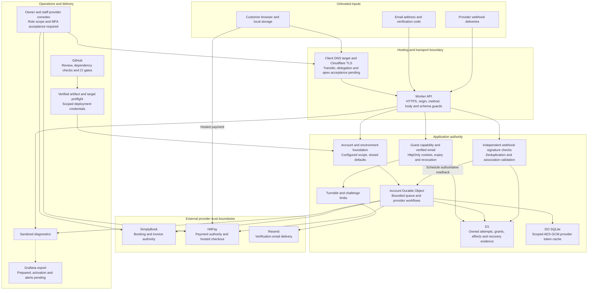

# Security infrastructure

SoccerBot layers Cloudflare’s secure hosting, Turnstile’s bot checks and Resend-delivered email verification with server-enforced access controls. SimplyBook owns booking records and HitPay hosts payment; SoccerBot validates both before confirmation and retains recovery evidence to prevent duplicate transactions. Restricted credentials, protected data storage and GitHub’s dependency checks and verified releases safeguard operations. Planned Grafana monitoring adds failure visibility; client hosting, monitoring and operational safeguards still require acceptance before handover.

## Scope and status

This document explains the security architecture, its trust boundaries, implemented controls, remaining acceptance work and proposed future layers. The diagram shows responsibility and data flow, not permission for every caller or a claim that every deployment is active. A provider response is validated even when it comes from an authenticated provider. A browser return or a signed webhook alone does not establish paid, valid booking state.

Reviewed against the source on 28 October 2026. **Implemented** means a control exists in repository code; **prepared** means configuration or integration exists but operational acceptance is pending; **proposed** means future work. Client production, apex/renewal proof, Grafana activation and several handover controls remain separate from developer deployment and synthetic CI evidence. This is an architecture inventory, not a penetration-test report or compliance certification.

[Business rules](business-rules.md) owns the numbered requirements; [API contracts](api-contracts.md) owns request/response details; [Runbook](runbook.md) owns operational procedures; [Progress](../PROGRESS.md) owns current failures and leave-off; [Journey](journey.md) owns milestone acceptance and history. This document does not duplicate credentials, customer records or recovery codes.

## 1. What is being protected

| Asset / boundary                    | Main threats                                                                | Current protection and limits                                                                                                                                            |
| ----------------------------------- | --------------------------------------------------------------------------- | ------------------------------------------------------------------------------------------------------------------------------------------------------------------------ |
| Customer identity and contact       | Enumeration, stolen access, cross-customer reads, stale replies             | Protected identity before prefill, owned capability/session checks, revocation and response-generation checks; email account security remains external                   |
| Booking and payment effects         | Duplicate creation, forged success, changed price/merchant, late settlement | Durable claims and associations, provider verification, retained uncertainty and recovery; no cross-provider atomic transaction                                          |
| Provider and deployment credentials | Browser exposure, logs/artifact leakage, wrong-account use                  | Server-side bindings, scope checks, redacted diagnostics and target preflight; operator access/rotation still needs operational controls                                 |
| D1/DO state                         | Wrong database, identity substitution, corrupted recovery evidence          | Immutable foundation checks, account-scoped coordination and additive migrations; tested production restore/RPO/RTO remains pending                                      |
| Browser and HTTP entry              | Forged origins, malicious payloads, session theft, XSS                      | HTTPS/origin checks, strict schemas/body limits, HttpOnly cookies and restricted checkout destinations; source review does not establish a full deployed CSP/WAF posture |
| Source and software supply chain    | Compromised dependency/action, malicious PR, unverified deployment          | Pinned dependencies/actions, Dependabot/audit and required verification; green CI cannot prove dependency integrity or detect every vulnerability                        |
| Availability and incident detection | Abuse, provider latency, queue saturation, silent failure                   | Bounded application queues/checking/delivery, diagnostics and synthetic resilience tests; edge rate limits and production alert coverage need separate acceptance        |

Customer browser state, URL parameters, cached catalogue data, contact fields and client-reported roles/prices are untrusted. Trainer/Admin rights in SimplyBook, HitPay and Cloudflare are provider-console permissions; SoccerBot does not implement a custom staff administration API or its own staff role hierarchy.

## 2. DNS, TLS and hosting boundary

**Implemented application controls:** [Worker entry](../worker/index.ts) requires API HTTPS and the configured origin, rejects a conflicting supplied Origin, restricts query forms and dispatches only named routes. Browser mutations require same-origin Origin; signed webhooks use their separate authentication path. Production asset requests also enforce configured origin and allowed methods. [Pages adapter](../worker/pages.ts) has its own forwarding/origin boundary; do not assume both hosting modes share identical deployment behavior.

**Current ownership plan:** activate the destination Cloudflare zone before Registrar transfer, preserving email and DNSSEC coordination; bootstrap the closed Worker before domain hookup. Transfer/delegation are unverified; preserve email records and explicitly assess DNSSEC before nameserver changes. The client bootstrap target is now a closed Worker on its exact Workers.dev origin with previews disabled. The SaaS target remains a supported alternative with its own preflight; no custom domain is activated by this change. Account/zone/fallback/route and resource checks belong to [deployment preflight](../scripts/deploy-cloudflare.mjs), [target validation](../scripts/deployment-target.mjs) and [hosting rules BR-025–027](business-rules.md#client-hosting-setup-prepared-not-deployed). Origin rejection reduces alternate-host entry; it does not replace user authorization or protect an exposed server secret.

**Acceptance still needed:** exact DNS owners, apex support, proxy/CAA settings, trusted hostname coverage, persistent automated certificate validation/renewal prerequisites, availability/expiry alerts and rollback. Record initial issuance separately from actual renewal evidence. Preserve MX, SPF, DKIM, DMARC and unrelated DNS records. Platform features such as managed WAF, DNSSEC, edge rate limiting and bot rules are not claimed enabled merely because Cloudflare hosts the site.

API responses explicitly set no-store, JSON content type, nosniff and no-referrer. A comprehensive static-site CSP, anti-framing policy, Permissions-Policy and HSTS deployment was not established by this source inspection; the CSP in the experiment harness is **test-only**. Inspect actual headers on every intended hostname before adding or claiming browser-hardening controls.

## 3. Customer identity, sessions and abuse controls

[Access](../worker/access.ts) issues the server-owned `__Host-soccerbot-access` capability. It uses Secure, HttpOnly, SameSite=Strict and Path=/; storage binds capability to an owner and enforces expiry/revocation. Browser storage and attempt IDs are not authentication. An invalid old guest cookie cannot inherit the prior owner's attempts.

[Identity](../worker/identity.ts) and [delivery](../worker/identity-delivery.ts) require current access, scoped delivery, normalized email, a bounded challenge and a valid code. Turnstile is checked server-side before permitted email delivery; request/attempt limits and expiry restrict abuse. Codes are stored as keyed hashes rather than plaintext. Resend delivers verification email; it is not the authority for booking or payment confirmation. A successful email challenge establishes access to that mailbox, not a real-world identity or permission to administer the business.

[Remembered identity](../worker/remembered-identity.ts) rotates/restores server-controlled authority within its original lifetime and revocation policy. Current-device sign-out and all-device revocation remain server operations. All-device revocation requires current verified email authority, including permitted remembered restoration; a guest cannot revoke another identity. [Contact profiles](../worker/contact-profile.ts) require current identity, account/origin and consent predicates at the storage boundary. Sign-out revokes access without pretending to delete retained contact records.

[Browser identity service](../src/services/identity.ts) rejects stale/aborted replies and identity-generation mismatches. Cached `current()` state is a UI convenience, not fresh server authority. HttpOnly reduces direct script access to cookie values but does not prevent an XSS payload from acting through an authenticated browser. SameSite/Origin defenses address cross-site request abuse, not same-origin script compromise. See [BR-003–005](business-rules.md#identity-privacy-and-environment-isolation).

## 4. Authorization, validation and environment isolation

[Bindings](../worker/bindings.ts) checks configured account, environment, database and coordinator against the immutable foundation. Protected operations fail closed on missing/mismatched resources; an unknown database is not automatically claimed. Closed-production health can report an empty registration as `pending` only while all customer/provider/email/payment/warming switches are explicitly disabled. It reads the foundation table without writing identity or invoking a coordinator; missing schema and foreign identities still fail. A 200 closed-install health response is not operational readiness. [Policy](../worker/policy.ts) and provider-specific configuration constrain access modes, operation windows, allowed accounts/hosts and credentials. Developer and client staging/production data, provider mappings and secrets must remain separate. SimplyBook credential lookup uses environment-selected DEV/PROD names without fallback; production authentication rejects a company that differs from the reviewed public target mapping. Target digests and artifact validation seal company/service mappings. Secret presence in health does not prove successful authentication. Client sandbox operations additionally require an explicit access switch and matching expected company, service and HitPay merchant/business configuration. Payment scope binds original account, environment, company, key digest and invoice/attempt even when app404 sandbox credentials are intentionally shared. HitPay transport remains sandbox-host-only; no live host is introduced. Production artifact validation rejects CLIENT_SANDBOX_ACCESS=enabled.

[Router](../worker/index.ts), [domain schemas](../src/domain/native-checkout.ts) and operation owners enforce body bounds, strict fields, consent, selected service/instructor/time/player limits and authoritative price/account scope. Server code rechecks ownership and current access for protected reads and writes. A disabled button, valid JSON schema, signed cookie or successful previous request is insufficient by itself. Public display snapshots speed browsing but cannot authorize a booking.

Provider credentials stay on server bindings. Browser build-time values and source repositories must contain only intended public configuration. Some existing identity/sandbox/provider constants still require client portability work; do not remove those guards merely to make client activation pass. [API contracts](api-contracts.md#2-common-http-boundary) documents the exact boundary and explicit unavailable routes.

## 5. Financial integrity and durable recovery

Security includes preventing unauthorized or duplicate financial effects. [Customer authority](../worker/customer-authority.ts), [journal](../worker/journal.ts), [native dispatch](../worker/native-dispatch.ts) and [native checkout](../worker/native-checkout.ts) reserve owned intent/grants/effects before provider writes. Raw observed booking references survive later validation failure. Complete batch membership, invoice/account/currency and total must be valid before payment creation.

[HitPay hold](../worker/hitpay-hold.ts), [payment journal](../worker/hitpay-journal.ts) and [recovery](../worker/hitpay-recovery.ts) bind attempt, merchant, invoice, request ID and amount. Hosted checkout keeps payment entry with HitPay; the website does not collect card details. This design does not by itself establish any particular PCI compliance scope or certification.

Unknown writes retain their original identity and evidence; they are not retried with a new key. Browser closure, expiry, a deleted link or a lost response cannot prove nonpayment. Payment received may remain booking pending until accounting and valid booking readback reconcile. Cancellation is not a refund. [Receipt authorization](../worker/receipt.ts) and [confirmation](../worker/confirmation.ts) protect final success/export from cached browser claims. See [BR-007–013](business-rules.md#checkout-durable-effects-and-customer-errors).

### Receipt refresh boundary

Explicit export requests may refresh stale booking/invoice evidence through the existing coordinator queue. The server enforces owned access, the original checking window, shared check quota, provider account scope, and post-read state/authorization checks. Only known-ID reads are admitted; this path does not create bookings, register payments, reopen financial recovery or extend deadlines. Refreshed evidence authorizes that response only. Saved confirmation remains display evidence, not download authority. See the [receipt contract](api-contracts.md#6-protected-confirmation-receipt-and-recovery).

## 6. Webhook and outbound-provider boundaries

[HitPay webhook](../worker/hitpay-webhook.ts) verifies HMAC-SHA256 over bounded raw request bytes using its configured salt and `Hitpay-Signature`, then binds the event to retained payment scope. [SimplyBook webhook](../worker/webhook.ts) has its own `x-signature` and payload/subscription contract. Do not interchange their signing mechanisms. Both retain/deduplicate evidence; delivery acknowledgement is not confirmation of financial settlement. Recovery reads authoritative provider state.

[Provider transport](../worker/provider-transport.ts), [normalization](../worker/provider-normalization.ts) and payment owners bound operations and validate returned data and destinations. There is no general customer-supplied arbitrary URL proxy. Current sandbox host allowlists must be deliberately adapted and verified for a client merchant; accepting an arbitrary production URL would bypass a security boundary.

Provider credentials and webhook signing secrets have different uses and must be scoped/rotated independently. Authentication protects origin of a request; validation and financial reconciliation still protect its meaning. A compromised provider account or stolen signing secret is a residual risk requiring revocation and incident response.

## 7. Data, token encryption and retention

D1 retains access, identity/contact, attempts, grants and effect/payment/webhook/recovery evidence; public display snapshots are held in Durable Object storage. The [migrations](../migrations) and application ownership checks preserve evidence needed for reconciliation. These records are not anonymous: contact and booking-associated records remain personal or sensitive operational data and require restricted access, retention decisions and secure recovery procedures.

The [provider token cache](../worker/provider-token-cache.ts) encrypts two token families in DO SQLite using AES-GCM with scoped authenticated metadata. Account/environment/credential identity, issuance and original expiry constrain restoration; ciphertext from another scope or invalid metadata is rejected. [Provider session](../worker/provider-session.ts) handles invalidation and replacement without turning cached tokens into customer authority. Do not describe this as application-level encryption of every D1 field: the explicit code-level encryption here covers provider tokens.

No blanket retention/deletion or backup compliance claim is made. Restore capability, retention periods, approved RPO/RTO, encrypted backup access and a real restore drill still need recording for the selected accounts/plans. Financial uncertainty and audit evidence must not be erased by a cleanup job. See the [data lifecycle draft](data-lifecycle.md) for current storage/expiry behavior and pending clause mapping, and the [data recovery runbook](runbook.md#7-data-protection-and-restore) for restoration.

## 8. Availability and denial-of-service resistance

[Provider queue](../worker/provider-queue.ts) bounds active/waiting workflows, waiting lifetime and priority fairness; physical transports are separately bounded. [Checking lifecycle](../src/features/booking/confirmation-checking.ts) and server confirmation enforce original deadlines and shared allowances. Payload readers, identity challenge limits and export limits bound specific work. These are application controls, not a claim of unlimited traffic capacity or comprehensive edge abuse protection.

Cached display reads can bypass queued provider work, while stale snapshots never gain fresh write authority. Provider timeouts release only what their evidence permits; financial effects remain fenced when unknown. Synthetic overload/resilience results prove tested invariants under that workload, not live provider rate limits or sustained production capacity. Use [BR-015](business-rules.md#br-015), [BR-023](business-rules.md#br-023) and the runbook when selecting capacity controls.

## 9. Source, dependencies and deployment supply chain

[Dependabot](../.github/dependabot.yml) proposes weekly version updates and eligible security fixes; [verification](../scripts/verify.mjs) blocks high/critical npm advisories and audit-service errors. Exact lockfiles, pinned Action commits, source/policy checks and tests constrain changes. Developer-repository Dependency graph, alerts and security updates were owner-confirmed; client repository settings need their own verification. Low-severity advisories still need triage. No vulnerability scan proves absence of unknown compromise.

Automatic deployment candidates are first classified by a trusted-main job without Cloudflare credentials. Expected draft/closed/superseded/fork/bot/unprivileged PRs cannot reach deployment; eligible candidates face the same full checks again before account credentials are used. CI browser processes exclude bulk memory from core dumps; this limits postmortem memory visibility but does not suppress crash exit statuses, failed assertions or traces.

Browser shard receipts additionally bind the exact source fingerprint, public release profile, export hashes, repository, run and attempt. Aggregation requires both disjoint shards and the complete reviewed device/case inventory before producing a releasable receipt; shard success alone cannot authorize deployment. No shard/build job receives deployment credentials. These checks prevent accidental evidence substitution; they do not make unreviewed PR code trustworthy.

[Client CI](../.github/workflows/verify-target.yml) separates verification from main deployment; release jobs consume tested artifacts. [Verified-target checks](../scripts/verified-target-run.mjs), [deployment preflight](../scripts/deploy-cloudflare.mjs) and [deployment workflow](../.github/workflows/deploy-release.yml) bind revision, artifact and target. Automatic staging accepts only current open non-draft same-repository PRs from human authors with write permission; bots/forks cannot deploy. Secret-bearing controllers execute trusted-main tooling after verification, never PR scripts. Production accepts only successfully verified current main. Configuration/cutover and client activation remain unverified until executed. Fork/Dependabot changes must not gain production secrets; account-scoped credentials and workflow conditions require review when ownership moves repositories.

GitHub branch protection, required reviews, CODEOWNERS enforcement, CodeQL, secret scanning/push protection, artifact attestations and organization MFA are distinct controls. This document does not claim them configured from the presence of YAML or a clean run. Plan availability and account settings must be checked. [Dependency procedure](runbook.md#3-dependency-maintenance-and-dependabot) owns remediation steps; [versions](versions.md) owns the inventory.

## 10. Observability, operator access and response

[Diagnostics](../worker/diagnostics.ts) expose sanitized correlation/timing/error classifications rather than credentials, customer fields, raw URLs, SQL or arbitrary exceptions. [Telemetry](../worker/telemetry.ts) prepares bounded, sampled OTLP export outside the customer request path. Recognized failures bypass successful-event sampling within limits; best-effort export can still lose evidence. A quiet dashboard is not proof of security or availability.

Central company Grafana is intended; exporter activation, environment/service separation, receiver ingestion, redaction, dashboards and actionable alerts remain acceptance work. Telemetry is not a tamper-proof financial audit log or vulnerability scanner. Use the [signal dictionary](runbook.md#4-monitoring-and-observability) and [incident procedure](runbook.md#5-incident-response-and-recovery) for interpretation and recovery.

Cloudflare, GitHub, Grafana, SimplyBook, Resend and HitPay need named owners, least-privilege roles, MFA, recovery access and offboarding. Their administrative consoles sit outside customer email verification. Complete actual access/billing/MFA arrangements before handover; never place secret values or recovery codes in this repository. For suspected compromise, preserve evidence, identify affected account/environment/revision, contain with authorized credential/access controls, reconcile financial effects and restore a verified state; do not blindly replay payments or delete D1/DO evidence.

## 11. Additional layers to adopt

These are proposals or incomplete acceptance items, **not enabled features**. Review plan support, cost, operational ownership, provider compatibility and rollback before implementation. Priorities are recommendations; owner-approved business/release requirements remain authoritative.

| Priority / layer                                  | Why add or complete it                                          | Proposed approach                                                                                                                                                                  | Acceptance evidence                                                                                                             |
| ------------------------------------------------- | --------------------------------------------------------------- | ---------------------------------------------------------------------------------------------------------------------------------------------------------------------------------- | ------------------------------------------------------------------------------------------------------------------------------- |
| Before client launch: administrative identity     | Limit damage from compromised operator accounts                 | Named accounts, least privilege, MFA/passkeys where supported, reviewed recovery and offboarding; separately scoped CI/API tokens                                                  | Access inventory, role-denial checks, MFA/recovery ownership and tested token revocation                                        |
| Before client launch: TLS/DNS continuity          | Avoid domain takeover/misrouting and expiry outages             | Verify account/zone ownership, supported apex routing, managed renewal with persistent validation, CAA compatibility; assess DNSSEC with the current and destination DNS operators | Trusted cert and redirects on exact hosts, issuance/renewal evidence separately, expiry/availability alerts and DNS rollback    |
| Before client launch: production isolation        | Prevent developer credentials/data being used for customers     | Complete validated production mappings/origins/secrets, immutable foundation and single deployment owner                                                                           | Wrong-account/resource rejection, exact-artifact receipts, closed incomplete config and rollback rehearsal                      |
| Before client launch: operational detection       | Make failures actionable                                        | Activate scoped Grafana ingestion; add agreed availability, auth-abuse, provider-error and recovery-backlog alerts with runbook links                                              | Real ingested sanitized events, alert firing/routing and documented responder; no sample-only health claims                     |
| Before client launch: recoverability/privacy      | Recover from operator mistakes and limit personal-data exposure | Agree retention and RPO/RTO, restricted encrypted backups/exports, restore procedure and lawful deletion handling that preserves required financial evidence                       | Restore drill and owner-approved retention/access records                                                                       |
| Next: browser hardening                           | Reduce XSS, framing and accidental feature access               | Inventory scripts/frames/connect destinations; start CSP report-only, then enforce reviewed policy; anti-framing, Permissions-Policy and HSTS after full HTTPS readiness           | Header inspection on all hosts/routes, Turnstile/payment/export tests, violation review and rollback; no premature HSTS preload |
| Next: edge abuse controls                         | Reduce distributed challenge/API exhaustion                     | Review Cloudflare WAF/bot/rate rules by route; allow signed webhook delivery without weakening its signature checks; keep origin-side limits                                       | Legitimate booking and provider retries pass; synthetic abuse is bounded; false-positive monitoring                             |
| Next: code and secret scanning                    | Detect classes beyond dependency advisories                     | Evaluate CodeQL or equivalent SAST, secret scanning/push protection and dependency-review policies for each repository/plan                                                        | Known safe test fixtures detected, actionable triage, protected secrets and compatible CI                                       |
| Next: build provenance                            | Strengthen artifact and workflow integrity                      | Review minimal permissions, deployment credential scope, reusable workflow trust and supported attestations/SBOM; consider digest pinning for CI images                            | Verified provenance at deployment, rejected mismatched artifact and dependency inventory tied to revision                       |
| Later: independent assurance                      | Find gaps not represented by current tests                      | Threat-model review and scoped penetration testing of identity, authorization, checkout/webhooks and admin access                                                                  | Written findings, fixes and retest tied to deployed revision; no uncontrolled real financial tests                              |
| Later: stronger customer authentication if needed | Reduce reliance on mailbox security for higher-risk features    | Consider step-up/passkeys only if future stored payment/admin or sensitive account features justify the UX/recovery burden                                                         | Agreed threat model, recovery design, accessibility and phishing-resistance evidence                                            |

## 12. Verification and maintenance map

| Control family                         | Evidence owners                                                                                                                                                                              | What must still be proved outside those tests                                                          |
| -------------------------------------- | -------------------------------------------------------------------------------------------------------------------------------------------------------------------------------------------- | ------------------------------------------------------------------------------------------------------ |
| Access, identity, remembered profiles  | [identity tests](../worker/tests/identity.test.mjs), [delivery tests](../worker/tests/identity-delivery.test.mjs), [browser adapter](../src/services/identity.test.ts)                       | Actual sender/bot/domain configuration and owner account journey                                       |
| Binding and environment isolation      | [foundation tests](../worker/tests/foundation.test.mjs), [Pages boundary](../worker/tests/pages.test.mjs), [deployment scripts](../scripts/deploy-cloudflare.mjs)                            | Correct client resources, restricted operator roles and first-install/rollback acceptance              |
| Booking/payment authority and recovery | [native](../worker/tests/native.test.mjs), [combined hold](../worker/tests/combined-hold.test.mjs), [HitPay](../worker/tests/hitpay.test.mjs), [recovery](../worker/tests/recovery.test.mjs) | Live merchant/booking/provider configuration, owner payment journey and retained known-risk acceptance |
| Signatures and replay handling         | [webhook tests](../worker/tests/webhook.test.mjs), [HitPay tests](../worker/tests/hitpay.test.mjs)                                                                                           | Correct provider subscription/secret/delivery and operational reconciliation                           |
| Queue/token/privacy controls           | [queue tests](../worker/tests/provider-queue.test.mjs), [provider tests](../worker/tests/provider.test.mjs), [telemetry tests](../worker/tests/telemetry.test.mjs)                           | Actual sustained load, deployed redaction/ingestion, alert delivery and restoration                    |
| Browser workflows                      | [customer tests](../tests/customer.spec.ts), [experiment tests](../tests/experiment.spec.ts), [UAT](uat/simulated-user.md)                                                                   | Owner/device/provider acceptance; previously failed runs remain evidence                               |

Update this document when a trust boundary, authentication scheme, provider scope, storage policy or deployment path changes. Update the owning rule/API/runbook rather than copying mutable requirements here. Record observed security findings and exact remediation/deployment status in Progress, retain dated decisions in Journey, and never mark a proposed control implemented without source/configuration and acceptance evidence.

Closed-install management authority: `FoundationManagement` is a named service-binding entrypoint, with no public HTTP handler or registration route. A principal able to configure a binding to this entrypoint has registration/initialization authority; treat Worker deployment and remote service-binding credentials accordingly. Caller-supplied identities are checked against the deployed configuration and namespace-derived ID, and all methods fail outside closed production. The operator client independently checks real control-plane bindings and sealed release evidence before calling it. Registration is insert-only and foreign/racing identities are verified rather than overwritten. Do not grant this service binding to untrusted Workers or expose a forwarding endpoint. Production cloud transport/permission acceptance remains pending until explicitly exercised.

Foundation setup through GitHub Actions is manual-only on trusted current main, validates complete current-main gates/artifact before the credentialed step, and uses the existing production token only for the management operation. It shares the production deployment concurrency group. Dispatch input strings enter environment variables or parsed arguments, not executable shell interpolation. Ordinary deployment events do not register or initialize the foundation. The workspace developer token must not be substituted for the client identity.

### Customer-facing error boundary

Account and enquiry UI render only locally authored `CustomerMessageError` guidance or an operation-specific fallback. Unexpected network, JSON/schema and server diagnostic strings are not customer messages. Booking/confirmation adapters retain their fixed error mappings; do not populate approved message types from server response text. This UI boundary does not replace server response redaction, authorization or logging controls. See BR-013 for wording, payment-safety and presentation requirements.

Browser confirmation timing is local-only diagnostic output with allowlisted states, proof-source labels, monotonic times, build revision and a pseudonymous SHA-256 recovery key. It contains no raw attempt/provider IDs, customer details or credentials, and is not accepted as server payment evidence. No telemetry ingestion endpoint or new external destination is introduced.

Invoice document numbers are optional display metadata from validated invoice evidence. They do not grant access, establish payment or replace internal association/financial identities. Confirmation presentation hides internal booking/invoice/attempt IDs; protected DTOs retain existing identifiers for compatibility. WhatsApp opens an owner-approved external contact without embedding a customer name, phone, invoice or access token in its URL, and cannot perform booking mutations. Notification HTML drafts contain unbound placeholders only; recipient isolation, final paid/confirmed triggers and sender authentication require owner validation before enabling.

Customer PDF/calendar generation is retired; the protected receipt API retains its authorization and freshness checks. Confirmed live cards display the validated optional provider invoice number unchanged for owner testing; matching it to the final Pay document remains pending. No prefix substitution or financial-proof change is authorized by the presentation change.
